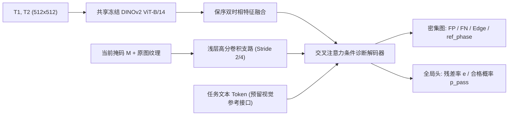

# Verifier V1：任务条件化空间诊断模型训练方案

> **文档状态与本轮授权边界**
> - **定位**：细化 `doc/CURRENT_STATE.md` 中“方向三·第一步（训练空间诊断模型）”的技术落地规范。
> - **首版数据聚焦**：V1 优先在自带双时相语义标注的 **SECOND** 数据集上跑通完整闭环；LEVIR-CD 与 WHU-CD 缺乏原生逐像素双期语义标签的问题暂作保留，待 SECOND 首版验证通过后再讨论扩展方式。
> - **本轮服务器唯一授权**：**仅执行本文第 7 节**（SECOND 纯净训练集核查、小样本真实预测与诊断标签导出、中文静态 HTML 审核页生成）。全量数据生成、模型训练与在线接入均不在本轮执行范围内。

---

## 一、核心设计决策速览

| 决策维度 | V1 方案选型 | 核心理由 |
| --- | --- | --- |
| **首发数据集** | 纯净 **SECOND 官方 train**（剔除历史开发/调参/评测曝光样本） | 原生 $512 \times 512$ 切片免裁窗截断，自带双期 6 类语义真值，天然支持类别、方向、转换与参考时相监督 |
| **初始掩码 $M_{\text{init}}$** | 混合 2 种现成免训练生成器（`SAM3` 跨期分割差 + `SegEarth` 稠密分数差），拒绝人工腐蚀/挖洞 GT | 兼顾“整块目标漏检”与“粗边界粘连/毛刺”两类真实残差，防止模型过拟合单一工具偏差 |
| **样本配比起点** | 70% 常规真实预测 + 20% 同图同 $M$ 切换指令 $Q$（反事实配对） + 10% 自然高分与原样真值锚点 | 逼迫文本条件分支生效，同时教会模型在近完美掩码上“无错不乱改” |
| **网络架构** | 冻结共享 DINOv2 ViT-B/14 + 保序双时相融合 + 原图与 $M$ 浅层高分细节支路 + 文本交叉注意力解码头 | 显存与训练成本可控，高低频特征互补，接口可直接扩展支持后续视觉参考（$T_3$） |
| **诊断输出** | 误检图 $P_{\text{FP}}$、全图漏检图 $P_{\text{FN}}$、边缘残差图 $P_{\text{edge}}$、建议参考时相 $P_{\text{phase}}$、质量分 | 只输出空间错误线索与修复指引，不黑盒覆盖原掩码，修改执行权归还 Planner |
| **待议保留项** | 纯二值变化数据集（LEVIR-CD / WHU-CD）如何接入方向与时相监督 | 留待 SECOND 首版离线效果确认后，再讨论采用损失屏蔽还是伪标签方案 |

---

## 二、问题形式化与诊断标签定义

### 2.1 模型输入与输出接口

记双时相光学影像对为 $(T_1, T_2)$，当前待审二值变化掩码为 $M \in \{0, 1\}^{H \times W}$，任务文本指令为 $Q$，对应任务下的真实变化掩码为 $G_Q \in \{0, 1\}^{H \times W}$。空间诊断模型定义为：

$$
D_\theta(T_1, T_2, M, Q) \to \left(P_{\text{FP}},\; P_{\text{FN}},\; P_{\text{edge}},\; P_{\text{phase}},\; \hat{e},\; p_{\text{pass}}\right)
$$

模型在推理时仅读取 $(T_1, T_2, M, Q)$，不接收任何真值统计、任务类别 ID 旁路或生成器名称。

### 2.2 SECOND 任务真值编译规则

SECOND 官方包含 6 类地物（非植被地表、树木、低矮植被、水体、建筑、运动场）。令 $C$ 为官方已标注的变化区域掩码，$L_1, L_2$ 为前后两期语义标签：

1. **与类别 $c$ 相关的全部变化**：$G_{\text{related}(c)} = C \cap [(L_1 = c) \lor (L_2 = c)]$（保留同类地物内部的真实翻新/改建变化，不能简单用 $L_1 \neq L_2$ 替代 $C$）；
2. **类别 $c$ 转入（如新建建筑）**：$G_{\text{into}(c)} = C \cap (L_1 \neq c) \cap (L_2 = c)$；
3. **类别 $c$ 转出（如拆除建筑）**：$G_{\text{outof}(c)} = C \cap (L_1 = c) \cap (L_2 \neq c)$；
4. **显式语义转换（$a \to b$）**：$G_{a \to b} = C \cap (L_1 = a) \cap (L_2 = b)$。

模型文本端直接输入规范英文短句（保留中文描述供人工审核页展示），每类任务准备少量等义句式模板：
- `related(building)`："Changes involving buildings."（与建筑相关的变化）
- `into(building)`："Areas that changed into buildings from another land-cover class."（新增/转入的建筑）
- `outof(building)`："Areas where buildings were removed or changed into another class."（拆除/转出的建筑）
- `tree_to_building`："Areas that changed from trees to buildings."（树木变为建筑）

### 2.3 误检（FP）、漏检（FN）与边缘残差（Edge）标签

1. **基础错漏标签**：
   $$
   Y_{\text{FP}} = M \cap (\neg G_Q), \qquad Y_{\text{FN}} = (\neg M) \cap G_Q
   $$
   其中 $Y_{\text{FP}}$ 天然包含“物理上未发生地物变化”的伪变化，以及**虽属真实变化（落在 $C$ 内）但不符合当前指令 $Q$** 的任务外干扰变化；$Y_{\text{FN}}$ 在全图 $\neg M$ 范围内定义，模型必须具备全图漏检搜索能力。

2. **非互斥边缘残差标签（$Y_{\text{edge}}$）**：
   边缘缺陷是错漏像素在已命中目标边界附近的几何子集，**允许与 $Y_{\text{FP}}$ 或 $Y_{\text{FN}}$ 重叠**（不做三类互斥分类）：
   - 先求连通域交集匹配：记 $S_M$ 为与 $G_Q$ 存在像素交集的 $M$ 连通域并集，$S_G$ 为与 $M$ 存在像素交集的 $G_Q$ 连通域并集，已匹配目标的错漏像素为 $E_{\text{matched}} = (Y_{\text{FP}} \cap S_M) \cup (Y_{\text{FN}} \cap S_G)$；
   - 取距离 $\partial M \cup \partial G_Q$ 不超过 $r$ 像素（原生 $512 \times 512$ 分辨率下默认 $r = 2$，小试时同步对比 $r \in \{1, 2, 4\}$）的窄带交集：
     $$
     Y_{\text{edge}} = E_{\text{matched}} \cap \operatorname{Band}_r(\partial M \cup \partial G_Q)
     $$
   - **设计优势**：整栋完全漏检的小建筑因无交集不会误归入 Edge（保留为纯 FN），孤立假目标保留为纯 FP，而掩码粘连、边界膨胀/欠分割及内部小孔洞则精准落入 $Y_{\text{edge}}$；当 $M = G_Q$ 时，$Y_{\text{edge}}$ 全零。

### 2.4 动作导向的“建议参考时相”（`ref_phase`）

验证器标注 $T_1 / T_2$ 的目的**不是追溯上游工具在哪一期犯了错**，而是面向下游修复动作，告诉 Planner **“该去哪一期影像上提取目标的清晰物理轮廓”**（例如建筑拆除后在 $T_2$ 已变为无边界裸地，必须指引 Planner 回 $T_1$ 分割原建筑轮廓）。

仅在需要重提轮廓或修边的误差区域（$Y_{\text{FN}} \cup Y_{\text{edge}}$）监督三分类标签 `ref_phase` $\in \{\text{t1}, \text{t2}, \text{both}\}$（纯孤立 FP 只需直接剔除，不计入时相损失）：

| SECOND 像素级真实语义关系 | `ref_phase` 标签 | 下游修复含义 |
| --- | --- | --- |
| $L_1 = c \land L_2 \neq c$（目标类别在后时相消失，如拆除） | `t1` | 目标实体轮廓存在于前时相 $T_1$，建议回 $T_1$ 分割取证 |
| $L_1 \neq c \land L_2 = c$（目标类别在后时相出现，如新建） | `t2` | 目标实体轮廓存在于后时相 $T_2$，建议去 $T_2$ 分割取证 |
| 显式 $a \to b$ 转换，或同类内部改建 $(L_1 = c \land L_2 = c)$ | `both` | 前后两期均承载目标地物边界，需双期联合比对或求差 |

> **关键防作弊检验**：若只看 `into(c)` 或 `outof(c)`，模型仅靠读取文本里的动词就能猜出全图统一标 `t2` 或 `t1`。离线评测必须重点考核 **`related(c)`（如“找出所有建筑相关变化”）且同图同时存在新建与拆除** 的样本，验证模型能否对新建漏检块标 `t2`、对拆除漏检块标 `t1`。

### 2.5 全局残差负担与通过标签

SECOND 原生切片即为完整 $512 \times 512$ 窗口，直接计算全图残差率：

$$
e = \frac{|Y_{\text{FP}} \cup Y_{\text{FN}}|}{\max(1,\; |M \cup G_Q|)}
$$

当 $M$ 与 $G_Q$ 均为空时记 $e = 0$。定义当前掩码合格标签 $y_{\text{pass}} = 1$ 当且仅当：$e \le 0.05$，且不存在面积 $\ge 16$ 像素的独立漏检连通域或独立误检连通域（具体面积阈值在小试肉眼审核后冻结）。

---

## 三、纯净数据隔离与 $M_{\text{init}}$ 生成协议

### 3.1 防泄露隔离与内部划分

1. **剔除全部历史曝光样本**：从 SECOND 官方 `train` 划分中，严格剔除此前在 Agent 开发、调参、确认（如 `dev60`、`tune`、`confirm` 及 $T_5$ 审核样本）和评测中出现过的全部图像 ID，并核查像素哈希确保无重命名副本流入。
2. **三段式内部源图划分**：对核查干净的 SECOND 训练源图按固定随机种子划分为 `fit`（80%，用于模型训练与首轮抽样审核）、`val`（10%，用于选 checkpoint 与定阈值）、`offline_eval`（10%，冻结协议后的独立离线测试）。同一对源图派生的所有任务 $Q$ 与候选掩码 $M$ 必须留在同一划分内。

### 3.2 两种互补真实生成器与配对采样

生成 $M_{\text{init}}$ 的函数严禁读取 $G_Q$。V1 固定采用以下两类免大模型真实预测器：
1. **单轮 `SAM3` 跨期分割差分**：按目标类别词分别分割 $T_1, T_2$ 后做集合差（转入取 $M_2 \setminus M_1$，转出取 $M_1 \setminus M_2$，相关变化取对称差或并集差分），主要提供整栋漏检、类别混淆等对象级残差；
2. **`SegEarth` 稠密语义分数差**：基于固定类别词表的双期语义概率变化阈值化得到粗掩码，主要提供边界粘连、轮廓膨胀与细碎伪变化残差。
3. **跨源泛化预留**：若仓库内早期 `ovcd_v0` 现成可跑且底层不与上述输出完全同源，可留作 `offline_eval` 阶段的未见生成器测试。

**训练记录抽样结构**：
- **常规真实残差（约 70%）**：两类生成器在合法任务上的原始预测结果（涵盖低、中、高不同初始 IoU，不挑高分样本）；
- **同图同 $M$ 跨指令反事实配对（约 20%）**：锁死同一对图像 $(T_1, T_2)$ 与同一个非空候选掩码 $M$，将指令从 $Q_a$ 切换为同图真实存在差异的合法指令 $Q_b$（满足 $G_{Q_a} \triangle G_{Q_b} \neq \varnothing$，例如同一张含新建与拆除的粗掩码分别搭配 `related(building)`、`into(building)`、`outof(building)`），强制模型学习任务条件响应；
- **高分与零误差锚点（约 10%）**：约 5% 自然高分预测掩码 + 约 5% 原样 $G_Q$ 输入（此时 $Y_{\text{FP}}, Y_{\text{FN}}, Y_{\text{edge}}$ 全空），抑制模型对合格掩码产生幻觉误报。

---

## 四、轻量条件化空间诊断网络架构



1. **冻结双时相视觉骨干**：复用共享权重的冻结 DINOv2 ViT-B/14 分别提取 $T_1, T_2$ 多层中间特征（输入内部 pad 至 $518 \times 518$ 适配 patch size 14，输出裁回 $512 \times 512$）。
2. **保序时相融合**：在各特征层拼接方向敏感表征并线性投影至 $256$ 维，保留“出现”与“消失”的非对称性：
   $$
   Z_l = \operatorname{Proj}_l\left([F_{1,l},\; F_{2,l},\; F_{2,l} - F_{1,l},\; |F_{2,l} - F_{1,l}|]\right)
   $$
3. **高分辨率掩码与边缘细节支路**：用轻量可训练浅层卷积直接编码原生分辨率的 $[T_1, T_2, M, \partial M]$，提供 stride $2/4$ 的清晰物理边缘与当前候选状态特征，弥补 ViT patch 下采样的边界模糊。
4. **可扩展条件交互模块**：使用冻结文本编码器提取词级特征并投影至 $256$ 维，通过 Cross-Attention 注入融合特征与解码器。条件容器预留可选的 `reference_tokens` 槽位，后续接入 $T_3$ 视觉参考时只需将参考图块经 Mask Pooling 映射为同维度 token 即可无缝拼接。
5. **物理支持域约束输出头**：
   - 误检概率：$P_{\text{FP}} = M \cdot \sigma(z_{\text{FP}})$（仅在当前掩码内激活）；
   - 漏检概率：$P_{\text{FN}} = (1 - M) \cdot \sigma(z_{\text{FN}})$（在掩码外全图激活）；
   - 边缘残差：$P_{\text{edge}} = \sigma(z_{\text{edge}})$（独立 Sigmoid，正确边界处监督为 $0$）；
   - 参考时相：$P_{\text{phase}} = \operatorname{Softmax}(z_{\text{phase}})$（三通道对应 `t1 / t2 / both`）；
   - 全局质量头：池化解码特征与预测误差面积占比，回归 $\hat{e}$ 与二分类概率 $p_{\text{pass}}$。

推理完成后，由外层脚本对概率图做阈值连通域提取，按置信度排序输出 Top-$K$（如 $K \le 5$）结构化错误区域列表（含错误类型、`bbox`、中心提示点及 `ref_phase`）交给 Verifier Agent。

---

## 五、损失函数与训练配置

### 5.1 组合损失函数

$$
\mathcal{L} = \mathcal{L}_{\text{FP/FN}} + 0.5\,\mathcal{L}_{\text{edge}} + 0.2\,\mathcal{L}_{\text{phase}} + 0.2\,\mathcal{L}_{\text{quality}} + 0.2\,\mathcal{L}_{Q}
$$

- **$\mathcal{L}_{\text{FP/FN}}$ 与 $\mathcal{L}_{\text{edge}}$**：在各自有效支持域内计算带正类权重上限（如 $\le 5$）的 BCE Loss，并对非空目标叠加 $0.5 \times \text{Soft Dice Loss}$（目标全空时仅算负例 BCE，防止零误差锚点梯度异常）。
- **$\mathcal{L}_{\text{phase}}$**：仅在真实错漏需取证像素 $(Y_{\text{FN}} \cup Y_{\text{edge}})$ 上计算三分类交叉熵，其余背景像素屏蔽损失。
- **$\mathcal{L}_{\text{quality}}$**：$\operatorname{BCE}(p_{\text{pass}}, y_{\text{pass}}) + 0.5\,\operatorname{SmoothL1}(\hat{e}, e)$。
- **反事实差分一致性约束 $\mathcal{L}_Q$**：对同图同 $M$ 的配对指令 $(Q_a, Q_b)$，记净残差预测 $\hat{R}_Q = P_{\text{FN}, Q} - P_{\text{FP}, Q}$，在任务真值差异区 $K = G_{Q_a} \triangle G_{Q_b}$ 上约束预测随指令同步翻转，并抑制非差异区乱动：
  $$
  \mathcal{L}_Q = \operatorname{mean}_{K}\operatorname{SmoothL1}\!\left((\hat{R}_{Q_a} - \hat{R}_{Q_b}) - (G_{Q_a} - G_{Q_b})\right) + 0.1\operatorname{mean}_{\neg K}|\hat{R}_{Q_a} - \hat{R}_{Q_b}|
  $$

### 5.2 训练超参与作业规范（供后续获批训练阶段使用）

- **基础配置**：原生 $512 \times 512$ 输入；同步随机翻转、$90^\circ$ 旋转；时相交换增强仅在同时反转指令方向（`into` $\leftrightarrow$ `outof`、$a \to b \leftrightarrow b \to a$）与 `t1/t2` 标签时启用。AdamW 优化器（解码头学习率 $10^{-4}$，weight decay $0.01$），bf16 混合精度，有效批大小约 $16$，$50$ epochs。
- **训评原子绑定**：后续提交正式 Slurm 训练作业时，脚本内必须串联“训练 $\to$ 保存最优权重（按 `val` 上 FP/FN 宏平均 AUPRC 选取） $\to$ 自动跑完 `offline_eval` 离线评测出表”，正式长跑前先用 1–2 个 batch 做冒烟验证。

---

## 六、离线独立评测与必做对照

在接入双 Agent 闭环前，先在冻结的 `offline_eval` 集上完成独立验收：

### 6.1 核心评测指标
1. **像素与对象错漏定位**：$P_{\text{FP}}$（$M$ 内）、$P_{\text{FN}}$（$\neg M$ 内，单列**整栋完全漏检目标召回率**）及 $P_{\text{edge}}$ 的 AUPRC 与 F1；固定建议数 $K \in \{1, 3, 5\}$ 下的区域级 Precision@K 与 Recall@K。
2. **指令切换敏感度**：在同图同 $M$ 不同 $Q$ 配对样本上，真值差异区 $K$ 内的残差符号翻转准确率。
3. **局部参考时相准确率**：在 `related(c)` 同图混有新增与拆除的样本上，检验 `ref_phase` 的空间分类 Macro-F1（对比“仅读文本规则猜时相”基线）。
4. **高分掩码低误报率**：在自然高分掩码与原样 $G_Q$ 零误差控制组上的不必要返工率与误定位率。

### 6.2 三组核心离线对照（检验算法独立贡献）
因为数学上 $Y_{\text{FN}} - Y_{\text{FP}} = G_Q - M$，必须排除“仅仅把普通分割器换了个输出名字”的质疑，固定相同训练数据与骨干对比：
1. **零样本 VLM 核验基线**：对比项目现有冻结 `ask`（及 $16 \times 16$ 网格定位提示下）的错漏检出效率与开销；
2. **同骨干条件变化分割求差**：不输入 $M$，直接训练预测 $\hat{G}_Q$ 后计算 $M(1 - \hat{G}_Q)$ 与 $(1 - M)\hat{G}_Q$；
3. **同骨干条件掩码精修求差**：同样输入 $(T_1, T_2, M, Q)$ 直接预测精修掩码 $\hat{G}_Q$ 后与 $M$ 求差，验证显式错漏分解头与反事实配对训练是否比黑盒精修提供更可靠的诊断校准与低误报特性。

> **后续演进备选**：若离线定位已达标但需进一步拉大与普通精修网络的算法代差，下一阶段可在少量训练样本上真实调用 Planner 原子修复工具，基于修复前后的实际 $\Delta F_1$ 训练“区域修复动作预期收益”排序头（不在 V1 首轮开展）。

---

## 七、本轮服务器首单任务（仅做 SECOND 小试与 HTML 审核）

### 7.1 执行范围与硬性停机点
1. **核查 SECOND 纯净训练池**：核对本地 SECOND 官方 `train` 划分，从当前有效配置与任务清单中排查并剔除全部历史已曝光图像 ID（不盲目递归扫描未授权旧日志目录），输出 `split_audit.json` 记录官方总数、排除数与最终可用纯净源图数。
2. **小样本候选与诊断标签导出**：从纯净池抽取 **24–30 对源图**，复用现成 `SAM3` 跨期分割差与 `SegEarth` 稠密分数差导出共 **100–150 条** 诊断样本，覆盖 `related`、`into`、`outof`、$a \to b$ 四类指令、同图同 $M$ 换 $Q$ 配对以及少量原样 $G_Q$ 锚点。
3. **自动集合不变量质检（`label_qc.json`）**：自动校验每条记录满足 $Y_{\text{FP}} \subseteq M$、$Y_{\text{FN}} \subseteq \neg M$、$(M \setminus Y_{\text{FP}}) \cup Y_{\text{FN}} = G_Q$、$Y_{\text{edge}} \subseteq Y_{\text{FP}} \cup Y_{\text{FN}}$、零误差锚点三图全空、且保留 SECOND 同类内部真实变化。
4. **生成中文静态视觉审核页**：输出至 `results/verifier_v1_pilot/<run_id>/audit.html`（使用同目录相对路径图片，无外部依赖），支持按任务类型、生成器、同 $M$ 换 $Q$ 配对过滤，每条样本清晰展示：
   - $T_1$、$T_2$、中英文任务指令、初始掩码 $M$、任务真值 $G_Q$；
   - 误检（红）、漏检（青）、边缘残差（黄，支持切换对比 $r = 1/2/4$）叠加图层；
   - **参考时相 `ref_phase` 可视化图层**（用醒目颜色区分需参考 `t1`、`t2` 与 `both` 的漏检/修边区域，重点展示同图既有出现又有消失的案例）；
   - 初始 IoU、各通道像素面积及可复制的 `sample_id`。
5. **停机汇报**：生成审核页与 QC 清单后保持 `pending_review` 状态立即停机，按 `AGENTS.md` 输出不超过 25 行的中文事实简报。**严禁在本轮编写训练网络、跑全量生成或接入在线 Agent。**

### 7.2 可直接发送给服务器的唤醒提示词

```text
在协作分支开展 Verifier V1 首轮数据小试。请先检查实际分支、HEAD、工作树与运行作业，读取根目录 `AGENTS.md`、`doc/CURRENT_STATE.md` 与 `doc/VERIFIER_V1_TRAINING_PLAN.md`，本轮严格只执行 `VERIFIER_V1_TRAINING_PLAN.md` 第 7 节。

核心要求：
1. 首轮仅在 SECOND 数据集上开展：核查官方 train 并剔除全部历史开发/调参/评测曝光过的图像 ID，输出 `split_audit.json`。
2. 抽取 24–30 对纯净 SECOND 源图，复用现成 SAM3 跨期分割差与 SegEarth 稠密分数差生成真实 M_init（严禁人工腐蚀/扰动 GT，含少量原样 GT 锚点），导出 100–150 条包含 FP、FN、Edge（对比 r=1/2/4）及动作导向参考时相 `ref_phase`（t1/t2/both）的诊断样本，重点构造“同图同 M 切换指令 Q”配对与“同图混有新增和拆除的局部时相指引”案例。
3. 完成集合不变量自动 QC（`label_qc.json`），并生成静态自包含中文视觉审核页 `results/verifier_v1_pilot/<run_id>/audit.html`（相对路径配图，下载即看）。

可按需派生两个 `gpt-6.1-sol / high` Subagent 分别负责数据导出/QC 与静态审核页制作；涉及 GPU 推理统一走 Slurm。审核页与清单就绪后立即停机，按 `AGENTS.md` 输出 ≤25 行中文简报，严禁提前写模型、跑全量数据或启动训练。
```

---

## 八、核心参考文献

1. **SECOND Dataset**：Yang et al., *Asymmetric Siamese Networks for Semantic Change Detection in Aerial Images*, IEEE TGRS 2022.
2. **PseudoClick**：Liu et al., *PseudoClick: Interactive Image Segmentation with Click Imitation*, ECCV 2022.（显式预测 FP/FN 错误热力图原型）
3. **Referring Change Detection**：Korkmaz et al., *Referring Change Detection in Remote Sensing Imagery*, WACV 2026.（语言约束变化检测任务参考）
4. **SegEarth-OV**：Li et al., *Towards Training-Free Open-Vocabulary Segmentation for Remote Sensing Images*, CVPR 2025.
5. **DINOv2**：Oquab et al., *DINOv2: Learning Robust Visual Features without Supervision*, TMLR 2024.
6. **LISA & SegRefiner**：Lai et al. (CVPR 2024) / Meng et al. (NeurIPS 2023).（多模态特征注入与粗掩码残差合成对照参考）