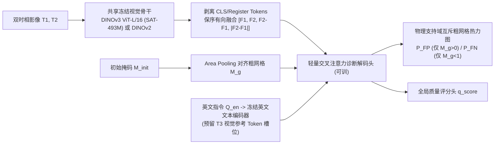

# Verifier V1：任务条件化空间诊断模型训练方案（定型训练版）

> **文档状态与当前阶段边界**
> - **定位**：细化 `doc/CURRENT_STATE.md` 中“方向三·第一步（训练空间诊断模型）”的定型数据规范与模型训练落地指南。
> - **数据管线状态（已封版）**：已完成纯净官方 `train` 划分下 **LEVIR-CD、WHU-CD**（刚体建筑锚点）与**四清晰类裁剪版 SECOND**（多类、有向与反事实样本）的清洗与生成定型；淘汰早期简版手搓预测器，锁定 **DynamicEarth M-C-I + OmniOVCD + ReA-OVCD** 三梯队免训练开放词汇管线，产出并通过人工验收 **276 条开发集样本**。
> - **监督与输出极简化**：彻底移除 `Edge` 边缘通道、暂缓 `ref_phase` 时相分支，且 **V1 首版不引入细粒度漏检归因分类头**（交由下游 Planner 结合热力图高亮区自行看图判别），聚焦训透空间定义域严格互斥的 **`FP + FN` 双通道粗网格热力图**与**全局质量分**。
> - **当前训练推进节奏（两阶段落地）**：
>   1. **阶段一（当前执行：276 条小集训练冒烟与链路调通）**：先在已验收的 276 条开发样本上按源图（`source_id`）严格隔离切分临时 `fit / val`，跑通冻结视觉骨干 + 轻量诊断头的训练、可视化导出与反事实翻转验证，确认架构与损失无误；
>   2. **阶段二（冻结评测集与扩量正式训练）**：将上述 276 条对应源图整包冻结为独立开发评测基准，复用完全相同的封版数据管线在其余未曝光纯净 `train` 源图池上扩量构建正式训练集（目标首期约 600～1,000 对独立底图、展开约 3,000～4,000 条样本），执行训评一体闭环。

---

## 一、核心设计决策速览

| 决策维度 | V1 定型选型 | 核心理由 |
| --- | --- | --- |
| **训练数据源与分期使用** | 纯净官方 `train`：**LEVIR-CD + WHU-CD + 裁剪版 SECOND**（276 条已审样本先做训练冒烟，随后冻结为评测集并另行扩量训练集） | 用 LEVIR/WHU 的清晰刚体建筑锚定几何定位，配合 SECOND 提供多类、有向与反事实监督；新旧源图按 `source_id` 严格隔离防泄漏 |
| **脏类裁剪与文本规范** | 独立任务仅保留 **建筑、水体、运动场、树木** 四类清晰目标（剔除独立非植被地表/低矮植被及二者互转）；**内部纯英文指令**，剥离一切工具名前缀 | 根除模糊背景类与主观折线标注切碎实体目标的噪声，仅在有清晰目标参与的 `transition` 中保留背景类转换，防止文本注意力被工具名稀释 |
| **初始掩码 $M_{\text{init}}$（已封版）** | 锁定三套成熟免训练开放词汇方法：**DynamicEarth M-C-I + OmniOVCD + ReA-OVCD**，基于模型自身双期语义导出四类任务，严禁接触 GT 修剪 | 三套方法在 `SECOND` 与建筑库上天然形成“低中 → 中段 → 中高”三级真实质量梯队，彻底替代早期高空掩码率的手搓 `SAM3 / SegEarth` 简版策略 |
| **诊断输出降维** | **空间互斥双通道粗网格热力图**（$M$ 内误检 $P_{\text{FP}}$、$\neg M$ 内漏检 $P_{\text{FN}}$）+ 全局质量分；**删除 `Edge`、暂缓 `ref_phase`、V1 不设漏检归因头** | 阻断沿 $M$ 外轮廓描边骗分的形态学捷径，规避 `LEVIR-CD` 缺少单期语义真值导致的归因标签不一致，先以最简结构跑通空间指错闭环 |
| **网络架构减负** | 共享冻结视觉骨干（优先推荐卫星预训练 **DINOv3 ViT-L/16 (`SAT-493M`)**，兼容 **DINOv2** 对照）+ 保序时相差分融合 + 池化掩码先验 + **冻结英文文本编码器**交叉注意力解码头 | 卫星预训练 DINOv3 与高分遥感地物同域，且 `16×16` Patch 在 `512×512` 输入下天然对齐 `32×32` 整数粗网格；取消高分浅层卷积旁路杜绝边缘作弊 |

---

## 二、问题形式化、任务清洗与诊断标签定义

### 2.1 模型输入与双通道互斥输出接口

记双时相光学影像对为 $(T_1, T_2)$，当前待审二值变化掩码为 $M \in \{0, 1\}^{H \times W}$，自然英文任务指令为 $Q_{\text{en}}$，对应任务下的清洗后真实变化掩码为 $G_{\text{clean}} \in \{0, 1\}^{H \times W}$。空间诊断模型定义为：

$$D_\theta(T_1, T_2, M, Q_{\text{en}}) \to \left(P_{\text{FP}},\; P_{\text{FN}},\; [\hat{q}_{\text{score}}]\right)$$

- **严格输入隔离**：模型训练与推理时仅读取 $(T_1, T_2, M, Q_{\text{en}})$，不接收任何真值统计、结构化类别 ID 旁路或生成器名称（生成器标识如 `rea_ovcd` / `omni_ovcd` / `dynamicearth_mci` / `gt_anchor` 仅记录于独立元数据字段 `generator`，严禁拼入 $Q_{\text{en}}$ 或中文审核文本 $Q_{\text{zh}}$）。
- **空间定义域互斥的双通道粗网格热力图**（输出张量形状为 `[B, 2, H_g, W_g]`，默认直接工作在骨干特征网格分辨率，如 `32×32`；是否经轻量上采样由配置指定）：
  1. **通道 0（误检热力图 $P_{\text{FP}}$）**：仅在当前掩码支持域（网格内存在 $M = 1$ 有效像素，即 $M_g > 0$）内有效。下游推理时按 $M$ 的各个连通域聚合热力均值即可得到**组件级误检置信度**，供 Planner 结合工具剔除假变化或方向反例。
  2. **通道 1（漏检热力图 $P_{\text{FN}}$）**：仅在掩码外部背景域（网格内存在 $M = 0$ 有效像素，即 $M_g < 1$）内有效。下游推理时对高响应热力团做阈值分割与外接框/峰值提取，生成供 Planner 局部重审或重分割的**候选漏检区域**。
  3. **全局质量评分头 $\hat{q}_{\text{score}}$**：基于解码特征与预测错漏激活统计，输出当前掩码的整体质量估计分（拟合有效域 `IoU` 或合格概率，作为闭环是否停止返工的全局判据）。

### 2.2 多数据集任务编译与 SECOND 脏数据清洗规则

#### （1）LEVIR-CD 与 WHU-CD 任务映射
两套二值建筑变化数据集直接映射为建筑类的无向相关变化任务 `related(building)`（涵盖新建、拆除与改扩建），并对 `WHU-CD` 过滤原始变化像素过小的边缘残片样本。

#### （2）SECOND 语义任务编译与三项硬性净水规则
令 $C$ 为 SECOND 官方有效变化掩码，$L_1, L_2$ 为前后两期语义真值标签，保留四类语义任务：
1. `related(c)`：$G_{\text{related}(c)} = C \cap [(L_1 = c) \lor (L_2 = c)]$；
2. `into(c)`：$G_{\text{into}(c)} = C \cap (L_1 \neq c) \cap (L_2 = c)$；
3. `outof(c)`：$G_{\text{outof}(c)} = C \cap (L_1 = c) \cap (L_2 \neq c)$；
4. `transition(a, b)`：$G_{a \to b} = C \cap (L_1 = a) \cap (L_2 = b)$。

执行以下**三项类别与几何清洗规则**：
- **规则 A（锁定四类清晰主体类别）**：独立生成 `related / into / outof` 任务时，仅允许物理轮廓明确的目标类——**`building`（建筑）、`water`（水体）、`playground`（运动场）、`tree`（树木）**。
- **规则 B（禁绝兜底模糊类独立成题）**：**彻底禁止**以 `non-vegetated ground surface`（非植被地表）或单独的 `low vegetation`（低矮植被）生成独立的 `related / into / outof` 任务。
- **规则 C（剔除模糊互转与切碎实体的伪转换）**：**禁止** `low_vegetation` $\leftrightarrow$ `non-vegetated ground surface` 互转；允许非植被地表/低矮植被作为一端与上述四类清晰地物构成 `transition`（如“非植被地表 → 运动场”），但若某连通变化实体因另一时相底图混杂裸土与杂草而被切碎（不满足实体覆盖率 `transition_coverage` 或碎块数上限），则过滤该条 `transition`，改由完整的 `into / outof` 承载监督。

#### （3）中英分离的自然指令模板
模型端统一采样无工具前缀的自然英文指令 `prompt_en`，中文 `prompt_zh` 仅用于审核页展示：
- `related(building)`：`"Find all changes involving buildings."` / `"涉及建筑的变化"`
- `into(building)`：`"Identify newly constructed buildings."` / `"新增或转入建筑的区域"`
- `outof(building)`：`"Locate demolished or removed buildings."` / `"拆除或转出建筑的区域"`
- `transition(tree, building)`：`"Find areas that changed from trees to buildings."` / `"由树木变为建筑的区域"`

### 2.3 错漏标签导出、几何毛刺清洗与完备忽略掩码（`ignore_mask`）

1. **真值碎斑清理与防假阳性守恒铁律**：
   对原始任务真值 $G_{\text{raw}}$ 中面积小于 $A_{\min}$（如 `16 px`）的孤立标注碎斑清理得到 $G_{\text{clean}}$。**被清理的真值像素 $(G_{\text{raw}} \setminus G_{\text{clean}})$ 必须严格并入 `ignore_mask`**，严禁直接置为背景 `0`（否则正确检出该处的 $M_{\text{init}}$ 会被冤枉成假阳性 `FP`）。

2. **原始互斥错漏与四重 `ignore_mask` 屏蔽**：
   由清洗后真值计算 $Y_{\text{FP}}^{\text{raw}} = M \cap (\neg G_{\text{clean}})$、$Y_{\text{FN}}^{\text{raw}} = (\neg M) \cap G_{\text{clean}}$，并将以下四类区域统一并入不计损失的 `ignore_mask`（同时从最终 `FP / FN` 标签中扣除）：
   - **清理真值碎斑与极小预测碎点**：$G_{\text{raw}} \setminus G_{\text{clean}}$，以及 $Y_{\text{FP}}^{\text{raw}} / Y_{\text{FN}}^{\text{raw}}$ 中面积小于 $A_{\min}$ 的孤立碎斑；
   - **匹配目标边界容差带**：围绕 $M$ 与 $G_{\text{clean}}$ 已发生交集匹配的物体轮廓生成半径 $r_{\text{ign}}$（如 `2 px`）的空心容差环，完整保留未匹配独立误检块与独立漏检块主体；
   - **高分辨率建筑屋檐细长条毛刺（针对 `WHU-CD` 等 0.2m 影像）**：针对高分航拍屋檐/排水沟投影偏移产生的“宽仅 1～3 像素、长数十像素（面积 $\ge A_{\min}$）”贴边细长条，通过几何厚度/形态学开运算判别或自适应容差将其并入 `ignore_mask`，同时确保绝不误删 `LEVIR-CD` 等数据集中的紧凑独立小型住宅或配房；
   - **有效域外配准黑边**：自动检测 $T_1$ 或 $T_2$ 中贴近图像四边的纯黑无数据连通域（影像旋转配准黑角），并入 `ignore_mask`。

---

## 三、定型初始掩码管线、防泄露隔离与扩量采样协议

### 3.1 定型三梯队免训练开放词汇生成器（已锁版）
生成 $M_{\text{init}}$ 全程严禁使用 $G_Q$ 修剪，亦不引入有监督专有模型（规避 `train` 集自测过拟合与跨集切分负担），统一锁定以下三套成熟免训练开放词汇变化检测（OVCD）配置：

1. **DynamicEarth M-C-I（低中质量档，提供候选块级错漏多样性）**：
   - 流程：`SAM` 提取类别无关候选块 → `DINO / DINOv2` 跨期特征相似度判别变化 → `SegEarth-OV` 双期特征池化分类。
   - 锁版细节：严格采用原论文**候选块级池化分类**（禁止改为逐像素分类），`512×512` 输入下将提示点网格等密度适配为 `16×16`（对齐原 `256×256` 下的 `8×8` 密度），不开启低置信前景强行补齐。
2. **OmniOVCD（稳健中段档，提供实例解耦边界与中段残差）**：
   - 流程：基于冻结 `SAM 3` 融合语义头、实例头与存在性头构建单期掩码，经跨期实例解耦匹配生成变化掩码。
   - 锁版细节：在导出有向与转换任务时，**仅在已检出原变化域内开启“置零背景 `0` 补齐为最高响应前景类”**（修复单类独立阈值截断阻断 `transition` 匹配的问题），其余区域保持原预测不变。
3. **ReA-OVCD（中高质量档主力，提供高可靠双期多类语义结果）**：
   - 流程：基于冻结 `SAM 3` 提取双期 6 类联合语义分布，结合语义分布散度推理（SCR）与边界内部支撑度连通域过滤（BCR）。
   - 锁版细节：**保持不补齐的原生双期语义组合版本**（保留多类竞争对背景噪声的天然抑制，避免额外误检）。

- **四类任务的无泄露布尔导出**：统一由各方法自身预测的变化域 $\hat{B}$ 与双期类别 $(\hat{Y}_1, \hat{Y}_2)$ 导出 `related(c)`（$\hat{Y}_1=c \lor \hat{Y}_2=c$）、`into(c)`（$\hat{Y}_2=c \land \hat{Y}_1\neq c$）、`outof(c)`（$\hat{Y}_1=c \land \hat{Y}_2\neq c$）与 `transition(a, b)`（$\hat{Y}_1=a \land \hat{Y}_2=b$）。
- **生成器质量统计双口径**：汇报 $M_{\text{init}}$ 本身质量时，须拆开**常规样本**与**反事实样本**，并同时记录**单样本算术平均 `Macro IoU`** 与**全库累计像素 `Global IoU`**（$\sum \text{TP} / \sum (\text{TP}+\text{FP}+\text{FN})$），确保与原论文评测口径对齐可比。

### 3.2 防泄露隔离、反事实配对与全量扩增分桶规则
1. **源图级原子隔离**：严格排除历史开发/调参/评测曝光过的图像 ID；一切内部划分（`fit / val / offline_eval`）均以**独立源图对 `source_id`** 为原子单位，确保同一源图的所有任务指令、不同生成器输出及反事实配对严格留在同一集合内。
2. **反事实配对与空掩码过滤**：
   - 锁死同一源图与同一非空 $M_{\text{init}}$，切换真值存在显著差异的合法英文指令 $Q_a \neq Q_b$（满足 $\vert{}G_{Q_a} \triangle G_{Q_b}\vert{} \ge A_{\text{cf}}$，约占总样本 `15%～20%`）；
   - **硬性约束**：构造反事实分组（`same_m_group`）时**必须跳过全黑空掩码（`mask_area == 0`）**，严禁将不同任务的全零掩码聚合成伪反事实组。
3. **正式训练集扩增分桶留存建议（阶段二扩量时应用）**：
   将已验收的 276 条样本冻结为评测集后，在其余纯净 `train` 源图池上跑出候选池并做分桶限额留存（不改动单张掩码像素）：
   - 控制低分大错档（`IoU < 0.3`）占比在约 `30%` 以内，其中**全黑空掩码严格压在 `5%` 以内**；
   - 优先全留天然落入 **`[0.3, 0.9)`** 的中段过渡与局部精修样本（目标合占约 `50%`，重点保障 `into / outof / transition` 有足够局部残差正例）；
   - 配置约 **`10%～15%` 的自然高分与原样 $G_{\text{clean}}$ 零误差锚点**（锚点 `FP/FN` 全空），配合约 `3%～5%` 空真值兜底负样本，校准模型的合格分上限与停止判据。

---

## 四、轻量条件化空间诊断网络架构（Verifier V1）

1. **共享冻结双时相视觉骨干**：
   - 优先选用遥感卫星影像预训练的冻结 **DINOv3 ViT-L/16 (`SAT-493M`)**（保留 **DINOv2** 作为可配置切换选项）。在 `512×512` 输入下，Patch 16 直接得到规整的 **`32×32` 整数空间网格**（若用 Patch 14 的 DINOv2，则按配置缩放至 14 的整数倍如 `518×518` 得到 `37×37` 网格）。
   - **Token 重塑规范**：前向提取最后一层（或多层拼接）特征时，必须先剥离序列头部的非空间 Token（如 `1 个 CLS Token + 4 个 Register Tokens`），仅将空间 Patch Tokens 重塑为 $F_1, F_2 \in \mathbb{R}^{C_v \times H_g \times W_g}$。
2. **保序方向敏感时相融合**：
   在粗网格上显式拼接有向差分 $F_2 - F_1$（保留“新建转入”与“拆除转出”的不对称方向信息）与幅值差分 $|F_2 - F_1|$，经 `1×1 Conv + GroupNorm/LayerNorm + GELU` 投影至隐藏维度 $d$（如 `256`）：
   $$
   Z = \operatorname{Proj}\left([F_1,\; F_2,\; F_2 - F_1,\; |F_2 - F_1|]\right)
   $$
3. **无捷径粗网格掩码先验注入**：
   对二值 $M_{\text{init}}$ 按网格窗口做均值池化（Area Pooling），得到网格前景覆盖率 $M_g \in [0, 1]^{1 \times H_g \times W_g}$，经轻量投影后融入 $Z$。**取消一切读取原图高频纹理或 $\partial M_{\text{init}}$ 轮廓的浅层高分辨率卷积支路**，从物理结构上杜绝沿掩码边缘描边作弊。
4. **冻结英文文本编码与条件交叉注意力解码**：
   使用冻结英文文本编码器（如 CLIP / SigLIP Text Encoder）提取 $Q_{\text{en}}$ 的词级特征序列并线性投影至维度 $d$，经 2～4 层轻量解码块（空间 Self-Attention / ConvNeXt 块 + Text Cross-Attention + FFN）交互更新网格特征。条件序列预留可选的 `reference_tokens` 槽位以便后续无缝扩展 $T_3$ 视觉参考任务。
5. **物理支持域隔离的双通道头与全局评分头**：
   - 空间头输出双通道粗网格 logits $(z_{\text{FP}}, z_{\text{FN}}) \in \mathbb{R}^{2 \times H_g \times W_g}$，推理时结合网格掩码硬门控输出：$P_{\text{FP}} = \sigma(z_{\text{FP}}) \cdot \mathbb{I}(M_g > 0)$，$P_{\text{FN}} = \sigma(z_{\text{FN}}) \cdot \mathbb{I}(M_g < 1)$；
   - 全局质量头融合解码全局池化向量、文本句向量及预测错漏响应统计，经轻量 MLP 输出预测质量分 $\hat{q}_{\text{score}} \in [0, 1]$。

---

## 五、粗网格软标签下采样、损失函数与训练规范

### 5.1 结合 `ignore_mask` 的粗网格软标签下采样（Area Pooling）
为在粗网格（如 `16×16` 像素对应 1 个格点）上无损保留小目标并精确屏蔽容差带与黑边，对每个网格单元 $g$ 按像素集合统计软目标：
1. 记网格 $g$ 内未被忽略的有效像素集为 $V_g = \{x \in g \mid \text{ignore\_mask}(x) = 0\}$，有效占比 $\omega_g = |V_g| / |g|$。当 $\omega_g < \tau_{\text{valid}}$（可配阈值，如 `0.2`，即该格点绝大部分处于黑边或忽略带内）时，令网格有效标记 $W_{\text{valid}}(g) = 0$，不计入空间损失。
2. 对 $W_{\text{valid}}(g) = 1$ 的有效网格，分别在各自物理支持域的有效像素上定义软标签：
   - **误检支持域 $\Omega_{\text{FP}}$**：满足 $|V_g \cap \{M = 1\}| > 0$ 的有效网格，其软目标为 $y_{\text{FP}}(g) = \frac{|V_g \cap Y_{\text{FP}}|}{|V_g \cap \{M = 1\}|} \in [0, 1]$；
   - **漏检支持域 $\Omega_{\text{FN}}$**：满足 $|V_g \cap \{M = 0\}| > 0$ 的有效网格，其软目标为 $y_{\text{FN}}(g) = \frac{|V_g \cap Y_{\text{FN}}|}{|V_g \cap \{M = 0\}|} \in [0, 1]$。

### 5.2 支持域隔离组合损失与成对采样策略
总训练损失由四项可配置加权组成：
$$
\mathcal{L} = \mathcal{L}_{\text{FP}} + \lambda_{\text{FN}}\,\mathcal{L}_{\text{FN}} + \lambda_{\text{qual}}\,\mathcal{L}_{\text{quality}} + \lambda_Q\,\mathcal{L}_Q
$$

- **互斥空间损失 $\mathcal{L}_{\text{FP}}, \mathcal{L}_{\text{FN}}$**：分别严格限制在 $\Omega_{\text{FP}}$ 与 $\Omega_{\text{FN}}$ 网格子集上计算带正负类平衡的软标签二元分类损失（加权 BCE 或软目标 Focal Loss）+ **Soft Dice Loss**；当单条样本的 $y_{\text{FP}}$ 或 $y_{\text{FN}}$ 全零（如零误差锚点）时自动关闭该样本的 Dice 项、仅保留负例抑制项，保证梯度稳定。
- **全局质量回归损失 $\mathcal{L}_{\text{quality}}$**：采用 `Smooth L1 Loss` 监督 $\hat{q}_{\text{score}}$ 拟合当前样本在有效域内的真实质量分（如有效域 `IoU`）。
- **反事实成对采样与一致性约束 $\mathcal{L}_Q$**：
  - 训练 Sampler 尽量将同一 `same_m_group` 下的配对指令 $(Q_a, Q_b)$ 采入同一 mini-batch；
  - 对配对样本施加轻量排序与差分翻转约束：在真值差异有效网格上约束净残差预测 $\hat{R}_Q = P_{\text{FN}, Q} - P_{\text{FP}, Q}$ 随指令切换同步翻转，且真实匹配度更高一侧的 $\hat{q}_{\text{score}}$ 保持正向裕度。
- **优化与数据增强红线**：
  - 冻结视觉骨干与文本编码器，仅采用 `AdamW`（基础学习率约 `1e-4`，Cosine 退火，配合轻量 Weight Decay）更新投影层、解码器与输出头；
  - 支持对 $(T_1, T_2, M, Y_{\text{FP}}, Y_{\text{FN}}, \text{ignore\_mask})$ 同步执行随机水平/垂直翻转与 $90^\circ$ 倍数旋转；**禁止对有向任务（`into / outof / transition`）在不改写英文指令方向的前提下单独调换 $(T_1, T_2)$ 顺序**。

---

## 六、离线验收指标与两阶段训练执行规范

### 6.1 核心离线验收指标
离线评估聚焦验证器向 Planner 提供空间纠偏线索与停机信号的有效性：
1. **组件级误检识别力（FP Component AUPRC / F1）**：在 $M_{\text{init}}$ 各连通组件内池化 $P_{\text{FP}}$ 均值，评估区分“真变化目标块”与“背景误检/错向块”的准确率。
2. **背景漏检定位命中率（FN Region Recall@$K$ / Grid AUPRC）**：对 $P_{\text{FN}}$ 提取前 $K$ 个高响应连通团，统计其命中真实独立漏检目标连通域的召回率。
3. **跨指令反事实翻转准确率（CF Flip Accuracy & Score Margin）**：在同图同非空 $M_{\text{init}}$ 切换指令 $(Q_a, Q_b)$ 的配对样本上，统计差异区主导错误通道正确翻转的比例及质量分差值。
4. **零误差与高分锚点低误报率（Anchor False Alarm Rate）**：在原样 $G_{\text{clean}}$ 锚点与高分样本上，统计错误输出高置信热力峰值或低合格分的误报比例。

### 6.2 两阶段训练落地流程
1. **第一阶段（当前执行：276 条开发集训练试车）**：
   - 将已验收的 276 条开发样本按 `source_id` 切分为临时 `fit / val`（保证同源图及反事实组绝不跨划分拆分）；
   - 先用 1～2 个 batch 跑通前向、软标签池化与反向传播冒烟检查，随后跑完 20～30 epoch 轻量训练并导出验证集热力图对比页，确认：Loss 正常下降、无沿掩码外轮廓整圈描边、反事实配对能随英文指令翻转、零误差锚点热力图保持低响应。
2. **第二阶段（扩量正式训练与闭环验证）**：
   - 将上述 276 条样本整包冻结为固定的 `offline_eval` 评测集；
   - 使用封版的三路生成器（`DynamicEarth M-C-I + OmniOVCD 前景补齐 + ReA-OVCD`）与清洗管线，在其余未曝光纯净 `train` 源图池上按 3.2 节分桶留存规则扩充约 3,000～4,000 条训练样本（内部按 `source_id` 切分 `fit / val`）；
   - 单次训练作业原子化串联 **`fit 训练 -> 按 val 选优保存权重 -> 自动在冻结评测集上输出四大核心指标表与失败案例页`**，通过离线验收后接入 CD-Agent 双闭环实测二轮修复增益。

---

## 七、参考基线备忘

- **初始掩码三梯队基线**：DynamicEarth (`M-C-I`, AAAI 2026)、OmniOVCD (`SAM 3` SFID, 2026)、ReA-OVCD (`SAM 3` SCR+BCR, 2026)。
- **视觉骨干与数据基准**：DINOv3 (`ViT-L/16 SAT-493M`, Meta 2025) / DINOv2 (TMLR 2024)；LEVIR-CD、WHU-CD、SECOND。