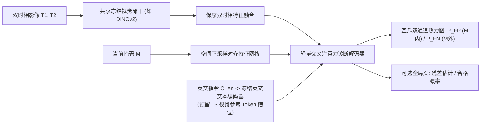

# Verifier V1：任务条件化空间诊断模型训练方案（修订版）

> **文档状态与本轮授权边界**
> - **定位**：细化 `doc/CURRENT_STATE.md` 中“方向三·第一步（训练空间诊断模型）”的技术落地规范。
> - **数据与监督降维**：V1 联合使用纯净官方 `train` 划分下的 **LEVIR-CD、WHU-CD**（提供边界清晰的刚体建筑锚点）与**清洗后的 SECOND**（提供多类、方向及反事实指令样本）；**果断砍掉 `Edge` 边缘预测通道并暂缓 `ref_phase` 时相分支**，聚焦训练空间定义域互斥的 **`FP + FN` 双通道错漏热力图**。
> - **语言与超参原则**：模型内部严格输入**自然英文任务短句**（中文描述仅用于人工 HTML 审核与元数据展示，严禁混入上游工具名称）；输入缩放尺寸、特征网格步长、滤波面积、忽略带宽度及损失权重等均作为**可配置超参数**管理，不在规范中硬编码锁死。
> - **本轮服务器唯一授权**：**仅执行本文第 7 节**（三数据集纯净训练集核查、SECOND 脏类别剔除与多源小样本修复导出、中文静态 HTML 审核页重生成）。全量数据生成、模型训练与在线接入均不在本轮执行范围内。

---

## 一、核心设计决策速览

| 决策维度 | V1 修订选型 | 核心理由 |
| --- | --- | --- |
| **训练数据源** | 纯净官方 `train`：**LEVIR-CD + WHU-CD + 清洗版 SECOND**（严格剔除历史开发/调参/评测曝光样本） | 用 LEVIR/WHU 的清晰刚体建筑锚定几何判别底座，配合清洗后的 SECOND 提供类别、方向与同图换词监督 |
| **脏类裁剪与文本规范** | 剔除 SECOND 高歧义兜底类独立任务与切碎实体的转换任务；**内部纯英文指令**，剥离一切工具名前缀 | 根除“非植被地表/低矮植被”人工折线把完整新建建筑切成锯齿残片的噪声，防止文本注意力被工具名稀释 |
| **初始掩码 $M_{\text{init}}$** | 混合现成免训练真实预测器（如 `SAM3` 跨期分割差、`SegEarth` 稠密分数差、`ovcd_v0`），拒绝人工腐蚀 GT | 覆盖整块漏检、类别/方向混淆与粗预测粘连等真实残差，配合同图换指令配对与零误差锚点防过拟合 |
| **诊断输出降维** | **空间互斥双通道热力图**（$M$ 内误检 $P_{\text{FP}}$、$\neg M$ 内漏检 $P_{\text{FN}}$）+ 可选全局质量分；**删除 `Edge`，暂缓 `ref_phase`** | 彻底阻断模型沿 $M$ 轮廓描边骗分的形态学捷径，规避模糊地表上时相自动归因噪声，降低 V1 收敛难度 |
| **网络架构减负** | 冻结共享双时相视觉骨干（如 DINOv2）+ 保序时相融合 + 池化掩码先验 + **冻结英文文本编码器**交叉注意力解码头 | **移除原图与掩码高分卷积细节支路**，从物理结构上杜绝高频轮廓作弊，显存开销更低且接口兼容后续 $T_3$ |

---

## 二、问题形式化、任务清洗与诊断标签定义

### 2.1 模型输入与双通道互斥输出接口

记双时相光学影像对为 $(T_1, T_2)$，当前待审二值变化掩码为 $M \in \{0, 1\}^{H \times W}$，自然英文任务指令为 $Q_{\text{en}}$，对应任务下的真实变化掩码为 $G_Q \in \{0, 1\}^{H \times W}$。空间诊断模型定义为：

$$
D_\theta(T_1, T_2, M, Q_{\text{en}}) \to \left(P_{\text{FP}},\; P_{\text{FN}},\; [\hat{e},\; p_{\text{pass}}]\right)
$$

- **严格输入隔离**：模型推理与训练时仅读取 $(T_1, T_2, M, Q_{\text{en}})$，不接收任何真值统计、结构化类别 ID 旁路或生成器名称（生成器来源如 `SAM3` / `SegEarth` 仅记录于独立元数据字段，严禁拼入 $Q_{\text{en}}$ 或中文审核文本 $Q_{\text{zh}}$）。
- **空间定义域互斥的双通道热力图**（输出张量形状为 `[B, 2, H_out, W_out]`，空间分辨率由骨干网格步长与解码上采样配置决定）：
  1. **通道 0（误检热力图 $P_{\text{FP}}$）**：仅在当前掩码支持域（对齐网格后的 $M > 0$ 区域）内有效。下游推理时直接按 $M$ 的各个连通域聚合均值，即可获得干净的**组件级误检置信度**，供 Planner 结合 `inspect` / `remove_region` 剔除假变化。
  2. **通道 1（漏检热力图 $P_{\text{FN}}$）**：仅在掩码外部背景域（$M = 0$ 区域）内有效。下游推理时对高响应热力团做阈值分割与外接框/峰值点提取，即可生成供 Planner 调用 `view` 或局部重分割的**候选漏检区域**，无需额外训练复杂矩形框回归头。
  3. **可选全局质量头**：基于解码特征与预测错漏占比输出估计残差率 $\hat{e}$ 与合格概率 $p_{\text{pass}}$（是否在首轮损失中启用设为可配置开关）。

### 2.2 多数据集任务编译与 SECOND 脏数据清洗规则

#### （1）LEVIR-CD 与 WHU-CD 任务映射
两套二值建筑变化数据集具有高对比度刚体边界，其官方变化真值直接映射为建筑类的无向相关变化任务 `related(building)`（涵盖新建、拆除与改扩建）。

#### （2）SECOND 语义任务编译与三项硬性净水规则
令 $C$ 为 SECOND 官方有效变化掩码，$L_1, L_2$ 为前后两期语义标签。保留四类基础语义逻辑：
1. `related(c)`：$G_{\text{related}(c)} = C \cap [(L_1 = c) \lor (L_2 = c)]$（保留同类地物内部真实改建变化）；
2. `into(c)`：$G_{\text{into}(c)} = C \cap (L_1 \neq c) \cap (L_2 = c)$；
3. `outof(c)`：$G_{\text{outof}(c)} = C \cap (L_1 = c) \cap (L_2 \neq c)$；
4. `transition(a, b)`：$G_{a \to b} = C \cap (L_1 = a) \cap (L_2 = b)$。

针对 SECOND 中模糊地表类导致真值破碎的问题，执行以下**三项类别与几何清洗规则**：
- **规则 A（锁定清晰主体类别）**：独立生成 `related / into / outof` 任务时，仅允许物理轮廓相对明确的类别作为目标类——优先保留 **`building`（建筑）、`water`（水体）、`playground`（运动场）、`tree`（树木）**（视样本分布也可将 `tree` 与 `low_vegetation` 合并为广义 `vegetation` 植被类测试，禁止单独拆分细碎荒草）。
- **规则 B（禁绝兜底模糊类独立成题）**：**彻底禁止**以 `non-vegetated ground surface`（非植被地表）或单独的 `low vegetation`（低矮植被）作为独立目标生成 `related / into / outof` 任务。
- **规则 C（剔除腰斩完整实体的伪转换任务）**：**禁止** `low_vegetation` $\leftrightarrow$ `non-vegetated ground surface` 互转任务；对于涉及刚体目标的 `transition(a, b)`，若某连通变化实体（如 $T_2$ 新建的一整栋完整厂房）仅因另一时相底图混杂了裸土与杂草而被 $L_1 = a$ 切割成残缺锯齿条带（即 $G_{a \to b}$ 在该变化连通域内仅占局部碎块且边界横穿实体内部），应过滤该条 `transition` 记录，改由完整的 `into(building)` 或 `outof(building)` 承载监督。

#### （3）中英分离的自然指令模板
模型端统一采样自然、多样化的英文表达（避免单一死板句式），中文端仅生成无工具前缀的自然审阅说明：
- `related(building)`：
  - `prompt_en`: `"Find all changes involving buildings."` / `"Changes related to buildings."`
  - `prompt_zh`: `"找出所有与建筑相关的变化"`
- `into(building)`：
  - `prompt_en`: `"Identify newly constructed buildings."` / `"Areas that changed into buildings."`
  - `prompt_zh`: `"找出新建或转入的建筑区域"`
- `outof(building)`：
  - `prompt_en`: `"Locate demolished or removed buildings."` / `"Areas where buildings were removed or changed into other land cover."`
  - `prompt_zh`: `"找出拆除或转出的建筑区域"`
- `transition(tree, building)`：
  - `prompt_en`: `"Find areas that changed from trees to buildings."`
  - `prompt_zh`: `"找出由树木变为建筑的区域"`

### 2.3 错漏标签导出、碎斑过滤与边界梯度忽略带

1. **原始互斥错漏集合**：
   $$
   Y_{\text{FP}}^{\text{raw}} = M \cap (\neg G_Q), \qquad Y_{\text{FN}}^{\text{raw}} = (\neg M) \cap G_Q
   $$
   其中 $Y_{\text{FP}}^{\text{raw}}$ 同时覆盖“未发生物理变化的假阳性”与“虽发生真实变化但不符合当前指令 $Q_{\text{en}}$ 的任务外干扰变化”。

2. **极小碎斑过滤与边界容差忽略带（`ignore_mask`）**：
   鉴于人工多边形标注与基础分割工具（如 `SAM3`）在物体边缘天然存在数像素的轮廓贴合差异，直接逐像素强监督边界残差会迫使模型拟合标注噪声：
   - **极小连通域过滤**：对 $G_Q$、$Y_{\text{FP}}^{\text{raw}}$ 与 $Y_{\text{FN}}^{\text{raw}}$ 中面积小于可配置阈值 $A_{\min}$ 的细碎孤立噪点，不作为正例目标学习，直接并入损失忽略掩码 `ignore_mask`。
   - **匹配边界容差忽略带**：在 $M$ 与 $G_Q$ 已发生交集匹配的物体轮廓附近（或沿 $\partial G_Q \cup \partial M$ 窄带），设置可配置半径 $r_{\text{ign}}$ 的形态学容差带并标记进 `ignore_mask`（注意保留完全漏检的独立目标主体与完全误检的独立假目标主体不被吞噬）。训练计算损失时对 `ignore_mask` 覆盖区域屏蔽梯度。

---

## 三、防泄露数据隔离与多源采样协议

### 3.1 三数据集防泄露核查与内部划分
1. **严格排除历史曝光样本**：分别核查本地 **SECOND、LEVIR-CD、WHU-CD** 的官方 `train` 划分（对于大幅面数据集如 WHU-CD，优先复用仓库标准训练切片口径），剔除此前在 Agent 开发、调参、确认（如 `dev60`、`tune`、`confirm` 及 $T_5$ 审核页）和评测中实际使用过的全部图像/切片 ID（仅排除有真实实验记录或缓存的曝光列表，无需纠结未实际产物的历史空头登记表）。
2. **源图级内部三划分**：将核查干净的训练源图按场景/原图分组划分为 `fit`、`val`、`offline_eval`（具体比例由配置指定），确保同一源图切出的所有子窗、不同指令 $Q_{\text{en}}$ 及不同生成器 $M_{\text{init}}$ 严格留在同一划分内。

### 3.2 真实生成器组合与样本配比结构
生成 $M_{\text{init}}$ 的流程严禁接触 $G_Q$，混合使用仓库现成免大模型粗预测器（如不同阈值的单轮 `SAM3` 跨期分割差、`SegEarth` 稠密语义概率差及可用的 `ovcd_v0` 粗管线），使训练集自然覆盖“整栋漏检”、“类别/方向混淆误检”与“粗边界粘连”三类真实缺陷。

整体采样由两组**可配置配比权重**控制：
- **跨数据集均衡采样**：平衡“LEVIR-CD + WHU-CD 刚体建筑样本”与“清洗后 SECOND 多类及有向约束样本”的采样权重，防止模糊地物主导梯度或单一建筑词导致文本分支退化。
- **三类功能样本混合**：
  1. **常规真实预测残差**（主体部分）：各生成器在合法任务上的原始预测结果；
  2. **同图同 $M$ 跨指令反事实配对**（重点由 SECOND 提供）：锁死同一对图像 $(T_1, T_2)$ 与同一非空候选掩码 $M$，切换两条真值存在显著差异的合法英文指令 $Q_a \neq Q_b$（满足 $|G_{Q_a} \triangle G_{Q_b}| \ge A_{\text{cf}}$），迫使模型依赖文本交叉注意力翻转 `FP / FN` 响应；
  3. **高分与零误差锚点**（控制比例）：混入自然高分预测与原样 $G_Q$ 输入（此时 $Y_{\text{FP}}, Y_{\text{FN}}$ 全空），抑制模型对优质掩码产生幻觉误报。

---

## 四、轻量条件化空间诊断网络架构

1. **共享冻结双时相视觉骨干**：采用共享权重的冻结视觉基础模型（如 DINOv2 ViT）分别提取 $T_1, T_2$ 的块级特征表示（输入缩放尺寸与提取层索引通过配置设定，适配骨干 patch 步长）。
2. **保序方向敏感融合**：在特征网格上拼接保序差分表征并线性投影至隐藏维度 $d$，显式保留“新增出现”与“拆除消失”的时序非对称性：
   $$
   Z = \operatorname{Proj}\left([F_1,\; F_2,\; F_2 - F_1,\; |F_2 - F_1|]\right)
   $$
3. **无捷径掩码状态注入**：直接通过平均池化/插值将待审二值掩码 $M$ 对齐至骨干特征网格分辨率，经轻量投影后与双时相融合特征结合。**刻意取消读取原图与 $\partial M$ 的高分辨率浅层卷积支路**，从结构上根除模型记忆边缘高频锯齿走捷径的风险。
4. **冻结英文文本编码与可扩展条件交互**：使用与视觉空间对齐或通用语义强的**冻结英文文本编码器**（如 CLIP / RemoteCLIP / SigLIP 文本塔）提取 $Q_{\text{en}}$ 的词级/句级嵌入并投影至维度 $d$，经若干层轻量 Cross-Attention 与空间交互层解码。条件序列接口预留可选的 `reference_tokens` 槽位，以便后续 V2 无缝拼入 $T_3$ 视觉参考区域的 Mask Pooling 原型特征。
5. **物理支持域隔离的双通道输出头**：
   - 将解码器特征映射为双通道 logits $(z_{\text{FP}}, z_{\text{FN}})$（可直接工作在粗特征网格或经轻量上采样输出，由配置决定）；
   - 结合对齐至同分辨率的掩码权重 $M_g \in [0, 1]$，严格在各自定义域内评估与输出激活响应（$P_{\text{FP}}$ 聚焦掩码覆盖区，$P_{\text{FN}}$ 聚焦掩码外背景区）。

---

## 五、损失函数与训练作业规范

### 5.1 支持域隔离的组合损失

将有效监督域记为剔除 `ignore_mask`（及图像无效黑边域）后的像素/网格集合 $\Omega_{\text{valid}}$，定义主损失：

$$
\mathcal{L} = \mathcal{L}_{\text{FP}} + \lambda_{\text{FN}}\,\mathcal{L}_{\text{FN}} + \lambda_Q\,\mathcal{L}_Q + \lambda_{\text{qual}}\,\mathcal{L}_{\text{quality}}
$$

- **$\mathcal{L}_{\text{FP}}$（仅在 $\Omega_{\text{valid}} \cap \{M > 0\}$ 上计算）** 与 **$\mathcal{L}_{\text{FN}}$（仅在 $\Omega_{\text{valid}} \cap \{M = 0\}$ 上计算）**：采用带类别不平衡调节的二元分类损失（如 Focal Loss 或带正类权重上限的 BCE Loss），并在当前样本目标非空时叠加可配置权重的 $\text{Soft Dice Loss}$；当目标全空（如零误差锚点）时自动仅计算负例分类项，保证梯度平稳。
- **反事实差分一致性约束 $\mathcal{L}_Q$（可选配对正则）**：对同图同 $M$ 的配对英文指令 $(Q_a, Q_b)$，在真值差异有效区 $(G_{Q_a} \triangle G_{Q_b}) \cap \Omega_{\text{valid}}$ 上约束净残差预测 $\hat{R}_Q = P_{\text{FN}, Q} - P_{\text{FP}, Q}$ 随指令同步翻转，并抑制非差异区波动。
- **超参解耦管理**：所有损失系数（$\lambda_{\text{FN}}, \lambda_Q, \lambda_{\text{qual}}$）、Focal/正类权重、学习率、批大小、训练轮数及几何增强（同步翻转、旋转，以及同步翻转 `into` $\leftrightarrow$ `outof` 文本方向的时相交换增强）统一由训练配置文件暴露，不在文档中硬性锁死。

### 5.2 训评一体作业铁律（供后续获批训练阶段执行）
正式启动模型训练时，单次 Slurm 脚本必须原子化串联 **`训练 -> 按 val 指标保存最优权重 -> 自动运行 offline_eval 离线评测出表`**；提交正式长作业前必须先用 1 至 2 个 batch 跑通全链路冒烟测试。

---

## 六、区域级离线验收指标与核心对照

鉴于验证器的核心职责是为 Planner 提供**可操作的空间错漏定位**而非逐像素描边，离线验收以区域/组件级指标为主：

1. **$M_{\text{init}}$ 连通域级误检识别（FP Component F1 / AUPRC）**：将 $P_{\text{FP}}$ 在 $M_{\text{init}}$ 各连通组件内池化打分，评估其区分“真目标组件”与“假变化/任务不符组件”的准确率。
2. **背景漏检热力定位命中率（FN Region Recall@$K$ / Precision@$K$）**：对 $P_{\text{FN}}$ 提取前 $K$ 个高响应候选团/外接框，检验其对真实漏检连通组件（特别是整栋完全漏检建筑/目标）的中心命中率与覆盖召回率。
3. **跨指令反事实翻转准确率**：在同图同 $M$ 切换英文指令 $(Q_a, Q_b)$ 的配对集上，统计真值差异区内的错漏判别翻转正确率。
4. **零误差/高分掩码低误报率**：在原样 $G_Q$ 与高 IoU 锚点样本上，统计被错误触发高置信返工建议的误报比例。
5. **公平对照基线**：在相同 `offline_eval` 划分上对比（a）现有零样本 VLM `ask` 核验、（b）同骨干不读 $M$ 的条件变化分割事后求差、（c）同骨干输入 $(T_1, T_2, M, Q_{\text{en}})$ 黑盒输出精修掩码事后求差。

---

## 七、本轮服务器执行任务：数据清洗修复与多源 HTML 视觉重审

### 7.1 本轮修复范围与硬性停机点
针对首轮 SECOND 小试暴露的“`Edge` 全轮廓描边捷径、模糊地表切碎建筑真值、中文指令混入 `SAM3 分割的` 前缀、缺少刚体建筑数据集对照”四大问题，本轮仅做数据管线修复与审核页更新：

1. **三数据集纯净池核查（`split_audit.json`）**：核查本地 **LEVIR-CD、WHU-CD、SECOND** 的官方 `train` 划分，排除仓库内已有实际开发/调参/确认记录的曝光图像 ID，汇总各数据集可用纯净训练样本规模。
2. **诊断样本清洗与重导出**：
   - **彻底移除** `Edge` 通道与 `ref_phase` 通道的导出及可视化；
   - **修复任务文本**：模型输入字段 `prompt_en` 严格使用自然英文短句，审核展示字段 `prompt_zh` 严格使用自然中文描述，将 `SAM3 / SegEarth / ovcd_v0` 等来源移入独立字段 `generator`，**严禁在任何指令文本中出现工具名前缀**；
   - **执行 SECOND 脏类裁剪**：按 2.2 节规则剔除 `非植被地表` 与独立 `低矮植被` 任务，剔除 `低矮植被` $\leftrightarrow$ `非植被地表` 及把单个完整变化实体腰斩成锯齿碎条的 `transition` 任务；
   - **联合抽样导出小试集**：从纯净 **LEVIR-CD、WHU-CD**（建筑 `related`）与**清洗后 SECOND**（覆盖清洗后的 `related / into / outof / transition`、同图同 $M$ 换指令反事实对、少量原样 $G_Q$ 零误差锚点）中联合抽取代表性小试样本，复用真实免训练生成器产出 $M_{\text{init}}$；
   - **可配置碎斑过滤与边界忽略带**：通过脚本可配参数过滤极小碎斑并生成边界容差 `ignore_mask`。
3. **集合不变量自动质检（`label_qc.json`）**：校验每条样本满足 $Y_{\text{FP}} \subseteq M$、$Y_{\text{FN}} \subseteq \neg M$、无任何被禁脏类别或 `"SAM3"` 指令前缀残留、反事实配对真值确实存在非空差异、零误差锚点 `FP/FN` 全空。
4. **重新生成中文静态视觉审核页**：输出至 `results/verifier_v1_pilot/<run_id>/audit.html`（同目录相对路径图片，本地浏览器直接打开无外部依赖），支持按数据集（`LEVIR / WHU / SECOND`）、任务类型、生成器、反事实配对筛选，每条记录清晰展示：
   - $T_1$、$T_2$、干净的 `prompt_zh` 与 `prompt_en`、独立的 `generator` 标签 badge；
   - 初始掩码 $M_{\text{init}}$、清洗后任务真值 $G_Q$；
   - 干净的 **`FP` 误检图（红，仅在 $M$ 内）**、**`FN` 漏检图（青，仅在 $M$ 外）**，以及单独用柔和灰/暗纹标出的 **`ignore_mask`（边界容差与极小碎斑忽略区）**，方便肉眼核验有效监督信号是否干净显著。
5. **停机汇报**：生成并通过校验后立即停在 `pending_review` 状态，按 `AGENTS.md` 输出 $\le 25$ 行中文简报。**严禁提前编写诊断网络、跑全量生成或启动模型训练。**

---

## 八、核心参考文献

1. **SECOND Dataset**：Yang et al., *Asymmetric Siamese Networks for Semantic Change Detection in Aerial Images*, IEEE TGRS 2022.
2. **LEVIR-CD & WHU-CD**：Chen & Shi, *A Spatial-Temporal Attention-Based Method and a New Dataset for Remote Sensing Image Change Detection*, Remote Sensing 2020; Ji et al., *Fully Convolutional Networks for Multisource Building Extraction from an Open Aerial and Satellite Imagery Data Set*, IEEE TGRS 2019.
3. **PseudoClick**：Liu et al., *PseudoClick: Interactive Image Segmentation with Click Imitation*, ECCV 2022.
4. **Referring Change Detection**：Korkmaz et al., *Referring Change Detection in Remote Sensing Imagery*, WACV 2026.
5. **SegEarth-OV**：Li et al., *Towards Training-Free Open-Vocabulary Segmentation for Remote Sensing Images*, CVPR 2025.
6. **DINOv2**：Oquab et al., *DINOv2: Learning Robust Visual Features without Supervision*, TMLR 2024.