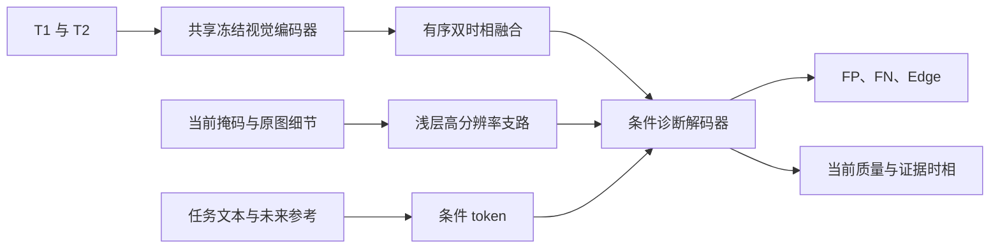

# Verifier V1：任务条件化空间诊断模型训练方案

> 状态：研究设计稿，尚未训练或验证；可用于首轮数据小试。  
> 日期：2026-11-17。建议仓库路径：`doc/VERIFIER_V1_TRAINING_PLAN.md`。  
> 依据：本次提供的 `doc/CURRENT_STATE.md`、项目协作约束及服务器 `AGENTS.md`。本文件只细化方向三，不改变方向一、方向二的安排，不替代当前状态入口。  
> **本轮服务器授权范围仅为第 10 节：纯净训练来源核查、小样本真实预测与诊断标签导出、静态 HTML 审核。后续章节中的训练、全量生成和在线实验均不是本轮执行授权。**

## 0. 建议先做出的决定

**V1 采用两种互补的真实掩码生成方式，训练一个读取双时相图像、当前掩码和任务文本的轻量诊断解码器。先证明诊断有效，再接入双 Agent 闭环。**

| 决策 | 本方案建议 | 主要理由 |
| --- | --- | --- |
| 训练范围 | 经核查的公开 train，剔除全部已用于开发、调参、确认和评测的来源 | 历史预测残差不能回流训练 |
| 数据集分工 | LEVIR：建筑常规变化；SECOND：类别、方向、转换；WHU：核实划分与双期标签后加入 | 三个数据集的监督能力不同，不能强行统一成方向标签 |
| 初始掩码 | 两个现成生成器为主；约 70% 常规真实预测、20% 同图同掩码换指令、10% 高质量锚点 | 覆盖不同错误机制，同时避免生成工程膨胀 |
| GT 使用 | 计算监督标签；少量原样 GT 锚点；不做 GT 腐蚀、膨胀、挖洞、对象粘贴 | 遵守服务器约束，也减少合成痕迹捷径 |
| 模型 | 冻结 DINOv2 ViT-B/14 等现有视觉骨干，训练有序双时相融合、文本条件模块和高分辨率诊断头 | 训练与调试成本较可控，便于公平对照 |
| 输出 | FP、FN、边界缺陷、当前质量分；可选证据时相 | 输出错误证据，掩码修改仍由 Planner 执行 |
| 时相解释 | “建议参考的证据时相”，不是未经证实的“错误因果来源” | 最终掩码与 GT 的差集无法唯一还原错误来自哪一期 |
| 核心强对照 | 条件变化分割后求差；进一步比较同输入的掩码精修后求差 | 防止把普通分割的重参数化误当算法创新 |
| 首轮规模 | 24–36 对合规源图，最多约 200 条诊断记录 | 足够肉眼检查协议，不提前开展模型开发 |

以上比例、训练配置和验收目标是**待小试后冻结的建议值**，不是文献结论，也不是已测得的最优设置。

### 0.1 三个需要纠正的前提

1. **原版 LEVIR-CD 只有二值建筑变化标签。** 数据包含增长与减少，但标签本身不能把两者唯一分开。没有额外可靠标注时，只训练“建筑变化”，不自动造“新建／拆除”真值。[R1]
2. **SECOND 的六类是非植被地表、树木、低矮植被、水体、建筑、运动场。** 道路、农田不能直接当作其独立 GT 类别；非变化编码也不能当成某种地物背景。[R2][R3]
3. **SECOND 保留同类别内部的真实变化。** 因而不能用“两期类别不同”代替完整变化 GT。[R2]

WHU 还有一个需服务器核实的问题：官方网页中常见的建筑提取 train/val/test 切片说明，不能直接证明本地 WHU-CD 划分是“官方变化检测 train”。本方案没有检查服务器下载包及划分文件，因此对此保留待核状态。[R4]

### 0.2 当前状态与本文件的关系

- 继续保留 Planner 的掩码修改权、Verifier 的只读诊断与放行职责。
- 旧 `find_missed` 留在固定流程基线，不在本轮继续堆规则。
- 方向二继续冻结现有零样本 `ask`，本方案不改动它的跨模态试验。
- V1 只训练光学—光学、简单类别和方向条件。T3、T4 接口可预留，能力尚未验证。
- `CURRENT_STATE.md` 提到形态学扰动，但服务器约束禁止 GT 人工合成扰动。本方案直接采用不冲突的子集：真实预测、条件替换、原样 GT 锚点。边界距离计算是只读标签派生，不是修改 GT。
- 本设计文档按用户明确要求单独提供；若需登记入口，只在现有技术文档中放短链接，不创建平行的研究 README 或过程账本。

## 1. 问题定义与研究假设

### 1.1 输入、监督与权限

记图像对为 $I=(T_1,T_2)$，当前掩码为 $M$，任务指令为 $Q$，其合法目标真值为 $G_Q$。

区分两个有效域：$\Omega_{\mathrm{input}}$ 仅由图像 NoData、padding 和合法视野产生，推理时可知；$\Omega_{v,Q}\subseteq\Omega_{\mathrm{input}}$ 是该任务标注完整的区域，可能受 GT 缺标或方向未知影响，只用于监督与评测。下文单任务简写为 $\Omega_v$。**标注有效域不能输入模型。**

训练模型：

$$
D_\theta(T_1,T_2,M,Q)
\rightarrow
(P_{\mathrm{FP}},P_{\mathrm{FN}},P_{\mathrm{edge}},
\hat e,p_{\mathrm{acceptable}},P_{\mathrm{time}}).
$$

- $P_{\mathrm{FP}}$：当前掩码内部不属于任务目标的概率。
- $P_{\mathrm{FN}}$：当前掩码外部遗漏任务目标的概率，必须允许全图搜索。
- $P_{\mathrm{edge}}$：值得局部修边的错误区域概率，可与 FP/FN 重叠。
- $\hat e$：当前残余错误负担。
- $p_{\mathrm{acceptable}}$：当前掩码达到事先约定质量标准的概率。
- $P_{\mathrm{time}}$：有监督依据时，建议查看或提取轮廓的证据时相。

模型不生成自然语言推理链，不执行掩码编辑，不接收 GT、错误统计或生成器身份作为推理输入。Verifier Agent 另行审查轨迹，再将结构化诊断交给 Planner。

### 1.2 必须面对的数学等价性

真实诊断标签为：

$$
Y_{\mathrm{FP}}=M(1-G_Q), \qquad
Y_{\mathrm{FN}}=(1-M)G_Q.
$$

因此：

$$
Y_{\mathrm{FN}}-Y_{\mathrm{FP}}=G_Q-M.
$$

只要普通条件分割器能预测 $\hat G_Q$，也能输出：

$$
\hat P_{\mathrm{FP}}=M(1-\hat G_Q),\qquad
\hat P_{\mathrm{FN}}=(1-M)\hat G_Q.
$$

**输出错误图是一种有用的接口，但本身不构成新算法。** PseudoClick 已经显式学习 FP/FN 错误图；语言条件变化检测也已有直接相关研究。[R5][R6]

更强的反对意见是：如果精修网络同样读取 $I,M,Q$，它预测新掩码后再做差，与我们的像素监督可能近乎等价。仅更换输出头名称无法排除这一解释。

### 1.3 本方案真正要验证的假设

> 通过真实残差混合、固定掩码的任务反事实训练、候选状态输入和独立质量校准，专用诊断模型可以在相同误报与反馈预算下，提供更准确、可执行的错误证据。

这里的“反事实”只指固定图像时替换任务条件或候选掩码，不表示物理世界的因果推断。

需要分别证明：

1. **任务条件有效**：同图同 $M$ 换 $Q$，错误位置按任务真值改变。
2. **候选状态有效**：同图同 $Q$ 换 $M$，模型能适应不同错漏状态，尤其不会频繁误报高分结果。
3. **错误来源泛化有效**：不只识别某个生成器的固定输出痕迹。
4. **反馈有用**：后续真实工具动作能利用诊断改善结果；离线定位变好不能替代这个证明。

若强对照达到相同效果，应保留有用模块并收缩算法主张。更值得推进的后续方向是学习真实工具干预的收益，而不是继续增加装饰性网络分支，见第 11 节。

## 2. 数据集、任务文本与任务 GT 编译

### 2.1 数据能力表

| 来源 | 可以直接监督的 V1 任务 | 条件与限制 |
| --- | --- | --- |
| LEVIR-CD 原版 | 建筑常规变化 | 新建、拆除方向未知；不从模型预测或 VLM 回答补造方向 GT |
| SECOND | 某类相关变化、某类转入、某类转出、明确的 $a\to b$ 转换 | 只使用官方可映射类别；保留同类真实变化；标签 0 的语义按原始标注核实 |
| WHU-CD | 建筑常规变化；在可靠双期建筑标注支持下的方向变化 | 先确认 CD 划分血缘、时相顺序、GT 版本与两期建筑标签一致性 |

这些数据集中，SECOND 应承担主要的条件区分监督。不要让 LEVIR/WHU 的大量单一建筑任务淹没它。建议训练抽样先给 SECOND 约 50% 权重，剩余按合法可用的 LEVIR/WHU 来源分配；这是采样权重，不是复制新源图。

如果 WHU 无法证明符合用户要求的官方 train，标为 `quarantined_pending_split_decision`，先处理已核实数据，不擅自新划一套 train。

### 2.2 SECOND 的任务 GT

令 $C$ 为官方变化域，$L_1,L_2$ 为两个时相在已标注变化区域的语义标签。定义：

$$
G_{\mathrm{related}(c)}
=C\cap[(L_1=c)\lor(L_2=c)].
$$

$$
G_{\mathrm{into}(c)}
=C\cap(L_1\ne c)\cap(L_2=c).
$$

$$
G_{\mathrm{outof}(c)}
=C\cap(L_1=c)\cap(L_2\ne c).
$$

$$
G_{a\to b}
=C\cap(L_1=a)\cap(L_2=b).
$$

多类别相关变化可用对应单类任务 GT 的并集，但 V1 首次模型先以单类和明确方向为主，避免组合数失控。

必须遵守：

- $C$ 优先读取发布版变化标注。若发布格式把变化域编码在双期语义图中，只在核实官方颜色/索引规则后解码。
- 原论文以 $(0,0)$ 表示非变化；不能把 $(c,c)$ 一律当作非变化。[R2]
- 单边为 0、未知颜色、标签不一致、无效像素必须单独统计，不能靠猜测映射。
- $\mathrm{into}(c)$ 是“类别转入”，不是 $0\to c$；$\mathrm{outof}(c)$ 也不是 $c\to0$。
- “新建建筑／拆除建筑”在 V1 对应像素级建筑类别转入／转出，可能包含扩建或局部减少，不能宣称是完整实例事件标注。
- $\mathrm{related}(c)$ 与“只看 T2 为 c”的定义不同。使用明确文本，不让同一句指令对应两种编译规则。

### 2.3 WHU 的方向 GT

只有在官方双期建筑标注 $B^*_1,B^*_2$ 与当前变化 GT 配准、一致性通过核查时，才可以构造：

$$
G_{\mathrm{new}}=C\cap B^*_2\cap\neg B^*_1,\qquad
G_{\mathrm{removed}}=C\cap B^*_1\cap\neg B^*_2.
$$

若 $G_{\mathrm{new}}\cup G_{\mathrm{removed}}$ 与 $C$ 不完全一致，保留差异并显示，不用两期分割差分悄然替换变化 GT。未被解释的像素可继续用于常规变化任务；方向任务中标为未知并屏蔽监督，待人工确认。

若这会产生大范围不完整的方向目标，则暂不使用该图的方向任务，而不是用“忽略区域”掩盖标签不可靠。

### 2.4 文本输入不能成为装饰

V1 模型实际接收的是任务文本特征。任务类别 ID、GT 语义统计和任务编译器的 oracle 输出不另行输入模型。

可采用短英文规范文本训练，并保存中文审核描述，例如：

| 中文审核描述 | 实际编码文本示例 |
| --- | --- |
| 与建筑相关的变化 | Changes involving buildings. |
| 建筑转入 | Areas that became buildings from a different land-cover class. |
| 建筑转出 | Areas that changed from buildings to a different land-cover class. |
| 树木转为建筑 | Areas that changed from trees to buildings. |

这只是一个可控的 V1 文本接口。若在线系统接收中文，由 Planner 的确定性规范化层产生相同语义的规范文本，并保留原文；该层不能读取 GT。若要直接处理中文自由描述，需选用并验证相应文本编码器，不能默认英文 CLIP 已具备该能力。

每类准备少量人工可核查的等义模板，留出部分模板只做验证。类别数有限时，成功只能证明“语义条件选择有效”，不能证明开放词汇、复杂推理或 T3 泛化。

## 3. 纯净 train 与防泄露协议

### 3.1 先证明来源，再生成任何 M

定义：

$$
D_{\mathrm{clean}}
=D_{\mathrm{official\ train}}
\setminus D_{\mathrm{previously\ exposed}}.
$$

这里的曝光包括：已有 dev、tune、confirm、val、test、人工案例审查以及用于方法选择的开发图像。即使它们原本来自官方 train，也必须排除。

**零已知交集不等于排除清单完整。** 需要同时输出：

- `verified_clean`：官方来源和曝光排除均有证据。
- `excluded`：命中禁止训练来源，记录原因。
- `unknown_quarantined`：缺少来源、坐标或历史登记，暂不生成训练样本。

本轮不访问历史预测来补充训练，不复制旧 M，不把推理缓存成功当作当前生成器真实运行。

### 3.2 四层去重与隔离

1. **身份层**：dataset、release、官方 split、原始 pair ID、父图/地理块 ID、时间顺序、裁剪框。
2. **内容层**：原文件 SHA256、规范化解码像素哈希、图像对哈希；核查重命名、换格式及 T1/T2 颠倒后的重复。
3. **空间层**：相同原图的裁剪框相交、上下文窗口相交、可用地理范围重叠。感知哈希只能用于发现疑似重复，不能单独证明不重叠。
4. **派生层**：同源图的所有 Q、M、增强与裁剪保持同组，先分组再扩样。

LEVIR 的同一个 1024 原图所切出的所有小块应同组。若已曝光任一子块，原则上排除该原图的其他子块，除非已有明确并经同意的地理隔离协议。

WHU 若来自单张大幅正射影像，不能机械地删除整个父场景，也不能随机混切。应依据已核实的固定地理分区，排除曝光范围，并按实际窗口及上下文半径扩大禁止区域。新增裁剪窗口的整个覆盖范围都必须落在允许区域内。

### 3.3 历史读取边界

服务器 `AGENTS.md` 禁止未被当前指令点名的 `results/`、`doc/archive/` 历史账本扫描。

因此首轮：

- 从当前生效的代码、配置、数据登记与 split/task manifest 获取曝光清单。
- 不递归扫描旧结果文件夹寻找过去的图。
- 若必要的历史 manifest 路径不在已授权范围，报告需要读取的具体路径或登记缺口。
- 无法覆盖历史曝光的来源维持隔离状态；可以继续处理其他独立且已核实的来源。

本文件只授权读取本轮自己新建的 `results/verifier_v1_pilot/<run_id>/` 产物，不构成开放其他历史目录的授权。

### 3.4 新模型自己的数据划分

建议对 $D_{\mathrm{clean}}$ 再按源图/地理块建立：

| 子集 | 建议比例 | 用途 |
| --- | --- | --- |
| fit | 70% | 梯度训练；首轮人工审核样本从这里取 |
| selection | 10% | 结构、训练超参数、checkpoint 选择 |
| calibration | 10% | 冻结模型后校准概率与放行/报警阈值 |
| confirm | 10% | 冻结协议后的独立离线确认 |

比例随有效源图数量和空间分区调整，但必须在生成派生样本前确定，公布实际数量。不要为了凑比例破坏地理隔离。

首轮只生成 fit 小样本；可登记其他子集 ID，但不提前用 confirm GT 挑样或设计标签。人工看过的小试图保持在 fit，不再冒充独立确认样本。

官方 val/test 仍与训练隔离。以后若要报告正式数据集结果，另行批准并冻结协议；上述 confirm 是 V1 内部独立确认集，不冒充官方 test。旧 dev/tune 只能标为“已曝光诊断集”。

confirm 仅用于预先登记并冻结的一批模型、种子和协议。若看过结果后据此修改模型、数据或阈值，该批 confirm 转为已曝光诊断集；下一轮独立确认须使用新的未曝光来源。按事先登记方案在同一 confirm 比较多个模型和三种子，不属于事后调参。

### 3.5 生成器与预训练权重的曝光

冻结生成器版本、权重、提示词和阈值。记录其是否使用过本项目开发标签、是否曾在目标数据集监督微调。

- 免训练生成器无需为每个样本重新训练。
- 若未来使用在 fit 图像上监督拟合的生成器，应评估交叉拟合残差，避免过分乐观的训练内预测。
- 基础模型大规模预训练数据通常无法完全追溯。报告本项目可验证的监督隔离边界，不声称已证明全球预训练零曝光。
- 若选用遥感基础模型，额外检查其预训练与 benchmark 曝光情况，不只看名字是否“遥感”。

## 4. M_init：两种真实来源，少量受控反例

### 4.1 为什么选择混合，而非统一一个生成器

单一生成器容易让诊断器记住固定误差形态，例如总在某种边缘出现 FP、总遗漏某种面积的目标。双 Agent 后续改变工具和参数后，误差分布就可能失配。

混合也不能无限扩张：多套工具安装、参数网格和失败兼容会挤占核心研究。**V1 先保留两个可运行、误差机制不同的来源，并统一导出接口。**

建议优先级：

| 来源 | 预期覆盖的错误 | V1 使用方式 |
| --- | --- | --- |
| 单轮 SAM3 跨期分割差分 | 对象遗漏、类别误分、跨期对应或轮廓偏差 | 一个正常配置，少量样本可再用一个预先固定阈值 |
| SegEarth 稠密语义分数差 | 概率模糊、粗边界、局部粘连和细碎区域 | 固定类别词表、分数处理和阈值 |
| 既有 `ovcd_v0` | 依真实实现确认；可能补充特征差分型错误 | 若现成可跑，可作第二来源替代或后续留出来源，不现场重建 |
| 高分真实 M 与原样 $G_Q$ | 近收敛和无需修改状态 | 单独采样并记录来源 |

SAM3 的文本/视觉提示分割能力、SegEarth 的遥感开放词汇稠密语义路线有官方实现支持；这里对其错误互补性的判断是待小试核实的设计推断，不是已实测结论。[R7][R8]

如果 `ovcd_v0` 只是复用同一 SAM3 输出做不同后处理，它不算独立的生成架构。必须记录底层依赖。

### 4.2 生成器接口与禁止的信息流

生成阶段函数只允许读取：

~~~python
generate_candidate(
    image_t1,
    image_t2,
    task_text,
    frozen_generator_config,
) -> candidate_mask, optional_confidence, optional_single_time_predictions
~~~

另一个离线导出步骤才读取官方标注并计算 $G_Q$、FP、FN、Edge 和统计。生成器不得拿 GT 选阈值、选框、选点、剔除失败输出或选择每张图最好的方案。

同一图像的视觉特征、单期分割可以在多个任务间复用，但所有派生关系要记录。出现异常时保留失败状态，不把旧缓存冒充本轮推理。

### 4.3 方向生成与同类变化的限制

跨期分割差分可按已有实现定义：

- 类别转入：目标类在 T2 的分割减去 T1 的分割。
- 类别转出：反向差分。
- 某类相关变化：双向差分或已有跨期对应输出。
- 明确 $a\to b$：结合两期对应语义的真实预测结果。

SegEarth 的类别分数差可作为近似候选依据，但其分数未必是校准概率；命名和日志应忠于真实接口。固定类别竞争集合，不能为某张图用 GT 删除干扰类别。

**两期独立语义分割再相减可能共同漏掉“类别不变但发生真实变化”的区域。** 这既是合法 FN 监督，也暴露生成器覆盖缺口。审核页要单独列出该类情况；如已存在可运行的特征变化流水线，可在后续批准后补充。不能把语义差分的盲点写成“GT 无变化”。

### 4.4 推荐采样比例

按训练诊断记录的抽样权重，起点为：

- **70% 常规真实预测**：两个来源大致均衡；保留低分、中分、高分，避免只存有利样本。
- **20% 条件反事实**：图像与 $M$ 完全不变，只切换为另一个有合法 GT 的任务。
- **10% 近收敛锚点**：约 5% 高质量真实结果，原样 GT 不超过约 5%。

高分真实结果可在 fit 构建阶段按 GT 统计分层抽样；这属于训练采样。离线自然分布主表不能按每张图 GT 挑选最优生成器或阈值。

建议质量分层报告 $IoU(M,G_Q)$ 的 $[0,.3), [.3,.7), [.7,.9), [.9,.95), [.95,1]$；不强求均匀。如果某类错误或高分真实状态数量不足，报告缺口，不能用大量形态学 GT 破坏补齐。

无目标任务应占一定比例，但不让大量空任务主导“文本敏感性”。重点保留同图中两种目标实际存在的对比。

### 4.5 最重要的配对样本

**A. 同图、同 M、不同 Q：学习任务相关性。**

例如一张图存在建筑转入与转出，同一个真实 $M$ 包含两者。分别审查“建筑相关变化”“建筑转入”“建筑转出”。被判正确的区域应随任务改变。

条件配对必须满足：

- 配对两侧图像哈希、M 哈希完全相同。
- $G_{Q_a}\triangle G_{Q_b}$ 非空，才算有辨识力的任务切换样本。
- 两个 Q 都可由可靠标注编译；不能用未标注类别造负例。
- 最好同时包含任务目标存在与干扰目标存在的情况。

**B. 同图、同 Q、不同 M：学习当前状态。**

复用两个真实生成器或不同固定配置的输出，使误差位置与质量改变。所有候选都保存，不挑最佳值代替整体分布。

这两类配对是必要检查，但直接分割后求差也可能通过，不能单凭它们宣称优于强对照。

### 4.6 “负例拼接”的边界

首轮不需要跨图粘贴。主要负例由同图真实 M 配错任务自然得到。

后续只有确认覆盖不足时，才考虑同一配准图像对内真实预测 mask 的并集/复用，并限制其占比、记录所有父 mask。它属于候选掩码合成，不是假装新增物理 GT。

V1 不使用：跨图对象粘贴、从 GT 抠对象植入 M、GT 腐蚀/膨胀/挖洞、随机破坏 GT 后当主要训练残差。对图像与标签做一致坐标变换的数据增强另见第 7 节，不改变其语义真值。

## 5. 诊断标签、边缘定义与时相证据

### 5.1 基础标签

所有逻辑仅在 $\Omega_v$ 内成立：

$$
Y_{\mathrm{FP}}=\mathbf{1}_{\Omega_v}M(1-G_Q),\qquad
Y_{\mathrm{FN}}=\mathbf{1}_{\Omega_v}(1-M)G_Q.
$$

监督 FP 包括不符合当前任务的真实变化。只在具备足够语义标注的样本上，附带统计“官方变化域内但任务外”的 FP：

$$
Y_{\mathrm{FP,task}}=Y_{\mathrm{FP}}\cap C.
$$

不要把 LEVIR 建筑变化 GT 之外的全部像素称为“物理上没有任何变化”：其他地物可能未被该数据集标注。主标签始终是相对于当前任务的正确性。

### 5.2 Edge 是几何残差子集，不是第三种互斥真值

令 $E=Y_{\mathrm{FP}}\cup Y_{\mathrm{FN}}$。先建立简单、可审核的连通域对应：

- $S_M$：与任意 GT 连通域有实际像素交集的 M 连通域之并。
- $S_G$：与任意 M 连通域有实际像素交集的 GT 连通域之并。
- $E_{\mathrm{matched}}=(Y_{\mathrm{FP}}\cap S_M)\cup(Y_{\mathrm{FN}}\cap S_G)$。

再定义：

$$
Y_{\mathrm{edge}}
=E_{\mathrm{matched}}
\cap
\operatorname{Band}_r(\partial M\cup\partial G_Q).
$$

$\operatorname{Band}_r$ 为到边界距离不超过 $r$ 的邻域。采用固定连通性和边界定义；建议 8 连通，首轮原生网格先展示 $r=2$ 像素，并在少量样本上同时显示 1/2/4 像素的差异。

好处：

- 完全漏掉的独立对象进入 FN，不因其很小而自动全部变成 Edge。
- 完全错误的独立对象进入 FP。
- 同一个预测连到多个 GT 对象时，仍可保留粘连处的边界残差。
- 匹配对象内部的小孔可通过 M 的内边界进入 Edge。

限制也应明确：
- 这是“匹配对象附近的边界残差”标签，不是完整拓扑缺陷标注。
- 一像素偶然重叠、细长结构、严重偏移可能改变组件对应，需要样例审查。
- 远离边界的粗大桥接或缺失部分仍由 FP/FN 负责，不要求 Edge 包揽所有结构错误。
- 标签不能自动区分“配准失误、锯齿、阴影”这些病因。
- 不把所有正确边界设为错误正例；$M=G_Q$ 时 Edge 必须全零。
- 半径记录在原生分辨率上，同时记录 GSD；不同数据集相同像素宽度不代表相同地面宽度。

组件匹配与面积只在标注有效域内计算。另设 `edge_label_valid`，排除未知区、padding 和人工裁剪边缘的 $r$ 邻域；优先在原生完整网格上派生边界后再裁剪。Edge loss/指标仅使用该有效域，FP/FN 不因此丢弃其余合法监督像素。

触及未知区或被裁剪截断的组件标为 `partial_component`，保留原始组件身份，不用于宣称完整对象漏检/独立误检，也不套用完整对象质量规则。像素残差仍参与有效域内统计。

GT、M、input_valid 和 label_valid 原样保存。派生边界标签只写入新文件，不修改原始 GT。

### 5.3 为什么不能直接标“错误源自 T1/T2”

同一处 FN 既可能由 T2 漏分导致，也可能由 T1 过分后在差分中抵消导致。给定最终 $M,G_Q$，两种生成过程可能产生相同观察结果。

V1 用以下辅助输出：

~~~text
support_time = t1 | t2 | both | unknown
~~~

含义是“哪一期承载该任务目标的语义/轮廓证据”，而不是“哪一期工具犯错”，也不保证该期影像最清晰。

| 已知监督情况 | 可采用的证据时相标签 |
| --- | --- |
| 类别转入 | T2 |
| 类别转出 | T1 |
| 显式 $a\to b$ 转换 | both |
| 类别相关变化，局部是该类出现/消失 | 按可靠双期语义局部标 T2/T1 |
| 同类真实变化、两期都相关 | both |
| 只有二值变化 GT、方向无依据 | unknown；该位置不计算时相监督 loss |

只在合法 FN/Edge 等需取证区域监督。FP 不必强制指定重分割时相。

尤其应评估“同一个建筑相关变化任务、图内同时出现与消失”的局部时相判断。单纯给“新建”统一输出 T2，可以由任务文本规则完成，不能作为学会空间归因的证据。加入只读 Q 的时相规则基线。

训练可用三个有效类别的分类头，并对未知标注屏蔽 loss；推理时低置信度或不受支持的任务返回 unknown。未知标注不等于已经拥有可靠的不确定性真值。

### 5.4 当前质量与放行标签

建议监督：

$$
e=\frac{|Y_{\mathrm{FP}}\cup Y_{\mathrm{FN}}|}
{\max(1,|(M\cup G_Q)\cap\Omega_v|)}.
$$

非空情况下 $e=1-IoU(M,G_Q)$，所有面积限定在同一个有效标注域；有效域内 M 与 G 均为空时 $e=0$。

**质量头、自然高分/原样 GT 锚点和 acceptable 评测只使用在输入有效域内任务标注完整的记录。** 部分缺标记录仅训练 masked 空间头，不给一个依赖隐藏缺标区域的“全图质量”标签。全部无有效标签时标为 `no_valid_labels` 并跳过监督，不能被公式误标成零错误。

质量标签的单位是模型本次实际输入范围。裁剪后须重算，整图汇聚见第 7.3 节。完整对象约束只作用于未被裁剪截断的组件；其余可见错误仍参与像素负担与非边缘错误统计。

仅靠这个比例会忽略小对象。建议的“当前可接受”标签同时考虑：

1. $e\le 0.05$；
2. 没有超过预设面积的完整漏检对象或独立误检对象；
3. 没有超过预设面积的非边缘错误连通区域。

这里的真值容差字段命名为 `gt_error_area_tolerance`，可用原生网格 16 像素作为审核起点，由 fit 样本人工审核后、正式训练前冻结。它与预测区域过滤字段 `prediction_min_report_area` 是两个不同参数；后者才可在 calibration 选择。校准不得改变真实“合格”的定义。

小于真值容差的错误仍完整保留在像素指标和小目标子表中，不能删除 GT。

这是容差定义，不是普遍标准。高 IoU 样本与“可接受样本”应分别统计。

**静态样本只能教会模型估计当前质量，不能证明继续调用工具已无收益。** 在线“收敛放行”以后还需结合轨迹合规、已尝试动作和预算。预算用完应报告未收敛，不伪装成质量通过。

### 5.5 自动 QC 不变量

每条记录验证：

$$
Y_{\mathrm{FP}}\subseteq M,\quad
Y_{\mathrm{FN}}\subseteq\neg M,\quad
Y_{\mathrm{FP}}\cap Y_{\mathrm{FN}}=\varnothing.
$$

$$
(M\setminus Y_{\mathrm{FP}})\cup Y_{\mathrm{FN}}=G_Q
\quad \text{on }\Omega_v.
$$

$$
Y_{\mathrm{edge}}\subseteq
Y_{\mathrm{FP}}\cup Y_{\mathrm{FN}}.
$$

同时核查：

- 数据形状、时相顺序、坐标、像素值域、ignore/padding 区域；
- GT 锚点三个错误图均为空；
- 条件配对的图像/M 哈希相同；
- 方向标签来源合法；
- GT 原文件校验值未改变；
- 同源派生样本没有跨 split；
- 仅凭 $M=\varnothing$ 不能判无需修改，必须与 $G_Q$ 对照生成标签。

## 6. 架构选型与推荐结构

### 6.1 横向比较

| 路线 | 适合的能力 | 本项目中的主要代价或局限 | 建议 |
| --- | --- | --- | --- |
| 冻结视觉基础模型＋轻量条件解码器 | 全图错误定位、重复使用图像特征、控制训练规模 | 冻结特征的遥感适应性和细边界需实测 | **V1 主线** |
| 遥感基础模型或已训 CD 骨干＋同样的头 | 可能有更贴近遥感/跨期的表征 | 需要额外接口、权重曝光与公平性核查 | 后续仅替换骨干做一项对照 |
| LISA 类 MLLM＋像素头 | 复杂语言和隐式意图，面向后续 T4 | V1 类别词不需要完整语言生成能力；双图训练和显存调试增多 | 保留条件接口，首版不训练大语言骨干 |
| PseudoClick／交互式分割式错误解码 | FP/FN 到点、框、局部修正线索 | 原单图目标任务仍需扩展至双时相和任务条件 | 借鉴错误预测与区域反馈 |
| SegRefiner 类扩散精修 | 精细边界和多种粗掩码恢复 | 主要目标是生成改进掩码，多步生成不直接解决诊断可信度 | 后续修边工具或离线精修对照 |

文献事实：LISA 连接语言表征与掩码解码；PseudoClick 显式预测错误；SegRefiner 通过离散扩散逐步精修。[R5][R9][R10] 上表的算力和适配判断是本方案推断，不是这些论文对本项目的测试结果。

### 6.2 推荐的最小结构

**视觉主干。** 优先复用已有 DINOv2 ViT-B/14 权重，冻结共享编码器，分别处理 T1/T2。官方实现提供该骨干及密集任务特征接口；其在本任务的效果尚未验证。[R11]

提取数个中间层，经投影形成解码特征。ViT 中间层并非天然不同空间分辨率，需由解码器显式构造特征金字塔，不把中间层名称当成多尺度实现。

**时间有序融合。**

$$
Z_l=\operatorname{Proj}_l
[F_{1,l},F_{2,l},F_{2,l}-F_{1,l},|F_{2,l}-F_{1,l}|].
$$

加入时相角色标识。只用绝对差无法保留方向信息。这是合理的实现选择，不作为单独的新颖性主张。

**候选状态与细节。** 用可训练浅层卷积读取原生分辨率的 T1/T2、M 和仅由 M 计算的边界/距离图，提供 stride 2/4 细节。它既让网络看到当前候选状态，也补足 patch 特征的细边界信息。不能输入 GT 距离图。

**条件模块。** 冻结文本编码器，投影词级 token 到例如 256 维；在融合/解码层以 cross-attention 注入。V1 不同时堆多个 FiLM、门控和额外语言模型。

DINOv2 与 CLIP 文本不天然处在对齐空间，不能直接点积就当分类概率；由可训练投影和条件融合学习关系。

任务编译器的类别/方向字段只用于监督构造和审计，不作为绕过文本的 oracle 旁路。若未来采用由 Planner 实际解析的结构化条件，须单列其接口和文本依赖消融。

### 6.3 三个密集头的支持域

$$
P_{\mathrm{FP}}=M\cdot\sigma(z_{\mathrm{FP}}),\qquad
P_{\mathrm{FN}}=(1-M)\cdot\sigma(z_{\mathrm{FN}}).
$$

这两个支持域来自错误定义，不是在线防退化补丁。

- FN 头读取整个场景特征；不得只在 M 的候选框或边界外扩区工作。
- Edge 使用独立 sigmoid，允许与 FP/FN 重叠；不做三类 softmax。
- Edge 头不能只输出 M 边界；所有正确边界都是负例。
- 质量头从融合特征及预测诊断统计聚合；时相头只在有合法监督的区域训练。
- 模型不额外输出可直接覆盖 M 的“最终掩码”。

### 6.4 面向后续 T3/T4 的接口

统一条件容器：

~~~text
Condition {
  text_tokens,
  text_attention_mask,
  reference_tokens: optional,
  reference_attention_mask: optional,
  modality_type
}
~~~

未来参考图可经视觉编码器及参考 mask pooling 转为固定宽度 token；复杂语言可换成更强文本/MLLM 表征后投影到同一接口。参考图如有 before/after 角色也必须显式标记。

接口兼容不等于能力自动迁移。新增复杂语言、视觉参考或 SAR 输入时需要各自的训练数据、对照与验证，本轮不启用空壳模块冒充已支持功能。

### 6.5 交给 Verifier 的结果

~~~json
{
  "mask_handle": "current_mask_handle",
  "diagnostic_maps": {
    "fp": "map_handle",
    "fn": "map_handle",
    "edge": "map_handle"
  },
  "regions": [
    {
      "error_type": "fn",
      "bbox_xyxy": [40, 80, 90, 130],
      "point_xy": [65, 105],
      "confidence": 0.83,
      "support_time": "t2"
    }
  ],
  "current_quality": {
    "scope": "input_window",
    "predicted_error_fraction": 0.08,
    "acceptable_probability": 0.27
  }
}
~~~

以上数值仅演示 schema，不是测量结果。坐标为原始图像像素，bbox 使用 $[x_0,y_0,x_1,y_1)$ 约定并写入接口版本。

区域由预测图的固定阈值、连通域与排序产生，不从 GT 框生成。重叠 Edge 与 FP/FN 保留关联，避免一个错误被重复计算为多个独立成功反馈。每轮提供固定预算的区域，例如总计最多 5 个，而不是无限输出建议。

Verifier 可将这些证据解释为“检查/移除/补提/修边”的候选建议；实际选择和执行由 Planner 完成。

## 7. 损失函数、训练配置与资源安排

### 7.1 首个模型的损失

$$
L=L_{\mathrm{maps}}
+0.5L_{\mathrm{edge}}
+0.2L_Q
+0.2L_{\mathrm{quality}}
+0.1L_{\mathrm{time}}.
$$

这些权重是可复现的起点。只在 selection 上小范围调整，并保留无附加 $L_Q$ 的对照。

**FP/FN 主损失。**

各头只在合法支持域内计算 BCE，加非空目标的 Soft Dice。建议 Dice 权重 0.5；BCE 正类权重从 fit 统计得到并封顶，例如不超过 5，防止为召回率把完好掩码报满错误。

- 目标为空仍计算负例 BCE。
- 目标为空不把 Dice 自动当成一个满分样本。
- 支持域为空时该项 loss 为 0，记录次数。
- 源图、任务和 mask 的重复抽样权重归一化，避免配对样本重复计权失控。

**边界损失。**

对独立 Edge 标签用 BCE 与非空 Dice。必须包含正确边界负例。预测图是否与 FP/FN 一致另行统计，不引入 GT 引导的推理门控。

**任务反事实约束。**

对同图同 M 的 $Q_a,Q_b$，令：

$$
\hat R_Q=P_{\mathrm{FN},Q}-P_{\mathrm{FP},Q},\qquad
\Omega_{ab}=\Omega_{v,Q_a}\cap\Omega_{v,Q_b}\cap\Omega_{\mathrm{input}},
\quad K=(G_{Q_a}\triangle G_{Q_b})\cap\Omega_{ab}.
$$

建议：

$$
L_Q=
\operatorname{mean}_{K}
\operatorname{SmoothL1}\left(
(\hat R_{Q_a}-\hat R_{Q_b})-(G_{Q_a}-G_{Q_b})
\right)
+
0.1\operatorname{mean}_{\Omega_{ab}\setminus K}
|\hat R_{Q_a}-\hat R_{Q_b}|.
$$

第一项要求该变化的位置正确变化；第二项限制共同可信域内的无关区域乱动。空区域项跳过，不能将任一任务的未知像素补零后作为差异监督。两个任务仍各自在自己的有效域内计算标准像素监督。

这个约束是联合优化偏置，不引入新的信息，也不是新数学定理。必须区分“配对采样有效”与“附加 loss 有效”。

同图换 M 的残差恒等式只用于一致性检查，首版不再叠一个强制 loss；它本身容易被普通分割求差满足。

**质量损失。**

$$
L_{\mathrm{quality}}
=\operatorname{BCE}(p_{\mathrm{acceptable}},y_{\mathrm{acceptable}})
+0.5\operatorname{SmoothL1}(\hat e,e).
$$

阈值标准见第 5.4 节，先于正式训练冻结。不能把生成器名字或 GT 算出的 IoU 输入质量头。

**时相损失。**

在有证据的 FN/Edge 区域计算有效类别交叉熵。未知位置全部屏蔽，不把 unknown 当成任意时相的负例。该辅助头不是 V1 主要创新。

### 7.2 数据增强与特征复用

- 对 T1/T2/M/所有标签实施一致的 crop、翻转和 90 度旋转。
- 按实际 crop、有效域重新计算 $e$ 与 $y_{\mathrm{acceptable}}$，不能继承整图质量标量；保留原始组件身份，裁断的组件不按“完整对象”计数。条件配对两侧采用同一个 crop。
- 光度增强先用轻量、同步策略，不凭空生成几何变化。
- 时相交换仅在任务语义可反转时启用，同时交换 T1/T2 和方向文本：转入↔转出，$a\to b\leftrightarrow b\to a$，证据时相也反转。
- 常规类别相关变化在交换后 GT 不变；方向任务不可只交换图像。
- 几何变换是坐标一致的训练增强，不是破坏 GT 造错误。
- 同一图像视图的多 Q、多 M 可共享冻结视觉前向。不同裁剪/增强视图不能错用同一缓存。
- 不为节省编码时间预先把整个 val/test 的特征混入训练缓存。

### 7.3 推荐初始配置

| 项目 | 起点 |
| --- | --- |
| 训练裁剪 | 512×512；先按来源分组再裁剪；保留原生坐标/GSD |
| ViT 尺寸处理 | patch size 14 时显式 padding 到兼容大小，例如 518；RGB pad、label valid mask 同步处理，输出裁回原尺寸 |
| 可训练部分 | 融合、文本投影、浅层细节支路、诊断/质量头；视觉/文本骨干先冻结 |
| 解码宽度 | 256；中间层数量控制在少量，不进行骨干搜索 |
| 优化器 | AdamW，训练头学习率 $10^{-4}$，weight decay 0.01 |
| 调度 | 5% warm-up，cosine；初始正式预算 50 epochs |
| batch | 先试 microbatch 2；以实测显存决定，梯度累积到约 16 条诊断记录 |
| 数值精度 | 硬件支持时 bf16；记录实际 dtype |
| checkpoint | 按 selection 上预先指定的 FP/FN macro AP 均值选择，不按 confirm 选择 |
| 随机性 | 开发单种子；核心结果三种子，例如 17/29/43 |
| 资源 | 目标是在常规 24–48GB GPU 上完成冻结骨干实验；显存与时间必须由 smoke/profile 测量，本文未实测 |

裁剪训练不能只采有错误的 ROI，否则模型学不到全场景低误报。先混合均匀裁剪与 fit 内分层采样；验证采用固定覆盖整幅图的切片和固定融合，禁止 GT 选窗。

**质量头的范围与整图汇聚。** V1 质量主表先以固定诊断输入单元（如 512×512）报告；其“全局”仅指该输入范围，不把窗口概率冒充 1024 整图概率。像素定位仍对原图做完整覆盖，重叠区按固定规则融合。

若本阶段另行批准整图质量评价，冻结模型后用融合错误图计算：

$$
\hat e_{\mathrm{image}}=
\frac{\sum_{\Omega_{\mathrm{input}}}(P_{\mathrm{FP}}+P_{\mathrm{FN}})}
{\max(1,|M\cap\Omega_{\mathrm{input}}|+
\sum_{\Omega_{\mathrm{input}}}P_{\mathrm{FN}})}.
$$

这是只用预测的误差负担估计，分母对应 $|M\cup G|=|M|+|FN|$。再用预先固定的小型校准器，将该估计、预测最大错误区域面积、最差窗口质量及窗口数量映射为整图 acceptable 概率；校准器仅在 calibration 的完整标注整图上拟合，并在 confirm 独立检验。不能平均窗口概率直接当整图放行概率；未完成整图校准时输出 `image_acceptable_probability=null`，只报告窗口质量和整图定位。

如果冻结骨干训练不足，先检查标签、条件配对和错误覆盖；只有有具体证据时，下一轮再比较末端 block 的少量解冻或 LoRA。不要第一次同时训练多个骨干。

### 7.4 后续训练作业必须带离线验证

本节只适用于用户随后批准的训练阶段。

Slurm 作业内连续执行：

1. 在约定 fit 上训练；
2. 保存正式权重与配置；
3. 用该权重完成本阶段授权的 selection/离线测评；
4. 输出指标、诊断图和机器可读 JSON。

正式提交前，用 Slurm 跑 1–2 个训练 batch 与极小评测样本，检查权重保存/读取和指标落盘。临时 smoke 权重验证后清理。

训练、排队时间不受主动开发 1 小时约束，不得为赶时间悄然删减已确定 epochs 或数据。训练结束自动离线测评不等于获准接入在线 Agent，也不等于获准开启官方 test。

## 8. 离线评测：如何证明它是有效诊断器

### 8.1 数据面板

使用同一组独立确认源图，预先固定任务与生成器输出。至少分开报告：

1. **自然候选分布**：冻结生成器按固定配置产生的全部结果，主表不筛最好 mask。
2. **条件切换配对**：同图同 M，不同合法 Q。
3. **候选状态配对**：同图同 Q，不同真实 M。
4. **近收敛真实结果**：高 IoU 与合格质量样本的低误报。
5. **Oracle 控制**：原样 GT 作为 M，仅作为离线零错误检查，单独报告，不混入自然主表或在线推理。
6. **未见生成器**：完整留出一种生成来源，而不是只留出某个阈值。
7. **困难子集**：完整对象漏检、远离 M 的 FN、小对象、边界残差、同类真实变化、无目标/空 M。

原样 GT 锚点的推理输入属于明确标识的 oracle 控制，不能用于宣称真实部署效果或替代自然高分样本校准。

### 8.2 定位指标

| 问题 | 主指标 | 具体口径 |
| --- | --- | --- |
| FP | AUPRC、IoU、F1 | 在 M 支持域内评估；另报整图误报面积 |
| FN | AUPRC、IoU、F1 | 在 $\neg M$ 支持域内评估；单列完全漏检对象和距 M 较远的 FN |
| Edge | AUPRC、F1 | 对第 5.2 节冻结的标签评估；同时比较边界带规则 |
| 可执行区域 | Precision/Recall@1/3/5 | 固定区域/网格预算；报告完整对象召回 |
| 低误报 | 每图误定位率、误报面积比、不必要返工率 | 精确 GT 控制、自然高分、无目标空掩码分别报告 |
| 质量 | $\hat e$ MAE、Brier、可靠性曲线 | 自然分布评估，避免只在平衡采样分布报告 |
| 资源 | 单图延迟、峰值显存、额外调用 | 冷启动与缓存复用分开说明 |

不要用像素 accuracy 作主指标，它会被大量正确背景淹没。

没有正例的单图 AP、IoU、F1 均不进入错误定位宏平均，记为不适用而非 1；主表按对应错误存在的图汇总并报告数量。无错误图与空支持域单独计数，进入低误报指标。同步报告 micro AP；若额外列含空样本的 IoU/F1，必须披露空集约定，不能替代主表。

区分两个错误率：

- **误定位**：输出的类型化网格按第 8.4 节冻结的 GT 网格规则不含对应错误。报告每图至少一次误定位的比例及建议精度。首版以统一网格作为 region 对照主表，连通域仅用于实际反馈；如追加连通域检测指标，须预先另定匹配协议。
- **不必要返工**：$y_{\mathrm{acceptable}}=1$，但经校准的质量判定要求返工。准确指出一个可容忍的边界误差不自动算误定位；如果据此判必须返工，则属于此项。

近完美但有真实小错误的掩码与完全零错误控制必须分开。

“Boundary IoU”适合后续真实修正结果的边界质量比较；当前模型只输出诊断时，用 Edge 定位指标即可，不能把错误热图的边界指标当作最终掩码已改善。[R12]

### 8.3 条件敏感度与状态敏感度

**任务切换。** 采用第 7.1 节的共同有效域 $\Omega_{ab}$，在 $K=(G_{Q_a}\triangle G_{Q_b})\cap\Omega_{ab}$ 上检验：

$$
\operatorname{sign}(\hat R_{Q_a}-\hat R_{Q_b})
=\operatorname{sign}(G_{Q_a}-G_{Q_b}).
$$

为防止极小数值变化也算成功，建议要求正确方向的差值大于固定 margin，例如 0.2；margin 在 selection 预先确定。在 $\Omega_{ab}\setminus K$ 上报告平均绝对差；等义改写也应保持稳定。

按像素统计之外，再按变化对象/区域统计，防止大块地物掩盖少数方向错误。条件敏感度主表优先用两个任务目标都实际存在的图。

**掩码切换。** 对同 $I,Q$ 的 $M_a,M_b$，真实残差满足：
$$
R_{M_a}-R_{M_b}=M_b-M_a.
$$

报告该一致性误差，并按各质量档报告绝对 FP/FN 定位能力。直接分割后求差天然可能满足此式，因此它只是输入有效性的必要检查。

时相交换也需同时反转 Q。只交换输入图像却不改新建/拆除文本，不是合法稳定性测试。

### 8.4 与零样本 VLM 的公平比较

**保留现有 `ask` 基线。** 冻结模型版本、prompt、输入图、解析协议和调用预算。原协议只能输出语言或框时，不编造像素 IoU。

另设统一定位协议：

- 输入相同分辨率的 T1/T2/M/Q，不给 GT 裁剪、点或框。
- 在 512 图上可用 16×16 网格；VLM 输出错误类型、网格 ID 和置信度。
- 诊断模型用预先固定的池化规则，把像素概率汇总到相同网格。
- 在统一 K 下比较 typed Precision/Recall@K、完整漏检覆盖、是否需要返工和开销。
- 网格正例条件预先固定，例如对应错误像素至少 16 个；另报小于该面积的错误子集，不将它们删去。
- 主表所有错误类型共享 K 条建议预算，不能每种错误各取 K 条。相同网格的多种错误标签合并为一个建议记录；预测 Edge 与 FP/FN 的关联使用冻结规则，不能靠重复建议增加预算。
- 每个建议保留主错误类型与附加标签；主表按主类型计命中并报告各类型召回，附加标签另报。匹配类型和并列分数排序规则先固定。
- $P@K=\text{正确建议数}/K$，不足 K 的槽位计未命中。另报 $\text{selective precision}=\text{正确建议数}/\text{实际建议数}$、实际建议数和覆盖率；没有建议时 selective precision 记不适用而非 1。
- Recall 的分母为该类型全部正例网格，图内无该类错误时记不适用并单列；小对象另按是否被命中统计。

统一网格版是新的受控 VLM 评测协议，不能冒称完全等于历史 `ask` 行为；两者分别命名。

若用“VLM 框/点＋SAM”得到密集图，单独列为组合基线，并计入工具开销和失败。不要把 SAM 的定位归为 VLM 原生像素能力。

### 8.5 最小对照与消融顺序

**第一批核心对照：**

| 对照 | 它回答的问题 |
| --- | --- |
| 冻结零样本 VLM | 专用训练是否比现有核验器更可靠、定位更实用 |
| 同骨干条件变化分割 → 与 M 求差 | 是否只是学习任务 GT 后换一种输出名称 |
| 同骨干、同输入的条件掩码精修 → 求差 | 相比普通二阶段精修，诊断训练是否还有独立价值 |
| 推荐诊断模型 | 主方法 |
| 去掉 Q 的诊断模型 | 条件分支有没有实际贡献 |

同输入精修对照可复用大部分编码/解码代码，基础版本使用标准分割损失预测 $G_Q$。它仅是离线比较，不在部署路径覆盖 M。对照采用相同 fit 图像、Q、M 状态、训练预算与选择规则；忽略 M 的条件分割对照也匹配训练样本曝光次数。

用于支撑算法结论时，还需一个**监督匹配的精修变体**：将其 $\hat G$ 转成 FP/FN 后，计算相同的支持域损失、$L_Q$ 及边界/质量/时相辅助监督。无需新增骨干。否则收益可能来自采样、损失或辅助标签，不能归因于“三头诊断形式”。若监督匹配后等价，应将贡献表述为条件残差训练协议与反馈用途。

**第二批按失败证据追加：**

- 单一生成器 vs 两来源混合，总记录数/优化步数匹配。
- 有配对采样、无额外 $L_Q$ vs 完整模型。
- 去掉配对采样 vs 相同来源的普通采样。
- 去掉 M 特征支路，但保留输出支持域 gating。
- 预测 FP/FN 乘 M 边界带的简易 Edge 基线，比较独立边缘头价值。
- 时相头 vs 只读 Q 的时相规则。

不做所有模块的全组合搜索。第一批训练先用一个种子排错；关键结论再重复三种子。随机 VLM 对比按项目约定做三次独立运行；确定性标签导出无需机械重复三遍。

### 8.6 跨生成器的有效口径

训练使用 SAM3 与 SegEarth 时，可将现成 `ovcd_v0` 留到 confirm 作为未见来源，但必须确认它没有只是复用前两者的同一中间结果。

如可用来源只有两个，则后续单独训练“来源 A → 测来源 B”的诊断器，并与混合训练对比。不把看过 B 的模型在 B 上的结果称为未见来源泛化。

在同一确认源图上比较 seen/unseen 候选，报告：

- 原始完整分布；
- 按初始 IoU、FP/FN 比例、错误面积、边界残差占比的质量分层或匹配结果；
- 各数据集与任务的结果。

质量匹配只用于说明分布差异，不能根据 confirm 标签重新选阈值、训练或挑最佳模型。

### 8.7 放行校准与统计单位

在 calibration 上选择像素阈值、`prediction_min_report_area` 及质量放行阈值；之后固定到 confirm。真实质量定义中的 `gt_error_area_tolerance`、GT 网格正例面积规则和 Edge 标签定义早在正式训练前冻结，不参与这里的校准。

温度缩放或带截距的简单校准可作为起点，但训练采样和类别加权会改变概率含义。必须在自然候选分布上检查校准前后表现，不能宣称一次校准保证跨生成器可靠。[R13]

至少报告：

- 被放行样本中实际不合格的比例；
- 真正合格样本中被放行的比例；
- 自然高分掩码被错误要求返工的比例；
- 风险—放行覆盖率曲线，防止通过“永不放行”获得低风险。

所有置信区间以源图/独立地理块为重采样单位，采用配对 bootstrap，例如 1000 次。像素、Q、副本 M、相邻切块不能当作独立样本。

只有约 60 个独立好样本零误报，零事件二项模型的单侧 95% 上界才约为 5%；约 300 个才接近 1%。这是样本量计算，不是当前证据。空间相关或同图多任务会进一步降低有效样本量。

### 8.8 建议的离线验收标准

这些是首次正式训练前应冻结的研究目标，不是既有结论，也不自动授权在线部署。

| 方面 | 建议目标 | 未达到时优先处理 |
| --- | --- | --- |
| 数据有效性 | 泄露/标签不变量违规为 0；未知来源不入 fit | 停止相关来源，修数据协议 |
| 错漏定位 | FP/FN macro AP 均值较条件分割求差提高约 5 个百分点；核心差异报告源图级区间 | 核查诊断是否只是分割重参数化 |
| 强精修对照 | 同等反馈预算/误报约束下体现定位或反馈优势 | 若无优势，收缩算法主张 |
| 条件响应 | 有效任务切换正确率目标 ≥80%，较无 Q 对照提高 ≥10 个百分点，并限制不变区扰动 | 先查同 M 配对与合法 Q |
| 高分低误报 | 自然合格掩码的不必要返工率目标 ≤5%；完全零错误控制的每图误定位率目标 ≤5%；均与召回同时报告 | 调采样、概率校准与特征，不加回滚补丁 |
| 区域实用性 | 同 K、相近 precision 下，FN/FP 区域 recall 优于 VLM | 检查整块漏检与反馈格式 |
| 来源泛化 | 未见来源上相对强基线的改善方向一致 | 检查生成器依赖及质量差异 |
| 放行 | 目标：放行错误率 ≤5%，合格样本放行覆盖 ≥80%；报告置信区间 | 数据不足则写“证据不足”，不宣布可靠收敛 |

若提升只来自边缘，完整漏检没有改善，应明确结论是“边缘诊断有效”，不能写成全局补漏成功。时相辅助头只在可信标签子集报告 macro F1、覆盖率及 Q-only 对照，不单独决定 V1 是否有用。

## 9. 样本记录与实现边界

### 9.1 每条记录的最小元数据

~~~text
sample_id
dataset / release / official_split / verifier_split
source_pair_id / parent_or_geo_block_id / crop_xyxy / gsd
image_t1_path / image_t2_path / pixel_hashes / time_order
task_text / task_display_zh / predicate / label_compiler_version
candidate_mask_path / candidate_hash
generator_id / code_sha / weight_hash / config_hash / seed
single_time_prediction_paths: optional
gt_source_paths / gt_hashes
input_valid_path / label_valid_path / edge_label_valid_path
task_annotation_complete / quality_label_valid / partial_component_ids
fp_path / fn_path / edge_path / support_time_path / support_valid_path
edge_radius / connectivity / coordinate_convention
training_only_quality_statistics
provenance_status / exclusion_check_version / review_status
counterfactual_group_id / candidate_state_group_id
~~~

图像路径、GT 路径、质量统计可共存于审计 manifest，但训练/推理 dataset 必须采用字段白名单：

- 推理：T1、T2、M、Q，以及只由图像/几何产生的 input_valid。
- 训练 target：FP、FN、Edge、质量标签、有效的时相标签；label_valid、edge_label_valid 和 quality_label_valid 仅用于相应 loss/指标，禁止输入模型。
- 审计：来源、生成器、GT、统计等。

模型前向函数不接受整个 manifest 对象，避免把审计字段意外送入条件编码器。

### 9.2 建议代码位置

复用 `code/agent_baseline/` 现有工具与数据加载入口。新增数据审计、标签导出和审核页脚本可放在独立小目录，实际目录名由服务器核实代码后决定。

本方案不声称某个脚本/API 已存在。不在首轮改 `planner.py`、`loop_json.py`、现有 `ask`、`find_missed` 或在线工具注册，不做框架重构。

## 10. 首轮服务器任务：只到静态样本审核

### 10.1 目标与停止点

**完成一批可追溯、可肉眼检查的真实训练候选，状态为 `pending_review`。**

本轮包含：

1. 纯净 train 与标签能力核查；
2. 小样本 M 生成；
3. FP/FN/Edge 与可用时相证据标签导出；
4. 自动 QC；
5. 中文静态 HTML 审核页与简短事实报告。

本轮不包含模型实现、训练、全量数据生成、超参数搜索或在线 Agent 评测。

### 10.2 开工核查

前台主 Agent：

- 读取服务器当前 `AGENTS.md`、`doc/CURRENT_STATE.md` 和本文件。
- 确认仓库、实际分支、HEAD、工作树和运行/排队作业；沿用 `claude/project-thread-2tuaib` 协作分支约定。
- 若实际分支/并发工作与约定冲突，先报告；不强切、不覆盖未提交修改、不自动合并上游。
- 查当前生效数据配置、官方 split 与曝光登记，明确哪些来源可继续。
- 核实 SAM3、SegEarth、`ovcd_v0` 的真实入口与依赖，仅复用现成能力。
- 确定一个新 run_id 和本轮产物目录，禁止覆盖旧产物。

无需把所有纯净数据像素完整加载一遍才能小试：可先完成来源/分组清单审计，再对计划小试样本做严格内容与空间核查。对无法确认的来源保持隔离，不能为赶时间降低标准。

### 10.3 规模与取样

- 起步 24 对独立源图；如合法覆盖需要，最多 36 对。
- 可用时先各来源约 8 对；WHU 暂不可用则明确报告，允许在其他已核实来源补足，不硬造三数据集覆盖。
- 每图两个真实生成器的默认输出；只在少量预先选定图上补第二个固定阈值。
- 对有合法语义标注的图构造同 M 不同 Q 配对；LEVIR 不伪造方向。
- 总诊断记录控制在约 100–200 条以内；独立源图数和派生记录数分开报告。
- 少量原样 GT 锚点，其余高分锚点来自真实输出。
- 保留一部分按固定种子随机抽取的图，另一部分在 fit 内按标签/残差类型分层，防止全部是挑选案例。
- 未找到真实高分或某类错误时，报告缺口，不通过 GT 破坏补齐。

抽样应尽量覆盖：整块 FP、整块 FN、任务外变化、边界粘连/缺损、小目标完全漏检、同类真实变化、自然高分、原样 GT、无目标空掩码。覆盖不足不是造数据的理由。

### 10.4 HTML 审核页

唯一静态入口建议：

`results/verifier_v1_pilot/<run_id>/audit.html`

页面用中文，不依赖后端或外部 CDN；可用相对路径资产打包查看。每条记录提供：

- T1、T2、任务文本、M、$G_Q$；
- FP 红色、FN 青色、Edge 黄色的独立图层与清楚图例；
- 原图尺寸查看、局部放大、透明度开关；
- 同图同 M 的不同 Q 并排比较；
- 同图同 Q 的不同 M 对照；
- 边界带、组件对应和有效标注范围开关；
- 数据来源、split、父图/地理块、生成器配置、GT 血缘；
- IoU、FP/FN/Edge 面积、时相监督来源；
- `pending_review` 状态，以及可复制的 sample_id 供反馈。

按数据集、生成器、错误类型、质量档和条件配对过滤。小对象全漏、正确边界与同类变化应有直达筛选项。

审核页展示 GT 是人工离线检查的必要信息；不要把该页面或带 GT 的拼图送进未来在线 Planner/Verifier。未来诊断推理可视化另用无 GT 版本。

### 10.5 自动 QC 与本轮交付

建议产物全部位于同一任务目录：

~~~text
results/verifier_v1_pilot/<run_id>/
  audit.html
  manifest.jsonl
  split_audit.json
  label_qc.json
  config.yaml
  summary.md
  assets/
  cases/
  logs/
~~~

上面是输出布局建议，不是已经存在的文件。

`split_audit.json` 至少列：官方来源数、各排除原因、未知隔离数、最终已核实数、历史清单覆盖范围、去重/空间核查方式。

`label_qc.json` 至少列：第 5.5 节各不变量通过/失败数、非法类别、方向缺标、空支持域、条件配对哈希检查、边界定义异常样例。

验证重点是有意义的标签语义检查，包括 SECOND 的同类变化保留、非变化 0 的解释、方向反转、完整漏检不误标成 Edge。可以用独立小型测试数组验证运算，不把这种测试数组混入训练数据，也不改动官方 GT。

有歧义的病例标为需审，不把自动 QC 通过写成人工 approved。首轮材料完成即停。

### 10.6 前台与 Subagent 分工

按服务器规范，默认 `gpt-6.1-sol`、`high`。两个 Subagent 足够：

| 执行者 | 职责 | 写入边界 |
| --- | --- | --- |
| 前台主 Agent | 状态/来源审核、明确 schema、资源调度、复核结果、集成报告 | 统一配置与最终汇报；避免抢写子任务文件 |
| 数据 Subagent | 活跃 split 登记核查、现成生成器小试、标签/QC | 数据脚本与本轮 cases/manifest |
| HTML Subagent | 中文静态审核页；先定 schema，等待真实数据接入 | 页面模板和展示资产；不能自行改标签规则 |

读/分析可并行，生成依赖通过的清单，HTML 最终检查依赖真实导出。代码修改用隔离工作区或明确互不重叠的文件，不能同时修改同一工作树文件。

派生时说明数量与分工；收尾核对产物后关闭可关闭的实例。无法关闭时如实写已完成/闲置，不声称已关闭。

### 10.7 Slurm、时限与异常

- 主动编码与小型验证目标 30–50 分钟，上限约 1 小时。
- GPU 推理、批量生成通过 Slurm，不能占用登录节点跑。
- 任务超过交互开发窗口时，允许提交后汇报 Job ID、配置和输出路径。
- 需要异步接力时核实 `exp-loop` 的结束唤醒已注册；失败就报告未注册。
- Hook 结束后只检查本轮数据、QC、HTML 和日志，然后汇报，不自动进入训练。
- 同一错误连续两次修复仍失败，暂停受阻部分并报告；不取消无关的正常作业。
- 本轮没有训练，所以“训练→测评连续绑定”不触发。
- 只在数据完成且人工确认后，由用户另发下一阶段任务。

### 10.8 首轮成功标准

- 纯净来源的可验证范围与未知部分均清楚，不能有未说明的泄露假设。
- 实际运行了合法样本的候选生成；生成器缺失或失败如实列出。
- 诊断标签的集合不变量通过；方向与类别定义没有伪造。
- 静态页可以直接查看真实病例，配对关系与边界定义清楚。
- 全部样本保持 pending_review。
- 没有启动模型训练、全量生成或在线接入。

简报不超过 25 行中文，列实际数量、QC 结果、文件路径、代码/配置改动、真实提交 SHA（如有）、阻碍，以及每个 Subagent 和作业的实际状态。当前仓库未明确授权推送时，不把“已生成文档/代码”说成“已推送”。

## 11. 审核后的阶段路线与更强的算法方向

| 阶段 | 输入条件 | 产物与停点 |
| --- | --- | --- |
| 小试审核 | 本轮授权 | 本文件第 10 节材料；等待用户肉眼确认 |
| 全量数据 | 样本/标签协议获批，用户下达新任务 | 冻结 manifest、数据/QC 分布；不自动接训练 |
| 首个模型 | 训练配置和离线协议另获批准 | 训练与约定离线验证连续运行；报告真实结果 |
| 核心对照 | 首个模型可用，用户批准实验范围 | 条件分割、精修、VLM 与必要消融 |
| 真实动作监督 | 定位可用且希望加强算法贡献 | 少量 train 来源的工具干预与动作收益标签 |
| 在线闭环 | 用户批准接口和评测集合 | 开关对照、动作成功率、逐轮净收益、停止行为 |

### 11.1 如果需要加强算法创新，优先学真实修复收益

可以在未来批准的少量 fit 样本上，为同一个诊断区域实际尝试固定原子动作：

- 删除预测 FP 区域；
- 在 T1 重分割；
- 在 T2 重分割；
- 在双期重新取证；
- 局部边界精修；
- no-op（不修改），作为零收益参照，防止“所有动作都变差但仍强选最好一个”。

用训练 GT 在离线计算实际修复前后的净收益，例如：

$$
u(a)=F_1(M^{(a)},G_Q)-F_1(M,G_Q)-\lambda\,\mathrm{cost}(a).
$$

其中 $M^{(a)}$ 必须来自真实工具执行，不是用 GT 直接替换的 oracle 修正；成功、无效、变差都保留。动作框/点来自预测诊断或预先冻结的无 GT 提案，不能从 GT 错误位置挑最容易成功的动作。

在此基础上训练区域动作排序或“继续处理是否值得”的头，使诊断与工具能力关联。它比简单把“新建→T2”标成时相因果，更接近可验证的闭环决策贡献。

这是另一个有成本的研究阶段，**不在首轮小试中实现**。它仍应与普通精修和规则动作排序比较，不能预先保证新颖性或效果。

### 11.2 在线阶段的边界

未来保持：

- Verifier 只读诊断、审查轨迹并决定是否放行；
- Planner 选择和执行工具；
- Recorder 记录真实轨迹，GT 仅用于隔离的离线评分；
- 不添加人工防退化回滚掩盖失败；
- 若工具不能利用正确诊断改善掩码，分别归因诊断、反馈和执行能力，不把错误全归给模型。

在线对照至少包含初始单轮结果、固定流程＋旧 find_missed、零样本 VLM 核验闭环、受训诊断闭环，并匹配工具/步数预算。先在获批开发集调试，再按冻结协议做确认，不能从离线 AP 直接跳到论文系统结论。

## 12. 可直接发送的首轮服务器提示词

> 在 `claude/project-thread-2tuaib` 协作分支开展 Verifier V1 首轮小试。先核查实际分支、HEAD、工作树和作业，阅读服务器 `AGENTS.md`、`doc/CURRENT_STATE.md` 与 `doc/VERIFIER_V1_TRAINING_PLAN.md`，**只执行方案第 10 节**。
>
> 前台负责审核和集成；安排两个 `gpt-6.1-sol / high` Subagent，分别做数据审计与标签导出、中文静态 HTML。先从当前有效 split/task 登记证明纯净 train，剔除全部历史开发/评测来源；缺失证据的来源隔离，不扫描未授权历史 results/archive。
>
> 复用两个现成互补生成器，在 24–36 对合规源图上导出最多约 200 条 M_init 与 FP/FN/Edge 记录，重点展示同图同 M 换 Q；LEVIR 不伪造方向，WHU 先核实划分，SECOND 按方案处理类别和同类变化。禁止 GT 扰动，可用少量原样 GT 锚点。
>
> GPU 工作走 Slurm，必要时注册并核实 exp-loop；完成静态审核页、清单与 QC 后以 pending_review 停止。**本轮不写模型、不跑全量、不训练、不接在线评测，Hook 也不得越阶段。** 开发约 1 小时，计算运行不限；结束按 AGENTS 输出 ≤25 行事实简报、产物路径及 Subagent/作业状态。

## 13. 一手资料与引用范围

本文的配比、模型组合、损失权重、数据阶段和验收目标是本次设计建议。以下来源仅支持对应数据事实和已有方法描述，不支持“本方案已优于现有方法”的结论。

- **R1 — LEVIR-CD 官方页面**：数据类型、建筑增长/减少场景和二值变化标签。  
  https://justchenhao.github.io/LEVIR/
- **R2 — SECOND 原论文：Semantic Change Detection with Asymmetric Siamese Networks**：任务编码、同类变化和原论文划分。  
  https://arxiv.org/html/2010.05687v2
- **R3 — SECOND 官方项目介绍**：正式地物类别。  
  https://captain-whu.github.io/BED4RS/
- **R4 — WHU 官方数据页**：建筑提取数据与变化检测包分别列出；本地 CD 划分仍须核查。网页全文访问曾超时，本次核查采用官方页面搜索索引，未检查服务器包。  
  https://gpcv.whu.edu.cn/data/building_dataset.html
- **R5 — PseudoClick，ECCV 2022**：FP/FN 错误预测与交互纠正点击。  
  https://www.ecva.net/papers/eccv_2022/papers_ECCV/papers/136660717.pdf
- **R6 — Referring Change Detection in Remote Sensing Imagery，WACV 2026**：语言条件变化检测的直接相关工作。本文不采用其合成图像数据路线。  
  https://yilmazkorkmaz1.github.io/RCD/
- **R7 — SAM 3 官方实现**：文本/视觉概念提示和分割接口，实际运行版本需固定。  
  https://github.com/facebookresearch/sam3
- **R8 — SegEarth-OV，CVPR 2025**：遥感开放词汇分割；名称中的 training-free 不代表所有组件从未训练，原文说明 SimFeatUp 可从无标签图像学习。  
  https://likyoo.github.io/SegEarth-OV/  
  https://openaccess.thecvf.com/content/CVPR2025/papers/Li_SegEarth-OV_Towards_Training-Free_Open-Vocabulary_Segmentation_for_Remote_Sensing_Images_CVPR_2025_paper.pdf
- **R9 — LISA，CVPR 2024**：语言表征连接像素分割能力。  
  https://arxiv.org/abs/2308.00692
- **R10 — SegRefiner，NeurIPS 2023**：离散扩散粗掩码精修。  
  https://papers.nips.cc/paper_files/paper/2023/hash/fc0cc55dca3d791c4a0bb2d8ddeefe4f-Abstract-Conference.html
- **R11 — DINOv2 官方实现**：可复用视觉特征与 ViT-B/14。  
  https://github.com/facebookresearch/dinov2
- **R12 — Boundary IoU，CVPR 2021**：掩码边界质量评价。  
  https://arxiv.org/abs/2103.16562
- **R13 — On Calibration of Modern Neural Networks，ICML 2017**：概率校准与温度缩放。  
  https://proceedings.mlr.press/v70/guo17a.html

[R1]: https://justchenhao.github.io/LEVIR/
[R2]: https://arxiv.org/html/2010.05687v2
[R3]: https://captain-whu.github.io/BED4RS/
[R4]: https://gpcv.whu.edu.cn/data/building_dataset.html
[R5]: https://www.ecva.net/papers/eccv_2022/papers_ECCV/papers/136660717.pdf
[R6]: https://yilmazkorkmaz1.github.io/RCD/
[R7]: https://github.com/facebookresearch/sam3
[R8]: https://likyoo.github.io/SegEarth-OV/
[R9]: https://arxiv.org/abs/2308.00692
[R10]: https://papers.nips.cc/paper_files/paper/2023/hash/fc0cc55dca3d791c4a0bb2d8ddeefe4f-Abstract-Conference.html
[R11]: https://github.com/facebookresearch/dinov2
[R12]: https://arxiv.org/abs/2103.16562
[R13]: https://proceedings.mlr.press/v70/guo17a.html
