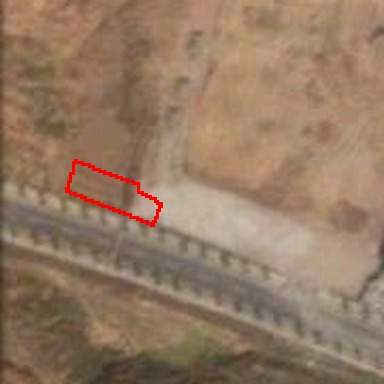
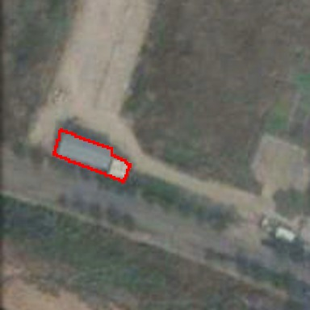
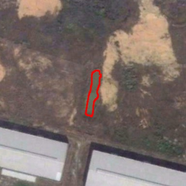
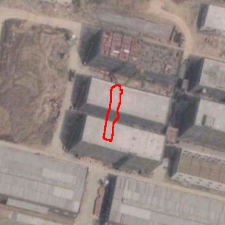
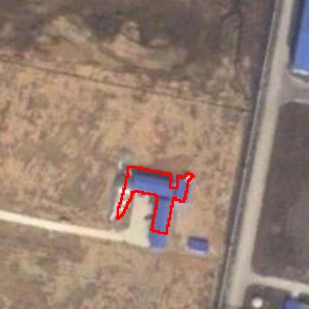
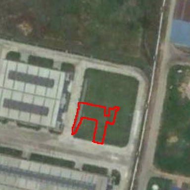

# T3 bridge smoke3 人工审查（2026-11-14）

本审查读取已有三个任务的原始解析、全部22条核验回答，以及三个示例的两期近景和远景；重点检查候选69/138（1065）、48/35（1129）、33/72/89（1136）的渲染输入。没有重新调用模型，没有改GT、历史结果或开发清单。其余候选仅审原始回答，未逐张作视觉裁决。这里的人工意见是图像证据解释，不是新增人工真值。

## 最重要的范围限制

三个任务全部属于目标类。排除给定示例后，train_1065与train_1129均没有剩余GT，train_1136只剩3像素、1个微小组件。smoke用于验证真实请求、解析、排序、核验及归档链路，不足以评估桥接的总体检出能力，也没有地表类证据。不能因smoke分数低而换掉固定dev60。

对既有SECOND标签的前态/后态/类别对一致率分别为2/3、3/3、2/3。**这不是人工裁决后的视觉理解准确率**：类别一致也可能存在影像歧义，不一致则需要分辨输入可识别性、标签定义与模型误读。

| 任务 | 独立解析 | 提供的类别对 | 排除示例后GT像素 | DINO k4 TP/FP/FN | 桥接 k4 TP/FP/FN | 桥接核验后 TP/FP/FN |
|---|---|---|---:|---|---|---|
| train_1065_2to5 | 裸地→建筑 | 裸地→建筑 | 0 | 0/7151/0 | 0/4132/0 | 0/4132/0 |
| train_1129_4to5 | 裸地→建筑 | 水体→建筑 | 0 | 0/11793/0 | 0/3762/0 | 0/3762/0 |
| train_1136_5to1 | 建筑→低矮植被 | 建筑→低矮植被 | 3 | 1/5075/2 | 0/1664/3 | 0/318/3 |

上述FP是既有任务掩码口径下的计数，不等于每个像素都已经人工确认为无变化。完整数值见[summary.json](smoke/summary.json)。22条核验中20条yes、2条no；两个no均来自1136。所有回答都成功解析为结构化字段，但“格式可解析”并不保证答案与理由一致。

## train_1065_2to5：示例较小，核验放宽为工业建设过程

T1轮廓内是道路边褐色裸地区域；T2为浅灰色细长矩形，独立解析称小建筑/棚屋。这个解释与标签一致，但当前分辨率下小建筑、铺装和其他人工构筑物之间仍有歧义，不能只靠标签一致宣称识别已充分证实。

完整输入：[前态远景](smoke/tasks/train_1065_2to5/interpretation/t1/01.png)、[后态远景](smoke/tasks/train_1065_2to5/interpretation/t2/01.png)、[前态原回答](smoke/tasks/train_1065_2to5/interpretation/t1/answer.json)、[后态原回答](smoke/tasks/train_1065_2to5/interpretation/t2/answer.json)。

DINO前4为106/107/92/7；桥接前4为138/99/69/176，完全不同。两组8次核验全yes，未起到筛选作用。候选138位于厂房右侧，T1是褐色地面，T2轮廓内主要仍呈褐灰色面状区域，外围出现道路及白色结构；从这些图不能直接确认轮廓内是完整建筑屋顶。候选69覆盖更长的同侧区域，核验把示例后态说成“construction site”、候选后态说成“building”，仍以两者都属于开发建设为由答yes。这是可直接从原文确认的**有向类别匹配标准变宽**，与严格“同一前态、同一后态”不一致；邻域工业建设背景可能参与了判断，但视觉图不能证明其内部注意力机制。

证据：[138前/后](smoke/tasks/train_1065_2to5/verification/138/input.json)、[138回答](smoke/tasks/train_1065_2to5/verification/138/answer.json)、[69前/后](smoke/tasks/train_1065_2to5/verification/69/input.json)、[69回答](smoke/tasks/train_1065_2to5/verification/69/answer.json)。因剩余GT为空，本例不能诊断“漏检召回”或比较谁找到了更多正确新实例。

## train_1129_4to5：GT类别不一致，示例可识别性/类别歧义需人工复核

T1轮廓是窄长且弯曲的褐灰色条带；周边有浅色裸土和暗绿色/褐色地表。近景和远景均缺乏足够清晰的典型水面纹理，不能仅凭当前图确认是水体。独立解析为non-vegetated ground，并给出裸土/砂土/土路依据；与GT water不一致。此处应标记**GT类别不一致、示例可识别性/类别歧义待人工复核**，不能机械归为Agent或VLM能力错误。T2条带落在新建筑屋顶和其边界附近，建筑解释有较强图像支持。

完整输入：[前态远景](smoke/tasks/train_1129_4to5/interpretation/t1/01.png)、[后态远景](smoke/tasks/train_1129_4to5/interpretation/t2/01.png)、[前态原回答](smoke/tasks/train_1129_4to5/interpretation/t1/answer.json)、[后态原回答](smoke/tasks/train_1129_4to5/interpretation/t2/answer.json)。

DINO前4为35/71/65/110；桥接前4为48/90/75/140。8次核验全yes，且核验也将示例T1解释为bare ground/vegetation，没有给出水体依据。候选35几乎沿原示例条带，属于明显的示例自身/邻近提议，最终计分虽移除示例，但框外边缘仍可能留下FP。候选48非常小，放大的T2近景不易辨认，远景显示它落在新厂房屋顶；“附近存在工业建筑”与“这个小轮廓内确实是什么”的证据强度不同，需保留局部尺度限制。

证据：[35输入](smoke/tasks/train_1129_4to5/verification/35/input.json)、[35回答](smoke/tasks/train_1129_4to5/verification/35/answer.json)、[48输入](smoke/tasks/train_1129_4to5/verification/48/input.json)、[48回答](smoke/tasks/train_1129_4to5/verification/48/answer.json)。本例剩余GT为空；oracle类别诊断也只能改变空真值下的FP，不能被解释为可恢复的召回收益。

## train_1136_5to1：单时相解析清楚，联合核验受大场景叙事干扰且出现内部矛盾

T1是清晰的蓝色T形小建筑，T2同一轮廓落在绿色草坪内。独立解析的建筑→低矮植被与可见影像及提供标签一致，视觉证据比前两例明确。

完整输入：[前态远景](smoke/tasks/train_1136_5to1/interpretation/t1/01.png)、[后态远景](smoke/tasks/train_1136_5to1/interpretation/t2/01.png)、[前态原回答](smoke/tasks/train_1136_5to1/interpretation/t1/answer.json)、[后态原回答](smoke/tasks/train_1136_5to1/interpretation/t2/answer.json)。

但8图联合核验反复将**示例**概括为裸地→工业/硬化地表。这与红轮廓局部的蓝屋顶→草坪不符，反而符合周围大范围厂区开发的变化。故有较强证据表明核验发生了局部对象与邻域整体场景的混淆，而不能说单时相语义解析本身失败。

候选33确实覆盖蓝屋顶的一部分，后态为草坪。其JSON `change`为yes，但理由明确写“this is not the same directed transition”，并把示例说成裸地→工业、候选说成建筑→草地。这里存在**答案字段与理由直接矛盾**；现行程序按yes保留是忠实执行已定解析规则，不能事后改判后再算作原始模型表现。候选8的回答也承认两者方向分别为裸地→硬化面、硬化面→植被，却以“同一城市化过程”答yes，体现有向匹配标准放宽。

桥接前4为72/33/89/8，其中72和89位于图像右缘既有工业区，红轮廓部分贴近原图边缘，大片上下文是厂区外围。核验均答no，视觉上未见与示例相同的明确建筑消失→草坪过程，拒绝有一定依据。不过它们的示例描述仍不正确，不能把最终no当作完整推理正确。核验将桥接FP从1664减到318，但没有找回剩余3个GT像素。

DINO前4为8/33/57/42，覆盖那3个GT像素中的1个；前8覆盖全部3个。桥接前8覆盖0、前16覆盖1。全提议可以覆盖全部3像素，但任何提议都不能以IoU≥0.5对齐这个微小GT组件。因此本例同时存在**候选粒度不匹配**与**top-k排序覆盖差距**；排序差距仅涉及3像素，不能据此宣称一般性的DINO优势。示例解析已正确，oracle类别桥接排名与实际桥接一致，说明这例的排名问题不能靠纠正类别解决。

证据：[33输入](smoke/tasks/train_1136_5to1/verification/33/input.json)、[33矛盾回答](smoke/tasks/train_1136_5to1/verification/33/answer.json)、[8回答](smoke/tasks/train_1136_5to1/verification/8/answer.json)、[72输入/回答](smoke/tasks/train_1136_5to1/verification/72/input.json)、[89输入/回答](smoke/tasks/train_1136_5to1/verification/89/input.json)。

## 对下一阶段的解释约束

保留现有同候选、同k、共享8图核验的配对。该对照可以检验排序带来的候选组成差异；核验改问法若后续尝试，必须独立成臂，不能一并修改后归因排序。dev60统计应额外列出移除示例后空GT/微小GT任务数量，避免汇总F1掩盖任务支持量。未来对核验的“标准放宽”“字段理由矛盾”“示例局部与邻域混淆”分别记录，不通过静默后处理改写本轮回答。

## 在线脚本静态审核

`vision_t13.example.json`内两个解释器、DynamicEarth源码目录、SAM、DINOv2、CLIP、SimFeatUp路径均在管理节点可读，解释器可执行。这只能证明路径存在；GPU可见性、计算节点导入和权重加载须以Slurm实际启动结果为准，不在管理节点加载模型。规划器和ask均显式qwen3.7-flash，新增解析请求也固定该模型。

配对结构正确：两臂使用同一个既有agent10清单、相同v4/G3/工具集合/阈值/30轮默认预算，每臂每seed10会话，并发1；唯一配置差异为桥接臂增加两个可选工具。1016/2027/3038是`seed-offset`，每张图实际seed由已有`seed_for`确定，两臂同图同offset一致，不能把offset直接写成所有API请求的实际seed。解析缓存位于独立arm/seed会话目录，不跨独立seed复用答案。工具增加了可调用能力，不强制Agent执行固定流程；若Agent未调用，应如实报告采用率。

需要主Agent在提交前修正/确认三点：

1. `report()`中metrics命令后接`|| true`，会把“实验进程成功但指标脚本失败”伪装为成功退出。应保留实验原失败码；原任务成功时传播指标脚本失败码，并把汇总失败记入日志。不能继续使用旧metric.json作为成功结果。
2. metrics当前会对已存在final.json计数，`complete`只检查文件数；一个error终止的final也会计入“完成”。应同时报告present、valid、error、missing；每个arm/seed的10个有效会话才构成有效配对。若本作业的expected10缺失，不应仅凭父shell退出0宣称通过。
3. 明确传入冻结源码快照的`T3_CODE`，baseline与bridge使用同一版本。仅先后运行共享工作树不能保证严格配对。现有最终会话费用包括新增解析费用，但缺失final的中断会话费用尚不进入online_summary，需另列部分会话已发生费用，避免低估总费用。

### 审核后实现修订（尚待Slurm回归）

独立研究分支已修复上述在线脚本/指标问题：汇总失败向上传播；结束、真实submit、error、fallback与缺final分开统计；当前arm/seed必须10个真实submit才通过完成检查。费用从消息中的响应标识去重，新增语义请求以原attempt文件为唯一来源，包含缺final的已记录usage。重启前仅归档无final的中断目录，防止Recorder初始化清空旧轨迹；已有final会话保持原样并由既有harness跳过。没有响应usage的请求无法凭空补计，账本报告实际已记录费用及截断消息行数。主Agent集成与计算节点回归后才能称修复已验证。

另已将DINO对照改为复用历史top32原始提议下标；计算节点先核对旧packed masks与当前SAM提议逐像素一致。所有k≤32比较沿用历史排序，无需重新计算DINO区域池化特征；桥接仍使用全部原SAM提议。该改动不修改冻结smoke产物。
