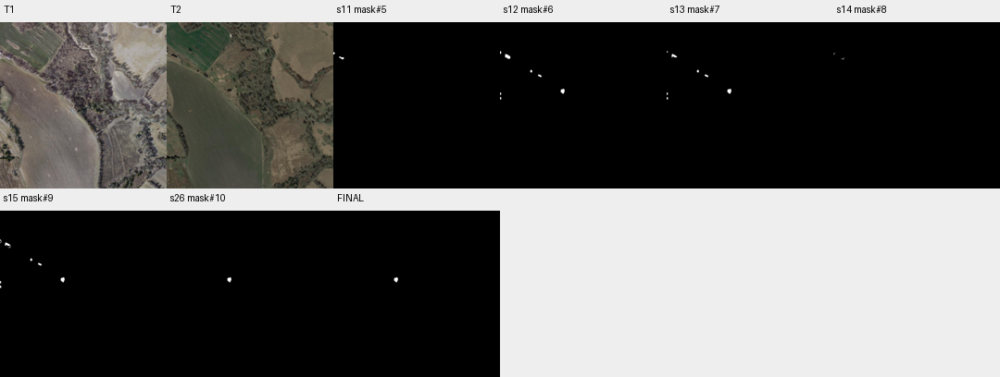

# case_01 完整轨迹

[交互回放](case_01.html#review) · [审查总表](20_case_review.md)



真实错误循环；重复拦截本身按既定策略执行

完整0–28步：分割匹配、局部查看后得到mask#9，但一直set_current=false。21步ask无当前答案失败，22步把mask输入仅接受实例的to_mask失败，23步重复被过滤，24步ask仍失败，25步借submit设为current才继续。最终保留544 FP、GT为空；误检另外涉及视觉判断，不能全归因于这四轮状态失败。

优先提供对已有mask的显式答案切换，保留Agent选择权；不自动采用最新候选，也不因空答案惩罚。

## 第 0 步

当前答案：None；离线评价：None


## 第 1 步

当前答案：None；离线评价：None

I need to find buildings that changed between T1 and T2. Let me start by examining both images more closely, particularly looking for building-related changes. I can see in T2 there appears to be a new building around coordinates (300-400, 450-500) that wasn't visible in T1. Let me segment buildings in both times to identify changes.


<details><summary>segment_text · 完整参数和返回</summary>


```json

{
  "tool": "segment_text",
  "args": {
    "time": "t1",
    "text": "building",
    "score_thr": 0.3
  },
  "ok": true,
  "error_code": null,
  "result_text": "{\"ok\":true,\"inst\":\"inst#0\",\"n\":2,\"area\":374,\"score\":{\"min\":0.70703125,\"median\":0.716796875,\"max\":0.7265625}}",
  "current_before": null,
  "current_after": null,
  "input_handles": [],
  "output_handles": [
    "inst#0"
  ],
  "eval": null,
  "candidate_eval": [],
  "set_current": null
}

```


</details>

## 第 2 步

当前答案：None；离线评价：None

I segmented buildings in T1 and found 2 instances. Let me also segment buildings in T2 to compare.


<details><summary>segment_text · 完整参数和返回</summary>


```json

{
  "tool": "segment_text",
  "args": {
    "time": "t2",
    "text": "building",
    "score_thr": 0.3
  },
  "ok": true,
  "error_code": null,
  "result_text": "{\"ok\":true,\"inst\":\"inst#1\",\"n\":7,\"area\":1864,\"score\":{\"min\":0.51953125,\"median\":0.5546875,\"max\":0.7265625}}",
  "current_before": null,
  "current_after": null,
  "input_handles": [],
  "output_handles": [
    "inst#1"
  ],
  "eval": null,
  "candidate_eval": [],
  "set_current": null
}

```


</details>

## 第 3 步

当前答案：None；离线评价：None

I have inst#0 for T1 buildings (2 instances) and inst#1 for T2 buildings (7 instances). Let me inspect both to see what's there, then match them to find changes.


<details><summary>inspect · 完整参数和返回</summary>


```json

{
  "tool": "inspect",
  "args": {
    "mask": "inst#0"
  },
  "ok": true,
  "error_code": null,
  "result_text": "{\"ok\":true,\"mask\":\"inst#0\",\"total_components\":2,\"returned\":2,\"has_more\":false,\"components\":[{\"id\":2,\"area\":272,\"bbox\":[35,211,65,229],\"score\":0.7265625},{\"id\":1,\"area\":102,\"bbox\":[0,184,10,200],\"score\":0.70703125}]}",
  "current_before": null,
  "current_after": null,
  "input_handles": [
    "inst#0"
  ],
  "output_handles": [],
  "eval": null,
  "candidate_eval": [],
  "set_current": null
}

```


</details>

<details><summary>inspect · 完整参数和返回</summary>


```json

{
  "tool": "inspect",
  "args": {
    "mask": "inst#1"
  },
  "ok": true,
  "error_code": null,
  "result_text": "{\"ok\":true,\"mask\":\"inst#1\",\"total_components\":7,\"returned\":7,\"has_more\":false,\"components\":[{\"id\":7,\"area\":642,\"bbox\":[31,196,64,227],\"score\":0.7265625},{\"id\":1,\"area\":544,\"bbox\":[373,409,397,441],\"score\":0.625},{\"id\":6,\"area\":218,\"bbox\":[234,322,256,338],\"score\":0.5546875},{\"id\":5,\"area\":158,\"bbox\":[186,293,198,310],\"score\":0.62890625},{\"id\":3,\"area\":111,\"bbox\":[0,178,8,197],\"score\":0.51953125},{\"id\":4,\"area\":102,\"bbox\":[0,461,8,476],\"score\":0.53515625},{\"id\":2,\"area\":89,\"bbox\":[0,434,7,449],\"score\":0.546875}]}",
  "current_before": null,
  "current_after": null,
  "input_handles": [
    "inst#1"
  ],
  "output_handles": [],
  "eval": null,
  "candidate_eval": [],
  "set_current": null
}

```


</details>

## 第 4 步

当前答案：None；离线评价：None

I see T1 has 2 building instances (IDs 1 and 2) with bboxes around [0,184,10,200] and [35,211,65,229]. T2 has 7 instances. Let me match instances between T1 and T2 to find which ones are present, appeared, or disappeared.


<details><summary>match_instances · 完整参数和返回</summary>


```json

{
  "tool": "match_instances",
  "args": {
    "inst_t1": "inst#0",
    "inst_t2": "inst#1",
    "overlap_thr": 0.25
  },
  "ok": true,
  "error_code": null,
  "result_text": "{\"ok\":true,\"appeared\":\"inst#2\",\"appeared_n\":5,\"disappeared\":\"inst#3\",\"disappeared_n\":0,\"present_t2\":\"inst#4\",\"present_t2_n\":2}",
  "current_before": null,
  "current_after": null,
  "input_handles": [
    "inst#0",
    "inst#1"
  ],
  "output_handles": [
    "inst#2",
    "inst#3",
    "inst#4"
  ],
  "eval": null,
  "candidate_eval": [],
  "set_current": null
}

```


</details>

## 第 5 步

当前答案：None；离线评价：None

The match shows 5 appeared instances and 0 disappeared, with 2 present. But I need to verify these are actual building changes and not false positives (like shadows or vehicles). Let me view the T1 and T2 images with overlays to see what's happening, particularly around the areas where new buildings might be.

Let me first look at the regions more carefully. The T1 has buildings at [0,184,10,200] and [35,211,65,229]. In T2, there are instances at similar locations plus new ones. Let me view specific regions to understand what changed.


<details><summary>view · 完整参数和返回</summary>


```json

{
  "tool": "view",
  "args": {
    "region": [
      0,
      150,
      100,
      250
    ],
    "overlay": "inst#0",
    "label_components": true
  },
  "ok": false,
  "error_code": "bad_args",
  "result_text": "{\"ok\":false,\"error_code\":\"bad_args\",\"message\":\"Component labels need a mask handle; call to_mask first.\"}",
  "current_before": null,
  "current_after": null,
  "input_handles": [
    "inst#0"
  ],
  "output_handles": [],
  "eval": null,
  "candidate_eval": [],
  "set_current": null
}

```


</details>

## 第 6 步

当前答案：None；离线评价：None

Let me view the region without overlay first to see the actual images, then I'll create a mask from the instances.


<details><summary>view · 完整参数和返回</summary>


```json

{
  "tool": "view",
  "args": {
    "region": [
      0,
      150,
      100,
      250
    ]
  },
  "ok": true,
  "error_code": null,
  "result_text": "{\"ok\":true,\"view_id\":\"view#1\",\"region\":[0,150,100,250],\"overlay\":null,\"display_size\":[768,768],\"image_size\":[796,796],\"scale\":7.68,\"padding\":[28,28],\"labelled_ids\":[],\"unlabelled_count\":0}",
  "current_before": null,
  "current_after": null,
  "input_handles": [],
  "output_handles": [],
  "eval": null,
  "candidate_eval": [],
  "set_current": null
}

```


</details>

## 第 7 步

当前答案：None；离线评价：None

I can see in this region (around [0,150,100,250]) that there's a building visible in both T1 and T2. In T1, I see what appears to be a building with a white/light roof around y=200-225. In T2, the same area shows a building but it looks different - possibly the same building or a changed one. Let me look at other regions where new buildings might have appeared.

Looking at the T2 instances, I see instance ID 1 at bbox [373,409,397,441] which is a new location not present in T1. Let me view that area.


<details><summary>view · 完整参数和返回</summary>


```json

{
  "tool": "view",
  "args": {
    "region": [
      350,
      380,
      420,
      460
    ]
  },
  "ok": true,
  "error_code": null,
  "result_text": "{\"ok\":true,\"view_id\":\"view#2\",\"region\":[350,380,420,460],\"overlay\":null,\"display_size\":[672,768],\"image_size\":[700,796],\"scale\":9.6,\"padding\":[28,28],\"labelled_ids\":[],\"unlabelled_count\":0}",
  "current_before": null,
  "current_after": null,
  "input_handles": [],
  "output_handles": [],
  "eval": null,
  "candidate_eval": [],
  "set_current": null
}

```


</details>

## 第 8 步

当前答案：None；离线评价：None

I can see in this region (around [350,380,420,460]) that T1 shows vegetation/ground with no clear building, while T2 shows a clear building structure (dark roof with lighter walls). This is a newly constructed building - a change!

Let me also check the other new instances in T2. I saw instance ID 6 at [234,322,256,338], ID 5 at [186,293,198,310], and others near x=0. Let me view those areas to verify they are actual building changes.


<details><summary>view · 完整参数和返回</summary>


```json

{
  "tool": "view",
  "args": {
    "region": [
      170,
      280,
      270,
      350
    ]
  },
  "ok": true,
  "error_code": null,
  "result_text": "{\"ok\":true,\"view_id\":\"view#3\",\"region\":[170,280,270,350],\"overlay\":null,\"display_size\":[768,538],\"image_size\":[796,566],\"scale\":7.68,\"padding\":[28,28],\"labelled_ids\":[],\"unlabelled_count\":0}",
  "current_before": null,
  "current_after": null,
  "input_handles": [],
  "output_handles": [],
  "eval": null,
  "candidate_eval": [],
  "set_current": null
}

```


</details>

## 第 9 步

当前答案：None；离线评价：None

In this region [170,280,270,350], T1 shows vegetation/ground with no clear building, while T2 shows what appears to be small structures (possibly buildings or vehicles). I see dark shapes that could be buildings. Let me check if these are actual buildings or just shadows/vehicles. The instance at [186,293,198,310] (ID 5) and [234,322,256,338] (ID 6) in T2 might be new buildings.

Let me also check the area near x=0 where there are several instances in T2 (IDs 3, 4, 2). These might correspond to the T1 buildings that were detected.


<details><summary>view · 完整参数和返回</summary>


```json

{
  "tool": "view",
  "args": {
    "region": [
      0,
      170,
      80,
      240
    ]
  },
  "ok": true,
  "error_code": null,
  "result_text": "{\"ok\":true,\"view_id\":\"view#4\",\"region\":[0,170,80,240],\"overlay\":null,\"display_size\":[768,672],\"image_size\":[796,700],\"scale\":9.6,\"padding\":[28,28],\"labelled_ids\":[],\"unlabelled_count\":0}",
  "current_before": null,
  "current_after": null,
  "input_handles": [],
  "output_handles": [],
  "eval": null,
  "candidate_eval": [],
  "set_current": null
}

```


</details>

## 第 10 步

当前答案：None；离线评价：None

In this region [0,170,80,240], I can see:
- T1 has a building with white/light roof visible around y=188-225
- T2 shows the same area but the building appears different - it looks like a larger structure with dark roof and lighter walls. This could be the same building that was rebuilt/renovated, or it could be a different building.

Looking at the match results: 2 present instances (meaning they exist in both times), 5 appeared (new in T2), 0 disappeared. But I need to verify which of the "appeared" are actual building changes vs false positives (like shadows, vehicles, etc.).

Let me create a mask from the T2 instances that appeared and check them more carefully. First, let me select the appeared instances and create a change mask.

From the match: appeared="inst#2" with n=5. Let me get those instance IDs.


<details><summary>select · 完整参数和返回</summary>


```json

{
  "tool": "select",
  "args": {
    "set": "inst#1",
    "where": "id in (1, 2, 3, 4, 5, 6, 7)"
  },
  "ok": false,
  "error_code": "bad_args",
  "result_text": "{\"ok\":false,\"error_code\":\"bad_args\",\"message\":\"where allows only score/area, comparisons, numbers and and/or.\"}",
  "current_before": null,
  "current_after": null,
  "input_handles": [
    "inst#1"
  ],
  "output_handles": [],
  "eval": null,
  "candidate_eval": [],
  "set_current": null
}

```


</details>

## 第 11 步

当前答案：None；离线评价：None

I need to select instances from inst#1. Let me first understand which instances are the "appeared" ones by looking at the match result more carefully. The match returned appeared="inst#2" with n=5, but I need to know which specific instance IDs in inst#1 correspond to the appeared ones.

Let me create a mask from all T2 instances and then use the match to identify changes. Actually, let me take a different approach - I'll create masks for T1 and T2 buildings separately, then compute the difference to find changes.

First, let me convert the instance sets to masks:


<details><summary>to_mask · 完整参数和返回</summary>


```json

{
  "tool": "to_mask",
  "args": {
    "sets": [
      "inst#0"
    ],
    "set_current": false
  },
  "ok": true,
  "error_code": null,
  "result_text": "{\"ok\":true,\"mask\":\"mask#5\",\"area\":374,\"component_count\":2}",
  "current_before": null,
  "current_after": null,
  "input_handles": [
    "inst#0"
  ],
  "output_handles": [
    "mask#5"
  ],
  "eval": null,
  "candidate_eval": [
    {
      "handle": "mask#5",
      "parent": null,
      "tp": 0,
      "fp": 374,
      "fn": 0,
      "f1": 0.0,
      "iou": 0.0
    }
  ],
  "set_current": false
}

```


</details>

## 第 12 步

当前答案：None；离线评价：None

I have mask#5 for T1 buildings. Now let me create a mask for T2 buildings.


<details><summary>to_mask · 完整参数和返回</summary>


```json

{
  "tool": "to_mask",
  "args": {
    "sets": [
      "inst#1"
    ],
    "set_current": false
  },
  "ok": true,
  "error_code": null,
  "result_text": "{\"ok\":true,\"mask\":\"mask#6\",\"area\":1864,\"component_count\":7}",
  "current_before": null,
  "current_after": null,
  "input_handles": [
    "inst#1"
  ],
  "output_handles": [
    "mask#6"
  ],
  "eval": null,
  "candidate_eval": [
    {
      "handle": "mask#6",
      "parent": null,
      "tp": 0,
      "fp": 1864,
      "fn": 0,
      "f1": 0.0,
      "iou": 0.0
    }
  ],
  "set_current": false
}

```


</details>

## 第 13 步

当前答案：None；离线评价：None

I have mask#5 (T1 buildings) and mask#6 (T2 buildings). The change mask should be the parts of T2 that are not in T1 (new buildings) plus any parts of T1 that are not in T2 (demolished buildings). Let me compute this.

First, let me find what's new in T2 (mask#6 minus mask#5):


<details><summary>combine · 完整参数和返回</summary>


```json

{
  "tool": "combine",
  "args": {
    "op": "subtract",
    "a": "mask#6",
    "b": "mask#5",
    "set_current": false
  },
  "ok": true,
  "error_code": null,
  "result_text": "{\"ok\":true,\"mask\":\"mask#7\",\"area\":1578,\"component_count\":7,\"added_px\":0,\"removed_px\":286}",
  "current_before": null,
  "current_after": null,
  "input_handles": [
    "mask#6",
    "mask#5"
  ],
  "output_handles": [
    "mask#7"
  ],
  "eval": null,
  "candidate_eval": [
    {
      "handle": "mask#7",
      "parent": "mask#6",
      "tp": 0,
      "fp": 1578,
      "fn": 0,
      "f1": 0.0,
      "iou": 0.0,
      "delta_f1_from_parent": 0.0
    }
  ],
  "set_current": false
}

```


</details>

## 第 14 步

当前答案：None；离线评价：None

I have mask#7 which is T2 buildings minus T1 buildings (new construction). Now I also need to check for demolished buildings (T1 minus T2). Let me compute that:


<details><summary>combine · 完整参数和返回</summary>


```json

{
  "tool": "combine",
  "args": {
    "op": "subtract",
    "a": "mask#5",
    "b": "mask#6",
    "set_current": false
  },
  "ok": true,
  "error_code": null,
  "result_text": "{\"ok\":true,\"mask\":\"mask#8\",\"area\":88,\"component_count\":4,\"added_px\":0,\"removed_px\":286}",
  "current_before": null,
  "current_after": null,
  "input_handles": [
    "mask#5",
    "mask#6"
  ],
  "output_handles": [
    "mask#8"
  ],
  "eval": null,
  "candidate_eval": [
    {
      "handle": "mask#8",
      "parent": "mask#5",
      "tp": 0,
      "fp": 88,
      "fn": 0,
      "f1": 0.0,
      "iou": 0.0,
      "delta_f1_from_parent": 0.0
    }
  ],
  "set_current": false
}

```


</details>

## 第 15 步

当前答案：None；离线评价：None

I have mask#7 (new buildings in T2) and mask#8 (demolished buildings from T1). The total change mask should be the union of these two. Let me combine them:


<details><summary>combine · 完整参数和返回</summary>


```json

{
  "tool": "combine",
  "args": {
    "op": "union",
    "a": "mask#7",
    "b": "mask#8",
    "set_current": false
  },
  "ok": true,
  "error_code": null,
  "result_text": "{\"ok\":true,\"mask\":\"mask#9\",\"area\":1666,\"component_count\":11,\"added_px\":88,\"removed_px\":0}",
  "current_before": null,
  "current_after": null,
  "input_handles": [
    "mask#7",
    "mask#8"
  ],
  "output_handles": [
    "mask#9"
  ],
  "eval": null,
  "candidate_eval": [
    {
      "handle": "mask#9",
      "parent": "mask#7",
      "tp": 0,
      "fp": 1666,
      "fn": 0,
      "f1": 0.0,
      "iou": 0.0,
      "delta_f1_from_parent": 0.0
    }
  ],
  "set_current": false
}

```


</details>

## 第 16 步

当前答案：None；离线评价：None

I have mask#9 which is the union of new and demolished building changes. However, I need to verify that these are actual building changes and not false positives (like shadows, vehicles, or misregistration artifacts). Let me view the components of this mask to check them.


<details><summary>inspect · 完整参数和返回</summary>


```json

{
  "tool": "inspect",
  "args": {
    "mask": "mask#9"
  },
  "ok": true,
  "error_code": null,
  "result_text": "{\"ok\":true,\"mask\":\"mask#9\",\"total_components\":11,\"returned\":11,\"has_more\":false,\"components\":[{\"id\":9,\"area\":544,\"bbox\":[373,409,397,441]},{\"id\":3,\"area\":422,\"bbox\":[31,196,64,218]},{\"id\":8,\"area\":218,\"bbox\":[234,322,256,338]},{\"id\":7,\"area\":158,\"bbox\":[186,293,198,310]},{\"id\":11,\"area\":102,\"bbox\":[0,461,8,476]},{\"id\":10,\"area\":89,\"bbox\":[0,434,7,449]},{\"id\":4,\"area\":50,\"bbox\":[47,218,65,229]},{\"id\":1,\"area\":45,\"bbox\":[0,178,8,187]},{\"id\":2,\"area\":36,\"bbox\":[0,188,10,200]},{\"id\":5,\"area\":1,\"bbox\":[42,220,43,221]},{\"id\":6,\"area\":1,\"bbox\":[45,222,46,223]}]}",
  "current_before": null,
  "current_after": null,
  "input_handles": [
    "mask#9"
  ],
  "output_handles": [],
  "eval": null,
  "candidate_eval": [],
  "set_current": null
}

```


</details>

## 第 17 步

当前答案：None；离线评价：None

I have 11 components in the change mask. Let me analyze them:

1. Component 9 (area 544, bbox [373,409,397,441]) - This is the new building I saw earlier at around (373-397, 409-441). This looks like a genuine new building.

2. Component 3 (area 422, bbox [31,196,64,218]) - This is near the existing building area. Need to check if this is a real change or just edge effects.

3. Component 8 (area 218, bbox [234,322,256,338]) - New instance in T2, need to verify it's a building.

4. Component 7 (area 158, bbox [186,293,198,310]) - Another new instance in T2, need to verify.

5. Components 11, 10 (areas 102, 89) - Near x=0, y=434-476. These might be related to the T1 buildings that were detected.

6. Components 4, 1, 2 (small areas near x=0, y=178-229) - These are likely edge artifacts from the T1 buildings.

7. Components 5, 6 (area 1 each) - Very small, likely noise/edge artifacts.

Let me view some of these regions to verify they are actual building changes. First, let me look at component 9 which I already confirmed is a new building.


<details><summary>view · 完整参数和返回</summary>


```json

{
  "tool": "view",
  "args": {
    "region": [
      350,
      380,
      420,
      460
    ],
    "overlay": "mask#9",
    "label_components": true,
    "ids": [
      9
    ]
  },
  "ok": true,
  "error_code": null,
  "result_text": "{\"ok\":true,\"view_id\":\"view#5\",\"region\":[350,380,420,460],\"overlay\":\"mask#9\",\"display_size\":[672,768],\"image_size\":[700,796],\"scale\":9.6,\"padding\":[28,28],\"labelled_ids\":[9],\"unlabelled_count\":0}",
  "current_before": null,
  "current_after": null,
  "input_handles": [
    "mask#9"
  ],
  "output_handles": [],
  "eval": null,
  "candidate_eval": [],
  "set_current": null
}

```


</details>

## 第 18 步

当前答案：None；离线评价：None

Component 9 is clearly a new building - T1 shows vegetation/ground, T2 shows a clear building structure. This is a valid change.

Now let me check component 3 (bbox [31,196,64,218]) which is near the existing building area:


<details><summary>view · 完整参数和返回</summary>


```json

{
  "tool": "view",
  "args": {
    "region": [
      0,
      170,
      100,
      250
    ],
    "overlay": "mask#9",
    "label_components": true,
    "ids": [
      3
    ]
  },
  "ok": true,
  "error_code": null,
  "result_text": "{\"ok\":true,\"view_id\":\"view#6\",\"region\":[0,170,100,250],\"overlay\":\"mask#9\",\"display_size\":[768,614],\"image_size\":[796,642],\"scale\":7.68,\"padding\":[28,28],\"labelled_ids\":[3],\"unlabelled_count\":0}",
  "current_before": null,
  "current_after": null,
  "input_handles": [
    "mask#9"
  ],
  "output_handles": [],
  "eval": null,
  "candidate_eval": [],
  "set_current": null
}

```


</details>

## 第 19 步

当前答案：None；离线评价：None

Component 3 shows a building that exists in both T1 and T2, but the mask is capturing the difference between them. Looking at T1 vs T2, the building appears to have changed - in T1 it has a white/light roof, in T2 it has a dark roof with lighter walls. This could be a building that was rebuilt or renovated. However, I need to be careful - this might just be the same building with different appearance due to seasonal/illumination changes, which should NOT count as a change.

Looking more carefully: In T1, there's a building with white roof visible. In T2, the same location shows a different-looking building (dark roof). This could be either:
1. The same building with different appearance (not a change)
2. A demolished and rebuilt structure (a change)

The fact that the segmentation detected it as a "change" (part of mask#9) suggests the SAM model sees it as different. But I need to verify if this is actually a building change or just illumination/shadow differences.

Let me also check components 8 and 7 which are new instances in T2:


<details><summary>view · 完整参数和返回</summary>


```json

{
  "tool": "view",
  "args": {
    "region": [
      170,
      280,
      270,
      350
    ],
    "overlay": "mask#9",
    "label_components": true,
    "ids": [
      7,
      8
    ]
  },
  "ok": true,
  "error_code": null,
  "result_text": "{\"ok\":true,\"view_id\":\"view#7\",\"region\":[170,280,270,350],\"overlay\":\"mask#9\",\"display_size\":[768,538],\"image_size\":[796,566],\"scale\":7.68,\"padding\":[28,28],\"labelled_ids\":[7,8],\"unlabelled_count\":0}",
  "current_before": null,
  "current_after": null,
  "input_handles": [
    "mask#9"
  ],
  "output_handles": [],
  "eval": null,
  "candidate_eval": [],
  "set_current": null
}

```


</details>

## 第 20 步

当前答案：None；离线评价：None

Looking at components 7 and 8:
- Component 7 (bbox [186,293,198,310]): In T1, this area shows vegetation/ground with no clear building. In T2, there's a small dark structure that could be a building or vehicle. The shape looks like it could be a small building or shed.
- Component 8 (bbox [234,322,256,338]): Similar situation - T1 shows ground/vegetation, T2 shows a dark elongated structure.

These could be new small buildings, but they might also be vehicles or temporary structures which should NOT count as building changes. Let me look more carefully at these regions to determine if they are actual buildings.

Let me also check the small components near x=0 (components 11, 10, 4, 1, 2) which might be edge artifacts from the existing T1 buildings:


<details><summary>view · 完整参数和返回</summary>


```json

{
  "tool": "view",
  "args": {
    "region": [
      0,
      170,
      80,
      240
    ],
    "overlay": "mask#9",
    "label_components": true,
    "ids": [
      1,
      2,
      4,
      10,
      11
    ]
  },
  "ok": true,
  "error_code": null,
  "result_text": "{\"ok\":true,\"view_id\":\"view#8\",\"region\":[0,170,80,240],\"overlay\":\"mask#9\",\"display_size\":[768,672],\"image_size\":[796,700],\"scale\":9.6,\"padding\":[28,28],\"labelled_ids\":[1,2,4],\"unlabelled_count\":0}",
  "current_before": null,
  "current_after": null,
  "input_handles": [
    "mask#9"
  ],
  "output_handles": [],
  "eval": null,
  "candidate_eval": [],
  "set_current": null
}

```


</details>

## 第 21 步

当前答案：None；离线评价：None

Looking at components 1, 2, and 4 in this region:
- Component 1 (bbox [0,178,8,187]) and Component 2 (bbox [0,188,10,200]): These are very small edge pieces near x=0. They appear to be edge artifacts from the existing building that was detected in T1. In both T1 and T2, there's a building visible on the left edge. The difference here is likely just misregistration or edge effects, not an actual building change.
- Component 4 (bbox [47,218,65,229]): This is part of the larger building structure. Looking at T1 vs T2, the building appears to have changed appearance (white roof in T1 vs dark roof in T2). This could be a rebuilt building or just illumination differences.

The key question is whether component 3 (the main part of the building at [31,196,64,218]) represents a real building change or just illumination/shadow differences. Looking at the images:
- T1: Building with white/light roof
- T2: Building with dark roof and lighter walls

This looks like it could be the same building with different seasonal appearance, OR it could be a demolished and rebuilt structure. The fact that SAM detected it as a change suggests there's a significant difference, but I need to determine if it's a valid "building change" per the rules.

According to the rules: "Does NOT count: shadows, seasonal, illumination or color/tone differences of the same building". So if this is just the same building with different appearance, it should NOT be counted.

However, looking more carefully at the images, the building in T2 appears to have a different shape/structure compared to T1. In T1, it's a long rectangular building with white roof. In T2, it appears to be a different structure with dark roof. This could indicate a demolished and rebuilt scenario.

Let me also check the other new instances (components 7 and 8) more carefully to see if they are actual buildings or vehicles/temporary structures.

Actually, let me take a step back and use the verifier to check these regions. Let me ask the verifier about the current mask components.


<details><summary>ask · 完整参数和返回</summary>


```json

{
  "tool": "ask",
  "args": {},
  "ok": false,
  "error_code": "bad_args",
  "result_text": "{\"ok\":false,\"error_code\":\"bad_args\",\"message\":\"There is no current answer; pass regions with a mask handle.\"}",
  "current_before": null,
  "current_after": null,
  "input_handles": [],
  "output_handles": [],
  "eval": null,
  "candidate_eval": [],
  "set_current": null
}

```


</details>

## 第 22 步

当前答案：None；离线评价：None

I need to set mask#9 as the current answer first, then ask the verifier. Let me do that:


<details><summary>to_mask · 完整参数和返回</summary>


```json

{
  "tool": "to_mask",
  "args": {
    "sets": [
      "mask#9"
    ],
    "set_current": true
  },
  "ok": false,
  "error_code": "bad_handle",
  "result_text": "{\"ok\":false,\"error_code\":\"bad_handle\",\"message\":\"Expected a inst handle.\"}",
  "current_before": null,
  "current_after": null,
  "input_handles": [
    "mask#9"
  ],
  "output_handles": [],
  "eval": null,
  "candidate_eval": [],
  "set_current": true
}

```


</details>

## 第 23 步

当前答案：None；离线评价：None

I need to use a mask handle, not an inst handle. Let me set mask#9 as current answer properly:


## 第 24 步

当前答案：None；离线评价：None

I see that `to_mask` expects instance sets, not mask handles. Let me use a different approach - I'll set the current answer by using the mask directly. Actually, looking at the tool description, `to_mask` converts instance sets to a binary mask and can set it as current. But I already have mask#9 as a mask handle. Let me try to use `combine` or another method to set it as current.

Actually, re-reading the rules: "By default a mask returned by a mask tool becomes your current answer". So when I created mask#9 using `combine`, it should have become the current answer. Let me verify by asking the verifier now.


<details><summary>ask · 完整参数和返回</summary>


```json

{
  "tool": "ask",
  "args": {},
  "ok": false,
  "error_code": "bad_args",
  "result_text": "{\"ok\":false,\"error_code\":\"bad_args\",\"message\":\"There is no current answer; pass regions with a mask handle.\"}",
  "current_before": null,
  "current_after": null,
  "input_handles": [],
  "output_handles": [],
  "eval": null,
  "candidate_eval": [],
  "set_current": null
}

```


</details>

## 第 25 步

当前答案：mask#9；离线评价：{'tp': 0, 'fp': 1666, 'fn': 0, 'f1': 0.0, 'iou': 0.0, 'delta_f1': None}

I need to set a current answer. Let me use `to_mask` with an instance set, or I can create a mask from the current answer. Actually, looking at the tools again, I think I need to use `submit` with the mask handle directly. But first, let me verify the mask components by asking the verifier about specific regions.

Let me try to set mask#9 as current by using it in a tool call that sets current. Actually, the issue is that `to_mask` expects instance handles, not mask handles. Let me try a different approach - I'll use `combine` with itself or just submit with mask#9.

Actually, re-reading the rules: "By default the returned mask becomes your current answer" for most tools. When I called `combine` to create mask#9, it should have been set as current. But the `ask` function says "There is no current answer". This might mean I need to explicitly set it.

Let me try to use `select` on an instance set and then convert to mask, or I can just submit with mask#9 directly.


<details><summary>submit · 完整参数和返回</summary>


```json

{
  "tool": "submit",
  "args": {
    "mask": "mask#9",
    "summary": "Initial change mask with 11 components. Need verification."
  },
  "ok": true,
  "error_code": null,
  "result_text": "{\"ok\":true,\"submitted\":false,\"report\":\"Report before submission. Every run gets this report as the first response to submit; it does not judge the mask, and nothing has to change. mask#9 is now your current answer: 1666 pixels in 11 components.\\nThe verifier has just checked the 11 components that had no answer.\\nVerifier answers on mask#9: 2 yes, 9 no, 0 unparsed, 0 with no answer. An answer applies only to the exact outline it was about; a view is not an answer.\\n  IDs answered yes: [9, 5]\\n  IDs answered no: [3, 8, 7, 11, 10, 4, 1, 2, 6]\\n  answered no: id=3 area=422 bbox=[31, 196, 64, 218] type=seasonal_or_color p_yes=0.0 reason=The same building structure is visible in both dates, with the dark area in T2 appearing to be a shadow or change in roo\\n  answered no: id=8 area=218 bbox=[234, 322, 256, 338] type=no_change p_yes=0.0 reason=The object within the red contour maintains a consistent shape, size, and position relative to the road in both dates, i\\n  answered no: id=7 area=158 bbox=[186, 293, 198, 310] type=non_building_change p_yes=0.0 reason=The object inside the contour is not a building but appears to be a patch of vegetation or ground cover that has changed\\n  answered no: id=11 area=102 bbox=[0, 461, 8, 476] type=seasonal_or_color p_yes=0.0 reason=The object within the red contour maintains a consistent shape and position across both dates, with the apparent differe\\n  answered no: id=10 area=89 bbox=[0, 434, 7, 449] type=non_building_change p_yes=0.0 reason=The object inside the contour is not a building but appears to be vegetation or ground cover that has changed appearance\\n  answered no: id=4 area=50 bbox=[47, 218, 65, 229] type=seasonal_or_color p_yes=0.0 reason=The building outline and position relative to the road remain consistent between T1 and T2, with the apparent color and \\n  answered no: id=1 area=45 bbox=[0, 178, 8, 187] type=no_change p_yes=0.0 reason=The red contour marks the same white building structure in both T1 and T2, with no evidence of demolition or new constru\\n  answered no: id=2 area=36 bbox=[0, 188, 10, 200] type=no_change p_yes=0.0 reason=The red contour marks the same white building in both dates, showing consistent shape and position relative to fixed sur\\n  answered no: id=6 area=1 bbox=[45, 222, 46, 223] type=seasonal_or_color p_yes=0.0 reason=The building at the red contour is present in both dates with the same outline and structure, but shows a different roof\\nA verifier answer is evidence, not an order, and it can be wrong in both directions. No answer is not an error. To finish with this mask, call submit with mask#9 again. To change it, edit and submit the new handle; components the verifier has not seen will be reported again. In the summary, say what you changed, and why you went against any verifier answer. You have 5 replies left.\"}",
  "current_before": null,
  "current_after": "mask#9",
  "input_handles": [
    "mask#9"
  ],
  "output_handles": [],
  "eval": {
    "tp": 0,
    "fp": 1666,
    "fn": 0,
    "f1": 0.0,
    "iou": 0.0,
    "delta_f1": null
  },
  "candidate_eval": [],
  "set_current": null
}

```


</details>

## 第 26 步

当前答案：mask#10；离线评价：{'tp': 0, 'fp': 544, 'fn': 0, 'f1': 0.0, 'iou': 0.0, 'delta_f1': 0.0}

The verifier has checked all 11 components. The results show:
- **YES (keep)**: IDs 9 and 5
- **NO (remove)**: IDs 3, 8, 7, 11, 10, 4, 1, 2, 6

Key findings from the verifier:
- ID 9 (area 544, bbox [373,409,397,441]): YES - This is a new building (confirmed earlier)
- ID 5 (area 1, bbox [42,220,43,221]): YES - Very small component, need to check
- All other IDs are marked as NO for various reasons (seasonal/color differences, non-building changes, no_change)

The verifier says ID 5 is "yes" but it's only 1 pixel area. Let me check what ID 5 is - it's at [42,220,43,221] which is a tiny 1x1 pixel region. This might be an edge artifact that the verifier incorrectly marked as yes.

Let me remove all the "no" components and keep only the "yes" ones. But first, let me verify ID 5 more carefully. Actually, looking at the verifier answers:
- ID 5 was answered "yes" but it's only 1 pixel. This seems like it might be a false positive or edge artifact.

Let me remove all components except ID 9 (the clear new building). But wait, I should also check if there are any other valid changes I might have missed.

Actually, looking at the verifier report again:
- ID 9: YES (new building at [373,409,397,441])
- ID 5: YES (tiny 1-pixel component at [42,220,43,221])

All others are NO. The verifier is saying that most of the detected changes are either:
1. Seasonal/color differences of the same building (IDs 3, 4, 6, 11)
2. Non-building changes like vegetation (IDs 7, 10)
3. No change (IDs 1, 2, 8)

So the only real building change appears to be ID 9 (the new building). ID 5 is suspiciously small (1 pixel) and might be noise.

Let me remove all components except ID 9. First, I need to create a new mask with only ID 9.


<details><summary>remove_region · 完整参数和返回</summary>


```json

{
  "tool": "remove_region",
  "args": {
    "mask": "mask#9",
    "ids": [
      1,
      2,
      3,
      4,
      5,
      6,
      7,
      8,
      10,
      11
    ],
    "set_current": true
  },
  "ok": true,
  "error_code": null,
  "result_text": "{\"ok\":true,\"mask\":\"mask#10\",\"area\":544,\"component_count\":1,\"added_px\":0,\"removed_px\":1122,\"current_mask\":{\"before\":\"mask#9\",\"after\":\"mask#10\"}}",
  "current_before": "mask#9",
  "current_after": "mask#10",
  "input_handles": [
    "mask#9"
  ],
  "output_handles": [
    "mask#10"
  ],
  "eval": {
    "tp": 0,
    "fp": 544,
    "fn": 0,
    "f1": 0.0,
    "iou": 0.0,
    "delta_f1": 0.0
  },
  "candidate_eval": [
    {
      "handle": "mask#10",
      "parent": "mask#9",
      "tp": 0,
      "fp": 544,
      "fn": 0,
      "f1": 0.0,
      "iou": 0.0,
      "delta_f1_from_parent": 0.0
    }
  ],
  "set_current": true
}

```


</details>

## 第 27 步

当前答案：mask#10；离线评价：{'tp': 0, 'fp': 544, 'fn': 0, 'f1': 0.0, 'iou': 0.0, 'delta_f1': 0.0}

I've removed all components except ID 9, which is the new building at [373,409,397,441]. The verifier previously answered "yes" for ID 9, confirming it's a valid building change. Now I have mask#10 with only this component.

Let me verify this is correct by viewing the region one more time to confirm it's a genuine new building:


<details><summary>view · 完整参数和返回</summary>


```json

{
  "tool": "view",
  "args": {
    "region": [
      350,
      380,
      420,
      460
    ],
    "overlay": "mask#10",
    "label_components": true,
    "ids": [
      9
    ]
  },
  "ok": true,
  "error_code": null,
  "result_text": "{\"ok\":true,\"view_id\":\"view#9\",\"region\":[350,380,420,460],\"overlay\":\"mask#10\",\"display_size\":[672,768],\"image_size\":[700,796],\"scale\":9.6,\"padding\":[28,28],\"labelled_ids\":[9],\"unlabelled_count\":0}",
  "current_before": "mask#10",
  "current_after": "mask#10",
  "input_handles": [
    "mask#10"
  ],
  "output_handles": [],
  "eval": {
    "tp": 0,
    "fp": 544,
    "fn": 0,
    "f1": 0.0,
    "iou": 0.0,
    "delta_f1": 0.0
  },
  "candidate_eval": [],
  "set_current": null
}

```


</details>

## 第 28 步

当前答案：mask#10；离线评价：{'tp': 0, 'fp': 544, 'fn': 0, 'f1': 0.0, 'iou': 0.0, 'delta_f1': 0.0}

The view confirms that component 9 is a genuine new building:
- T1: Shows vegetation/ground with no building structure
- T2: Shows a clear building with dark roof and lighter walls

This is a valid newly constructed building. The verifier answered "yes" for this component, confirming it's a real building change.

I have mask#10 with only this one valid component. Let me submit this as the final answer.


<details><summary>submit · 完整参数和返回</summary>


```json

{
  "tool": "submit",
  "args": {
    "mask": "mask#10",
    "summary": "One newly constructed building detected at bbox [373,409,397,441]. T1 shows vegetation/ground, T2 shows a clear building with dark roof. Verifier confirmed this as a valid building change (ID 9: yes). All other initially detected components were removed as they were either seasonal/color differences of existing buildings, non-building changes (vegetation), or edge artifacts."
  },
  "ok": true,
  "error_code": null,
  "result_text": "{\"ok\":true,\"mask\":\"mask#10\",\"area\":544,\"component_count\":1,\"current_mask\":{\"before\":\"mask#10\",\"after\":\"mask#10\"},\"submitted\":true}",
  "current_before": "mask#10",
  "current_after": "mask#10",
  "input_handles": [
    "mask#10"
  ],
  "output_handles": [],
  "eval": {
    "tp": 0,
    "fp": 544,
    "fn": 0,
    "f1": 0.0,
    "iou": 0.0,
    "delta_f1": 0.0
  },
  "candidate_eval": [],
  "set_current": null
}

```


</details>
