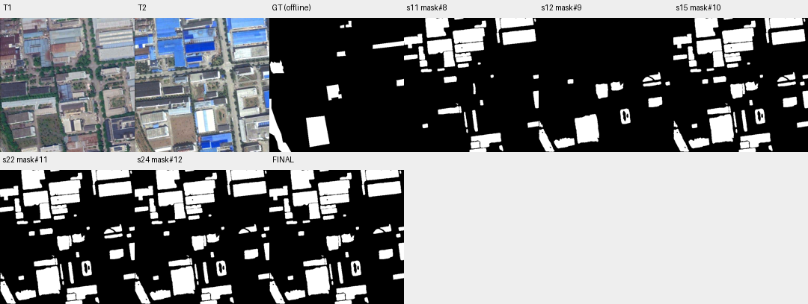

# case_02 完整轨迹

[交互回放](case_02.html#review) · [审查总表](20_case_review.md)



真实ask/to_mask双调用失败循环

完整0–27步：前期提议和特征未转化为合理选择，后用蓝屋顶与裸土候选。18–21步在无current与mask误传to_mask间重复；22步union(mask#10,mask#10)只为设置current，生成像素相同新句柄；随后核验和提交。mask#9 F1=50.22，合并屋顶后最终23.66；GT及图像显示把既有屋顶翻色当跨类变化，状态修复不能独自解决语义问题。

用显式答案切换替代恒等union；历史T1.3只作诊断，不改该任务或在其上做新实验。

## 第 0 步

当前答案：None；离线评价：None


## 第 1 步

当前答案：None；离线评价：None

I need to find all land-cover changes between T1 and T2. Let me start by examining both images more carefully to identify what has changed.


<details><summary>view · 完整参数和返回</summary>


```json

{
  "tool": "view",
  "args": {
    "region": [
      0,
      0,
      512,
      512
    ]
  },
  "ok": true,
  "error_code": null,
  "result_text": "{\"ok\":true,\"view_id\":\"view#1\",\"region\":[0,0,512,512],\"overlay\":null,\"display_size\":[768,768],\"image_size\":[796,796],\"scale\":1.5,\"padding\":[28,28],\"labelled_ids\":[],\"unlabelled_count\":0}",
  "current_before": null,
  "current_after": null,
  "input_handles": [],
  "output_handles": [],
  "eval": null,
  "candidate_eval": [],
  "set_current": null
}

```


</details>

## 第 2 步

当前答案：None；离线评价：None

I can see significant changes between T1 and T2. Let me analyze the key differences:

1. In T1, there are many buildings with various roof colors (gray, brown, blue). In T2, many roofs appear to have been replaced with bright blue roofs.
2. There appears to be new construction or renovation in several areas.
3. Some areas that were green/vegetation in T1 appear to be bare soil or construction sites in T2.

Let me use a more systematic approach. I'll segment everything at both times and compare, or use semantic segmentation to identify specific land-cover types.

First, let me try to segment "any change" by looking at what changed. A good approach would be to:
1. Segment all objects at T1 and T2
2. Compare them to find changes

Let me start by using segment_everything at both times to get proposals, then compare features.


<details><summary>segment_everything · 完整参数和返回</summary>


```json

{
  "tool": "segment_everything",
  "args": {
    "time": "t1"
  },
  "ok": true,
  "error_code": null,
  "result_text": "{\"ok\":true,\"props\":\"props#0\",\"n\":208,\"area\":191232,\"score_range\":[1.0,1.0]}",
  "current_before": null,
  "current_after": null,
  "input_handles": [],
  "output_handles": [
    "props#0"
  ],
  "eval": null,
  "candidate_eval": [],
  "set_current": null
}

```


</details>

## 第 3 步

当前答案：None；离线评价：None

I got proposals for T1. Now let me get proposals for T2 as well.


<details><summary>segment_everything · 完整参数和返回</summary>


```json

{
  "tool": "segment_everything",
  "args": {
    "time": "t2"
  },
  "ok": true,
  "error_code": null,
  "result_text": "{\"ok\":true,\"props\":\"props#1\",\"n\":192,\"area\":209795,\"score_range\":[1.0,1.0]}",
  "current_before": null,
  "current_after": null,
  "input_handles": [],
  "output_handles": [
    "props#1"
  ],
  "eval": null,
  "candidate_eval": [],
  "set_current": null
}

```


</details>

## 第 4 步

当前答案：None；离线评价：None

Now I have proposals for both T1 and T2. Let me extract DINOv2 features for both times to compare the appearance changes.


<details><summary>extract_features · 完整参数和返回</summary>


```json

{
  "tool": "extract_features",
  "args": {
    "time": "t1"
  },
  "ok": true,
  "error_code": null,
  "result_text": "{\"ok\":true,\"feat\":\"feat#2\",\"time\":\"t1\",\"grid_shape\":[36,36,768]}",
  "current_before": null,
  "current_after": null,
  "input_handles": [],
  "output_handles": [
    "feat#2"
  ],
  "eval": null,
  "candidate_eval": [],
  "set_current": null
}

```


</details>

## 第 5 步

当前答案：None；离线评价：None


<details><summary>extract_features · 完整参数和返回</summary>


```json

{
  "tool": "extract_features",
  "args": {
    "time": "t2"
  },
  "ok": true,
  "error_code": null,
  "result_text": "{\"ok\":true,\"feat\":\"feat#3\",\"time\":\"t2\",\"grid_shape\":[36,36,768]}",
  "current_before": null,
  "current_after": null,
  "input_handles": [],
  "output_handles": [
    "feat#3"
  ],
  "eval": null,
  "candidate_eval": [],
  "set_current": null
}

```


</details>

## 第 6 步

当前答案：None；离线评价：None

Now I have features for both times. Let me compare the proposals from T1 and T2 using the features to identify changes. I'll use compare_features on props#0 (T1) with both feature sets.


<details><summary>compare_features · 完整参数和返回</summary>


```json

{
  "tool": "compare_features",
  "args": {
    "props": "props#0",
    "feat_t1": "feat#2",
    "feat_t2": "feat#3"
  },
  "ok": true,
  "error_code": null,
  "result_text": "{\"ok\":true,\"props\":\"props#4\",\"n\":208,\"area\":191232,\"score_range\":[0.04170459508895874,0.32291555404663086]}",
  "current_before": null,
  "current_after": null,
  "input_handles": [
    "props#0",
    "feat#2",
    "feat#3"
  ],
  "output_handles": [
    "props#4"
  ],
  "eval": null,
  "candidate_eval": [],
  "set_current": null
}

```


</details>

## 第 7 步

当前答案：None；离线评价：None

I have compared T1 proposals with features. The score is 1 - cosine of temporal difference, so higher scores indicate more change. Let me also compare T2 proposals to see changes from that perspective.


<details><summary>compare_features · 完整参数和返回</summary>


```json

{
  "tool": "compare_features",
  "args": {
    "props": "props#1",
    "feat_t1": "feat#2",
    "feat_t2": "feat#3"
  },
  "ok": true,
  "error_code": null,
  "result_text": "{\"ok\":true,\"props\":\"props#5\",\"n\":192,\"area\":209795,\"score_range\":[0.032778382301330566,0.329339861869812]}",
  "current_before": null,
  "current_after": null,
  "input_handles": [
    "props#1",
    "feat#2",
    "feat#3"
  ],
  "output_handles": [
    "props#5"
  ],
  "eval": null,
  "candidate_eval": [],
  "set_current": null
}

```


</details>

## 第 8 步

当前答案：None；离线评价：None

I have comparison scores for both T1 and T2 proposals. The scores range from about 0.03 to 0.33, indicating some changes but not extreme differences. However, this approach might not capture all changes well because the proposals are separate between times.

Let me try a different approach - I'll use semantic segmentation to identify specific land-cover types at both times and then compare them. Or better yet, let me look at the images more carefully to identify specific change regions.

Looking at the images:
- T1 has many buildings with gray/brown roofs
- T2 has many buildings with bright blue roofs (likely new roofing)
- There appear to be areas where vegetation was removed and replaced with bare soil/construction
- Some buildings appear to have been newly constructed or significantly modified

Let me try to segment specific features that indicate change. First, let me look at what "blue roof" appears in T2 but not in T1.


<details><summary>segment_text · 完整参数和返回</summary>


```json

{
  "tool": "segment_text",
  "args": {
    "time": "t2",
    "text": "blue roof",
    "score_thr": 0.3
  },
  "ok": true,
  "error_code": null,
  "result_text": "{\"ok\":true,\"inst\":\"inst#6\",\"n\":52,\"area\":55726,\"score\":{\"min\":0.318359375,\"median\":0.583984375,\"max\":0.90234375}}",
  "current_before": null,
  "current_after": null,
  "input_handles": [],
  "output_handles": [
    "inst#6"
  ],
  "eval": null,
  "candidate_eval": [],
  "set_current": null
}

```


</details>

## 第 9 步

当前答案：None；离线评价：None

I found blue roofs in T2. Now let me check if these blue roofs existed in T1 - they likely represent a change (roof renovation). Let me also look for other changes like bare soil, new construction, etc.

Let me first view the blue roof instances to understand what changed.


<details><summary>inspect · 完整参数和返回</summary>


```json

{
  "tool": "inspect",
  "args": {
    "mask": "inst#6",
    "limit": 20
  },
  "ok": true,
  "error_code": null,
  "result_text": "{\"ok\":true,\"mask\":\"inst#6\",\"total_components\":52,\"returned\":20,\"has_more\":true,\"components\":[{\"id\":25,\"area\":5923,\"bbox\":[373,43,502,104],\"score\":0.90234375},{\"id\":13,\"area\":5656,\"bbox\":[80,0,172,75],\"score\":0.85546875},{\"id\":5,\"area\":5354,\"bbox\":[185,38,307,94],\"score\":0.51953125},{\"id\":50,\"area\":4575,\"bbox\":[88,79,185,140],\"score\":0.78125},{\"id\":6,\"area\":4225,\"bbox\":[366,0,493,40],\"score\":0.875},{\"id\":45,\"area\":3820,\"bbox\":[185,39,307,82],\"score\":0.65625},{\"id\":44,\"area\":3663,\"bbox\":[255,440,369,495],\"score\":0.6796875},{\"id\":15,\"area\":3536,\"bbox\":[192,90,304,133],\"score\":0.875},{\"id\":8,\"area\":2660,\"bbox\":[254,439,370,474],\"score\":0.64453125},{\"id\":12,\"area\":2275,\"bbox\":[150,126,194,188],\"score\":0.8125},{\"id\":1,\"area\":1929,\"bbox\":[0,70,70,110],\"score\":0.35546875},{\"id\":4,\"area\":1881,\"bbox\":[190,71,301,99],\"score\":0.376953125},{\"id\":51,\"area\":1769,\"bbox\":[129,326,211,368],\"score\":0.326171875},{\"id\":11,\"area\":1656,\"bbox\":[87,41,160,76],\"score\":0.369140625},{\"id\":3,\"area\":1430,\"bbox\":[0,70,52,103],\"score\":0.75390625},{\"id\":19,\"area\":1160,\"bbox\":[491,278,512,345],\"score\":0.8125},{\"id\":9,\"area\":1145,\"bbox\":[197,145,258,169],\"score\":0.83203125},{\"id\":43,\"area\":1108,\"bbox\":[230,353,280,469],\"score\":0.388671875},{\"id\":42,\"area\":1079,\"bbox\":[290,464,351,496],\"score\":0.47265625},{\"id\":20,\"area\":1053,\"bbox\":[259,352,281,434],\"score\":0.5859375}]}",
  "current_before": null,
  "current_after": null,
  "input_handles": [
    "inst#6"
  ],
  "output_handles": [],
  "eval": null,
  "candidate_eval": [],
  "set_current": null
}

```


</details>

## 第 10 步

当前答案：None；离线评价：None

I see many blue roof instances in T2. These likely represent changes from the previous roof colors in T1. Let me also look for other types of changes - like bare soil, new construction areas, or vegetation removal.

Let me try to segment "bare soil" or "construction" in T2 to find areas that were previously vegetated or built-up.


<details><summary>segment_text · 完整参数和返回</summary>


```json

{
  "tool": "segment_text",
  "args": {
    "time": "t2",
    "text": "bare soil",
    "score_thr": 0.3
  },
  "ok": true,
  "error_code": null,
  "result_text": "{\"ok\":true,\"inst\":\"inst#7\",\"n\":12,\"area\":22763,\"score\":{\"min\":0.328125,\"median\":0.4833984375,\"max\":0.58203125}}",
  "current_before": null,
  "current_after": null,
  "input_handles": [],
  "output_handles": [
    "inst#7"
  ],
  "eval": null,
  "candidate_eval": [],
  "set_current": null
}

```


</details>

## 第 11 步

当前答案：None；离线评价：None

I found bare soil instances in T2. Let me also look for "new construction" or other change indicators. But first, let me think about a more systematic approach.

The key changes I can see visually:
1. Many roofs changed from gray/brown to bright blue (roof renovation)
2. Some areas that were green/vegetation became bare soil (construction sites)
3. Some buildings may have been newly constructed

Let me try to create a comprehensive change mask by combining these different types of changes. First, let me convert the blue roof instances and bare soil instances to masks.


<details><summary>to_mask · 完整参数和返回</summary>


```json

{
  "tool": "to_mask",
  "args": {
    "sets": [
      "inst#6"
    ],
    "set_current": false
  },
  "ok": true,
  "error_code": null,
  "result_text": "{\"ok\":true,\"mask\":\"mask#8\",\"area\":55726,\"component_count\":35}",
  "current_before": null,
  "current_after": null,
  "input_handles": [
    "inst#6"
  ],
  "output_handles": [
    "mask#8"
  ],
  "eval": null,
  "candidate_eval": [
    {
      "handle": "mask#8",
      "parent": null,
      "tp": 543,
      "fp": 55183,
      "fn": 20632,
      "f1": 0.014122053029219386,
      "iou": 0.007111239162890594
    }
  ],
  "set_current": false
}

```


</details>

## 第 12 步

当前答案：None；离线评价：None

I have a mask of blue roofs in T2. Now let me also convert the bare soil instances to a mask.


<details><summary>to_mask · 完整参数和返回</summary>


```json

{
  "tool": "to_mask",
  "args": {
    "sets": [
      "inst#7"
    ],
    "set_current": false
  },
  "ok": true,
  "error_code": null,
  "result_text": "{\"ok\":true,\"mask\":\"mask#9\",\"area\":22763,\"component_count\":15}",
  "current_before": null,
  "current_after": null,
  "input_handles": [
    "inst#7"
  ],
  "output_handles": [
    "mask#9"
  ],
  "eval": null,
  "candidate_eval": [
    {
      "handle": "mask#9",
      "parent": null,
      "tp": 11032,
      "fp": 11731,
      "fn": 10143,
      "f1": 0.5021621375574673,
      "iou": 0.3352580076581778
    }
  ],
  "set_current": false
}

```


</details>

## 第 13 步

当前答案：None；离线评价：None

I have masks for blue roofs (mask#8) and bare soil (mask#9) in T2. These represent potential changes. However, I need to be careful - not all blue roofs necessarily represent a change (some might have been blue before), and not all bare soil represents a land-cover change (could be seasonal).

Let me think more carefully. The task is to find "any change" - any land-cover category change between T1 and T2. 

A better approach might be to:
1. Look at specific regions where I can clearly see changes
2. Use the verifier to check my proposed change regions

Let me first look at some specific regions to understand what changed. Let me zoom into areas where I see obvious changes.

Looking at the images:
- Top area (y=0-150): Many buildings with blue roofs in T2 that had different colors in T1
- Middle area (y=200-350): Some vegetation removal, new construction
- Bottom area (y=350-512): More changes including new blue roofs and bare soil

Let me try a different approach - I'll use semantic segmentation to identify specific land-cover types at both times and compare them. But first, let me look at the images more carefully by viewing specific regions.


<details><summary>view · 完整参数和返回</summary>


```json

{
  "tool": "view",
  "args": {
    "region": [
      0,
      0,
      256,
      256
    ]
  },
  "ok": true,
  "error_code": null,
  "result_text": "{\"ok\":true,\"view_id\":\"view#2\",\"region\":[0,0,256,256],\"overlay\":null,\"display_size\":[768,768],\"image_size\":[796,796],\"scale\":3.0,\"padding\":[28,28],\"labelled_ids\":[],\"unlabelled_count\":0}",
  "current_before": null,
  "current_after": null,
  "input_handles": [],
  "output_handles": [],
  "eval": null,
  "candidate_eval": [],
  "set_current": null
}

```


</details>

## 第 14 步

当前答案：None；离线评价：None

I can see clear changes in this region:
- In T1, there are buildings with gray/brown roofs and some blue roofs
- In T2, many of those roofs have been replaced with bright blue roofs
- There's also some vegetation removal visible

This confirms that roof color changes represent land-cover changes. Let me now look at other regions to identify all changes systematically.

Let me view the bottom portion of the image where I saw bare soil and new construction.


<details><summary>view · 完整参数和返回</summary>


```json

{
  "tool": "view",
  "args": {
    "region": [
      0,
      300,
      512,
      512
    ]
  },
  "ok": true,
  "error_code": null,
  "result_text": "{\"ok\":true,\"view_id\":\"view#3\",\"region\":[0,300,512,512],\"overlay\":null,\"display_size\":[768,318],\"image_size\":[796,346],\"scale\":1.5,\"padding\":[28,28],\"labelled_ids\":[],\"unlabelled_count\":0}",
  "current_before": null,
  "current_after": null,
  "input_handles": [],
  "output_handles": [],
  "eval": null,
  "candidate_eval": [],
  "set_current": null
}

```


</details>

## 第 15 步

当前答案：None；离线评价：None

I can see significant changes in this region:
- In T1, there's a large area of vegetation/grass (green/brown patches) around coordinates (100-250, 350-450)
- In T2, that same area appears to be bare soil/construction site (brown/tan color)
- New blue roofs have appeared in the bottom right
- Some buildings have been newly constructed or renovated

This confirms vegetation removal and new construction as changes. Let me now try to create a comprehensive change mask by combining all the different types of changes I've identified.

My approach so far:
1. Blue roofs in T2 (mask#8) - represents roof renovation changes
2. Bare soil in T2 (mask#9) - represents vegetation removal/construction changes

But I need to be more careful. The task says "any change" - any land-cover category change. So I should include:
- Roof color changes (blue roofs where there were different colors before)
- Vegetation removal (areas that were vegetated but are now bare soil)
- New construction (new buildings or expanded areas)

Let me try to combine these masks and also look for other potential changes. First, let me union the two masks I have.


<details><summary>combine · 完整参数和返回</summary>


```json

{
  "tool": "combine",
  "args": {
    "op": "union",
    "a": "mask#8",
    "b": "mask#9",
    "set_current": false
  },
  "ok": true,
  "error_code": null,
  "result_text": "{\"ok\":true,\"mask\":\"mask#10\",\"area\":78489,\"component_count\":49,\"added_px\":22763,\"removed_px\":0}",
  "current_before": null,
  "current_after": null,
  "input_handles": [
    "mask#8",
    "mask#9"
  ],
  "output_handles": [
    "mask#10"
  ],
  "eval": null,
  "candidate_eval": [
    {
      "handle": "mask#10",
      "parent": "mask#8",
      "tp": 11575,
      "fp": 66914,
      "fn": 9600,
      "f1": 0.2322804623535078,
      "iou": 0.13140119651715879,
      "delta_f1_from_parent": 0.21815840932428843
    }
  ],
  "set_current": false
}

```


</details>

## 第 16 步

当前答案：None；离线评价：None

I have a combined mask of blue roofs and bare soil. But I'm concerned this might not capture all changes. Let me think about what else might have changed:

1. The blue roofs in T2 likely represent roof renovation - but I need to verify these were different in T1
2. The bare soil areas represent vegetation removal or construction
3. There might be other changes like new buildings, road changes, etc.

Let me look at the middle region (around y=200-350) to see if there are other changes I missed.


<details><summary>view · 完整参数和返回</summary>


```json

{
  "tool": "view",
  "args": {
    "region": [
      0,
      200,
      512,
      350
    ]
  },
  "ok": true,
  "error_code": null,
  "result_text": "{\"ok\":true,\"view_id\":\"view#4\",\"region\":[0,200,512,350],\"overlay\":null,\"display_size\":[768,225],\"image_size\":[796,253],\"scale\":1.5,\"padding\":[28,28],\"labelled_ids\":[],\"unlabelled_count\":0}",
  "current_before": null,
  "current_after": null,
  "input_handles": [],
  "output_handles": [],
  "eval": null,
  "candidate_eval": [],
  "set_current": null
}

```


</details>

## 第 17 步

当前答案：None；离线评价：None

I can see more changes in this middle region:
- In T1, there's a building with a blue/dark roof around (250-300, 250-300) that appears to have changed
- Some vegetation areas have been modified
- There appear to be new structures or modifications to existing buildings

Let me now try a more systematic approach. I'll use the semantic segmentation to identify specific land-cover types at both times and compare them. But first, let me check what my current combined mask looks like by viewing it.

Actually, let me reconsider my approach. The task is to find "any change" - any land-cover category change. A better strategy might be to:

1. Identify all regions where there's a clear visual difference between T1 and T2
2. Use the verifier to check if these are actual changes

Let me look at the full image again and identify key change regions visually, then create masks for them.

From my observations:
1. Top area (y=0-150): Many blue roofs appeared/changed
2. Middle area (y=200-350): Some building modifications and vegetation changes
3. Bottom area (y=350-512): Bare soil appeared (vegetation removal), new blue roofs

Let me try to create a more comprehensive change mask by looking at specific regions. First, let me check if my current mask#10 captures the main changes by viewing it overlaid on the images.


<details><summary>view · 完整参数和返回</summary>


```json

{
  "tool": "view",
  "args": {
    "region": [
      0,
      0,
      512,
      512
    ],
    "overlay": "mask#10"
  },
  "ok": true,
  "error_code": null,
  "result_text": "{\"ok\":true,\"view_id\":\"view#5\",\"region\":[0,0,512,512],\"overlay\":\"mask#10\",\"display_size\":[768,768],\"image_size\":[796,796],\"scale\":1.5,\"padding\":[28,28],\"labelled_ids\":[],\"unlabelled_count\":0}",
  "current_before": null,
  "current_after": null,
  "input_handles": [
    "mask#10"
  ],
  "output_handles": [],
  "eval": null,
  "candidate_eval": [],
  "set_current": null
}

```


</details>

## 第 18 步

当前答案：None；离线评价：None

I can see the red outlines of my current mask on both T1 and T2. The mask captures:
- Blue roof areas in T2 (which appear as changes from T1)
- Bare soil areas in T2

However, I notice that some of the outlined areas in T1 might not actually represent changes - they could be areas that existed in both times but just look different due to lighting or other factors. Also, I may be missing some changes.

Let me think more carefully about what constitutes a "change":
- A change of land-cover category at the same location between T1 and T2
- This includes roof color changes, vegetation removal, new construction, etc.

The key issue is that I need to ensure I'm capturing actual land-cover changes, not just appearance differences. Let me use the verifier to check my current mask components.


<details><summary>ask · 完整参数和返回</summary>


```json

{
  "tool": "ask",
  "args": {},
  "ok": false,
  "error_code": "bad_args",
  "result_text": "{\"ok\":false,\"error_code\":\"bad_args\",\"message\":\"There is no current answer; pass regions with a mask handle.\"}",
  "current_before": null,
  "current_after": null,
  "input_handles": [],
  "output_handles": [],
  "eval": null,
  "candidate_eval": [],
  "set_current": null
}

```


</details>

## 第 19 步

当前答案：None；离线评价：None

I need to set my current answer first. Let me set mask#10 as the current answer and then ask the verifier to check it.


<details><summary>to_mask · 完整参数和返回</summary>


```json

{
  "tool": "to_mask",
  "args": {
    "sets": [
      "mask#10"
    ],
    "set_current": true
  },
  "ok": false,
  "error_code": "bad_handle",
  "result_text": "{\"ok\":false,\"error_code\":\"bad_handle\",\"message\":\"Expected a inst handle.\"}",
  "current_before": null,
  "current_after": null,
  "input_handles": [
    "mask#10"
  ],
  "output_handles": [],
  "eval": null,
  "candidate_eval": [],
  "set_current": true
}

```


</details>

## 第 20 步

当前答案：None；离线评价：None

I see - to_mask with sets parameter expects inst handles, not mask handles. Let me try a different approach. I'll use the current mask#10 directly as the answer by passing it to submit, but first let me verify it's correct.

Actually, looking at the instructions again: "By default a mask returned by a mask tool becomes your current answer". So mask#10 should already be my current answer since I created it with combine (which defaults set_current=true).

Let me try asking without arguments to check the components of my current answer.


<details><summary>ask · 完整参数和返回</summary>


```json

{
  "tool": "ask",
  "args": {},
  "ok": false,
  "error_code": "bad_args",
  "result_text": "{\"ok\":false,\"error_code\":\"bad_args\",\"message\":\"There is no current answer; pass regions with a mask handle.\"}",
  "current_before": null,
  "current_after": null,
  "input_handles": [],
  "output_handles": [],
  "eval": null,
  "candidate_eval": [],
  "set_current": null
}

```


</details>

## 第 21 步

当前答案：None；离线评价：None

I need to set a current answer first. Let me use to_mask with a single mask handle (not sets parameter) to set it as current answer.


<details><summary>to_mask · 完整参数和返回</summary>


```json

{
  "tool": "to_mask",
  "args": {
    "sets": [
      "mask#10"
    ],
    "set_current": true
  },
  "ok": false,
  "error_code": "bad_handle",
  "result_text": "{\"ok\":false,\"error_code\":\"bad_handle\",\"message\":\"Expected a inst handle.\"}",
  "current_before": null,
  "current_after": null,
  "input_handles": [
    "mask#10"
  ],
  "output_handles": [],
  "eval": null,
  "candidate_eval": [],
  "set_current": true
}

```


</details>

## 第 22 步

当前答案：mask#11；离线评价：{'tp': 11575, 'fp': 66914, 'fn': 9600, 'f1': 0.2322804623535078, 'iou': 0.13140119651715879, 'delta_f1': None}

I see the issue - to_mask requires inst handles, not mask handles. Let me try a different approach. I'll use combine with set_current=true to create a new mask that becomes the current answer.

Actually, looking at the function description again: "By default the returned mask becomes your current answer". So when I called combine earlier with set_current=true (default), mask#10 should have become my current answer. But it seems like it didn't work as expected.

Let me try using combine again to set mask#10 as current answer by combining it with itself or using a simple operation.


<details><summary>combine · 完整参数和返回</summary>


```json

{
  "tool": "combine",
  "args": {
    "op": "union",
    "a": "mask#10",
    "b": "mask#10",
    "set_current": true
  },
  "ok": true,
  "error_code": null,
  "result_text": "{\"ok\":true,\"mask\":\"mask#11\",\"area\":78489,\"component_count\":49,\"added_px\":0,\"removed_px\":0,\"current_mask\":{\"before\":null,\"after\":\"mask#11\"}}",
  "current_before": null,
  "current_after": "mask#11",
  "input_handles": [
    "mask#10",
    "mask#10"
  ],
  "output_handles": [
    "mask#11"
  ],
  "eval": {
    "tp": 11575,
    "fp": 66914,
    "fn": 9600,
    "f1": 0.2322804623535078,
    "iou": 0.13140119651715879,
    "delta_f1": null
  },
  "candidate_eval": [
    {
      "handle": "mask#11",
      "parent": "mask#10",
      "tp": 11575,
      "fp": 66914,
      "fn": 9600,
      "f1": 0.2322804623535078,
      "iou": 0.13140119651715879,
      "delta_f1_from_parent": 0.0
    }
  ],
  "set_current": true
}

```


</details>

## 第 23 步

当前答案：mask#11；离线评价：{'tp': 11575, 'fp': 66914, 'fn': 9600, 'f1': 0.2322804623535078, 'iou': 0.13140119651715879, 'delta_f1': 0.0}

Good, now I have a current answer (mask#11) with 49 components. The verifier shows 0 yes, 0 no, 0 unparsed, and 49 "none" - meaning none of the components have been verified yet. Let me ask the verifier to check these components.


<details><summary>ask · 完整参数和返回</summary>


```json

{
  "tool": "ask",
  "args": {},
  "ok": true,
  "error_code": null,
  "result_text": "{\"ok\":true,\"results\":[{\"mask\":\"mask#11\",\"id\":39,\"p_yes\":1.0,\"answer\":\"yes\",\"type\":\"land_cover_change\",\"reason\":\"The area inside the red contour changes from a vegetated patch with trees at T1 to bare soil or construction ground at T2, indicating a land-cover change.\",\"status\":\"parsed\"},{\"mask\":\"mask#11\",\"id\":9,\"p_yes\":0.9999339485121742,\"answer\":\"yes\",\"type\":\"land_cover_change\",\"reason\":\"The roof color inside the red contour changes from grey/brown in T1 to bright blue in T2, indicating a replacement of roofing material or structure that alters the land-cover category.\",\"status\":\"parsed\"},{\"mask\":\"mask#11\",\"id\":7,\"p_yes\":0.999998932307713,\"answer\":\"yes\",\"type\":\"land_cover_change\",\"reason\":\"The roof material inside the red contour changed from a light grey/white color at T1 to a distinct bright blue at T2, indicating a replacement of the roofing material or a change in land cover category.\",\"status\":\"parsed\"},{\"mask\":\"mask#11\",\"id\":6,\"p_yes\":0.9998601800604576,\"answer\":\"yes\",\"type\":\"land_cover_change\",\"reason\":\"The roof material inside the contour changed from a light grey/white color at T1 to a distinct bright blue at T2, indicating a replacement of the roofing material which constitutes a land-cover change.\",\"status\":\"parsed\"},{\"mask\":\"mask#11\",\"id\":1,\"p_yes\":0.9999994285007814,\"answer\":\"yes\",\"type\":\"land_cover_change\",\"reason\":\"The roof material inside the contour changed from a dull, weathered grey/brown color at T1 to a bright, uniform blue at T2, indicating a replacement of the roofing material.\",\"status\":\"parsed\"},{\"mask\":\"mask#11\",\"id\":3,\"p_yes\":0.9933073292998074,\"answer\":\"yes\",\"type\":\"land_cover_change\",\"reason\":\"The land cover inside the red contour changes from a mix of bare ground/vegetation and a small structure at T1 to a large blue-roofed industrial building at T2.\",\"status\":\"parsed\"},{\"mask\":\"mask#11\",\"id\":45,\"p_yes\":0.9999852611181312,\"answer\":\"yes\",\"type\":\"land_cover_change\",\"reason\":\"The land cover inside the red contour changed from a brownish, possibly dirt or older roof surface at T1 to a distinct blue industrial roof at T2.\",\"status\":\"parsed\"},{\"mask\":\"mask#11\",\"id\":10,\"p_yes\":0.9999989323030254,\"answer\":\"yes\",\"type\":\"land_cover_change\",\"reason\":\"The roof color inside the red contour changes from a dull brownish-grey at T1 to a bright blue at T2, indicating a replacement of the roofing material which constitutes a land-cover change.\",\"status\":\"parsed\"},{\"mask\":\"mask#11\",\"id\":43,\"p_yes\":0.9999339484559767,\"answer\":\"yes\",\"type\":\"land_cover_change\",\"reason\":\"The area inside the red contour changes from a vegetated strip with trees at T1 to bare soil or dirt at T2, indicating a land-cover change.\",\"status\":\"parsed\"},{\"mask\":\"mask#11\",\"id\":30,\"p_yes\":1.0,\"answer\":\"yes\",\"type\":\"land_cover_change\",\"reason\":\"The land cover inside the red contour changed from a building with a blue roof at T1 to bare ground or construction site at T2.\",\"status\":\"parsed\"},{\"mask\":\"mask#11\",\"id\":8,\"p_yes\":0.999664653994998,\"answer\":\"yes\",\"type\":\"land_cover_change\",\"reason\":\"The land cover inside the red contour changes from a dark-roofed building at T1 to a bright blue-roofed building at T2, indicating a replacement of the structure or its roof material.\",\"status\":\"parsed\"},{\"mask\":\"mask#11\",\"id\":46,\"p_yes\":0.9999999586008577,\"answer\":\"yes\",\"type\":\"land_cover_change\",\"reason\":\"The land cover inside the red contour changes from vegetated/grassy area at T1 to bare soil/impervious surface at T2.\",\"status\":\"parsed\"},{\"mask\":\"mask#11\",\"id\":35,\"p_yes\":0.9999599369137357,\"answer\":\"yes\",\"type\":\"land_cover_change\",\"reason\":\"The land cover inside the red contour changes from a building with a light-colored roof at T1 to bare ground or a construction site at T2.\",\"status\":\"parsed\"},{\"mask\":\"mask#11\",\"id\":12,\"p_yes\":0.9770239061506817,\"answer\":\"yes\",\"type\":\"land_cover_change\",\"reason\":\"The roof color inside the contour changed from reddish-brown and beige in T1 to bright blue in T2, indicating a replacement of roofing material or structure which constitutes a land cover change.\",\"status\":\"parsed\"},{\"mask\":\"mask#11\",\"id\":32,\"p_yes\":0.970690033182729,\"answer\":\"yes\",\"type\":\"land_cover_change\",\"reason\":\"The land cover inside the red contour changes from dense green vegetation at T1 to a mix of sparse vegetation and bare ground or pavement at T2.\",\"status\":\"parsed\"},{\"mask\":\"mask#11\",\"id\":36,\"p_yes\":0.9999990577598263,\"answer\":\"yes\",\"type\":\"land_cover_change\",\"reason\":\"The area inside the contour changes from a building with a dark roof at T1 to bare ground or a paved yard at T2, indicating the building was removed.\",\"status\":\"parsed\"},{\"mask\":\"mask#11\",\"id\":25,\"p_yes\":0.6513690545330995,\"answer\":\"yes\",\"type\":\"land_cover_change\",\"reason\":\"The area inside the red contour changes from dense tree cover in T1 to a mix of bare ground and sparse vegetation in T2, indicating land-cover change.\",\"status\":\"parsed\"},{\"mask\":\"mask#11\",\"id\":31,\"p_yes\":0.9999987901452468,\"answer\":\"yes\",\"type\":\"land_cover_change\",\"reason\":\"The land cover inside the red contour changes from a light-colored building roof at T1 to a distinct blue building roof at T2, indicating a replacement of the structure or roofing material.\",\"status\":\"parsed\"},{\"mask\":\"mask#11\",\"id\":37,\"p_yes\":0.9998601795596165,\"answer\":\"yes\",\"type\":\"land_cover_change\",\"reason\":\"The roof color of the building inside the red contour changed from dark grey in T1 to bright white in T2, indicating a replacement of the roofing material or a significant change in surface albedo.\",\"status\":\"parsed\"},{\"mask\":\"mask#11\",\"id\":22,\"p_yes\":0.4073532590478475,\"answer\":\"no\",\"type\":\"same_category_replacement\",\"reason\":\"The land cover category remains 'impervious surface/building' in both T1 and T2, as the roof color change does not alter the fundamental land-cover class.\",\"status\":\"parsed\"},{\"mask\":\"mask#11\",\"id\":11,\"p_yes\":0.9999869929488436,\"answer\":\"yes\",\"type\":\"land_cover_change\",\"reason\":\"The land cover inside the contour changed from a dark reddish-brown roof at T1 to a bright blue roof at T2, indicating a replacement of the roofing material or a change in the building structure.\",\"status\":\"parsed\"},{\"mask\":\"mask#11\",\"id\":13,\"p_yes\":0.9998911038785552,\"answer\":\"yes\",\"type\":\"land_cover_change\",\"reason\":\"The land cover inside the red contour changes from a dark reddish-brown roof at T1 to a bright blue roof at T2, indicating a replacement of the building material or structure.\",\"status\":\"parsed\"},{\"mask\":\"mask#11\",\"id\":47,\"p_yes\":0.9999999006886123,\"answer\":\"yes\",\"type\":\"land_cover_change\",\"reason\":\"The land cover inside the red contour changes from a brownish, possibly dirt or paved surface at T1 to a distinct blue building roof at T2.\",\"status\":\"parsed\"},{\"mask\":\"mask#11\",\"id\":49,\"p_yes\":0.9999962733783474,\"answer\":\"yes\",\"type\":\"land_cover_change\",\"reason\":\"The land cover inside the red contour changes from a building with a reddish-brown roof at T1 to a building with a bright blue roof at T2, indicating a replacement that alters the land-cover category.\",\"status\":\"parsed\"},{\"mask\":\"mask#11\",\"id\":41,\"p_yes\":0.9992903442882606,\"answer\":\"yes\",\"type\":\"land_cover_change\",\"reason\":\"The land cover inside the red contour changes from a dark, solar-panel-like covering at T1 to a bright blue roof material at T2, indicating a replacement that alters the land-cover category.\",\"status\":\"parsed\"},{\"mask\":\"mask#11\",\"id\":26,\"p_yes\":0.5000178690440809,\"answer\":\"no\",\"type\":\"same_category_replacement\",\"reason\":\"The land cover within the red contour remains consistent as a landscaped green area with trees and shrubs in both T1 and T2, representing a replacement that preserves the land-cover category.\",\"status\":\"parsed\"},{\"mask\":\"mask#11\",\"id\":14,\"p_yes\":0.6791992658765812,\"answer\":\"yes\",\"type\":\"land_cover_change\",\"reason\":\"The land cover inside the red contour changes from a dark, uniform surface (likely a building roof or paved area) at T1 to a structure with distinct bright white elements and surrounding vegetation at T2, indicating a physical change in the land cover category.\",\"status\":\"parsed\"},{\"mask\":\"mask#11\",\"id\":19,\"p_yes\":0.9999998144622747,\"answer\":\"yes\",\"type\":\"land_cover_change\",\"reason\":\"The area inside the contour changes from green vegetation in T1 to bare soil or pavement in T2, indicating a land-cover change.\",\"status\":\"parsed\"},{\"mask\":\"mask#11\",\"id\":5,\"p_yes\":0.9999982396669495,\"answer\":\"yes\",\"type\":\"land_cover_change\",\"reason\":\"The area inside the red contour changes from bare ground or dirt at T1 to a built structure (likely a building roof) at T2, indicating a land-cover category change.\",\"status\":\"parsed\"},{\"mask\":\"mask#11\",\"id\":16,\"p_yes\":0.9740437482761679,\"answer\":\"yes\",\"type\":\"land_cover_change\",\"reason\":\"The land cover inside the contour changed from a building with a brownish/grey roof at T1 to a building with a bright blue roof at T2, indicating a change in surface material or category.\",\"status\":\"parsed\"},{\"mask\":\"mask#11\",\"id\":23,\"p_yes\":0.9999852610954091,\"answer\":\"yes\",\"type\":\"land_cover_change\",\"reason\":\"The area inside the contour changes from a dark, vegetated or water-filled patch at T1 to bare, light-colored soil or construction ground at T2.\",\"status\":\"parsed\"},{\"mask\":\"mask#11\",\"id\":18,\"p_yes\":0.9999810750485029,\"answer\":\"yes\",\"type\":\"land_cover_change\",\"reason\":\"The area inside the contour changes from a dark, low-profile structure or shadowed ground in T1 to a distinct bright blue roof in T2, indicating a replacement of land-cover category.\",\"status\":\"parsed\"},{\"mask\":\"mask#11\",\"id\":38,\"p_yes\":0.9999957772031086,\"answer\":\"yes\",\"type\":\"land_cover_change\",\"reason\":\"The area inside the red contour changes from a vegetated or open field at T1 to a large building with a white roof at T2, indicating a clear land-cover category change.\",\"status\":\"parsed\"},{\"mask\":\"mask#11\",\"id\":24,\"p_yes\":0.9997040469574368,\"answer\":\"yes\",\"type\":\"land_cover_change\",\"reason\":\"The land cover inside the contour changes from dense tree canopy at T1 to sparse grass or low vegetation at T2.\",\"status\":\"parsed\"},{\"mask\":\"mask#11\",\"id\":42,\"p_yes\":0.9999994285019261,\"answer\":\"yes\",\"type\":\"land_cover_change\",\"reason\":\"The land cover inside the red contour changes from a dark, textured surface (likely a dark roof or soil) at T1 to a bright blue surface (likely a tarp or painted roof) at T2, indicating a distinct category change.\",\"status\":\"parsed\"},{\"mask\":\"mask#11\",\"id\":21,\"p_yes\":0.9999756999531013,\"answer\":\"yes\",\"type\":\"land_cover_change\",\"reason\":\"The land cover inside the contour changes from a light gray rooftop at T1 to a distinct blue rooftop at T2, indicating a replacement of the roof material or color.\",\"status\":\"parsed\"},{\"mask\":\"mask#11\",\"id\":33,\"p_yes\":0.9998601796049373,\"answer\":\"yes\",\"type\":\"land_cover_change\",\"reason\":\"The land cover inside the contour changes from a dark, opaque roof structure at T1 to a bright, reflective surface (likely a new roof or solar panels) at T2, indicating a physical alteration of the surface material.\",\"status\":\"parsed\"},{\"mask\":\"mask#11\",\"id\":17,\"p_yes\":0.999948558274206,\"answer\":\"yes\",\"type\":\"land_cover_change\",\"reason\":\"The area inside the contour changes from bare ground or dirt path in T1 to a built structure (likely a small shed or container) with a distinct roof in T2.\",\"status\":\"parsed\"},{\"mask\":\"mask#11\",\"id\":48,\"p_yes\":0.9999994956542472,\"answer\":\"yes\",\"type\":\"land_cover_change\",\"reason\":\"The land cover inside the contour changed from a reddish-brown surface (likely bare soil or weathered roofing) at T1 to a distinct blue surface (likely a new blue roof or tarp) at T2, indicating a change in land-cover category.\",\"status\":\"parsed\"},{\"mask\":\"mask#11\",\"id\":27,\"p_yes\":0.9999938558871,\"answer\":\"yes\",\"type\":\"land_cover_change\",\"reason\":\"The area inside the contour changes from a light-colored paved surface at T1 to a dark, vegetated patch at T2, indicating a land-cover change.\",\"status\":\"parsed\"},{\"mask\":\"mask#11\",\"id\":40,\"p_yes\":0.9994472283959892,\"answer\":\"yes\",\"type\":\"land_cover_change\",\"reason\":\"The area inside the red contour changes from dense green vegetation (forest/trees) at T1 to bare soil with scattered small shrubs at T2, indicating a clear land-cover category change.\",\"status\":\"parsed\"},{\"mask\":\"mask#11\",\"id\":2,\"p_yes\":0.9999974387256515,\"answer\":\"yes\",\"type\":\"land_cover_change\",\"reason\":\"The land cover inside the red contour changes from a light-colored, possibly bare or paved surface at T1 to a distinct blue roof structure at T2.\",\"status\":\"parsed\"},{\"mask\":\"mask#11\",\"id\":20,\"p_yes\":0.9999910603738569,\"answer\":\"yes\",\"type\":\"land_cover_change\",\"reason\":\"The land cover inside the contour changes from a light-colored surface (likely a building roof or paved area) at T1 to a dark blue feature (likely a new roof or water body) at T2, indicating a category change.\",\"status\":\"parsed\"},{\"mask\":\"mask#11\",\"id\":15,\"p_yes\":0.9994472307982285,\"answer\":\"yes\",\"type\":\"land_cover_change\",\"reason\":\"The area inside the contour changes from a dirt or paved surface in T1 to distinct blue roofing material in T2, indicating a change in land cover.\",\"status\":\"parsed\"},{\"mask\":\"mask#11\",\"id\":44,\"p_yes\":0.9999952149278,\"answer\":\"yes\",\"type\":\"land_cover_change\",\"reason\":\"The land cover inside the contour changes from green vegetation in T1 to a built structure (likely a building wall or roof) in T2.\",\"status\":\"parsed\"},{\"mask\":\"mask#11\",\"id\":4,\"p_yes\":0.9999930377878959,\"answer\":\"yes\",\"type\":\"land_cover_change\",\"reason\":\"The land cover inside the contour changed from a light-colored building roof at T1 to blue water (or a blue surface reflecting water) at T2, indicating a distinct category change.\",\"status\":\"parsed\"},{\"mask\":\"mask#11\",\"id\":34,\"p_yes\":0.9999339487086556,\"answer\":\"yes\",\"type\":\"land_cover_change\",\"reason\":\"The land cover inside the red contour changes from a light-colored building roof or paved surface at T1 to a dark-colored roof structure at T2, indicating a physical alteration of the built environment.\",\"status\":\"parsed\"},{\"mask\":\"mask#11\",\"id\":29,\"p_yes\":0.9964064697756072,\"answer\":\"yes\",\"type\":\"land_cover_change\",\"reason\":\"The location changes from a vegetated area with trees and shrubs in T1 to bare soil or dirt in T2, indicating a land cover change.\",\"status\":\"parsed\"},{\"mask\":\"mask#11\",\"id\":28,\"p_yes\":0.8933162904459822,\"answer\":\"yes\",\"type\":\"land_cover_change\",\"reason\":\"The red square marks a transition from an open dirt or grass area in T1 to a distinct tree or shrub canopy in T2, indicating a change in land cover category.\",\"status\":\"parsed\"}],\"remaining_unverified\":0}",
  "current_before": "mask#11",
  "current_after": "mask#11",
  "input_handles": [],
  "output_handles": [],
  "eval": {
    "tp": 11575,
    "fp": 66914,
    "fn": 9600,
    "f1": 0.2322804623535078,
    "iou": 0.13140119651715879,
    "delta_f1": 0.0
  },
  "candidate_eval": [],
  "set_current": null
}

```


</details>

## 第 24 步

当前答案：mask#12；离线评价：{'tp': 11575, 'fp': 65101, 'fn': 9600, 'f1': 0.2365841943362868, 'iou': 0.1341624553757708, 'delta_f1': 0.004303731982779002}

The verifier has checked all 49 components of my current mask. The results show:
- 47 components answered "yes" (land_cover_change)
- 2 components answered "no" (same_category_replacement)

The two "no" answers are:
- id=22: "The land cover category remains 'impervious surface/building' in both T1 and T2, as the roof color change does not alter the fundamental land-cover class."
- id=26: "The land cover within the red contour remains consistent as a landscaped green area with trees and shrubs in both T1 and T2, representing a replacement that preserves the land-cover category."

These two components should be removed from my change mask because they don't represent actual land-cover changes according to the verifier. Let me remove these components from the mask.


<details><summary>remove_region · 完整参数和返回</summary>


```json

{
  "tool": "remove_region",
  "args": {
    "mask": "mask#11",
    "ids": [
      22,
      26
    ],
    "set_current": true
  },
  "ok": true,
  "error_code": null,
  "result_text": "{\"ok\":true,\"mask\":\"mask#12\",\"area\":76676,\"component_count\":47,\"added_px\":0,\"removed_px\":1813,\"current_mask\":{\"before\":\"mask#11\",\"after\":\"mask#12\"}}",
  "current_before": "mask#11",
  "current_after": "mask#12",
  "input_handles": [
    "mask#11"
  ],
  "output_handles": [
    "mask#12"
  ],
  "eval": {
    "tp": 11575,
    "fp": 65101,
    "fn": 9600,
    "f1": 0.2365841943362868,
    "iou": 0.1341624553757708,
    "delta_f1": 0.004303731982779002
  },
  "candidate_eval": [
    {
      "handle": "mask#12",
      "parent": "mask#11",
      "tp": 11575,
      "fp": 65101,
      "fn": 9600,
      "f1": 0.2365841943362868,
      "iou": 0.1341624553757708,
      "delta_f1_from_parent": 0.004303731982779002
    }
  ],
  "set_current": true
}

```


</details>

## 第 25 步

当前答案：mask#12；离线评价：{'tp': 11575, 'fp': 65101, 'fn': 9600, 'f1': 0.2365841943362868, 'iou': 0.1341624553757708, 'delta_f1': 0.0}

I've removed the 2 components that the verifier marked as "no" (same_category_replacement). Now I have 47 components, all of which the verifier has confirmed as land_cover_change. The current answer is mask#12 with 47 components and area of 76676 pixels.

Let me verify this is correct by asking the verifier again to make sure all remaining components are still valid.


<details><summary>ask · 完整参数和返回</summary>


```json

{
  "tool": "ask",
  "args": {},
  "ok": true,
  "error_code": null,
  "result_text": "{\"ok\":true,\"results\":[],\"remaining_unverified\":0}",
  "current_before": "mask#12",
  "current_after": "mask#12",
  "input_handles": [],
  "output_handles": [],
  "eval": {
    "tp": 11575,
    "fp": 65101,
    "fn": 9600,
    "f1": 0.2365841943362868,
    "iou": 0.1341624553757708,
    "delta_f1": 0.0
  },
  "candidate_eval": [],
  "set_current": null
}

```


</details>

## 第 26 步

当前答案：mask#12；离线评价：{'tp': 11575, 'fp': 65101, 'fn': 9600, 'f1': 0.2365841943362868, 'iou': 0.1341624553757708, 'delta_f1': 0.0}

All 47 remaining components have been verified as land_cover_change by the verifier. The mask has no unverified components. 

Now I need to submit this as my final answer. Let me create a summary of what changed:

- Many building roofs changed from gray/brown colors to bright blue (roof renovation)
- Some vegetated areas were converted to bare soil/construction sites
- Some buildings were removed or significantly modified
- New structures appeared in some areas

The total change area is 76,676 pixels across 47 distinct change regions.


<details><summary>submit · 完整参数和返回</summary>


```json

{
  "tool": "submit",
  "args": {
    "mask": "mask#12",
    "summary": "Found 47 land-cover change regions totaling 76,676 pixels. Changes include: roof color changes from gray/brown to bright blue (roof renovation), vegetation removal converting to bare soil/construction sites, building removals, and new construction. Two components initially included were removed after verifier confirmed they were same-category replacements (id 22: impervious surface remained impervious; id 26: landscaped green area remained green). All remaining 47 components verified as actual land-cover changes."
  },
  "ok": true,
  "error_code": null,
  "result_text": "{\"ok\":true,\"submitted\":false,\"report\":\"Report before submission. Every run gets this report as the first response to submit; it does not judge the mask, and nothing has to change. mask#12 is now your current answer: 76676 pixels in 47 components.\\nVerifier answers on mask#12: 47 yes, 0 no, 0 unparsed, 0 with no answer. An answer applies only to the exact outline it was about; a view is not an answer.\\n  IDs answered yes: [39, 9, 7, 6, 1, 3, 45, 10, 43, 30, 8, 46, 35, 12, 32, 36, 25, 31, 37, 11, 13, 47, 49, 41, 14, 19, 5, 16, 23, 18, 38, 24, 42, 21, 33, 17, 48, 27, 40, 2, 20, 15, 44, 4, 34, 29, 28]\\nA verifier answer is evidence, not an order, and it can be wrong in both directions. No answer is not an error. To finish with this mask, call submit with mask#12 again. To change it, edit and submit the new handle; components the verifier has not seen will be reported again. In the summary, say what you changed, and why you went against any verifier answer. You have 4 replies left.\"}",
  "current_before": "mask#12",
  "current_after": "mask#12",
  "input_handles": [
    "mask#12"
  ],
  "output_handles": [],
  "eval": {
    "tp": 11575,
    "fp": 65101,
    "fn": 9600,
    "f1": 0.2365841943362868,
    "iou": 0.1341624553757708,
    "delta_f1": 0.0
  },
  "candidate_eval": [],
  "set_current": null
}

```


</details>

## 第 27 步

当前答案：mask#12；离线评价：{'tp': 11575, 'fp': 65101, 'fn': 9600, 'f1': 0.2365841943362868, 'iou': 0.1341624553757708, 'delta_f1': 0.0}

The verifier has confirmed all 47 components as land_cover_change. The report shows that all IDs have been answered "yes" and there are no unverified components. I need to submit again to finalize the answer.


<details><summary>submit · 完整参数和返回</summary>


```json

{
  "tool": "submit",
  "args": {
    "mask": "mask#12",
    "summary": "Final change mask with 47 verified land-cover change regions (76,676 pixels total). Changes include: roof renovations (gray/brown to bright blue), vegetation removal to bare soil/construction, building removals, and new construction. Removed 2 false positives (id 22: same-category impervious surface; id 26: same-category landscaped green area) after verifier confirmation. All remaining 47 components verified as actual land-cover changes between T1 and T2."
  },
  "ok": true,
  "error_code": null,
  "result_text": "{\"ok\":true,\"mask\":\"mask#12\",\"area\":76676,\"component_count\":47,\"current_mask\":{\"before\":\"mask#12\",\"after\":\"mask#12\"},\"submitted\":true}",
  "current_before": "mask#12",
  "current_after": "mask#12",
  "input_handles": [
    "mask#12"
  ],
  "output_handles": [],
  "eval": {
    "tp": 11575,
    "fp": 65101,
    "fn": 9600,
    "f1": 0.2365841943362868,
    "iou": 0.1341624553757708,
    "delta_f1": 0.0
  },
  "candidate_eval": [],
  "set_current": null
}

```


</details>
