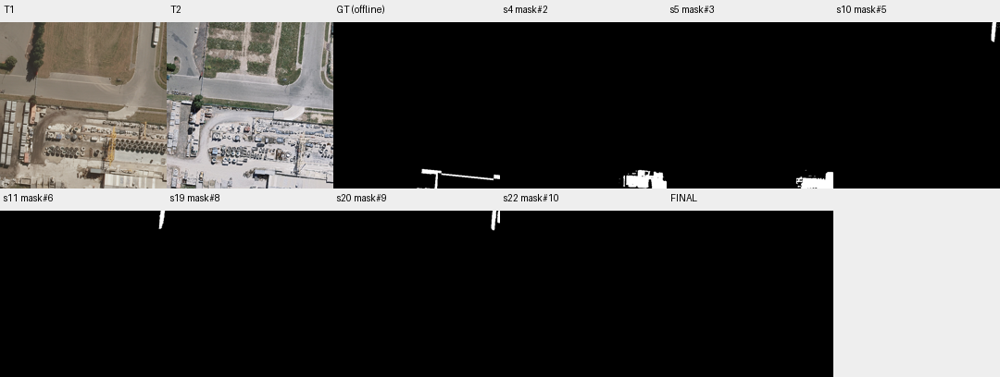

# case_03 完整轨迹

[交互回放](case_03.html#review) · [审查总表](20_case_review.md)



重复全图查看存在，但不能认定是无效循环

完整0–22步：第1、12、18步相同全图view穿插分割、局部观察、核验，信息关注点不同。最终提交空掩码，漏2112 TP；GT主要位于图块边缘，候选与验证器将车辆/临时对象排除。确有漏检，但无法证明重复view导致漏检，也未发现状态损坏。

保留重新观察能力；改用是否获得新证据评估冗余，不对同参数view一刀切。边界候选问题本轮不改显示尺寸。

## 第 0 步

当前答案：None；离线评价：None


## 第 1 步

当前答案：None；离线评价：None

I need to find all buildings that changed between T1 and T2 (newly built or demolished). Let me start by examining both images more carefully to identify any building changes.

First, let me look at the full images to get a better understanding of what's there.


<details><summary>view · 完整参数和返回</summary>


```json

{
  "tool": "view",
  "args": {
    "region": [
      0,
      0,
      512,
      512
    ]
  },
  "ok": true,
  "error_code": null,
  "result_text": "{\"ok\":true,\"view_id\":\"view#1\",\"region\":[0,0,512,512],\"overlay\":null,\"display_size\":[768,768],\"image_size\":[796,796],\"scale\":1.5,\"padding\":[28,28],\"labelled_ids\":[],\"unlabelled_count\":0}",
  "current_before": null,
  "current_after": null,
  "input_handles": [],
  "output_handles": [],
  "eval": null,
  "candidate_eval": [],
  "set_current": null
}

```


</details>

## 第 2 步

当前答案：None；离线评价：None

I need to identify building changes between T1 and T2. Let me first segment buildings in both times to compare them. I'll start by segmenting "building" in T1 and T2.


<details><summary>segment_text · 完整参数和返回</summary>


```json

{
  "tool": "segment_text",
  "args": {
    "time": "t1",
    "text": "building"
  },
  "ok": true,
  "error_code": null,
  "result_text": "{\"ok\":true,\"inst\":\"inst#0\",\"n\":0,\"area\":0,\"score\":null}",
  "current_before": null,
  "current_after": null,
  "input_handles": [],
  "output_handles": [
    "inst#0"
  ],
  "eval": null,
  "candidate_eval": [],
  "set_current": null
}

```


</details>

## 第 3 步

当前答案：None；离线评价：None

The segment_text for "building" in T1 returned 0 instances. Let me try segmenting in T2 as well, and also look more carefully at the images to identify any buildings.

Looking at the images:
- T1 shows what appears to be an industrial/storage yard with concrete pipes, some equipment, and a road. There's a building visible in the bottom right corner (with "S" marking).
- T2 shows similar scene but with some changes - the top area now has vegetation/fields instead of bare soil, and there appear to be some new structures.

Let me try segmenting buildings with a different approach - maybe using segment_prompt with a box around potential building areas.

First, let me look at specific regions more carefully. I notice in T2 there might be a new building structure in the upper right area (around x=480-512, y=0-50) that wasn't in T1. Also, there seems to be a small building/structure near the left side around y=256-300.

Let me try to segment buildings more broadly:


<details><summary>segment_text · 完整参数和返回</summary>


```json

{
  "tool": "segment_text",
  "args": {
    "time": "t2",
    "text": "building"
  },
  "ok": true,
  "error_code": null,
  "result_text": "{\"ok\":true,\"inst\":\"inst#1\",\"n\":0,\"area\":0,\"score\":null}",
  "current_before": null,
  "current_after": null,
  "input_handles": [],
  "output_handles": [
    "inst#1"
  ],
  "eval": null,
  "candidate_eval": [],
  "set_current": null
}

```


</details>

## 第 4 步

当前答案：None；离线评价：None

The segment_text for "building" returned 0 instances in both times. This might be because the text prompt isn't finding buildings, or the buildings are not well-defined. Let me look more carefully at the images to identify what could be considered buildings.

Looking at T1:
- Bottom right corner has a building with "S" marking (around x=384-512, y=450-512)
- There might be some small structures in the industrial yard area

Looking at T2:
- Similar building in bottom right
- Upper right corner appears to have something new (possibly a building or structure around x=480-512, y=0-50)
- Left side around y=256-300 shows what might be a new small structure

Let me try using segment_prompt with boxes around potential building areas to see if I can detect any buildings. First, let me check the bottom right building that's visible in both images:


<details><summary>segment_prompt · 完整参数和返回</summary>


```json

{
  "tool": "segment_prompt",
  "args": {
    "time": "t1",
    "box": [
      384,
      450,
      512,
      512
    ]
  },
  "ok": true,
  "error_code": null,
  "result_text": "{\"ok\":true,\"mask\":\"mask#2\",\"area\":5139,\"component_count\":8,\"bbox\":[366,455,512,512],\"sam_quality\":0.6134275197982788}",
  "current_before": null,
  "current_after": null,
  "input_handles": [],
  "output_handles": [
    "mask#2"
  ],
  "eval": null,
  "candidate_eval": [
    {
      "handle": "mask#2",
      "parent": null,
      "tp": 638,
      "fp": 4501,
      "fn": 1474,
      "f1": 0.17597572748586401,
      "iou": 0.09647663692726448
    }
  ],
  "set_current": null
}

```


</details>

## 第 5 步

当前答案：None；离线评价：None

I got a mask for the bottom right building in T1. Let me also segment the same area in T2 to see if it's still there (which would mean no change for that building):


<details><summary>segment_prompt · 完整参数和返回</summary>


```json

{
  "tool": "segment_prompt",
  "args": {
    "time": "t2",
    "box": [
      384,
      450,
      512,
      512
    ]
  },
  "ok": true,
  "error_code": null,
  "result_text": "{\"ok\":true,\"mask\":\"mask#3\",\"area\":3735,\"component_count\":5,\"bbox\":[398,455,512,512],\"sam_quality\":0.6805789470672607}",
  "current_before": null,
  "current_after": null,
  "input_handles": [],
  "output_handles": [
    "mask#3"
  ],
  "eval": null,
  "candidate_eval": [
    {
      "handle": "mask#3",
      "parent": null,
      "tp": 406,
      "fp": 3329,
      "fn": 1706,
      "f1": 0.1388746365657602,
      "iou": 0.07461863628009557
    }
  ],
  "set_current": null
}

```


</details>

## 第 6 步

当前答案：None；离线评价：None

The building in the bottom right appears to be present in both T1 and T2, so it's not a change (it's the same building). Let me look for other potential changes.

Looking at the images more carefully:
- In T2, there appears to be something new in the upper right corner (around x=480-512, y=0-50) that wasn't clearly visible in T1
- There might be some small structures added in the industrial yard area

Let me check the upper right area in both times:


<details><summary>view · 完整参数和返回</summary>


```json

{
  "tool": "view",
  "args": {
    "region": [
      400,
      0,
      512,
      100
    ]
  },
  "ok": true,
  "error_code": null,
  "result_text": "{\"ok\":true,\"view_id\":\"view#2\",\"region\":[400,0,512,100],\"overlay\":null,\"display_size\":[768,686],\"image_size\":[796,714],\"scale\":6.857142857142857,\"padding\":[28,28],\"labelled_ids\":[],\"unlabelled_count\":0}",
  "current_before": null,
  "current_after": null,
  "input_handles": [],
  "output_handles": [],
  "eval": null,
  "candidate_eval": [],
  "set_current": null
}

```


</details>

## 第 7 步

当前答案：None；离线评价：None

In the upper right area (400-512, 0-100), I can see:
- T1: There's a truck/vehicle on the road (the white rectangular objects appear to be trucks/trailers)
- T2: The road is there but no truck, and there appears to be some structure on the right edge (around x=480-512, y=0-50) that looks like it could be part of a building

The white objects in T1 look like trucks on the road, not buildings. In T2, there seems to be a dark structure on the right edge. Let me look more carefully at this area.

Let me also check the left side where I noticed potential changes around y=256-300:


<details><summary>view · 完整参数和返回</summary>


```json

{
  "tool": "view",
  "args": {
    "region": [
      0,
      200,
      200,
      350
    ]
  },
  "ok": true,
  "error_code": null,
  "result_text": "{\"ok\":true,\"view_id\":\"view#3\",\"region\":[0,200,200,350],\"overlay\":null,\"display_size\":[768,576],\"image_size\":[796,604],\"scale\":3.84,\"padding\":[28,28],\"labelled_ids\":[],\"unlabelled_count\":0}",
  "current_before": null,
  "current_after": null,
  "input_handles": [],
  "output_handles": [],
  "eval": null,
  "candidate_eval": [],
  "set_current": null
}

```


</details>

## 第 8 步

当前答案：None；离线评价：None

Looking at the left side (0-200, 200-350), I can see:
- T1: There's an orange/peach colored structure that looks like a small building or shed around x=80-120, y=240-320. There are also concrete pipes/materials stored nearby.
- T2: The same area shows similar structures but with some changes - there appears to be additional equipment or materials added, and the orange structure seems to still be there but maybe modified.

The key question is whether these are buildings that changed (newly built or demolished) or just changes in stored materials/equipment.

Let me look at the full image more carefully to identify actual building changes. Let me check if there are any clearly new buildings or demolished buildings by looking at different regions.

Let me try a different approach - segment "building" with a lower score threshold to see if I can detect any buildings:


<details><summary>segment_text · 完整参数和返回</summary>


```json

{
  "tool": "segment_text",
  "args": {
    "time": "t1",
    "text": "building",
    "score_thr": 0.3
  },
  "ok": true,
  "error_code": null,
  "result_text": "{\"ok\":true,\"inst\":\"inst#4\",\"n\":0,\"area\":0,\"score\":null}",
  "current_before": null,
  "current_after": null,
  "input_handles": [],
  "output_handles": [
    "inst#4"
  ],
  "eval": null,
  "candidate_eval": [],
  "set_current": null
}

```


</details>

## 第 9 步

当前答案：None；离线评价：None

The segment_text is not finding any buildings. Let me try a different approach - I'll look at the images more carefully to identify potential building changes manually, then use segment_prompt to create masks for those areas.

Looking at the full images again:
- T1 has a building in the bottom right (with "S" marking)
- T2 has the same building in the bottom right
- In T2, there appears to be something new in the upper right corner that wasn't clearly a building in T1

Let me check the upper right area more carefully in both times to see if there's a new building:


<details><summary>view · 完整参数和返回</summary>


```json

{
  "tool": "view",
  "args": {
    "region": [
      450,
      0,
      512,
      80
    ]
  },
  "ok": true,
  "error_code": null,
  "result_text": "{\"ok\":true,\"view_id\":\"view#4\",\"region\":[448,0,512,80],\"overlay\":null,\"display_size\":[614,768],\"image_size\":[642,796],\"scale\":9.6,\"padding\":[28,28],\"labelled_ids\":[],\"unlabelled_count\":0}",
  "current_before": null,
  "current_after": null,
  "input_handles": [],
  "output_handles": [],
  "eval": null,
  "candidate_eval": [],
  "set_current": null
}

```


</details>

## 第 10 步

当前答案：None；离线评价：None

In the upper right area (448-512, 0-80):
- T1: Shows what appears to be trucks/vehicles on the road (the white rectangular objects with shadows)
- T2: The road is there but no trucks, and on the right edge (around x=496-512, y=0-60) there's a dark structure that could be part of a building

The white objects in T1 look like trucks/trailers on the road, not buildings. In T2, there's a dark structure visible on the right edge which might be a new building or part of an existing one.

Let me also check if there are any demolished buildings. Looking at the industrial yard area, I need to see if any structures present in T1 are gone in T2.

Let me try to segment buildings using a box around the potential new building in T2 upper right:


<details><summary>segment_prompt · 完整参数和返回</summary>


```json

{
  "tool": "segment_prompt",
  "args": {
    "time": "t2",
    "box": [
      480,
      0,
      512,
      60
    ]
  },
  "ok": true,
  "error_code": null,
  "result_text": "{\"ok\":true,\"mask\":\"mask#5\",\"area\":703,\"component_count\":5,\"bbox\":[485,0,512,61],\"sam_quality\":0.8442137241363525}",
  "current_before": null,
  "current_after": null,
  "input_handles": [],
  "output_handles": [
    "mask#5"
  ],
  "eval": null,
  "candidate_eval": [
    {
      "handle": "mask#5",
      "parent": null,
      "tp": 0,
      "fp": 703,
      "fn": 2112,
      "f1": 0.0,
      "iou": 0.0
    }
  ],
  "set_current": null
}

```


</details>

## 第 11 步

当前答案：None；离线评价：None

I found a potential new building in T2 at the upper right (480-512, 0-60). Let me check if this area had any building in T1 by segmenting the same region:


<details><summary>segment_prompt · 完整参数和返回</summary>


```json

{
  "tool": "segment_prompt",
  "args": {
    "time": "t1",
    "box": [
      480,
      0,
      512,
      60
    ]
  },
  "ok": true,
  "error_code": null,
  "result_text": "{\"ok\":true,\"mask\":\"mask#6\",\"area\":655,\"component_count\":1,\"bbox\":[488,0,507,56],\"sam_quality\":0.6465086936950684}",
  "current_before": null,
  "current_after": null,
  "input_handles": [],
  "output_handles": [
    "mask#6"
  ],
  "eval": null,
  "candidate_eval": [
    {
      "handle": "mask#6",
      "parent": null,
      "tp": 0,
      "fp": 655,
      "fn": 2112,
      "f1": 0.0,
      "iou": 0.0
    }
  ],
  "set_current": null
}

```


</details>

## 第 12 步

当前答案：None；离线评价：None

Interesting - both T1 and T2 have something in the same region (480-512, 0-60). In T1 it was a truck/vehicle, and in T2 it appears to be a building structure. This could be a case where a vehicle was replaced by a building, but according to the rules, "Land, soil or vegetation in T1 with a building in T2 is new construction, not a replacement". However, if there was already something (a truck) in T1 at that location, it's not clear if this counts as a building change.

Actually, looking more carefully:
- In T1, the white objects are trucks on the road
- In T2, there's a dark building structure on the right edge

The question is whether the truck area should be considered as having a building before. Since trucks are not buildings, and the area in T1 had vehicles (not buildings) while T2 has a building, this would count as newly constructed building.

But wait - I need to be careful. The task says to find buildings that changed. If the T1 region had vehicles (not buildings) and T2 has a building, that's new construction. But I need to verify this is actually a building and not just a vehicle or temporary pile.

Let me also check for any demolished buildings. Let me look at the industrial yard area more carefully to see if any structures present in T1 are gone in T2.

Let me try a different approach - I'll use segment_text with different terms to try to detect buildings, or use segment_prompt with boxes around areas where I suspect changes.

First, let me look at the full image again to identify all potential building locations:


<details><summary>view · 完整参数和返回</summary>


```json

{
  "tool": "view",
  "args": {
    "region": [
      0,
      0,
      512,
      512
    ]
  },
  "ok": true,
  "error_code": null,
  "result_text": "{\"ok\":true,\"view_id\":\"view#5\",\"region\":[0,0,512,512],\"overlay\":null,\"display_size\":[768,768],\"image_size\":[796,796],\"scale\":1.5,\"padding\":[28,28],\"labelled_ids\":[],\"unlabelled_count\":0}",
  "current_before": null,
  "current_after": null,
  "input_handles": [],
  "output_handles": [],
  "eval": null,
  "candidate_eval": [],
  "set_current": null
}

```


</details>

## 第 13 步

当前答案：None；离线评价：None

Looking at the full images, I need to identify building changes. Let me analyze what I see:

**T1 observations:**
- Bottom right: Building with "S" marking (present in both)
- Upper right: Trucks/vehicles on road (not buildings)
- Left side: Industrial yard with concrete pipes, some small structures/sheds (orange colored structure around x=80-120, y=240-320)
- Top area: Bare soil/field (no buildings)

**T2 observations:**
- Bottom right: Same building with "S" marking (no change)
- Upper right: Dark structure visible on right edge (potential new building)
- Left side: Similar industrial yard but with some additions/changes
- Top area: Now has vegetation/grass (changed from bare soil, but this is land cover change, not building)

Key potential changes:
1. Upper right corner (around x=480-512, y=0-60): T1 had trucks, T2 has a dark building structure - this could be newly constructed building
2. Need to check if any buildings present in T1 are demolished in T2

Let me verify the upper right area more carefully. The structure in T2 at that location looks like it could be a building. Let me also check if there are any other potential changes.

Let me look at the left side area where there's an orange structure in T1 to see if it's still there in T2 or if it was demolished:


<details><summary>view · 完整参数和返回</summary>


```json

{
  "tool": "view",
  "args": {
    "region": [
      50,
      220,
      150,
      340
    ]
  },
  "ok": true,
  "error_code": null,
  "result_text": "{\"ok\":true,\"view_id\":\"view#6\",\"region\":[50,220,150,340],\"overlay\":null,\"display_size\":[640,768],\"image_size\":[668,796],\"scale\":6.4,\"padding\":[28,28],\"labelled_ids\":[],\"unlabelled_count\":0}",
  "current_before": null,
  "current_after": null,
  "input_handles": [],
  "output_handles": [],
  "eval": null,
  "candidate_eval": [],
  "set_current": null
}

```


</details>

## 第 14 步

当前答案：None；离线评价：None

Looking at the left side area (50-150, 220-340):
- T1: Has an orange/peach colored structure that looks like a small building or shed, plus concrete pipes stored nearby
- T2: The same area shows similar structures - the orange/tan colored structure is still there, but with some additional equipment/materials added

This appears to be the same building/structure in both times, just with different stored materials around it. This is not a building change (no new construction or demolition).

Now let me focus on the upper right area where I suspect a new building might have been constructed. Let me verify this more carefully by looking at the exact location:


<details><summary>view · 完整参数和返回</summary>


```json

{
  "tool": "view",
  "args": {
    "region": [
      470,
      0,
      512,
      80
    ]
  },
  "ok": true,
  "error_code": null,
  "result_text": "{\"ok\":true,\"view_id\":\"view#7\",\"region\":[448,0,512,80],\"overlay\":null,\"display_size\":[614,768],\"image_size\":[642,796],\"scale\":9.6,\"padding\":[28,28],\"labelled_ids\":[],\"unlabelled_count\":0}",
  "current_before": null,
  "current_after": null,
  "input_handles": [],
  "output_handles": [],
  "eval": null,
  "candidate_eval": [],
  "set_current": null
}

```


</details>

## 第 15 步

当前答案：None；离线评价：None

In the upper right area (448-512, 0-80):
- T1: Shows white rectangular objects that appear to be trucks/vehicles on the road (with shadows indicating they're 3D objects)
- T2: The road is visible but no trucks, and on the right edge (around x=496-512, y=0-60) there's a dark structure with what appears to be a roof - this looks like a building

The key question is whether the T1 objects are buildings or vehicles. They look like trucks/trailers on the road based on their shape and the shadow pattern. In T2, there's clearly a building structure on the right edge.

This would count as newly constructed building if the T1 location had vehicles (not buildings) and T2 has a building.

However, I need to be careful - the task says "Land, soil or vegetation in T1 with a building in T2 is new construction". If T1 had vehicles (which are not land, soil, or vegetation), this might be a different case. But the rule also says we should count "a building newly constructed (absent in T1, present in T2)". Since the building was absent in T1 (only vehicles were there) and present in T2, this counts as new construction.

Let me now check if there are any other potential changes. Let me also verify if there are any demolished buildings by checking areas where structures exist in T1 but not in T2.

Looking at the images, I don't see any obvious demolished buildings. The main building in the bottom right is present in both. The orange structure on the left is present in both.

Let me now create a change mask for the potential new building in the upper right. I'll use the mask I already created for T2 (mask#5) which shows the building at that location. But I need to make sure this is actually a building change and not just a vehicle.

Actually, let me reconsider. Looking at T1 more carefully, the white objects in the upper right are clearly trucks on the road (you can see the cab and trailer shapes). In T2, there's a dark building structure on the right edge. This is a case where a building was newly constructed (the truck was removed and a building was built in its place, or a building was built next to where the truck was).

Wait, but looking at the coordinates - in T1 the trucks are around x=480-512, y=0-70, and in T2 the building is around x=496-512, y=0-60. They're in similar locations but not exactly the same. The building in T2 seems to be on the very edge of the image.

Let me create a change mask for this potential new building. I'll use mask#5 (the T2 segmentation of the building) as the change mask, since it represents a building that's present in T2 but wasn't a building in T1.

But first, let me verify this is indeed a building by looking at it more carefully and possibly using the verifier:


<details><summary>ask · 完整参数和返回</summary>


```json

{
  "tool": "ask",
  "args": {
    "regions": [
      {
        "mask": "mask#5",
        "ids": [
          1
        ]
      }
    ]
  },
  "ok": true,
  "error_code": null,
  "result_text": "{\"ok\":true,\"results\":[{\"mask\":\"mask#5\",\"id\":1,\"p_yes\":0.0373266027836917,\"answer\":\"no\",\"type\":\"vehicle_or_temporary\",\"reason\":\"The object inside the red contour is a long white truck/trailer visible on the road in T1 and absent in T2, which classifies as a vehicle rather than a permanent building change.\",\"status\":\"parsed\"}],\"remaining_unverified\":0}",
  "current_before": null,
  "current_after": null,
  "input_handles": [
    "mask#5"
  ],
  "output_handles": [],
  "eval": null,
  "candidate_eval": [],
  "set_current": null
}

```


</details>

## 第 16 步

当前答案：None；离线评价：None

The verifier says the object in mask#5 is a vehicle (truck/trailer) that was present in T1 and absent in T2, not a building change. This means my initial interpretation was wrong - the white objects in T1 are trucks, and they're gone in T2, but this is not a building change (it's just vehicles moving).

So mask#5 should NOT be included in the change mask since it's a vehicle, not a building.

Let me reconsider what I'm looking for. I need to find:
1. Buildings newly constructed (absent in T1, present in T2)
2. Buildings demolished (present in T1, absent in T2)

The verifier told me that mask#5 contains a vehicle, not a building. So I need to look elsewhere for actual building changes.

Let me re-examine the images more carefully. Looking at the full images again:
- The bottom right building with "S" marking appears in both T1 and T2 (no change)
- The orange structure on the left appears in both T1 and T2 (no change)
- The top area changed from bare soil to vegetation (but this is land cover change, not building)

Wait, let me look more carefully at the upper right area. In T2, there's a dark structure visible on the right edge. Is this a new building? Let me check if there's actually a building there in T2 that wasn't there in T1.

Actually, looking at view#7 again:
- T1: White trucks on the road
- T2: Dark structure on the right edge (around x=496-512, y=0-60)

The verifier said mask#5 (which I created for the T2 region 480-512, 0-60) contains a vehicle. But wait, mask#5 was created by segmenting T2 with box [480, 0, 512, 60]. The verifier is saying this region contains a vehicle that was in T1 and is absent in T2. This suggests that what I thought was a building in T2 might actually be the same vehicle from T1, or the segmentation captured something else.

Let me re-examine. The verifier's answer says "The object inside the red contour is a long white truck/trailer visible on the road in T1 and absent in T2". This means the region I segmented in T2 (mask#5) actually corresponds to where the truck was in T1, and the truck is now gone in T2. So this is not a new building - it's just a vehicle that moved.

But wait, the verifier is checking mask#5 which was created from T2. If mask#5 contains a vehicle that was in T1 and is absent in T2, then mask#5 must be capturing the location where the truck was, but in T2 there's no truck there. This is confusing.

Let me re-read the verifier's answer: "The object inside the red contour is a long white truck/trailer visible on the road in T1 and absent in T2, which classifies as a vehicle rather than a permanent building change."

This suggests that mask#5 (which is from T2) contains something that the verifier identifies as a vehicle. But if the vehicle is absent in T2, how can mask#5 (from T2) contain it?

I think the verifier is looking at the crop of T1 and T2 for the region defined by mask#5, and seeing that in T1 there was a truck there, but in T2 there's no truck (or maybe there's a different object). The verifier is saying this is a vehicle change, not a building change.

Given this, I should not include mask#5 in my change mask because it's not a building change.

Let me now look for actual building changes. I need to find:
1. A building that exists in T2 but didn't exist in T1 (new construction)
2. A building that existed in T1 but doesn't exist in T2 (demolition)

Looking at the images again, I don't see any obvious new buildings or demolished buildings. The main structures (bottom right building, left side orange structure) appear to be present in both times.

However, let me check if there might be a new building somewhere I haven't looked yet. Let me look at the area around the industrial yard more carefully.

Actually, wait - let me re-examine the upper right area. In T2, I saw a dark structure on the right edge. Let me check if this is actually a building by looking at it more carefully:


<details><summary>view · 完整参数和返回</summary>


```json

{
  "tool": "view",
  "args": {
    "region": [
      480,
      0,
      512,
      100
    ]
  },
  "ok": true,
  "error_code": null,
  "result_text": "{\"ok\":true,\"view_id\":\"view#8\",\"region\":[448,0,512,100],\"overlay\":null,\"display_size\":[492,768],\"image_size\":[520,796],\"scale\":7.68,\"padding\":[28,28],\"labelled_ids\":[],\"unlabelled_count\":0}",
  "current_before": null,
  "current_after": null,
  "input_handles": [],
  "output_handles": [],
  "eval": null,
  "candidate_eval": [],
  "set_current": null
}

```


</details>

## 第 17 步

当前答案：None；离线评价：None

Looking at the upper right area (480-512, 0-100):
- T1: White trucks/trailers on the road
- T2: The road is visible, and on the right edge there's a dark structure that appears to be part of a building (with what looks like a roof)

The key question is whether this dark structure in T2 is a new building or just part of an existing structure. Looking at T1, there was no building there - just trucks on the road. In T2, there's clearly a building structure on the right edge.

But the verifier said mask#5 (which I created for this region) contains a vehicle, not a building. This suggests that what I'm seeing as a "building" in T2 might actually be the same location where the truck was, and the segmentation captured something else.

Let me reconsider: maybe the dark structure in T2 is actually a different object, and the verifier is correct that it's not a building change. Or maybe the verifier is looking at the wrong thing.

Actually, I think I need to be more careful here. The verifier's answer says the object in mask#5 is a vehicle that was in T1 and absent in T2. This means mask#5 (from T2) is capturing a region where in T1 there was a vehicle, but in T2 there's no vehicle (or a different object). The verifier is classifying this as a vehicle change, not a building change.

Given this, I should not include this region in my change mask because it's not a building change.

Let me now look for other potential building changes. I'll check if there are any buildings in T2 that weren't in T1, or vice versa.

Looking at the full images again, I notice:
- The bottom right building with "S" marking is present in both
- The orange structure on the left is present in both
- The top area changed from bare soil to vegetation (not a building change)

I don't see any obvious new buildings or demolished buildings. However, let me check if there might be a small building I missed somewhere.

Let me try segmenting "building" with different parameters to see if I can detect any buildings:


<details><summary>segment_text · 完整参数和返回</summary>


```json

{
  "tool": "segment_text",
  "args": {
    "time": "t1",
    "text": "house",
    "score_thr": 0.3
  },
  "ok": true,
  "error_code": null,
  "result_text": "{\"ok\":true,\"inst\":\"inst#7\",\"n\":0,\"area\":0,\"score\":null}",
  "current_before": null,
  "current_after": null,
  "input_handles": [],
  "output_handles": [
    "inst#7"
  ],
  "eval": null,
  "candidate_eval": [],
  "set_current": null
}

```


</details>

## 第 18 步

当前答案：None；离线评价：None

The segment_text for "house" also returned 0 instances. Let me try a different approach - I'll manually identify potential building locations and use segment_prompt to create masks, then verify them with the verifier.

Looking at the images carefully:
1. Bottom right building (with "S" marking) - present in both T1 and T2, so no change
2. Orange structure on left side - present in both, so no change
3. Upper right area - T1 had trucks, T2 has a dark structure (but verifier said this is vehicle-related, not building)

Let me check if there are any other potential building changes by looking at the industrial yard area more carefully. Maybe there's a small building that was added or removed.

Actually, let me reconsider the upper right area. The verifier said mask#5 contains a vehicle that was in T1 and absent in T2. But mask#5 was created from T2 segmentation. This is confusing because if the vehicle is absent in T2, how can mask#5 (from T2) contain it?

I think the verifier might be looking at the T1 image for that region and seeing the vehicle, while the T2 image shows something else (or nothing). The verifier is classifying this as a vehicle change, not a building change.

Given all this analysis, I don't see any clear building changes (new construction or demolition). The main structures appear to be present in both times, and the only changes I see are:
- Vehicles moving (not building changes)
- Land cover changes (bare soil to vegetation, not building changes)

Let me submit an empty mask since I don't see any building changes.

Wait, but let me double-check by looking at the images one more time to make sure I haven't missed anything.


<details><summary>view · 完整参数和返回</summary>


```json

{
  "tool": "view",
  "args": {
    "region": [
      0,
      0,
      512,
      512
    ]
  },
  "ok": true,
  "error_code": null,
  "result_text": "{\"ok\":true,\"view_id\":\"view#9\",\"region\":[0,0,512,512],\"overlay\":null,\"display_size\":[768,768],\"image_size\":[796,796],\"scale\":1.5,\"padding\":[28,28],\"labelled_ids\":[],\"unlabelled_count\":0}",
  "current_before": null,
  "current_after": null,
  "input_handles": [],
  "output_handles": [],
  "eval": null,
  "candidate_eval": [],
  "set_current": null
}

```


</details>

## 第 19 步

当前答案：mask#8；离线评价：{'tp': 0, 'fp': 0, 'fn': 2112, 'f1': 0.0, 'iou': 0.0, 'delta_f1': None}

Looking at the full images side by side:

**T1 observations:**
- Bottom right: Building with "S" marking (present in both)
- Upper right: White trucks/trailers on road
- Left side: Orange/peach structure (small building/shed) present
- Top area: Bare soil/field

**T2 observations:**
- Bottom right: Same building with "S" marking (no change)
- Upper right: No trucks visible, but there's a dark structure on the right edge
- Left side: Same orange structure still present
- Top area: Now has vegetation/grass (land cover change, not building)

The key question is whether the dark structure in T2 upper right is a new building. The verifier said mask#5 (which I created for this region) contains a vehicle, not a building. This suggests that what I'm seeing might not be a building change.

However, let me reconsider - maybe there IS a new building in T2 that I haven't properly identified. Let me look more carefully at the upper right area in T2 to see if there's actually a building structure there.

Actually, looking at view#8 T2 again, I can see a dark structure on the right edge (around x=496-512, y=0-60) that looks like it could be a building with a roof. But the verifier said mask#5 (which covers this area) contains a vehicle, not a building.

I think the verifier is correct - this is not a building change. The white objects in T1 are trucks, and they're gone in T2, but this is a vehicle change, not a building change.

Given my analysis, I don't see any clear building changes (new construction or demolition). The main structures are present in both times, and the other changes are vehicles moving or land cover changes.

Let me submit an empty mask since I don't see any building changes.


<details><summary>submit · 完整参数和返回</summary>


```json

{
  "tool": "submit",
  "args": {
    "mask": "mask#8",
    "summary": "No building changes detected. The main structures (bottom right building with \"S\" marking, left side orange structure) are present in both T1 and T2. Changes observed include vehicles moving (upper right trucks absent in T2) and land cover changes (bare soil to vegetation in top area), but these are not building changes."
  },
  "ok": true,
  "error_code": null,
  "result_text": "{\"ok\":true,\"submitted\":false,\"report\":\"Report before submission. Every run gets this report as the first response to submit; it does not judge the mask, and nothing has to change. mask#8 is now your current answer: 0 pixels in 0 components.\\nVerifier answers on mask#8: 0 yes, 0 no, 0 unparsed, 0 with no answer. An answer applies only to the exact outline it was about; a view is not an answer.\\nA verifier answer is evidence, not an order, and it can be wrong in both directions. No answer is not an error. To finish with this mask, call submit with mask#8 again. To change it, edit and submit the new handle; components the verifier has not seen will be reported again. In the summary, say what you changed, and why you went against any verifier answer. You have 11 replies left.\"}",
  "current_before": null,
  "current_after": "mask#8",
  "input_handles": [
    "mask#8"
  ],
  "output_handles": [],
  "eval": {
    "tp": 0,
    "fp": 0,
    "fn": 2112,
    "f1": 0.0,
    "iou": 0.0,
    "delta_f1": null
  },
  "candidate_eval": [],
  "set_current": null
}

```


</details>

## 第 20 步

当前答案：mask#8；离线评价：{'tp': 0, 'fp': 0, 'fn': 2112, 'f1': 0.0, 'iou': 0.0, 'delta_f1': 0.0}

The verifier shows 0 answers for the empty mask, which is expected. But I should reconsider my analysis - maybe there ARE building changes that I missed. Let me look more carefully at the images.

Looking at T2 again, I notice:
- Upper right corner (around x=480-512, y=0-50): There's a dark structure visible on the right edge in T2 that wasn't clearly present as a building in T1 (T1 had trucks there)
- The top area changed from bare soil to vegetation (not a building change)

Wait, let me re-examine the upper right area. In T2, I see what appears to be a building structure on the right edge. Let me check if this is actually a new building by looking at it more carefully and possibly creating a proper mask for it.

Actually, the verifier already told me that mask#5 (which I created for the upper right area) contains a vehicle, not a building. So that region is not a building change.

But let me think about this differently. Maybe I need to look for buildings that are present in T2 but weren't in T1, or vice versa. Let me try to segment buildings more systematically.

Let me try using segment_prompt with a box around the bottom right building to confirm it's present in both times (which would mean no change for that building):

Actually, I already know the bottom right building is present in both. Let me check if there might be any other buildings I missed.

Looking at the industrial yard area in T2, I see some additional structures/equipment that weren't in T1. But these appear to be temporary materials or equipment, not permanent buildings.

Let me also check if there might be a demolished building. Looking at T1, I see the orange structure on the left side. In T2, this structure is still there. So no demolition there.

Hmm, let me reconsider the upper right area one more time. The verifier said mask#5 contains a vehicle. But mask#5 was created from T2 segmentation. If the vehicle is absent in T2, how can mask#5 contain it?

I think the verifier is looking at the T1 image for that region and seeing the vehicle, while the T2 image shows something else (or nothing). The verifier is classifying this as a vehicle change, not a building change.

Given all this, I believe there are no building changes. But let me double-check by looking at the images one more time to make sure I haven't missed anything.

Actually, wait - let me look at the upper right area in T2 more carefully. In view#8 T2, I can see a dark structure on the right edge (around x=496-512, y=0-60). This looks like it could be a building with a roof. But the verifier said mask#5 (which covers this area) contains a vehicle.

Maybe the issue is that mask#5 was created by segmenting T2 with box [480, 0, 512, 60], and the segmentation captured something that the verifier identifies as a vehicle-related object. But visually, it looks like a building structure.

Let me try to create a better mask for this potential new building and verify it with the verifier. First, let me segment T2 with a tighter box around the dark structure:


<details><summary>segment_prompt · 完整参数和返回</summary>


```json

{
  "tool": "segment_prompt",
  "args": {
    "time": "t2",
    "box": [
      490,
      0,
      512,
      70
    ]
  },
  "ok": true,
  "error_code": null,
  "result_text": "{\"ok\":true,\"mask\":\"mask#9\",\"area\":969,\"component_count\":2,\"bbox\":[485,0,512,61],\"sam_quality\":0.6461277604103088}",
  "current_before": "mask#8",
  "current_after": "mask#8",
  "input_handles": [],
  "output_handles": [
    "mask#9"
  ],
  "eval": {
    "tp": 0,
    "fp": 0,
    "fn": 2112,
    "f1": 0.0,
    "iou": 0.0,
    "delta_f1": 0.0
  },
  "candidate_eval": [
    {
      "handle": "mask#9",
      "parent": null,
      "tp": 0,
      "fp": 969,
      "fn": 2112,
      "f1": 0.0,
      "iou": 0.0
    }
  ],
  "set_current": null
}

```


</details>

## 第 21 步

当前答案：mask#8；离线评价：{'tp': 0, 'fp': 0, 'fn': 2112, 'f1': 0.0, 'iou': 0.0, 'delta_f1': 0.0}

I created mask#9 for the upper right area in T2. Let me verify this with the verifier to see if it's a building change:


<details><summary>ask · 完整参数和返回</summary>


```json

{
  "tool": "ask",
  "args": {
    "regions": [
      {
        "mask": "mask#9",
        "ids": [
          1,
          2
        ]
      }
    ]
  },
  "ok": true,
  "error_code": null,
  "result_text": "{\"ok\":true,\"results\":[{\"mask\":\"mask#9\",\"id\":1,\"p_yes\":0.006692832593334199,\"answer\":\"no\",\"type\":\"vehicle_or_temporary\",\"reason\":\"The object inside the red contour is a long truck visible in T1 that is absent in T2, representing a temporary vehicle rather than a permanent building change.\",\"status\":\"parsed\"},{\"mask\":\"mask#9\",\"id\":2,\"p_yes\":0.010986865611404077,\"answer\":\"no\",\"type\":\"vehicle_or_temporary\",\"reason\":\"The object inside the contour is a truck/trailer visible in T1 and a dark vehicle or temporary structure in T2 at the same location, which falls under temporary objects rather than permanent building changes.\",\"status\":\"parsed\"}],\"remaining_unverified\":0}",
  "current_before": "mask#8",
  "current_after": "mask#8",
  "input_handles": [
    "mask#9"
  ],
  "output_handles": [],
  "eval": {
    "tp": 0,
    "fp": 0,
    "fn": 2112,
    "f1": 0.0,
    "iou": 0.0,
    "delta_f1": 0.0
  },
  "candidate_eval": [],
  "set_current": null
}

```


</details>

## 第 22 步

当前答案：mask#10；离线评价：{'tp': 0, 'fp': 0, 'fn': 2112, 'f1': 0.0, 'iou': 0.0, 'delta_f1': 0.0}

The verifier confirms that both components in mask#9 are vehicle/temporary objects, not building changes. Component 1 is a truck visible in T1 and absent in T2 (vehicle change). Component 2 is a truck/trailer in T1 and a dark vehicle or temporary structure in T2 (still vehicle/temporary, not building).

So the upper right area does NOT contain a building change - it's just vehicles moving or being replaced by temporary structures.

Given all my analysis:
- Bottom right building: Present in both T1 and T2 (no change)
- Left side orange structure: Present in both T1 and T2 (no change)
- Upper right area: Vehicles in T1, no building in T2 (vehicle change, not building change)
- Top area: Bare soil to vegetation (land cover change, not building change)

I don't see any building changes (new construction or demolition). Let me submit an empty mask again to confirm this is the final answer.


<details><summary>submit · 完整参数和返回</summary>


```json

{
  "tool": "submit",
  "args": {
    "mask": "mask#10",
    "summary": "No building changes detected between T1 and T2. Verified regions include: bottom right building (present in both), left side orange structure (present in both), and upper right area (vehicles in T1, no building in T2 - classified as vehicle/temporary by verifier). All other changes are land cover (bare soil to vegetation) or vehicle movements, not building changes."
  },
  "ok": true,
  "error_code": null,
  "result_text": "{\"ok\":true,\"mask\":\"mask#10\",\"area\":0,\"component_count\":0,\"current_mask\":{\"before\":\"mask#8\",\"after\":\"mask#10\"},\"submitted\":true}",
  "current_before": "mask#8",
  "current_after": "mask#10",
  "input_handles": [
    "mask#10"
  ],
  "output_handles": [],
  "eval": {
    "tp": 0,
    "fp": 0,
    "fn": 2112,
    "f1": 0.0,
    "iou": 0.0,
    "delta_f1": 0.0
  },
  "candidate_eval": [],
  "set_current": null
}

```


</details>
