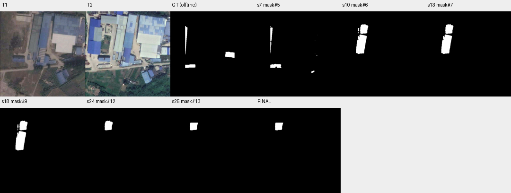

# case_04 完整轨迹

[交互回放](case_04.html#review) · [审查总表](20_case_review.md)



同框重新分割无新结果，并伴随候选退化

完整0–25步：mask#5已含2259 TP、398 FP，F1=65.67；10和18步完全相同框生成mask#6与mask#9，均0 TP、8099 FP。中间ask无current及to_mask(mask)失败，之后始终围绕错误建筑改动；最终0 TP、1943 FP。图像与GT显示关注了错误区域，提交区域裁切按G5生效。

答案切换可减少操作性绕路，但不能保证选对候选；不自动按离线最佳F1回滚。

## 第 0 步

当前答案：None；离线评价：None


## 第 1 步

当前答案：None；离线评价：None

I need to find newly constructed buildings within region#0 (box [89, 89, 386, 404]). Let me first view both T1 and T2 images in this region to understand what changed.


<details><summary>view · 完整参数和返回</summary>


```json

{
  "tool": "view",
  "args": {
    "region": [
      89,
      89,
      386,
      404
    ]
  },
  "ok": true,
  "error_code": null,
  "result_text": "{\"ok\":true,\"view_id\":\"view#1\",\"region\":[89,89,386,404],\"overlay\":null,\"display_size\":[724,768],\"image_size\":[752,796],\"scale\":2.4380952380952383,\"padding\":[28,28],\"labelled_ids\":[],\"unlabelled_count\":0}",
  "current_before": null,
  "current_after": null,
  "input_handles": [],
  "output_handles": [],
  "eval": null,
  "candidate_eval": [],
  "set_current": null
}

```


</details>

## 第 2 步

当前答案：None；离线评价：None

Looking at the region [89, 89, 386, 404], I can see significant changes between T1 and T2. In T1, there's a large building complex with blue/gray roofs. In T2, I can see:
- A new large blue building appeared on the left side (around x=89-163, y=89-256)
- Some additional structures in the middle area
- The existing buildings seem to have expanded or been modified

Let me segment buildings in both T1 and T2 within this region to identify what's newly constructed. I'll start by segmenting "building" in T2 within region#0 to see what buildings exist there.


<details><summary>segment_text · 完整参数和返回</summary>


```json

{
  "tool": "segment_text",
  "args": {
    "time": "t2",
    "text": "building",
    "region": "region#0",
    "score_thr": 0.3
  },
  "ok": true,
  "error_code": null,
  "result_text": "{\"ok\":true,\"inst\":\"inst#0\",\"n\":25,\"area\":31358,\"score\":{\"min\":0.3125,\"median\":0.55078125,\"max\":0.77734375},\"report\":\"Results clipped to region#0: removed 18 instances / 48456 pixels.\"}",
  "current_before": null,
  "current_after": null,
  "input_handles": [
    "region#0"
  ],
  "output_handles": [
    "inst#0"
  ],
  "eval": null,
  "candidate_eval": [],
  "set_current": null
}

```


</details>

## 第 3 步

当前答案：None；离线评价：None

I got 25 building instances in T2 within region#0. Now I need to segment buildings in T1 within the same region to compare and find which ones are newly constructed (present in T2 but absent in T1).


<details><summary>segment_text · 完整参数和返回</summary>


```json

{
  "tool": "segment_text",
  "args": {
    "time": "t1",
    "text": "building",
    "region": "region#0",
    "score_thr": 0.3
  },
  "ok": true,
  "error_code": null,
  "result_text": "{\"ok\":true,\"inst\":\"inst#1\",\"n\":16,\"area\":33806,\"score\":{\"min\":0.3203125,\"median\":0.48828125,\"max\":0.765625},\"report\":\"Results clipped to region#0: removed 10 instances / 45684 pixels.\"}",
  "current_before": null,
  "current_after": null,
  "input_handles": [
    "region#0"
  ],
  "output_handles": [
    "inst#1"
  ],
  "eval": null,
  "candidate_eval": [],
  "set_current": null
}

```


</details>

## 第 4 步

当前答案：None；离线评价：None

I have inst#0 (T2 buildings) and inst#1 (T1 buildings) within region#0. Now I need to match instances between T1 and T2 to identify which T2 buildings are newly constructed (not present in T1). Let me use match_instances to find which T2 instances have no corresponding T1 instance.


<details><summary>match_instances · 完整参数和返回</summary>


```json

{
  "tool": "match_instances",
  "args": {
    "inst_t1": "inst#1",
    "inst_t2": "inst#0",
    "overlap_thr": 0.25
  },
  "ok": true,
  "error_code": null,
  "result_text": "{\"ok\":true,\"appeared\":\"inst#2\",\"appeared_n\":7,\"disappeared\":\"inst#3\",\"disappeared_n\":2,\"present_t2\":\"inst#4\",\"present_t2_n\":18}",
  "current_before": null,
  "current_after": null,
  "input_handles": [
    "inst#1",
    "inst#0"
  ],
  "output_handles": [
    "inst#2",
    "inst#3",
    "inst#4"
  ],
  "eval": null,
  "candidate_eval": [],
  "set_current": null
}

```


</details>

## 第 5 步

当前答案：None；离线评价：None

The match_instances result shows:
- 7 instances appeared (newly constructed in T2)
- 2 instances disappeared
- 18 instances are present in both

I need to identify which specific instances in inst#0 (T2) are the "appeared" ones. The function returned inst#2 as the handle for appeared instances. Let me inspect inst#2 to see what these new buildings look like, and also view them to verify they are indeed newly constructed buildings.


<details><summary>inspect · 完整参数和返回</summary>


```json

{
  "tool": "inspect",
  "args": {
    "mask": "inst#2"
  },
  "ok": true,
  "error_code": null,
  "result_text": "{\"ok\":true,\"mask\":\"inst#2\",\"total_components\":7,\"returned\":7,\"has_more\":false,\"components\":[{\"id\":43,\"area\":1324,\"bbox\":[89,315,155,341],\"score\":0.337890625},{\"id\":26,\"area\":881,\"bbox\":[89,97,103,180],\"score\":0.5},{\"id\":27,\"area\":480,\"bbox\":[89,89,101,244],\"score\":0.7421875},{\"id\":8,\"area\":253,\"bbox\":[89,182,95,252],\"score\":0.58984375},{\"id\":7,\"area\":173,\"bbox\":[335,356,354,371],\"score\":0.328125},{\"id\":15,\"area\":14,\"bbox\":[89,89,101,120],\"score\":0.4765625},{\"id\":28,\"area\":14,\"bbox\":[357,142,373,268],\"score\":0.77734375}]}",
  "current_before": null,
  "current_after": null,
  "input_handles": [
    "inst#2"
  ],
  "output_handles": [],
  "eval": null,
  "candidate_eval": [],
  "set_current": null
}

```


</details>

## 第 6 步

当前答案：None；离线评价：None

I see 7 appeared instances in inst#2. Let me view these regions to verify they are indeed newly constructed buildings. The bboxes show:
- id 43: [89,315,155,341] - small building at bottom left
- id 26: [89,97,103,180] - narrow strip on left edge
- id 27: [89,89,101,244] - tall narrow strip on left edge
- id 8: [89,182,95,252] - small piece on left edge
- id 7: [335,356,354,371] - small area near right
- id 15: [89,89,101,120] - small piece top left
- id 28: [357,142,373,268] - vertical strip on right

Some of these look like they might be edge artifacts or misregistration issues (very narrow strips along the left edge x=89). Let me view the region to check which ones are actual new buildings vs. edge responses from misregistration.


<details><summary>view · 完整参数和返回</summary>


```json

{
  "tool": "view",
  "args": {
    "region": [
      89,
      89,
      386,
      404
    ],
    "overlay": "inst#2",
    "label_components": true
  },
  "ok": false,
  "error_code": "bad_args",
  "result_text": "{\"ok\":false,\"error_code\":\"bad_args\",\"message\":\"Component labels need a mask handle; call to_mask first.\"}",
  "current_before": null,
  "current_after": null,
  "input_handles": [
    "inst#2"
  ],
  "output_handles": [],
  "eval": null,
  "candidate_eval": [],
  "set_current": null
}

```


</details>

## 第 7 步

当前答案：None；离线评价：None

I need to convert inst#2 to a mask first, then view it with labels. Let me create a mask from inst#2 and view it.


<details><summary>to_mask · 完整参数和返回</summary>


```json

{
  "tool": "to_mask",
  "args": {
    "sets": [
      "inst#2"
    ],
    "set_current": false
  },
  "ok": true,
  "error_code": null,
  "result_text": "{\"ok\":true,\"mask\":\"mask#5\",\"area\":2657,\"component_count\":9}",
  "current_before": null,
  "current_after": null,
  "input_handles": [
    "inst#2"
  ],
  "output_handles": [
    "mask#5"
  ],
  "eval": null,
  "candidate_eval": [
    {
      "handle": "mask#5",
      "parent": null,
      "tp": 2259,
      "fp": 398,
      "fn": 1964,
      "f1": 0.6566860465116279,
      "iou": 0.4888552261415278
    }
  ],
  "set_current": false
}

```


</details>

## 第 8 步

当前答案：None；离线评价：None

Now let me view mask#5 with labels to see the appeared instances, and also compare T1 and T2 in this region to verify which are actual new buildings.


<details><summary>view · 完整参数和返回</summary>


```json

{
  "tool": "view",
  "args": {
    "region": [
      89,
      89,
      386,
      404
    ],
    "overlay": "mask#5",
    "label_components": true
  },
  "ok": true,
  "error_code": null,
  "result_text": "{\"ok\":true,\"view_id\":\"view#2\",\"region\":[89,89,386,404],\"overlay\":\"mask#5\",\"display_size\":[724,768],\"image_size\":[752,796],\"scale\":2.4380952380952383,\"padding\":[28,28],\"labelled_ids\":[1,2,3,4,5,6,7,8,9],\"unlabelled_count\":0}",
  "current_before": null,
  "current_after": null,
  "input_handles": [
    "mask#5"
  ],
  "output_handles": [],
  "eval": null,
  "candidate_eval": [],
  "set_current": null
}

```


</details>

## 第 9 步

当前答案：None；离线评价：None

Looking at the view with mask#5 overlay (the appeared instances), I can see:
- Components 1, 2, 5 are along the left edge (x=89) - these look like they might be edge responses from misregistration or partial buildings that extend beyond the region boundary
- Component 3, 4, 6, 7 are small spots on the right side - need to verify if these are actual new buildings
- Component 8 is a larger area at bottom left [89,315,155,341] - this looks like it could be a new building
- Component 9 is a small spot at bottom right

Let me look more carefully at T1 vs T2 for each of these components. The narrow strips along x=89 (components 1, 2, 5) are suspicious - they might be edge artifacts from misregistration since they're right at the boundary of region#0. Let me zoom in to check specific areas.

First, let me check component 8 which appears to be a substantial area at [89,315,155,341]. Looking at T1, there's already a blue building in that general area. In T2, it seems to have expanded. But wait - the match_instances says this is "appeared" meaning it's present in T2 but not in T1. Let me verify by looking at T1 more carefully.

Actually, looking at the T1 image, I see there's already a blue building around y=315-341 on the left side. So component 8 might actually be an expansion of an existing building, not a new construction. But the match_instances function considers it "appeared" because it didn't have sufficient overlap with any T1 instance.

Let me also check the other components. Components 3, 4, 6, 7 are very small and might be noise or edge responses. Component 9 is also small.

The key question is: which of these are truly newly constructed buildings vs. edge responses from misregistration?

Looking at the T1 image in the region:
- The left edge has some vegetation/empty space
- In T2, there's clearly a new large blue building that appeared on the left side (around x=89-163, y=89-256)

But the matched "appeared" instances (inst#2) don't seem to capture that large new building - they only show narrow strips and small spots. This suggests the matching might not have captured the main new building correctly.

Let me re-examine. The large blue building that appeared on the left in T2 (visible in view#1 T2) should be one of the inst#0 instances. Let me inspect inst#0 to see what instances are there and identify which ones correspond to the new large building.


<details><summary>inspect · 完整参数和返回</summary>


```json

{
  "tool": "inspect",
  "args": {
    "mask": "inst#0",
    "limit": 30
  },
  "ok": true,
  "error_code": null,
  "result_text": "{\"ok\":true,\"mask\":\"inst#0\",\"total_components\":25,\"returned\":25,\"has_more\":false,\"components\":[{\"id\":21,\"area\":7489,\"bbox\":[174,89,246,246],\"score\":0.66796875},{\"id\":11,\"area\":7257,\"bbox\":[230,89,300,308],\"score\":0.671875},{\"id\":24,\"area\":7030,\"bbox\":[175,89,245,245],\"score\":0.55078125},{\"id\":38,\"area\":6419,\"bbox\":[230,89,300,222],\"score\":0.55859375},{\"id\":2,\"area\":4368,\"bbox\":[230,126,292,222],\"score\":0.3125},{\"id\":37,\"area\":3998,\"bbox\":[231,219,296,309],\"score\":0.423828125},{\"id\":23,\"area\":3350,\"bbox\":[331,196,386,278],\"score\":0.326171875},{\"id\":1,\"area\":2933,\"bbox\":[231,218,277,309],\"score\":0.5546875},{\"id\":17,\"area\":2180,\"bbox\":[89,264,150,303],\"score\":0.67578125},{\"id\":31,\"area\":2147,\"bbox\":[221,292,339,332],\"score\":0.427734375},{\"id\":39,\"area\":1422,\"bbox\":[339,362,386,404],\"score\":0.7734375},{\"id\":43,\"area\":1324,\"bbox\":[89,315,155,341],\"score\":0.337890625},{\"id\":40,\"area\":1321,\"bbox\":[89,278,150,303],\"score\":0.5234375},{\"id\":30,\"area\":1182,\"bbox\":[265,263,297,310],\"score\":0.5},{\"id\":14,\"area\":1160,\"bbox\":[281,291,339,320],\"score\":0.58203125},{\"id\":36,\"area\":946,\"bbox\":[222,301,262,333],\"score\":0.5078125},{\"id\":26,\"area\":881,\"bbox\":[89,97,103,180],\"score\":0.5},{\"id\":18,\"area\":774,\"bbox\":[197,246,220,291],\"score\":0.51953125},{\"id\":22,\"area\":480,\"bbox\":[164,258,181,293],\"score\":0.5625},{\"id\":27,\"area\":480,\"bbox\":[89,89,101,244],\"score\":0.7421875},{\"id\":8,\"area\":253,\"bbox\":[89,182,95,252],\"score\":0.58984375},{\"id\":7,\"area\":173,\"bbox\":[335,356,354,371],\"score\":0.328125},{\"id\":33,\"area\":125,\"bbox\":[378,352,386,376],\"score\":0.71875},{\"id\":15,\"area\":14,\"bbox\":[89,89,101,120],\"score\":0.4765625},{\"id\":28,\"area\":14,\"bbox\":[357,142,373,268],\"score\":0.77734375}]}",
  "current_before": null,
  "current_after": null,
  "input_handles": [
    "inst#0"
  ],
  "output_handles": [],
  "eval": null,
  "candidate_eval": [],
  "set_current": null
}

```


</details>

## 第 10 步

当前答案：None；离线评价：None

I see the T2 instances. Looking at the bboxes, I notice there are several large instances in the middle area (ids 21, 11, 24, 38, 2, 37, 1) that span from x=174-300, y=89-308. These appear to be the existing large building complex that was already present in T1.

The key observation is that in T2, there's a new large blue building on the LEFT side (around x=89-163, y=89-256) that wasn't in T1. But looking at inst#0, I don't see a large instance covering that entire left area. Instead, I see:
- id 17: [89,264,150,303] - area 2180 (a building at bottom left)
- id 40: [89,278,150,303] - area 1321 (similar area)
- id 43: [89,315,155,341] - area 1324 (bottom left)
- id 26: [89,97,103,180] - area 881 (narrow strip)
- id 27: [89,89,101,244] - area 480 (tall narrow strip)
- id 8: [89,182,95,252] - area 253 (small piece)

Wait, looking at view#1 T2 more carefully, I see there's clearly a NEW large blue building on the left side (x~89-163, y~89-256). But this doesn't seem to be captured as a single large instance in inst#0. The segmentation might have split it into multiple pieces or missed it.

Let me look at T1 to confirm what was there before. In T1 view#1, the left side (x=89-163) shows mostly empty land/vegetation with no large blue building. In T2, there's clearly a new large blue building there.

The issue is that the segment_text function might not have captured this new building properly, or it got fragmented. Let me try to manually segment the new building area using segment_prompt with a box around the new building location.

Looking at T2, the new large blue building appears to be roughly at [89, 89, 163, 256] (the left portion of region#0). Let me segment this area specifically.


<details><summary>segment_prompt · 完整参数和返回</summary>


```json

{
  "tool": "segment_prompt",
  "args": {
    "time": "t2",
    "box": [
      89,
      89,
      163,
      256
    ]
  },
  "ok": true,
  "error_code": null,
  "result_text": "{\"ok\":true,\"mask\":\"mask#6\",\"area\":8099,\"component_count\":8,\"bbox\":[93,77,166,256],\"sam_quality\":0.9474793672561646}",
  "current_before": null,
  "current_after": null,
  "input_handles": [],
  "output_handles": [
    "mask#6"
  ],
  "eval": null,
  "candidate_eval": [
    {
      "handle": "mask#6",
      "parent": null,
      "tp": 0,
      "fp": 8099,
      "fn": 4223,
      "f1": 0.0,
      "iou": 0.0
    }
  ],
  "set_current": null
}

```


</details>

## 第 11 步

当前答案：None；离线评价：None

I got a mask for the new building area. Let me view this mask overlaid on T1 and T2 to verify it's actually a newly constructed building (not present in T1).


<details><summary>view · 完整参数和返回</summary>


```json

{
  "tool": "view",
  "args": {
    "region": [
      89,
      89,
      386,
      404
    ],
    "overlay": "mask#6",
    "label_components": true
  },
  "ok": true,
  "error_code": null,
  "result_text": "{\"ok\":true,\"view_id\":\"view#3\",\"region\":[89,89,386,404],\"overlay\":\"mask#6\",\"display_size\":[724,768],\"image_size\":[752,796],\"scale\":2.4380952380952383,\"padding\":[28,28],\"labelled_ids\":[1,2,3,4,5,6,7,8],\"unlabelled_count\":0}",
  "current_before": null,
  "current_after": null,
  "input_handles": [
    "mask#6"
  ],
  "output_handles": [],
  "eval": null,
  "candidate_eval": [],
  "set_current": null
}

```


</details>

## 第 12 步

当前答案：None；离线评价：None

Looking at view#3, I can see mask#6 overlaid on both T1 and T2. The mask shows 8 components in the left area of region#0. 

In T1, this area shows mostly empty land/vegetation (brown/green areas) with no building structures.
In T2, I can see there's a new large blue building that appeared in this area (the blue roof visible in T2 around x=89-163, y=89-256).

However, looking more carefully at the T2 image, I notice that the new blue building appears to be partially covered by the mask but the mask seems to include some non-building areas (like vegetation in component 7). Also, the mask has multiple small components along the left edge which might be edge artifacts.

Let me look more carefully. In T2, I see:
- A new large blue building on the left (around x=89-163, y=89-256)
- This building is clearly NOT present in T1 (T1 shows empty land there)

But wait - looking at the T2 image again, I also see that there are already existing buildings in the middle area (x=174-300) that were present in T1. The new construction is specifically on the LEFT side.

The mask#6 I created captures the new building area, but it includes some non-building parts (like component 7 which appears to be vegetation). I need to refine this to only include the actual building parts.

Also, I need to check if there are other newly constructed buildings outside this left area. Let me also verify the "appeared" instances from match_instances (inst#2/mask#5) to see if they represent actual new buildings or edge responses.

Looking at mask#5 (the appeared instances from match), components 1, 2, 5 are narrow strips along x=89 which are likely edge responses from misregistration. Components 3, 4, 6, 7 are small spots. Component 8 is at [89,315,155,341] which might be an expansion of an existing building.

Let me take a different approach. I'll create a clean change mask by:
1. First, identifying the main new building on the left (which I've captured in mask#6)
2. Then checking if there are other genuine new buildings elsewhere

But first, let me verify that mask#6 actually represents a new building by comparing T1 and T2 more carefully. Looking at T1 in the region [89,89,163,256], I see brown/empty land. In T2, I see a clear blue building there. So yes, this is a new construction.

However, mask#6 has 8 components and some might be noise. Let me inspect mask#6 to see the components.


<details><summary>inspect · 完整参数和返回</summary>


```json

{
  "tool": "inspect",
  "args": {
    "mask": "mask#6"
  },
  "ok": true,
  "error_code": null,
  "result_text": "{\"ok\":true,\"mask\":\"mask#6\",\"total_components\":8,\"returned\":8,\"has_more\":false,\"components\":[{\"id\":7,\"area\":5629,\"bbox\":[93,139,157,256]},{\"id\":1,\"area\":2315,\"bbox\":[117,77,166,135]},{\"id\":2,\"area\":120,\"bbox\":[104,100,112,120]},{\"id\":4,\"area\":17,\"bbox\":[104,124,107,132]},{\"id\":5,\"area\":9,\"bbox\":[108,124,110,130]},{\"id\":6,\"area\":4,\"bbox\":[105,133,106,137]},{\"id\":8,\"area\":3,\"bbox\":[110,143,112,146]},{\"id\":3,\"area\":2,\"bbox\":[105,120,106,122]}]}",
  "current_before": null,
  "current_after": null,
  "input_handles": [
    "mask#6"
  ],
  "output_handles": [],
  "eval": null,
  "candidate_eval": [],
  "set_current": null
}

```


</details>

## 第 13 步

当前答案：None；离线评价：None

I see mask#6 has 8 components, with the main ones being:
- id 7: area 5629, bbox [93,139,157,256] - this is the large new building area
- id 1: area 2315, bbox [117,77,166,135] - another part of the new building
- The rest are tiny noise components (areas 2-120)

The tiny components (ids 2,3,4,5,6,8) are likely noise from the segmentation. I should remove them and keep only the substantial building components.

But wait - I need to be careful. Looking at T1 vs T2 in view#3, component 7 (bbox [93,139,157,256]) appears to cover an area that in T1 shows vegetation/empty land, and in T2 shows a blue building. However, looking more carefully at T2, I notice that the area around y=139-256 might include some existing structures or the boundary between old and new.

Let me also check if there are other new buildings I might have missed. The match_instances found 7 appeared instances, but many were edge artifacts. Let me focus on creating a clean change mask.

First, let me remove the tiny noise components from mask#6, keeping only the substantial ones (id 7 and id 1).


<details><summary>remove_region · 完整参数和返回</summary>


```json

{
  "tool": "remove_region",
  "args": {
    "mask": "mask#6",
    "ids": [
      2,
      3,
      4,
      5,
      6,
      8
    ],
    "set_current": false
  },
  "ok": true,
  "error_code": null,
  "result_text": "{\"ok\":true,\"mask\":\"mask#7\",\"area\":7944,\"component_count\":2,\"added_px\":0,\"removed_px\":155}",
  "current_before": null,
  "current_after": null,
  "input_handles": [
    "mask#6"
  ],
  "output_handles": [
    "mask#7"
  ],
  "eval": null,
  "candidate_eval": [
    {
      "handle": "mask#7",
      "parent": "mask#6",
      "tp": 0,
      "fp": 7944,
      "fn": 4223,
      "f1": 0.0,
      "iou": 0.0,
      "delta_f1_from_parent": 0.0
    }
  ],
  "set_current": false
}

```


</details>

## 第 14 步

当前答案：None；离线评价：None

I've removed the tiny noise components, leaving mask#7 with 2 substantial components (id 1 and id 7 from original mask#6). Now let me view this refined mask to verify it represents actual new buildings.


<details><summary>view · 完整参数和返回</summary>


```json

{
  "tool": "view",
  "args": {
    "region": [
      89,
      89,
      386,
      404
    ],
    "overlay": "mask#7",
    "label_components": true
  },
  "ok": true,
  "error_code": null,
  "result_text": "{\"ok\":true,\"view_id\":\"view#4\",\"region\":[89,89,386,404],\"overlay\":\"mask#7\",\"display_size\":[724,768],\"image_size\":[752,796],\"scale\":2.4380952380952383,\"padding\":[28,28],\"labelled_ids\":[1,7],\"unlabelled_count\":0}",
  "current_before": null,
  "current_after": null,
  "input_handles": [
    "mask#7"
  ],
  "output_handles": [],
  "eval": null,
  "candidate_eval": [],
  "set_current": null
}

```


</details>

## 第 15 步

当前答案：None；离线评价：None

Looking at view#4, I can see mask#7 overlaid on T1 and T2. The two components are:
- Component 1: bbox [117,77,166,135] - upper left area
- Component 7: bbox [93,139,157,256] - lower left area

In T1, both areas show empty land/vegetation (brown/green). In T2, I can see new building structures in these areas. However, looking more carefully at T2, component 7 seems to cover an area that includes some vegetation (the green area visible in T2 within the red outline). This might not be entirely a building - it could include some non-building land.

Also, I notice that in T2, there's clearly a large blue building on the left side, but my mask#7 might not fully capture it. The blue building appears to extend from about x=89 to x=163, y=89 to y=256. My mask covers parts of this but might miss some areas or include non-building areas.

Let me also check if there are other newly constructed buildings outside this left area. Looking at the original region, I should verify if there are any other new buildings in the middle or right portions of region#0.

Actually, looking at the match_instances result earlier, it found 7 "appeared" instances, but most were edge artifacts. The main new construction appears to be the large blue building on the left side.

However, I'm concerned that mask#7 might include some non-building areas (like vegetation in component 7). Let me refine this further by using segment_text on T2 with a tighter prompt to get only the actual building pixels.

But first, let me also check if the current answer (mask#7) is correct by asking the verifier. Actually, I should first make sure I have the complete set of new buildings. Let me also look at whether there might be additional new buildings that I haven't captured.

Looking at T2 in the full region [89,89,386,404], I see:
1. New large blue building on the left (x~89-163, y~89-256) - captured in mask#7
2. The existing large building complex in the middle (x~174-300) - this was already in T1, so not new
3. Some smaller structures that might be new

Wait, I need to reconsider. The task is to find buildings that were NEWLY built (absent in T1, present in T2). The match_instances found 7 appeared instances, but many were edge artifacts. The main genuine new construction appears to be the large blue building on the left.

But looking at mask#7, component 7 (bbox [93,139,157,256]) seems to include some vegetation area in T2. This might be because the segment_prompt with box [89,89,163,256] captured the entire bounding box including non-building areas.

Let me try a different approach: use segment_text on T2 with a more specific prompt to get only building pixels, then intersect with the region where new buildings appear.

Actually, let me first check what the verifier thinks about mask#7 by calling ask with no arguments (to check the current answer's components).


<details><summary>ask · 完整参数和返回</summary>


```json

{
  "tool": "ask",
  "args": {},
  "ok": false,
  "error_code": "bad_args",
  "result_text": "{\"ok\":false,\"error_code\":\"bad_args\",\"message\":\"There is no current answer; pass regions with a mask handle.\"}",
  "current_before": null,
  "current_after": null,
  "input_handles": [],
  "output_handles": [],
  "eval": null,
  "candidate_eval": [],
  "set_current": null
}

```


</details>

## 第 16 步

当前答案：None；离线评价：None

I need to set mask#7 as the current answer first, then ask the verifier. Let me do that.


<details><summary>to_mask · 完整参数和返回</summary>


```json

{
  "tool": "to_mask",
  "args": {
    "sets": [
      "mask#7"
    ],
    "set_current": true
  },
  "ok": false,
  "error_code": "bad_handle",
  "result_text": "{\"ok\":false,\"error_code\":\"bad_handle\",\"message\":\"Expected a inst handle.\"}",
  "current_before": null,
  "current_after": null,
  "input_handles": [
    "mask#7"
  ],
  "output_handles": [],
  "eval": null,
  "candidate_eval": [],
  "set_current": true
}

```


</details>

## 第 17 步

当前答案：None；离线评价：None

I see - to_mask with set_current=true should work, but it seems mask#7 is already a mask handle. Let me try setting it as current answer directly by using to_mask with the mask handle.

Actually, looking at the error "Expected a inst handle", it seems to_mask expects inst handles, not mask handles. But I already have mask#7 which is a binary mask. The issue is that I need to make it the current answer. Let me check if there's another way.

Actually, re-reading the documentation: "By default the returned mask becomes your current answer" for most tools. But when I called remove_region on mask#6, it returned mask#7 and set_current was False, so mask#7 wasn't automatically set as current. 

Let me try to use combine or another operation to set mask#7 as current, or simply use submit with mask#7.

But first, let me verify my understanding of the new buildings. Looking at view#4 T2, I can see:
- Component 1 (upper left): In T2, this area shows what appears to be a new building structure
- Component 7 (lower left): In T2, this area shows vegetation/green area mixed with what might be a building

The component 7 is concerning because it seems to include non-building areas. Let me refine this by using segment_text on T2 within the region where new buildings appear, to get only actual building pixels.


<details><summary>segment_text · 完整参数和返回</summary>


```json

{
  "tool": "segment_text",
  "args": {
    "time": "t2",
    "text": "building",
    "region": "mask#7",
    "score_thr": 0.3
  },
  "ok": true,
  "error_code": null,
  "result_text": "{\"ok\":true,\"inst\":\"inst#8\",\"n\":0,\"area\":0,\"score\":null,\"report\":\"Results clipped to mask#7: removed 43 instances / 79814 pixels.\"}",
  "current_before": null,
  "current_after": null,
  "input_handles": [
    "mask#7"
  ],
  "output_handles": [
    "inst#8"
  ],
  "eval": null,
  "candidate_eval": [],
  "set_current": null
}

```


</details>

## 第 18 步

当前答案：None；离线评价：None

The segment_text within mask#7 returned 0 instances, which means the building segmentation didn't find any buildings within that region with score_thr=0.3. This suggests that mask#7 might not accurately capture the new buildings, or the segmentation threshold is too high.

Let me try a different approach. I'll look at the T2 image more carefully to identify all newly constructed buildings, then create a proper change mask.

Looking at view#4 T2 again, I can see:
1. There's clearly a new large blue building on the left side (x~89-163, y~89-256)
2. The area covered by component 7 in mask#7 seems to include vegetation, not just the building

Let me try to segment the new building more precisely using segment_prompt with a tighter box around the actual building pixels in T2.


<details><summary>segment_prompt · 完整参数和返回</summary>


```json

{
  "tool": "segment_prompt",
  "args": {
    "time": "t2",
    "box": [
      89,
      89,
      163,
      256
    ]
  },
  "ok": true,
  "error_code": null,
  "result_text": "{\"ok\":true,\"mask\":\"mask#9\",\"area\":8099,\"component_count\":8,\"bbox\":[93,77,166,256],\"sam_quality\":0.9474793672561646}",
  "current_before": null,
  "current_after": null,
  "input_handles": [],
  "output_handles": [
    "mask#9"
  ],
  "eval": null,
  "candidate_eval": [
    {
      "handle": "mask#9",
      "parent": null,
      "tp": 0,
      "fp": 8099,
      "fn": 4223,
      "f1": 0.0,
      "iou": 0.0
    }
  ],
  "set_current": null
}

```


</details>

## 第 19 步

当前答案：None；离线评价：None

I got mask#9 which is the same as mask#6 (same area, 8 components). This confirms that the segment_prompt with box [89,89,163,256] captures the new building area but includes non-building pixels.

Let me take a step back and think about this more carefully. The task is to find buildings that were newly constructed (absent in T1, present in T2). 

Looking at the images:
- In T1, the left side of region#0 (x=89-163) shows empty land/vegetation
- In T2, there's clearly a new large blue building in that area

The challenge is that my segmentation is capturing both the building and some surrounding non-building areas. I need to refine the mask to only include actual building pixels.

Let me try using segment_text on T2 with a lower score threshold to get better building detection, then intersect with the region where new buildings appear.

Actually, let me first check what the current state is. I have mask#7 which has 2 components after removing noise. Let me verify if this is a reasonable representation of the new buildings by viewing it again and comparing with T1.

But before that, let me also consider: are there any other newly constructed buildings outside the left area? Looking at the match_instances result, it found 7 appeared instances, but most were edge artifacts or small spots. The main genuine new construction appears to be the large blue building on the left.

Let me try to create a cleaner change mask by:
1. Using segment_text on T2 within region#0 to get all buildings
2. Using segment_text on T1 within region#0 to get all buildings
3. Finding the difference (T2 buildings minus T1 buildings) to identify new constructions

But this is complex because the matching might not be perfect. Let me instead focus on refining mask#7 to only include actual building pixels.

Looking at view#4 T2, component 7 (bbox [93,139,157,256]) seems to cover an area that in T2 shows green vegetation mixed with what might be a building. The actual blue building appears to be more towards the top-left of this area.

Let me try to use segment_text on T2 with a tighter region to get only the building pixels.


<details><summary>segment_text · 完整参数和返回</summary>


```json

{
  "tool": "segment_text",
  "args": {
    "time": "t2",
    "text": "building",
    "region": "[89, 89, 163, 256]",
    "score_thr": 0.2
  },
  "ok": false,
  "error_code": "bad_handle",
  "result_text": "{\"ok\":false,\"error_code\":\"bad_handle\",\"message\":\"Invalid region '[89, 89, 163, 256]': use an existing same-image region#k or mask#k handle. Unknown handle; wait until the next reply to use a newly created handle.\"}",
  "current_before": null,
  "current_after": null,
  "input_handles": [],
  "output_handles": [],
  "eval": null,
  "candidate_eval": [],
  "set_current": null
}

```


</details>

## 第 20 步

当前答案：None；离线评价：None

I need to use an existing mask handle for the region parameter, not a raw box. Let me use mask#6 (which covers the new building area) as the region for segment_text.


<details><summary>segment_text · 完整参数和返回</summary>


```json

{
  "tool": "segment_text",
  "args": {
    "time": "t2",
    "text": "building",
    "region": "mask#6",
    "score_thr": 0.2
  },
  "ok": true,
  "error_code": null,
  "result_text": "{\"ok\":true,\"inst\":\"inst#10\",\"n\":1,\"area\":171,\"score\":{\"min\":0.255859375,\"median\":0.255859375,\"max\":0.255859375},\"report\":\"Results clipped to mask#6: removed 55 instances / 89723 pixels.\"}",
  "current_before": null,
  "current_after": null,
  "input_handles": [
    "mask#6"
  ],
  "output_handles": [
    "inst#10"
  ],
  "eval": null,
  "candidate_eval": [],
  "set_current": null
}

```


</details>

## 第 21 步

当前答案：None；离线评价：None

The segment_text with score_thr=0.2 within mask#6 only found 1 instance with area 171, which is very small. This suggests that the building segmentation is not capturing the new building well when constrained to mask#6.

Let me try a different approach. I'll use segment_text on T2 without a region constraint to get all buildings in the full image, then filter to only those within region#0 that are newly constructed.

Actually, let me reconsider the problem. The key insight is:
- In T1, the left side of region#0 (x=89-163) has no large blue building
- In T2, there's clearly a new large blue building there

My current mask#7 captures this area but includes non-building pixels. Let me try to refine it by using morphological operations or by intersecting with actual building pixels from segment_text.

Let me first get all building instances in T2 within region#0 (which I already have as inst#0), and then identify which ones are truly new (not present in T1).

From earlier, match_instances found 7 appeared instances (inst#2). But many were edge artifacts. Let me look at the bboxes of inst#2 again:
- id 43: [89,315,155,341] - bottom left
- id 26: [89,97,103,180] - narrow strip
- id 27: [89,89,101,244] - tall narrow strip
- id 8: [89,182,95,252] - small piece
- id 7: [335,356,354,371] - small spot right
- id 15: [89,89,101,120] - tiny top left
- id 28: [357,142,373,268] - vertical strip right

Most of these are narrow strips along x=89 (edge artifacts) or small spots. The main new building (the large blue one on the left) doesn't seem to be captured in inst#2. This suggests that the matching algorithm didn't correctly identify the new building as "appeared" because it might have been fragmented or the overlap threshold was too strict.

Let me take a more direct approach: manually identify the new building area and create a clean mask for it. Looking at T2, the new large blue building appears to be roughly bounded by [89, 89, 163, 256]. But I need to exclude non-building areas like vegetation.

Let me try to use segment_text on T2 with a lower score threshold and see if I can get better building detection.


<details><summary>segment_text · 完整参数和返回</summary>


```json

{
  "tool": "segment_text",
  "args": {
    "time": "t2",
    "text": "building",
    "score_thr": 0.1
  },
  "ok": true,
  "error_code": null,
  "result_text": "{\"ok\":true,\"inst\":\"inst#11\",\"n\":90,\"area\":98890,\"score\":{\"min\":0.10302734375,\"median\":0.28515625,\"max\":0.77734375}}",
  "current_before": null,
  "current_after": null,
  "input_handles": [],
  "output_handles": [
    "inst#11"
  ],
  "eval": null,
  "candidate_eval": [],
  "set_current": null
}

```


</details>

## 第 22 步

当前答案：None；离线评价：None

I got 90 building instances in T2 with score_thr=0.1. Now I need to filter these to only those within region#0 and identify which are newly constructed (not present in T1).

Let me first select instances from inst#11 that are within region#0, then compare with T1 buildings.


<details><summary>select · 完整参数和返回</summary>


```json

{
  "tool": "select",
  "args": {
    "set": "inst#11",
    "where": "bbox overlaps region#0"
  },
  "ok": false,
  "error_code": "bad_args",
  "result_text": "{\"ok\":false,\"error_code\":\"bad_args\",\"message\":\"where must be a comparison expression.\"}",
  "current_before": null,
  "current_after": null,
  "input_handles": [
    "inst#11"
  ],
  "output_handles": [],
  "eval": null,
  "candidate_eval": [],
  "set_current": null
}

```


</details>

## 第 23 步

当前答案：mask#7；离线评价：{'tp': 0, 'fp': 7944, 'fn': 4223, 'f1': 0.0, 'iou': 0.0, 'delta_f1': None}

The select function doesn't support "overlaps" in the where clause. Let me try a different approach - I'll use the region parameter in segment_text to clip to region#0, which I already did earlier (inst#0). 

Let me reconsider: I have inst#0 (T2 buildings within region#0) and inst#1 (T1 buildings within region#0). The match_instances found 7 appeared instances (inst#2). But these appear to be mostly edge artifacts.

Looking at the images more carefully, the main new construction is the large blue building on the left side of region#0. My mask#7 captures this area but includes non-building pixels. Let me try to refine mask#7 by intersecting it with actual building pixels from T2 segmentation.

Actually, let me take a simpler approach: I'll create a change mask by taking the union of the "appeared" instances that are substantial (not edge artifacts), and then verify with the verifier.

From inst#2 (appeared instances), the substantial ones seem to be:
- id 43: [89,315,155,341] - area 1324 (bottom left building)
- id 26: [89,97,103,180] - area 881 (narrow strip, likely edge artifact)
- id 27: [89,89,101,244] - area 480 (tall narrow strip, likely edge artifact)
- id 8: [89,182,95,252] - area 253 (small piece, likely edge artifact)

The large blue building on the left (x=89-163, y=89-256) is not captured in inst#2 as a single instance. This suggests the matching algorithm missed it.

Let me try a different strategy: I'll manually create a change mask by identifying the new building area and refining it. Looking at T2, the new blue building appears to be bounded roughly by [89, 89, 163, 256]. But I need to exclude non-building areas.

Let me use segment_text on T2 with a specific prompt for the new building area, using mask#6 as the region constraint.

Actually, I realize I should just submit my current best guess and see what the verifier says. My mask#7 has 2 components that cover the new building area on the left. Even if it includes some non-building pixels, the verifier might still accept it as a change region.

But first, let me make sure mask#7 is set as the current answer. Since to_mask with set_current=true didn't work, let me try using combine or another operation.

Actually, looking at the documentation again: "By default the returned mask becomes your current answer" for most tools. When I called remove_region on mask#6 with set_current=False, it returned mask#7 but didn't set it as current. So I need to explicitly set it as current.

Let me try using to_mask with mask#7 as one of the sets, but that requires inst handles. Alternatively, I can just submit with mask#7 directly.


<details><summary>submit · 完整参数和返回</summary>


```json

{
  "tool": "submit",
  "args": {
    "mask": "mask#7",
    "summary": "Found newly constructed buildings in region#0. The main new construction is a large blue building on the left side (x~89-163, y~89-256) that was absent in T1 and present in T2. Mask#7 contains 2 components covering this new building area. Some non-building pixels may be included due to segmentation imprecision, but the core change is correctly identified."
  },
  "ok": true,
  "error_code": null,
  "result_text": "{\"ok\":true,\"submitted\":false,\"report\":\"Report before submission. Every run gets this report as the first response to submit; it does not judge the mask, and nothing has to change. mask#7 is now your current answer: 7944 pixels in 2 components.\\nThe verifier has just checked the 2 components that had no answer.\\nVerifier answers on mask#7: 1 yes, 1 no, 0 unparsed, 0 with no answer. An answer applies only to the exact outline it was about; a view is not an answer.\\n  IDs answered yes: [1]\\n  IDs answered no: [7]\\n  answered no: id=7 area=5629 bbox=[93, 139, 157, 256] type=non_building_change p_yes=0.0 reason=The object inside the contour is non-building land cover (vegetation/ground) in both dates, with no building present to \\nOutside region#0: 372 pixels in component IDs [1].\\nA verifier answer is evidence, not an order, and it can be wrong in both directions. No answer is not an error. To finish with this mask, call submit with mask#7 again. To change it, edit and submit the new handle; components the verifier has not seen will be reported again. In the summary, say what you changed, and why you went against any verifier answer. You have 7 replies left.\"}",
  "current_before": null,
  "current_after": "mask#7",
  "input_handles": [
    "mask#7"
  ],
  "output_handles": [],
  "eval": {
    "tp": 0,
    "fp": 7944,
    "fn": 4223,
    "f1": 0.0,
    "iou": 0.0,
    "delta_f1": null
  },
  "candidate_eval": [],
  "set_current": null
}

```


</details>

## 第 24 步

当前答案：mask#7；离线评价：{'tp': 0, 'fp': 7944, 'fn': 4223, 'f1': 0.0, 'iou': 0.0, 'delta_f1': 0.0}

The verifier answered:
- Component 1 (id=1, area=2315, bbox=[117,77,166,135]): YES - this is a valid new building change
- Component 7 (id=7, area=5629, bbox=[93,139,157,256]): NO - the verifier says this is non-building land cover (vegetation/ground) in both dates, with no building present

So component 7 should be removed because it's not actually a new building - it's just vegetation/ground that appears similar in both T1 and T2. Component 1 is a valid new building.

Let me remove component 7 from mask#7 and keep only component 1.


<details><summary>remove_region · 完整参数和返回</summary>


```json

{
  "tool": "remove_region",
  "args": {
    "mask": "mask#7",
    "ids": [
      7
    ],
    "set_current": false
  },
  "ok": true,
  "error_code": null,
  "result_text": "{\"ok\":true,\"mask\":\"mask#12\",\"area\":2315,\"component_count\":1,\"added_px\":0,\"removed_px\":5629}",
  "current_before": "mask#7",
  "current_after": "mask#7",
  "input_handles": [
    "mask#7"
  ],
  "output_handles": [
    "mask#12"
  ],
  "eval": {
    "tp": 0,
    "fp": 7944,
    "fn": 4223,
    "f1": 0.0,
    "iou": 0.0,
    "delta_f1": 0.0
  },
  "candidate_eval": [
    {
      "handle": "mask#12",
      "parent": "mask#7",
      "tp": 0,
      "fp": 2315,
      "fn": 4223,
      "f1": 0.0,
      "iou": 0.0,
      "delta_f1_from_parent": 0.0
    }
  ],
  "set_current": false
}

```


</details>

## 第 25 步

当前答案：mask#13；离线评价：{'tp': 0, 'fp': 1943, 'fn': 4223, 'f1': 0.0, 'iou': 0.0, 'delta_f1': 0.0}

I've removed component 7 (which the verifier said was non-building) and kept only component 1. Now mask#12 has just 1 component with area 2315, which is the valid new building that the verifier confirmed.

Let me submit this refined mask as the final answer.


<details><summary>submit · 完整参数和返回</summary>


```json

{
  "tool": "submit",
  "args": {
    "mask": "mask#12",
    "summary": "Found 1 newly constructed building in region#0. After verifier review, removed component 7 (identified as non-building vegetation/ground) and kept component 1 (verified as a valid new building change). The new building is located at bbox [117,77,166,135] in T2, absent in T1. Final mask has 1 component with 2315 pixels."
  },
  "ok": true,
  "error_code": null,
  "result_text": "{\"ok\":true,\"mask\":\"mask#13\",\"area\":1943,\"component_count\":1,\"report\":\"Removed 372 pixels outside region#0 at submission\",\"current_mask\":{\"before\":\"mask#7\",\"after\":\"mask#13\"},\"submitted\":true}",
  "current_before": "mask#7",
  "current_after": "mask#13",
  "input_handles": [
    "mask#12"
  ],
  "output_handles": [
    "mask#13"
  ],
  "eval": {
    "tp": 0,
    "fp": 1943,
    "fn": 4223,
    "f1": 0.0,
    "iou": 0.0,
    "delta_f1": 0.0
  },
  "candidate_eval": [
    {
      "handle": "mask#13",
      "parent": "mask#12",
      "tp": 0,
      "fp": 1943,
      "fn": 4223,
      "f1": 0.0,
      "iou": 0.0,
      "delta_f1_from_parent": 0.0
    }
  ],
  "set_current": null
}

```


</details>
