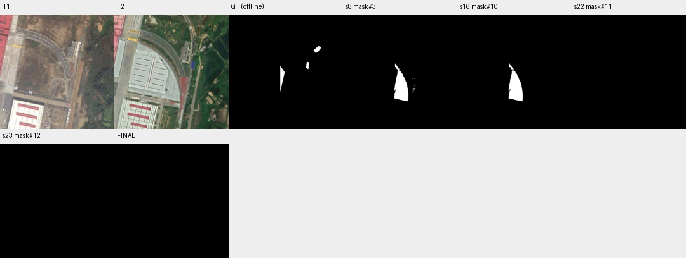

# case_07 完整轨迹

[交互回放](case_07.html#review) · [审查总表](20_case_review.md)



连续view不是已证实浪费；语义误判与漏检更关键

完整0–23步：18步否定大候选，19–21步分别看局部、全区和另一局部，确在尝试核查。之后提交空掩码漏2073 TP。图像中目标屋顶被解释为停车场；候选原已低召回，F1从10.86变0。不能把三个view当根因或声称Agent未看图就盲信。

改进核验冲突处理需独立对照；当前保留人工证据，不追加危险删除一律拦截。

## 第 0 步

当前答案：None；离线评价：None


## 第 1 步

当前答案：None；离线评价：None

I need to find building changes within region#0 (box [231, 84, 464, 398]). Let me first view both T1 and T2 images to understand what's in this region, then segment buildings at both times to identify changes.

Looking at the views:
- T1 shows a curved railway track area with some vegetation/empty land
- T2 shows a large new building complex (appears to be a warehouse or industrial facility) has been constructed in that same area

This suggests there's likely a new building construction. Let me segment buildings in both times within the region to confirm and create a change mask.


<details><summary>segment_text · 完整参数和返回</summary>


```json

{
  "tool": "segment_text",
  "args": {
    "time": "t1",
    "text": "building",
    "region": "region#0",
    "score_thr": 0.3
  },
  "ok": true,
  "error_code": null,
  "result_text": "{\"ok\":true,\"inst\":\"inst#0\",\"n\":1,\"area\":2067,\"score\":{\"min\":0.74609375,\"median\":0.74609375,\"max\":0.74609375},\"report\":\"Results clipped to region#0: removed 3 instances / 24622 pixels.\"}",
  "current_before": null,
  "current_after": null,
  "input_handles": [
    "region#0"
  ],
  "output_handles": [
    "inst#0"
  ],
  "eval": null,
  "candidate_eval": [],
  "set_current": null
}

```


</details>

## 第 2 步

当前答案：None；离线评价：None

T1 has 1 building instance with area 2067 in region#0. Now let me segment buildings in T2 within the same region to compare.


<details><summary>segment_text · 完整参数和返回</summary>


```json

{
  "tool": "segment_text",
  "args": {
    "time": "t2",
    "text": "building",
    "region": "region#0",
    "score_thr": 0.3
  },
  "ok": true,
  "error_code": null,
  "result_text": "{\"ok\":true,\"inst\":\"inst#1\",\"n\":6,\"area\":4603,\"score\":{\"min\":0.30859375,\"median\":0.4482421875,\"max\":0.486328125},\"report\":\"Results clipped to region#0: removed 4 instances / 50134 pixels.\"}",
  "current_before": null,
  "current_after": null,
  "input_handles": [
    "region#0"
  ],
  "output_handles": [
    "inst#1"
  ],
  "eval": null,
  "candidate_eval": [],
  "set_current": null
}

```


</details>

## 第 3 步

当前答案：None；离线评价：None

T2 has 6 building instances with total area 4603 in region#0. But wait - looking at the T2 image, there's clearly a large new building complex that wasn't in T1. The segmentation might have missed it or split it into multiple parts. Let me inspect both instance sets to understand what we're dealing with, and also view the region more carefully.


<details><summary>inspect · 完整参数和返回</summary>


```json

{
  "tool": "inspect",
  "args": {
    "mask": "inst#0"
  },
  "ok": true,
  "error_code": null,
  "result_text": "{\"ok\":true,\"mask\":\"inst#0\",\"total_components\":1,\"returned\":1,\"has_more\":false,\"components\":[{\"id\":4,\"area\":2067,\"bbox\":[299,116,340,198],\"score\":0.74609375}]}",
  "current_before": null,
  "current_after": null,
  "input_handles": [
    "inst#0"
  ],
  "output_handles": [],
  "eval": null,
  "candidate_eval": [],
  "set_current": null
}

```


</details>

<details><summary>inspect · 完整参数和返回</summary>


```json

{
  "tool": "inspect",
  "args": {
    "mask": "inst#1"
  },
  "ok": true,
  "error_code": null,
  "result_text": "{\"ok\":true,\"mask\":\"inst#1\",\"total_components\":6,\"returned\":6,\"has_more\":false,\"components\":[{\"id\":9,\"area\":2400,\"bbox\":[294,117,338,203],\"score\":0.4609375},{\"id\":2,\"area\":605,\"bbox\":[410,364,443,398],\"score\":0.30859375},{\"id\":6,\"area\":583,\"bbox\":[342,206,363,243],\"score\":0.486328125},{\"id\":10,\"area\":563,\"bbox\":[231,236,243,337],\"score\":0.435546875},{\"id\":8,\"area\":435,\"bbox\":[382,137,410,166],\"score\":0.46875},{\"id\":3,\"area\":17,\"bbox\":[234,283,244,317],\"score\":0.41015625}]}",
  "current_before": null,
  "current_after": null,
  "input_handles": [
    "inst#1"
  ],
  "output_handles": [],
  "eval": null,
  "candidate_eval": [],
  "set_current": null
}

```


</details>

## 第 4 步

当前答案：None；离线评价：None

I see that T1 has one building instance (id 4, area 2067, bbox [299,116,340,198]) and T2 has 6 instances. The largest T2 instance (id 9, area 2400, bbox [294,117,338,203]) seems to be at a similar location as the T1 building - this might be the same building or a rebuilt one.

But looking at the T2 image, there's clearly a much larger building complex that was constructed in the region. The segmentation with score_thr=0.3 might not have captured it well. Let me view the region more carefully to understand what changed, and possibly use a lower threshold or different approach.

Let me first view the region to see what's happening:


<details><summary>view · 完整参数和返回</summary>


```json

{
  "tool": "view",
  "args": {
    "region": [
      231,
      84,
      464,
      398
    ]
  },
  "ok": true,
  "error_code": null,
  "result_text": "{\"ok\":true,\"view_id\":\"view#1\",\"region\":[231,84,464,398],\"overlay\":null,\"display_size\":[570,768],\"image_size\":[598,796],\"scale\":2.445859872611465,\"padding\":[28,28],\"labelled_ids\":[],\"unlabelled_count\":0}",
  "current_before": null,
  "current_after": null,
  "input_handles": [],
  "output_handles": [],
  "eval": null,
  "candidate_eval": [],
  "set_current": null
}

```


</details>

## 第 5 步

当前答案：None；离线评价：None

Looking at the zoomed views of region#0:
- T1 shows a small building/structure around [299,116,340,198] area (the gray structure visible)
- T2 shows that same structure still there, but also reveals a large new building complex on the left side (the white/gray warehouse with red stripes) that wasn't in T1

Wait - looking more carefully at the full image views earlier, the large building complex appears to be mostly outside region#0 (it's on the left side). Let me check the actual coordinates. The region is [231, 84, 464, 398]. The large building in T2 seems to span from around x=231 to maybe x=350 or so based on the view.

Actually, looking at view#1 (T2), I can see:
- The original small building is still there (around y=116-203, x=294-338)
- There's a blue rectangular object (could be a temporary structure or vehicle)
- There's a red/brown area that might be construction material or a different surface
- On the left edge, part of the large new building complex is visible

The segmentation found instances in T2 but the large building might not have been fully captured. Let me try segmenting with a lower threshold or use prompt-based segmentation to better capture the new construction.

Let me first check if the large building in T2 is actually within region#0 by looking at its extent. From the full T2 view, the large building appears to start around x=231 and extend rightward. Let me try segmenting again with a lower score threshold to capture more buildings:


<details><summary>segment_text · 完整参数和返回</summary>


```json

{
  "tool": "segment_text",
  "args": {
    "time": "t2",
    "text": "building",
    "region": "region#0",
    "score_thr": 0.1
  },
  "ok": true,
  "error_code": null,
  "result_text": "{\"ok\":true,\"inst\":\"inst#2\",\"n\":18,\"area\":7988,\"score\":{\"min\":0.12158203125,\"median\":0.21875,\"max\":0.486328125},\"report\":\"Results clipped to region#0: removed 26 instances / 59131 pixels.\"}",
  "current_before": null,
  "current_after": null,
  "input_handles": [
    "region#0"
  ],
  "output_handles": [
    "inst#2"
  ],
  "eval": null,
  "candidate_eval": [],
  "set_current": null
}

```


</details>

## 第 6 步

当前答案：None；离线评价：None

With lower threshold, T2 now has 18 instances with total area 7988. This is more than double the previous count. Let me inspect these to understand what's being captured:


<details><summary>inspect · 完整参数和返回</summary>


```json

{
  "tool": "inspect",
  "args": {
    "mask": "inst#2",
    "limit": 20
  },
  "ok": true,
  "error_code": null,
  "result_text": "{\"ok\":true,\"mask\":\"inst#2\",\"total_components\":18,\"returned\":18,\"has_more\":false,\"components\":[{\"id\":2,\"area\":3042,\"bbox\":[295,122,350,218],\"score\":0.185546875},{\"id\":40,\"area\":2400,\"bbox\":[294,117,338,203],\"score\":0.4609375},{\"id\":17,\"area\":822,\"bbox\":[413,343,464,398],\"score\":0.1884765625},{\"id\":45,\"area\":654,\"bbox\":[421,343,459,384],\"score\":0.24609375},{\"id\":5,\"area\":605,\"bbox\":[410,364,443,398],\"score\":0.30859375},{\"id\":30,\"area\":583,\"bbox\":[342,206,363,243],\"score\":0.486328125},{\"id\":42,\"area\":563,\"bbox\":[231,236,243,337],\"score\":0.435546875},{\"id\":35,\"area\":435,\"bbox\":[382,137,410,166],\"score\":0.46875},{\"id\":41,\"area\":360,\"bbox\":[421,343,445,367],\"score\":0.2431640625},{\"id\":18,\"area\":299,\"bbox\":[438,361,459,384],\"score\":0.1845703125},{\"id\":6,\"area\":264,\"bbox\":[446,286,464,310],\"score\":0.1455078125},{\"id\":4,\"area\":257,\"bbox\":[421,126,439,148],\"score\":0.21875},{\"id\":11,\"area\":210,\"bbox\":[246,388,273,398],\"score\":0.12158203125},{\"id\":27,\"area\":169,\"bbox\":[387,228,399,244],\"score\":0.150390625},{\"id\":16,\"area\":132,\"bbox\":[454,382,464,398],\"score\":0.21875},{\"id\":24,\"area\":124,\"bbox\":[400,164,415,176],\"score\":0.140625},{\"id\":46,\"area\":88,\"bbox\":[410,388,423,398],\"score\":0.1748046875},{\"id\":10,\"area\":17,\"bbox\":[234,283,244,317],\"score\":0.41015625}]}",
  "current_before": null,
  "current_after": null,
  "input_handles": [
    "inst#2"
  ],
  "output_handles": [],
  "eval": null,
  "candidate_eval": [],
  "set_current": null
}

```


</details>

## 第 7 步

当前答案：None；离线评价：None

I see that with lower threshold, we get more instances but many are small and might be noise. The largest instance (id 2, area 3042, bbox [295,122,350,218]) seems to correspond to the same building as in T1 (which was at [299,116,340,198]). This suggests the original building is still there.

But I need to check if there's a NEW large building constructed. Looking at the full T2 view earlier, there was a large white/gray warehouse complex on the left side of region#0. Let me check if this is being captured. The bbox [295,122,350,218] for the largest T2 instance is similar to T1's building location.

Wait - I need to reconsider. Looking at the full image views:
- In T1, the region [231,84,464,398] shows mostly empty land with railway tracks and one small building
- In T2, the same region shows the small building still there, plus what appears to be a large new construction on the LEFT side (around x=231-350, y=200-380)

But the segmentation isn't capturing that large building well. Let me try using prompt-based segmentation with a box around the large new building area to better capture it. First, let me view the region more carefully to identify where the new building is:


<details><summary>view · 完整参数和返回</summary>


```json

{
  "tool": "view",
  "args": {
    "region": [
      231,
      84,
      464,
      398
    ],
    "overlay": "inst#2"
  },
  "ok": true,
  "error_code": null,
  "result_text": "{\"ok\":true,\"view_id\":\"view#2\",\"region\":[231,84,464,398],\"overlay\":\"inst#2\",\"display_size\":[570,768],\"image_size\":[598,796],\"scale\":2.445859872611465,\"padding\":[28,28],\"labelled_ids\":[],\"unlabelled_count\":0}",
  "current_before": null,
  "current_after": null,
  "input_handles": [
    "inst#2"
  ],
  "output_handles": [],
  "eval": null,
  "candidate_eval": [],
  "set_current": null
}

```


</details>

## 第 8 步

当前答案：None；离线评价：None

Looking at the overlay, I can see the segmentation is capturing various small objects but missing the large new building complex that's visible on the left side of T2 (the white/gray warehouse with red stripes). The large building appears to be mostly outside region#0 or only partially within it.

Let me look more carefully at the full images again. In the original view#0 T2, I can see a large building complex that starts around x=231 and extends rightward. But looking at the zoomed view#1 T2, the large building seems to be cut off at the left edge (x=231), suggesting most of it might be outside region#0.

Actually, wait - looking at view#1 T2 more carefully, I see:
- The original small building is still there (around y=116-203)
- A blue rectangular object (could be a temporary structure)
- A red/brown area (could be construction material or a different surface)
- On the LEFT edge (x~231), there's part of a large white building visible

The key question is: is there a NEW building constructed within region#0 that wasn't in T1?

Looking at T1 vs T2 in region#0:
- T1 has one small building (the gray structure)
- T2 has the same small building still there, plus possibly new structures

But the large white warehouse complex I saw in the full T2 view appears to be mostly outside region#0 (it's on the far left, and region#0 starts at x=231).

Let me try a different approach - use prompt-based segmentation with a box around the area where I suspect new construction might be. Looking at view#1 T2, there's a blue rectangle around [380-410, 220-250] and a red area around [290-350, 280-340]. Let me check if these are buildings or other features.

Actually, let me reconsider the task. The region#0 is [231, 84, 464, 398]. Looking at the full T2 image, the large building complex appears to span from about x=231 to x=350 and y=200 to y=380. This IS within region#0!

Let me try segmenting with a box prompt focused on the large new building area:


<details><summary>segment_prompt · 完整参数和返回</summary>


```json

{
  "tool": "segment_prompt",
  "args": {
    "time": "t2",
    "box": [
      231,
      200,
      360,
      380
    ]
  },
  "ok": true,
  "error_code": null,
  "result_text": "{\"ok\":true,\"mask\":\"mask#3\",\"area\":6575,\"component_count\":20,\"bbox\":[229,217,339,387],\"sam_quality\":0.3810836672782898}",
  "current_before": null,
  "current_after": null,
  "input_handles": [],
  "output_handles": [
    "mask#3"
  ],
  "eval": null,
  "candidate_eval": [
    {
      "handle": "mask#3",
      "parent": null,
      "tp": 464,
      "fp": 6111,
      "fn": 1609,
      "f1": 0.10730804810360776,
      "iou": 0.056695992179863146
    }
  ],
  "set_current": null
}

```


</details>

## 第 9 步

当前答案：None；离线评价：None

I got a mask with 20 components in the area [229,217,339,387] which is within region#0. This seems to be capturing the large new building complex. Let me view this mask overlaid on T2 to see what it captured:


<details><summary>view · 完整参数和返回</summary>


```json

{
  "tool": "view",
  "args": {
    "region": [
      231,
      84,
      464,
      398
    ],
    "overlay": "mask#3"
  },
  "ok": true,
  "error_code": null,
  "result_text": "{\"ok\":true,\"view_id\":\"view#3\",\"region\":[231,84,464,398],\"overlay\":\"mask#3\",\"display_size\":[570,768],\"image_size\":[598,796],\"scale\":2.445859872611465,\"padding\":[28,28],\"labelled_ids\":[],\"unlabelled_count\":0}",
  "current_before": null,
  "current_after": null,
  "input_handles": [
    "mask#3"
  ],
  "output_handles": [],
  "eval": null,
  "candidate_eval": [],
  "set_current": null
}

```


</details>

## 第 10 步

当前答案：None；离线评价：None

I can see that mask#3 is capturing the large new building complex on the left side of T2 (the white/gray warehouse). In T1, this area was empty land, so this represents a new building construction.

Now I need to:
1. Create a change mask that shows where buildings were newly constructed (present in T2 but not in T1) within region#0
2. Also check if any buildings were demolished (present in T1 but not in T2)

Let me first get the T1 building mask clipped to region#0, then compare with T2. The approach should be:
- Get all buildings in T2 within region#0
- Subtract buildings that were already in T1 within region#0
- The result should be the new construction

But wait - I need to be careful. The task says to find building changes. A building newly constructed means absent in T1, present in T2. A building demolished means present in T1, absent in T2.

From what I've seen:
- T1 has one small building at [299,116,340,198]
- T2 has that same building still there (around [294,117,338,203])
- T2 also has a large new building complex that wasn't in T1

So the change should be the new large building construction. Let me create a proper change mask by:
1. Getting T2 buildings within region#0
2. Getting T1 buildings within region#0
3. Finding what's in T2 but not in T1 (new construction)

Actually, a simpler approach: I can use the match_instances function to see which T2 instances have no corresponding T1 instance (appeared/new), and which T1 instances have no corresponding T2 instance (disappeared/demolished).

But first, let me make sure I have good masks for both times. Let me use the inst#1 (T2 with score_thr=0.3) and inst#0 (T1) and match them:


<details><summary>match_instances · 完整参数和返回</summary>


```json

{
  "tool": "match_instances",
  "args": {
    "inst_t1": "inst#0",
    "inst_t2": "inst#1",
    "overlap_thr": 0.25
  },
  "ok": true,
  "error_code": null,
  "result_text": "{\"ok\":true,\"appeared\":\"inst#4\",\"appeared_n\":5,\"disappeared\":\"inst#5\",\"disappeared_n\":0,\"present_t2\":\"inst#6\",\"present_t2_n\":1}",
  "current_before": null,
  "current_after": null,
  "input_handles": [
    "inst#0",
    "inst#1"
  ],
  "output_handles": [
    "inst#4",
    "inst#5",
    "inst#6"
  ],
  "eval": null,
  "candidate_eval": [],
  "set_current": null
}

```


</details>

## 第 11 步

当前答案：None；离线评价：None

The match_instances shows:
- 5 instances appeared (new in T2, not in T1) - these are new constructions
- 0 instances disappeared (no demolitions)
- 1 instance present in T2 (the original building that's still there)

So there are 5 new building instances in T2 that weren't in T1. But I need to make sure these are actual buildings and not noise. The inst#1 had only 6 instances total, and 5 appeared. Let me check which instances appeared by looking at inst#4 (the appeared set).

Wait, the result says "appeared":"inst#4" but I don't have inst#4 yet. The match_instances returns handles for the matched sets. Let me inspect what was returned:

Actually, looking at the output more carefully:
- "appeared":"inst#4" - this is a handle to the appeared instances
- "appeared_n":5 - 5 instances appeared
- "disappeared":"inst#5" - handle to disappeared instances (0 of them)
- "present_t2":"inst#6" - handle to instances present in both (1 instance)

But I don't see inst#4, inst#5, inst#6 in my previous calls. These must be new handles created by match_instances. Let me inspect them:


<details><summary>inspect · 完整参数和返回</summary>


```json

{
  "tool": "inspect",
  "args": {
    "mask": "inst#4"
  },
  "ok": true,
  "error_code": null,
  "result_text": "{\"ok\":true,\"mask\":\"inst#4\",\"total_components\":5,\"returned\":5,\"has_more\":false,\"components\":[{\"id\":2,\"area\":605,\"bbox\":[410,364,443,398],\"score\":0.30859375},{\"id\":6,\"area\":583,\"bbox\":[342,206,363,243],\"score\":0.486328125},{\"id\":10,\"area\":563,\"bbox\":[231,236,243,337],\"score\":0.435546875},{\"id\":8,\"area\":435,\"bbox\":[382,137,410,166],\"score\":0.46875},{\"id\":3,\"area\":17,\"bbox\":[234,283,244,317],\"score\":0.41015625}]}",
  "current_before": null,
  "current_after": null,
  "input_handles": [
    "inst#4"
  ],
  "output_handles": [],
  "eval": null,
  "candidate_eval": [],
  "set_current": null
}

```


</details>

<details><summary>inspect · 完整参数和返回</summary>


```json

{
  "tool": "inspect",
  "args": {
    "mask": "inst#6"
  },
  "ok": true,
  "error_code": null,
  "result_text": "{\"ok\":true,\"mask\":\"inst#6\",\"total_components\":1,\"returned\":1,\"has_more\":false,\"components\":[{\"id\":9,\"area\":2400,\"bbox\":[294,117,338,203],\"score\":0.4609375}]}",
  "current_before": null,
  "current_after": null,
  "input_handles": [
    "inst#6"
  ],
  "output_handles": [],
  "eval": null,
  "candidate_eval": [],
  "set_current": null
}

```


</details>

## 第 12 步

当前答案：None；离线评价：None

I see that the "appeared" instances (inst#4) are:
- id 2: area 605, bbox [410,364,443,398] - small building in bottom right
- id 6: area 583, bbox [342,206,363,243] - small building
- id 10: area 563, bbox [231,236,243,337] - thin strip on left edge
- id 8: area 435, bbox [382,137,410,166] - small building
- id 3: area 17, bbox [234,283,244,317] - very small (likely noise)

And the "present" instance (inst#6) is the main building at [294,117,338,203] which corresponds to the T1 building.

But wait - these appeared instances don't seem to include the large new building complex I saw in T2! The large building should have been captured somewhere. Let me check if my lower threshold segmentation (inst#2) has more instances that might represent the new construction.

Actually, I think the issue is that inst#1 (T2 with score_thr=0.3) didn't capture the large new building well because it's a large structure that might have been split or not detected properly. Let me use inst#2 (T2 with score_thr=0.1) instead for matching:


<details><summary>match_instances · 完整参数和返回</summary>


```json

{
  "tool": "match_instances",
  "args": {
    "inst_t1": "inst#0",
    "inst_t2": "inst#2",
    "overlap_thr": 0.25
  },
  "ok": true,
  "error_code": null,
  "result_text": "{\"ok\":true,\"appeared\":\"inst#7\",\"appeared_n\":16,\"disappeared\":\"inst#8\",\"disappeared_n\":0,\"present_t2\":\"inst#9\",\"present_t2_n\":2}",
  "current_before": null,
  "current_after": null,
  "input_handles": [
    "inst#0",
    "inst#2"
  ],
  "output_handles": [
    "inst#7",
    "inst#8",
    "inst#9"
  ],
  "eval": null,
  "candidate_eval": [],
  "set_current": null
}

```


</details>

## 第 13 步

当前答案：None；离线评价：None

With lower threshold, 16 instances appeared and 2 are present. Let me inspect these to understand what's new:


<details><summary>inspect · 完整参数和返回</summary>


```json

{
  "tool": "inspect",
  "args": {
    "mask": "inst#7",
    "limit": 20
  },
  "ok": true,
  "error_code": null,
  "result_text": "{\"ok\":true,\"mask\":\"inst#7\",\"total_components\":16,\"returned\":16,\"has_more\":false,\"components\":[{\"id\":17,\"area\":822,\"bbox\":[413,343,464,398],\"score\":0.1884765625},{\"id\":45,\"area\":654,\"bbox\":[421,343,459,384],\"score\":0.24609375},{\"id\":5,\"area\":605,\"bbox\":[410,364,443,398],\"score\":0.30859375},{\"id\":30,\"area\":583,\"bbox\":[342,206,363,243],\"score\":0.486328125},{\"id\":42,\"area\":563,\"bbox\":[231,236,243,337],\"score\":0.435546875},{\"id\":35,\"area\":435,\"bbox\":[382,137,410,166],\"score\":0.46875},{\"id\":41,\"area\":360,\"bbox\":[421,343,445,367],\"score\":0.2431640625},{\"id\":18,\"area\":299,\"bbox\":[438,361,459,384],\"score\":0.1845703125},{\"id\":6,\"area\":264,\"bbox\":[446,286,464,310],\"score\":0.1455078125},{\"id\":4,\"area\":257,\"bbox\":[421,126,439,148],\"score\":0.21875},{\"id\":11,\"area\":210,\"bbox\":[246,388,273,398],\"score\":0.12158203125},{\"id\":27,\"area\":169,\"bbox\":[387,228,399,244],\"score\":0.150390625},{\"id\":16,\"area\":132,\"bbox\":[454,382,464,398],\"score\":0.21875},{\"id\":24,\"area\":124,\"bbox\":[400,164,415,176],\"score\":0.140625},{\"id\":46,\"area\":88,\"bbox\":[410,388,423,398],\"score\":0.1748046875},{\"id\":10,\"area\":17,\"bbox\":[234,283,244,317],\"score\":0.41015625}]}",
  "current_before": null,
  "current_after": null,
  "input_handles": [
    "inst#7"
  ],
  "output_handles": [],
  "eval": null,
  "candidate_eval": [],
  "set_current": null
}

```


</details>

<details><summary>inspect · 完整参数和返回</summary>


```json

{
  "tool": "inspect",
  "args": {
    "mask": "inst#9"
  },
  "ok": true,
  "error_code": null,
  "result_text": "{\"ok\":true,\"mask\":\"inst#9\",\"total_components\":2,\"returned\":2,\"has_more\":false,\"components\":[{\"id\":2,\"area\":3042,\"bbox\":[295,122,350,218],\"score\":0.185546875},{\"id\":40,\"area\":2400,\"bbox\":[294,117,338,203],\"score\":0.4609375}]}",
  "current_before": null,
  "current_after": null,
  "input_handles": [
    "inst#9"
  ],
  "output_handles": [],
  "eval": null,
  "candidate_eval": [],
  "set_current": null
}

```


</details>

## 第 14 步

当前答案：None；离线评价：None

I see that with lower threshold, the "present" instances (inst#9) are:
- id 2: area 3042, bbox [295,122,350,218] - this is the main building (similar to T1's location)
- id 40: area 2400, bbox [294,117,338,203] - same building, different segmentation

And the "appeared" instances (inst#7) include many small objects, but I still don't see the large new building complex that I observed in T2. The large building should have a significant area.

Wait - looking at the appeared instances, none of them have a large area like the warehouse I saw. The largest appeared instance is id 17 with area 822. This suggests the large building might not be captured by the text-based segmentation.

Let me go back to my mask#3 which was created with a box prompt around [231, 200, 360, 380]. This mask captured the large new building. Let me check if this mask represents actual new construction by comparing it with T1.

Actually, I think the best approach is to:
1. Use mask#3 (which captures the large new building in T2) as the change mask
2. But I need to verify this is actually a building and not something else

Let me view mask#3 overlaid on both T1 and T2 to confirm:


<details><summary>view · 完整参数和返回</summary>


```json

{
  "tool": "view",
  "args": {
    "region": [
      231,
      84,
      464,
      398
    ],
    "overlay": "mask#3"
  },
  "ok": true,
  "error_code": null,
  "result_text": "{\"ok\":true,\"view_id\":\"view#4\",\"region\":[231,84,464,398],\"overlay\":\"mask#3\",\"display_size\":[570,768],\"image_size\":[598,796],\"scale\":2.445859872611465,\"padding\":[28,28],\"labelled_ids\":[],\"unlabelled_count\":0}",
  "current_before": null,
  "current_after": null,
  "input_handles": [
    "mask#3"
  ],
  "output_handles": [],
  "eval": null,
  "candidate_eval": [],
  "set_current": null
}

```


</details>

## 第 15 步

当前答案：None；离线评价：None

I can see mask#3 is capturing the large new building complex on the left side of T2 (the white/gray warehouse with red stripes). In T1, this area was empty land/vegetation, so this represents a new building construction.

However, I notice that mask#3 also includes some small scattered components in the middle-right area (around x=300-400, y=280-340) which appear as small red dots. These might be noise or small features. Let me check what these are by looking at the components of mask#3:


<details><summary>inspect · 完整参数和返回</summary>


```json

{
  "tool": "inspect",
  "args": {
    "mask": "mask#3",
    "limit": 30
  },
  "ok": true,
  "error_code": null,
  "result_text": "{\"ok\":true,\"mask\":\"mask#3\",\"total_components\":20,\"returned\":20,\"has_more\":false,\"components\":[{\"id\":1,\"area\":6450,\"bbox\":[229,217,293,387]},{\"id\":14,\"area\":50,\"bbox\":[314,327,324,340]},{\"id\":11,\"area\":13,\"bbox\":[321,320,324,326]},{\"id\":7,\"area\":10,\"bbox\":[318,312,320,318]},{\"id\":18,\"area\":7,\"bbox\":[314,343,316,347]},{\"id\":20,\"area\":6,\"bbox\":[310,345,312,348]},{\"id\":4,\"area\":5,\"bbox\":[318,283,320,286]},{\"id\":5,\"area\":4,\"bbox\":[310,284,312,286]},{\"id\":15,\"area\":4,\"bbox\":[310,329,312,332]},{\"id\":17,\"area\":4,\"bbox\":[310,337,312,340]},{\"id\":19,\"area\":4,\"bbox\":[307,344,308,348]},{\"id\":6,\"area\":3,\"bbox\":[318,305,319,308]},{\"id\":8,\"area\":3,\"bbox\":[322,312,324,314]},{\"id\":10,\"area\":3,\"bbox\":[315,320,316,323]},{\"id\":16,\"area\":3,\"bbox\":[318,336,319,339]},{\"id\":12,\"area\":2,\"bbox\":[318,321,319,323]},{\"id\":2,\"area\":1,\"bbox\":[338,238,339,239]},{\"id\":3,\"area\":1,\"bbox\":[243,246,244,247]},{\"id\":9,\"area\":1,\"bbox\":[310,314,311,315]},{\"id\":13,\"area\":1,\"bbox\":[310,322,311,323]}]}",
  "current_before": null,
  "current_after": null,
  "input_handles": [
    "mask#3"
  ],
  "output_handles": [],
  "eval": null,
  "candidate_eval": [],
  "set_current": null
}

```


</details>

## 第 16 步

当前答案：mask#10；离线评价：{'tp': 463, 'fp': 5987, 'fn': 1610, 'f1': 0.10864718995658805, 'iou': 0.05744416873449131, 'delta_f1': None}

I see that mask#3 has one large component (id 1, area 6450, bbox [229,217,293,387]) which is the main new building, and many tiny components (areas 1-50) which are likely noise from the segmentation.

The large component (id 1) with area 6450 is clearly the new building construction. The tiny components are probably artifacts and should be removed.

Let me create a cleaner change mask by keeping only the significant component (id 1) and removing the tiny noise components. I'll use remove_region to filter out small components:


<details><summary>remove_region · 完整参数和返回</summary>


```json

{
  "tool": "remove_region",
  "args": {
    "mask": "mask#3",
    "ids": [
      2,
      3,
      4,
      5,
      6,
      7,
      8,
      9,
      10,
      11,
      12,
      13,
      14,
      15,
      16,
      17,
      18,
      19,
      20
    ],
    "set_current": true
  },
  "ok": true,
  "error_code": null,
  "result_text": "{\"ok\":true,\"mask\":\"mask#10\",\"area\":6450,\"component_count\":1,\"added_px\":0,\"removed_px\":125,\"current_mask\":{\"before\":null,\"after\":\"mask#10\"}}",
  "current_before": null,
  "current_after": "mask#10",
  "input_handles": [
    "mask#3"
  ],
  "output_handles": [
    "mask#10"
  ],
  "eval": {
    "tp": 463,
    "fp": 5987,
    "fn": 1610,
    "f1": 0.10864718995658805,
    "iou": 0.05744416873449131,
    "delta_f1": null
  },
  "candidate_eval": [
    {
      "handle": "mask#10",
      "parent": "mask#3",
      "tp": 463,
      "fp": 5987,
      "fn": 1610,
      "f1": 0.10864718995658805,
      "iou": 0.05744416873449131,
      "delta_f1_from_parent": 0.0013391418529802857
    }
  ],
  "set_current": true
}

```


</details>

## 第 17 步

当前答案：mask#10；离线评价：{'tp': 463, 'fp': 5987, 'fn': 1610, 'f1': 0.10864718995658805, 'iou': 0.05744416873449131, 'delta_f1': 0.0}

I've created a clean change mask (mask#10) with one component of area 6450 pixels, which represents the new building construction in region#0. The verifier shows "1 none" which means it hasn't been verified yet.

Let me verify this is correct by viewing the mask overlaid on both T1 and T2 to confirm it's actually a building change:


<details><summary>view · 完整参数和返回</summary>


```json

{
  "tool": "view",
  "args": {
    "region": [
      231,
      84,
      464,
      398
    ],
    "overlay": "mask#10"
  },
  "ok": true,
  "error_code": null,
  "result_text": "{\"ok\":true,\"view_id\":\"view#5\",\"region\":[231,84,464,398],\"overlay\":\"mask#10\",\"display_size\":[570,768],\"image_size\":[598,796],\"scale\":2.445859872611465,\"padding\":[28,28],\"labelled_ids\":[],\"unlabelled_count\":0}",
  "current_before": "mask#10",
  "current_after": "mask#10",
  "input_handles": [
    "mask#10"
  ],
  "output_handles": [],
  "eval": {
    "tp": 463,
    "fp": 5987,
    "fn": 1610,
    "f1": 0.10864718995658805,
    "iou": 0.05744416873449131,
    "delta_f1": 0.0
  },
  "candidate_eval": [],
  "set_current": null
}

```


</details>

## 第 18 步

当前答案：mask#10；离线评价：{'tp': 463, 'fp': 5987, 'fn': 1610, 'f1': 0.10864718995658805, 'iou': 0.05744416873449131, 'delta_f1': 0.0}

The mask#10 is correctly highlighting the large new building complex on the left side of region#0. In T1, this area was empty land/vegetation, and in T2, there's a large white/gray warehouse building with red stripes. This is clearly a new building construction.

Now let me check if there are any other building changes I might have missed. Let me also verify that the original small building (present in both T1 and T2) is not included in my change mask, since it's not a change.

Looking at view#5, the mask#10 only covers the large new building on the left, which is correct. The original small building around [294,117,338,203] is not covered by the mask, which is correct since it wasn't demolished or newly constructed - it's still there.

Let me now ask the verifier to check this component:


<details><summary>ask · 完整参数和返回</summary>


```json

{
  "tool": "ask",
  "args": {},
  "ok": true,
  "error_code": null,
  "result_text": "{\"ok\":true,\"results\":[{\"mask\":\"mask#10\",\"id\":1,\"p_yes\":0.05340802792794377,\"answer\":\"no\",\"type\":\"non_building_change\",\"reason\":\"The area inside the red contour is bare ground in T1 and a paved parking lot in T2, which is a change in land cover rather than the construction or demolition of a building.\",\"status\":\"parsed\"}],\"remaining_unverified\":0}",
  "current_before": "mask#10",
  "current_after": "mask#10",
  "input_handles": [],
  "output_handles": [],
  "eval": {
    "tp": 463,
    "fp": 5987,
    "fn": 1610,
    "f1": 0.10864718995658805,
    "iou": 0.05744416873449131,
    "delta_f1": 0.0
  },
  "candidate_eval": [],
  "set_current": null
}

```


</details>

## 第 19 步

当前答案：mask#10；离线评价：{'tp': 463, 'fp': 5987, 'fn': 1610, 'f1': 0.10864718995658805, 'iou': 0.05744416873449131, 'delta_f1': 0.0}

The verifier says "no" with type "non_building_change" and reason: "The area inside the red contour is bare ground in T1 and a paved parking lot in T2, which is a change in land cover rather than the construction or demolition of a building."

This is interesting - the verifier is interpreting the large white/gray structure as a paved parking lot rather than a building. Let me look more carefully at the images to determine if this is actually a building or just a parking lot.

Looking at view#5 T2, I can see what appears to be a large structure with:
- White/gray surface with red stripes (could be roof markings or structural elements)
- It has a defined rectangular shape
- It looks like it could be a warehouse or industrial building

But the verifier is saying it's a parking lot. Let me zoom in more to see the details:


<details><summary>view · 完整参数和返回</summary>


```json

{
  "tool": "view",
  "args": {
    "region": [
      231,
      200,
      360,
      398
    ]
  },
  "ok": true,
  "error_code": null,
  "result_text": "{\"ok\":true,\"view_id\":\"view#6\",\"region\":[231,200,360,398],\"overlay\":null,\"display_size\":[500,768],\"image_size\":[528,796],\"scale\":3.878787878787879,\"padding\":[28,28],\"labelled_ids\":[],\"unlabelled_count\":0}",
  "current_before": "mask#10",
  "current_after": "mask#10",
  "input_handles": [],
  "output_handles": [],
  "eval": {
    "tp": 463,
    "fp": 5987,
    "fn": 1610,
    "f1": 0.10864718995658805,
    "iou": 0.05744416873449131,
    "delta_f1": 0.0
  },
  "candidate_eval": [],
  "set_current": null
}

```


</details>

## 第 20 步

当前答案：mask#10；离线评价：{'tp': 463, 'fp': 5987, 'fn': 1610, 'f1': 0.10864718995658805, 'iou': 0.05744416873449131, 'delta_f1': 0.0}

Looking at the zoomed view, I can see in T2 there's a large white/gray structure with what appears to be parking spaces (the horizontal lines look like parking stall markings) and a red area next to it. This does look more like a parking lot than a building.

However, looking at the full T2 image earlier, I also saw what appeared to be a large warehouse-like structure on the far left (outside the current zoom). Let me check if there's actually a building that I'm missing. The verifier says it's a parking lot (land cover change), not a building.

But wait - I need to reconsider. Looking at the original full T2 view, there was clearly a large building complex. Let me look at the area more carefully. The mask#10 covers [229,217,293,387] which is the left portion of region#0. In T2, this area shows a large white structure with red stripes.

Actually, looking more carefully at view#6 T2, I see:
- A large white/gray area with horizontal lines (could be parking spaces or roof panels)
- A red/brown area next to it (could be construction material or a different surface)

The verifier is interpreting this as a parking lot. But I need to determine if this is actually a building or just paved ground.

Let me look at the full T2 image again to get a better sense of what's there:


<details><summary>view · 完整参数和返回</summary>


```json

{
  "tool": "view",
  "args": {
    "region": [
      231,
      84,
      464,
      398
    ]
  },
  "ok": true,
  "error_code": null,
  "result_text": "{\"ok\":true,\"view_id\":\"view#7\",\"region\":[231,84,464,398],\"overlay\":null,\"display_size\":[570,768],\"image_size\":[598,796],\"scale\":2.445859872611465,\"padding\":[28,28],\"labelled_ids\":[],\"unlabelled_count\":0}",
  "current_before": "mask#10",
  "current_after": "mask#10",
  "input_handles": [],
  "output_handles": [],
  "eval": {
    "tp": 463,
    "fp": 5987,
    "fn": 1610,
    "f1": 0.10864718995658805,
    "iou": 0.05744416873449131,
    "delta_f1": 0.0
  },
  "candidate_eval": [],
  "set_current": null
}

```


</details>

## 第 21 步

当前答案：mask#10；离线评价：{'tp': 463, 'fp': 5987, 'fn': 1610, 'f1': 0.10864718995658805, 'iou': 0.05744416873449131, 'delta_f1': 0.0}

Looking at view#7 T2, I can see on the left side (around x=231-300, y=200-398) there's a large white/gray structure with what appears to be horizontal lines (parking spaces or roof panels). The verifier has already determined this is a parking lot (land cover change), not a building.

However, I notice that in T2, there's also a blue rectangular object around [380-410, 220-250] and a red/brown area around [290-350, 280-340]. These might be other features, but they're likely not buildings either (the blue could be a temporary structure or vehicle, the red could be construction material).

The verifier's answer says "no" for my current mask, meaning it doesn't consider the highlighted area as a building change. This suggests that the large white/gray structure is indeed a parking lot, not a building.

Given that:
1. The verifier has checked my mask and said "no" (not a building change)
2. The area appears to be a parking lot (land cover change) rather than a building
3. There don't appear to be any clear new buildings or demolished buildings in region#0

I should reconsider whether there are any actual building changes in this region. Let me check if there are any other potential building changes I might have missed.

Looking at the T1 image, there's one small building at [299,116,340,198]. In T2, this same building appears to still be there (around [294,117,338,203]). So this building wasn't demolished or newly constructed - it's still present.

Are there any other buildings? Let me check if there are any small buildings I might have missed. Looking at the T2 image, I see:
- The original small building (still there)
- A blue rectangular object (could be a temporary structure, vehicle, or small building)
- Some other small structures on the right side

Let me try to segment buildings more carefully to see if there are any actual building changes. But first, let me accept the verifier's assessment that the large white/gray area is a parking lot, not a building.

If the verifier is correct that there are no building changes, then I should submit an empty mask. But let me double-check by looking at the original small building to confirm it's still there in T2:


<details><summary>view · 完整参数和返回</summary>


```json

{
  "tool": "view",
  "args": {
    "region": [
      290,
      110,
      350,
      210
    ]
  },
  "ok": true,
  "error_code": null,
  "result_text": "{\"ok\":true,\"view_id\":\"view#8\",\"region\":[288,110,352,210],\"overlay\":null,\"display_size\":[492,768],\"image_size\":[520,796],\"scale\":7.68,\"padding\":[28,28],\"labelled_ids\":[],\"unlabelled_count\":0}",
  "current_before": "mask#10",
  "current_after": "mask#10",
  "input_handles": [],
  "output_handles": [],
  "eval": {
    "tp": 463,
    "fp": 5987,
    "fn": 1610,
    "f1": 0.10864718995658805,
    "iou": 0.05744416873449131,
    "delta_f1": 0.0
  },
  "candidate_eval": [],
  "set_current": null
}

```


</details>

## 第 22 步

当前答案：mask#11；离线评价：{'tp': 0, 'fp': 0, 'fn': 2073, 'f1': 0.0, 'iou': 0.0, 'delta_f1': -0.10864718995658805}

Looking at the zoomed view of the original building area [288,110,352,210]:
- T1 shows a gray rectangular building structure
- T2 shows the same gray rectangular building structure still there (though it appears slightly different due to lighting/seasonal changes)

This confirms the original building is still present in T2 - it wasn't demolished. The appearance difference is likely due to seasonal/illumination changes, not a change in the building itself.

Given that:
1. The verifier has determined my current mask (mask#10) represents a parking lot (land cover change), not a building change
2. The original small building is still present in both T1 and T2
3. I don't see any other clear new buildings or demolished buildings in region#0

I should conclude that there are no building changes in this region. Let me submit an empty mask to indicate no changes.

But wait - before submitting, let me reconsider. The verifier said "no" for mask#10, but maybe I should check if there are any other potential building changes I missed. Let me also verify by looking at the blue object in T2 which might be a temporary structure or small building:

Actually, the task says vehicles and temporary piles are NOT counted as building changes. So even if the blue object is a vehicle or temporary structure, it wouldn't count.

Given the verifier's assessment and my visual inspection, I believe there are no actual building changes (new construction or demolition) in region#0. The large white/gray area is a parking lot (land cover change), and the original building is still there.

Let me submit an empty mask:


<details><summary>submit · 完整参数和返回</summary>


```json

{
  "tool": "submit",
  "args": {
    "mask": "mask#11",
    "summary": "No building changes detected in region#0. The large white/gray structure visible in T2 was verified by the independent verifier as a paved parking lot (land cover change), not a building. The original small building present in T1 remains present in T2 (not demolished). No new buildings were constructed and no buildings were demolished within the region."
  },
  "ok": true,
  "error_code": null,
  "result_text": "{\"ok\":true,\"submitted\":false,\"report\":\"Report before submission. Every run gets this report as the first response to submit; it does not judge the mask, and nothing has to change. mask#11 is now your current answer: 0 pixels in 0 components.\\nVerifier answers on mask#11: 0 yes, 0 no, 0 unparsed, 0 with no answer. An answer applies only to the exact outline it was about; a view is not an answer.\\nA verifier answer is evidence, not an order, and it can be wrong in both directions. No answer is not an error. To finish with this mask, call submit with mask#11 again. To change it, edit and submit the new handle; components the verifier has not seen will be reported again. In the summary, say what you changed, and why you went against any verifier answer. You have 8 replies left.\"}",
  "current_before": "mask#10",
  "current_after": "mask#11",
  "input_handles": [
    "mask#11"
  ],
  "output_handles": [
    "mask#11"
  ],
  "eval": {
    "tp": 0,
    "fp": 0,
    "fn": 2073,
    "f1": 0.0,
    "iou": 0.0,
    "delta_f1": -0.10864718995658805
  },
  "candidate_eval": [
    {
      "handle": "mask#11",
      "parent": null,
      "tp": 0,
      "fp": 0,
      "fn": 2073,
      "f1": 0.0,
      "iou": 0.0
    }
  ],
  "set_current": null
}

```


</details>

## 第 23 步

当前答案：mask#12；离线评价：{'tp': 0, 'fp': 0, 'fn': 2073, 'f1': 0.0, 'iou': 0.0, 'delta_f1': 0.0}

The submit with "empty" created mask#11 (0 pixels, 0 components) as the current answer. The verifier has no answers yet for this empty mask. I need to call submit again with mask#11 to finalize the submission.


<details><summary>submit · 完整参数和返回</summary>


```json

{
  "tool": "submit",
  "args": {
    "mask": "mask#11",
    "summary": "No building changes detected in region#0. The large white/gray structure visible in T2 was verified by the independent verifier as a paved parking lot (land cover change), not a building. The original small building present in T1 remains present in T2 (not demolished). No new buildings were constructed and no buildings were demolished within the region."
  },
  "ok": true,
  "error_code": null,
  "result_text": "{\"ok\":true,\"mask\":\"mask#12\",\"area\":0,\"component_count\":0,\"current_mask\":{\"before\":\"mask#11\",\"after\":\"mask#12\"},\"submitted\":true}",
  "current_before": "mask#11",
  "current_after": "mask#12",
  "input_handles": [
    "mask#11"
  ],
  "output_handles": [
    "mask#12"
  ],
  "eval": {
    "tp": 0,
    "fp": 0,
    "fn": 2073,
    "f1": 0.0,
    "iou": 0.0,
    "delta_f1": 0.0
  },
  "candidate_eval": [
    {
      "handle": "mask#12",
      "parent": "mask#11",
      "tp": 0,
      "fp": 0,
      "fn": 2073,
      "f1": 0.0,
      "iou": 0.0,
      "delta_f1_from_parent": 0.0
    }
  ],
  "set_current": null
}

```


</details>
