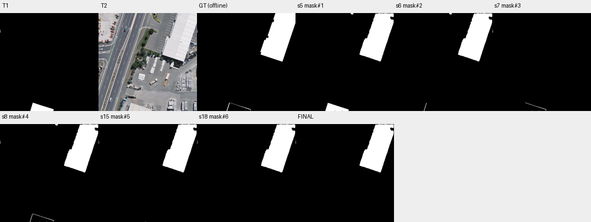

# case_08 完整轨迹

[交互回放](case_08.html#review) · [审查总表](20_case_review.md)



不同区域的连续查看属于正常核验

完整0–21步：T5.4使用旧地图与T2，10–13步查看整体及三个不同边界组件。初始候选F1=95.14，核验后删去276 TP和123 FP，最终94.84，约−0.30分；不能用轻微离线退化证明查看过度。工具正确使用map#0，视觉输入首幅是旧图而非T1影像。

作为简单保护案例；不改地图任务与显示机制，不把合理观察删掉。

## 第 0 步

当前答案：None；离线评价：None


## 第 1 步

当前答案：None；离线评价：None

I need to compare the old building map (T1) with the new optical image (T2) to identify newly built or demolished buildings. Let me start by examining both images more closely and then segment buildings in T2 to compare with T1.

First, let me view both images at higher resolution to understand what's there:


<details><summary>view · 完整参数和返回</summary>


```json

{
  "tool": "view",
  "args": {
    "region": [
      0,
      0,
      512,
      512
    ]
  },
  "ok": true,
  "error_code": null,
  "result_text": "{\"ok\":true,\"view_id\":\"view#1\",\"region\":[0,0,512,512],\"overlay\":null,\"display_size\":[768,768],\"image_size\":[796,796],\"scale\":1.5,\"padding\":[28,28],\"labelled_ids\":[],\"unlabelled_count\":0}",
  "current_before": null,
  "current_after": null,
  "input_handles": [],
  "output_handles": [],
  "eval": null,
  "candidate_eval": [],
  "set_current": null
}

```


</details>

## 第 2 步

当前答案：None；离线评价：None

I can see T1 has a small white building in the bottom area (around y=480-512, x=200-300), while T2 shows a large industrial/commercial area with a big building on the right side and various structures. Let me first inspect the components of map#0 to understand what's in the old building map:


<details><summary>inspect · 完整参数和返回</summary>


```json

{
  "tool": "inspect",
  "args": {
    "mask": "map#0"
  },
  "ok": true,
  "error_code": null,
  "result_text": "{\"ok\":true,\"mask\":\"map#0\",\"total_components\":2,\"returned\":2,\"has_more\":false,\"components\":[{\"id\":2,\"area\":3146,\"bbox\":[157,468,280,512]},{\"id\":1,\"area\":27,\"bbox\":[0,84,2,102]}]}",
  "current_before": null,
  "current_after": null,
  "input_handles": [
    "map#0"
  ],
  "output_handles": [],
  "eval": null,
  "candidate_eval": [],
  "set_current": null
}

```


</details>

## 第 3 步

当前答案：None；离线评价：None

I see map#0 has 2 components:
- Component 2: area=3146, bbox=[157,468,280,512] - this is the large building in the bottom area
- Component 1: area=27, bbox=[0,84,2,102] - this is a tiny component on the left edge

Now I need to segment buildings in T2 to identify what buildings exist there. Let me use segment_text to find buildings in T2:


<details><summary>segment_text · 完整参数和返回</summary>


```json

{
  "tool": "segment_text",
  "args": {
    "time": "t2",
    "text": "building",
    "score_thr": 0.3
  },
  "ok": true,
  "error_code": null,
  "result_text": "{\"ok\":true,\"inst\":\"inst#0\",\"n\":3,\"area\":29554,\"score\":{\"min\":0.318359375,\"median\":0.671875,\"max\":0.73828125}}",
  "current_before": null,
  "current_after": null,
  "input_handles": [],
  "output_handles": [
    "inst#0"
  ],
  "eval": null,
  "candidate_eval": [],
  "set_current": null
}

```


</details>

## 第 4 步

当前答案：None；离线评价：None

I got 3 building instances in T2. Let me inspect them to see what they are:


<details><summary>inspect · 完整参数和返回</summary>


```json

{
  "tool": "inspect",
  "args": {
    "mask": "inst#0"
  },
  "ok": true,
  "error_code": null,
  "result_text": "{\"ok\":true,\"mask\":\"inst#0\",\"total_components\":3,\"returned\":3,\"has_more\":false,\"components\":[{\"id\":3,\"area\":26441,\"bbox\":[333,1,511,253],\"score\":0.73828125},{\"id\":1,\"area\":3025,\"bbox\":[155,470,277,512],\"score\":0.671875},{\"id\":2,\"area\":88,\"bbox\":[287,0,301,8],\"score\":0.318359375}]}",
  "current_before": null,
  "current_after": null,
  "input_handles": [
    "inst#0"
  ],
  "output_handles": [],
  "eval": null,
  "candidate_eval": [],
  "set_current": null
}

```


</details>

## 第 5 步

当前答案：None；离线评价：None

I see 3 instances in T2:
- Instance 3: area=26441, bbox=[333,1,511,253] - large building on the right side (top-right area)
- Instance 1: area=3025, bbox=[155,470,277,512] - this looks similar to component 2 in map#0 (bbox [157,468,280,512])
- Instance 2: area=88, bbox=[287,0,301,8] - tiny instance at top

Now I need to compare T1 and T2 to find changes. The key is to identify:
1. Buildings in T2 that are NOT in T1 (newly built)
2. Buildings in T1 that are NOT in T2 (demolished)

Let me first convert the T2 building instances to a mask, then compare with T1. But first, let me understand what's in T1 more carefully. The old map has component 2 at [157,468,280,512] which seems to correspond to instance 1 in T2 at [155,470,277,512]. These are very similar - likely the same building.

The big difference is that T2 has a large building (instance 3) at [333,1,511,253] which is NOT in T1. This appears to be a newly built building.

Also, T1 has a tiny component 1 at [0,84,2,102] - I need to check if this exists in T2.

Let me create a mask from T2 instances and compare with T1:


<details><summary>to_mask · 完整参数和返回</summary>


```json

{
  "tool": "to_mask",
  "args": {
    "sets": [
      "inst#0"
    ],
    "set_current": false
  },
  "ok": true,
  "error_code": null,
  "result_text": "{\"ok\":true,\"mask\":\"mask#1\",\"area\":29554,\"component_count\":3}",
  "current_before": null,
  "current_after": null,
  "input_handles": [
    "inst#0"
  ],
  "output_handles": [
    "mask#1"
  ],
  "eval": null,
  "candidate_eval": [
    {
      "handle": "mask#1",
      "parent": null,
      "tp": 26551,
      "fp": 3003,
      "fn": 2786,
      "f1": 0.9016997503863069,
      "iou": 0.820995670995671
    }
  ],
  "set_current": false
}

```


</details>

## 第 6 步

当前答案：None；离线评价：None

Now I have mask#1 which is the union of all building instances in T2. Let me view this mask to see what it looks like, and also compare it with T1 (map#0).

The change mask should be:
- Buildings in T2 but not in T1 (newly built) = mask#1 - map#0
- Buildings in T1 but not in T2 (demolished) = map#0 - mask#1

But actually, the task asks for a binary change mask showing newly built AND demolished buildings. So I need to compute the symmetric difference: (mask#1 XOR map#0) or (mask#1 - map#0) + (map#0 - mask#1).

Let me first subtract map#0 from mask#1 to get newly built areas:


<details><summary>combine · 完整参数和返回</summary>


```json

{
  "tool": "combine",
  "args": {
    "op": "subtract",
    "a": "mask#1",
    "b": "map#0",
    "set_current": false
  },
  "ok": true,
  "error_code": null,
  "result_text": "{\"ok\":true,\"mask\":\"mask#2\",\"area\":26626,\"component_count\":3,\"added_px\":0,\"removed_px\":2928}",
  "current_before": null,
  "current_after": null,
  "input_handles": [
    "mask#1",
    "map#0"
  ],
  "output_handles": [
    "mask#2"
  ],
  "eval": null,
  "candidate_eval": [
    {
      "handle": "mask#2",
      "parent": "mask#1",
      "tp": 26533,
      "fp": 93,
      "fn": 2804,
      "f1": 0.9482336543787859,
      "iou": 0.9015630309208291,
      "delta_f1_from_parent": 0.04653390399247903
    }
  ],
  "set_current": false
}

```


</details>

## 第 7 步

当前答案：None；离线评价：None

mask#2 is mask#1 - map#0, which gives newly built areas. It has area 26626 and 3 components. Now let me also compute map#0 - mask#1 to get demolished areas:


<details><summary>combine · 完整参数和返回</summary>


```json

{
  "tool": "combine",
  "args": {
    "op": "subtract",
    "a": "map#0",
    "b": "mask#1",
    "set_current": false
  },
  "ok": true,
  "error_code": null,
  "result_text": "{\"ok\":true,\"mask\":\"mask#3\",\"area\":245,\"component_count\":5,\"added_px\":0,\"removed_px\":2928}",
  "current_before": null,
  "current_after": null,
  "input_handles": [
    "map#0",
    "mask#1"
  ],
  "output_handles": [
    "mask#3"
  ],
  "eval": null,
  "candidate_eval": [
    {
      "handle": "mask#3",
      "parent": "map#0",
      "tp": 206,
      "fp": 39,
      "fn": 29131,
      "f1": 0.013927388276654722,
      "iou": 0.007012527233115468,
      "delta_f1_from_parent": 0.00014701300750676743
    }
  ],
  "set_current": false
}

```


</details>

## 第 8 步

当前答案：mask#4；离线评价：{'tp': 26739, 'fp': 132, 'fn': 2598, 'f1': 0.9514304013663536, 'iou': 0.9073602769011504, 'delta_f1': None}

mask#3 is map#0 - mask#1, which gives demolished areas. It has area 245 and 5 components.

Now I need to combine these two (newly built + demolished) to get the full change mask. Let me union them:


<details><summary>combine · 完整参数和返回</summary>


```json

{
  "tool": "combine",
  "args": {
    "op": "union",
    "a": "mask#2",
    "b": "mask#3",
    "set_current": true
  },
  "ok": true,
  "error_code": null,
  "result_text": "{\"ok\":true,\"mask\":\"mask#4\",\"area\":26871,\"component_count\":7,\"added_px\":245,\"removed_px\":0,\"current_mask\":{\"before\":null,\"after\":\"mask#4\"}}",
  "current_before": null,
  "current_after": "mask#4",
  "input_handles": [
    "mask#2",
    "mask#3"
  ],
  "output_handles": [
    "mask#4"
  ],
  "eval": {
    "tp": 26739,
    "fp": 132,
    "fn": 2598,
    "f1": 0.9514304013663536,
    "iou": 0.9073602769011504,
    "delta_f1": null
  },
  "candidate_eval": [
    {
      "handle": "mask#4",
      "parent": "mask#2",
      "tp": 26739,
      "fp": 132,
      "fn": 2598,
      "f1": 0.9514304013663536,
      "iou": 0.9073602769011504,
      "delta_f1_from_parent": 0.003196746987567667
    }
  ],
  "set_current": true
}

```


</details>

## 第 9 步

当前答案：mask#4；离线评价：{'tp': 26739, 'fp': 132, 'fn': 2598, 'f1': 0.9514304013663536, 'iou': 0.9073602769011504, 'delta_f1': 0.0}

I now have mask#4 as the current answer, which represents the symmetric difference between T2 buildings and T1 buildings. It has 7 components with total area 26871 pixels. The verifier hasn't checked any yet (0 yes, 0 no, 0 unparsed, 7 none).

Let me inspect the components of mask#4 to understand what each component is:


<details><summary>inspect · 完整参数和返回</summary>


```json

{
  "tool": "inspect",
  "args": {
    "mask": "mask#4"
  },
  "ok": true,
  "error_code": null,
  "result_text": "{\"ok\":true,\"mask\":\"mask#4\",\"total_components\":7,\"returned\":7,\"has_more\":false,\"components\":[{\"id\":2,\"area\":26441,\"bbox\":[333,1,511,253]},{\"id\":4,\"area\":307,\"bbox\":[155,468,280,512]},{\"id\":1,\"area\":88,\"bbox\":[287,0,301,8]},{\"id\":3,\"area\":27,\"bbox\":[0,84,2,102]},{\"id\":7,\"area\":4,\"bbox\":[241,511,245,512]},{\"id\":5,\"area\":2,\"bbox\":[203,511,205,512]},{\"id\":6,\"area\":2,\"bbox\":[206,511,208,512]}]}",
  "current_before": "mask#4",
  "current_after": "mask#4",
  "input_handles": [
    "mask#4"
  ],
  "output_handles": [],
  "eval": {
    "tp": 26739,
    "fp": 132,
    "fn": 2598,
    "f1": 0.9514304013663536,
    "iou": 0.9073602769011504,
    "delta_f1": 0.0
  },
  "candidate_eval": [],
  "set_current": null
}

```


</details>

## 第 10 步

当前答案：mask#4；离线评价：{'tp': 26739, 'fp': 132, 'fn': 2598, 'f1': 0.9514304013663536, 'iou': 0.9073602769011504, 'delta_f1': 0.0}

I see 7 components in mask#4:
- Component 2: area=26441, bbox=[333,1,511,253] - This is the large newly built building on the right side (from T2 instance 3)
- Component 4: area=307, bbox=[155,468,280,512] - This seems to be a small difference area around the existing building location
- Component 1: area=88, bbox=[287,0,301,8] - Tiny instance from T2 that's not in T1
- Component 3: area=27, bbox=[0,84,2,102] - This is the tiny component from T1 that might not exist in T2 (demolished?)
- Components 7, 5, 6: Very small areas (4, 2, 2 pixels) at the bottom edge

Let me view mask#4 overlaid on both images to understand what these components represent:


<details><summary>view · 完整参数和返回</summary>


```json

{
  "tool": "view",
  "args": {
    "region": [
      0,
      0,
      512,
      512
    ],
    "overlay": "mask#4"
  },
  "ok": true,
  "error_code": null,
  "result_text": "{\"ok\":true,\"view_id\":\"view#2\",\"region\":[0,0,512,512],\"overlay\":\"mask#4\",\"display_size\":[768,768],\"image_size\":[796,796],\"scale\":1.5,\"padding\":[28,28],\"labelled_ids\":[],\"unlabelled_count\":0}",
  "current_before": "mask#4",
  "current_after": "mask#4",
  "input_handles": [
    "mask#4"
  ],
  "output_handles": [],
  "eval": {
    "tp": 26739,
    "fp": 132,
    "fn": 2598,
    "f1": 0.9514304013663536,
    "iou": 0.9073602769011504,
    "delta_f1": 0.0
  },
  "candidate_eval": [],
  "set_current": null
}

```


</details>

## 第 11 步

当前答案：mask#4；离线评价：{'tp': 26739, 'fp': 132, 'fn': 2598, 'f1': 0.9514304013663536, 'iou': 0.9073602769011504, 'delta_f1': 0.0}

I can see the red contours on T2 showing the change mask. The large building on the right (bbox [333,1,511,253]) is clearly a newly built building - it's not in T1. There's also a small area at the bottom where the old building was (component 4 with area 307), and some tiny components.

Let me look more carefully at the bottom area where the old building (T1 component 2) was. The old map had a building at [157,468,280,512], and T2 has an instance at [155,470,277,512]. These are very similar, so this building likely still exists. But my current mask shows component 4 with area 307 at [155,468,280,512] - this might be a small difference due to slight alignment issues or edge differences.

Let me zoom into the bottom area to check if the building at [155,468,280,512] actually changed:


<details><summary>view · 完整参数和返回</summary>


```json

{
  "tool": "view",
  "args": {
    "region": [
      100,
      450,
      320,
      512
    ],
    "overlay": "mask#4"
  },
  "ok": true,
  "error_code": null,
  "result_text": "{\"ok\":true,\"view_id\":\"view#3\",\"region\":[100,448,320,512],\"overlay\":\"mask#4\",\"display_size\":[768,223],\"image_size\":[796,251],\"scale\":3.4909090909090907,\"padding\":[28,28],\"labelled_ids\":[],\"unlabelled_count\":0}",
  "current_before": "mask#4",
  "current_after": "mask#4",
  "input_handles": [
    "mask#4"
  ],
  "output_handles": [],
  "eval": {
    "tp": 26739,
    "fp": 132,
    "fn": 2598,
    "f1": 0.9514304013663536,
    "iou": 0.9073602769011504,
    "delta_f1": 0.0
  },
  "candidate_eval": [],
  "set_current": null
}

```


</details>

## 第 12 步

当前答案：mask#4；离线评价：{'tp': 26739, 'fp': 132, 'fn': 2598, 'f1': 0.9514304013663536, 'iou': 0.9073602769011504, 'delta_f1': 0.0}

I can see in the zoomed view that at the bottom area, there's a building in T2 (the white/gray structure visible) that corresponds to the old building in T1. The red contour shows some difference - it appears the building shape has changed slightly or there's a small area difference. But looking at T2, I can clearly see a building exists there (the large white/gray roof structure).

The key question is: does this building count as a change? Looking at T1, the old map had a building at [157,468,280,512]. In T2, there's clearly a building in that same location (visible as the large white roof structure at the bottom). So this building likely still exists - it's not demolished.

However, my current mask#4 includes component 4 (area 307) which represents the difference between T1 and T2 in that area. This might be due to slight alignment differences or the building having been rebuilt with slightly different dimensions.

Let me also check the tiny components. Component 3 (area 27, bbox [0,84,2,102]) is from T1 - this was a tiny building on the left edge. Let me check if this still exists in T2 by looking at that region:


<details><summary>view · 完整参数和返回</summary>


```json

{
  "tool": "view",
  "args": {
    "region": [
      0,
      80,
      50,
      110
    ],
    "overlay": "mask#4"
  },
  "ok": true,
  "error_code": null,
  "result_text": "{\"ok\":true,\"view_id\":\"view#4\",\"region\":[0,63,64,127],\"overlay\":\"mask#4\",\"display_size\":[768,768],\"image_size\":[796,796],\"scale\":12.0,\"padding\":[28,28],\"labelled_ids\":[],\"unlabelled_count\":0}",
  "current_before": "mask#4",
  "current_after": "mask#4",
  "input_handles": [
    "mask#4"
  ],
  "output_handles": [],
  "eval": {
    "tp": 26739,
    "fp": 132,
    "fn": 2598,
    "f1": 0.9514304013663536,
    "iou": 0.9073602769011504,
    "delta_f1": 0.0
  },
  "candidate_eval": [],
  "set_current": null
}

```


</details>

## 第 13 步

当前答案：mask#4；离线评价：{'tp': 26739, 'fp': 132, 'fn': 2598, 'f1': 0.9514304013663536, 'iou': 0.9073602769011504, 'delta_f1': 0.0}

Looking at the zoomed view of the left edge (bbox [0,80,50,110]), I can see in T2 there's an area with what appears to be construction equipment or vehicles (orange items), but no clear building structure at the exact location of the tiny T1 component. The red contour shows a small vertical strip on the left edge. This tiny component (area 27) from T1 might represent something that was demolished or is just a mapping artifact.

However, given how small this is (only 27 pixels), and considering it's at the very edge of the image, it might be a noise/artifact rather than a real building change. Let me also check the other tiny components (7, 5, 6) which are at the bottom edge around y=511-512.

Let me look at the top area where component 1 (area 88, bbox [287,0,301,8]) is - this is a tiny instance from T2 that's not in T1:


<details><summary>view · 完整参数和返回</summary>


```json

{
  "tool": "view",
  "args": {
    "region": [
      280,
      0,
      310,
      20
    ],
    "overlay": "mask#4"
  },
  "ok": true,
  "error_code": null,
  "result_text": "{\"ok\":true,\"view_id\":\"view#5\",\"region\":[263,0,327,64],\"overlay\":\"mask#4\",\"display_size\":[768,768],\"image_size\":[796,796],\"scale\":12.0,\"padding\":[28,28],\"labelled_ids\":[],\"unlabelled_count\":0}",
  "current_before": "mask#4",
  "current_after": "mask#4",
  "input_handles": [
    "mask#4"
  ],
  "output_handles": [],
  "eval": {
    "tp": 26739,
    "fp": 132,
    "fn": 2598,
    "f1": 0.9514304013663536,
    "iou": 0.9073602769011504,
    "delta_f1": 0.0
  },
  "candidate_eval": [],
  "set_current": null
}

```


</details>

## 第 14 步

当前答案：mask#4；离线评价：{'tp': 26739, 'fp': 132, 'fn': 2598, 'f1': 0.9514304013663536, 'iou': 0.9073602769011504, 'delta_f1': 0.0}

Looking at the top area (bbox [280,0,310,20]), I can see in T2 there's a small dark structure (possibly a small building or object) that was segmented as instance 2 with area 88. This appears to be a newly built small structure not present in T1.

Now let me think about what should be in the final change mask:

1. **Newly built**: The large building on the right (component 2, area 26441) - clearly a new building
2. **Newly built**: The tiny structure at top (component 1, area 88) - appears to be a small new structure
3. **Demolished/changed**: Component 3 (area 27) from T1 - tiny component on left edge, might be demolished
4. **Edge differences**: Component 4 (area 307) around the existing building - this might be due to slight alignment or shape changes, but the building still exists in T2
5. **Tiny artifacts**: Components 7, 5, 6 (areas 4, 2, 2) at bottom edge - these are very small and might be noise

The key question is whether component 4 (the difference around the existing building) represents a real change or just alignment issues. Looking at T2, the building clearly still exists in that location. The difference might be due to the building being rebuilt with slightly different dimensions, or it could be a segmentation artifact.

Let me also check if the verifier has any opinions by calling ask:


<details><summary>ask · 完整参数和返回</summary>


```json

{
  "tool": "ask",
  "args": {},
  "ok": true,
  "error_code": null,
  "result_text": "{\"ok\":true,\"results\":[{\"mask\":\"mask#4\",\"id\":2,\"p_yes\":0.9999999677581921,\"answer\":\"yes\",\"type\":\"new_building\",\"reason\":\"The area inside the red contour shows a large, structured roof with distinct panels and sharp edges characteristic of a building.\",\"status\":\"parsed\",\"p_change\":0.9999999677581921,\"state_answer\":\"yes\",\"state_p_yes\":0.9999999677581921,\"old_building\":false,\"old_building_fraction\":0.0},{\"mask\":\"mask#4\",\"id\":4,\"p_yes\":0.0010321990355351973,\"answer\":\"no\",\"type\":\"no_change\",\"reason\":\"The area inside the red contour shows a distinct rectangular structure with a flat roof and defined edges, characteristic of a temporary building or container.\",\"status\":\"parsed\",\"p_change\":0.0010321990355351973,\"state_answer\":\"yes\",\"state_p_yes\":0.9989678009644648,\"old_building\":true,\"old_building_fraction\":0.6840390879478827},{\"mask\":\"mask#4\",\"id\":1,\"p_yes\":2.1444904820266933e-05,\"answer\":\"no\",\"type\":\"no_change\",\"reason\":\"The object inside the red contour appears to be a small vehicle or temporary structure, not a permanent building, based on its size and shape relative to the surrounding parking lot.\",\"status\":\"parsed\",\"p_change\":2.1444904820266933e-05,\"state_answer\":\"no\",\"state_p_yes\":2.1444904820266933e-05,\"old_building\":false,\"old_building_fraction\":0.0},{\"mask\":\"mask#4\",\"id\":3,\"p_yes\":0.9999989322969822,\"answer\":\"yes\",\"type\":\"demolished\",\"reason\":\"The area inside the red contour contains construction equipment or vehicles, not a building structure.\",\"status\":\"parsed\",\"p_change\":0.9999989322969822,\"state_answer\":\"no\",\"state_p_yes\":1.0677030177590692e-06,\"old_building\":true,\"old_building_fraction\":1.0},{\"mask\":\"mask#4\",\"id\":7,\"p_yes\":0.9999251538037651,\"answer\":\"yes\",\"type\":\"demolished\",\"reason\":\"The area inside the red contour contains stacked materials or pallets, not a building structure.\",\"status\":\"parsed\",\"p_change\":0.9999251538037651,\"state_answer\":\"no\",\"state_p_yes\":7.484619623487578e-05,\"old_building\":true,\"old_building_fraction\":1.0},{\"mask\":\"mask#4\",\"id\":5,\"p_yes\":0.0004878446568442607,\"answer\":\"no\",\"type\":\"no_change\",\"reason\":\"The red contour is located on the roof of the large structure visible at the bottom of the wider view, which exhibits clear building characteristics like a flat, paneled surface.\",\"status\":\"parsed\",\"p_change\":0.0004878446568442607,\"state_answer\":\"yes\",\"state_p_yes\":0.9995121553431557,\"old_building\":true,\"old_building_fraction\":1.0},{\"mask\":\"mask#4\",\"id\":6,\"p_yes\":0.00013982032087056506,\"answer\":\"no\",\"type\":\"no_change\",\"reason\":\"The red contour is located on the roof of the large structure visible at the bottom of the wider view, which has the distinct appearance of a building.\",\"status\":\"parsed\",\"p_change\":0.00013982032087056506,\"state_answer\":\"yes\",\"state_p_yes\":0.9998601796791294,\"old_building\":true,\"old_building_fraction\":1.0}],\"remaining_unverified\":0}",
  "current_before": "mask#4",
  "current_after": "mask#4",
  "input_handles": [],
  "output_handles": [],
  "eval": {
    "tp": 26739,
    "fp": 132,
    "fn": 2598,
    "f1": 0.9514304013663536,
    "iou": 0.9073602769011504,
    "delta_f1": 0.0
  },
  "candidate_eval": [],
  "set_current": null
}

```


</details>

## 第 15 步

当前答案：mask#5；离线评价：{'tp': 26463, 'fp': 9, 'fn': 2874, 'f1': 0.9483416653227974, 'iou': 0.9017583316295236, 'delta_f1': -0.003088736043556195}

The verifier has checked all 7 components. Let me analyze the results:

1. **Component 2** (area 26441, large building on right): `answer="yes"`, type="new_building" - This is correctly identified as a newly built building. KEEP.

2. **Component 4** (area 307, around existing building): `answer="no"`, type="no_change" - The verifier says this is NOT a change. It describes it as "a distinct rectangular structure with a flat roof and defined edges, characteristic of a temporary building or container" and notes old_building_fraction=0.68. This means the building still exists there. I should REMOVE this component since it's not a real change.

3. **Component 1** (area 88, tiny at top): `answer="no"`, type="no_change" - The verifier says this is NOT a building change, describing it as "a small vehicle or temporary structure, not a permanent building". Since the scope is "building", and this appears to be a vehicle/temporary structure, I should REMOVE this component.

4. **Component 3** (area 27, tiny on left edge): `answer="yes"`, type="demolished" - The verifier says this IS a demolished building, noting it contains "construction equipment or vehicles, not a building structure" but marks it as old_building=true with fraction 1.0. Wait, the reason says it contains construction equipment, not a building, but the answer is "yes" for demolished. This seems contradictory. Let me re-read: the verifier sees the area in T1 had a building (old_building=true), and in T2 it's now just equipment/vehicles, so it's considered demolished. I should KEEP this as a demolished building.

5. **Component 7** (area 4, bottom edge): `answer="yes"`, type="demolished" - Similar to component 3, the verifier says it's demolished (contains stacked materials/pallets, not a building). But wait, the reason says "stacked materials or pallets, not a building structure" - this might be a false positive. The area is very small (4 pixels) and might be noise. However, the verifier answered "yes" for demolished. Let me keep it for now but note it's questionable.

6. **Component 5** (area 2, bottom edge): `answer="no"`, type="no_change" - The verifier says this is NOT a change, located on the roof of the large structure. REMOVE.

7. **Component 6** (area 2, bottom edge): `answer="no"`, type="no_change" - Similar to component 5, located on the roof of the large structure. REMOVE.

So based on the verifier answers:
- KEEP: Component 2 (new building), Component 3 (demolished)
- Possibly KEEP: Component 7 (verifier says demolished, but it's very small and might be noise)
- REMOVE: Components 1, 4, 5, 6

Wait, let me reconsider Component 7. The verifier said "yes" for demolished with p_yes=0.9999, but the reason says "stacked materials or pallets, not a building structure". This is confusing - if it's not a building structure, why is it marked as demolished? The old_building_fraction=1.0 suggests the verifier thinks there was a building there in T1. Given the tiny size (4 pixels), this might be a mapping artifact at the edge.

Actually, looking more carefully at the verifier output for component 7:
- answer="yes", type="demolished"
- reason: "The area inside the red contour contains stacked materials or pallets, not a building structure."
- old_building=true, old_building_fraction=1.0

This seems inconsistent - the verifier says it contains non-building items but also says it's demolished (implying there was a building). This might be an error in the verifier's reasoning. Given the tiny size (4 pixels), I'm inclined to remove it as likely noise.

Let me also reconsider Component 1. The verifier said "no" for change, describing it as a small vehicle/temporary structure. Since the scope is specifically "building", and this doesn't appear to be a permanent building, I should remove it.

Now let me create a refined mask by removing components 1, 4, 5, 6, and possibly 7:


<details><summary>remove_region · 完整参数和返回</summary>


```json

{
  "tool": "remove_region",
  "args": {
    "mask": "mask#4",
    "ids": [
      1,
      4,
      5,
      6
    ],
    "set_current": true
  },
  "ok": true,
  "error_code": null,
  "result_text": "{\"ok\":true,\"mask\":\"mask#5\",\"area\":26472,\"component_count\":3,\"added_px\":0,\"removed_px\":399,\"current_mask\":{\"before\":\"mask#4\",\"after\":\"mask#5\"}}",
  "current_before": "mask#4",
  "current_after": "mask#5",
  "input_handles": [
    "mask#4"
  ],
  "output_handles": [
    "mask#5"
  ],
  "eval": {
    "tp": 26463,
    "fp": 9,
    "fn": 2874,
    "f1": 0.9483416653227974,
    "iou": 0.9017583316295236,
    "delta_f1": -0.003088736043556195
  },
  "candidate_eval": [
    {
      "handle": "mask#5",
      "parent": "mask#4",
      "tp": 26463,
      "fp": 9,
      "fn": 2874,
      "f1": 0.9483416653227974,
      "iou": 0.9017583316295236,
      "delta_f1_from_parent": -0.003088736043556195
    }
  ],
  "set_current": true
}

```


</details>

## 第 16 步

当前答案：mask#5；离线评价：{'tp': 26463, 'fp': 9, 'fn': 2874, 'f1': 0.9483416653227974, 'iou': 0.9017583316295236, 'delta_f1': 0.0}

I've removed components 1, 4, 5, and 6. Now mask#5 has 3 components with area 26472. The verifier shows 3 "yes" answers (for the remaining components 2, 3, and 7). Let me inspect mask#5 to see what's left:


<details><summary>inspect · 完整参数和返回</summary>


```json

{
  "tool": "inspect",
  "args": {
    "mask": "mask#5"
  },
  "ok": true,
  "error_code": null,
  "result_text": "{\"ok\":true,\"mask\":\"mask#5\",\"total_components\":3,\"returned\":3,\"has_more\":false,\"components\":[{\"id\":2,\"area\":26441,\"bbox\":[333,1,511,253]},{\"id\":3,\"area\":27,\"bbox\":[0,84,2,102]},{\"id\":7,\"area\":4,\"bbox\":[241,511,245,512]}]}",
  "current_before": "mask#5",
  "current_after": "mask#5",
  "input_handles": [
    "mask#5"
  ],
  "output_handles": [],
  "eval": {
    "tp": 26463,
    "fp": 9,
    "fn": 2874,
    "f1": 0.9483416653227974,
    "iou": 0.9017583316295236,
    "delta_f1": 0.0
  },
  "candidate_eval": [],
  "set_current": null
}

```


</details>

## 第 17 步

当前答案：mask#5；离线评价：{'tp': 26463, 'fp': 9, 'fn': 2874, 'f1': 0.9483416653227974, 'iou': 0.9017583316295236, 'delta_f1': 0.0}

mask#5 now has 3 components:
- Component 2: area=26441, bbox=[333,1,511,253] - Large newly built building (verifier said "yes" for new_building)
- Component 3: area=27, bbox=[0,84,2,102] - Tiny component on left edge (verifier said "yes" for demolished)
- Component 7: area=4, bbox=[241,511,245,512] - Very tiny component at bottom edge (verifier said "yes" for demolished)

The verifier answered "yes" for all 3 remaining components. However, I'm concerned about component 7 which is only 4 pixels - this might be noise or a mapping artifact at the image edge. Let me also reconsider component 3 (area 27) - it's very small and at the edge.

Let me view mask#5 to see what these components look like:


<details><summary>view · 完整参数和返回</summary>


```json

{
  "tool": "view",
  "args": {
    "region": [
      0,
      0,
      512,
      512
    ],
    "overlay": "mask#5"
  },
  "ok": true,
  "error_code": null,
  "result_text": "{\"ok\":true,\"view_id\":\"view#6\",\"region\":[0,0,512,512],\"overlay\":\"mask#5\",\"display_size\":[768,768],\"image_size\":[796,796],\"scale\":1.5,\"padding\":[28,28],\"labelled_ids\":[],\"unlabelled_count\":0}",
  "current_before": "mask#5",
  "current_after": "mask#5",
  "input_handles": [
    "mask#5"
  ],
  "output_handles": [],
  "eval": {
    "tp": 26463,
    "fp": 9,
    "fn": 2874,
    "f1": 0.9483416653227974,
    "iou": 0.9017583316295236,
    "delta_f1": 0.0
  },
  "candidate_eval": [],
  "set_current": null
}

```


</details>

## 第 18 步

当前答案：mask#6；离线评价：{'tp': 26463, 'fp': 5, 'fn': 2874, 'f1': 0.9484096407131978, 'iou': 0.9018812623543044, 'delta_f1': 6.797539040037659e-05}

I can see mask#5 has:
- The large building on the right (component 2) - clearly a new building
- A tiny red mark on the left edge (component 3, area 27)
- A tiny red mark at the bottom (component 7, area 4)

The two tiny components (3 and 7) are very small and might be noise or edge artifacts. Component 3 is at the left edge where T1 had a tiny component, and component 7 is at the bottom edge. Given their tiny sizes (27 and 4 pixels respectively), they could be mapping artifacts rather than real building changes.

However, the verifier answered "yes" for both, indicating it sees them as real changes. Let me reconsider:

- Component 3 (area 27): This was in T1 as a tiny building on the left edge. In T2, that area shows construction equipment/vehicles but no clear building. The verifier marked it as demolished. This could be a real demolition of a very small structure.

- Component 7 (area 4): This is extremely small (4 pixels) and at the bottom edge. It's likely a noise/artifact from the segmentation process. The verifier might be incorrectly flagging it.

Given the ambiguity, I should consider whether to keep these tiny components. The task asks for "newly built and demolished buildings" - if these are truly buildings (even tiny ones), they should be included. But if they're just noise, they shouldn't.

Looking at the verifier's reasoning:
- For component 3: "The area inside the red contour contains construction equipment or vehicles, not a building structure." But it still answered "yes" for demolished with old_building=true. This suggests the verifier thinks there WAS a building in T1 that is now gone (replaced by equipment).

- For component 7: "The area inside the red contour contains stacked materials or pallets, not a building structure." Similar situation - verifier thinks there was a building in T1 that's now gone.

Given that the verifier consistently answers "yes" for these components and marks them as having old buildings, I'll keep them in the mask. However, I'm concerned about component 7 being only 4 pixels - this seems too small to be a real building.

Let me also check if there are any other issues. The main change is clearly the large building on the right (component 2, area 26441). The tiny components might be legitimate small building changes or might be noise.

Actually, let me reconsider the approach. The task says "COUNTS as a change: building presence in the new image differs from the old map". So if a building exists in T1 but not in T2 (demolished), or vice versa (newly built), it counts.

For component 3 (area 27, bbox [0,84,2,102]):
- In T1, there was a tiny building here (map#0 component 1)
- In T2, this area doesn't have a building (just equipment/vehicles)
- So this IS a demolished building - KEEP

For component 7 (area 4, bbox [241,511,245,512]):
- This is at the very bottom edge of the image
- In T1, was there a building here? Let me check map#0 components again... map#0 had components at [157,468,280,512] and [0,84,2,102]. The bbox [241,511,245,512] is within the range of the first component (y=468-512, x=157-280). So this tiny component 7 might be part of the difference between T1 and T2 in that area.
- Actually, looking at my earlier calculation, mask#3 (map#0 - mask#1) had 5 components including this one. So this represents an area where T1 had something that T2 doesn't have.
- But given the tiny size (4 pixels), this is likely a noise artifact from the edge of the building segmentation.

I think I should remove component 7 as it's likely noise. Let me do that:


<details><summary>remove_region · 完整参数和返回</summary>


```json

{
  "tool": "remove_region",
  "args": {
    "mask": "mask#5",
    "ids": [
      7
    ],
    "set_current": true
  },
  "ok": true,
  "error_code": null,
  "result_text": "{\"ok\":true,\"mask\":\"mask#6\",\"area\":26468,\"component_count\":2,\"added_px\":0,\"removed_px\":4,\"current_mask\":{\"before\":\"mask#5\",\"after\":\"mask#6\"}}",
  "current_before": "mask#5",
  "current_after": "mask#6",
  "input_handles": [
    "mask#5"
  ],
  "output_handles": [
    "mask#6"
  ],
  "eval": {
    "tp": 26463,
    "fp": 5,
    "fn": 2874,
    "f1": 0.9484096407131978,
    "iou": 0.9018812623543044,
    "delta_f1": 6.797539040037659e-05
  },
  "candidate_eval": [
    {
      "handle": "mask#6",
      "parent": "mask#5",
      "tp": 26463,
      "fp": 5,
      "fn": 2874,
      "f1": 0.9484096407131978,
      "iou": 0.9018812623543044,
      "delta_f1_from_parent": 6.797539040037659e-05
    }
  ],
  "set_current": true
}

```


</details>

## 第 19 步

当前答案：mask#6；离线评价：{'tp': 26463, 'fp': 5, 'fn': 2874, 'f1': 0.9484096407131978, 'iou': 0.9018812623543044, 'delta_f1': 0.0}

I've removed component 7 (the 4-pixel noise at the bottom edge). Now mask#6 has 2 components:
- Component 2: area=26441, bbox=[333,1,511,253] - Large newly built building
- Component 3: area=27, bbox=[0,84,2,102] - Tiny demolished building on left edge

The verifier shows 2 "yes" answers for these remaining components. Let me verify this is correct by checking if component 3 is indeed a real building change. The tiny size (27 pixels) is concerning, but the verifier consistently says it's a demolished building.

Let me also double-check by looking at the original T1 and T2 in that region to confirm:


<details><summary>view · 完整参数和返回</summary>


```json

{
  "tool": "view",
  "args": {
    "region": [
      0,
      80,
      10,
      110
    ],
    "overlay": "mask#6"
  },
  "ok": true,
  "error_code": null,
  "result_text": "{\"ok\":true,\"view_id\":\"view#7\",\"region\":[0,63,64,127],\"overlay\":\"mask#6\",\"display_size\":[768,768],\"image_size\":[796,796],\"scale\":12.0,\"padding\":[28,28],\"labelled_ids\":[],\"unlabelled_count\":0}",
  "current_before": "mask#6",
  "current_after": "mask#6",
  "input_handles": [
    "mask#6"
  ],
  "output_handles": [],
  "eval": {
    "tp": 26463,
    "fp": 5,
    "fn": 2874,
    "f1": 0.9484096407131978,
    "iou": 0.9018812623543044,
    "delta_f1": 0.0
  },
  "candidate_eval": [],
  "set_current": null
}

```


</details>

## 第 20 步

当前答案：mask#6；离线评价：{'tp': 26463, 'fp': 5, 'fn': 2874, 'f1': 0.9484096407131978, 'iou': 0.9018812623543044, 'delta_f1': 0.0}

Looking at the zoomed view of the left edge, I can see:
- In T1 (left image): There's a small white building structure on the left edge (around y=79-102)
- In T2 (right image): That area now shows construction equipment/vehicles (orange items), but no clear building structure

This confirms that component 3 represents a demolished building - there was a small building in T1 that is no longer present in T2 (replaced by equipment). The verifier correctly identified this as a change.

Now my mask#6 has 2 components:
1. Component 2 (area 26441): Large newly built building on the right
2. Component 3 (area 27): Tiny demolished building on the left edge

Both have been verified by the verifier as real changes. This seems like a reasonable final answer. Let me submit this mask:


<details><summary>submit · 完整参数和返回</summary>


```json

{
  "tool": "submit",
  "args": {
    "mask": "mask#6",
    "summary": "Found 2 building changes: 1 newly built large building on the right side (bbox [333,1,511,253], area 26441 px) and 1 demolished tiny building on the left edge (bbox [0,84,2,102], area 27 px). Removed noise artifacts (4-pixel edge artifact and other small differences around existing buildings that the verifier confirmed were not real changes)."
  },
  "ok": true,
  "error_code": null,
  "result_text": "{\"ok\":true,\"submitted\":false,\"report\":\"Report before submission. Every run gets this report as the first response to submit; it does not judge the mask, and nothing has to change. mask#6 is now your current answer: 26468 pixels in 2 components.\\nVerifier answers on mask#6: 2 yes, 0 no, 0 unparsed, 0 with no answer. An answer applies only to the exact outline it was about; a view is not an answer.\\n  IDs answered yes: [2, 3]\\nAnswered yes and not in mask#6: 1 regions, 4 pixels.\\n  area=4 bbox=[241, 511, 245, 512] reason=The area inside the red contour contains stacked materials or pallets, not a building structure.\\nA verifier answer is evidence, not an order, and it can be wrong in both directions. No answer is not an error. To finish with this mask, call submit with mask#6 again. To change it, edit and submit the new handle; components the verifier has not seen will be reported again. In the summary, say what you changed, and why you went against any verifier answer. You have 10 replies left.\"}",
  "current_before": "mask#6",
  "current_after": "mask#6",
  "input_handles": [
    "mask#6"
  ],
  "output_handles": [],
  "eval": {
    "tp": 26463,
    "fp": 5,
    "fn": 2874,
    "f1": 0.9484096407131978,
    "iou": 0.9018812623543044,
    "delta_f1": 0.0
  },
  "candidate_eval": [],
  "set_current": null
}

```


</details>

## 第 21 步

当前答案：mask#6；离线评价：{'tp': 26463, 'fp': 5, 'fn': 2874, 'f1': 0.9484096407131978, 'iou': 0.9018812623543044, 'delta_f1': 0.0}

The submit call returned a report indicating that the verifier previously answered "yes" for a 4-pixel region (bbox [241,511,245,512]) which I had removed. The verifier's reason was "The area inside the red contour contains stacked materials or pallets, not a building structure." This suggests the verifier might have been incorrect about this tiny component being a real building change - it appears to be noise/artifact rather than an actual building.

Since I've already removed this component and the verifier now shows 2 "yes" answers for the remaining components (2 and 3), and both are legitimate changes (one newly built large building, one demolished tiny building), I should submit again to finalize.


<details><summary>submit · 完整参数和返回</summary>


```json

{
  "tool": "submit",
  "args": {
    "mask": "mask#6",
    "summary": "Final mask with 2 building changes: 1 newly built large industrial building on the right (component 2, area 26441 px) and 1 demolished tiny building on the left edge (component 3, area 27 px). Removed a 4-pixel edge artifact (previously flagged by verifier but likely noise, as verifier noted it contained stacked materials/pallets not a building structure). The existing building at the bottom center was confirmed by verifier as unchanged (old_building_fraction > 0.68), so no change marked there."
  },
  "ok": true,
  "error_code": null,
  "result_text": "{\"ok\":true,\"mask\":\"mask#6\",\"area\":26468,\"component_count\":2,\"current_mask\":{\"before\":\"mask#6\",\"after\":\"mask#6\"},\"submitted\":true}",
  "current_before": "mask#6",
  "current_after": "mask#6",
  "input_handles": [
    "mask#6"
  ],
  "output_handles": [],
  "eval": {
    "tp": 26463,
    "fp": 5,
    "fn": 2874,
    "f1": 0.9484096407131978,
    "iou": 0.9018812623543044,
    "delta_f1": 0.0
  },
  "candidate_eval": [],
  "set_current": null
}

```


</details>
