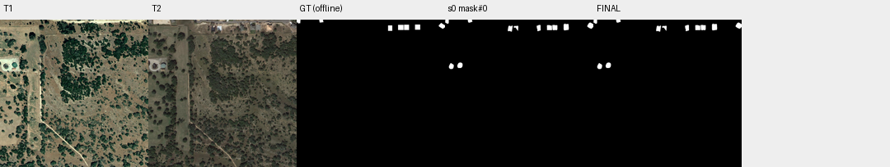

# case_09 完整轨迹

[交互回放](case_09.html#review) · [审查总表](20_case_review.md)



固定提交核验后出现可省观察，但没有答案退化

完整0–6步：用户明确“未指出错误，保持mask#0不变”。1步已正确提交，固定核验门返回报告后又inspect及三次view，6步原样再提交，F1保持70.69。标签捕获额外调用，但其源头包括固定提交门，并非失控循环。

未来可研究明确保持原样任务的提交交互；本轮先避免改变现有核验门，防止跳过必要审查。

## 第 0 步

当前答案：mask#0；离线评价：{'tp': 6507, 'fp': 4647, 'fn': 750, 'f1': 0.7068600293302917, 'iou': 0.5466229838709677, 'delta_f1': None}


## 第 1 步

当前答案：mask#0；离线评价：{'tp': 6507, 'fp': 4647, 'fn': 750, 'f1': 0.7068600293302917, 'iou': 0.5466229838709677, 'delta_f1': 0.0}

The user has reviewed the mask and confirmed no errors, so I should keep mask#0 unchanged and submit it.


<details><summary>submit · 完整参数和返回</summary>


```json

{
  "tool": "submit",
  "args": {
    "mask": "mask#0",
    "summary": "User reviewed mask#0 (11 components, 11154 pixels) and confirmed no errors. Submitting unchanged as final building change detection mask."
  },
  "ok": true,
  "error_code": null,
  "result_text": "{\"ok\":true,\"submitted\":false,\"report\":\"Report before submission. Every run gets this report as the first response to submit; it does not judge the mask, and nothing has to change. mask#0 is now your current answer: 11154 pixels in 11 components.\\nVerifier answers on mask#0: 0 yes, 0 no, 0 unparsed, 11 with no answer. An answer applies only to the exact outline it was about; a view is not an answer.\\n  no answer: id=4 area=1495 bbox=[819, 27, 855, 75]\\n  no answer: id=3 area=1289 bbox=[982, 20, 1024, 64]\\n  no answer: id=7 area=1194 bbox=[741, 37, 776, 74]\\n  no answer: id=6 area=1174 bbox=[703, 37, 739, 73]\\n  no answer: id=10 area=1145 bbox=[85, 298, 122, 336]\\n  no answer: id=8 area=1087 bbox=[434, 41, 467, 83]\\n  no answer: id=11 area=1045 bbox=[27, 302, 61, 343]\\n  no answer: id=5 area=973 bbox=[633, 37, 661, 80]\\n  no answer: id=1 area=609 bbox=[2, 0, 26, 28]\\n  no answer: id=9 area=590 bbox=[475, 43, 506, 77]\\n  no answer: id=2 area=553 bbox=[157, 0, 189, 21]\\nCompared with the given mask: 0 pixels added, in components []; 0 pixels removed; 0 given components are gone: 0 answered no, 0 answered yes, 0 with no answer. Removed pixels are not the same as corrected errors.\\nA verifier answer is evidence, not an order, and it can be wrong in both directions. No answer is not an error. To finish with this mask, call submit with mask#0 again. To change it, edit and submit the new handle; components the verifier has not seen will be reported again. In the summary, say what you changed, and why you went against any verifier answer. You have 29 replies left.\"}",
  "current_before": "mask#0",
  "current_after": "mask#0",
  "input_handles": [
    "mask#0"
  ],
  "output_handles": [],
  "eval": {
    "tp": 6507,
    "fp": 4647,
    "fn": 750,
    "f1": 0.7068600293302917,
    "iou": 0.5466229838709677,
    "delta_f1": 0.0
  },
  "candidate_eval": [],
  "set_current": null
}

```


</details>

## 第 2 步

当前答案：mask#0；离线评价：{'tp': 6507, 'fp': 4647, 'fn': 750, 'f1': 0.7068600293302917, 'iou': 0.5466229838709677, 'delta_f1': 0.0}

The verifier has not answered any components yet (all 11 have "no answer"). I need to verify each component by viewing the regions in T1 and T2 to ensure they are actual building changes. Let me inspect the components first to understand their locations, then view them in both times.


<details><summary>inspect · 完整参数和返回</summary>


```json

{
  "tool": "inspect",
  "args": {
    "mask": "mask#0"
  },
  "ok": true,
  "error_code": null,
  "result_text": "{\"ok\":true,\"mask\":\"mask#0\",\"total_components\":11,\"returned\":11,\"has_more\":false,\"components\":[{\"id\":4,\"area\":1495,\"bbox\":[819,27,855,75]},{\"id\":3,\"area\":1289,\"bbox\":[982,20,1024,64]},{\"id\":7,\"area\":1194,\"bbox\":[741,37,776,74]},{\"id\":6,\"area\":1174,\"bbox\":[703,37,739,73]},{\"id\":10,\"area\":1145,\"bbox\":[85,298,122,336]},{\"id\":8,\"area\":1087,\"bbox\":[434,41,467,83]},{\"id\":11,\"area\":1045,\"bbox\":[27,302,61,343]},{\"id\":5,\"area\":973,\"bbox\":[633,37,661,80]},{\"id\":1,\"area\":609,\"bbox\":[2,0,26,28]},{\"id\":9,\"area\":590,\"bbox\":[475,43,506,77]},{\"id\":2,\"area\":553,\"bbox\":[157,0,189,21]}]}",
  "current_before": "mask#0",
  "current_after": "mask#0",
  "input_handles": [
    "mask#0"
  ],
  "output_handles": [],
  "eval": {
    "tp": 6507,
    "fp": 4647,
    "fn": 750,
    "f1": 0.7068600293302917,
    "iou": 0.5466229838709677,
    "delta_f1": 0.0
  },
  "candidate_eval": [],
  "set_current": null
}

```


</details>

## 第 3 步

当前答案：mask#0；离线评价：{'tp': 6507, 'fp': 4647, 'fn': 750, 'f1': 0.7068600293302917, 'iou': 0.5466229838709677, 'delta_f1': 0.0}

I need to verify each component by viewing the regions in T1 and T2. The components are mostly along the top edge (y=0-83) and a few on the left side (y=298-343). Let me view the full image with the mask overlay first to see all components, then zoom into specific regions.


<details><summary>view · 完整参数和返回</summary>


```json

{
  "tool": "view",
  "args": {
    "region": [
      0,
      0,
      1024,
      1024
    ],
    "overlay": "mask#0",
    "label_components": true
  },
  "ok": true,
  "error_code": null,
  "result_text": "{\"ok\":true,\"view_id\":\"view#1\",\"region\":[0,0,1024,1024],\"overlay\":\"mask#0\",\"display_size\":[768,768],\"image_size\":[796,796],\"scale\":0.75,\"padding\":[28,28],\"labelled_ids\":[1,2,3,4,5,6,7,8,9,10,11],\"unlabelled_count\":0}",
  "current_before": "mask#0",
  "current_after": "mask#0",
  "input_handles": [
    "mask#0"
  ],
  "output_handles": [],
  "eval": {
    "tp": 6507,
    "fp": 4647,
    "fn": 750,
    "f1": 0.7068600293302917,
    "iou": 0.5466229838709677,
    "delta_f1": 0.0
  },
  "candidate_eval": [],
  "set_current": null
}

```


</details>

## 第 4 步

当前答案：mask#0；离线评价：{'tp': 6507, 'fp': 4647, 'fn': 750, 'f1': 0.7068600293302917, 'iou': 0.5466229838709677, 'delta_f1': 0.0}

I can see the mask components overlaid on both T1 and T2. Looking at the images:

- Components 1, 2, 3, 4, 5, 6, 7, 8, 9 are along the top edge (y=0-83) - these appear to be buildings/structures near a road
- Components 10, 11 are on the left side around y=298-343 - these appear to be circular structures (possibly tanks or silos)

The user said they reviewed and found no errors, but I should verify by looking more closely at specific regions. Let me zoom into the top edge area where most components are, and also check the left side components.

Let me view the top region more closely to see if these are actual building changes:


<details><summary>view · 完整参数和返回</summary>


```json

{
  "tool": "view",
  "args": {
    "region": [
      0,
      0,
      1024,
      150
    ],
    "overlay": "mask#0",
    "label_components": true
  },
  "ok": true,
  "error_code": null,
  "result_text": "{\"ok\":true,\"view_id\":\"view#2\",\"region\":[0,0,1024,150],\"overlay\":\"mask#0\",\"display_size\":[768,112],\"image_size\":[796,140],\"scale\":0.75,\"padding\":[28,28],\"labelled_ids\":[1,2,3,4,5,6,7,8,9],\"unlabelled_count\":0}",
  "current_before": "mask#0",
  "current_after": "mask#0",
  "input_handles": [
    "mask#0"
  ],
  "output_handles": [],
  "eval": {
    "tp": 6507,
    "fp": 4647,
    "fn": 750,
    "f1": 0.7068600293302917,
    "iou": 0.5466229838709677,
    "delta_f1": 0.0
  },
  "candidate_eval": [],
  "set_current": null
}

```


</details>

## 第 5 步

当前答案：mask#0；离线评价：{'tp': 6507, 'fp': 4647, 'fn': 750, 'f1': 0.7068600293302917, 'iou': 0.5466229838709677, 'delta_f1': 0.0}

Looking at the zoomed view of the top edge:
- In T1, I can see some structures along the road but they appear faint or partially visible
- In T2, the same locations show clear buildings/structures with roofs (dark and light colored)
- Components 1, 2, 3, 4, 5, 6, 7, 8, 9 all appear to be actual building changes - new constructions or changed buildings

Now let me check the left side components (10 and 11) which are around y=298-343:


<details><summary>view · 完整参数和返回</summary>


```json

{
  "tool": "view",
  "args": {
    "region": [
      0,
      250,
      200,
      400
    ],
    "overlay": "mask#0",
    "label_components": true,
    "ids": [
      10,
      11
    ]
  },
  "ok": true,
  "error_code": null,
  "result_text": "{\"ok\":true,\"view_id\":\"view#3\",\"region\":[0,250,200,400],\"overlay\":\"mask#0\",\"display_size\":[768,576],\"image_size\":[796,604],\"scale\":3.84,\"padding\":[28,28],\"labelled_ids\":[10,11],\"unlabelled_count\":0}",
  "current_before": "mask#0",
  "current_after": "mask#0",
  "input_handles": [
    "mask#0"
  ],
  "output_handles": [],
  "eval": {
    "tp": 6507,
    "fp": 4647,
    "fn": 750,
    "f1": 0.7068600293302917,
    "iou": 0.5466229838709677,
    "delta_f1": 0.0
  },
  "candidate_eval": [],
  "set_current": null
}

```


</details>

## 第 6 步

当前答案：mask#0；离线评价：{'tp': 6507, 'fp': 4647, 'fn': 750, 'f1': 0.7068600293302917, 'iou': 0.5466229838709677, 'delta_f1': 0.0}

Looking at components 10 and 11 in the zoomed view:
- These appear to be circular water tanks or storage tanks, not buildings
- In T1, they are visible as dark circular structures
- In T2, they still exist with similar appearance (just different lighting/color due to seasonal/illumination differences)
- The user feedback said "no errors" but these might actually be non-building changes (tanks/water bodies)

Wait - the user explicitly said "The user reviewed the mask and pointed out no errors. Keep mask#0 unchanged." This is clear instruction from the user. However, I should verify if these are actually building changes or not.

Looking more carefully:
- Components 10 and 11 appear to be circular tanks/water reservoirs, which are typically considered infrastructure but may or may not count as "building" depending on definition
- The scope says "building" class - tanks might not be buildings

But the user has already reviewed and confirmed no errors. Since the user is the one who provided feedback saying "no errors", I should trust that and keep mask#0 unchanged.

Let me submit the final mask as instructed by the user:


<details><summary>submit · 完整参数和返回</summary>


```json

{
  "tool": "submit",
  "args": {
    "mask": "mask#0",
    "summary": "User reviewed mask#0 (11 components, 11154 pixels) and confirmed no errors. Keeping mask#0 unchanged as final building change detection mask. Components include 9 structures along top edge (new buildings near road) and 2 circular structures on left side."
  },
  "ok": true,
  "error_code": null,
  "result_text": "{\"ok\":true,\"mask\":\"mask#0\",\"area\":11154,\"component_count\":11,\"current_mask\":{\"before\":\"mask#0\",\"after\":\"mask#0\"},\"submitted\":true}",
  "current_before": "mask#0",
  "current_after": "mask#0",
  "input_handles": [
    "mask#0"
  ],
  "output_handles": [],
  "eval": {
    "tp": 6507,
    "fp": 4647,
    "fn": 750,
    "f1": 0.7068600293302917,
    "iou": 0.5466229838709677,
    "delta_f1": 0.0
  },
  "candidate_eval": [],
  "set_current": null
}

```


</details>
