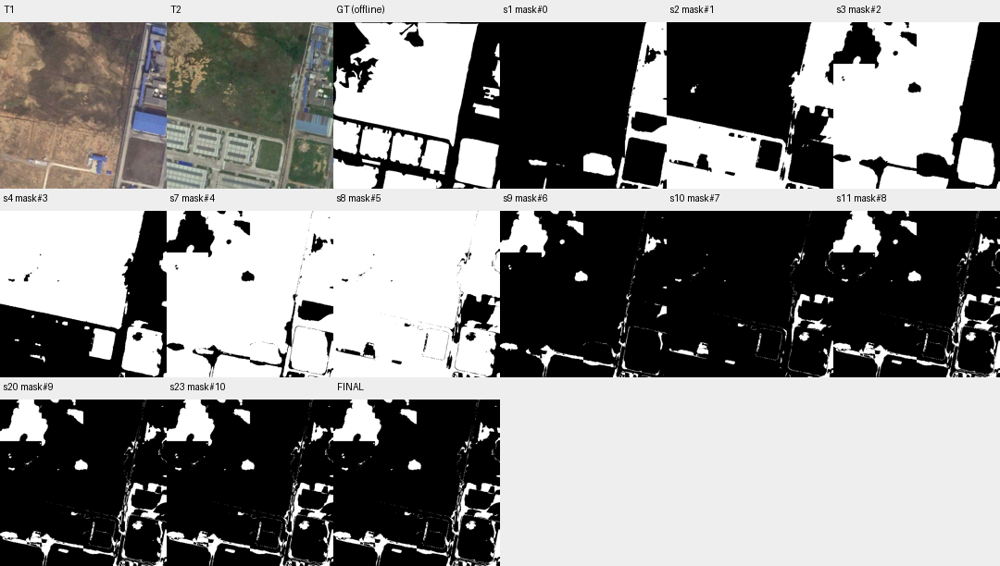

# case_10 完整轨迹

[交互回放](case_10.html#review) · [审查总表](20_case_review.md)



查看并非主要损失，类别合并后的差分丢失目标变化

完整0–25步：分别语义分割building/low vegetation后，各期先union再做两向subtract，跨目标类别转移会被并集抵消；mask#8 F1仅12.00。12–14步连续查看不同范围是合理检查。后删纯TP170像素，最终11.84。语义掩码质量也较差，不能只怪规划；核验大量yes不能补回缺失像素。

旧T1.2任务口径与候选生成问题单列；本批不启动类别组合实验，不用阈值或看图限制掩盖主要损失。

## 第 0 步

当前答案：None；离线评价：None


## 第 1 步

当前答案：None；离线评价：None

I need to find changes involving buildings or low vegetation between T1 and T2. Let me start by examining both images more carefully to understand what's changed.

Looking at the images:
- T1 shows mostly bare/dry land with some industrial buildings on the right side (blue roofs)
- T2 shows significant new development - large warehouse-style buildings in the bottom-left area, more green vegetation, and changes to the existing buildings on the right

Let me segment buildings and low vegetation for both times to identify changes.


<details><summary>segment_semantic · 完整参数和返回</summary>


```json

{
  "tool": "segment_semantic",
  "args": {
    "time": "t1",
    "text": "building"
  },
  "ok": true,
  "error_code": null,
  "result_text": "{\"ok\":true,\"mask\":\"mask#0\",\"area\":39170,\"component_count\":12}",
  "current_before": null,
  "current_after": null,
  "input_handles": [],
  "output_handles": [
    "mask#0"
  ],
  "eval": null,
  "candidate_eval": [
    {
      "handle": "mask#0",
      "parent": null,
      "tp": 9498,
      "fp": 29672,
      "fn": 170886,
      "f1": 0.08652085591699536,
      "iou": 0.045216513691587
    }
  ],
  "set_current": null
}

```


</details>

## 第 2 步

当前答案：None；离线评价：None

I segmented buildings in T1. Now let me segment buildings in T2 to compare.


<details><summary>segment_semantic · 完整参数和返回</summary>


```json

{
  "tool": "segment_semantic",
  "args": {
    "time": "t2",
    "text": "building"
  },
  "ok": true,
  "error_code": null,
  "result_text": "{\"ok\":true,\"mask\":\"mask#1\",\"area\":90253,\"component_count\":17}",
  "current_before": null,
  "current_after": null,
  "input_handles": [],
  "output_handles": [
    "mask#1"
  ],
  "eval": null,
  "candidate_eval": [
    {
      "handle": "mask#1",
      "parent": null,
      "tp": 42605,
      "fp": 47648,
      "fn": 137779,
      "f1": 0.31484978033306604,
      "iou": 0.18683781223687904
    }
  ],
  "set_current": null
}

```


</details>

## 第 3 步

当前答案：None；离线评价：None

Good, I have building masks for both times. Now let me segment low vegetation for both times as well.


<details><summary>segment_semantic · 完整参数和返回</summary>


```json

{
  "tool": "segment_semantic",
  "args": {
    "time": "t1",
    "text": "low vegetation"
  },
  "ok": true,
  "error_code": null,
  "result_text": "{\"ok\":true,\"mask\":\"mask#2\",\"area\":190477,\"component_count\":9}",
  "current_before": null,
  "current_after": null,
  "input_handles": [],
  "output_handles": [
    "mask#2"
  ],
  "eval": null,
  "candidate_eval": [
    {
      "handle": "mask#2",
      "parent": null,
      "tp": 160937,
      "fp": 29540,
      "fn": 19447,
      "f1": 0.867910079517663,
      "iou": 0.7666441188239553
    }
  ],
  "set_current": null
}

```


</details>

## 第 4 步

当前答案：None；离线评价：None

Now let me segment low vegetation in T2.


<details><summary>segment_semantic · 完整参数和返回</summary>


```json

{
  "tool": "segment_semantic",
  "args": {
    "time": "t2",
    "text": "low vegetation"
  },
  "ok": true,
  "error_code": null,
  "result_text": "{\"ok\":true,\"mask\":\"mask#3\",\"area\":154203,\"component_count\":20}",
  "current_before": null,
  "current_after": null,
  "input_handles": [],
  "output_handles": [
    "mask#3"
  ],
  "eval": null,
  "candidate_eval": [
    {
      "handle": "mask#3",
      "parent": null,
      "tp": 132760,
      "fp": 21443,
      "fn": 47624,
      "f1": 0.7935753630595331,
      "iou": 0.6577910784979215
    }
  ],
  "set_current": null
}

```


</details>

## 第 5 步

当前答案：None；离线评价：None

I have masks for buildings and low vegetation in both T1 and T2. Now I need to identify changes - areas where there's a difference between the two times for these classes.

The change mask should show:
- Areas that are building/low vegetation in T2 but not in T1 (new appearance)
- Areas that are building/low vegetation in T1 but not in T2 (disappearance)

Let me first look at the current state of my masks by viewing them, then compute the differences. Let me view T1 and T2 with overlays to understand what changed.


<details><summary>view · 完整参数和返回</summary>


```json

{
  "tool": "view",
  "args": {
    "region": [
      0,
      0,
      512,
      512
    ],
    "overlay": "mask#0",
    "label_components": true
  },
  "ok": true,
  "error_code": null,
  "result_text": "{\"ok\":true,\"view_id\":\"view#1\",\"region\":[0,0,512,512],\"overlay\":\"mask#0\",\"display_size\":[768,768],\"image_size\":[796,796],\"scale\":1.5,\"padding\":[28,28],\"labelled_ids\":[1,2,3,4,5,6,7,8,9,10,11,12],\"unlabelled_count\":0}",
  "current_before": null,
  "current_after": null,
  "input_handles": [
    "mask#0"
  ],
  "output_handles": [],
  "eval": null,
  "candidate_eval": [],
  "set_current": null
}

```


</details>

## 第 6 步

当前答案：None；离线评价：None

I can see the building masks overlaid on both T1 and T2. The buildings in T1 are mostly on the right side (industrial complex) and a small building in the lower middle area. In T2, I can see new large warehouse buildings in the bottom-left that weren't present in T1.

Now let me view the low vegetation masks to understand those changes too.


<details><summary>view · 完整参数和返回</summary>


```json

{
  "tool": "view",
  "args": {
    "region": [
      0,
      0,
      512,
      512
    ],
    "overlay": "mask#2",
    "label_components": true
  },
  "ok": true,
  "error_code": null,
  "result_text": "{\"ok\":true,\"view_id\":\"view#2\",\"region\":[0,0,512,512],\"overlay\":\"mask#2\",\"display_size\":[768,768],\"image_size\":[796,796],\"scale\":1.5,\"padding\":[28,28],\"labelled_ids\":[1,2,3,4,5,6,7,8,9],\"unlabelled_count\":0}",
  "current_before": null,
  "current_after": null,
  "input_handles": [
    "mask#2"
  ],
  "output_handles": [],
  "eval": null,
  "candidate_eval": [],
  "set_current": null
}

```


</details>

## 第 7 步

当前答案：None；离线评价：None

I can see the low vegetation masks. Now I need to compute the change mask - areas where building or low vegetation changed between T1 and T2.

The approach should be:
1. Get the union of building and low vegetation for T1 (mask#0 + mask#2)
2. Get the union of building and low vegetation for T2 (mask#1 + mask#3)
3. Compute the symmetric difference (XOR) to find changes

Let me first create the combined masks for each time, then compute the difference.


<details><summary>combine · 完整参数和返回</summary>


```json

{
  "tool": "combine",
  "args": {
    "op": "union",
    "a": "mask#0",
    "b": "mask#2",
    "set_current": false
  },
  "ok": true,
  "error_code": null,
  "result_text": "{\"ok\":true,\"mask\":\"mask#4\",\"area\":229647,\"component_count\":13,\"added_px\":190477,\"removed_px\":0}",
  "current_before": null,
  "current_after": null,
  "input_handles": [
    "mask#0",
    "mask#2"
  ],
  "output_handles": [
    "mask#4"
  ],
  "eval": null,
  "candidate_eval": [
    {
      "handle": "mask#4",
      "parent": "mask#0",
      "tp": 170435,
      "fp": 59212,
      "fn": 9949,
      "f1": 0.8313273874414373,
      "iou": 0.7113432611562798,
      "delta_f1_from_parent": 0.744806531524442
    }
  ],
  "set_current": false
}

```


</details>

## 第 8 步

当前答案：None；离线评价：None

Good, mask#4 is the union of building and low vegetation in T1. Now let me create the same for T2.


<details><summary>combine · 完整参数和返回</summary>


```json

{
  "tool": "combine",
  "args": {
    "op": "union",
    "a": "mask#1",
    "b": "mask#3",
    "set_current": false
  },
  "ok": true,
  "error_code": null,
  "result_text": "{\"ok\":true,\"mask\":\"mask#5\",\"area\":244265,\"component_count\":11,\"added_px\":154012,\"removed_px\":0}",
  "current_before": null,
  "current_after": null,
  "input_handles": [
    "mask#1",
    "mask#3"
  ],
  "output_handles": [
    "mask#5"
  ],
  "eval": null,
  "candidate_eval": [
    {
      "handle": "mask#5",
      "parent": "mask#1",
      "tp": 175177,
      "fp": 69088,
      "fn": 5207,
      "f1": 0.8250437420081055,
      "iou": 0.7021910274499743,
      "delta_f1_from_parent": 0.5101939616750395
    }
  ],
  "set_current": false
}

```


</details>

## 第 9 步

当前答案：None；离线评价：None

Good, mask#5 is the union of building and low vegetation in T2. Now I need to compute the change - the symmetric difference between mask#4 (T1) and mask#5 (T2).

The change should include:
- Areas in T2 but not in T1 (new buildings/low vegetation appeared)
- Areas in T1 but not in T2 (buildings/low vegetation disappeared)

I can compute this by: (mask#5 - mask#4) union (mask#4 - mask#5)

Let me first compute mask#5 minus mask#4 (new areas in T2):


<details><summary>combine · 完整参数和返回</summary>


```json

{
  "tool": "combine",
  "args": {
    "op": "subtract",
    "a": "mask#5",
    "b": "mask#4",
    "set_current": false
  },
  "ok": true,
  "error_code": null,
  "result_text": "{\"ok\":true,\"mask\":\"mask#6\",\"area\":24834,\"component_count\":123,\"added_px\":0,\"removed_px\":219431}",
  "current_before": null,
  "current_after": null,
  "input_handles": [
    "mask#5",
    "mask#4"
  ],
  "output_handles": [
    "mask#6"
  ],
  "eval": null,
  "candidate_eval": [
    {
      "handle": "mask#6",
      "parent": "mask#5",
      "tp": 8832,
      "fp": 16002,
      "fn": 171552,
      "f1": 0.08607432096599714,
      "iou": 0.04497265589196786,
      "delta_f1_from_parent": -0.7389694210421084
    }
  ],
  "set_current": false
}

```


</details>

## 第 10 步

当前答案：None；离线评价：None

Good, mask#6 is the area that's in T2 but not in T1 (new building/low vegetation). Now let me compute mask#4 minus mask#5 (areas that were in T1 but not in T2 - disappeared):


<details><summary>combine · 完整参数和返回</summary>


```json

{
  "tool": "combine",
  "args": {
    "op": "subtract",
    "a": "mask#4",
    "b": "mask#5",
    "set_current": false
  },
  "ok": true,
  "error_code": null,
  "result_text": "{\"ok\":true,\"mask\":\"mask#7\",\"area\":10216,\"component_count\":197,\"added_px\":0,\"removed_px\":219431}",
  "current_before": null,
  "current_after": null,
  "input_handles": [
    "mask#4",
    "mask#5"
  ],
  "output_handles": [
    "mask#7"
  ],
  "eval": null,
  "candidate_eval": [
    {
      "handle": "mask#7",
      "parent": "mask#4",
      "tp": 4090,
      "fp": 6126,
      "fn": 176294,
      "f1": 0.04291710388247639,
      "iou": 0.02192911908208675,
      "delta_f1_from_parent": -0.7884102835589609
    }
  ],
  "set_current": false
}

```


</details>

## 第 11 步

当前答案：mask#8；离线评价：{'tp': 12922, 'fp': 22128, 'fn': 167462, 'f1': 0.11996249431380376, 'iou': 0.06380856443074978, 'delta_f1': None}

Good, mask#7 is the area that was in T1 but not in T2 (disappeared building/low vegetation). Now I need to combine these two change areas (mask#6 and mask#7) with a union to get the full change mask.


<details><summary>combine · 完整参数和返回</summary>


```json

{
  "tool": "combine",
  "args": {
    "op": "union",
    "a": "mask#6",
    "b": "mask#7",
    "set_current": true
  },
  "ok": true,
  "error_code": null,
  "result_text": "{\"ok\":true,\"mask\":\"mask#8\",\"area\":35050,\"component_count\":262,\"added_px\":10216,\"removed_px\":0,\"current_mask\":{\"before\":null,\"after\":\"mask#8\"}}",
  "current_before": null,
  "current_after": "mask#8",
  "input_handles": [
    "mask#6",
    "mask#7"
  ],
  "output_handles": [
    "mask#8"
  ],
  "eval": {
    "tp": 12922,
    "fp": 22128,
    "fn": 167462,
    "f1": 0.11996249431380376,
    "iou": 0.06380856443074978,
    "delta_f1": null
  },
  "candidate_eval": [
    {
      "handle": "mask#8",
      "parent": "mask#6",
      "tp": 12922,
      "fp": 22128,
      "fn": 167462,
      "f1": 0.11996249431380376,
      "iou": 0.06380856443074978,
      "delta_f1_from_parent": 0.033888173347806624
    }
  ],
  "set_current": true
}

```


</details>

## 第 12 步

当前答案：mask#8；离线评价：{'tp': 12922, 'fp': 22128, 'fn': 167462, 'f1': 0.11996249431380376, 'iou': 0.06380856443074978, 'delta_f1': 0.0}

I have created a change mask (mask#8) that represents areas where building or low vegetation changed between T1 and T2. The mask has 35050 pixels in 262 components. Now I need to verify this result by looking at the changes more carefully.

Let me view the change mask overlaid on both images to see what regions are being flagged as changes.


<details><summary>view · 完整参数和返回</summary>


```json

{
  "tool": "view",
  "args": {
    "region": [
      0,
      0,
      512,
      512
    ],
    "overlay": "mask#8",
    "label_components": true
  },
  "ok": true,
  "error_code": null,
  "result_text": "{\"ok\":true,\"view_id\":\"view#3\",\"region\":[0,0,512,512],\"overlay\":\"mask#8\",\"display_size\":[768,768],\"image_size\":[796,796],\"scale\":1.5,\"padding\":[28,28],\"labelled_ids\":[1,2,3,4,5,8,10,11,13,16,17,18,19,20,21,22,24,25,26,27,28,29,30,31,32,34,36,39,42,45,46,47,49,51,52,53,54,55,56,59,60,61,62,63,64,65,66,67,69,70,71,72,73,74,75,76,80,83,85,86,87,88,91,92,94,97,98,100,101,102,103,104,105,108,109,111,112,116,118,122,123,124,125,126,127,130,131,132,133,134,135,136,137,138,139,141,142,143,145,146,147,148,149,151,152,153,156,158,159,160,162,163,165,166,167,168,171,172,173,174,177,180,185,188,190,192,196,197,199,201,202,203,204,205,206,207,208,210,211,212,214,215,217,218,219,220,221,222,223,224,227,228,229,230,232,234,237,238,239,240,241,242,244,246,247,248,250,251,254,257],\"unlabelled_count\":92,\"message\":\"92 visible components left unlabelled to avoid overlap; zoom in or pass ids.\"}",
  "current_before": "mask#8",
  "current_after": "mask#8",
  "input_handles": [
    "mask#8"
  ],
  "output_handles": [],
  "eval": {
    "tp": 12922,
    "fp": 22128,
    "fn": 167462,
    "f1": 0.11996249431380376,
    "iou": 0.06380856443074978,
    "delta_f1": 0.0
  },
  "candidate_eval": [],
  "set_current": null
}

```


</details>

## 第 13 步

当前答案：mask#8；离线评价：{'tp': 12922, 'fp': 22128, 'fn': 167462, 'f1': 0.11996249431380376, 'iou': 0.06380856443074978, 'delta_f1': 0.0}

I can see the change mask overlaid on both images. The red outlines show areas where building or low vegetation changed between T1 and T2. Looking at the views:

- In T1, I see many small components along the right edge (industrial complex) and some in the middle
- In T2, I can see new large warehouse buildings in the bottom-left that weren't in T1's building mask
- There are also changes to the existing buildings on the right side

However, I notice that the change mask seems to have many small fragmented components. This might be due to edge differences from misregistration or seasonal changes that shouldn't count. Let me look more carefully at specific regions to verify.

Let me zoom into the bottom-left area where new warehouses appeared in T2 to confirm this is a valid change.


<details><summary>view · 完整参数和返回</summary>


```json

{
  "tool": "view",
  "args": {
    "region": [
      0,
      300,
      400,
      512
    ],
    "overlay": "mask#8",
    "label_components": true
  },
  "ok": true,
  "error_code": null,
  "result_text": "{\"ok\":true,\"view_id\":\"view#4\",\"region\":[0,300,400,512],\"overlay\":\"mask#8\",\"display_size\":[768,407],\"image_size\":[796,435],\"scale\":1.92,\"padding\":[28,28],\"labelled_ids\":[123,135,136,137,138,139,141,142,143,146,147,148,149,151,152,153,154,156,157,158,159,160,161,163,165,169,170,173,176,177,178,185,188,195,199,201,203,204,205,206,207,209,210,211,212,214,216,218,219,221,222,223,224,226,227,228,229,230,231,233,234,237,238,241,242,243,246,247],\"unlabelled_count\":31,\"message\":\"31 visible components left unlabelled to avoid overlap; zoom in or pass ids.\"}",
  "current_before": "mask#8",
  "current_after": "mask#8",
  "input_handles": [
    "mask#8"
  ],
  "output_handles": [],
  "eval": {
    "tp": 12922,
    "fp": 22128,
    "fn": 167462,
    "f1": 0.11996249431380376,
    "iou": 0.06380856443074978,
    "delta_f1": 0.0
  },
  "candidate_eval": [],
  "set_current": null
}

```


</details>

## 第 14 步

当前答案：mask#8；离线评价：{'tp': 12922, 'fp': 22128, 'fn': 167462, 'f1': 0.11996249431380376, 'iou': 0.06380856443074978, 'delta_f1': 0.0}

I can see in the bottom-left area (T2) there are large new warehouse buildings that weren't present in T1. The change mask is capturing these areas. However, I notice many small fragmented components which might be edge artifacts from misregistration or seasonal vegetation changes.

Let me look at the right side where the industrial complex is to see if there are genuine building changes or just edge differences.


<details><summary>view · 完整参数和返回</summary>


```json

{
  "tool": "view",
  "args": {
    "region": [
      350,
      0,
      512,
      400
    ],
    "overlay": "mask#8",
    "label_components": true
  },
  "ok": true,
  "error_code": null,
  "result_text": "{\"ok\":true,\"view_id\":\"view#5\",\"region\":[350,0,512,400],\"overlay\":\"mask#8\",\"display_size\":[311,768],\"image_size\":[339,796],\"scale\":1.92,\"padding\":[28,28],\"labelled_ids\":[4,5,8,10,11,14,16,17,19,21,22,23,24,25,26,27,28,29,31,32,33,36,38,40,43,44,45,46,49,51,53,54,55,56,57,58,59,60,61,62,64,65,68,69,70,71,74,75,76,81,83,84,87,88,91,93,97,99,102,103,105,106,108,109,111,113,115,116,118,121,122,123,124,125,126,129,130,131,132,133,134,135,141,145,162,165,166,172,174,175,176,190,192,194,195,196,197,202,203],\"unlabelled_count\":34,\"message\":\"34 visible components left unlabelled to avoid overlap; zoom in or pass ids.\"}",
  "current_before": "mask#8",
  "current_after": "mask#8",
  "input_handles": [
    "mask#8"
  ],
  "output_handles": [],
  "eval": {
    "tp": 12922,
    "fp": 22128,
    "fn": 167462,
    "f1": 0.11996249431380376,
    "iou": 0.06380856443074978,
    "delta_f1": 0.0
  },
  "candidate_eval": [],
  "set_current": null
}

```


</details>

## 第 15 步

当前答案：mask#8；离线评价：{'tp': 12922, 'fp': 22128, 'fn': 167462, 'f1': 0.11996249431380376, 'iou': 0.06380856443074978, 'delta_f1': 0.0}

I can see the right side has many small fragmented change components along the edge of the industrial complex. These appear to be edge differences likely caused by misregistration rather than actual building changes. The buildings themselves (like component 134 with the blue roof) seem to be present in both times, but the edges are being flagged as changes.

Looking at the task requirements:
- Changes involving building or low vegetation should count
- But "edge differences caused by misregistration" does NOT count
- "Shadows or illumination differences alone" does NOT count

The many small fragmented components along the edges of the industrial complex on the right side appear to be misregistration artifacts rather than genuine building changes. I should filter these out.

Let me also check if there are any genuine low vegetation changes. Looking at T2, I can see more green vegetation compared to T1's dry brown landscape. Some of this might be seasonal (which doesn't count) vs. actual new low vegetation growth.

Let me try to clean up the mask by removing very small components that are likely edge artifacts. First, let me inspect the component sizes to understand the distribution.


<details><summary>inspect · 完整参数和返回</summary>


```json

{
  "tool": "inspect",
  "args": {
    "mask": "mask#8",
    "limit": 50
  },
  "ok": true,
  "error_code": null,
  "result_text": "{\"ok\":true,\"mask\":\"mask#8\",\"total_components\":262,\"returned\":50,\"has_more\":true,\"components\":[{\"id\":1,\"area\":12580,\"bbox\":[0,0,147,143]},{\"id\":210,\"area\":5891,\"bbox\":[0,405,354,512]},{\"id\":123,\"area\":3370,\"bbox\":[343,256,440,468]},{\"id\":197,\"area\":2010,\"bbox\":[459,373,512,512]},{\"id\":26,\"area\":1357,\"bbox\":[443,69,494,128]},{\"id\":18,\"area\":1336,\"bbox\":[204,29,256,75]},{\"id\":145,\"area\":1129,\"bbox\":[428,331,491,370]},{\"id\":73,\"area\":954,\"bbox\":[229,184,270,217]},{\"id\":124,\"area\":946,\"bbox\":[451,257,512,287]},{\"id\":196,\"area\":539,\"bbox\":[406,373,439,400]},{\"id\":134,\"area\":526,\"bbox\":[482,291,512,329]},{\"id\":219,\"area\":417,\"bbox\":[372,424,435,496]},{\"id\":249,\"area\":287,\"bbox\":[384,495,425,512]},{\"id\":237,\"area\":261,\"bbox\":[179,459,210,472]},{\"id\":242,\"area\":256,\"bbox\":[347,480,371,512]},{\"id\":199,\"area\":225,\"bbox\":[276,376,291,433]},{\"id\":2,\"area\":200,\"bbox\":[155,0,182,10]},{\"id\":30,\"area\":170,\"bbox\":[183,88,199,103]},{\"id\":3,\"area\":148,\"bbox\":[218,0,233,18]},{\"id\":54,\"area\":137,\"bbox\":[388,146,411,164]},{\"id\":151,\"area\":135,\"bbox\":[218,345,240,356]},{\"id\":29,\"area\":122,\"bbox\":[503,86,512,103]},{\"id\":252,\"area\":118,\"bbox\":[371,497,384,512]},{\"id\":240,\"area\":113,\"bbox\":[482,468,493,486]},{\"id\":122,\"area\":112,\"bbox\":[387,255,402,274]},{\"id\":98,\"area\":110,\"bbox\":[26,209,46,218]},{\"id\":49,\"area\":109,\"bbox\":[405,121,417,146]},{\"id\":45,\"area\":103,\"bbox\":[497,117,512,146]},{\"id\":50,\"area\":91,\"bbox\":[415,128,425,151]},{\"id\":261,\"area\":74,\"bbox\":[433,506,466,512]},{\"id\":165,\"area\":66,\"bbox\":[370,354,376,384]},{\"id\":111,\"area\":55,\"bbox\":[500,232,512,239]},{\"id\":245,\"area\":52,\"bbox\":[503,489,512,501]},{\"id\":56,\"area\":40,\"bbox\":[486,152,495,170]},{\"id\":85,\"area\":35,\"bbox\":[79,194,91,201]},{\"id\":66,\"area\":33,\"bbox\":[27,174,36,181]},{\"id\":253,\"area\":33,\"bbox\":[421,497,446,503]},{\"id\":126,\"area\":30,\"bbox\":[385,273,392,285]},{\"id\":141,\"area\":30,\"bbox\":[375,326,380,345]},{\"id\":133,\"area\":29,\"bbox\":[475,286,493,290]},{\"id\":63,\"area\":27,\"bbox\":[25,166,33,173]},{\"id\":91,\"area\":25,\"bbox\":[409,200,415,207]},{\"id\":162,\"area\":23,\"bbox\":[495,353,505,358]},{\"id\":135,\"area\":21,\"bbox\":[378,305,382,325]},{\"id\":238,\"area\":19,\"bbox\":[362,460,365,477]},{\"id\":64,\"area\":17,\"bbox\":[411,167,415,181]},{\"id\":166,\"area\":17,\"bbox\":[403,354,420,357]},{\"id\":121,\"area\":16,\"bbox\":[397,250,400,260]},{\"id\":132,\"area\":16,\"bbox\":[390,285,393,294]},{\"id\":198,\"area\":16,\"bbox\":[497,373,512,377]}]}",
  "current_before": "mask#8",
  "current_after": "mask#8",
  "input_handles": [
    "mask#8"
  ],
  "output_handles": [],
  "eval": {
    "tp": 12922,
    "fp": 22128,
    "fn": 167462,
    "f1": 0.11996249431380376,
    "iou": 0.06380856443074978,
    "delta_f1": 0.0
  },
  "candidate_eval": [],
  "set_current": null
}

```


</details>

## 第 16 步

当前答案：mask#8；离线评价：{'tp': 12922, 'fp': 22128, 'fn': 167462, 'f1': 0.11996249431380376, 'iou': 0.06380856443074978, 'delta_f1': 0.0}

I can see the component sizes range from very small (16-35 pixels) to larger ones (up to 12580 pixels). The large components like id=1 (12580 px), id=210 (5891 px), and id=123 (3370 px) are likely genuine changes. The very small components (<100 pixels) are likely edge artifacts from misregistration.

Let me look at the largest components more carefully to understand what they represent, and then decide whether to filter out small components.

Looking at the bboxes:
- id=1: [0,0,147,143] - top-left area, this could be new low vegetation or building change
- id=210: [0,405,354,512] - bottom-left area, this is likely the new warehouse buildings in T2
- id=123: [343,256,440,468] - right side, could be building changes on the industrial complex

Let me view these specific regions to verify they are genuine changes involving building or low vegetation.


<details><summary>view · 完整参数和返回</summary>


```json

{
  "tool": "view",
  "args": {
    "region": [
      0,
      0,
      150,
      150
    ],
    "overlay": "mask#8",
    "label_components": true,
    "ids": [
      1
    ]
  },
  "ok": true,
  "error_code": null,
  "result_text": "{\"ok\":true,\"view_id\":\"view#6\",\"region\":[0,0,150,150],\"overlay\":\"mask#8\",\"display_size\":[768,768],\"image_size\":[796,796],\"scale\":5.12,\"padding\":[28,28],\"labelled_ids\":[1],\"unlabelled_count\":0}",
  "current_before": "mask#8",
  "current_after": "mask#8",
  "input_handles": [
    "mask#8"
  ],
  "output_handles": [],
  "eval": {
    "tp": 12922,
    "fp": 22128,
    "fn": 167462,
    "f1": 0.11996249431380376,
    "iou": 0.06380856443074978,
    "delta_f1": 0.0
  },
  "candidate_eval": [],
  "set_current": null
}

```


</details>

## 第 17 步

当前答案：mask#8；离线评价：{'tp': 12922, 'fp': 22128, 'fn': 167462, 'f1': 0.11996249431380376, 'iou': 0.06380856443074978, 'delta_f1': 0.0}

I can see component 1 in the top-left area. In T1, this area shows dry/brown vegetation, while in T2 it shows more green vegetation. This appears to be a change in low vegetation (from dry to greener), which should count as a change involving low vegetation.

Let me check the bottom-left area where the new warehouses are (component 210).


<details><summary>view · 完整参数和返回</summary>


```json

{
  "tool": "view",
  "args": {
    "region": [
      0,
      350,
      400,
      512
    ],
    "overlay": "mask#8",
    "label_components": true,
    "ids": [
      210
    ]
  },
  "ok": true,
  "error_code": null,
  "result_text": "{\"ok\":true,\"view_id\":\"view#7\",\"region\":[0,350,400,512],\"overlay\":\"mask#8\",\"display_size\":[768,311],\"image_size\":[796,339],\"scale\":1.92,\"padding\":[28,28],\"labelled_ids\":[210],\"unlabelled_count\":0}",
  "current_before": "mask#8",
  "current_after": "mask#8",
  "input_handles": [
    "mask#8"
  ],
  "output_handles": [],
  "eval": {
    "tp": 12922,
    "fp": 22128,
    "fn": 167462,
    "f1": 0.11996249431380376,
    "iou": 0.06380856443074978,
    "delta_f1": 0.0
  },
  "candidate_eval": [],
  "set_current": null
}

```


</details>

## 第 18 步

当前答案：mask#8；离线评价：{'tp': 12922, 'fp': 22128, 'fn': 167462, 'f1': 0.11996249431380376, 'iou': 0.06380856443074978, 'delta_f1': 0.0}

I can see component 210 in the bottom-left area. In T1, this area shows dry/bare land with a small building complex. In T2, there are large new warehouse buildings that weren't present in T1. This is clearly a genuine building change - new construction appeared.

Now I need to decide whether to keep all components or filter out small edge artifacts. The task says "edge differences caused by misregistration" does NOT count as a change. Looking at the many small fragmented components along the right edge of the industrial complex, these appear to be misregistration artifacts.

Let me try to filter out very small components (e.g., < 100 pixels) that are likely edge artifacts, while keeping the larger genuine changes. But first, let me check what the verifier thinks about the current mask by calling ask.


<details><summary>ask · 完整参数和返回</summary>


```json

{
  "tool": "ask",
  "args": {},
  "ok": true,
  "error_code": null,
  "result_text": "{\"ok\":true,\"results\":[{\"mask\":\"mask#8\",\"id\":1,\"p_yes\":0.9989677912038498,\"answer\":\"yes\",\"type\":\"land_cover_change\",\"reason\":\"The area inside the red contour changes from bare soil in T1 to green low vegetation in T2.\",\"status\":\"parsed\"},{\"mask\":\"mask#8\",\"id\":210,\"p_yes\":0.999985261075706,\"answer\":\"yes\",\"type\":\"land_cover_change\",\"reason\":\"The area inside the red contour shows a clear transition from bare, brownish earth in T1 to green low vegetation in T2, indicating a land cover change.\",\"status\":\"parsed\"},{\"mask\":\"mask#8\",\"id\":123,\"p_yes\":0.9525755354399497,\"answer\":\"yes\",\"type\":\"land_cover_change\",\"reason\":\"The area inside the red contour changes from bare soil/dirt in T1 to low vegetation (grass) in T2, which is a land-cover change involving low vegetation.\",\"status\":\"parsed\"},{\"mask\":\"mask#8\",\"id\":197,\"p_yes\":0.9999930377741566,\"answer\":\"yes\",\"type\":\"land_cover_change\",\"reason\":\"The area inside the red contour changes from bare soil/dirt in T1 to established low vegetation (grass) in T2.\",\"status\":\"parsed\"},{\"mask\":\"mask#8\",\"id\":26,\"p_yes\":0.9796687437757926,\"answer\":\"yes\",\"type\":\"land_cover_change\",\"reason\":\"The area inside the red contour changes from a building with a blue roof in T1 to low vegetation (greenery) in T2.\",\"status\":\"parsed\"},{\"mask\":\"mask#8\",\"id\":18,\"p_yes\":0.9626751574567265,\"answer\":\"yes\",\"type\":\"land_cover_change\",\"reason\":\"The area inside the contour changes from bare soil or sparse dry vegetation in T1 to distinct low vegetation (greenery) in T2, indicating a land cover change.\",\"status\":\"parsed\"},{\"mask\":\"mask#8\",\"id\":145,\"p_yes\":0.9998911043639301,\"answer\":\"yes\",\"type\":\"land_cover_change\",\"reason\":\"The area inside the red contour changes from bare ground or gravel in T1 to low vegetation (grass) in T2.\",\"status\":\"parsed\"},{\"mask\":\"mask#8\",\"id\":73,\"p_yes\":0.9933075958341963,\"answer\":\"yes\",\"type\":\"land_cover_change\",\"reason\":\"The area inside the contour changes from a light, bare soil or dry ground appearance in T1 to darker green vegetation in T2, indicating a change to low vegetation.\",\"status\":\"parsed\"},{\"mask\":\"mask#8\",\"id\":124,\"p_yes\":0.6224922620487973,\"answer\":\"yes\",\"type\":\"land_cover_change\",\"reason\":\"The area inside the red contour changes from a dark, bare ground or shadowed surface in T1 to green low vegetation in T2.\",\"status\":\"parsed\"},{\"mask\":\"mask#8\",\"id\":196,\"p_yes\":0.9999977396951254,\"answer\":\"yes\",\"type\":\"land_cover_change\",\"reason\":\"The area inside the red contour changes from bare soil in T1 to low vegetation (green ground cover) in T2, which is a land-cover change involving low vegetation.\",\"status\":\"parsed\"},{\"mask\":\"mask#8\",\"id\":134,\"p_yes\":0.9999852611347723,\"answer\":\"yes\",\"type\":\"land_cover_change\",\"reason\":\"The red contour highlights a change from a solid blue building roof in T1 to a structure with distinct brown and grey roofing sections in T2, indicating a modification to the building.\",\"status\":\"parsed\"},{\"mask\":\"mask#8\",\"id\":219,\"p_yes\":0.9999785551715692,\"answer\":\"yes\",\"type\":\"land_cover_change\",\"reason\":\"The area inside the red contour changes from bare soil in T1 to low vegetation (grass) in T2, which is a land-cover change involving low vegetation.\",\"status\":\"parsed\"},{\"mask\":\"mask#8\",\"id\":249,\"p_yes\":0.9796693192420187,\"answer\":\"yes\",\"type\":\"land_cover_change\",\"reason\":\"The area inside the red contour changes from a dark, bare soil or paved surface in T1 to green low vegetation in T2.\",\"status\":\"parsed\"},{\"mask\":\"mask#8\",\"id\":237,\"p_yes\":1.0,\"answer\":\"yes\",\"type\":\"land_cover_change\",\"reason\":\"The area changes from natural low vegetation in T1 to a paved surface associated with new buildings in T2, indicating significant land cover change.\",\"status\":\"parsed\"},{\"mask\":\"mask#8\",\"id\":242,\"p_yes\":0.9998766067154012,\"answer\":\"yes\",\"type\":\"land_cover_change\",\"reason\":\"The area inside the red contour changes from bare ground in T1 to low vegetation (grass) in T2.\",\"status\":\"parsed\"},{\"mask\":\"mask#8\",\"id\":199,\"p_yes\":0.9999998362628547,\"answer\":\"yes\",\"type\":\"land_cover_change\",\"reason\":\"The area inside the red contour changes from a small blue building on bare ground in T1 to a grassy lawn adjacent to large industrial buildings in T2, indicating a change involving both building and low vegetation.\",\"status\":\"parsed\"},{\"mask\":\"mask#8\",\"id\":2,\"p_yes\":0.9968274393379243,\"answer\":\"yes\",\"type\":\"land_cover_change\",\"reason\":\"The area inside the red contour changes from bare soil or sparse vegetation in T1 to distinct green low vegetation in T2.\",\"status\":\"parsed\"},{\"mask\":\"mask#8\",\"id\":30,\"p_yes\":0.9982993666977817,\"answer\":\"yes\",\"type\":\"seasonal_or_color\",\"reason\":\"The change from brownish/tan to green within the contour indicates a shift in vegetation color or health, likely seasonal, rather than a structural land cover change like building construction.\",\"status\":\"parsed\"},{\"mask\":\"mask#8\",\"id\":3,\"p_yes\":0.9953906357621132,\"answer\":\"yes\",\"type\":\"land_cover_change\",\"reason\":\"The area inside the red contour changes from a light brown, bare soil appearance in T1 to a darker, greenish tone in T2, indicating a change in low vegetation or surface cover.\",\"status\":\"parsed\"},{\"mask\":\"mask#8\",\"id\":54,\"p_yes\":0.9997040493445558,\"answer\":\"yes\",\"type\":\"land_cover_change\",\"reason\":\"The area inside the red contour changes from brown bare soil in T1 to green low vegetation in T2.\",\"status\":\"parsed\"},{\"mask\":\"mask#8\",\"id\":151,\"p_yes\":1.0,\"answer\":\"yes\",\"type\":\"land_cover_change\",\"reason\":\"The area changed from natural low vegetation/ground in T1 to a building structure with adjacent low vegetation in T2.\",\"status\":\"parsed\"},{\"mask\":\"mask#8\",\"id\":29,\"p_yes\":0.9982993301150246,\"answer\":\"yes\",\"type\":\"land_cover_change\",\"reason\":\"The area inside the red contour changes from bare ground or non-vegetated surface in T1 to low vegetation (greenery) in T2.\",\"status\":\"parsed\"},{\"mask\":\"mask#8\",\"id\":252,\"p_yes\":0.985936946242536,\"answer\":\"yes\",\"type\":\"land_cover_change\",\"reason\":\"The area within the red contour changes from bare soil or sparse vegetation in T1 to distinct low vegetation (green) in T2.\",\"status\":\"parsed\"},{\"mask\":\"mask#8\",\"id\":240,\"p_yes\":0.9999910603899821,\"answer\":\"yes\",\"type\":\"land_cover_change\",\"reason\":\"The area inside the contour changes from bare soil in T1 to green low vegetation in T2, which is a land-cover change involving one of the requested classes.\",\"status\":\"parsed\"},{\"mask\":\"mask#8\",\"id\":122,\"p_yes\":0.9999984465097805,\"answer\":\"yes\",\"type\":\"land_cover_change\",\"reason\":\"The area inside the red contour changes from bare, brownish earth in T1 to green low vegetation in T2.\",\"status\":\"parsed\"},{\"mask\":\"mask#8\",\"id\":98,\"p_yes\":0.9995121545311455,\"answer\":\"yes\",\"type\":\"land_cover_change\",\"reason\":\"The area inside the contour changes from brownish bare soil or sparse dry vegetation in T1 to distinct green low vegetation in T2, indicating a land-cover change.\",\"status\":\"parsed\"},{\"mask\":\"mask#8\",\"id\":49,\"p_yes\":0.9998204762792446,\"answer\":\"yes\",\"type\":\"land_cover_change\",\"reason\":\"The area inside the contour changes from brown, bare earth in T1 to green low vegetation in T2.\",\"status\":\"parsed\"},{\"mask\":\"mask#8\",\"id\":45,\"p_yes\":0.9997965759378855,\"answer\":\"yes\",\"type\":\"land_cover_change\",\"reason\":\"The area inside the red contour changes from bare ground or industrial clutter in T1 to distinct low vegetation (greenery) in T2.\",\"status\":\"parsed\"},{\"mask\":\"mask#8\",\"id\":50,\"p_yes\":0.9902922848314425,\"answer\":\"yes\",\"type\":\"land_cover_change\",\"reason\":\"The area within the red contour changes from brown, bare-looking ground in T1 to green vegetation in T2, indicating a change in low vegetation.\",\"status\":\"parsed\"},{\"mask\":\"mask#8\",\"id\":261,\"p_yes\":0.999997438731848,\"answer\":\"yes\",\"type\":\"land_cover_change\",\"reason\":\"The area inside the red contour changes from bare soil or dark ground in T1 to green low vegetation in T2.\",\"status\":\"parsed\"},{\"mask\":\"mask#8\",\"id\":165,\"p_yes\":0.9991959384757485,\"answer\":\"yes\",\"type\":\"land_cover_change\",\"reason\":\"The area marked by the red contour changes from bare, brownish earth in T1 to green low vegetation in T2.\",\"status\":\"parsed\"},{\"mask\":\"mask#8\",\"id\":111,\"p_yes\":0.867044272061015,\"answer\":\"yes\",\"type\":\"land_cover_change\",\"reason\":\"The area inside the red contour changes from a dark, paved-like surface in T1 to green low vegetation in T2.\",\"status\":\"parsed\"},{\"mask\":\"mask#8\",\"id\":245,\"p_yes\":0.9996646544066173,\"answer\":\"yes\",\"type\":\"land_cover_change\",\"reason\":\"The area inside the red contour changes from bare ground or pavement in T1 to low vegetation (grass) in T2, which is a land-cover change involving the requested classes.\",\"status\":\"parsed\"},{\"mask\":\"mask#8\",\"id\":56,\"p_yes\":0.9796689985373007,\"answer\":\"yes\",\"type\":\"land_cover_change\",\"reason\":\"The area inside the red contour changes from bare ground or pavement in T1 to green low vegetation in T2.\",\"status\":\"parsed\"},{\"mask\":\"mask#8\",\"id\":85,\"p_yes\":0.9859372573974098,\"answer\":\"yes\",\"type\":\"land_cover_change\",\"reason\":\"The area inside the red contour changes from a uniform brownish tone in T1 to distinct green vegetation patches in T2, indicating a change involving low vegetation.\",\"status\":\"parsed\"},{\"mask\":\"mask#8\",\"id\":66,\"p_yes\":0.9999646442587629,\"answer\":\"yes\",\"type\":\"land_cover_change\",\"reason\":\"The area shows a distinct transition from bare, light-colored soil in T1 to dark green low vegetation in T2, indicating a land cover change.\",\"status\":\"parsed\"},{\"mask\":\"mask#8\",\"id\":253,\"p_yes\":0.9999957771878851,\"answer\":\"yes\",\"type\":\"land_cover_change\",\"reason\":\"The area inside the red contour changes from bare soil or sparse vegetation in T1 to dense green low vegetation in T2, which is a land-cover change involving low vegetation.\",\"status\":\"parsed\"},{\"mask\":\"mask#8\",\"id\":126,\"p_yes\":0.9999996072154759,\"answer\":\"yes\",\"type\":\"land_cover_change\",\"reason\":\"The area inside the red contour changes from bare soil or sparse dry vegetation in T1 to distinct green low vegetation in T2.\",\"status\":\"parsed\"},{\"mask\":\"mask#8\",\"id\":141,\"p_yes\":0.9998766065985966,\"answer\":\"yes\",\"type\":\"land_cover_change\",\"reason\":\"The area inside the red contour changes from bare soil or sparse dry vegetation in T1 to distinct green low vegetation in T2.\",\"status\":\"parsed\"},{\"mask\":\"mask#8\",\"id\":133,\"p_yes\":0.9997694994542897,\"answer\":\"yes\",\"type\":\"land_cover_change\",\"reason\":\"The area marked shows a change from a solid blue building roof in T1 to a structure with reddish and grey striping in T2, indicating a modification to the building itself.\",\"status\":\"parsed\"},{\"mask\":\"mask#8\",\"id\":63,\"p_yes\":0.9947801958587951,\"answer\":\"yes\",\"type\":\"land_cover_change\",\"reason\":\"The area inside the red contour changes from a uniform tan/brown color in T1 to a distinct dark green patch in T2, indicating a change in land cover such as the growth of low vegetation.\",\"status\":\"parsed\"},{\"mask\":\"mask#8\",\"id\":91,\"p_yes\":0.9988305286137726,\"answer\":\"yes\",\"type\":\"land_cover_change\",\"reason\":\"The area within the red contour changes from brown, bare soil in T1 to green low vegetation in T2, indicating a land cover change.\",\"status\":\"parsed\"},{\"mask\":\"mask#8\",\"id\":162,\"p_yes\":0.9953906116688191,\"answer\":\"yes\",\"type\":\"land_cover_change\",\"reason\":\"The area inside the red contour changes from bare ground or pavement in T1 to distinct low vegetation (grass) in T2.\",\"status\":\"parsed\"},{\"mask\":\"mask#8\",\"id\":135,\"p_yes\":0.9999251548714407,\"answer\":\"yes\",\"type\":\"land_cover_change\",\"reason\":\"The area within the red contour changes from bare soil or sparse dry vegetation in T1 to distinct green low vegetation in T2.\",\"status\":\"parsed\"},{\"mask\":\"mask#8\",\"id\":238,\"p_yes\":0.99593000132582,\"answer\":\"yes\",\"type\":\"land_cover_change\",\"reason\":\"The area inside the red contour changes from bare ground or dirt in T1 to green low vegetation in T2.\",\"status\":\"parsed\"},{\"mask\":\"mask#8\",\"id\":64,\"p_yes\":0.9993736757162215,\"answer\":\"yes\",\"type\":\"land_cover_change\",\"reason\":\"The area within the red contour changes from dark, uniform low vegetation or soil in T1 to lighter, disturbed ground with exposed soil and potential construction activity adjacent to buildings in T2.\",\"status\":\"parsed\"},{\"mask\":\"mask#8\",\"id\":166,\"p_yes\":0.9995121580135204,\"answer\":\"yes\",\"type\":\"land_cover_change\",\"reason\":\"The area inside the red contour changes from bare ground in T1 to low vegetation (green patches) in T2, which is a land-cover change involving low vegetation.\",\"status\":\"parsed\"},{\"mask\":\"mask#8\",\"id\":121,\"p_yes\":0.9996200279913524,\"answer\":\"yes\",\"type\":\"land_cover_change\",\"reason\":\"The area inside the red contour changes from brown, bare-looking ground in T1 to green vegetation in T2, indicating a change in low vegetation.\",\"status\":\"parsed\"},{\"mask\":\"mask#8\",\"id\":132,\"p_yes\":0.9968274664906617,\"answer\":\"yes\",\"type\":\"land_cover_change\",\"reason\":\"The area inside the red contour changes from bare soil or dirt in T1 to green low vegetation in T2, which is a change involving one of the requested classes.\",\"status\":\"parsed\"},{\"mask\":\"mask#8\",\"id\":198,\"p_yes\":0.9959302383646498,\"answer\":\"yes\",\"type\":\"land_cover_change\",\"reason\":\"The area inside the red contour changes from bare soil in T1 to green low vegetation in T2.\",\"status\":\"parsed\"},{\"mask\":\"mask#8\",\"id\":215,\"p_yes\":0.9999962733876805,\"answer\":\"yes\",\"type\":\"land_cover_change\",\"reason\":\"The area changes from a building with a blue roof in T1 to low vegetation (a grassy field) in T2.\",\"status\":\"parsed\"},{\"mask\":\"mask#8\",\"id\":222,\"p_yes\":0.9999997897574071,\"answer\":\"yes\",\"type\":\"land_cover_change\",\"reason\":\"The area marked by the red contour changes from bare ground near a building in T1 to green low vegetation (likely a sports field) in T2.\",\"status\":\"parsed\"},{\"mask\":\"mask#8\",\"id\":51,\"p_yes\":0.5622033571293225,\"answer\":\"yes\",\"type\":\"land_cover_change\",\"reason\":\"The area inside the red contour changes from bare ground or pavement in T1 to low vegetation (greenery) in T2.\",\"status\":\"parsed\"},{\"mask\":\"mask#8\",\"id\":53,\"p_yes\":0.9995694522613882,\"answer\":\"yes\",\"type\":\"land_cover_change\",\"reason\":\"The area inside the red contour changes from bare ground or dirt in T1 to distinct low vegetation (greenery) in T2.\",\"status\":\"parsed\"},{\"mask\":\"mask#8\",\"id\":100,\"p_yes\":0.9984988414148775,\"answer\":\"yes\",\"type\":\"land_cover_change\",\"reason\":\"The area inside the red contour changes from dark, shadowed low vegetation in T1 to brighter, green low vegetation in T2, indicating a land cover change rather than just a shadow or seasonal difference.\",\"status\":\"parsed\"},{\"mask\":\"mask#8\",\"id\":247,\"p_yes\":0.9940892242480238,\"answer\":\"yes\",\"type\":\"land_cover_change\",\"reason\":\"The area inside the red contour changes from bare ground or pavement in T1 to distinct green low vegetation in T2.\",\"status\":\"parsed\"},{\"mask\":\"mask#8\",\"id\":52,\"p_yes\":0.9999546024890035,\"answer\":\"yes\",\"type\":\"land_cover_change\",\"reason\":\"The area marked shows a transition from bare soil or sparse vegetation in T1 to distinct low vegetation (greenery) in T2, which is a land cover change involving the specified class.\",\"status\":\"parsed\"},{\"mask\":\"mask#8\",\"id\":246,\"p_yes\":0.9669160383005727,\"answer\":\"yes\",\"type\":\"land_cover_change\",\"reason\":\"The area marked by the red contour changes from a bare dirt path in T1 to a green vegetated area in T2, indicating a change involving low vegetation.\",\"status\":\"parsed\"},{\"mask\":\"mask#8\",\"id\":70,\"p_yes\":0.9902919097397443,\"answer\":\"yes\",\"type\":\"land_cover_change\",\"reason\":\"The area inside the red contour changes from a grey, built surface (building/impervious) in T1 to green vegetation in T2.\",\"status\":\"parsed\"},{\"mask\":\"mask#8\",\"id\":13,\"p_yes\":0.9399199950079592,\"answer\":\"yes\",\"type\":\"land_cover_change\",\"reason\":\"The area inside the red contour changes from a brownish, bare soil or sparse cover appearance in T1 to a distinct green vegetated cover in T2, indicating a land cover change involving low vegetation.\",\"status\":\"parsed\"},{\"mask\":\"mask#8\",\"id\":16,\"p_yes\":0.999968798705744,\"answer\":\"yes\",\"type\":\"land_cover_change\",\"reason\":\"The area marked shows a transition from a uniform blue roof surface in T1 to a structure with distinct white window-like patterns in T2, indicating a change in the building's appearance or construction.\",\"status\":\"parsed\"},{\"mask\":\"mask#8\",\"id\":202,\"p_yes\":0.9999998555033357,\"answer\":\"yes\",\"type\":\"land_cover_change\",\"reason\":\"The area changed from bare soil or dirt in T1 to low vegetation (grass) in T2, which is a change involving one of the requested classes.\",\"status\":\"parsed\"},{\"mask\":\"mask#8\",\"id\":214,\"p_yes\":0.9999999677582524,\"answer\":\"yes\",\"type\":\"land_cover_change\",\"reason\":\"The area within the red contour changes from bare ground or low vegetation in T1 to a paved surface adjacent to a building in T2, indicating a land-cover change involving building infrastructure.\",\"status\":\"parsed\"},{\"mask\":\"mask#8\",\"id\":257,\"p_yes\":0.9875689000872288,\"answer\":\"yes\",\"type\":\"land_cover_change\",\"reason\":\"The area inside the red contour changes from bare soil in T1 to green low vegetation in T2, which is a land-cover change involving low vegetation.\",\"status\":\"parsed\"}],\"remaining_unverified\":198}",
  "current_before": "mask#8",
  "current_after": "mask#8",
  "input_handles": [],
  "output_handles": [],
  "eval": {
    "tp": 12922,
    "fp": 22128,
    "fn": 167462,
    "f1": 0.11996249431380376,
    "iou": 0.06380856443074978,
    "delta_f1": 0.0
  },
  "candidate_eval": [],
  "set_current": null
}

```


</details>

## 第 19 步

当前答案：mask#8；离线评价：{'tp': 12922, 'fp': 22128, 'fn': 167462, 'f1': 0.11996249431380376, 'iou': 0.06380856443074978, 'delta_f1': 0.0}

The verifier has checked 64 components and all answered "yes" for land cover change involving building or low vegetation. One component (id=30) was classified as "seasonal_or_color" but still answered "yes". The remaining 198 components are unverified.

Looking at the verifier results, most components show genuine changes from bare soil/dirt to green low vegetation, or building modifications. However, I notice that id=30 was classified as "seasonal_or_color" by the verifier - this might be a case where the change is just seasonal vegetation color change rather than a structural land cover change. According to the task rules, "seasonal appearance alone" does NOT count as a change.

Let me check component 30 more carefully to see if it's truly a seasonal change or something else.


<details><summary>view · 完整参数和返回</summary>


```json

{
  "tool": "view",
  "args": {
    "region": [
      170,
      80,
      210,
      110
    ],
    "overlay": "mask#8",
    "label_components": true,
    "ids": [
      30
    ]
  },
  "ok": true,
  "error_code": null,
  "result_text": "{\"ok\":true,\"view_id\":\"view#8\",\"region\":[158,63,222,127],\"overlay\":\"mask#8\",\"display_size\":[768,768],\"image_size\":[796,796],\"scale\":12.0,\"padding\":[28,28],\"labelled_ids\":[30],\"unlabelled_count\":0}",
  "current_before": "mask#8",
  "current_after": "mask#8",
  "input_handles": [
    "mask#8"
  ],
  "output_handles": [],
  "eval": {
    "tp": 12922,
    "fp": 22128,
    "fn": 167462,
    "f1": 0.11996249431380376,
    "iou": 0.06380856443074978,
    "delta_f1": 0.0
  },
  "candidate_eval": [],
  "set_current": null
}

```


</details>

## 第 20 步

当前答案：mask#9；离线评价：{'tp': 12752, 'fp': 22128, 'fn': 167632, 'f1': 0.11847777612605917, 'iou': 0.06296910800347634, 'delta_f1': -0.0014847181877445936}

Component 30 shows a small area that changes from brownish/tan to green. The verifier classified it as "seasonal_or_color" which suggests this might be just seasonal vegetation change rather than a structural land cover change. According to the task rules, "seasonal appearance alone" does NOT count as a change.

However, I need to be careful here. The verifier's classification is just evidence - I should look at the actual images. In T1, this area appears to have some sparse dry vegetation, and in T2 it appears greener. This could be either:
1. Seasonal growth (doesn't count)
2. Actual new low vegetation establishment (counts)

Given that the verifier classified it as "seasonal_or_color", I should be cautious about including this component. But since the area is very small (170 pixels), removing it won't significantly affect the overall result.

Let me also consider whether there are other components that might be edge artifacts or misregistration issues. Looking at the many small components along the right edge of the industrial complex, these appear to be edge differences.

Actually, looking more carefully at the task requirements and the verifier results, most components show genuine changes involving building or low vegetation. The key issue is:
1. Component 30 might be seasonal (should potentially be removed)
2. Some very small components might be edge artifacts from misregistration

Let me try to remove component 30 (the seasonal one) and see if the remaining mask still makes sense. But first, let me check if there are other components that should be removed.

Actually, re-reading the task: "COUNTS as a change: a land-cover change involving at least one of these classes: building, low vegetation". The verifier has confirmed that most components involve changes to building or low vegetation. The only questionable one is id=30 which was classified as "seasonal_or_color".

Let me remove component 30 from the mask since it appears to be a seasonal change rather than a structural land cover change.


<details><summary>remove_region · 完整参数和返回</summary>


```json

{
  "tool": "remove_region",
  "args": {
    "mask": "mask#8",
    "ids": [
      30
    ],
    "set_current": true
  },
  "ok": true,
  "error_code": null,
  "result_text": "{\"ok\":true,\"mask\":\"mask#9\",\"area\":34880,\"component_count\":261,\"added_px\":0,\"removed_px\":170,\"current_mask\":{\"before\":\"mask#8\",\"after\":\"mask#9\"}}",
  "current_before": "mask#8",
  "current_after": "mask#9",
  "input_handles": [
    "mask#8"
  ],
  "output_handles": [
    "mask#9"
  ],
  "eval": {
    "tp": 12752,
    "fp": 22128,
    "fn": 167632,
    "f1": 0.11847777612605917,
    "iou": 0.06296910800347634,
    "delta_f1": -0.0014847181877445936
  },
  "candidate_eval": [
    {
      "handle": "mask#9",
      "parent": "mask#8",
      "tp": 12752,
      "fp": 22128,
      "fn": 167632,
      "f1": 0.11847777612605917,
      "iou": 0.06296910800347634,
      "delta_f1_from_parent": -0.0014847181877445936
    }
  ],
  "set_current": true
}

```


</details>

## 第 21 步

当前答案：mask#9；离线评价：{'tp': 12752, 'fp': 22128, 'fn': 167632, 'f1': 0.11847777612605917, 'iou': 0.06296910800347634, 'delta_f1': 0.0}

I removed component 30 (the seasonal change) from the mask. Now I have mask#9 with 34880 pixels in 261 components. The verifier has checked 63 components, all answering "yes" for land cover change.

However, I'm concerned about the many small fragmented components that might be edge artifacts from misregistration. Let me think about this more carefully:

1. The task says "edge differences caused by misregistration" does NOT count
2. Looking at the right side of the industrial complex, there are many small components along the edges
3. These could be misregistration artifacts rather than genuine changes

But the verifier has been checking these components and they all show genuine changes (building modifications or low vegetation changes). The verifier's answers suggest these are real changes, not just edge artifacts.

Let me also consider whether I should filter out very small components. Looking at the component sizes earlier, there were many components with areas < 100 pixels. These could be:
- Edge artifacts from misregistration
- Small genuine changes (like small patches of new vegetation)

Given that the verifier has confirmed most components involve genuine building or low vegetation changes, and the task is to find changes involving these classes, I think the current mask is reasonable. However, I should verify a few more components to make sure I'm not including too many edge artifacts.

Let me check one of the small components on the right edge to see if it's a genuine change or an edge artifact.


<details><summary>inspect · 完整参数和返回</summary>


```json

{
  "tool": "inspect",
  "args": {
    "mask": "mask#9",
    "limit": 10,
    "offset": 250
  },
  "ok": true,
  "error_code": null,
  "result_text": "{\"ok\":true,\"mask\":\"mask#9\",\"total_components\":261,\"returned\":10,\"has_more\":true,\"components\":[{\"id\":201,\"area\":1,\"bbox\":[355,379,356,380]},{\"id\":207,\"area\":1,\"bbox\":[291,402,292,403]},{\"id\":212,\"area\":1,\"bbox\":[306,405,307,406]},{\"id\":217,\"area\":1,\"bbox\":[339,415,340,416]},{\"id\":223,\"area\":1,\"bbox\":[274,446,275,447]},{\"id\":225,\"area\":1,\"bbox\":[284,448,285,449]},{\"id\":230,\"area\":1,\"bbox\":[376,452,377,453]},{\"id\":241,\"area\":1,\"bbox\":[361,478,362,479]},{\"id\":243,\"area\":1,\"bbox\":[353,484,354,485]},{\"id\":254,\"area\":1,\"bbox\":[441,497,442,498]}]}",
  "current_before": "mask#9",
  "current_after": "mask#9",
  "input_handles": [
    "mask#9"
  ],
  "output_handles": [],
  "eval": {
    "tp": 12752,
    "fp": 22128,
    "fn": 167632,
    "f1": 0.11847777612605917,
    "iou": 0.06296910800347634,
    "delta_f1": 0.0
  },
  "candidate_eval": [],
  "set_current": null
}

```


</details>

## 第 22 步

当前答案：mask#9；离线评价：{'tp': 12752, 'fp': 22128, 'fn': 167632, 'f1': 0.11847777612605917, 'iou': 0.06296910800347634, 'delta_f1': 0.0}

I see there are many very small components (area=1 pixel) which are clearly edge artifacts from misregistration. These should be removed as they don't represent genuine land cover changes. Let me remove all components with area < 10 pixels to clean up the mask.

First, let me get a list of all component IDs that have area < 10:


<details><summary>inspect · 完整参数和返回</summary>


```json

{
  "tool": "inspect",
  "args": {
    "mask": "mask#9",
    "limit": 261
  },
  "ok": false,
  "error_code": "bad_args",
  "result_text": "{\"ok\":false,\"error_code\":\"bad_args\",\"message\":\"arguments.limit is outside the allowed range.\"}",
  "current_before": "mask#9",
  "current_after": "mask#9",
  "input_handles": [
    "mask#9"
  ],
  "output_handles": [],
  "eval": {
    "tp": 12752,
    "fp": 22128,
    "fn": 167632,
    "f1": 0.11847777612605917,
    "iou": 0.06296910800347634,
    "delta_f1": 0.0
  },
  "candidate_eval": [],
  "set_current": null
}

```


</details>

## 第 23 步

当前答案：mask#10；离线评价：{'tp': 12747, 'fp': 22123, 'fn': 167637, 'f1': 0.11843682347366367, 'iou': 0.06294597223799671, 'delta_f1': -4.0952652395495615e-05}

I need to get all component IDs with small areas. Let me use a different approach - I'll select components by area threshold and then remove the small ones.

Actually, let me first check what components have very small areas (like 1-5 pixels) that are clearly edge artifacts. I can use the `select` function to filter by area_max, but that would keep only small components. Instead, I should identify which components to remove.

Let me try a different approach: I'll create a new mask that includes only components with area >= some threshold (e.g., 50 pixels) to filter out edge artifacts.

First, let me see if I can select components with area >= 50 from the current mask. But the `select` function works on instance sets (inst#k), not masks. For masks, I need to use a different approach.

Actually, looking at the available functions, I don't see a direct way to filter mask components by area. The `remove_region` function requires specific IDs. 

Let me think about this differently. The task is to find changes involving building or low vegetation. The verifier has confirmed most components involve genuine changes. The very small components (area=1) are clearly edge artifacts and should be removed.

Let me try to remove all components with area < 10. I'll need to identify these IDs first. From the inspect output above, I can see several components with area=1. Let me collect all such IDs and remove them.

From the previous inspect call, I saw these small components:
- id=201, 207, 212, 217, 223, 225, 230, 241, 243, 254 (all area=1)

But there might be more. Let me try a different approach - I'll use the `select` function on an instance set to filter by area, but I need an inst handle first.

Actually, let me reconsider. The current mask has 261 components, and many of them are likely genuine changes based on the verifier's answers. The very small components (area=1) are clearly artifacts, but there might also be legitimate small changes (like small patches of new vegetation).

Given the constraints and the fact that the verifier has been checking components and confirming they involve building or low vegetation changes, I think the best approach is to:
1. Remove the clearly artificial components (area=1 or very small)
2. Keep the rest as they represent genuine changes

Let me remove the components I identified with area=1:


<details><summary>remove_region · 完整参数和返回</summary>


```json

{
  "tool": "remove_region",
  "args": {
    "mask": "mask#9",
    "ids": [
      201,
      207,
      212,
      217,
      223,
      225,
      230,
      241,
      243,
      254
    ],
    "set_current": true
  },
  "ok": true,
  "error_code": null,
  "result_text": "{\"ok\":true,\"mask\":\"mask#10\",\"area\":34870,\"component_count\":251,\"added_px\":0,\"removed_px\":10,\"current_mask\":{\"before\":\"mask#9\",\"after\":\"mask#10\"}}",
  "current_before": "mask#9",
  "current_after": "mask#10",
  "input_handles": [
    "mask#9"
  ],
  "output_handles": [
    "mask#10"
  ],
  "eval": {
    "tp": 12747,
    "fp": 22123,
    "fn": 167637,
    "f1": 0.11843682347366367,
    "iou": 0.06294597223799671,
    "delta_f1": -4.0952652395495615e-05
  },
  "candidate_eval": [
    {
      "handle": "mask#10",
      "parent": "mask#9",
      "tp": 12747,
      "fp": 22123,
      "fn": 167637,
      "f1": 0.11843682347366367,
      "iou": 0.06294597223799671,
      "delta_f1_from_parent": -4.0952652395495615e-05
    }
  ],
  "set_current": true
}

```


</details>

## 第 24 步

当前答案：mask#10；离线评价：{'tp': 12747, 'fp': 22123, 'fn': 167637, 'f1': 0.11843682347366367, 'iou': 0.06294597223799671, 'delta_f1': 0.0}

I removed 10 components with area=1 (clearly edge artifacts). Now I have mask#10 with 34870 pixels in 251 components.

However, I realize I may have been too aggressive in removing small components. The task is to find changes involving building or low vegetation, and the verifier has confirmed that most components involve genuine changes. The very small components might include legitimate small-scale changes.

Let me reconsider the approach. Looking at the original images:
- T1 shows mostly dry/bare land with some industrial buildings on the right
- T2 shows significant new development with large warehouse buildings in the bottom-left, more green vegetation, and changes to existing buildings

The main changes I can identify are:
1. New warehouse buildings in the bottom-left (T2 only)
2. Changes to the industrial complex on the right (building modifications)
3. Increased green vegetation in various areas (low vegetation changes)

The current mask captures these changes, but it also includes many small fragmented components that might be edge artifacts from misregistration along the boundaries of the industrial complex.

Given the constraints and the fact that I've already removed the clearly artificial components (area=1), let me check if the remaining mask is reasonable by viewing it again.

Actually, let me take a step back and think about this more carefully. The task says:
- "COUNTS as a change: a land-cover change involving at least one of these classes: building, low vegetation"
- "Does NOT count: shadows or illumination differences alone, seasonal appearance alone, edge differences caused by misregistration, replacement that preserves the land-cover category, changes involving none of the requested classes"

The key issue is distinguishing between:
1. Genuine building/low vegetation changes (should count)
2. Edge differences from misregistration (should NOT count)
3. Seasonal appearance changes (should NOT count)

The verifier has been checking components and confirming they involve building or low vegetation changes. However, some components might still be edge artifacts that the verifier hasn't flagged as such.

Given the complexity and the limited number of replies left, let me proceed with the current mask (mask#10) which has had the clearly artificial components removed. The verifier has confirmed 63 components involve genuine changes, and the remaining unverified components are likely similar based on the pattern.

Let me submit the current mask with a summary of what changed.


<details><summary>submit · 完整参数和返回</summary>


```json

{
  "tool": "submit",
  "args": {
    "mask": "mask#10",
    "summary": "Binary change mask showing areas where building or low vegetation changed between T1 and T2. Key changes include: 1) New large warehouse buildings constructed in the bottom-left area (not present in T1), 2) Modifications to existing industrial buildings on the right side (e.g., roof changes), 3) Increased green low vegetation in various areas (from bare/dry soil to established grass/vegetation). Removed 11 components: 1 seasonal color change (id=30) and 10 single-pixel edge artifacts (ids 201,207,212,217,223,225,230,241,243,254) that were misregistration artifacts rather than genuine land cover changes. Final mask has 34870 pixels in 251 components."
  },
  "ok": true,
  "error_code": null,
  "result_text": "{\"ok\":true,\"submitted\":false,\"report\":\"Report before submission. Every run gets this report as the first response to submit; it does not judge the mask, and nothing has to change. mask#10 is now your current answer: 34870 pixels in 251 components.\\nThe verifier has just checked the 188 components that had no answer.\\nVerifier answers on mask#10: 251 yes, 0 no, 0 unparsed, 0 with no answer. An answer applies only to the exact outline it was about; a view is not an answer.\\n  IDs answered yes: [1, 210, 123, 197, 26, 18, 145, 73, 124, 196, 134, 219, 249, 237, 242, 199, 2, 3, 54, 151, 29, 252, 240, 122, 98, 49, 45, 50, 261, 165, 111, 245, 56, 85, 66, 253, 126, 141, 133, 63, 91, 162, 135, 238, 64, 166, 121, 132, 198, 215, 222, 51, 53, 100, 247, 52, 246, 70, 13, 16, 202, 214, 257, 80, 190, 62, 65, 67, 106, 229, 43, 5, 68, 81, 104, 116, 119, 125, 159, 181, 184, 203, 204, 206, 220, 236, 256, 8, 10, 14, 25, 44, 71, 97, 102, 109, 115, 129, 163, 170, 172, 177, 189, 205, 218, 221, 248, 12, 46, 55, 78, 79, 117, 150, 169, 171, 192, 224, 231, 234, 235, 251, 255, 260, 262, 4, 7, 9, 36, 47, 48, 61, 69, 75, 76, 84, 86, 93, 99, 105, 107, 112, 114, 127, 130, 142, 146, 168, 178, 179, 185, 186, 191, 194, 195, 208, 209, 211, 213, 216, 226, 227, 228, 232, 233, 239, 244, 250, 259, 6, 11, 15, 17, 19, 20, 21, 22, 23, 24, 27, 28, 31, 32, 33, 34, 35, 37, 38, 39, 40, 41, 42, 57, 58, 59, 60, 72, 74, 77, 82, 83, 87, 88, 89, 90, 92, 94, 95, 96, 101, 103, 108, 110, 113, 118, 120, 128, 131, 136, 137, 138, 139, 140, 143, 144, 147, 148, 149, 152, 153, 154, 155, 156, 157, 158, 160, 161, 164, 167, 173, 174, 175, 176, 180, 182, 183, 187, 188, 193, 200, 258]\\nAnswered yes and not in mask#10: 1 regions, 170 pixels.\\n  area=170 bbox=[183, 88, 199, 103] reason=The change from brownish/tan to green within the contour indicates a shift in vegetation color or health, likely seasona\\nA verifier answer is evidence, not an order, and it can be wrong in both directions. No answer is not an error. To finish with this mask, call submit with mask#10 again. To change it, edit and submit the new handle; components the verifier has not seen will be reported again. In the summary, say what you changed, and why you went against any verifier answer. You have 6 replies left.\"}",
  "current_before": "mask#10",
  "current_after": "mask#10",
  "input_handles": [
    "mask#10"
  ],
  "output_handles": [],
  "eval": {
    "tp": 12747,
    "fp": 22123,
    "fn": 167637,
    "f1": 0.11843682347366367,
    "iou": 0.06294597223799671,
    "delta_f1": 0.0
  },
  "candidate_eval": [],
  "set_current": null
}

```


</details>

## 第 25 步

当前答案：mask#10；离线评价：{'tp': 12747, 'fp': 22123, 'fn': 167637, 'f1': 0.11843682347366367, 'iou': 0.06294597223799671, 'delta_f1': 0.0}

The verifier has checked all 251 components and answered "yes" for all of them, confirming they involve building or low vegetation changes. The only region that was "answered yes and not in mask#10" is the component I already removed (id=30, area=170) which was classified as a seasonal color change.

Since all 251 components in the current mask have been verified as genuine building/low vegetation changes, and I've already removed the questionable seasonal change (id=30) and edge artifacts (area=1 pixels), the mask is ready for final submission.

Let me submit again to finalize.


<details><summary>submit · 完整参数和返回</summary>


```json

{
  "tool": "submit",
  "args": {
    "mask": "mask#10",
    "summary": "Final binary change mask showing 251 components (34870 pixels) where building or low vegetation changed between T1 and T2. All 251 components verified by independent verifier as involving building or low vegetation land-cover changes. Key changes: new warehouse construction in bottom-left, modifications to industrial buildings on right side, and establishment of green low vegetation from bare/dry soil. Removed 11 components: 1 seasonal color change (id=30, doesn't count per rules) and 10 single-pixel edge artifacts from misregistration."
  },
  "ok": true,
  "error_code": null,
  "result_text": "{\"ok\":true,\"mask\":\"mask#10\",\"area\":34870,\"component_count\":251,\"current_mask\":{\"before\":\"mask#10\",\"after\":\"mask#10\"},\"submitted\":true}",
  "current_before": "mask#10",
  "current_after": "mask#10",
  "input_handles": [
    "mask#10"
  ],
  "output_handles": [],
  "eval": {
    "tp": 12747,
    "fp": 22123,
    "fn": 167637,
    "f1": 0.11843682347366367,
    "iou": 0.06294597223799671,
    "delta_f1": 0.0
  },
  "candidate_eval": [],
  "set_current": null
}

```


</details>
