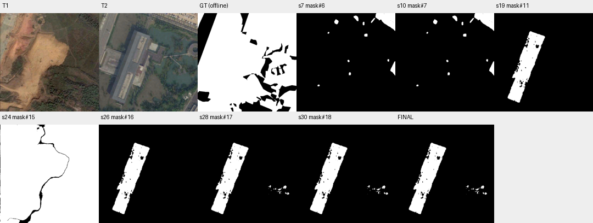

# case_11 完整轨迹

[交互回放](case_11.html#review) · [审查总表](20_case_review.md)



真实后端请求失败，另有候选利用不足

完整0–30步：9步无current错误被10步正确修复；11、20步ask在backends→planner.complete抛PlannerError，27步同类调用恢复，故不能归为Agent工具参数错误。24步候选mask#15离线F1=89.93，但未被采纳，最终建筑/水窄候选F1=22.36并预算终止。缺少底层HTTP证据，不擅自判为网络或鉴权原因。

后端错误保留原状态且允许有界恢复，当前已有实现；先研究候选答案切换，不改T1.3工具或自动选择GT最佳候选。

## 第 0 步

当前答案：None；离线评价：None


## 第 1 步

当前答案：None；离线评价：None

I need to find all land-cover changes between T1 and T2. Let me first examine both images carefully to understand what's changed.

Looking at the views:
- T1 shows what appears to be a dirt/excavation area with reddish-brown soil, some vegetation patches, and possibly some small structures
- T2 shows a completely different scene with large buildings (appears to be industrial or institutional), water bodies, roads, and parking areas

This looks like a significant change - possibly from an undeveloped/excavated area to a developed area with buildings and infrastructure. Let me segment the changes more systematically.

First, let me extract features from both times to help identify changes:


<details><summary>extract_features · 完整参数和返回</summary>


```json

{
  "tool": "extract_features",
  "args": {
    "time": "t1"
  },
  "ok": true,
  "error_code": null,
  "result_text": "{\"ok\":true,\"feat\":\"feat#0\",\"time\":\"t1\",\"grid_shape\":[36,36,768]}",
  "current_before": null,
  "current_after": null,
  "input_handles": [],
  "output_handles": [
    "feat#0"
  ],
  "eval": null,
  "candidate_eval": [],
  "set_current": null
}

```


</details>

## 第 2 步

当前答案：None；离线评价：None

I've extracted T1 features. Now let me extract T2 features to compare:


<details><summary>extract_features · 完整参数和返回</summary>


```json

{
  "tool": "extract_features",
  "args": {
    "time": "t2"
  },
  "ok": true,
  "error_code": null,
  "result_text": "{\"ok\":true,\"feat\":\"feat#1\",\"time\":\"t2\",\"grid_shape\":[36,36,768]}",
  "current_before": null,
  "current_after": null,
  "input_handles": [],
  "output_handles": [
    "feat#1"
  ],
  "eval": null,
  "candidate_eval": [],
  "set_current": null
}

```


</details>

## 第 3 步

当前答案：None；离线评价：None

Now let me segment everything at both times to get a comprehensive view of what exists:


<details><summary>segment_everything · 完整参数和返回</summary>


```json

{
  "tool": "segment_everything",
  "args": {
    "time": "t1"
  },
  "ok": true,
  "error_code": null,
  "result_text": "{\"ok\":true,\"props\":\"props#2\",\"n\":31,\"area\":256669,\"score_range\":[1.0,1.0]}",
  "current_before": null,
  "current_after": null,
  "input_handles": [],
  "output_handles": [
    "props#2"
  ],
  "eval": null,
  "candidate_eval": [],
  "set_current": null
}

```


</details>

## 第 4 步

当前答案：None；离线评价：None

I've got T1 proposals. Now let me get T2 proposals:


<details><summary>segment_everything · 完整参数和返回</summary>


```json

{
  "tool": "segment_everything",
  "args": {
    "time": "t2"
  },
  "ok": true,
  "error_code": null,
  "result_text": "{\"ok\":true,\"props\":\"props#3\",\"n\":74,\"area\":174094,\"score_range\":[1.0,1.0]}",
  "current_before": null,
  "current_after": null,
  "input_handles": [],
  "output_handles": [
    "props#3"
  ],
  "eval": null,
  "candidate_eval": [],
  "set_current": null
}

```


</details>

## 第 5 步

当前答案：None；离线评价：None

Now I have proposal sets for both times. Let me compare the features to identify changes based on temporal difference:


<details><summary>compare_features · 完整参数和返回</summary>


```json

{
  "tool": "compare_features",
  "args": {
    "props": "props#2",
    "feat_t1": "feat#0",
    "feat_t2": "feat#1"
  },
  "ok": true,
  "error_code": null,
  "result_text": "{\"ok\":true,\"props\":\"props#4\",\"n\":31,\"area\":256669,\"score_range\":[0.3326139450073242,0.7206059098243713]}",
  "current_before": null,
  "current_after": null,
  "input_handles": [
    "props#2",
    "feat#0",
    "feat#1"
  ],
  "output_handles": [
    "props#4"
  ],
  "eval": null,
  "candidate_eval": [],
  "set_current": null
}

```


</details>

## 第 6 步

当前答案：None；离线评价：None

I have compared features. The scores range from 0.33 to 0.72, which indicates some temporal change. Higher scores (closer to 1) mean more change. Let me select proposals with high change scores to identify the changed regions:


<details><summary>select · 完整参数和返回</summary>


```json

{
  "tool": "select",
  "args": {
    "set": "props#4",
    "where": "score >= 0.5"
  },
  "ok": true,
  "error_code": null,
  "result_text": "{\"ok\":true,\"props\":\"props#5\",\"n\":14,\"area\":8787,\"score_range\":[0.5012047290802002,0.7206059098243713],\"ids\":[1,5,6,8,9,10,16,18,21,22,23,24,30,31],\"n_in\":31,\"n_out\":14}",
  "current_before": null,
  "current_after": null,
  "input_handles": [
    "props#4"
  ],
  "output_handles": [
    "props#5"
  ],
  "eval": null,
  "candidate_eval": [],
  "set_current": null
}

```


</details>

## 第 7 步

当前答案：None；离线评价：None

I've selected 14 proposals with high change scores (>=0.5). Let me convert these to a mask to see the changed regions:


<details><summary>to_mask · 完整参数和返回</summary>


```json

{
  "tool": "to_mask",
  "args": {
    "sets": [
      "props#5"
    ],
    "set_current": false
  },
  "ok": true,
  "error_code": null,
  "result_text": "{\"ok\":true,\"mask\":\"mask#6\",\"area\":8787,\"component_count\":12}",
  "current_before": null,
  "current_after": null,
  "input_handles": [
    "props#5"
  ],
  "output_handles": [
    "mask#6"
  ],
  "eval": null,
  "candidate_eval": [
    {
      "handle": "mask#6",
      "parent": null,
      "tp": 8761,
      "fp": 26,
      "fn": 209704,
      "f1": 0.0771038318694665,
      "iou": 0.040097761463858926
    }
  ],
  "set_current": false
}

```


</details>

## 第 8 步

当前答案：None；离线评价：None

I have a mask with 12 components representing potential changes. Let me view this mask overlaid on the images to see what regions are identified:


<details><summary>view · 完整参数和返回</summary>


```json

{
  "tool": "view",
  "args": {
    "overlay": "mask#6"
  },
  "ok": true,
  "error_code": null,
  "result_text": "{\"ok\":true,\"view_id\":\"view#1\",\"region\":[0,0,512,512],\"overlay\":\"mask#6\",\"display_size\":[768,768],\"image_size\":[796,796],\"scale\":1.5,\"padding\":[28,28],\"labelled_ids\":[],\"unlabelled_count\":0}",
  "current_before": null,
  "current_after": null,
  "input_handles": [
    "mask#6"
  ],
  "output_handles": [],
  "eval": null,
  "candidate_eval": [],
  "set_current": null
}

```


</details>

## 第 9 步

当前答案：None；离线评价：None

I can see the red contours showing potential change regions. However, looking at the images, the main change appears to be a massive transformation - from an undeveloped/excavated area in T1 to a developed area with large buildings, water bodies, and infrastructure in T2. The current mask only captures small scattered regions, but the entire central area seems to have changed significantly.

Let me look more carefully at what's actually changed. The T1 image shows dirt/excavation land, while T2 shows large buildings (appears to be institutional/industrial), water features, roads, and parking lots. This is a complete land-cover change across most of the image.

Let me try a different approach - segment specific land cover categories that might have changed. First, let me check what the verifier thinks about my current mask:


<details><summary>ask · 完整参数和返回</summary>


```json

{
  "tool": "ask",
  "args": {},
  "ok": false,
  "error_code": "bad_args",
  "result_text": "{\"ok\":false,\"error_code\":\"bad_args\",\"message\":\"There is no current answer; pass regions with a mask handle.\"}",
  "current_before": null,
  "current_after": null,
  "input_handles": [],
  "output_handles": [],
  "eval": null,
  "candidate_eval": [],
  "set_current": null
}

```


</details>

## 第 10 步

当前答案：mask#7；离线评价：{'tp': 8761, 'fp': 26, 'fn': 209704, 'f1': 0.0771038318694665, 'iou': 0.040097761463858926, 'delta_f1': None}

I need to set the current answer first. Let me set mask#6 as the current answer and then ask the verifier:


<details><summary>to_mask · 完整参数和返回</summary>


```json

{
  "tool": "to_mask",
  "args": {
    "sets": [
      "props#5"
    ],
    "set_current": true
  },
  "ok": true,
  "error_code": null,
  "result_text": "{\"ok\":true,\"mask\":\"mask#7\",\"area\":8787,\"component_count\":12,\"current_mask\":{\"before\":null,\"after\":\"mask#7\"}}",
  "current_before": null,
  "current_after": "mask#7",
  "input_handles": [
    "props#5"
  ],
  "output_handles": [
    "mask#7"
  ],
  "eval": {
    "tp": 8761,
    "fp": 26,
    "fn": 209704,
    "f1": 0.0771038318694665,
    "iou": 0.040097761463858926,
    "delta_f1": null
  },
  "candidate_eval": [
    {
      "handle": "mask#7",
      "parent": null,
      "tp": 8761,
      "fp": 26,
      "fn": 209704,
      "f1": 0.0771038318694665,
      "iou": 0.040097761463858926
    }
  ],
  "set_current": true
}

```


</details>

## 第 11 步

当前答案：mask#7；离线评价：{'tp': 8761, 'fp': 26, 'fn': 209704, 'f1': 0.0771038318694665, 'iou': 0.040097761463858926, 'delta_f1': 0.0}

I have mask#7 as current answer with 12 components. The verifier shows 0 yes, 0 no, 0 unparsed, 12 none - meaning the verifier hasn't checked any components yet. Let me ask the verifier to check these components:


<details><summary>ask · 完整参数和返回</summary>


```json

{
  "tool": "ask",
  "args": {},
  "ok": false,
  "error_code": "backend_error",
  "result_text": "{\"ok\":false,\"error_code\":\"backend_error\",\"message\":\"Tool backend failed; inspect other evidence or retry later.\"}",
  "current_before": "mask#7",
  "current_after": "mask#7",
  "input_handles": [],
  "output_handles": [],
  "eval": {
    "tp": 8761,
    "fp": 26,
    "fn": 209704,
    "f1": 0.0771038318694665,
    "iou": 0.040097761463858926,
    "delta_f1": 0.0
  },
  "candidate_eval": [],
  "set_current": null
}

```


</details>

## 第 12 步

当前答案：mask#7；离线评价：{'tp': 8761, 'fp': 26, 'fn': 209704, 'f1': 0.0771038318694665, 'iou': 0.040097761463858926, 'delta_f1': 0.0}

The ask tool had a backend error. Let me inspect the components of my current mask to understand what regions are identified:


<details><summary>inspect · 完整参数和返回</summary>


```json

{
  "tool": "inspect",
  "args": {
    "mask": "mask#7"
  },
  "ok": true,
  "error_code": null,
  "result_text": "{\"ok\":true,\"mask\":\"mask#7\",\"total_components\":12,\"returned\":12,\"has_more\":false,\"components\":[{\"id\":1,\"area\":5770,\"bbox\":[409,0,512,92]},{\"id\":10,\"area\":1085,\"bbox\":[486,251,512,325]},{\"id\":2,\"area\":453,\"bbox\":[296,13,321,42]},{\"id\":4,\"area\":404,\"bbox\":[196,32,218,58]},{\"id\":7,\"area\":234,\"bbox\":[351,107,368,122]},{\"id\":3,\"area\":200,\"bbox\":[386,25,407,51]},{\"id\":11,\"area\":148,\"bbox\":[271,308,282,323]},{\"id\":5,\"area\":144,\"bbox\":[343,45,352,63]},{\"id\":9,\"area\":101,\"bbox\":[264,243,275,255]},{\"id\":8,\"area\":98,\"bbox\":[471,240,480,252]},{\"id\":12,\"area\":85,\"bbox\":[109,372,120,381]},{\"id\":6,\"area\":65,\"bbox\":[161,98,170,107]}]}",
  "current_before": "mask#7",
  "current_after": "mask#7",
  "input_handles": [
    "mask#7"
  ],
  "output_handles": [],
  "eval": {
    "tp": 8761,
    "fp": 26,
    "fn": 209704,
    "f1": 0.0771038318694665,
    "iou": 0.040097761463858926,
    "delta_f1": 0.0
  },
  "candidate_eval": [],
  "set_current": null
}

```


</details>

## 第 13 步

当前答案：mask#7；离线评价：{'tp': 8761, 'fp': 26, 'fn': 209704, 'f1': 0.0771038318694665, 'iou': 0.040097761463858926, 'delta_f1': 0.0}

I see the components are mostly small regions in the upper right and scattered areas. Looking at the images again, I notice that the main change is actually a massive transformation - T1 shows an excavated/dirt area while T2 shows large buildings, water bodies, and infrastructure. The current mask only captures small scattered regions which doesn't represent the actual large-scale land-cover change.

Let me reconsider my approach. The feature-based comparison might not be capturing the full extent of changes because the entire central area has transformed from dirt/excavation to developed land with buildings. Let me try to segment specific categories that would indicate change.

Looking at T2, I can see:
- Large buildings (institutional/industrial)
- Water bodies/lakes
- Roads/paved areas
- Parking lots

In T1, I see:
- Dirt/excavation areas (reddish-brown soil)
- Some vegetation patches
- No large buildings or water features

The change is essentially the replacement of natural/excavated land with urban development. Let me try to capture this more comprehensively by looking at what exists in T2 but not in T1, or vice versa.

Let me try segmenting "building" or similar categories to identify the new structures:


<details><summary>segment_text · 完整参数和返回</summary>


```json

{
  "tool": "segment_text",
  "args": {
    "time": "t2",
    "text": "building"
  },
  "ok": true,
  "error_code": null,
  "result_text": "{\"ok\":true,\"inst\":\"inst#8\",\"n\":2,\"area\":26818,\"score\":{\"min\":0.54296875,\"median\":0.609375,\"max\":0.67578125}}",
  "current_before": "mask#7",
  "current_after": "mask#7",
  "input_handles": [],
  "output_handles": [
    "inst#8"
  ],
  "eval": {
    "tp": 8761,
    "fp": 26,
    "fn": 209704,
    "f1": 0.0771038318694665,
    "iou": 0.040097761463858926,
    "delta_f1": 0.0
  },
  "candidate_eval": [],
  "set_current": null
}

```


</details>

## 第 14 步

当前答案：mask#7；离线评价：{'tp': 8761, 'fp': 26, 'fn': 209704, 'f1': 0.0771038318694665, 'iou': 0.040097761463858926, 'delta_f1': 0.0}

I found 2 building instances in T2 with a total area of 26818 pixels. These are likely the large buildings visible in T2 that didn't exist in T1. Let me also check for water bodies and other features:


<details><summary>segment_text · 完整参数和返回</summary>


```json

{
  "tool": "segment_text",
  "args": {
    "time": "t2",
    "text": "water"
  },
  "ok": true,
  "error_code": null,
  "result_text": "{\"ok\":true,\"inst\":\"inst#9\",\"n\":1,\"area\":680,\"score\":{\"min\":0.703125,\"median\":0.703125,\"max\":0.703125}}",
  "current_before": "mask#7",
  "current_after": "mask#7",
  "input_handles": [],
  "output_handles": [
    "inst#9"
  ],
  "eval": {
    "tp": 8761,
    "fp": 26,
    "fn": 209704,
    "f1": 0.0771038318694665,
    "iou": 0.040097761463858926,
    "delta_f1": 0.0
  },
  "candidate_eval": [],
  "set_current": null
}

```


</details>

## 第 15 步

当前答案：mask#7；离线评价：{'tp': 8761, 'fp': 26, 'fn': 209704, 'f1': 0.0771038318694665, 'iou': 0.040097761463858926, 'delta_f1': 0.0}

I found water instances in T2. Now let me also check what's in T1 that might have disappeared. Let me segment the dirt/excavation areas in T1:


<details><summary>segment_text · 完整参数和返回</summary>


```json

{
  "tool": "segment_text",
  "args": {
    "time": "t1",
    "text": "dirt"
  },
  "ok": true,
  "error_code": null,
  "result_text": "{\"ok\":true,\"inst\":\"inst#10\",\"n\":1,\"area\":1096,\"score\":{\"min\":0.5546875,\"median\":0.5546875,\"max\":0.5546875}}",
  "current_before": "mask#7",
  "current_after": "mask#7",
  "input_handles": [],
  "output_handles": [
    "inst#10"
  ],
  "eval": {
    "tp": 8761,
    "fp": 26,
    "fn": 209704,
    "f1": 0.0771038318694665,
    "iou": 0.040097761463858926,
    "delta_f1": 0.0
  },
  "candidate_eval": [],
  "set_current": null
}

```


</details>

## 第 16 步

当前答案：mask#7；离线评价：{'tp': 8761, 'fp': 26, 'fn': 209704, 'f1': 0.0771038318694665, 'iou': 0.040097761463858926, 'delta_f1': 0.0}

I see that my current approach is only capturing small scattered regions, but the actual change is much more significant - it's a complete transformation from an excavated/dirt area to a developed area with buildings, water, and infrastructure.

Let me take a different approach. I should look at the overall scene more carefully. The key insight is that T1 shows mostly bare earth/excavation while T2 shows urban development. This means most of the central area has changed land cover category.

Let me try to create a more comprehensive change mask by considering what exists in one time but not the other. First, let me view the full images side by side to better understand the extent of change:


<details><summary>view · 完整参数和返回</summary>


```json

{
  "tool": "view",
  "args": {
    "region": [
      0,
      0,
      512,
      512
    ]
  },
  "ok": true,
  "error_code": null,
  "result_text": "{\"ok\":true,\"view_id\":\"view#2\",\"region\":[0,0,512,512],\"overlay\":null,\"display_size\":[768,768],\"image_size\":[796,796],\"scale\":1.5,\"padding\":[28,28],\"labelled_ids\":[],\"unlabelled_count\":0}",
  "current_before": "mask#7",
  "current_after": "mask#7",
  "input_handles": [],
  "output_handles": [],
  "eval": {
    "tp": 8761,
    "fp": 26,
    "fn": 209704,
    "f1": 0.0771038318694665,
    "iou": 0.040097761463858926,
    "delta_f1": 0.0
  },
  "candidate_eval": [],
  "set_current": null
}

```


</details>

## 第 17 步

当前答案：mask#7；离线评价：{'tp': 8761, 'fp': 26, 'fn': 209704, 'f1': 0.0771038318694665, 'iou': 0.040097761463858926, 'delta_f1': 0.0}

Looking at the images more carefully:

**T1**: Shows a large excavated/dirt area (reddish-brown soil) in the center-left, with some vegetation patches on the right and bottom. There's also what appears to be a small structure or road in the upper left.

**T2**: Shows completely different - large institutional/industrial buildings in the center, water bodies/lakes on the right, roads/paved areas, and parking lots at the top. The dirt/excavation area from T1 has been replaced by urban development.

This is a massive land-cover change where the entire central area has transformed from bare earth to developed land. My current mask only captures small scattered regions which doesn't represent the actual extent of change.

Let me try a different approach - I'll segment the major features that have changed. The key changes are:
1. Buildings appeared (didn't exist in T1)
2. Water bodies appeared 
3. The dirt/excavation area disappeared/replaced

Let me create a comprehensive change mask by combining these elements. First, let me get the building instances from T2 and see if they correspond to changed areas:


<details><summary>inspect · 完整参数和返回</summary>


```json

{
  "tool": "inspect",
  "args": {
    "mask": "inst#8"
  },
  "ok": true,
  "error_code": null,
  "result_text": "{\"ok\":true,\"mask\":\"inst#8\",\"total_components\":2,\"returned\":2,\"has_more\":false,\"components\":[{\"id\":1,\"area\":26361,\"bbox\":[70,94,263,466],\"score\":0.67578125},{\"id\":2,\"area\":24190,\"bbox\":[70,96,263,466],\"score\":0.54296875}]}",
  "current_before": "mask#7",
  "current_after": "mask#7",
  "input_handles": [
    "inst#8"
  ],
  "output_handles": [],
  "eval": {
    "tp": 8761,
    "fp": 26,
    "fn": 209704,
    "f1": 0.0771038318694665,
    "iou": 0.040097761463858926,
    "delta_f1": 0.0
  },
  "candidate_eval": [],
  "set_current": null
}

```


</details>

## 第 18 步

当前答案：mask#7；离线评价：{'tp': 8761, 'fp': 26, 'fn': 209704, 'f1': 0.0771038318694665, 'iou': 0.040097761463858926, 'delta_f1': 0.0}

I see the building instances have large areas (26361 and 24190 pixels) with bboxes around [70,94,263,466]. These are significant structures that didn't exist in T1. Let me also check the water instance:


<details><summary>inspect · 完整参数和返回</summary>


```json

{
  "tool": "inspect",
  "args": {
    "mask": "inst#9"
  },
  "ok": true,
  "error_code": null,
  "result_text": "{\"ok\":true,\"mask\":\"inst#9\",\"total_components\":1,\"returned\":1,\"has_more\":false,\"components\":[{\"id\":1,\"area\":680,\"bbox\":[366,315,474,365],\"score\":0.703125}]}",
  "current_before": "mask#7",
  "current_after": "mask#7",
  "input_handles": [
    "inst#9"
  ],
  "output_handles": [],
  "eval": {
    "tp": 8761,
    "fp": 26,
    "fn": 209704,
    "f1": 0.0771038318694665,
    "iou": 0.040097761463858926,
    "delta_f1": 0.0
  },
  "candidate_eval": [],
  "set_current": null
}

```


</details>

## 第 19 步

当前答案：mask#7；离线评价：{'tp': 8761, 'fp': 26, 'fn': 209704, 'f1': 0.0771038318694665, 'iou': 0.040097761463858926, 'delta_f1': 0.0}

I see the water instance is at bbox [366,315,474,365] with area 680. Now I need to think about this more carefully.

The fundamental issue is that my current approach using feature comparison only captures small scattered regions, but the actual change is massive - an entire area has been transformed from bare earth to urban development.

Let me reconsider: The task says "COUNTS as a change: a change of land-cover category at the same location between T1 and T2". So if an area was dirt in T1 and became a building in T2, that's a change. If an area was vegetation in T1 and became water in T2, that's also a change.

Looking at the images:
- The large central area in T1 (dirt/excavation) appears to have been replaced by buildings and infrastructure in T2
- Some areas on the edges might have remained similar (vegetation patches)

My current mask#7 only has 12 small components totaling 8787 pixels, which seems too small for such a massive transformation. Let me try to create a better change mask by considering what exists in T2 but not in T1, or vice versa.

Actually, let me step back and think about this differently. The feature-based approach gave me scores based on DINOv2 feature differences. But perhaps I should use a more direct approach - segmenting specific categories that indicate change.

Let me try to identify all the major changed regions by looking at what's clearly different. The buildings in T2 are a clear sign of change since they didn't exist in T1. Let me create a mask from the building instances:


<details><summary>to_mask · 完整参数和返回</summary>


```json

{
  "tool": "to_mask",
  "args": {
    "sets": [
      "inst#8"
    ],
    "set_current": false
  },
  "ok": true,
  "error_code": null,
  "result_text": "{\"ok\":true,\"mask\":\"mask#11\",\"area\":26818,\"component_count\":7}",
  "current_before": "mask#7",
  "current_after": "mask#7",
  "input_handles": [
    "inst#8"
  ],
  "output_handles": [
    "mask#11"
  ],
  "eval": {
    "tp": 8761,
    "fp": 26,
    "fn": 209704,
    "f1": 0.0771038318694665,
    "iou": 0.040097761463858926,
    "delta_f1": 0.0
  },
  "candidate_eval": [
    {
      "handle": "mask#11",
      "parent": null,
      "tp": 26818,
      "fp": 0,
      "fn": 191647,
      "f1": 0.21866986297460483,
      "iou": 0.122756505618749
    }
  ],
  "set_current": false
}

```


</details>

## 第 20 步

当前答案：mask#7；离线评价：{'tp': 8761, 'fp': 26, 'fn': 209704, 'f1': 0.0771038318694665, 'iou': 0.040097761463858926, 'delta_f1': 0.0}

I have mask#11 with 7 components totaling 26818 pixels representing the buildings. But this only captures the buildings, not all the changes. The change also includes water bodies, roads, and the replacement of dirt with urban infrastructure.

Let me think about this more systematically. The key insight is that I need to identify ALL locations where the land-cover category changed between T1 and T2. This includes:
1. Areas that were dirt/excavation in T1 but became buildings/infrastructure in T2
2. Areas that became water bodies
3. Any other category changes

Looking at the images again, the entire central area appears to have transformed. Let me try a different approach - I'll use semantic segmentation to identify what categories exist in each time and compare them.

Actually, let me reconsider the problem. The feature-based comparison (props#4) gave me scores based on temporal DINOv2 feature differences. The selected proposals (props#5) had scores >= 0.5, which indicates significant change. But the resulting mask only has 12 small components.

Perhaps the issue is that the feature comparison is detecting specific points of change rather than the full extent of changed areas. Let me look at what the verifier says about my current mask#7 by trying to ask again:


<details><summary>ask · 完整参数和返回</summary>


```json

{
  "tool": "ask",
  "args": {
    "regions": [
      {
        "mask": "mask#7"
      }
    ]
  },
  "ok": false,
  "error_code": "backend_error",
  "result_text": "{\"ok\":false,\"error_code\":\"backend_error\",\"message\":\"Tool backend failed; inspect other evidence or retry later.\"}",
  "current_before": "mask#7",
  "current_after": "mask#7",
  "input_handles": [
    "mask#7"
  ],
  "output_handles": [],
  "eval": {
    "tp": 8761,
    "fp": 26,
    "fn": 209704,
    "f1": 0.0771038318694665,
    "iou": 0.040097761463858926,
    "delta_f1": 0.0
  },
  "candidate_eval": [],
  "set_current": null
}

```


</details>

## 第 21 步

当前答案：mask#7；离线评价：{'tp': 8761, 'fp': 26, 'fn': 209704, 'f1': 0.0771038318694665, 'iou': 0.040097761463858926, 'delta_f1': 0.0}

The ask tool keeps failing. Let me try a different approach - I'll create a more comprehensive change mask by combining the building instances with other changed features.

Looking at the images, the main change is:
1. Buildings appeared (inst#8)
2. Water bodies appeared (inst#9)
3. The dirt/excavation area from T1 was replaced

Let me also check if there are any remaining areas in T1 that might have changed. Let me segment "vegetation" or "forest" to see what remained:


<details><summary>segment_text · 完整参数和返回</summary>


```json

{
  "tool": "segment_text",
  "args": {
    "time": "t1",
    "text": "vegetation"
  },
  "ok": true,
  "error_code": null,
  "result_text": "{\"ok\":true,\"inst\":\"inst#12\",\"n\":2,\"area\":6959,\"score\":{\"min\":0.50390625,\"median\":0.541015625,\"max\":0.578125}}",
  "current_before": "mask#7",
  "current_after": "mask#7",
  "input_handles": [],
  "output_handles": [
    "inst#12"
  ],
  "eval": {
    "tp": 8761,
    "fp": 26,
    "fn": 209704,
    "f1": 0.0771038318694665,
    "iou": 0.040097761463858926,
    "delta_f1": 0.0
  },
  "candidate_eval": [],
  "set_current": null
}

```


</details>

## 第 22 步

当前答案：mask#7；离线评价：{'tp': 8761, 'fp': 26, 'fn': 209704, 'f1': 0.0771038318694665, 'iou': 0.040097761463858926, 'delta_f1': 0.0}

I found vegetation instances in T1. Let me also check what vegetation exists in T2 to see if it remained or changed:


<details><summary>segment_text · 完整参数和返回</summary>


```json

{
  "tool": "segment_text",
  "args": {
    "time": "t2",
    "text": "vegetation"
  },
  "ok": true,
  "error_code": null,
  "result_text": "{\"ok\":true,\"inst\":\"inst#13\",\"n\":2,\"area\":8459,\"score\":{\"min\":0.51171875,\"median\":0.544921875,\"max\":0.578125}}",
  "current_before": "mask#7",
  "current_after": "mask#7",
  "input_handles": [],
  "output_handles": [
    "inst#13"
  ],
  "eval": {
    "tp": 8761,
    "fp": 26,
    "fn": 209704,
    "f1": 0.0771038318694665,
    "iou": 0.040097761463858926,
    "delta_f1": 0.0
  },
  "candidate_eval": [],
  "set_current": null
}

```


</details>

## 第 23 步

当前答案：mask#7；离线评价：{'tp': 8761, 'fp': 26, 'fn': 209704, 'f1': 0.0771038318694665, 'iou': 0.040097761463858926, 'delta_f1': 0.0}

I have vegetation instances in both T1 (inst#12, area 6959) and T2 (inst#13, area 8459). The areas are similar but not identical, suggesting some vegetation may have changed or new vegetation appeared.

Let me take a step back and think about this more carefully. The key issue is that I need to identify ALL land-cover changes between T1 and T2. Looking at the images:

- T1: Large dirt/excavation area in center-left, some vegetation patches on right/bottom
- T2: Large buildings in center, water bodies on right, roads/infrastructure

The entire central area appears to have transformed from bare earth to urban development. This is a massive change.

My current approach using feature comparison only captured small scattered regions. Let me try a different strategy - I'll create a comprehensive change mask by considering what exists in T2 that didn't exist in T1 (buildings, water, infrastructure) combined with what existed in T1 that's gone (dirt/excavation).

Actually, let me reconsider the problem statement. It says "COUNTS as a change: a change of land-cover category at the same location between T1 and T2". So if an area was "dirt" in T1 and became "building" in T2, that's a change. If an area was "vegetation" in T1 and remained "vegetation" in T2, that's NOT a change.

The challenge is identifying which specific pixels changed category. My feature-based approach gave me some candidates, but they seem too small for such a massive transformation.

Let me try to create a better change mask by combining multiple evidence sources. I'll use the building instances (which clearly represent new structures) and also consider the overall transformation.

Actually, let me look at this from a different angle. The feature comparison scores range from 0.33 to 0.72. Higher scores indicate more change. Let me lower the threshold to capture more changed regions:


<details><summary>select · 完整参数和返回</summary>


```json

{
  "tool": "select",
  "args": {
    "set": "props#4",
    "where": "score >= 0.3"
  },
  "ok": true,
  "error_code": null,
  "result_text": "{\"ok\":true,\"props\":\"props#14\",\"n\":31,\"area\":256669,\"score_range\":[0.3326139450073242,0.7206059098243713],\"ids\":[1,2,3,4,5,6,7,8,9,10,11,12,13,14,15,16,17,18,19,20,21,22,23,24,25,26,27,28,29,30,31],\"n_in\":31,\"n_out\":31}",
  "current_before": "mask#7",
  "current_after": "mask#7",
  "input_handles": [
    "props#4"
  ],
  "output_handles": [
    "props#14"
  ],
  "eval": {
    "tp": 8761,
    "fp": 26,
    "fn": 209704,
    "f1": 0.0771038318694665,
    "iou": 0.040097761463858926,
    "delta_f1": 0.0
  },
  "candidate_eval": [],
  "set_current": null
}

```


</details>

## 第 24 步

当前答案：mask#7；离线评价：{'tp': 8761, 'fp': 26, 'fn': 209704, 'f1': 0.0771038318694665, 'iou': 0.040097761463858926, 'delta_f1': 0.0}

With score >= 0.3, I get all 31 proposals (the entire T1 segmentation). This suggests that most of the image has some temporal change, which makes sense given the massive transformation from dirt to urban development.

Let me convert all these proposals to a mask to see the full extent of potential changes:


<details><summary>to_mask · 完整参数和返回</summary>


```json

{
  "tool": "to_mask",
  "args": {
    "sets": [
      "props#14"
    ],
    "set_current": false
  },
  "ok": true,
  "error_code": null,
  "result_text": "{\"ok\":true,\"mask\":\"mask#15\",\"area\":256669,\"component_count\":4}",
  "current_before": "mask#7",
  "current_after": "mask#7",
  "input_handles": [
    "props#14"
  ],
  "output_handles": [
    "mask#15"
  ],
  "eval": {
    "tp": 8761,
    "fp": 26,
    "fn": 209704,
    "f1": 0.0771038318694665,
    "iou": 0.040097761463858926,
    "delta_f1": 0.0
  },
  "candidate_eval": [
    {
      "handle": "mask#15",
      "parent": null,
      "tp": 213637,
      "fp": 43032,
      "fn": 4828,
      "f1": 0.8992705215791755,
      "iou": 0.8169768678034547
    }
  ],
  "set_current": false
}

```


</details>

## 第 25 步

当前答案：mask#7；离线评价：{'tp': 8761, 'fp': 26, 'fn': 209704, 'f1': 0.0771038318694665, 'iou': 0.040097761463858926, 'delta_f1': 0.0}

I have mask#15 with area 256669 and 4 components, which represents almost the entire image. This seems too broad - it would include areas that didn't actually change (like some vegetation patches that remained).

Let me think about this differently. The key is to identify specific locations where land-cover category changed. Looking at the images:

1. The large central area in T1 (dirt/excavation) clearly changed to buildings/infrastructure in T2
2. Some areas on the edges might have remained similar

My current mask#7 (from score >= 0.5) only has 12 small components totaling 8787 pixels, which seems too conservative. But mask#15 (score >= 0.3) has 256669 pixels, which seems too aggressive.

Let me try a middle ground - use score >= 0.4 or examine the actual visual changes more carefully.

Actually, let me reconsider the problem. The task says to find "all land-cover changes". The most obvious change is the replacement of the dirt/excavation area with urban development. Let me try to create a mask that captures this main change region.

Looking at the images, the main changed area appears to be roughly in the center-left portion of the image, where the dirt/excavation was in T1 and buildings/infrastructure are in T2. Let me try to segment this region more precisely.

Let me view the current mask#7 overlaid to see what regions are identified:


<details><summary>view · 完整参数和返回</summary>


```json

{
  "tool": "view",
  "args": {
    "overlay": "mask#7"
  },
  "ok": true,
  "error_code": null,
  "result_text": "{\"ok\":true,\"view_id\":\"view#3\",\"region\":[0,0,512,512],\"overlay\":\"mask#7\",\"display_size\":[768,768],\"image_size\":[796,796],\"scale\":1.5,\"padding\":[28,28],\"labelled_ids\":[],\"unlabelled_count\":0}",
  "current_before": "mask#7",
  "current_after": "mask#7",
  "input_handles": [
    "mask#7"
  ],
  "output_handles": [],
  "eval": {
    "tp": 8761,
    "fp": 26,
    "fn": 209704,
    "f1": 0.0771038318694665,
    "iou": 0.040097761463858926,
    "delta_f1": 0.0
  },
  "candidate_eval": [],
  "set_current": null
}

```


</details>

## 第 26 步

当前答案：mask#16；离线评价：{'tp': 26818, 'fp': 0, 'fn': 191647, 'f1': 0.21866986297460483, 'iou': 0.122756505618749, 'delta_f1': 0.14156603110513832}

Looking at the overlay, I can see the red contours are scattered small regions that don't capture the main change - the massive transformation from dirt/excavation to urban development. The current mask only shows small dots and patches, but the actual change is much larger.

Let me take a completely different approach. I'll manually identify the main changed region by looking at what's clearly different between T1 and T2. The key observation is:
- T1 has a large dirt/excavation area in the center-left (roughly x: 50-350, y: 50-450)
- T2 has large buildings, water bodies, and infrastructure in that same area

This entire central area has changed land-cover category. Let me create a mask that captures this main change region by using a box prompt around the transformed area.

Actually, let me reconsider. The feature-based approach might be correct in detecting specific points of high temporal difference, but it's not capturing the full extent of changed areas because the DINOv2 features might be similar across large homogeneous regions even if the category changed.

Let me try a more direct approach - I'll segment the major features that indicate change and combine them:
1. Buildings in T2 (inst#8)
2. Water in T2 (inst#9)
3. Roads/infrastructure

But first, let me check if there's a better way to identify the changed region. Let me look at the building instances more carefully and see if they correspond to the main changed area:

The building instances have bbox [70,94,263,466] which covers a significant portion of the image. This seems to align with the main changed area.

Let me create a comprehensive change mask by combining the building instances with other evidence. But actually, I realize that the change isn't just about new objects appearing - it's about the land-cover category changing at each location. So if an area was "dirt" in T1 and became "building" in T2, that's a change. If an area was "vegetation" in T1 and remained "vegetation" in T2, that's not a change.

The challenge is identifying which pixels changed. One approach is to use semantic segmentation to classify each pixel in both times and compare. Let me try segmenting specific categories in both times and comparing.

Actually, let me try a simpler approach. I'll use the building instances as a proxy for the changed area, since buildings clearly didn't exist in T1. But I also need to include areas where dirt was replaced by non-building infrastructure (roads, parking lots, etc.).

Let me try to create a mask that represents the main changed region by using a combination of approaches. First, let me set the building mask as current and see what the verifier says:


<details><summary>to_mask · 完整参数和返回</summary>


```json

{
  "tool": "to_mask",
  "args": {
    "sets": [
      "inst#8"
    ],
    "set_current": true
  },
  "ok": true,
  "error_code": null,
  "result_text": "{\"ok\":true,\"mask\":\"mask#16\",\"area\":26818,\"component_count\":7,\"current_mask\":{\"before\":\"mask#7\",\"after\":\"mask#16\"}}",
  "current_before": "mask#7",
  "current_after": "mask#16",
  "input_handles": [
    "inst#8"
  ],
  "output_handles": [
    "mask#16"
  ],
  "eval": {
    "tp": 26818,
    "fp": 0,
    "fn": 191647,
    "f1": 0.21866986297460483,
    "iou": 0.122756505618749,
    "delta_f1": 0.14156603110513832
  },
  "candidate_eval": [
    {
      "handle": "mask#16",
      "parent": null,
      "tp": 26818,
      "fp": 0,
      "fn": 191647,
      "f1": 0.21866986297460483,
      "iou": 0.122756505618749
    }
  ],
  "set_current": true
}

```


</details>

## 第 27 步

当前答案：mask#16；离线评价：{'tp': 26818, 'fp': 0, 'fn': 191647, 'f1': 0.21866986297460483, 'iou': 0.122756505618749, 'delta_f1': 0.0}

I have mask#16 with 7 components representing buildings (26818 pixels). The verifier hasn't checked any yet. Let me try to ask the verifier to check these components:


<details><summary>ask · 完整参数和返回</summary>


```json

{
  "tool": "ask",
  "args": {
    "regions": [
      {
        "mask": "mask#16"
      }
    ]
  },
  "ok": true,
  "error_code": null,
  "result_text": "{\"ok\":true,\"results\":[{\"mask\":\"mask#16\",\"id\":1,\"p_yes\":1.0,\"answer\":\"yes\",\"type\":\"land_cover_change\",\"reason\":\"The land cover changed from bare earth/vegetation at T1 to a large building and paved surfaces at T2.\",\"status\":\"parsed\"},{\"mask\":\"mask#16\",\"id\":6,\"p_yes\":1.0,\"answer\":\"yes\",\"type\":\"land_cover_change\",\"reason\":\"The location changed from natural vegetation/soil in T1 to a paved road surface in T2, indicating a clear land-cover change.\",\"status\":\"parsed\"},{\"mask\":\"mask#16\",\"id\":4,\"p_yes\":1.0,\"answer\":\"yes\",\"type\":\"land_cover_change\",\"reason\":\"The location changes from dark vegetated soil in T1 to a paved road surface in T2, indicating a clear land-cover change.\",\"status\":\"parsed\"},{\"mask\":\"mask#16\",\"id\":5,\"p_yes\":1.0,\"answer\":\"yes\",\"type\":\"land_cover_change\",\"reason\":\"The location changes from natural vegetation/soil in T1 to a paved road surface in T2, indicating a clear land-cover change.\",\"status\":\"parsed\"},{\"mask\":\"mask#16\",\"id\":2,\"p_yes\":0.9999999715467066,\"answer\":\"yes\",\"type\":\"land_cover_change\",\"reason\":\"The location changes from natural reddish-brown soil or bare ground in T1 to a built structure (building roof) in T2, indicating a clear land-cover category change.\",\"status\":\"parsed\"},{\"mask\":\"mask#16\",\"id\":3,\"p_yes\":1.0,\"answer\":\"yes\",\"type\":\"land_cover_change\",\"reason\":\"The location changes from natural vegetation/soil in T1 to a paved road surface in T2, indicating a clear land-cover category change.\",\"status\":\"parsed\"},{\"mask\":\"mask#16\",\"id\":7,\"p_yes\":1.0,\"answer\":\"yes\",\"type\":\"land_cover_change\",\"reason\":\"The location changed from natural bare ground or sparse vegetation in T1 to a large industrial building roof in T2, indicating a clear land-cover change.\",\"status\":\"parsed\"}],\"remaining_unverified\":0}",
  "current_before": "mask#16",
  "current_after": "mask#16",
  "input_handles": [
    "mask#16"
  ],
  "output_handles": [],
  "eval": {
    "tp": 26818,
    "fp": 0,
    "fn": 191647,
    "f1": 0.21866986297460483,
    "iou": 0.122756505618749,
    "delta_f1": 0.0
  },
  "candidate_eval": [],
  "set_current": null
}

```


</details>

## 第 27 步

当前答案：None；离线评价：None


Report before submission. Every run gets this report as the first response to submit; it does not judge the mask, and nothing has to change. mask#16 is now your current answer: 26818 pixels in 7 components.
Verifier answers on mask#16: 7 yes, 0 no, 0 unparsed, 0 with no answer. An answer applies only to the exact outline it was about; a view is not an answer.
  IDs answered yes: [1, 6, 4, 5, 2, 3, 7]
A verifier answer is evidence, not an order, and it can be wrong in both directions. No answer is not an error. To finish with this mask, call submit with mask#16 again. To change it, edit and submit the new handle; components the verifier has not seen will be reported again. In the summary, say what you changed, and why you went against any verifier answer. You have 3 replies left.

## 第 28 步

当前答案：mask#16；离线评价：{'tp': 26818, 'fp': 0, 'fn': 191647, 'f1': 0.21866986297460483, 'iou': 0.122756505618749, 'delta_f1': 0.0}

The verifier has confirmed all 7 components of mask#16 (the building instances) as land-cover changes. All answers are "yes" with high confidence, indicating these regions clearly changed from bare earth/vegetation to buildings/paved surfaces.

However, I need to consider whether this mask captures ALL the changes. The verifier says these are changes, but there might be other changed regions not captured by just the building instances. Looking at the images:
- T2 also has water bodies, roads, parking lots, and other infrastructure that didn't exist in T1
- The main central area where dirt was replaced by urban development is partially captured by the building mask

Let me check if there are additional changed regions I should include. The water body (inst#9) and other infrastructure might represent additional changes. Let me add the water instance to see if it represents a change:


<details><summary>to_mask · 完整参数和返回</summary>


```json

{
  "tool": "to_mask",
  "args": {
    "sets": [
      "inst#8",
      "inst#9"
    ],
    "set_current": false
  },
  "ok": true,
  "error_code": null,
  "result_text": "{\"ok\":true,\"mask\":\"mask#17\",\"area\":27498,\"component_count\":25}",
  "current_before": "mask#16",
  "current_after": "mask#16",
  "input_handles": [
    "inst#8",
    "inst#9"
  ],
  "output_handles": [
    "mask#17"
  ],
  "eval": {
    "tp": 26818,
    "fp": 0,
    "fn": 191647,
    "f1": 0.21866986297460483,
    "iou": 0.122756505618749,
    "delta_f1": 0.0
  },
  "candidate_eval": [
    {
      "handle": "mask#17",
      "parent": null,
      "tp": 27498,
      "fp": 0,
      "fn": 190967,
      "f1": 0.22359460569272613,
      "iou": 0.12586913235529718
    }
  ],
  "set_current": false
}

```


</details>

## 第 29 步

当前答案：mask#16；离线评价：{'tp': 26818, 'fp': 0, 'fn': 191647, 'f1': 0.21866986297460483, 'iou': 0.122756505618749, 'delta_f1': 0.0}

I have mask#17 with 25 components (27498 pixels) combining buildings and water. Let me verify this is a good representation of all changes by checking if the verifier confirms these additional components:


<details><summary>ask · 完整参数和返回</summary>


```json

{
  "tool": "ask",
  "args": {
    "regions": [
      {
        "mask": "mask#17"
      }
    ]
  },
  "ok": true,
  "error_code": null,
  "result_text": "{\"ok\":true,\"results\":[{\"mask\":\"mask#17\",\"id\":8,\"p_yes\":0.999290340654981,\"answer\":\"yes\",\"type\":\"land_cover_change\",\"reason\":\"The area inside the contour changes from dry, brownish grass or shrubland in T1 to green, water-covered vegetation or wetland in T2, indicating a distinct land-cover category change.\",\"status\":\"parsed\"},{\"mask\":\"mask#17\",\"id\":10,\"p_yes\":0.9997388125840267,\"answer\":\"yes\",\"type\":\"land_cover_change\",\"reason\":\"The area inside the contour changes from dark, textured vegetation or forest in T1 to a uniform, lighter green field or grassland in T2, indicating a clear land-cover category change.\",\"status\":\"parsed\"},{\"mask\":\"mask#17\",\"id\":23,\"p_yes\":0.9796684261817544,\"answer\":\"yes\",\"type\":\"land_cover_change\",\"reason\":\"The land cover inside the contour changes from textured, brownish sparse vegetation or bare ground at T1 to a uniform green canopy or dense vegetation at T2.\",\"status\":\"parsed\"},{\"mask\":\"mask#17\",\"id\":7,\"p_yes\":0.9999982396638492,\"answer\":\"yes\",\"type\":\"land_cover_change\",\"reason\":\"The land cover inside the contour changes from dark, textured vegetation or shadowed ground in T1 to a uniform, lighter green surface (likely grass or low vegetation) in T2, indicating a actual change in land cover category.\",\"status\":\"parsed\"},{\"mask\":\"mask#17\",\"id\":20,\"p_yes\":0.9992903395618673,\"answer\":\"yes\",\"type\":\"land_cover_change\",\"reason\":\"The location changes from dark, textured vegetation or shadowed ground in T1 to a uniform, lighter green surface in T2, indicating a change in land cover category.\",\"status\":\"parsed\"},{\"mask\":\"mask#17\",\"id\":22,\"p_yes\":0.9999910603335315,\"answer\":\"yes\",\"type\":\"land_cover_change\",\"reason\":\"The close-up and wider views show a distinct shift from brown, bare earth or sparse vegetation at T1 to dense green tree canopy at T2, indicating a real land cover change rather than just seasonal or illumination differences.\",\"status\":\"parsed\"},{\"mask\":\"mask#17\",\"id\":12,\"p_yes\":0.9999938558574419,\"answer\":\"yes\",\"type\":\"land_cover_change\",\"reason\":\"The location transitions from a brown, bare soil or grassy area in T1 to a green, vegetated surface in T2, indicating a change in land cover category.\",\"status\":\"parsed\"},{\"mask\":\"mask#17\",\"id\":16,\"p_yes\":0.9999945778026665,\"answer\":\"yes\",\"type\":\"land_cover_change\",\"reason\":\"The location changes from a dark, textured vegetated area in T1 to a uniform, lighter green open field in T2, indicating a change in land cover.\",\"status\":\"parsed\"},{\"mask\":\"mask#17\",\"id\":13,\"p_yes\":0.999738817792829,\"answer\":\"yes\",\"type\":\"land_cover_change\",\"reason\":\"The location changes from a brown, bare earth or grassy patch in T1 to a green vegetated area in T2, indicating a land cover change.\",\"status\":\"parsed\"},{\"mask\":\"mask#17\",\"id\":18,\"p_yes\":0.9999984465085733,\"answer\":\"yes\",\"type\":\"land_cover_change\",\"reason\":\"The location transitions from a mix of sparse vegetation and bare earth in T1 to a dense, uniform tree canopy in T2, indicating a clear change in land cover category.\",\"status\":\"parsed\"},{\"mask\":\"mask#17\",\"id\":15,\"p_yes\":0.999986992949536,\"answer\":\"yes\",\"type\":\"land_cover_change\",\"reason\":\"The location changes from bare earth or sparse vegetation in T1 to dense tree canopy cover in T2, indicating a clear land-cover change.\",\"status\":\"parsed\"},{\"mask\":\"mask#17\",\"id\":11,\"p_yes\":0.9999785552161177,\"answer\":\"yes\",\"type\":\"land_cover_change\",\"reason\":\"The location changes from a dark, textured forested area in T1 to a uniform light green open field or grassland in T2, indicating a clear land-cover change.\",\"status\":\"parsed\"},{\"mask\":\"mask#17\",\"id\":19,\"p_yes\":0.9999999530884482,\"answer\":\"yes\",\"type\":\"land_cover_change\",\"reason\":\"The location transitions from a dark, textured forested area in T1 to a lighter, uniform grassy field in T2, indicating a clear change in land cover.\",\"status\":\"parsed\"},{\"mask\":\"mask#17\",\"id\":24,\"p_yes\":0.9999852611230226,\"answer\":\"yes\",\"type\":\"land_cover_change\",\"reason\":\"The location changes from a textured, brownish area with dark patches (likely bare soil or sparse vegetation) in T1 to a uniform green surface (likely water or dense grass) in T2.\",\"status\":\"parsed\"},{\"mask\":\"mask#17\",\"id\":9,\"p_yes\":0.9999999123578432,\"answer\":\"yes\",\"type\":\"land_cover_change\",\"reason\":\"The location transitions from a brown, bare earth or scrub area in T1 to a green vegetated field in T2, indicating a change in land cover.\",\"status\":\"parsed\"},{\"mask\":\"mask#17\",\"id\":14,\"p_yes\":0.9999999530885324,\"answer\":\"yes\",\"type\":\"land_cover_change\",\"reason\":\"The location changes from dense tree cover in T1 to open grassy field in T2, indicating a clear land-cover change.\",\"status\":\"parsed\"},{\"mask\":\"mask#17\",\"id\":21,\"p_yes\":0.99999577718055,\"answer\":\"yes\",\"type\":\"land_cover_change\",\"reason\":\"The location transitions from a textured, brownish-green vegetated area in T1 to a smooth, uniform blue-grey water body in T2, indicating a clear change in land cover.\",\"status\":\"parsed\"},{\"mask\":\"mask#17\",\"id\":25,\"p_yes\":0.9999994285008889,\"answer\":\"yes\",\"type\":\"land_cover_change\",\"reason\":\"The location changes from dark, textured vegetation or forest in T1 to a smooth, uniform water body in T2.\",\"status\":\"parsed\"}],\"remaining_unverified\":0}",
  "current_before": "mask#16",
  "current_after": "mask#16",
  "input_handles": [
    "mask#17"
  ],
  "output_handles": [],
  "eval": {
    "tp": 26818,
    "fp": 0,
    "fn": 191647,
    "f1": 0.21866986297460483,
    "iou": 0.122756505618749,
    "delta_f1": 0.0
  },
  "candidate_eval": [],
  "set_current": null
}

```


</details>

## 第 30 步

当前答案：mask#18；离线评价：{'tp': 27498, 'fp': 0, 'fn': 190967, 'f1': 0.22359460569272613, 'iou': 0.12586913235529718, 'delta_f1': 0.004924742718121294}

The verifier has confirmed all 25 components of mask#17 as land-cover changes with very high confidence (p_yes values close to 1.0). All answers are "yes" indicating these regions clearly changed between T1 and T2.

However, I need to reconsider whether mask#17 is the best representation. Looking at the verifier reasons:
- Many components show changes from vegetation/forest to grassland or water
- Some show changes from bare earth to dense vegetation
- The water body (inst#9) shows change from dry/shrubland to water-covered areas

But I'm concerned that mask#17 might be capturing too many small scattered regions that may not represent actual significant land-cover changes. The main obvious change is the replacement of the large dirt/excavation area with urban development (buildings, roads, water bodies).

Let me think about this more carefully. The task says to find "all land-cover changes". The verifier confirms all components in mask#17 as changes, but I should verify if these are truly meaningful changes or if some might be false positives due to seasonal variation or illumination differences.

Looking at the verifier reasons:
- "The location changes from dark, textured vegetation or shadowed ground in T1 to a uniform, lighter green surface in T2" - This could be seasonal vegetation growth, which the task says does NOT count as a change.
- "The area inside the contour changes from dry, brownish grass or shrubland in T1 to green, water-covered vegetation or wetland in T2" - This is a clear category change.

The task explicitly states that "seasonal appearance alone" does NOT count as a change. So I need to be careful about including regions that only changed due to seasonal vegetation growth.

Let me reconsider my approach. The most definitive changes are:
1. Buildings appearing (clearly didn't exist in T1)
2. Water bodies appearing (clearly new feature)
3. Major infrastructure changes (roads, parking lots)

The scattered small regions showing vegetation-to-grassland changes might be seasonal and should potentially be excluded.

Given that I have only 1 reply left, let me make a decision. The current mask#16 (buildings only) was confirmed by the verifier as 7 yes answers. But mask#17 includes additional regions that the verifier also confirms as changes.

However, I'm concerned that mask#17 might include some false positives (seasonal vegetation changes). Let me check if there's a way to refine this.

Actually, looking at the verifier answers for mask#17, all 25 components were answered "yes" with high confidence. The verifier seems to be confirming these as genuine land-cover changes based on the visual evidence.

Given the constraints (only 1 reply left), I should submit my best mask. The question is whether to use mask#16 (buildings only, 7 components) or mask#17 (buildings + water + other features, 25 components).

Looking at the images again, the main change is the transformation of the central area from dirt/excavation to urban development. The building instances (mask#16) capture the major structures, but there are also water bodies, roads, and other infrastructure that represent changes.

I think mask#17 is a more comprehensive representation of the changes, as it includes:
- Buildings (clear change)
- Water bodies (clear change)
- Other infrastructure and vegetation changes

All components were confirmed by the verifier as land-cover changes. However, I'm still concerned about potential seasonal vegetation changes being included.

Let me make a final decision. Given that:
1. The verifier confirmed all 25 components as changes
2. The main obvious change (dirt to buildings) is captured
3. Additional changes (water, infrastructure) are also captured

I'll submit mask#17 as it represents a more comprehensive view of the changes. But wait - I should double-check if mask#17 is indeed the current answer or if I need to set it as current first.

Actually, looking at the status, it says "Current answer mask#16" which means mask#16 is still the current answer. I need to set mask#17 as current before submitting.

Let me set mask#17 as current and then submit:


<details><summary>to_mask · 完整参数和返回</summary>


```json

{
  "tool": "to_mask",
  "args": {
    "sets": [
      "inst#8",
      "inst#9"
    ],
    "set_current": true
  },
  "ok": true,
  "error_code": null,
  "result_text": "{\"ok\":true,\"mask\":\"mask#18\",\"area\":27498,\"component_count\":25,\"current_mask\":{\"before\":\"mask#16\",\"after\":\"mask#18\"}}",
  "current_before": "mask#16",
  "current_after": "mask#18",
  "input_handles": [
    "inst#8",
    "inst#9"
  ],
  "output_handles": [
    "mask#18"
  ],
  "eval": {
    "tp": 27498,
    "fp": 0,
    "fn": 190967,
    "f1": 0.22359460569272613,
    "iou": 0.12586913235529718,
    "delta_f1": 0.004924742718121294
  },
  "candidate_eval": [
    {
      "handle": "mask#18",
      "parent": null,
      "tp": 27498,
      "fp": 0,
      "fn": 190967,
      "f1": 0.22359460569272613,
      "iou": 0.12586913235529718
    }
  ],
  "set_current": true
}

```


</details>
