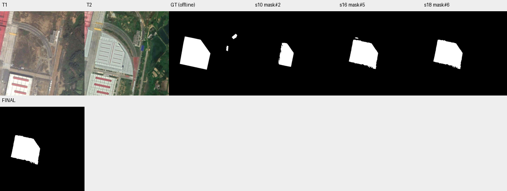

# case_12 完整轨迹

[交互回放](case_12.html#review) · [审查总表](20_case_review.md)



核验否定后误删112个纯TP像素，损失较小

完整0–21步：前期四次过大框被拒，缩框后恢复，最终改用文本实例。17步no意见对应112 TP、0 FP，18步删除，F1从88.75降88.49。核验被接受但不足以证明认知上的盲信；该小组件可能涉及标注边界，结论限于离线指标损失。

保留局部像素证据，不据此强制二次核验所有删除；风险是增加调用且保留真正FP。

## 第 0 步

当前答案：None；离线评价：None


## 第 1 步

当前答案：None；离线评价：None

I need to find buildings newly constructed between T1 and T2. Let me start by examining both images more carefully to identify what has changed.

Looking at the images:
- T1 shows a railway track curving through the scene, with some existing buildings (red-roofed building on left, white building with red stripes at bottom)
- T2 shows a large new warehouse/industrial building in the center area where there was previously just open land/railway tracks

Let me segment buildings in T2 to identify the new construction, then verify it wasn't present in T1.


<details><summary>segment_text · 完整参数和返回</summary>


```json

{
  "tool": "segment_text",
  "args": {
    "time": "t2",
    "text": "building"
  },
  "ok": true,
  "error_code": null,
  "result_text": "{\"ok\":true,\"inst\":\"inst#0\",\"n\":1,\"area\":18138,\"score\":{\"min\":0.62890625,\"median\":0.62890625,\"max\":0.62890625}}",
  "current_before": null,
  "current_after": null,
  "input_handles": [],
  "output_handles": [
    "inst#0"
  ],
  "eval": null,
  "candidate_eval": [],
  "set_current": null
}

```


</details>

## 第 2 步

当前答案：None；离线评价：None

I got an instance set for buildings in T2. Let me inspect it to see what was detected, and also look at T1 to check if these buildings existed there.


<details><summary>inspect · 完整参数和返回</summary>


```json

{
  "tool": "inspect",
  "args": {
    "mask": "inst#0"
  },
  "ok": true,
  "error_code": null,
  "result_text": "{\"ok\":true,\"mask\":\"inst#0\",\"total_components\":1,\"returned\":1,\"has_more\":false,\"components\":[{\"id\":1,\"area\":18138,\"bbox\":[15,381,193,511],\"score\":0.62890625}]}",
  "current_before": null,
  "current_after": null,
  "input_handles": [
    "inst#0"
  ],
  "output_handles": [],
  "eval": null,
  "candidate_eval": [],
  "set_current": null
}

```


</details>

<details><summary>segment_text · 完整参数和返回</summary>


```json

{
  "tool": "segment_text",
  "args": {
    "time": "t1",
    "text": "building"
  },
  "ok": true,
  "error_code": null,
  "result_text": "{\"ok\":true,\"inst\":\"inst#1\",\"n\":3,\"area\":25950,\"score\":{\"min\":0.65234375,\"median\":0.74609375,\"max\":0.80078125}}",
  "current_before": null,
  "current_after": null,
  "input_handles": [],
  "output_handles": [
    "inst#1"
  ],
  "eval": null,
  "candidate_eval": [],
  "set_current": null
}

```


</details>

## 第 3 步

当前答案：None；离线评价：None

I see that:
- T2 has one building instance (inst#0) with ID 1, area 18138, bbox [15,381,193,511] - this appears to be the large warehouse in the center
- T1 has 3 building instances (inst#1)

Let me look at the T1 buildings to understand what existed there, and also view the regions more carefully to identify new construction.


<details><summary>inspect · 完整参数和返回</summary>


```json

{
  "tool": "inspect",
  "args": {
    "mask": "inst#1"
  },
  "ok": true,
  "error_code": null,
  "result_text": "{\"ok\":true,\"mask\":\"inst#1\",\"total_components\":3,\"returned\":3,\"has_more\":false,\"components\":[{\"id\":2,\"area\":16314,\"bbox\":[36,381,195,511],\"score\":0.80078125},{\"id\":1,\"area\":7569,\"bbox\":[0,0,55,260],\"score\":0.65234375},{\"id\":3,\"area\":2067,\"bbox\":[299,116,340,198],\"score\":0.74609375}]}",
  "current_before": null,
  "current_after": null,
  "input_handles": [
    "inst#1"
  ],
  "output_handles": [],
  "eval": null,
  "candidate_eval": [],
  "set_current": null
}

```


</details>

<details><summary>view · 完整参数和返回</summary>


```json

{
  "tool": "view",
  "args": {
    "region": [
      0,
      100,
      400,
      400
    ]
  },
  "ok": true,
  "error_code": null,
  "result_text": "{\"ok\":true,\"view_id\":\"view#1\",\"region\":[0,100,400,400],\"overlay\":null,\"display_size\":[768,576],\"image_size\":[796,604],\"scale\":1.92,\"padding\":[28,28],\"labelled_ids\":[],\"unlabelled_count\":0}",
  "current_before": null,
  "current_after": null,
  "input_handles": [],
  "output_handles": [],
  "eval": null,
  "candidate_eval": [],
  "set_current": null
}

```


</details>

## 第 4 步

当前答案：None；离线评价：None

Now I can see clearly:
- In T1, the area around [100-350, 100-400] shows railway tracks and open land with no large building
- In T2, there's a large new warehouse/industrial building in that same area (the white building with dark stripes)

The T2 instance inst#0 has bbox [15,381,193,511] which seems to be at the bottom left - let me check this more carefully. Actually looking at the view, the new large building appears to be in the center area. Let me look at the full T2 image to understand the location better.

Let me view the full T2 image and also check if the detected instance corresponds to the new building.


<details><summary>view · 完整参数和返回</summary>


```json

{
  "tool": "view",
  "args": {
    "region": [
      0,
      0,
      796,
      604
    ],
    "overlay": "inst#0"
  },
  "ok": false,
  "error_code": "bad_args",
  "result_text": "{\"ok\":false,\"error_code\":\"bad_args\",\"message\":\"region must be an ordered box inside the full image.\"}",
  "current_before": null,
  "current_after": null,
  "input_handles": [
    "inst#0"
  ],
  "output_handles": [],
  "eval": null,
  "candidate_eval": [],
  "set_current": null
}

```


</details>

## 第 5 步

当前答案：None；离线评价：None

The region needs to be within the full image bounds. Let me check the actual image size and view with proper coordinates. The T2 image shows a large new building in the center area. Let me look at the full T2 image with the overlay to see what was detected.


<details><summary>view · 完整参数和返回</summary>


```json

{
  "tool": "view",
  "args": {
    "region": [
      0,
      0,
      512,
      512
    ],
    "overlay": "inst#0"
  },
  "ok": true,
  "error_code": null,
  "result_text": "{\"ok\":true,\"view_id\":\"view#2\",\"region\":[0,0,512,512],\"overlay\":\"inst#0\",\"display_size\":[768,768],\"image_size\":[796,796],\"scale\":1.5,\"padding\":[28,28],\"labelled_ids\":[],\"unlabelled_count\":0}",
  "current_before": null,
  "current_after": null,
  "input_handles": [
    "inst#0"
  ],
  "output_handles": [],
  "eval": null,
  "candidate_eval": [],
  "set_current": null
}

```


</details>

## 第 6 步

当前答案：None；离线评价：None

I see that inst#0 (the building detected in T2) is actually the existing building at the bottom left (the white building with red stripes), which was already present in T1. This is NOT a new building - it's an existing one.

The actual new construction appears to be the large warehouse/industrial building in the center area of T2 (around coordinates 100-350, 100-400) that wasn't there in T1. I need to segment this new building specifically.

Let me use a box prompt to segment the new building in T2. Looking at the T2 image, the new large building appears to be roughly in the region [80, 120, 360, 380].


<details><summary>segment_prompt · 完整参数和返回</summary>


```json

{
  "tool": "segment_prompt",
  "args": {
    "time": "t2",
    "box": [
      80,
      120,
      360,
      380
    ]
  },
  "ok": false,
  "error_code": "box_too_large",
  "result_text": "{\"ok\":false,\"error_code\":\"box_too_large\",\"message\":\"A box prompt segments one object. This box covers 27.77% of the image. For several objects or a whole area, use segment_text, then intersect with a region if needed.\"}",
  "current_before": null,
  "current_after": null,
  "input_handles": [],
  "output_handles": [],
  "eval": null,
  "candidate_eval": [],
  "set_current": null
}

```


</details>

## 第 7 步

当前答案：None；离线评价：None

The box is too large. Let me try a tighter box around just the new building. Looking at T2, the new warehouse appears to be roughly in [100, 150, 340, 370].


<details><summary>segment_prompt · 完整参数和返回</summary>


```json

{
  "tool": "segment_prompt",
  "args": {
    "time": "t2",
    "box": [
      100,
      150,
      340,
      370
    ]
  },
  "ok": false,
  "error_code": "box_too_large",
  "result_text": "{\"ok\":false,\"error_code\":\"box_too_large\",\"message\":\"A box prompt segments one object. This box covers 20.14% of the image. For several objects or a whole area, use segment_text, then intersect with a region if needed.\"}",
  "current_before": null,
  "current_after": null,
  "input_handles": [],
  "output_handles": [],
  "eval": null,
  "candidate_eval": [],
  "set_current": null
}

```


</details>

## 第 8 步

当前答案：None；离线评价：None

The box is still too large. Let me try an even tighter box around just the new building. Looking at T2, the new warehouse appears to be roughly in [120, 170, 320, 360].


<details><summary>segment_prompt · 完整参数和返回</summary>


```json

{
  "tool": "segment_prompt",
  "args": {
    "time": "t2",
    "box": [
      120,
      170,
      320,
      360
    ]
  },
  "ok": false,
  "error_code": "box_too_large",
  "result_text": "{\"ok\":false,\"error_code\":\"box_too_large\",\"message\":\"A box prompt segments one object. This box covers 14.50% of the image. For several objects or a whole area, use segment_text, then intersect with a region if needed.\"}",
  "current_before": null,
  "current_after": null,
  "input_handles": [],
  "output_handles": [],
  "eval": null,
  "candidate_eval": [],
  "set_current": null
}

```


</details>

## 第 9 步

当前答案：None；离线评价：None

The box is still too large. Let me try an even tighter box. Looking at T2, the new building appears to be roughly in [140, 180, 300, 350].


<details><summary>segment_prompt · 完整参数和返回</summary>


```json

{
  "tool": "segment_prompt",
  "args": {
    "time": "t2",
    "box": [
      140,
      180,
      300,
      350
    ]
  },
  "ok": false,
  "error_code": "box_too_large",
  "result_text": "{\"ok\":false,\"error_code\":\"box_too_large\",\"message\":\"A box prompt segments one object. This box covers 10.38% of the image. For several objects or a whole area, use segment_text, then intersect with a region if needed.\"}",
  "current_before": null,
  "current_after": null,
  "input_handles": [],
  "output_handles": [],
  "eval": null,
  "candidate_eval": [],
  "set_current": null
}

```


</details>

## 第 10 步

当前答案：None；离线评价：None

The box is still too large. Let me try a much tighter box around just the new building. Looking at T2, the new warehouse appears to be roughly in [150, 200, 280, 340].


<details><summary>segment_prompt · 完整参数和返回</summary>


```json

{
  "tool": "segment_prompt",
  "args": {
    "time": "t2",
    "box": [
      150,
      200,
      280,
      340
    ]
  },
  "ok": true,
  "error_code": null,
  "result_text": "{\"ok\":true,\"mask\":\"mask#2\",\"area\":9548,\"component_count\":1,\"bbox\":[151,192,244,338],\"sam_quality\":0.9031095504760742}",
  "current_before": null,
  "current_after": null,
  "input_handles": [],
  "output_handles": [
    "mask#2"
  ],
  "eval": null,
  "candidate_eval": [
    {
      "handle": "mask#2",
      "parent": null,
      "tp": 9548,
      "fp": 0,
      "fn": 17858,
      "f1": 0.5167505547437354,
      "iou": 0.3483908633146026
    }
  ],
  "set_current": null
}

```


</details>

## 第 11 步

当前答案：None；离线评价：None

I got a mask for the new building in T2. Now I need to verify this building was not present in T1. Let me view this region in both T1 and T2 to confirm it's a new construction.


<details><summary>view · 完整参数和返回</summary>


```json

{
  "tool": "view",
  "args": {
    "region": [
      100,
      150,
      350,
      400
    ]
  },
  "ok": true,
  "error_code": null,
  "result_text": "{\"ok\":true,\"view_id\":\"view#3\",\"region\":[100,150,350,400],\"overlay\":null,\"display_size\":[768,768],\"image_size\":[796,796],\"scale\":3.072,\"padding\":[28,28],\"labelled_ids\":[],\"unlabelled_count\":0}",
  "current_before": null,
  "current_after": null,
  "input_handles": [],
  "output_handles": [],
  "eval": null,
  "candidate_eval": [],
  "set_current": null
}

```


</details>

## 第 12 步

当前答案：None；离线评价：None

I can clearly see that in T1, this region shows open land/railway tracks with no building, while in T2 there's a large new warehouse/industrial building. This confirms it's a new construction.

Now I need to make sure my mask captures the full extent of the new building. The current mask#2 has bbox [151,192,244,338] which seems to only capture part of the building. Let me look at the full T2 image to see the complete extent of the new building and potentially refine the mask.

Looking at view#3 T2, the new building appears to extend from roughly x=100 to x=360, y=150 to y=380. But my box prompt only captured part of it. Let me try to get a better segmentation by using a different approach - maybe segment_text with a region constraint.

Actually, let me first check if there are other new buildings I might have missed. Looking at T2, I also see:
- A blue rectangular structure around [370, 220, 400, 260] 
- Some other structures on the right side

Let me use segment_text with a region to find all buildings in T2, then compare with T1 to identify which ones are new.


<details><summary>segment_text · 完整参数和返回</summary>


```json

{
  "tool": "segment_text",
  "args": {
    "time": "t2",
    "text": "building",
    "score_thr": 0.3
  },
  "ok": true,
  "error_code": null,
  "result_text": "{\"ok\":true,\"inst\":\"inst#3\",\"n\":10,\"area\":54737,\"score\":{\"min\":0.30859375,\"median\":0.4228515625,\"max\":0.62890625}}",
  "current_before": null,
  "current_after": null,
  "input_handles": [],
  "output_handles": [
    "inst#3"
  ],
  "eval": null,
  "candidate_eval": [],
  "set_current": null
}

```


</details>

## 第 13 步

当前答案：None；离线评价：None

I got 10 building instances in T2 with a lower score threshold. Let me inspect them to see all the buildings detected, then compare with T1 to identify which ones are new.


<details><summary>inspect · 完整参数和返回</summary>


```json

{
  "tool": "inspect",
  "args": {
    "mask": "inst#3"
  },
  "ok": true,
  "error_code": null,
  "result_text": "{\"ok\":true,\"mask\":\"inst#3\",\"total_components\":10,\"returned\":10,\"has_more\":false,\"components\":[{\"id\":10,\"area\":21948,\"bbox\":[66,158,243,351],\"score\":0.435546875},{\"id\":4,\"area\":18138,\"bbox\":[15,381,193,511],\"score\":0.62890625},{\"id\":1,\"area\":8301,\"bbox\":[0,2,49,279],\"score\":0.39453125},{\"id\":7,\"area\":4595,\"bbox\":[0,112,50,279],\"score\":0.31640625},{\"id\":9,\"area\":2400,\"bbox\":[294,117,338,203],\"score\":0.4609375},{\"id\":5,\"area\":776,\"bbox\":[428,437,455,472],\"score\":0.376953125},{\"id\":2,\"area\":637,\"bbox\":[410,364,443,402],\"score\":0.30859375},{\"id\":6,\"area\":583,\"bbox\":[342,206,363,243],\"score\":0.486328125},{\"id\":8,\"area\":435,\"bbox\":[382,137,410,166],\"score\":0.46875},{\"id\":3,\"area\":201,\"bbox\":[66,175,244,339],\"score\":0.41015625}]}",
  "current_before": null,
  "current_after": null,
  "input_handles": [
    "inst#3"
  ],
  "output_handles": [],
  "eval": null,
  "candidate_eval": [],
  "set_current": null
}

```


</details>

## 第 14 步

当前答案：None；离线评价：None

I see 10 building instances in T2. Let me analyze them:
- ID 10: bbox [66,158,243,351] - this is the large new warehouse (area 21948)
- ID 4: bbox [15,381,193,511] - this is the existing white building with red stripes (already in T1)
- ID 1: bbox [0,2,49,279] - this is the red-roofed building on the left (already in T1)
- ID 7: bbox [0,112,50,279] - part of the same red building
- ID 9: bbox [294,117,338,203] - small building on the right (need to check if new)
- ID 5, 2, 6, 8, 3: smaller structures

Let me compare these with T1 buildings to identify which are newly constructed. First, let me look at the T1 instances again and see their bboxes.

From earlier, T1 inst#1 had:
- ID 2: bbox [36,381,195,511] - matches T2 ID 4 (existing)
- ID 1: bbox [0,0,55,260] - matches T2 ID 1/7 (existing red building)
- ID 3: bbox [299,116,340,198] - this might match T2 ID 9

So the main new construction appears to be ID 10 in T2 (bbox [66,158,243,351]). Let me verify by checking if any other T2 buildings were not in T1.

Let me view the region around ID 9 (T2) vs T1 to see if it's new or existing.


<details><summary>view · 完整参数和返回</summary>


```json

{
  "tool": "view",
  "args": {
    "region": [
      280,
      100,
      350,
      220
    ]
  },
  "ok": true,
  "error_code": null,
  "result_text": "{\"ok\":true,\"view_id\":\"view#4\",\"region\":[280,100,350,220],\"overlay\":null,\"display_size\":[448,768],\"image_size\":[476,796],\"scale\":6.4,\"padding\":[28,28],\"labelled_ids\":[],\"unlabelled_count\":0}",
  "current_before": null,
  "current_after": null,
  "input_handles": [],
  "output_handles": [],
  "eval": null,
  "candidate_eval": [],
  "set_current": null
}

```


</details>

## 第 15 步

当前答案：None；离线评价：None

I can see that in both T1 and T2, there's a building in this region (around [290-340, 115-200]). It appears to be the same building in both images - just with different vegetation/illumination. This is NOT a new construction.

Now let me focus on the main new building - the large warehouse detected as ID 10 in inst#3 with bbox [66,158,243,351]. I need to create a proper change mask for this new building.

Let me use the instance ID 10 from inst#3 as my change mask, since it represents the newly constructed building. But first, let me verify this is indeed not present in T1 by checking if any T1 instance overlaps significantly with this area.

Actually, looking at the T1 instances:
- ID 2: bbox [36,381,195,511] - bottom left existing building
- ID 1: bbox [0,0,55,260] - left red building  
- ID 3: bbox [299,116,340,198] - right side small building

None of these overlap with bbox [66,158,243,351] which is the new warehouse. So ID 10 from inst#3 is definitely a new building.

Let me use inst#3 instance ID 10 as my change mask. I'll select just that instance and convert it to a mask.


<details><summary>select · 完整参数和返回</summary>


```json

{
  "tool": "select",
  "args": {
    "set": "inst#3",
    "ids": [
      10
    ]
  },
  "ok": true,
  "error_code": null,
  "result_text": "{\"ok\":true,\"inst\":\"inst#4\",\"ids\":[10],\"n_in\":10,\"n_out\":1}",
  "current_before": null,
  "current_after": null,
  "input_handles": [
    "inst#3"
  ],
  "output_handles": [
    "inst#4"
  ],
  "eval": null,
  "candidate_eval": [],
  "set_current": null
}

```


</details>

## 第 16 步

当前答案：mask#5；离线评价：{'tp': 21900, 'fp': 48, 'fn': 5506, 'f1': 0.8874660615147708, 'iou': 0.7976979675092882, 'delta_f1': None}

I selected instance ID 10 from inst#3, which gives me inst#4 containing just the new building. Now I need to convert this to a mask and submit it as the change result.


<details><summary>to_mask · 完整参数和返回</summary>


```json

{
  "tool": "to_mask",
  "args": {
    "sets": [
      "inst#4"
    ],
    "set_current": true
  },
  "ok": true,
  "error_code": null,
  "result_text": "{\"ok\":true,\"mask\":\"mask#5\",\"area\":21948,\"component_count\":3,\"current_mask\":{\"before\":null,\"after\":\"mask#5\"}}",
  "current_before": null,
  "current_after": "mask#5",
  "input_handles": [
    "inst#4"
  ],
  "output_handles": [
    "mask#5"
  ],
  "eval": {
    "tp": 21900,
    "fp": 48,
    "fn": 5506,
    "f1": 0.8874660615147708,
    "iou": 0.7976979675092882,
    "delta_f1": null
  },
  "candidate_eval": [
    {
      "handle": "mask#5",
      "parent": null,
      "tp": 21900,
      "fp": 48,
      "fn": 5506,
      "f1": 0.8874660615147708,
      "iou": 0.7976979675092882
    }
  ],
  "set_current": true
}

```


</details>

## 第 17 步

当前答案：mask#5；离线评价：{'tp': 21900, 'fp': 48, 'fn': 5506, 'f1': 0.8874660615147708, 'iou': 0.7976979675092882, 'delta_f1': 0.0}

I have created a mask (mask#5) representing the newly constructed building. The mask has 3 components with total area 21948 pixels. The verifier currently shows 0 yes, 0 no, 0 unparsed, 3 none - meaning it hasn't evaluated these components yet.

Let me ask the verifier to check these components to get its assessment.


<details><summary>ask · 完整参数和返回</summary>


```json

{
  "tool": "ask",
  "args": {},
  "ok": true,
  "error_code": null,
  "result_text": "{\"ok\":true,\"results\":[{\"mask\":\"mask#5\",\"id\":2,\"p_yes\":0.9999999586007784,\"answer\":\"yes\",\"type\":\"new_building\",\"reason\":\"The area was bare ground/vegetation in T1 and contains a large building with a marked parking lot in T2, indicating new construction.\",\"status\":\"parsed\"},{\"mask\":\"mask#5\",\"id\":1,\"p_yes\":0.08510214247402512,\"answer\":\"no\",\"type\":\"no_change\",\"reason\":\"The red contour in both T1 and T2 highlights the same paved area with parking markings adjacent to the road; there is no building present in either date, indicating no new construction or change occurred within the marked region.\",\"status\":\"parsed\"},{\"mask\":\"mask#5\",\"id\":3,\"p_yes\":0.9999756998549315,\"answer\":\"yes\",\"type\":\"new_building\",\"reason\":\"The location was bare ground in T1 and contains a new large building structure in T2.\",\"status\":\"parsed\"}],\"remaining_unverified\":0}",
  "current_before": "mask#5",
  "current_after": "mask#5",
  "input_handles": [],
  "output_handles": [],
  "eval": {
    "tp": 21900,
    "fp": 48,
    "fn": 5506,
    "f1": 0.8874660615147708,
    "iou": 0.7976979675092882,
    "delta_f1": 0.0
  },
  "candidate_eval": [],
  "set_current": null
}

```


</details>

## 第 18 步

当前答案：mask#6；离线评价：{'tp': 21788, 'fp': 48, 'fn': 5618, 'f1': 0.8849356240607611, 'iou': 0.7936184162599257, 'delta_f1': -0.002530437454009715}

The verifier has evaluated all 3 components of my mask:
- Component 2: YES - new building (bare ground in T1, large building with parking lot in T2)
- Component 1: NO - no change (same paved area with parking markings, no building present in either date)
- Component 3: YES - new building (bare ground in T1, new large building in T2)

Component 1 was marked as "no change" because it appears to be just a paved area/parking lot without an actual building. I should remove this component from my change mask since it's not actually a new building construction.

Let me remove component ID 1 from the mask.


<details><summary>remove_region · 完整参数和返回</summary>


```json

{
  "tool": "remove_region",
  "args": {
    "mask": "mask#5",
    "ids": [
      1
    ],
    "set_current": true
  },
  "ok": true,
  "error_code": null,
  "result_text": "{\"ok\":true,\"mask\":\"mask#6\",\"area\":21836,\"component_count\":2,\"added_px\":0,\"removed_px\":112,\"current_mask\":{\"before\":\"mask#5\",\"after\":\"mask#6\"}}",
  "current_before": "mask#5",
  "current_after": "mask#6",
  "input_handles": [
    "mask#5"
  ],
  "output_handles": [
    "mask#6"
  ],
  "eval": {
    "tp": 21788,
    "fp": 48,
    "fn": 5618,
    "f1": 0.8849356240607611,
    "iou": 0.7936184162599257,
    "delta_f1": -0.002530437454009715
  },
  "candidate_eval": [
    {
      "handle": "mask#6",
      "parent": "mask#5",
      "tp": 21788,
      "fp": 48,
      "fn": 5618,
      "f1": 0.8849356240607611,
      "iou": 0.7936184162599257,
      "delta_f1_from_parent": -0.002530437454009715
    }
  ],
  "set_current": true
}

```


</details>

## 第 19 步

当前答案：mask#6；离线评价：{'tp': 21788, 'fp': 48, 'fn': 5618, 'f1': 0.8849356240607611, 'iou': 0.7936184162599257, 'delta_f1': 0.0}

I removed component 1 (the paved area without a building) from the mask. Now mask#6 has 2 components, both of which were verified as "yes" for new_building. The verifier shows 2 yes, 0 no, 0 unparsed, 0 none - meaning all remaining components are confirmed as new building construction.

Let me verify this is correct by asking the verifier again to make sure everything is properly evaluated.


<details><summary>ask · 完整参数和返回</summary>


```json

{
  "tool": "ask",
  "args": {},
  "ok": true,
  "error_code": null,
  "result_text": "{\"ok\":true,\"results\":[],\"remaining_unverified\":0}",
  "current_before": "mask#6",
  "current_after": "mask#6",
  "input_handles": [],
  "output_handles": [],
  "eval": {
    "tp": 21788,
    "fp": 48,
    "fn": 5618,
    "f1": 0.8849356240607611,
    "iou": 0.7936184162599257,
    "delta_f1": 0.0
  },
  "candidate_eval": [],
  "set_current": null
}

```


</details>

## 第 20 步

当前答案：mask#6；离线评价：{'tp': 21788, 'fp': 48, 'fn': 5618, 'f1': 0.8849356240607611, 'iou': 0.7936184162599257, 'delta_f1': 0.0}

All components have been verified and both are confirmed as new building construction. The mask now contains only the newly built structures (the large warehouse/industrial building that was not present in T1).

Let me submit this final result with a summary.


<details><summary>submit · 完整参数和返回</summary>


```json

{
  "tool": "submit",
  "args": {
    "mask": "mask#6",
    "summary": "Found 1 newly constructed building: a large warehouse/industrial structure in the center area (bbox ~[66,158,243,351]) that was bare ground/vegetation in T1 but has a marked parking lot in T2. Removed one component (paved area without actual building) that the verifier correctly identified as no change. Final mask has 2 components totaling 21836 pixels, both verified as new_building."
  },
  "ok": true,
  "error_code": null,
  "result_text": "{\"ok\":true,\"submitted\":false,\"report\":\"Report before submission. Every run gets this report as the first response to submit; it does not judge the mask, and nothing has to change. mask#6 is now your current answer: 21836 pixels in 2 components.\\nVerifier answers on mask#6: 2 yes, 0 no, 0 unparsed, 0 with no answer. An answer applies only to the exact outline it was about; a view is not an answer.\\n  IDs answered yes: [2, 3]\\nA verifier answer is evidence, not an order, and it can be wrong in both directions. No answer is not an error. To finish with this mask, call submit with mask#6 again. To change it, edit and submit the new handle; components the verifier has not seen will be reported again. In the summary, say what you changed, and why you went against any verifier answer. You have 10 replies left.\"}",
  "current_before": "mask#6",
  "current_after": "mask#6",
  "input_handles": [
    "mask#6"
  ],
  "output_handles": [],
  "eval": {
    "tp": 21788,
    "fp": 48,
    "fn": 5618,
    "f1": 0.8849356240607611,
    "iou": 0.7936184162599257,
    "delta_f1": 0.0
  },
  "candidate_eval": [],
  "set_current": null
}

```


</details>

## 第 21 步

当前答案：mask#6；离线评价：{'tp': 21788, 'fp': 48, 'fn': 5618, 'f1': 0.8849356240607611, 'iou': 0.7936184162599257, 'delta_f1': 0.0}

The verifier has confirmed both components (IDs 2 and 3) as "yes" for new_building. The mask is ready for final submission. Let me submit again to finalize.


<details><summary>submit · 完整参数和返回</summary>


```json

{
  "tool": "submit",
  "args": {
    "mask": "mask#6",
    "summary": "Final result: 1 newly constructed building detected - a large warehouse/industrial structure in the center area that was bare ground in T1 but has a marked parking lot in T2. Mask has 2 components (IDs 2, 3), both verified by independent verifier as new_building. Removed one component (paved area without actual building) that was correctly identified as no change. Total area: 21836 pixels."
  },
  "ok": true,
  "error_code": null,
  "result_text": "{\"ok\":true,\"mask\":\"mask#6\",\"area\":21836,\"component_count\":2,\"current_mask\":{\"before\":\"mask#6\",\"after\":\"mask#6\"},\"submitted\":true}",
  "current_before": "mask#6",
  "current_after": "mask#6",
  "input_handles": [
    "mask#6"
  ],
  "output_handles": [],
  "eval": {
    "tp": 21788,
    "fp": 48,
    "fn": 5618,
    "f1": 0.8849356240607611,
    "iou": 0.7936184162599257,
    "delta_f1": 0.0
  },
  "candidate_eval": [],
  "set_current": null
}

```


</details>
