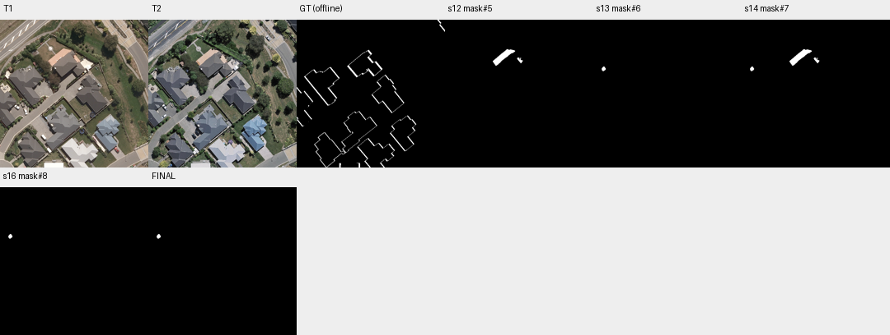

# case_13 完整轨迹

[交互回放](case_13.html#review) · [审查总表](20_case_review.md)



像素损失成立，但“验证器语义错误”尚不能确认

完整0–20步：候选mask#7只有182 TP、1738 FP，删除三个no组件后只留159 FP，最终F1=0。GT在多座外观未明显新增建筑边缘呈细轮廓；被标“有害删除”的组件只有112 TP、77 FP。可能是边界/配准与标注口径，不能仅以TP交集断言验证器语义错误；主要漏检在删除前已存在。

将纯像素损失与语义错判分开；不据这例盲加删除护栏，不开展新标注。

## 第 0 步

当前答案：None；离线评价：None


## 第 1 步

当前答案：None；离线评价：None

I need to find buildings that changed between T1 and T2 (newly constructed or demolished). Let me start by examining both images more carefully, then segment buildings at each time point to compare.

First, let me look at the images more closely to identify any obvious changes.


<details><summary>view · 完整参数和返回</summary>


```json

{
  "tool": "view",
  "args": {
    "region": [
      0,
      0,
      512,
      512
    ]
  },
  "ok": true,
  "error_code": null,
  "result_text": "{\"ok\":true,\"view_id\":\"view#1\",\"region\":[0,0,512,512],\"overlay\":null,\"display_size\":[768,768],\"image_size\":[796,796],\"scale\":1.5,\"padding\":[28,28],\"labelled_ids\":[],\"unlabelled_count\":0}",
  "current_before": null,
  "current_after": null,
  "input_handles": [],
  "output_handles": [],
  "eval": null,
  "candidate_eval": [],
  "set_current": null
}

```


</details>

## 第 2 步

当前答案：None；离线评价：None

I need to segment buildings at both T1 and T2 to identify changes. Let me start by segmenting buildings at T1 and T2 separately, then compare them.


<details><summary>segment_text · 完整参数和返回</summary>


```json

{
  "tool": "segment_text",
  "args": {
    "time": "t1",
    "text": "building",
    "score_thr": 0.3
  },
  "ok": true,
  "error_code": null,
  "result_text": "{\"ok\":true,\"inst\":\"inst#0\",\"n\":13,\"area\":54732,\"score\":{\"min\":0.310546875,\"median\":0.83203125,\"max\":0.8515625}}",
  "current_before": null,
  "current_after": null,
  "input_handles": [],
  "output_handles": [
    "inst#0"
  ],
  "eval": null,
  "candidate_eval": [],
  "set_current": null
}

```


</details>

## 第 3 步

当前答案：None；离线评价：None

I got 13 building instances at T1. Now let me segment buildings at T2.


<details><summary>segment_text · 完整参数和返回</summary>


```json

{
  "tool": "segment_text",
  "args": {
    "time": "t2",
    "text": "building",
    "score_thr": 0.3
  },
  "ok": true,
  "error_code": null,
  "result_text": "{\"ok\":true,\"inst\":\"inst#1\",\"n\":15,\"area\":55668,\"score\":{\"min\":0.322265625,\"median\":0.69921875,\"max\":0.921875}}",
  "current_before": null,
  "current_after": null,
  "input_handles": [],
  "output_handles": [
    "inst#1"
  ],
  "eval": null,
  "candidate_eval": [],
  "set_current": null
}

```


</details>

## 第 4 步

当前答案：None；离线评价：None

I have 13 instances at T1 and 15 at T2. Now I need to compare them to find which buildings are newly constructed (present in T2 but not T1) or demolished (present in T1 but not T2). Let me first inspect the instances to understand what we're working with, then use match_instances to find correspondences.


<details><summary>inspect · 完整参数和返回</summary>


```json

{
  "tool": "inspect",
  "args": {
    "mask": "inst#0",
    "limit": 20
  },
  "ok": true,
  "error_code": null,
  "result_text": "{\"ok\":true,\"mask\":\"inst#0\",\"total_components\":13,\"returned\":13,\"has_more\":false,\"components\":[{\"id\":10,\"area\":8009,\"bbox\":[159,318,276,450],\"score\":0.83203125},{\"id\":13,\"area\":7934,\"bbox\":[32,166,147,296],\"score\":0.8515625},{\"id\":11,\"area\":7171,\"bbox\":[213,411,338,512],\"score\":0.8515625},{\"id\":6,\"area\":7028,\"bbox\":[264,193,371,322],\"score\":0.8515625},{\"id\":3,\"area\":6201,\"bbox\":[327,328,413,454],\"score\":0.8515625},{\"id\":5,\"area\":6045,\"bbox\":[66,391,157,510],\"score\":0.8515625},{\"id\":12,\"area\":5324,\"bbox\":[171,100,293,198],\"score\":0.7734375},{\"id\":7,\"area\":4812,\"bbox\":[0,240,56,370],\"score\":0.83203125},{\"id\":9,\"area\":1205,\"bbox\":[152,491,220,512],\"score\":0.67578125},{\"id\":1,\"area\":1141,\"bbox\":[253,147,293,196],\"score\":0.310546875},{\"id\":2,\"area\":647,\"bbox\":[479,0,512,32],\"score\":0.5703125},{\"id\":4,\"area\":159,\"bbox\":[29,162,43,178],\"score\":0.458984375},{\"id\":8,\"area\":131,\"bbox\":[113,146,126,163],\"score\":0.349609375}]}",
  "current_before": null,
  "current_after": null,
  "input_handles": [
    "inst#0"
  ],
  "output_handles": [],
  "eval": null,
  "candidate_eval": [],
  "set_current": null
}

```


</details>

## 第 5 步

当前答案：None；离线评价：None

I see 13 instances at T1. Now let me inspect T2 instances to compare.


<details><summary>inspect · 完整参数和返回</summary>


```json

{
  "tool": "inspect",
  "args": {
    "mask": "inst#1",
    "limit": 20
  },
  "ok": true,
  "error_code": null,
  "result_text": "{\"ok\":true,\"mask\":\"inst#1\",\"total_components\":15,\"returned\":15,\"has_more\":false,\"components\":[{\"id\":10,\"area\":7899,\"bbox\":[155,320,273,451],\"score\":0.89453125},{\"id\":14,\"area\":7870,\"bbox\":[28,167,142,297],\"score\":0.90234375},{\"id\":11,\"area\":7023,\"bbox\":[210,413,333,512],\"score\":0.921875},{\"id\":6,\"area\":7020,\"bbox\":[260,194,367,324],\"score\":0.90234375},{\"id\":2,\"area\":6077,\"bbox\":[323,331,409,455],\"score\":0.89453125},{\"id\":5,\"area\":6027,\"bbox\":[61,392,153,511],\"score\":0.90625},{\"id\":12,\"area\":5358,\"bbox\":[176,109,290,200],\"score\":0.69921875},{\"id\":7,\"area\":4472,\"bbox\":[0,244,54,371],\"score\":0.8671875},{\"id\":8,\"area\":3816,\"bbox\":[176,114,261,200],\"score\":0.61328125},{\"id\":4,\"area\":1761,\"bbox\":[359,330,409,399],\"score\":0.33203125},{\"id\":15,\"area\":1761,\"bbox\":[165,102,268,159],\"score\":0.322265625},{\"id\":13,\"area\":1237,\"bbox\":[247,148,290,197],\"score\":0.63671875},{\"id\":9,\"area\":1009,\"bbox\":[147,496,214,512],\"score\":0.68359375},{\"id\":1,\"area\":804,\"bbox\":[475,0,512,40],\"score\":0.69921875},{\"id\":3,\"area\":178,\"bbox\":[109,144,123,162],\"score\":0.396484375}]}",
  "current_before": null,
  "current_after": null,
  "input_handles": [
    "inst#1"
  ],
  "output_handles": [],
  "eval": null,
  "candidate_eval": [],
  "set_current": null
}

```


</details>

## 第 6 步

当前答案：None；离线评价：None

I see 15 instances at T2. Now I need to match instances between T1 and T2 to identify which ones are present, appeared (newly built), or disappeared (demolished). Let me use match_instances to compare them.


<details><summary>match_instances · 完整参数和返回</summary>


```json

{
  "tool": "match_instances",
  "args": {
    "inst_t1": "inst#0",
    "inst_t2": "inst#1",
    "overlap_thr": 0.25
  },
  "ok": true,
  "error_code": null,
  "result_text": "{\"ok\":true,\"appeared\":\"inst#2\",\"appeared_n\":1,\"disappeared\":\"inst#3\",\"disappeared_n\":1,\"present_t2\":\"inst#4\",\"present_t2_n\":14}",
  "current_before": null,
  "current_after": null,
  "input_handles": [
    "inst#0",
    "inst#1"
  ],
  "output_handles": [
    "inst#2",
    "inst#3",
    "inst#4"
  ],
  "eval": null,
  "candidate_eval": [],
  "set_current": null
}

```


</details>

## 第 7 步

当前答案：None；离线评价：None

The match_instances result shows:
- 1 appeared instance (newly built): inst#2
- 1 disappeared instance (demolished): inst#3
- 14 present instances in T2

Wait, this seems odd. The function returns handles, not IDs. Let me understand what "inst#2" and "inst#3" refer to - these are likely instance handles from the match result, but I need to understand which specific instances appeared or disappeared.

Actually, looking at the output more carefully:
- "appeared":"inst#2" - this is a handle to an instance set containing the appeared instances
- "disappeared":"inst#3" - handle to disappeared instances
- "present_t2":"inst#4" - handle to instances present in T2

But wait, the function description says it returns "appeared, disappeared, present_t2 instance handles". So inst#2 contains the appeared instances, inst#3 contains the disappeared instances, and inst#4 contains the present instances.

Let me inspect these to understand what changed. First, let me check what's in the appeared set (inst#2).


<details><summary>inspect · 完整参数和返回</summary>


```json

{
  "tool": "inspect",
  "args": {
    "mask": "inst#2"
  },
  "ok": true,
  "error_code": null,
  "result_text": "{\"ok\":true,\"mask\":\"inst#2\",\"total_components\":1,\"returned\":1,\"has_more\":false,\"components\":[{\"id\":15,\"area\":1761,\"bbox\":[165,102,268,159],\"score\":0.322265625}]}",
  "current_before": null,
  "current_after": null,
  "input_handles": [
    "inst#2"
  ],
  "output_handles": [],
  "eval": null,
  "candidate_eval": [],
  "set_current": null
}

```


</details>

## 第 8 步

当前答案：None；离线评价：None

The appeared instance (inst#2) has id=15 with bbox [165,102,268,159] and area 1761. This is a newly built building. Let me check the disappeared set (inst#3).


<details><summary>inspect · 完整参数和返回</summary>


```json

{
  "tool": "inspect",
  "args": {
    "mask": "inst#3"
  },
  "ok": true,
  "error_code": null,
  "result_text": "{\"ok\":true,\"mask\":\"inst#3\",\"total_components\":1,\"returned\":1,\"has_more\":false,\"components\":[{\"id\":4,\"area\":159,\"bbox\":[29,162,43,178],\"score\":0.458984375}]}",
  "current_before": null,
  "current_after": null,
  "input_handles": [
    "inst#3"
  ],
  "output_handles": [],
  "eval": null,
  "candidate_eval": [],
  "set_current": null
}

```


</details>

## 第 9 步

当前答案：None；离线评价：None

The disappeared instance (inst#3) has id=4 with bbox [29,162,43,178] and area 159. This is a very small component (area 159 pixels). Let me verify this by looking at the images to see if there's actually a building that was demolished or if this might be noise/false positive.

Let me view the region around [29,162,43,178] in both T1 and T2 to check if this is a real demolition.


<details><summary>view · 完整参数和返回</summary>


```json

{
  "tool": "view",
  "args": {
    "region": [
      0,
      140,
      80,
      200
    ]
  },
  "ok": true,
  "error_code": null,
  "result_text": "{\"ok\":true,\"view_id\":\"view#2\",\"region\":[0,138,80,202],\"overlay\":null,\"display_size\":[768,614],\"image_size\":[796,642],\"scale\":9.6,\"padding\":[28,28],\"labelled_ids\":[],\"unlabelled_count\":0}",
  "current_before": null,
  "current_after": null,
  "input_handles": [],
  "output_handles": [],
  "eval": null,
  "candidate_eval": [],
  "set_current": null
}

```


</details>

## 第 10 步

当前答案：None；离线评价：None

Looking at the zoomed view, I can see:
- In T1 (left image), there's a small brownish structure around coordinates [29-43, 162-178] - this appears to be a small building or shed
- In T2 (right image), that same area shows vegetation/trees and no building - it appears the small structure has been demolished

So this does look like a real demolition. The disappeared instance (id=4 in inst#0) with bbox [29,162,43,178] and area 159 is indeed a demolished building.

Now let me also verify the appeared instance (newly built). The appeared instance has bbox [165,102,268,159] with area 1761. Let me view that region to confirm it's a new building.


<details><summary>view · 完整参数和返回</summary>


```json

{
  "tool": "view",
  "args": {
    "region": [
      150,
      90,
      280,
      170
    ]
  },
  "ok": true,
  "error_code": null,
  "result_text": "{\"ok\":true,\"view_id\":\"view#3\",\"region\":[150,90,280,170],\"overlay\":null,\"display_size\":[768,473],\"image_size\":[796,501],\"scale\":5.907692307692308,\"padding\":[28,28],\"labelled_ids\":[],\"unlabelled_count\":0}",
  "current_before": null,
  "current_after": null,
  "input_handles": [],
  "output_handles": [],
  "eval": null,
  "candidate_eval": [],
  "set_current": null
}

```


</details>

## 第 11 步

当前答案：None；离线评价：None

Looking at the zoomed view of region [150,90,280,170]:
- In T1 (left), I see a large tan/orange roof area which appears to be part of an existing building (the large house with orange roof)
- In T2 (right), I see the same area but with some changes - there seems to be additional construction or modification

Wait, this doesn't look like a newly built building. The bbox [165,102,268,159] for the appeared instance seems to overlap with an existing building. Let me look more carefully. Actually, looking at the T2 image, I can see that in the upper right area of this view, there might be some new construction (the small structure on the right side around x=248-268, y=130-159).

Let me check if this "appeared" instance is actually a new building by looking at the full context. The appeared instance has id=15 in inst#1 (T2 instances). Let me verify by viewing the specific area where this new building would be.

Actually, looking at the T2 image more carefully, I can see in the upper portion there's what appears to be a new small structure being built near the hedge. The bbox [165,102,268,159] covers an area that includes both the existing orange-roofed building and potentially a new addition.

But wait - the matched instance shows it as "appeared" meaning it's present in T2 but not in T1. Let me look at the T1 image again - in T1, that area (around x=165-268, y=102-159) shows the orange roof of the existing building. If the segmentation correctly identified a separate instance in T2 that wasn't in T1, it could be a new structure.

Let me look at the broader context to understand better. Let me view the area around the appeared instance more carefully.


<details><summary>view · 完整参数和返回</summary>


```json

{
  "tool": "view",
  "args": {
    "region": [
      140,
      80,
      300,
      180
    ]
  },
  "ok": true,
  "error_code": null,
  "result_text": "{\"ok\":true,\"view_id\":\"view#4\",\"region\":[140,80,300,180],\"overlay\":null,\"display_size\":[768,480],\"image_size\":[796,508],\"scale\":4.8,\"padding\":[28,28],\"labelled_ids\":[],\"unlabelled_count\":0}",
  "current_before": null,
  "current_after": null,
  "input_handles": [],
  "output_handles": [],
  "eval": null,
  "candidate_eval": [],
  "set_current": null
}

```


</details>

## 第 12 步

当前答案：None；离线评价：None

Looking at the comparison:
- T1 (left): Shows an existing house with orange/tan roof and dark gray roof sections. The area around [165,102,268,159] is part of the existing building complex.
- T2 (right): Shows the same house but with some modifications - I can see what appears to be a new small structure or addition on the right side (around x=240-270, y=130-160) that wasn't clearly present in T1.

The "appeared" instance with bbox [165,102,268,159] might actually be capturing a new addition or extension to the existing building. However, looking more carefully, in T1 there's already a significant orange-roofed structure in that area. The segmentation might have split the building differently between T1 and T2.

Actually, I need to reconsider. The match_instances function found 1 appeared instance. But I should verify if this is truly a new building or just a segmentation artifact where the same building was split into different instances.

Let me look at the specific bbox of the appeared instance [165,102,268,159] more carefully. In T1, this area contains the orange roof of the existing large house. If it's truly "appeared" (newly built), then there should be something new in T2 that wasn't in T1.

Looking at T2, I can see that near the top-right of this region (around x=240-270, y=130-160), there appears to be a new small structure or patio area that wasn't there in T1. This could be the newly constructed building.

However, I'm concerned that the segmentation might be incorrectly identifying parts of the same building as new. Let me also check if there are any other changes I might have missed.

Actually, let me take a different approach. Instead of relying solely on the match_instances result, let me create masks for the changed areas and verify them visually. I'll create a mask from the appeared instances and another from the disappeared instances, then combine them to form the change mask.

First, let me convert the inst#2 (appeared) and inst#3 (disappeared) to masks.


<details><summary>to_mask · 完整参数和返回</summary>


```json

{
  "tool": "to_mask",
  "args": {
    "sets": [
      "inst#2"
    ],
    "set_current": false
  },
  "ok": true,
  "error_code": null,
  "result_text": "{\"ok\":true,\"mask\":\"mask#5\",\"area\":1761,\"component_count\":3}",
  "current_before": null,
  "current_after": null,
  "input_handles": [
    "inst#2"
  ],
  "output_handles": [
    "mask#5"
  ],
  "eval": null,
  "candidate_eval": [
    {
      "handle": "mask#5",
      "parent": null,
      "tp": 182,
      "fp": 1579,
      "fn": 7255,
      "f1": 0.0395738203957382,
      "iou": 0.020186335403726708
    }
  ],
  "set_current": false
}

```


</details>

## 第 13 步

当前答案：None；离线评价：None

I created a mask from the appeared instances (inst#2). Now let me also create a mask from the disappeared instances (inst#3) and combine them.


<details><summary>to_mask · 完整参数和返回</summary>


```json

{
  "tool": "to_mask",
  "args": {
    "sets": [
      "inst#3"
    ],
    "set_current": false
  },
  "ok": true,
  "error_code": null,
  "result_text": "{\"ok\":true,\"mask\":\"mask#6\",\"area\":159,\"component_count\":1}",
  "current_before": null,
  "current_after": null,
  "input_handles": [
    "inst#3"
  ],
  "output_handles": [
    "mask#6"
  ],
  "eval": null,
  "candidate_eval": [
    {
      "handle": "mask#6",
      "parent": null,
      "tp": 0,
      "fp": 159,
      "fn": 7437,
      "f1": 0.0,
      "iou": 0.0
    }
  ],
  "set_current": false
}

```


</details>

## 第 14 步

当前答案：mask#7；离线评价：{'tp': 182, 'fp': 1738, 'fn': 7255, 'f1': 0.03890135727263012, 'iou': 0.019836512261580383, 'delta_f1': None}

Now I have mask#5 (appeared/newly built) and mask#6 (discovered/demolished). Let me combine them to create the final change mask.


<details><summary>combine · 完整参数和返回</summary>


```json

{
  "tool": "combine",
  "args": {
    "op": "union",
    "a": "mask#5",
    "b": "mask#6",
    "set_current": true
  },
  "ok": true,
  "error_code": null,
  "result_text": "{\"ok\":true,\"mask\":\"mask#7\",\"area\":1920,\"component_count\":4,\"added_px\":159,\"removed_px\":0,\"current_mask\":{\"before\":null,\"after\":\"mask#7\"}}",
  "current_before": null,
  "current_after": "mask#7",
  "input_handles": [
    "mask#5",
    "mask#6"
  ],
  "output_handles": [
    "mask#7"
  ],
  "eval": {
    "tp": 182,
    "fp": 1738,
    "fn": 7255,
    "f1": 0.03890135727263012,
    "iou": 0.019836512261580383,
    "delta_f1": null
  },
  "candidate_eval": [
    {
      "handle": "mask#7",
      "parent": "mask#5",
      "tp": 182,
      "fp": 1738,
      "fn": 7255,
      "f1": 0.03890135727263012,
      "iou": 0.019836512261580383,
      "delta_f1_from_parent": -0.0006724631231080844
    }
  ],
  "set_current": true
}

```


</details>

## 第 15 步

当前答案：mask#7；离线评价：{'tp': 182, 'fp': 1738, 'fn': 7255, 'f1': 0.03890135727263012, 'iou': 0.019836512261580383, 'delta_f1': 0.0}

I have created a change mask (mask#7) that combines the appeared and disappeared instances. The verifier shows 4 components with "none" status, meaning they haven't been verified yet. Let me ask the verifier to check these components to see if they are indeed building changes.


<details><summary>ask · 完整参数和返回</summary>


```json

{
  "tool": "ask",
  "args": {},
  "ok": true,
  "error_code": null,
  "result_text": "{\"ok\":true,\"results\":[{\"mask\":\"mask#7\",\"id\":1,\"p_yes\":6.962256076458745e-06,\"answer\":\"no\",\"type\":\"no_change\",\"reason\":\"The red contour highlights the same roof section in both dates with identical shape, structure, and position relative to fixed neighbors, indicating no building change.\",\"status\":\"parsed\"},{\"mask\":\"mask#7\",\"id\":2,\"p_yes\":9.422445114932423e-07,\"answer\":\"no\",\"type\":\"no_change\",\"reason\":\"The red contour highlights the same roof section in both dates, showing consistent structure and position relative to fixed surroundings like the hedge and patio, with only minor differences in lighting and shadow.\",\"status\":\"parsed\"},{\"mask\":\"mask#7\",\"id\":4,\"p_yes\":0.9324543645399561,\"answer\":\"yes\",\"type\":\"demolished\",\"reason\":\"The building present in T1 is absent in T2, where the area is now covered by vegetation and shadows, indicating demolition rather than replacement.\",\"status\":\"parsed\"},{\"mask\":\"mask#7\",\"id\":3,\"p_yes\":0.0003353496664478075,\"answer\":\"no\",\"type\":\"no_change\",\"reason\":\"The red contour marks the same fixed roof structure in both dates, with only minor differences in shadowing and adjacent temporary items like the pool enclosure visible in T2.\",\"status\":\"parsed\"}],\"remaining_unverified\":0}",
  "current_before": "mask#7",
  "current_after": "mask#7",
  "input_handles": [],
  "output_handles": [],
  "eval": {
    "tp": 182,
    "fp": 1738,
    "fn": 7255,
    "f1": 0.03890135727263012,
    "iou": 0.019836512261580383,
    "delta_f1": 0.0
  },
  "candidate_eval": [],
  "set_current": null
}

```


</details>

## 第 16 步

当前答案：mask#8；离线评价：{'tp': 0, 'fp': 159, 'fn': 7437, 'f1': 0.0, 'iou': 0.0, 'delta_f1': -0.03890135727263012}

The verifier has checked all 4 components of mask#7:
- Component id=1: "no" - same roof section in both dates, no change
- Component id=2: "no" - same roof section, no change  
- Component id=4: "yes" - demolished building (present in T1, absent in T2)
- Component id=3: "no" - same fixed roof structure, no change

So only component id=4 is a true building change (demolished). The other 3 components are false positives - they appear to be parts of existing buildings that were incorrectly included in the change mask.

Looking at the results:
- The "appeared" instance (newly built) seems to have been incorrectly identified - it's actually part of existing buildings (components 1, 2, 3 are all "no_change")
- The "disappeared" instance (component 4) is correctly identified as demolished

I need to remove the false positive components (ids 1, 2, 3) from the mask and keep only component 4 which is the actual demolition.

Let me remove the incorrect components from mask#7.


<details><summary>remove_region · 完整参数和返回</summary>


```json

{
  "tool": "remove_region",
  "args": {
    "mask": "mask#7",
    "ids": [
      1,
      2,
      3
    ],
    "set_current": true
  },
  "ok": true,
  "error_code": null,
  "result_text": "{\"ok\":true,\"mask\":\"mask#8\",\"area\":159,\"component_count\":1,\"added_px\":0,\"removed_px\":1761,\"current_mask\":{\"before\":\"mask#7\",\"after\":\"mask#8\"}}",
  "current_before": "mask#7",
  "current_after": "mask#8",
  "input_handles": [
    "mask#7"
  ],
  "output_handles": [
    "mask#8"
  ],
  "eval": {
    "tp": 0,
    "fp": 159,
    "fn": 7437,
    "f1": 0.0,
    "iou": 0.0,
    "delta_f1": -0.03890135727263012
  },
  "candidate_eval": [
    {
      "handle": "mask#8",
      "parent": "mask#7",
      "tp": 0,
      "fp": 159,
      "fn": 7437,
      "f1": 0.0,
      "iou": 0.0,
      "delta_f1_from_parent": -0.03890135727263012
    }
  ],
  "set_current": true
}

```


</details>

## 第 17 步

当前答案：mask#8；离线评价：{'tp': 0, 'fp': 159, 'fn': 7437, 'f1': 0.0, 'iou': 0.0, 'delta_f1': 0.0}

I've removed the false positive components and now have mask#8 with only 1 component (id=4) which the verifier confirmed as "yes" - a demolished building. The area is 159 pixels, which matches the disappeared instance we identified earlier.

Let me verify this is correct by asking the verifier again to confirm the current state of the mask.


<details><summary>ask · 完整参数和返回</summary>


```json

{
  "tool": "ask",
  "args": {},
  "ok": true,
  "error_code": null,
  "result_text": "{\"ok\":true,\"results\":[],\"remaining_unverified\":0}",
  "current_before": "mask#8",
  "current_after": "mask#8",
  "input_handles": [],
  "output_handles": [],
  "eval": {
    "tp": 0,
    "fp": 159,
    "fn": 7437,
    "f1": 0.0,
    "iou": 0.0,
    "delta_f1": 0.0
  },
  "candidate_eval": [],
  "set_current": null
}

```


</details>

## 第 18 步

当前答案：mask#8；离线评价：{'tp': 0, 'fp': 159, 'fn': 7437, 'f1': 0.0, 'iou': 0.0, 'delta_f1': 0.0}

The verifier shows no remaining unverified components, and the current mask#8 has 1 component which was previously verified as "yes" (demolished building). 

Let me do a final check by viewing the region to confirm this is indeed a demolished building.


<details><summary>view · 完整参数和返回</summary>


```json

{
  "tool": "view",
  "args": {
    "region": [
      0,
      140,
      80,
      200
    ],
    "overlay": "mask#8"
  },
  "ok": true,
  "error_code": null,
  "result_text": "{\"ok\":true,\"view_id\":\"view#5\",\"region\":[0,138,80,202],\"overlay\":\"mask#8\",\"display_size\":[768,614],\"image_size\":[796,642],\"scale\":9.6,\"padding\":[28,28],\"labelled_ids\":[],\"unlabelled_count\":0}",
  "current_before": "mask#8",
  "current_after": "mask#8",
  "input_handles": [
    "mask#8"
  ],
  "output_handles": [],
  "eval": {
    "tp": 0,
    "fp": 159,
    "fn": 7437,
    "f1": 0.0,
    "iou": 0.0,
    "delta_f1": 0.0
  },
  "candidate_eval": [],
  "set_current": null
}

```


</details>

## 第 19 步

当前答案：mask#8；离线评价：{'tp': 0, 'fp': 159, 'fn': 7437, 'f1': 0.0, 'iou': 0.0, 'delta_f1': 0.0}

The view confirms the change:
- T1 (left): The red contour highlights a small brownish building/structure that was present
- T2 (right): The same area now shows vegetation/trees with no building - confirming demolition

This is a valid building demolition. The mask#8 correctly identifies this single change. Now I should submit this as the final answer.


<details><summary>submit · 完整参数和返回</summary>


```json

{
  "tool": "submit",
  "args": {
    "mask": "mask#8",
    "summary": "Found 1 building change: one small structure demolished (present in T1 at bbox [29,162,43,178], absent in T2 where area is now covered by vegetation). The initially detected \"newly built\" instance was a false positive - verifier confirmed it was part of existing buildings with no actual change. Final mask contains only the verified demolition component (159 pixels, 1 component)."
  },
  "ok": true,
  "error_code": null,
  "result_text": "{\"ok\":true,\"submitted\":false,\"report\":\"Report before submission. Every run gets this report as the first response to submit; it does not judge the mask, and nothing has to change. mask#8 is now your current answer: 159 pixels in 1 components.\\nVerifier answers on mask#8: 1 yes, 0 no, 0 unparsed, 0 with no answer. An answer applies only to the exact outline it was about; a view is not an answer.\\n  IDs answered yes: [4]\\nA verifier answer is evidence, not an order, and it can be wrong in both directions. No answer is not an error. To finish with this mask, call submit with mask#8 again. To change it, edit and submit the new handle; components the verifier has not seen will be reported again. In the summary, say what you changed, and why you went against any verifier answer. You have 11 replies left.\"}",
  "current_before": "mask#8",
  "current_after": "mask#8",
  "input_handles": [
    "mask#8"
  ],
  "output_handles": [],
  "eval": {
    "tp": 0,
    "fp": 159,
    "fn": 7437,
    "f1": 0.0,
    "iou": 0.0,
    "delta_f1": 0.0
  },
  "candidate_eval": [],
  "set_current": null
}

```


</details>

## 第 20 步

当前答案：mask#8；离线评价：{'tp': 0, 'fp': 159, 'fn': 7437, 'f1': 0.0, 'iou': 0.0, 'delta_f1': 0.0}

The verifier has confirmed that mask#8 contains 1 component (id=4) which was answered "yes" as a demolished building. The submit function indicates I need to call submit again with the same mask to finalize. Let me do that now.


<details><summary>submit · 完整参数和返回</summary>


```json

{
  "tool": "submit",
  "args": {
    "mask": "mask#8",
    "summary": "Final answer: 1 building demolition detected. A small structure present in T1 at approximately [29,162,43,178] (area 159 pixels) is absent in T2 where vegetation now covers the area. Initial segmentation incorrectly identified a \"newly built\" instance but verifier confirmed it was part of existing buildings with no actual change - those false positives were removed. Final mask contains only the verified demolition component."
  },
  "ok": true,
  "error_code": null,
  "result_text": "{\"ok\":true,\"mask\":\"mask#8\",\"area\":159,\"component_count\":1,\"current_mask\":{\"before\":\"mask#8\",\"after\":\"mask#8\"},\"submitted\":true}",
  "current_before": "mask#8",
  "current_after": "mask#8",
  "input_handles": [
    "mask#8"
  ],
  "output_handles": [],
  "eval": {
    "tp": 0,
    "fp": 159,
    "fn": 7437,
    "f1": 0.0,
    "iou": 0.0,
    "delta_f1": 0.0
  },
  "candidate_eval": [],
  "set_current": null
}

```


</details>
