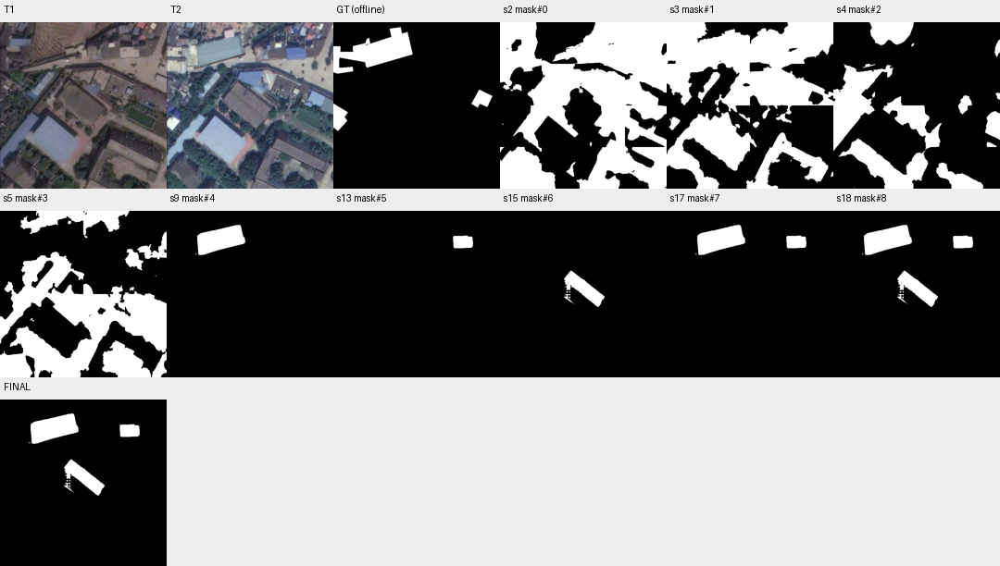

# case_15 完整轨迹

[交互回放](case_15.html#review) · [审查总表](20_case_review.md)



大框拒绝是工具能力边界，另有mask类型误用

完整0–22步：14步单物体框覆盖12.59%被拒，15步缩框恢复。16步to_mask误接三个mask报类型错，17–18步改union。最早目标mask#4 F1=60.47，加入两个全FP候选后47.79；20步核验全yes未发现FP。不能把合法box_too_large拒绝当Harness Bug。

研究既有mask的显式答案操作；组合候选仍由Agent负责，不放宽大框保护或改旧T1.2语义代码。

## 第 0 步

当前答案：None；离线评价：None


## 第 1 步

当前答案：None；离线评价：None

I'll analyze the changes between T1 and T2 for buildings and low vegetation. Let me start by examining both images more closely and then segment relevant features.


<details><summary>view · 完整参数和返回</summary>


```json

{
  "tool": "view",
  "args": {
    "region": [
      0,
      0,
      512,
      512
    ]
  },
  "ok": true,
  "error_code": null,
  "result_text": "{\"ok\":true,\"view_id\":\"view#1\",\"region\":[0,0,512,512],\"overlay\":null,\"display_size\":[768,768],\"image_size\":[796,796],\"scale\":1.5,\"padding\":[28,28],\"labelled_ids\":[],\"unlabelled_count\":0}",
  "current_before": null,
  "current_after": null,
  "input_handles": [],
  "output_handles": [],
  "eval": null,
  "candidate_eval": [],
  "set_current": null
}

```


</details>

## 第 2 步

当前答案：None；离线评价：None

I can see significant changes between T1 and T2. Let me identify key differences:

1. **Top-left area**: In T1 there's a dirt/empty field, but in T2 there's a large new building with gray roof
2. **Center area**: The brown rectangular area (possibly a sports court) in T1 appears to have changed - in T2 it looks like a building with darker roof
3. **Right side**: Some buildings appear to have new roofs or been modified
4. **Vegetation changes**: More trees/vegetation visible in T2 around the central area

Let me segment buildings and low vegetation at both times to identify changes systematically.


<details><summary>segment_semantic · 完整参数和返回</summary>


```json

{
  "tool": "segment_semantic",
  "args": {
    "time": "t1",
    "text": "building"
  },
  "ok": true,
  "error_code": null,
  "result_text": "{\"ok\":true,\"mask\":\"mask#0\",\"area\":162175,\"component_count\":10}",
  "current_before": null,
  "current_after": null,
  "input_handles": [],
  "output_handles": [
    "mask#0"
  ],
  "eval": null,
  "candidate_eval": [
    {
      "handle": "mask#0",
      "parent": null,
      "tp": 10205,
      "fp": 151970,
      "fn": 10379,
      "f1": 0.11167712670785022,
      "iou": 0.05914090661474089
    }
  ],
  "set_current": null
}

```


</details>

## 第 3 步

当前答案：None；离线评价：None

I'll segment buildings and low vegetation at both T1 and T2 to identify changes. Let me first get the semantic masks for both classes at both times.


<details><summary>segment_semantic · 完整参数和返回</summary>


```json

{
  "tool": "segment_semantic",
  "args": {
    "time": "t2",
    "text": "building"
  },
  "ok": true,
  "error_code": null,
  "result_text": "{\"ok\":true,\"mask\":\"mask#1\",\"area\":139099,\"component_count\":17}",
  "current_before": null,
  "current_after": null,
  "input_handles": [],
  "output_handles": [
    "mask#1"
  ],
  "eval": null,
  "candidate_eval": [
    {
      "handle": "mask#1",
      "parent": null,
      "tp": 17029,
      "fp": 122070,
      "fn": 3555,
      "f1": 0.2132850710470119,
      "iou": 0.11937274804772387
    }
  ],
  "set_current": null
}

```


</details>

## 第 4 步

当前答案：None；离线评价：None

Now let me segment low vegetation at both times:


<details><summary>segment_semantic · 完整参数和返回</summary>


```json

{
  "tool": "segment_semantic",
  "args": {
    "time": "t1",
    "text": "low vegetation"
  },
  "ok": true,
  "error_code": null,
  "result_text": "{\"ok\":true,\"mask\":\"mask#2\",\"area\":65131,\"component_count\":14}",
  "current_before": null,
  "current_after": null,
  "input_handles": [],
  "output_handles": [
    "mask#2"
  ],
  "eval": null,
  "candidate_eval": [
    {
      "handle": "mask#2",
      "parent": null,
      "tp": 5555,
      "fp": 59576,
      "fn": 15029,
      "f1": 0.12961558653677885,
      "iou": 0.06929890219560879
    }
  ],
  "set_current": null
}

```


</details>

## 第 5 步

当前答案：None；离线评价：None


<details><summary>segment_semantic · 完整参数和返回</summary>


```json

{
  "tool": "segment_semantic",
  "args": {
    "time": "t2",
    "text": "low vegetation"
  },
  "ok": true,
  "error_code": null,
  "result_text": "{\"ok\":true,\"mask\":\"mask#3\",\"area\":117890,\"component_count\":15}",
  "current_before": null,
  "current_after": null,
  "input_handles": [],
  "output_handles": [
    "mask#3"
  ],
  "eval": null,
  "candidate_eval": [
    {
      "handle": "mask#3",
      "parent": null,
      "tp": 660,
      "fp": 117230,
      "fn": 19924,
      "f1": 0.009532475410546384,
      "iou": 0.004789063520397057
    }
  ],
  "set_current": null
}

```


</details>

## 第 6 步

当前答案：None；离线评价：None

I have semantic masks for buildings and low vegetation at both times. Now I need to identify changes - areas where the class appears in one time but not the other, or where there's a significant change in extent.

Let me think about what constitutes a "change":
- Building appearing where there was none (or vice versa)
- Low vegetation appearing/disappearing
- Changes involving at least one of these classes

The approach should be:
1. Find building changes: (building_t2 AND NOT building_t1) OR (building_t1 AND NOT building_t2)
2. Find low vegetation changes: (low_veg_t2 AND NOT low_veg_t1) OR (low_veg_t1 AND NOT low_veg_t2)
3. Union these to get all changes involving these classes

But I need to be careful - the task says "changes involving at least one of these classes". So if a building is added next to existing low vegetation, that counts. If low vegetation replaces a building, that counts.

Let me first look at the components to understand what we're dealing with, then compute the symmetric difference.


<details><summary>inspect · 完整参数和返回</summary>


```json

{
  "tool": "inspect",
  "args": {
    "mask": "mask#0"
  },
  "ok": true,
  "error_code": null,
  "result_text": "{\"ok\":true,\"mask\":\"mask#0\",\"total_components\":10,\"returned\":10,\"has_more\":false,\"components\":[{\"id\":1,\"area\":144993,\"bbox\":[0,0,512,512]},{\"id\":8,\"area\":16077,\"bbox\":[0,383,171,512]},{\"id\":10,\"area\":514,\"bbox\":[203,430,232,475]},{\"id\":4,\"area\":415,\"bbox\":[32,191,67,212]},{\"id\":9,\"area\":103,\"bbox\":[0,384,13,401]},{\"id\":7,\"area\":60,\"bbox\":[276,368,282,383]},{\"id\":5,\"area\":9,\"bbox\":[7,312,11,315]},{\"id\":2,\"area\":2,\"bbox\":[307,144,309,145]},{\"id\":3,\"area\":1,\"bbox\":[131,167,132,168]},{\"id\":6,\"area\":1,\"bbox\":[480,320,481,321]}]}",
  "current_before": null,
  "current_after": null,
  "input_handles": [
    "mask#0"
  ],
  "output_handles": [],
  "eval": null,
  "candidate_eval": [],
  "set_current": null
}

```


</details>

## 第 7 步

当前答案：None；离线评价：None

The building mask at T1 has one large component (id 1) covering most of the image, plus some smaller components. This seems like the semantic segmentation is returning a very broad mask. Let me check the T2 building mask and low vegetation masks too.


<details><summary>inspect · 完整参数和返回</summary>


```json

{
  "tool": "inspect",
  "args": {
    "mask": "mask#1"
  },
  "ok": true,
  "error_code": null,
  "result_text": "{\"ok\":true,\"mask\":\"mask#1\",\"total_components\":17,\"returned\":17,\"has_more\":false,\"components\":[{\"id\":1,\"area\":91942,\"bbox\":[0,0,512,297]},{\"id\":6,\"area\":29450,\"bbox\":[0,276,277,512]},{\"id\":14,\"area\":13662,\"bbox\":[244,339,497,512]},{\"id\":4,\"area\":1882,\"bbox\":[96,153,164,249]},{\"id\":10,\"area\":791,\"bbox\":[7,291,41,332]},{\"id\":8,\"area\":568,\"bbox\":[336,280,383,311]},{\"id\":7,\"area\":307,\"bbox\":[221,280,256,311]},{\"id\":13,\"area\":262,\"bbox\":[264,306,285,325]},{\"id\":5,\"area\":108,\"bbox\":[152,261,163,277]},{\"id\":16,\"area\":90,\"bbox\":[504,460,512,476]},{\"id\":2,\"area\":11,\"bbox\":[123,22,127,26]},{\"id\":15,\"area\":11,\"bbox\":[381,423,384,428]},{\"id\":9,\"area\":10,\"bbox\":[340,282,342,287]},{\"id\":3,\"area\":2,\"bbox\":[126,45,127,47]},{\"id\":11,\"area\":1,\"bbox\":[6,300,7,301]},{\"id\":12,\"area\":1,\"bbox\":[376,300,377,301]},{\"id\":17,\"area\":1,\"bbox\":[462,497,463,498]}]}",
  "current_before": null,
  "current_after": null,
  "input_handles": [
    "mask#1"
  ],
  "output_handles": [],
  "eval": null,
  "candidate_eval": [],
  "set_current": null
}

```


</details>

## 第 8 步

当前答案：None；离线评价：None

I see the semantic segmentation is returning broad masks. The T1 building mask has one large component covering most of the image (bbox [0,0,512,512]), which suggests it's capturing a lot of area as "building" - possibly including shadows, dirt areas that look like buildings, etc.

Let me take a different approach. Instead of relying solely on semantic segmentation which may be noisy, I should:
1. Look at specific regions where I can visually identify changes
2. Use targeted segmentation with boxes around areas of change

From my visual inspection:
- Top-left area (around x=0-200, y=0-130): In T1 there's a dirt/empty field, in T2 there's a large new building with gray roof
- Center area (around x=150-400, y=150-350): The brown rectangular area changed significantly
- Right side: Some modifications visible

Let me use segment_prompt with boxes to capture specific change areas more accurately. First, let me zoom into the top-left area where I see a clear building addition.


<details><summary>view · 完整参数和返回</summary>


```json

{
  "tool": "view",
  "args": {
    "region": [
      0,
      0,
      256,
      200
    ]
  },
  "ok": true,
  "error_code": null,
  "result_text": "{\"ok\":true,\"view_id\":\"view#2\",\"region\":[0,0,256,200],\"overlay\":null,\"display_size\":[768,600],\"image_size\":[796,628],\"scale\":3.0,\"padding\":[28,28],\"labelled_ids\":[],\"unlabelled_count\":0}",
  "current_before": null,
  "current_after": null,
  "input_handles": [],
  "output_handles": [],
  "eval": null,
  "candidate_eval": [],
  "set_current": null
}

```


</details>

## 第 9 步

当前答案：None；离线评价：None

I can clearly see in the top-left area that a large new building with gray roof has been added between T1 and T2. In T1 there's mostly dirt/empty field, but in T2 there's a substantial building. Let me segment this change area using a box prompt.


<details><summary>segment_prompt · 完整参数和返回</summary>


```json

{
  "tool": "segment_prompt",
  "args": {
    "time": "t2",
    "box": [
      50,
      30,
      230,
      140
    ]
  },
  "ok": true,
  "error_code": null,
  "result_text": "{\"ok\":true,\"mask\":\"mask#4\",\"area\":8957,\"component_count\":2,\"bbox\":[88,43,241,136],\"sam_quality\":0.9421499967575073}",
  "current_before": null,
  "current_after": null,
  "input_handles": [],
  "output_handles": [
    "mask#4"
  ],
  "eval": null,
  "candidate_eval": [
    {
      "handle": "mask#4",
      "parent": null,
      "tp": 8931,
      "fp": 26,
      "fn": 11653,
      "f1": 0.6046511627906976,
      "iou": 0.43333333333333335
    }
  ],
  "set_current": null
}

```


</details>

## 第 10 步

当前答案：None；离线评价：None

Good, I segmented the new building in T2. Now let me check if this area was empty (not building) in T1 by looking at it. The mask#4 has bbox [88,43,241,136] which is within my box. This represents a building that appeared in T2 but wasn't there in T1 - this is definitely a change involving buildings.

Let me now look at other areas of change. Let me zoom into the center area where the brown rectangular court/area changed.


<details><summary>view · 完整参数和返回</summary>


```json

{
  "tool": "view",
  "args": {
    "region": [
      150,
      150,
      450,
      350
    ]
  },
  "ok": true,
  "error_code": null,
  "result_text": "{\"ok\":true,\"view_id\":\"view#3\",\"region\":[150,150,450,350],\"overlay\":null,\"display_size\":[768,512],\"image_size\":[796,540],\"scale\":2.56,\"padding\":[28,28],\"labelled_ids\":[],\"unlabelled_count\":0}",
  "current_before": null,
  "current_after": null,
  "input_handles": [],
  "output_handles": [],
  "eval": null,
  "candidate_eval": [],
  "set_current": null
}

```


</details>

## 第 11 步

当前答案：None；离线评价：None

I can see significant changes in the center area:
- In T1, there's a brown rectangular area (looks like a sports court or bare ground) with some blue structures
- In T2, this area appears to have a darker roof/structure, and there's more vegetation/trees around it
- The blue structure in T1 (around x=280-320, y=170-220) seems to have changed

Let me also look at the right side and bottom areas for more changes. Let me check the right portion where I saw some building modifications.


<details><summary>view · 完整参数和返回</summary>


```json

{
  "tool": "view",
  "args": {
    "region": [
      350,
      0,
      512,
      200
    ]
  },
  "ok": true,
  "error_code": null,
  "result_text": "{\"ok\":true,\"view_id\":\"view#4\",\"region\":[350,0,512,200],\"overlay\":null,\"display_size\":[622,768],\"image_size\":[650,796],\"scale\":3.84,\"padding\":[28,28],\"labelled_ids\":[],\"unlabelled_count\":0}",
  "current_before": null,
  "current_after": null,
  "input_handles": [],
  "output_handles": [],
  "eval": null,
  "candidate_eval": [],
  "set_current": null
}

```


</details>

## 第 12 步

当前答案：None；离线评价：None

I can see in the top-right area (x=350-512, y=0-200):
- In T1: There are several buildings with various colored roofs (red, blue, white)
- In T2: A large new blue-roofed building has appeared (around x=360-430, y=70-110), and some other buildings seem to have changed

This is another clear building change. Let me also check the bottom area for any changes there.


<details><summary>view · 完整参数和返回</summary>


```json

{
  "tool": "view",
  "args": {
    "region": [
      0,
      300,
      512,
      512
    ]
  },
  "ok": true,
  "error_code": null,
  "result_text": "{\"ok\":true,\"view_id\":\"view#5\",\"region\":[0,300,512,512],\"overlay\":null,\"display_size\":[768,318],\"image_size\":[796,346],\"scale\":1.5,\"padding\":[28,28],\"labelled_ids\":[],\"unlabelled_count\":0}",
  "current_before": null,
  "current_after": null,
  "input_handles": [],
  "output_handles": [],
  "eval": null,
  "candidate_eval": [],
  "set_current": null
}

```


</details>

## 第 13 步

当前答案：None；离线评价：None

In the bottom area (y=300-512):
- The large light-colored building on the left appears similar in both times
- The right side shows a building with striped roof that looks similar
- There seems to be more vegetation/trees around in T2 compared to T1

The main changes I've identified so far:
1. Top-left: New large gray-roofed building appeared (mask#4 captures this)
2. Top-right: New blue-roofed building appeared
3. Center: Changes to the brown rectangular area and surrounding structures
4. Possible vegetation changes

Let me now systematically capture these changes. I'll use segment_prompt with boxes around each change area to create precise masks, then combine them.

First, let me segment the new blue building in the top-right area:


<details><summary>segment_prompt · 完整参数和返回</summary>


```json

{
  "tool": "segment_prompt",
  "args": {
    "time": "t2",
    "box": [
      355,
      60,
      440,
      120
    ]
  },
  "ok": true,
  "error_code": null,
  "result_text": "{\"ok\":true,\"mask\":\"mask#5\",\"area\":2209,\"component_count\":1,\"bbox\":[368,76,429,115],\"sam_quality\":0.9550946950912476}",
  "current_before": null,
  "current_after": null,
  "input_handles": [],
  "output_handles": [
    "mask#5"
  ],
  "eval": null,
  "candidate_eval": [
    {
      "handle": "mask#5",
      "parent": null,
      "tp": 0,
      "fp": 2209,
      "fn": 20584,
      "f1": 0.0,
      "iou": 0.0
    }
  ],
  "set_current": null
}

```


</details>

## 第 14 步

当前答案：None；离线评价：None

Good, I have mask#5 for the new blue building in top-right. Now let me look at the center area more carefully to capture changes there. The brown rectangular area seems to have changed - it looks like a building roof appeared or was modified.


<details><summary>segment_prompt · 完整参数和返回</summary>


```json

{
  "tool": "segment_prompt",
  "args": {
    "time": "t2",
    "box": [
      180,
      170,
      400,
      320
    ]
  },
  "ok": false,
  "error_code": "box_too_large",
  "result_text": "{\"ok\":false,\"error_code\":\"box_too_large\",\"message\":\"A box prompt segments one object. This box covers 12.59% of the image. For several objects or a whole area, use segment_text, then intersect with a region if needed.\"}",
  "current_before": null,
  "current_after": null,
  "input_handles": [],
  "output_handles": [],
  "eval": null,
  "candidate_eval": [],
  "set_current": null
}

```


</details>

## 第 15 步

当前答案：None；离线评价：None

The box is too large. Let me use a smaller, more targeted box for the center area change. Looking at view#3, the main change in the center seems to be around the brown rectangular area and the blue structure. Let me try a tighter box.


<details><summary>segment_prompt · 完整参数和返回</summary>


```json

{
  "tool": "segment_prompt",
  "args": {
    "time": "t2",
    "box": [
      200,
      180,
      350,
      300
    ]
  },
  "ok": true,
  "error_code": null,
  "result_text": "{\"ok\":true,\"mask\":\"mask#6\",\"area\":5627,\"component_count\":8,\"bbox\":[197,184,321,295],\"sam_quality\":0.8106721639633179}",
  "current_before": null,
  "current_after": null,
  "input_handles": [],
  "output_handles": [
    "mask#6"
  ],
  "eval": null,
  "candidate_eval": [
    {
      "handle": "mask#6",
      "parent": null,
      "tp": 0,
      "fp": 5627,
      "fn": 20584,
      "f1": 0.0,
      "iou": 0.0
    }
  ],
  "set_current": null
}

```


</details>

## 第 16 步

当前答案：None；离线评价：None

I have mask#6 for the center area change. Now let me also check if there are vegetation changes. Looking at the images, I noticed more trees/vegetation in T2 around the central area compared to T1. Let me also look at the left side where there might be vegetation changes.

Let me now combine all the change masks I've identified so far:
- mask#4: New gray building in top-left
- mask#5: New blue building in top-right  
- mask#6: Center area changes (building/structure changes)

But I need to be careful - these masks represent what exists in T2, not necessarily the "change" area. The task asks for a binary change mask showing where changes involving buildings or low vegetation occurred. 

Actually, re-reading the task: "COUNTS as a change: a land-cover change involving at least one of these classes". So I need to identify areas where:
1. A building appeared (wasn't there before)
2. A building disappeared
3. Low vegetation appeared
4. Low vegetation disappeared
5. Any combination of the above

The masks I've created with segment_prompt on T2 show what's present in T2. But I need to verify these were NOT present in T1 (or were different). Since I visually confirmed these are new additions, they should count as changes.

However, I should also consider that some areas might have had low vegetation that was replaced by buildings, or vice versa. Let me also check if there are any areas where low vegetation changed significantly.

Let me now create a combined mask of all the change regions I've identified. I'll use to_mask to combine them:


<details><summary>to_mask · 完整参数和返回</summary>


```json

{
  "tool": "to_mask",
  "args": {
    "sets": [
      "mask#4",
      "mask#5",
      "mask#6"
    ],
    "set_current": true
  },
  "ok": false,
  "error_code": "bad_handle",
  "result_text": "{\"ok\":false,\"error_code\":\"bad_handle\",\"message\":\"Expected a inst handle.\"}",
  "current_before": null,
  "current_after": null,
  "input_handles": [
    "mask#4",
    "mask#5",
    "mask#6"
  ],
  "output_handles": [],
  "eval": null,
  "candidate_eval": [],
  "set_current": true
}

```


</details>

## 第 17 步

当前答案：mask#7；离线评价：{'tp': 8931, 'fp': 2235, 'fn': 11653, 'f1': 0.5625826771653544, 'iou': 0.39138437267189624, 'delta_f1': None}

The `to_mask` function expects instance sets (inst#k), not mask handles. I need to use a different approach. Let me use the `combine` function with union operation to combine these masks.


<details><summary>combine · 完整参数和返回</summary>


```json

{
  "tool": "combine",
  "args": {
    "op": "union",
    "a": "mask#4",
    "b": "mask#5",
    "set_current": true
  },
  "ok": true,
  "error_code": null,
  "result_text": "{\"ok\":true,\"mask\":\"mask#7\",\"area\":11166,\"component_count\":3,\"added_px\":2209,\"removed_px\":0,\"current_mask\":{\"before\":null,\"after\":\"mask#7\"}}",
  "current_before": null,
  "current_after": "mask#7",
  "input_handles": [
    "mask#4",
    "mask#5"
  ],
  "output_handles": [
    "mask#7"
  ],
  "eval": {
    "tp": 8931,
    "fp": 2235,
    "fn": 11653,
    "f1": 0.5625826771653544,
    "iou": 0.39138437267189624,
    "delta_f1": null
  },
  "candidate_eval": [
    {
      "handle": "mask#7",
      "parent": "mask#4",
      "tp": 8931,
      "fp": 2235,
      "fn": 11653,
      "f1": 0.5625826771653544,
      "iou": 0.39138437267189624,
      "delta_f1_from_parent": -0.042068485625343266
    }
  ],
  "set_current": true
}

```


</details>

## 第 18 步

当前答案：mask#8；离线评价：{'tp': 8931, 'fp': 7862, 'fn': 11653, 'f1': 0.47788747090456696, 'iou': 0.3139632988820924, 'delta_f1': -0.08469520626078741}

Good, I have mask#7 which is the union of mask#4 and mask#5. Now let me add mask#6 to this:


<details><summary>combine · 完整参数和返回</summary>


```json

{
  "tool": "combine",
  "args": {
    "op": "union",
    "a": "mask#7",
    "b": "mask#6",
    "set_current": true
  },
  "ok": true,
  "error_code": null,
  "result_text": "{\"ok\":true,\"mask\":\"mask#8\",\"area\":16793,\"component_count\":11,\"added_px\":5627,\"removed_px\":0,\"current_mask\":{\"before\":\"mask#7\",\"after\":\"mask#8\"}}",
  "current_before": "mask#7",
  "current_after": "mask#8",
  "input_handles": [
    "mask#7",
    "mask#6"
  ],
  "output_handles": [
    "mask#8"
  ],
  "eval": {
    "tp": 8931,
    "fp": 7862,
    "fn": 11653,
    "f1": 0.47788747090456696,
    "iou": 0.3139632988820924,
    "delta_f1": -0.08469520626078741
  },
  "candidate_eval": [
    {
      "handle": "mask#8",
      "parent": "mask#7",
      "tp": 8931,
      "fp": 7862,
      "fn": 11653,
      "f1": 0.47788747090456696,
      "iou": 0.3139632988820924,
      "delta_f1_from_parent": -0.08469520626078741
    }
  ],
  "set_current": true
}

```


</details>

## 第 19 步

当前答案：mask#8；离线评价：{'tp': 8931, 'fp': 7862, 'fn': 11653, 'f1': 0.47788747090456696, 'iou': 0.3139632988820924, 'delta_f1': 0.0}

I have mask#8 with 16793 pixels in 11 components. The verifier hasn't seen any of these yet (0 yes, 0 no, 0 unparsed, 11 none). Let me check the current answer to see what it looks like and verify if I'm capturing the right changes.

But wait - I need to be more careful. The masks I created using segment_prompt on T2 show what exists in T2, but I need to ensure these represent actual CHANGES (i.e., areas that were different between T1 and T2). 

Looking at my visual analysis:
- mask#4 (top-left): New gray building appeared - this is a change
- mask#5 (top-right): New blue building appeared - this is a change  
- mask#6 (center): Changes to structures/vegetation - need to verify

However, I might be missing some changes or including areas that aren't actually changes. Let me also consider that there might be low vegetation changes I haven't captured.

Let me look at the current mask#8 to see what regions are included:


<details><summary>view · 完整参数和返回</summary>


```json

{
  "tool": "view",
  "args": {
    "region": [
      0,
      0,
      512,
      512
    ],
    "overlay": "mask#8"
  },
  "ok": true,
  "error_code": null,
  "result_text": "{\"ok\":true,\"view_id\":\"view#6\",\"region\":[0,0,512,512],\"overlay\":\"mask#8\",\"display_size\":[768,768],\"image_size\":[796,796],\"scale\":1.5,\"padding\":[28,28],\"labelled_ids\":[],\"unlabelled_count\":0}",
  "current_before": "mask#8",
  "current_after": "mask#8",
  "input_handles": [
    "mask#8"
  ],
  "output_handles": [],
  "eval": {
    "tp": 8931,
    "fp": 7862,
    "fn": 11653,
    "f1": 0.47788747090456696,
    "iou": 0.3139632988820924,
    "delta_f1": 0.0
  },
  "candidate_eval": [],
  "set_current": null
}

```


</details>

## 第 20 步

当前答案：mask#8；离线评价：{'tp': 8931, 'fp': 7862, 'fn': 11653, 'f1': 0.47788747090456696, 'iou': 0.3139632988820924, 'delta_f1': 0.0}

I can see the red contours on both T1 and T2 showing my current mask#8. The regions I've captured are:
1. Top-left: A large rectangular area where a new gray building appeared (clearly visible in T2 but not in T1)
2. Top-right: A smaller area where a new blue building appeared
3. Center: An L-shaped area around the brown rectangular structure

These all appear to be legitimate changes involving buildings. However, I should also check if there are any low vegetation changes I'm missing. Looking at the images, I noticed more trees/vegetation in T2 around the central area compared to T1. Let me also verify that the center area change is indeed a building change and not just vegetation.

Let me also consider if there might be other changes I haven't captured. Looking at the full view, I should check:
- The left side where there might be vegetation changes
- Any areas where buildings were removed or significantly modified

Let me also use the semantic segmentation approach to get a broader view of changes. But first, let me ask the verifier about the current components to see what it thinks:


<details><summary>ask · 完整参数和返回</summary>


```json

{
  "tool": "ask",
  "args": {},
  "ok": true,
  "error_code": null,
  "result_text": "{\"ok\":true,\"results\":[{\"mask\":\"mask#8\",\"id\":1,\"p_yes\":1.0,\"answer\":\"yes\",\"type\":\"land_cover_change\",\"reason\":\"The area changes from a textured, patterned surface (likely low vegetation or bare ground) to a uniform grey roof structure, indicating the construction of a building.\",\"status\":\"parsed\"},{\"mask\":\"mask#8\",\"id\":4,\"p_yes\":0.9999485582150655,\"answer\":\"yes\",\"type\":\"land_cover_change\",\"reason\":\"The red contour highlights a building in T1 that is absent in T2, replaced by low vegetation or bare ground, indicating a land-cover change involving both building and low vegetation classes.\",\"status\":\"parsed\"},{\"mask\":\"mask#8\",\"id\":2,\"p_yes\":0.9998415679722289,\"answer\":\"yes\",\"type\":\"land_cover_change\",\"reason\":\"The roof color inside the red contour changes from light gray/white in T1 to dark blue in T2, indicating a change in the building's surface material or cover.\",\"status\":\"parsed\"},{\"mask\":\"mask#8\",\"id\":7,\"p_yes\":0.9840943753821548,\"answer\":\"yes\",\"type\":\"land_cover_change\",\"reason\":\"The area inside the red contour changes from low vegetation (dark green patches) in T1 to a building roof (brown/tan surface) in T2.\",\"status\":\"parsed\"},{\"mask\":\"mask#8\",\"id\":6,\"p_yes\":0.9933076260604142,\"answer\":\"yes\",\"type\":\"land_cover_change\",\"reason\":\"The area inside the red contour changes from bare ground or low vegetation in T1 to a distinct building roof structure in T2.\",\"status\":\"parsed\"},{\"mask\":\"mask#8\",\"id\":8,\"p_yes\":0.8354950555722067,\"answer\":\"yes\",\"type\":\"land_cover_change\",\"reason\":\"The area inside the red contour changes from a purplish tone in T1 to a distinct greenish tone in T2, indicating a change in low vegetation or surface cover.\",\"status\":\"parsed\"},{\"mask\":\"mask#8\",\"id\":5,\"p_yes\":0.9579148436142628,\"answer\":\"yes\",\"type\":\"land_cover_change\",\"reason\":\"The area inside the red contour changes from bare ground or sparse vegetation in T1 to a distinct building structure with visible roof lines in T2.\",\"status\":\"parsed\"},{\"mask\":\"mask#8\",\"id\":3,\"p_yes\":0.9999724652777902,\"answer\":\"yes\",\"type\":\"land_cover_change\",\"reason\":\"The area within the red contour changes from dark, textured ground (likely low vegetation or soil) in T1 to a bright, uniform surface (likely a building roof or paved area) in T2.\",\"status\":\"parsed\"},{\"mask\":\"mask#8\",\"id\":10,\"p_yes\":0.5621977487996886,\"answer\":\"yes\",\"type\":\"land_cover_change\",\"reason\":\"The close-up shows a transition from dark, textured low vegetation in T1 to a smoother, lighter surface in T2, indicating the removal of vegetation.\",\"status\":\"parsed\"},{\"mask\":\"mask#8\",\"id\":11,\"p_yes\":0.85195899612825,\"answer\":\"yes\",\"type\":\"land_cover_change\",\"reason\":\"The close-up shows a distinct change from dark, textured low vegetation in T1 to smooth, lighter-colored ground or pavement in T2.\",\"status\":\"parsed\"},{\"mask\":\"mask#8\",\"id\":9,\"p_yes\":0.5926949777763919,\"answer\":\"yes\",\"type\":\"land_cover_change\",\"reason\":\"The close-up shows a distinct change from a dark, textured patch (likely low vegetation or shadowed ground) in T1 to a uniform grey surface (likely bare soil or pavement) in T2, indicating a land cover change.\",\"status\":\"parsed\"}],\"remaining_unverified\":0}",
  "current_before": "mask#8",
  "current_after": "mask#8",
  "input_handles": [],
  "output_handles": [],
  "eval": {
    "tp": 8931,
    "fp": 7862,
    "fn": 11653,
    "f1": 0.47788747090456696,
    "iou": 0.3139632988820924,
    "delta_f1": 0.0
  },
  "candidate_eval": [],
  "set_current": null
}

```


</details>

## 第 21 步

当前答案：mask#8；离线评价：{'tp': 8931, 'fp': 7862, 'fn': 11653, 'f1': 0.47788747090456696, 'iou': 0.3139632988820924, 'delta_f1': 0.0}

Excellent! The verifier has checked all 11 components of mask#8 and answered "yes" to all of them, confirming they are all land-cover changes involving buildings or low vegetation. The reasons include:
- Construction of new buildings (gray roof, blue roof)
- Changes from vegetation/bare ground to building structures
- Roof color/material changes
- Vegetation removal

All components are verified as valid changes. Now I should submit this mask as the final answer. Let me provide a summary of what was found:

The change mask captures:
1. A new large gray-roofed building in the top-left area (where there was previously bare ground/vegetation)
2. A new blue-roofed building in the top-right area
3. Changes in the center area including building structure modifications and vegetation changes

All 11 components were verified by the independent verifier as legitimate land-cover changes involving buildings or low vegetation.


<details><summary>submit · 完整参数和返回</summary>


```json

{
  "tool": "submit",
  "args": {
    "mask": "mask#8",
    "summary": "Found changes involving buildings and low vegetation between T1 and T2. The binary change mask (mask#8) contains 11 components totaling ~16,793 pixels, all verified by the independent verifier as valid land-cover changes. Key changes include: (1) New large gray-roofed building constructed in top-left area where there was previously bare ground/low vegetation; (2) New blue-roofed building added in top-right area; (3) Modifications to central building structures with associated vegetation changes. All components confirmed by verifier as involving at least one of the target classes (building, low vegetation)."
  },
  "ok": true,
  "error_code": null,
  "result_text": "{\"ok\":true,\"submitted\":false,\"report\":\"Report before submission. Every run gets this report as the first response to submit; it does not judge the mask, and nothing has to change. mask#8 is now your current answer: 16793 pixels in 11 components.\\nVerifier answers on mask#8: 11 yes, 0 no, 0 unparsed, 0 with no answer. An answer applies only to the exact outline it was about; a view is not an answer.\\n  IDs answered yes: [1, 4, 2, 7, 6, 8, 5, 3, 10, 11, 9]\\nA verifier answer is evidence, not an order, and it can be wrong in both directions. No answer is not an error. To finish with this mask, call submit with mask#8 again. To change it, edit and submit the new handle; components the verifier has not seen will be reported again. In the summary, say what you changed, and why you went against any verifier answer. You have 9 replies left.\"}",
  "current_before": "mask#8",
  "current_after": "mask#8",
  "input_handles": [
    "mask#8"
  ],
  "output_handles": [],
  "eval": {
    "tp": 8931,
    "fp": 7862,
    "fn": 11653,
    "f1": 0.47788747090456696,
    "iou": 0.3139632988820924,
    "delta_f1": 0.0
  },
  "candidate_eval": [],
  "set_current": null
}

```


</details>

## 第 22 步

当前答案：mask#8；离线评价：{'tp': 8931, 'fp': 7862, 'fn': 11653, 'f1': 0.47788747090456696, 'iou': 0.3139632988820924, 'delta_f1': 0.0}

The verifier has confirmed all 11 components of mask#8 as valid land-cover changes. All answers are "yes" with high confidence scores. The mask captures legitimate changes involving buildings and low vegetation between T1 and T2. I'll submit again to finalize.


<details><summary>submit · 完整参数和返回</summary>


```json

{
  "tool": "submit",
  "args": {
    "mask": "mask#8",
    "summary": "Final submission of change mask (mask#8) showing 11 components (~16,793 pixels) where buildings or low vegetation changed between T1 and T2. All 11 components verified by independent verifier as valid land-cover changes. Key changes: new gray-roofed building in top-left (replacing bare ground/vegetation), new blue-roofed building in top-right, and central area modifications including building structure changes and vegetation removal. No changes made against verifier answers - all were confirmed as yes."
  },
  "ok": true,
  "error_code": null,
  "result_text": "{\"ok\":true,\"mask\":\"mask#8\",\"area\":16793,\"component_count\":11,\"current_mask\":{\"before\":\"mask#8\",\"after\":\"mask#8\"},\"submitted\":true}",
  "current_before": "mask#8",
  "current_after": "mask#8",
  "input_handles": [
    "mask#8"
  ],
  "output_handles": [],
  "eval": {
    "tp": 8931,
    "fp": 7862,
    "fn": 11653,
    "f1": 0.47788747090456696,
    "iou": 0.3139632988820924,
    "delta_f1": 0.0
  },
  "candidate_eval": [],
  "set_current": null
}

```


</details>
