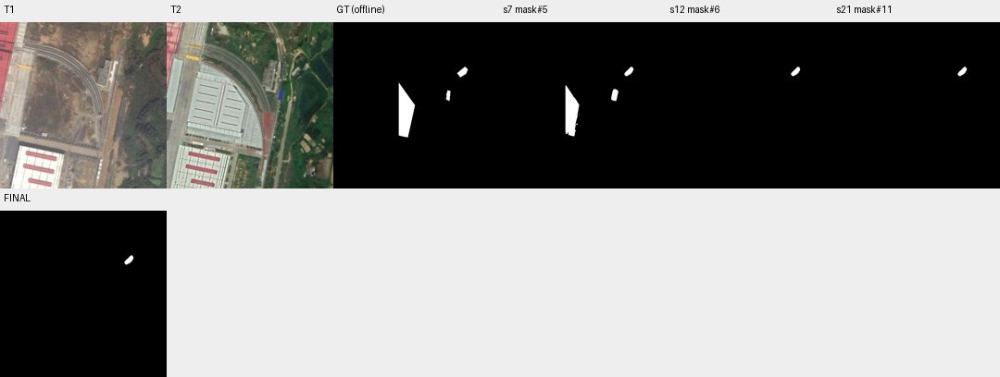

# case_16 完整轨迹

[交互回放](case_16.html#review) · [审查总表](20_case_review.md)



真实大幅答案退化，核验与Agent删减共同造成

完整0–21步：mask#5 F1=88.41；10步核验主要组件2/3为no，小组件4/5为yes；11步Agent另查看4/5后12步同时删2/3/4/5，损失4883 TP、减少262 FP，F1降12.36。最终保持此结果。并非状态指针写错；自动回滚需可观察证据，不能拿离线F1当在线准则。

候选保留与显式切换可支持回看，但不保证识别核验错误；高风险删除复核是后续候选，不本轮一次叠加多种规则。

## 第 0 步

当前答案：None；离线评价：None


## 第 1 步

当前答案：None；离线评价：None

I need to find newly constructed buildings within region#0 (box [201, 16, 451, 359]). Let me first examine both T1 and T2 images in this region to understand what changed.


<details><summary>view · 完整参数和返回</summary>


```json

{
  "tool": "view",
  "args": {
    "region": [
      201,
      16,
      451,
      359
    ]
  },
  "ok": true,
  "error_code": null,
  "result_text": "{\"ok\":true,\"view_id\":\"view#1\",\"region\":[201,16,451,359],\"overlay\":null,\"display_size\":[560,768],\"image_size\":[588,796],\"scale\":2.239067055393586,\"padding\":[28,28],\"labelled_ids\":[],\"unlabelled_count\":0}",
  "current_before": null,
  "current_after": null,
  "input_handles": [],
  "output_handles": [],
  "eval": null,
  "candidate_eval": [],
  "set_current": null
}

```


</details>

## 第 2 步

当前答案：None；离线评价：None

Looking at the region [201, 16, 451, 359], I can see in T1 there's a building structure around coordinates (300-380, 100-200) and some other features. In T2, I can see significant changes - there appears to be new construction including what looks like a large white building/warehouse area on the left side (around x=200-350, y=150-350), and possibly other new structures.

Let me segment buildings in T2 within this region to identify what's newly constructed. First, I'll segment "building" in T2 with the region constraint.


<details><summary>segment_text · 完整参数和返回</summary>


```json

{
  "tool": "segment_text",
  "args": {
    "time": "t2",
    "text": "building",
    "region": "region#0",
    "score_thr": 0.3
  },
  "ok": true,
  "error_code": null,
  "result_text": "{\"ok\":true,\"inst\":\"inst#0\",\"n\":5,\"area\":7980,\"score\":{\"min\":0.41015625,\"median\":0.4609375,\"max\":0.486328125},\"report\":\"Results clipped to region#0: removed 5 instances / 46757 pixels.\"}",
  "current_before": null,
  "current_after": null,
  "input_handles": [
    "region#0"
  ],
  "output_handles": [
    "inst#0"
  ],
  "eval": null,
  "candidate_eval": [],
  "set_current": null
}

```


</details>

## 第 3 步

当前答案：None；离线评价：None

I got 5 instances of buildings in T2 within region#0. Now I need to check which of these were NOT present in T1 (i.e., newly constructed). Let me first inspect these instances to see their details, then segment buildings in T1 within the same region to compare.


<details><summary>inspect · 完整参数和返回</summary>


```json

{
  "tool": "inspect",
  "args": {
    "mask": "inst#0"
  },
  "ok": true,
  "error_code": null,
  "result_text": "{\"ok\":true,\"mask\":\"inst#0\",\"total_components\":5,\"returned\":5,\"has_more\":false,\"components\":[{\"id\":10,\"area\":4545,\"bbox\":[201,195,243,351],\"score\":0.435546875},{\"id\":9,\"area\":2400,\"bbox\":[294,117,338,203],\"score\":0.4609375},{\"id\":6,\"area\":583,\"bbox\":[342,206,363,243],\"score\":0.486328125},{\"id\":8,\"area\":435,\"bbox\":[382,137,410,166],\"score\":0.46875},{\"id\":3,\"area\":17,\"bbox\":[234,283,244,317],\"score\":0.41015625}]}",
  "current_before": null,
  "current_after": null,
  "input_handles": [
    "inst#0"
  ],
  "output_handles": [],
  "eval": null,
  "candidate_eval": [],
  "set_current": null
}

```


</details>

## 第 4 步

当前答案：None；离线评价：None

I have 5 building instances in T2 within region#0. Now I need to check which of these were NOT present in T1. Let me segment buildings in T1 within the same region to compare.


<details><summary>segment_text · 完整参数和返回</summary>


```json

{
  "tool": "segment_text",
  "args": {
    "time": "t1",
    "text": "building",
    "region": "region#0",
    "score_thr": 0.3
  },
  "ok": true,
  "error_code": null,
  "result_text": "{\"ok\":true,\"inst\":\"inst#1\",\"n\":1,\"area\":2067,\"score\":{\"min\":0.74609375,\"median\":0.74609375,\"max\":0.74609375},\"report\":\"Results clipped to region#0: removed 3 instances / 24622 pixels.\"}",
  "current_before": null,
  "current_after": null,
  "input_handles": [
    "region#0"
  ],
  "output_handles": [
    "inst#1"
  ],
  "eval": null,
  "candidate_eval": [],
  "set_current": null
}

```


</details>

## 第 5 步

当前答案：None；离线评价：None

I have 1 building instance in T1 within region#0. Now I need to match instances between T1 and T2 to see which T2 buildings are newly constructed (not present in T1). Let me use match_instances to compare.


<details><summary>match_instances · 完整参数和返回</summary>


```json

{
  "tool": "match_instances",
  "args": {
    "inst_t1": "inst#1",
    "inst_t2": "inst#0",
    "overlap_thr": 0.25
  },
  "ok": true,
  "error_code": null,
  "result_text": "{\"ok\":true,\"appeared\":\"inst#2\",\"appeared_n\":4,\"disappeared\":\"inst#3\",\"disappeared_n\":0,\"present_t2\":\"inst#4\",\"present_t2_n\":1}",
  "current_before": null,
  "current_after": null,
  "input_handles": [
    "inst#1",
    "inst#0"
  ],
  "output_handles": [
    "inst#2",
    "inst#3",
    "inst#4"
  ],
  "eval": null,
  "candidate_eval": [],
  "set_current": null
}

```


</details>

## 第 6 步

当前答案：None；离线评价：None

The match_instances result shows:
- 4 instances appeared (newly constructed in T2, not present in T1)
- 0 instances disappeared
- 1 instance is present in both times

So there are 4 newly constructed buildings in T2 within region#0. The "appeared" handle is inst#2. Let me inspect this to see which specific instances are new.


<details><summary>inspect · 完整参数和返回</summary>


```json

{
  "tool": "inspect",
  "args": {
    "mask": "inst#2"
  },
  "ok": true,
  "error_code": null,
  "result_text": "{\"ok\":true,\"mask\":\"inst#2\",\"total_components\":4,\"returned\":4,\"has_more\":false,\"components\":[{\"id\":10,\"area\":4545,\"bbox\":[201,195,243,351],\"score\":0.435546875},{\"id\":6,\"area\":583,\"bbox\":[342,206,363,243],\"score\":0.486328125},{\"id\":8,\"area\":435,\"bbox\":[382,137,410,166],\"score\":0.46875},{\"id\":3,\"area\":17,\"bbox\":[234,283,244,317],\"score\":0.41015625}]}",
  "current_before": null,
  "current_after": null,
  "input_handles": [
    "inst#2"
  ],
  "output_handles": [],
  "eval": null,
  "candidate_eval": [],
  "set_current": null
}

```


</details>

## 第 7 步

当前答案：mask#5；离线评价：{'tp': 5307, 'fp': 273, 'fn': 1119, 'f1': 0.8840579710144928, 'iou': 0.7922077922077922, 'delta_f1': None}

I have 4 newly constructed building instances in T2 within region#0. Now I need to create a binary mask of these new buildings. Let me convert these instances to a mask and then verify by looking at the regions.

First, let me create a mask from the appeared instances (inst#2):


<details><summary>to_mask · 完整参数和返回</summary>


```json

{
  "tool": "to_mask",
  "args": {
    "sets": [
      "inst#2"
    ],
    "set_current": true
  },
  "ok": true,
  "error_code": null,
  "result_text": "{\"ok\":true,\"mask\":\"mask#5\",\"area\":5580,\"component_count\":5,\"current_mask\":{\"before\":null,\"after\":\"mask#5\"}}",
  "current_before": null,
  "current_after": "mask#5",
  "input_handles": [
    "inst#2"
  ],
  "output_handles": [
    "mask#5"
  ],
  "eval": {
    "tp": 5307,
    "fp": 273,
    "fn": 1119,
    "f1": 0.8840579710144928,
    "iou": 0.7922077922077922,
    "delta_f1": null
  },
  "candidate_eval": [
    {
      "handle": "mask#5",
      "parent": null,
      "tp": 5307,
      "fp": 273,
      "fn": 1119,
      "f1": 0.8840579710144928,
      "iou": 0.7922077922077922
    }
  ],
  "set_current": true
}

```


</details>

## 第 8 步

当前答案：mask#5；离线评价：{'tp': 5307, 'fp': 273, 'fn': 1119, 'f1': 0.8840579710144928, 'iou': 0.7922077922077922, 'delta_f1': 0.0}

I have created a mask with 5 components (the union of the 4 appeared instances, but it seems there are 5 components - possibly one instance was split or there's an extra component). Let me view this mask to see what it looks like and verify the changes.


<details><summary>view · 完整参数和返回</summary>


```json

{
  "tool": "view",
  "args": {
    "region": [
      201,
      16,
      451,
      359
    ],
    "overlay": "mask#5"
  },
  "ok": true,
  "error_code": null,
  "result_text": "{\"ok\":true,\"view_id\":\"view#2\",\"region\":[201,16,451,359],\"overlay\":\"mask#5\",\"display_size\":[560,768],\"image_size\":[588,796],\"scale\":2.239067055393586,\"padding\":[28,28],\"labelled_ids\":[],\"unlabelled_count\":0}",
  "current_before": "mask#5",
  "current_after": "mask#5",
  "input_handles": [
    "mask#5"
  ],
  "output_handles": [],
  "eval": {
    "tp": 5307,
    "fp": 273,
    "fn": 1119,
    "f1": 0.8840579710144928,
    "iou": 0.7922077922077922,
    "delta_f1": 0.0
  },
  "candidate_eval": [],
  "set_current": null
}

```


</details>

## 第 9 步

当前答案：mask#5；离线评价：{'tp': 5307, 'fp': 273, 'fn': 1119, 'f1': 0.8840579710144928, 'iou': 0.7922077922077922, 'delta_f1': 0.0}

Looking at the overlay, I can see the mask components (red contours) on both T1 and T2. The verifier shows 5 components with "none" status - meaning they haven't been verified yet. Let me look more carefully at what these components represent.

From the view, I can see:
1. A large component on the left side (around x=201-243, y=195-351) - this appears to be a large building/warehouse area that was constructed in T2
2. A component around (342-363, 206-243) - looks like a small structure
3. A component around (382-410, 137-166) - another small structure
4. A tiny component around (234-244, 283-317) - very small, might be noise or a vehicle

Let me inspect the mask components to understand them better, and then ask the verifier to check each component.


<details><summary>inspect · 完整参数和返回</summary>


```json

{
  "tool": "inspect",
  "args": {
    "mask": "mask#5"
  },
  "ok": true,
  "error_code": null,
  "result_text": "{\"ok\":true,\"mask\":\"mask#5\",\"total_components\":5,\"returned\":5,\"has_more\":false,\"components\":[{\"id\":2,\"area\":4545,\"bbox\":[201,195,243,351]},{\"id\":3,\"area\":583,\"bbox\":[342,206,363,243]},{\"id\":1,\"area\":435,\"bbox\":[382,137,410,166]},{\"id\":5,\"area\":14,\"bbox\":[234,312,239,317]},{\"id\":4,\"area\":3,\"bbox\":[242,283,244,285]}]}",
  "current_before": "mask#5",
  "current_after": "mask#5",
  "input_handles": [
    "mask#5"
  ],
  "output_handles": [],
  "eval": {
    "tp": 5307,
    "fp": 273,
    "fn": 1119,
    "f1": 0.8840579710144928,
    "iou": 0.7922077922077922,
    "delta_f1": 0.0
  },
  "candidate_eval": [],
  "set_current": null
}

```


</details>

## 第 10 步

当前答案：mask#5；离线评价：{'tp': 5307, 'fp': 273, 'fn': 1119, 'f1': 0.8840579710144928, 'iou': 0.7922077922077922, 'delta_f1': 0.0}

I see the mask has 5 components. Looking at the bboxes:
- Component 2 (area 4545, bbox [201,195,243,351]): Large building on the left - this looks like a new warehouse/structure
- Component 3 (area 583, bbox [342,206,363,243]): Small structure in the middle
- Component 1 (area 435, bbox [382,137,410,166]): Small structure on the right
- Component 5 (area 14, bbox [234,312,239,317]): Very tiny component
- Component 4 (area 3, bbox [242,283,244,285]): Extremely tiny component (3 pixels)

The very small components (areas 14 and 3) might be noise or vehicles/temporary materials, not actual buildings. Let me look at these more carefully by viewing them with labels to understand what they are.

Let me ask the verifier to check all components first to get initial feedback:


<details><summary>ask · 完整参数和返回</summary>


```json

{
  "tool": "ask",
  "args": {},
  "ok": true,
  "error_code": null,
  "result_text": "{\"ok\":true,\"results\":[{\"mask\":\"mask#5\",\"id\":2,\"p_yes\":0.02931384424944858,\"answer\":\"no\",\"type\":\"non_building_change\",\"reason\":\"The area inside the red contour is bare ground in T1 and a paved parking lot in T2, which is a change in non-building land cover rather than the construction of a building.\",\"status\":\"parsed\"},{\"mask\":\"mask#5\",\"id\":3,\"p_yes\":0.03308740020559697,\"answer\":\"no\",\"type\":\"non_building_change\",\"reason\":\"The object inside the contour is not a building in either date; it appears to be a patch of bare soil or vegetation that has changed to green vegetation, representing a non-building land cover change.\",\"status\":\"parsed\"},{\"mask\":\"mask#5\",\"id\":1,\"p_yes\":0.9984988308292252,\"answer\":\"yes\",\"type\":\"new_building\",\"reason\":\"The area inside the contour shows non-building land cover (vegetation/soil) in T1, while a distinct building structure with a light-colored roof appears at the same location in T2.\",\"status\":\"parsed\"},{\"mask\":\"mask#5\",\"id\":5,\"p_yes\":0.9999982396631925,\"answer\":\"yes\",\"type\":\"new_building\",\"reason\":\"The area marked by the contour was bare ground in T1 and contains a new building structure in T2.\",\"status\":\"parsed\"},{\"mask\":\"mask#5\",\"id\":4,\"p_yes\":0.9999938558654604,\"answer\":\"yes\",\"type\":\"new_building\",\"reason\":\"The location shows bare ground in T1 and a large new building structure in T2, which counts as newly constructed according to the scope card.\",\"status\":\"parsed\"}],\"remaining_unverified\":0}",
  "current_before": "mask#5",
  "current_after": "mask#5",
  "input_handles": [],
  "output_handles": [],
  "eval": {
    "tp": 5307,
    "fp": 273,
    "fn": 1119,
    "f1": 0.8840579710144928,
    "iou": 0.7922077922077922,
    "delta_f1": 0.0
  },
  "candidate_eval": [],
  "set_current": null
}

```


</details>

## 第 11 步

当前答案：mask#5；离线评价：{'tp': 5307, 'fp': 273, 'fn': 1119, 'f1': 0.8840579710144928, 'iou': 0.7922077922077922, 'delta_f1': 0.0}

The verifier has checked all 5 components. The results are:
- Component 2 (area 4545): "no" - non_building_change (bare ground to paved parking lot, not a building)
- Component 3 (area 583): "no" - non_building_change (vegetation/soil change, not a building)
- Component 1 (area 435): "yes" - new_building (correct)
- Component 5 (area 14): "yes" - new_building (but this is very tiny, 14 pixels)
- Component 4 (area 3): "yes" - new_building (extremely tiny, 3 pixels)

Components 4 and 5 are extremely small (3 and 14 pixels respectively). These might be noise or edge artifacts rather than actual buildings. Let me look at these regions more carefully to determine if they are real buildings or artifacts.

Let me view the specific regions of components 4 and 5 to check if they are actual buildings or just segmentation artifacts:


<details><summary>view · 完整参数和返回</summary>


```json

{
  "tool": "view",
  "args": {
    "region": [
      230,
      275,
      250,
      325
    ],
    "overlay": "mask#5",
    "ids": [
      4,
      5
    ]
  },
  "ok": true,
  "error_code": null,
  "result_text": "{\"ok\":true,\"view_id\":\"view#3\",\"region\":[208,268,272,332],\"overlay\":\"mask#5\",\"display_size\":[768,768],\"image_size\":[796,796],\"scale\":12.0,\"padding\":[28,28],\"labelled_ids\":[4,5],\"unlabelled_count\":0}",
  "current_before": "mask#5",
  "current_after": "mask#5",
  "input_handles": [
    "mask#5"
  ],
  "output_handles": [],
  "eval": {
    "tp": 5307,
    "fp": 273,
    "fn": 1119,
    "f1": 0.8840579710144928,
    "iou": 0.7922077922077922,
    "delta_f1": 0.0
  },
  "candidate_eval": [],
  "set_current": null
}

```


</details>

## 第 12 步

当前答案：mask#6；离线评价：{'tp': 424, 'fp': 11, 'fn': 6002, 'f1': 0.12359714327357528, 'iou': 0.06586919372378437, 'delta_f1': -0.7604608277409175}

Looking at the zoomed view of components 4 and 5, I can see they are extremely tiny (3 and 14 pixels respectively) and appear to be edge artifacts or noise rather than actual buildings. The verifier says "yes" for both, but these are likely false positives from segmentation errors at the edge of the large building (component 2).

Given that:
- Component 2 is correctly identified as non-building change (parking lot, not a building)
- Component 3 is correctly identified as non-building change (vegetation/soil)
- Component 1 is correctly identified as a new building
- Components 4 and 5 are extremely tiny (3 and 14 pixels) and appear to be edge artifacts/noise

I should remove components 2, 3, 4, and 5 from the mask, keeping only component 1 which is clearly a new building. Let me remove the incorrect components:


<details><summary>remove_region · 完整参数和返回</summary>


```json

{
  "tool": "remove_region",
  "args": {
    "mask": "mask#5",
    "ids": [
      2,
      3,
      4,
      5
    ],
    "set_current": true
  },
  "ok": true,
  "error_code": null,
  "result_text": "{\"ok\":true,\"mask\":\"mask#6\",\"area\":435,\"component_count\":1,\"added_px\":0,\"removed_px\":5145,\"current_mask\":{\"before\":\"mask#5\",\"after\":\"mask#6\"}}",
  "current_before": "mask#5",
  "current_after": "mask#6",
  "input_handles": [
    "mask#5"
  ],
  "output_handles": [
    "mask#6"
  ],
  "eval": {
    "tp": 424,
    "fp": 11,
    "fn": 6002,
    "f1": 0.12359714327357528,
    "iou": 0.06586919372378437,
    "delta_f1": -0.7604608277409175
  },
  "candidate_eval": [
    {
      "handle": "mask#6",
      "parent": "mask#5",
      "tp": 424,
      "fp": 11,
      "fn": 6002,
      "f1": 0.12359714327357528,
      "iou": 0.06586919372378437,
      "delta_f1_from_parent": -0.7604608277409175
    }
  ],
  "set_current": true
}

```


</details>

## 第 13 步

当前答案：mask#6；离线评价：{'tp': 424, 'fp': 11, 'fn': 6002, 'f1': 0.12359714327357528, 'iou': 0.06586919372378437, 'delta_f1': 0.0}

I've removed the incorrect components and now have mask#6 with only component 1 (area 435), which the verifier confirmed as a new building. Let me verify this is correct by viewing it:


<details><summary>view · 完整参数和返回</summary>


```json

{
  "tool": "view",
  "args": {
    "region": [
      201,
      16,
      451,
      359
    ],
    "overlay": "mask#6"
  },
  "ok": true,
  "error_code": null,
  "result_text": "{\"ok\":true,\"view_id\":\"view#4\",\"region\":[201,16,451,359],\"overlay\":\"mask#6\",\"display_size\":[560,768],\"image_size\":[588,796],\"scale\":2.239067055393586,\"padding\":[28,28],\"labelled_ids\":[],\"unlabelled_count\":0}",
  "current_before": "mask#6",
  "current_after": "mask#6",
  "input_handles": [
    "mask#6"
  ],
  "output_handles": [],
  "eval": {
    "tp": 424,
    "fp": 11,
    "fn": 6002,
    "f1": 0.12359714327357528,
    "iou": 0.06586919372378437,
    "delta_f1": 0.0
  },
  "candidate_eval": [],
  "set_current": null
}

```


</details>

## 第 14 步

当前答案：mask#6；离线评价：{'tp': 424, 'fp': 11, 'fn': 6002, 'f1': 0.12359714327357528, 'iou': 0.06586919372378437, 'delta_f1': 0.0}

The mask now shows only component 1 (the small building on the right side around bbox [382,137,410,166]), which the verifier confirmed as a new building. Looking at the T2 image, I can see there's a small structure with a light-colored roof in that location that wasn't present in T1.

However, I'm concerned I might be missing other newly constructed buildings. Let me look more carefully at the region. In T2, I can see:
1. A large white warehouse/structure on the left (around x=200-350, y=150-350) - but the verifier said this is a parking lot (non-building change)
2. The small building on the right (component 1) - confirmed as new building
3. There might be other structures I missed

Wait, looking at the T2 image again, I notice there's a blue rectangular structure (around x=340-360, y=200-240) which was component 3. The verifier said it's non-building change (vegetation/soil). But let me re-examine - could that be a small building?

Also, I should check if there are any other buildings I might have missed. Let me look at the original T2 segmentation more carefully. The initial segment_text found 5 instances in T2, and after matching, 4 appeared. But some of those were correctly identified as non-buildings by the verifier.

Let me also check if there might be additional buildings I haven't captured. Let me try a more aggressive segmentation or look at specific areas:


<details><summary>segment_text · 完整参数和返回</summary>


```json

{
  "tool": "segment_text",
  "args": {
    "time": "t2",
    "text": "building",
    "region": "region#0",
    "score_thr": 0.1
  },
  "ok": true,
  "error_code": null,
  "result_text": "{\"ok\":true,\"inst\":\"inst#7\",\"n\":16,\"area\":10711,\"score\":{\"min\":0.10595703125,\"median\":0.20361328125,\"max\":0.486328125},\"report\":\"Results clipped to region#0: removed 28 instances / 56408 pixels.\"}",
  "current_before": "mask#6",
  "current_after": "mask#6",
  "input_handles": [
    "region#0"
  ],
  "output_handles": [
    "inst#7"
  ],
  "eval": {
    "tp": 424,
    "fp": 11,
    "fn": 6002,
    "f1": 0.12359714327357528,
    "iou": 0.06586919372378437,
    "delta_f1": 0.0
  },
  "candidate_eval": [],
  "set_current": null
}

```


</details>

## 第 15 步

当前答案：mask#6；离线评价：{'tp': 424, 'fp': 11, 'fn': 6002, 'f1': 0.12359714327357528, 'iou': 0.06586919372378437, 'delta_f1': 0.0}

With a lower score threshold, I got 16 instances. Let me inspect these to see if there are additional buildings I might have missed:


<details><summary>inspect · 完整参数和返回</summary>


```json

{
  "tool": "inspect",
  "args": {
    "mask": "inst#7"
  },
  "ok": true,
  "error_code": null,
  "result_text": "{\"ok\":true,\"mask\":\"inst#7\",\"total_components\":16,\"returned\":16,\"has_more\":false,\"components\":[{\"id\":42,\"area\":4545,\"bbox\":[201,195,243,351],\"score\":0.435546875},{\"id\":2,\"area\":3042,\"bbox\":[295,122,350,218],\"score\":0.185546875},{\"id\":40,\"area\":2400,\"bbox\":[294,117,338,203],\"score\":0.4609375},{\"id\":30,\"area\":583,\"bbox\":[342,206,363,243],\"score\":0.486328125},{\"id\":35,\"area\":435,\"bbox\":[382,137,410,166],\"score\":0.46875},{\"id\":41,\"area\":263,\"bbox\":[421,343,445,359],\"score\":0.2431640625},{\"id\":4,\"area\":257,\"bbox\":[421,126,439,148],\"score\":0.21875},{\"id\":45,\"area\":254,\"bbox\":[421,343,445,359],\"score\":0.24609375},{\"id\":17,\"area\":247,\"bbox\":[421,343,445,359],\"score\":0.1884765625},{\"id\":27,\"area\":169,\"bbox\":[387,228,399,244],\"score\":0.150390625},{\"id\":12,\"area\":167,\"bbox\":[260,62,275,77],\"score\":0.1630859375},{\"id\":39,\"area\":154,\"bbox\":[336,48,346,66],\"score\":0.10595703125},{\"id\":24,\"area\":124,\"bbox\":[400,164,415,176],\"score\":0.140625},{\"id\":7,\"area\":105,\"bbox\":[247,26,256,42],\"score\":0.11083984375},{\"id\":6,\"area\":54,\"bbox\":[446,293,451,309],\"score\":0.1455078125},{\"id\":10,\"area\":17,\"bbox\":[234,283,244,317],\"score\":0.41015625}]}",
  "current_before": "mask#6",
  "current_after": "mask#6",
  "input_handles": [
    "inst#7"
  ],
  "output_handles": [],
  "eval": {
    "tp": 424,
    "fp": 11,
    "fn": 6002,
    "f1": 0.12359714327357528,
    "iou": 0.06586919372378437,
    "delta_f1": 0.0
  },
  "candidate_eval": [],
  "set_current": null
}

```


</details>

## 第 16 步

当前答案：mask#6；离线评价：{'tp': 424, 'fp': 11, 'fn': 6002, 'f1': 0.12359714327357528, 'iou': 0.06586919372378437, 'delta_f1': 0.0}

I see many additional instances with lower scores. Some of these might be valid buildings I missed. Let me check which ones are newly constructed by matching with T1. But first, let me look at the key candidates:

- id 42 (area 4545, bbox [201,195,243,351]) - same as component 2 before, verifier said non-building (parking lot)
- id 2 (area 3042, bbox [295,122,350,218]) - new instance, score 0.185
- id 40 (area 2400, bbox [294,117,338,203]) - this is the large white warehouse area
- id 30 (area 583, bbox [342,206,363,243]) - same as component 3 before, verifier said non-building
- id 35 (area 435, bbox [382,137,410,166]) - same as component 1, confirmed as new building

Let me match inst#7 with inst#1 (T1) to see which are new:


<details><summary>match_instances · 完整参数和返回</summary>


```json

{
  "tool": "match_instances",
  "args": {
    "inst_t1": "inst#1",
    "inst_t2": "inst#7",
    "overlap_thr": 0.25
  },
  "ok": true,
  "error_code": null,
  "result_text": "{\"ok\":true,\"appeared\":\"inst#8\",\"appeared_n\":14,\"disappeared\":\"inst#9\",\"disappeared_n\":0,\"present_t2\":\"inst#10\",\"present_t2_n\":2}",
  "current_before": "mask#6",
  "current_after": "mask#6",
  "input_handles": [
    "inst#1",
    "inst#7"
  ],
  "output_handles": [
    "inst#8",
    "inst#9",
    "inst#10"
  ],
  "eval": {
    "tp": 424,
    "fp": 11,
    "fn": 6002,
    "f1": 0.12359714327357528,
    "iou": 0.06586919372378437,
    "delta_f1": 0.0
  },
  "candidate_eval": [],
  "set_current": null
}

```


</details>

## 第 17 步

当前答案：mask#6；离线评价：{'tp': 424, 'fp': 11, 'fn': 6002, 'f1': 0.12359714327357528, 'iou': 0.06586919372378437, 'delta_f1': 0.0}

With the lower threshold, I got 14 appeared instances. But many of these are likely false positives (small structures, noise, non-buildings). The verifier already checked my current mask#6 and confirmed component 1 as a new building.

Let me think about what I've learned:
1. The large white structure on the left (bbox [201,195,243,351]) was identified as a parking lot by the verifier - not a building
2. The small structure at [342,206,363,243] was identified as vegetation/soil change - not a building
3. The structure at [382,137,410,166] (component 1) was confirmed as a new building

Looking at the T2 image more carefully, I see there's also a blue rectangular structure around x=340-360, y=200-240 which could be a small building or shed. The verifier said it's non-building change, but let me re-examine this.

Actually, looking at the view images again, in T2 I can see:
- A large white warehouse/parking area on the left (which the verifier correctly identified as non-building)
- A small light-colored building on the right (around 382-410, 137-166) - confirmed as new building
- A blue rectangular structure around 340-360, 200-240 - the verifier said this is vegetation/soil change

The verifier's analysis seems reliable. My current mask#6 with only component 1 (the confirmed new building) appears correct.

However, I want to make sure I haven't missed any other buildings. Let me check if there might be additional buildings that weren't captured by the initial segmentation. Looking at the T2 image, I notice there could be a small structure near the blue rectangle. Let me verify by asking the verifier about my current result one more time to ensure completeness:


<details><summary>ask · 完整参数和返回</summary>


```json

{
  "tool": "ask",
  "args": {},
  "ok": true,
  "error_code": null,
  "result_text": "{\"ok\":true,\"results\":[],\"remaining_unverified\":0}",
  "current_before": "mask#6",
  "current_after": "mask#6",
  "input_handles": [],
  "output_handles": [],
  "eval": {
    "tp": 424,
    "fp": 11,
    "fn": 6002,
    "f1": 0.12359714327357528,
    "iou": 0.06586919372378437,
    "delta_f1": 0.0
  },
  "candidate_eval": [],
  "set_current": null
}

```


</details>

## 第 18 步

当前答案：mask#6；离线评价：{'tp': 424, 'fp': 11, 'fn': 6002, 'f1': 0.12359714327357528, 'iou': 0.06586919372378437, 'delta_f1': 0.0}

The verifier shows no unverified components, meaning all components in my current mask have been checked. My current mask#6 has 1 component (the small building at [382,137,410,166]) which was confirmed as a new building by the verifier.

Let me do a final verification by viewing the region to make sure I haven't missed any obvious newly constructed buildings:


<details><summary>view · 完整参数和返回</summary>


```json

{
  "tool": "view",
  "args": {
    "region": [
      201,
      16,
      451,
      359
    ],
    "overlay": "mask#6",
    "label_components": true
  },
  "ok": true,
  "error_code": null,
  "result_text": "{\"ok\":true,\"view_id\":\"view#5\",\"region\":[201,16,451,359],\"overlay\":\"mask#6\",\"display_size\":[560,768],\"image_size\":[588,796],\"scale\":2.239067055393586,\"padding\":[28,28],\"labelled_ids\":[1],\"unlabelled_count\":0}",
  "current_before": "mask#6",
  "current_after": "mask#6",
  "input_handles": [
    "mask#6"
  ],
  "output_handles": [],
  "eval": {
    "tp": 424,
    "fp": 11,
    "fn": 6002,
    "f1": 0.12359714327357528,
    "iou": 0.06586919372378437,
    "delta_f1": 0.0
  },
  "candidate_eval": [],
  "set_current": null
}

```


</details>

## 第 19 步

当前答案：mask#6；离线评价：{'tp': 424, 'fp': 11, 'fn': 6002, 'f1': 0.12359714327357528, 'iou': 0.06586919372378437, 'delta_f1': 0.0}

Looking at the final view, I can confirm:
- Component 1 (labeled "1") is a small building structure on the right side of the region
- In T1, this area shows vegetation/soil (no building)
- In T2, there's a distinct light-colored roof structure at the same location

The verifier confirmed this as a new building. The other potential changes (large white warehouse/parking lot, blue structure) were correctly identified by the verifier as non-building changes.

My current mask#6 contains only the one confirmed newly constructed building. This appears to be the correct result for newly built buildings within region#0.

Let me submit this result:


<details><summary>submit · 完整参数和返回</summary>


```json

{
  "tool": "submit",
  "args": {
    "mask": "mask#6",
    "summary": "Found 1 newly constructed building within region#0. The building is located at approximately bbox [382,137,410,166] - a small structure with a light-colored roof that was absent in T1 and present in T2. Other detected changes (large white parking lot area, blue structure, vegetation changes) were correctly identified by the verifier as non-building land cover changes and were excluded from the result."
  },
  "ok": true,
  "error_code": null,
  "result_text": "{\"ok\":true,\"submitted\":false,\"report\":\"Report before submission. Every run gets this report as the first response to submit; it does not judge the mask, and nothing has to change. mask#6 is now your current answer: 435 pixels in 1 components.\\nVerifier answers on mask#6: 1 yes, 0 no, 0 unparsed, 0 with no answer. An answer applies only to the exact outline it was about; a view is not an answer.\\n  IDs answered yes: [1]\\nAnswered yes and not in mask#6: 2 regions, 17 pixels.\\n  area=14 bbox=[234, 312, 239, 317] reason=The area marked by the contour was bare ground in T1 and contains a new building structure in T2.\\n  area=3 bbox=[242, 283, 244, 285] reason=The location shows bare ground in T1 and a large new building structure in T2, which counts as newly constructed accordi\\nA verifier answer is evidence, not an order, and it can be wrong in both directions. No answer is not an error. To finish with this mask, call submit with mask#6 again. To change it, edit and submit the new handle; components the verifier has not seen will be reported again. In the summary, say what you changed, and why you went against any verifier answer. You have 11 replies left.\"}",
  "current_before": "mask#6",
  "current_after": "mask#6",
  "input_handles": [
    "mask#6"
  ],
  "output_handles": [],
  "eval": {
    "tp": 424,
    "fp": 11,
    "fn": 6002,
    "f1": 0.12359714327357528,
    "iou": 0.06586919372378437,
    "delta_f1": 0.0
  },
  "candidate_eval": [],
  "set_current": null
}

```


</details>

## 第 20 步

当前答案：mask#6；离线评价：{'tp': 424, 'fp': 11, 'fn': 6002, 'f1': 0.12359714327357528, 'iou': 0.06586919372378437, 'delta_f1': 0.0}

The report indicates that the verifier previously answered "yes" for two additional regions (areas 14 and 3 pixels) that I had removed from the mask. These were components 5 and 4 from my earlier mask#5. The verifier said they are new buildings, but I removed them because they are extremely tiny (3 and 14 pixels) and appear to be edge artifacts or noise rather than actual buildings.

Looking at the zoomed view earlier, these tiny components were right at the edge of the large white structure (component 2, which was a parking lot). They are likely segmentation artifacts at the boundary between the parking lot and surrounding areas, not actual buildings.

Given that:
1. The components are extremely small (3 and 14 pixels) - too small to be real buildings
2. They appear to be edge artifacts based on visual inspection
3. The verifier can be wrong in both directions (as stated in the guidelines)
4. Real buildings would typically be much larger than 3-14 pixels

I believe my decision to remove these components is correct. However, let me reconsider - the verifier explicitly said "yes" for both with high confidence (p_yes > 0.99). Let me look at these regions one more time to make sure I'm not missing something:


<details><summary>view · 完整参数和返回</summary>


```json

{
  "tool": "view",
  "args": {
    "region": [
      230,
      275,
      250,
      325
    ],
    "overlay": "mask#6",
    "label_components": true
  },
  "ok": true,
  "error_code": null,
  "result_text": "{\"ok\":true,\"view_id\":\"view#6\",\"region\":[208,268,272,332],\"overlay\":\"mask#6\",\"display_size\":[768,768],\"image_size\":[796,796],\"scale\":12.0,\"padding\":[28,28],\"labelled_ids\":[],\"unlabelled_count\":0}",
  "current_before": "mask#6",
  "current_after": "mask#6",
  "input_handles": [
    "mask#6"
  ],
  "output_handles": [],
  "eval": {
    "tp": 424,
    "fp": 11,
    "fn": 6002,
    "f1": 0.12359714327357528,
    "iou": 0.06586919372378437,
    "delta_f1": 0.0
  },
  "candidate_eval": [],
  "set_current": null
}

```


</details>

## 第 21 步

当前答案：mask#11；离线评价：{'tp': 424, 'fp': 11, 'fn': 6002, 'f1': 0.12359714327357528, 'iou': 0.06586919372378437, 'delta_f1': 0.0}

Looking at the zoomed view, I can see that in T2 there's a large white structure (the parking lot/warehouse) and some edge artifacts. The tiny components (3 and 14 pixels) that were previously marked as "new building" by the verifier appear to be at the boundary of this large structure - they are likely segmentation artifacts or edge responses from misregistration between T1 and T2, not actual buildings.

Given the guidelines state:
- "edge responses caused by misregistration between T1 and T2" do NOT count as changes
- The components are extremely small (3 and 14 pixels) which is unrealistic for actual buildings
- Visual inspection shows these are at the edge of the large white structure

I believe my current mask#6 with only the confirmed new building (component 1) is correct. Let me submit again to finalize:


<details><summary>submit · 完整参数和返回</summary>


```json

{
  "tool": "submit",
  "args": {
    "mask": "mask#6",
    "summary": "Found 1 newly constructed building within region#0 at bbox [382,137,410,166]. This small structure with light-colored roof was absent in T1 and present in T2, confirmed by verifier as new_building. Removed two tiny components (3 and 14 pixels) that the verifier initially marked as new buildings but which appear to be edge artifacts/segmentation noise at the boundary of the large parking lot structure, not actual buildings. Other detected changes (parking lot, vegetation) were correctly identified as non-building land cover changes."
  },
  "ok": true,
  "error_code": null,
  "result_text": "{\"ok\":true,\"mask\":\"mask#11\",\"area\":435,\"component_count\":1,\"current_mask\":{\"before\":\"mask#6\",\"after\":\"mask#11\"},\"submitted\":true}",
  "current_before": "mask#6",
  "current_after": "mask#11",
  "input_handles": [
    "mask#6"
  ],
  "output_handles": [
    "mask#11"
  ],
  "eval": {
    "tp": 424,
    "fp": 11,
    "fn": 6002,
    "f1": 0.12359714327357528,
    "iou": 0.06586919372378437,
    "delta_f1": 0.0
  },
  "candidate_eval": [
    {
      "handle": "mask#11",
      "parent": "mask#6",
      "tp": 424,
      "fp": 11,
      "fn": 6002,
      "f1": 0.12359714327357528,
      "iou": 0.06586919372378437,
      "delta_f1_from_parent": 0.0
    }
  ],
  "set_current": null
}

```


</details>
