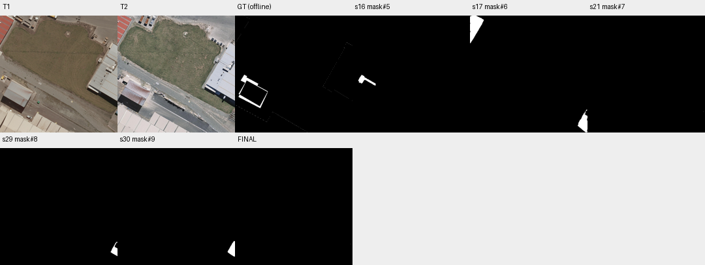

# case_17 完整轨迹

[交互回放](case_17.html#review) · [审查总表](20_case_review.md)



current≠latest不是Harness选错答案的证据

完整0–30步：16步mask#5 F1=49.43，17步主动切换拆除候选仅0.23；19步核验否定mask#5，21步删后current仅1 FP。末尾29/30生成T1/T2中间掩码均F1=0，未设置current；预算兜底保留current符合语义。若自动选最新同样F1=0且更多FP，不能把mismatch当Bug。

明确候选与当前答案的区别，保留显式切换；禁止“最新即最好”自动兜底。

## 第 0 步

当前答案：None；离线评价：None


## 第 1 步

当前答案：None；离线评价：None

I need to find buildings that changed between T1 and T2. Let me start by viewing both images more carefully, then segment buildings in each time to compare.

First, let me look at the images more closely to understand what's there.


<details><summary>view · 完整参数和返回</summary>


```json

{
  "tool": "view",
  "args": {
    "region": [
      0,
      0,
      512,
      512
    ]
  },
  "ok": true,
  "error_code": null,
  "result_text": "{\"ok\":true,\"view_id\":\"view#1\",\"region\":[0,0,512,512],\"overlay\":null,\"display_size\":[768,768],\"image_size\":[796,796],\"scale\":1.5,\"padding\":[28,28],\"labelled_ids\":[],\"unlabelled_count\":0}",
  "current_before": null,
  "current_after": null,
  "input_handles": [],
  "output_handles": [],
  "eval": null,
  "candidate_eval": [],
  "set_current": null
}

```


</details>

## 第 2 步

当前答案：None；离线评价：None

I need to segment buildings in both T1 and T2 to find changes. Let me start by segmenting buildings in T1 and T2 separately, then compare them.


<details><summary>segment_text · 完整参数和返回</summary>


```json

{
  "tool": "segment_text",
  "args": {
    "time": "t1",
    "text": "building",
    "score_thr": 0.3
  },
  "ok": true,
  "error_code": null,
  "result_text": "{\"ok\":true,\"inst\":\"inst#0\",\"n\":7,\"area\":49352,\"score\":{\"min\":0.326171875,\"median\":0.57421875,\"max\":0.73828125}}",
  "current_before": null,
  "current_after": null,
  "input_handles": [],
  "output_handles": [
    "inst#0"
  ],
  "eval": null,
  "candidate_eval": [],
  "set_current": null
}

```


</details>

## 第 3 步

当前答案：None；离线评价：None

I got 7 building instances in T1. Now let me segment buildings in T2.


<details><summary>segment_text · 完整参数和返回</summary>


```json

{
  "tool": "segment_text",
  "args": {
    "time": "t2",
    "text": "building",
    "score_thr": 0.3
  },
  "ok": true,
  "error_code": null,
  "result_text": "{\"ok\":true,\"inst\":\"inst#1\",\"n\":4,\"area\":44975,\"score\":{\"min\":0.353515625,\"median\":0.62109375,\"max\":0.73046875}}",
  "current_before": null,
  "current_after": null,
  "input_handles": [],
  "output_handles": [
    "inst#1"
  ],
  "eval": null,
  "candidate_eval": [],
  "set_current": null
}

```


</details>

## 第 4 步

当前答案：None；离线评价：None

I have 7 instances in T1 and 4 in T2. Let me inspect both to see what they are, then compare them to find changes.


<details><summary>inspect · 完整参数和返回</summary>


```json

{
  "tool": "inspect",
  "args": {
    "mask": "inst#0"
  },
  "ok": true,
  "error_code": null,
  "result_text": "{\"ok\":true,\"mask\":\"inst#0\",\"total_components\":7,\"returned\":7,\"has_more\":false,\"components\":[{\"id\":2,\"area\":16826,\"bbox\":[385,125,512,372],\"score\":0.73828125},{\"id\":1,\"area\":11812,\"bbox\":[0,420,298,511],\"score\":0.57421875},{\"id\":7,\"area\":8230,\"bbox\":[16,284,143,401],\"score\":0.6328125},{\"id\":5,\"area\":6207,\"bbox\":[137,428,299,512],\"score\":0.326171875},{\"id\":6,\"area\":4154,\"bbox\":[0,0,60,121],\"score\":0.58984375},{\"id\":3,\"area\":2327,\"bbox\":[469,411,512,511],\"score\":0.3515625},{\"id\":4,\"area\":1892,\"bbox\":[0,393,38,481],\"score\":0.326171875}]}",
  "current_before": null,
  "current_after": null,
  "input_handles": [
    "inst#0"
  ],
  "output_handles": [],
  "eval": null,
  "candidate_eval": [],
  "set_current": null
}

```


</details>

## 第 5 步

当前答案：None；离线评价：None

Now let me inspect T2 instances to see what buildings are there.


<details><summary>inspect · 完整参数和返回</summary>


```json

{
  "tool": "inspect",
  "args": {
    "mask": "inst#1"
  },
  "ok": true,
  "error_code": null,
  "result_text": "{\"ok\":true,\"mask\":\"inst#1\",\"total_components\":4,\"returned\":4,\"has_more\":false,\"components\":[{\"id\":1,\"area\":17864,\"bbox\":[0,398,308,512],\"score\":0.578125},{\"id\":2,\"area\":17304,\"bbox\":[384,123,512,369],\"score\":0.73046875},{\"id\":4,\"area\":8630,\"bbox\":[8,283,140,401],\"score\":0.6640625},{\"id\":3,\"area\":1177,\"bbox\":[25,260,101,306],\"score\":0.353515625}]}",
  "current_before": null,
  "current_after": null,
  "input_handles": [
    "inst#1"
  ],
  "output_handles": [],
  "eval": null,
  "candidate_eval": [],
  "set_current": null
}

```


</details>

## 第 6 步

当前答案：None；离线评价：None

I see T1 has 7 instances and T2 has 4 instances. Let me view both images side by side to understand the changes better, then match instances between T1 and T2 to find which ones appeared/disappeared.

Let me first look at the regions more carefully to identify what changed. I'll view specific areas where buildings might have changed.


<details><summary>view · 完整参数和返回</summary>


```json

{
  "tool": "view",
  "args": {
    "region": [
      0,
      280,
      310,
      512
    ]
  },
  "ok": true,
  "error_code": null,
  "result_text": "{\"ok\":true,\"view_id\":\"view#2\",\"region\":[0,280,310,512],\"overlay\":null,\"display_size\":[768,575],\"image_size\":[796,603],\"scale\":2.47741935483871,\"padding\":[28,28],\"labelled_ids\":[],\"unlabelled_count\":0}",
  "current_before": null,
  "current_after": null,
  "input_handles": [],
  "output_handles": [],
  "eval": null,
  "candidate_eval": [],
  "set_current": null
}

```


</details>

## 第 7 步

当前答案：None；离线评价：None

I can see in this region (bottom-left area), there's a building that appears to have changed. In T1, there's a building with a rusted roof, and in T2, the same building seems to still be there but maybe with some changes. Let me look at other areas too.

Let me check the top-right area where there might be new construction or demolished buildings.


<details><summary>view · 完整参数和返回</summary>


```json

{
  "tool": "view",
  "args": {
    "region": [
      380,
      100,
      512,
      400
    ]
  },
  "ok": true,
  "error_code": null,
  "result_text": "{\"ok\":true,\"view_id\":\"view#3\",\"region\":[380,100,512,400],\"overlay\":null,\"display_size\":[338,768],\"image_size\":[366,796],\"scale\":2.56,\"padding\":[28,28],\"labelled_ids\":[],\"unlabelled_count\":0}",
  "current_before": null,
  "current_after": null,
  "input_handles": [],
  "output_handles": [],
  "eval": null,
  "candidate_eval": [],
  "set_current": null
}

```


</details>

## 第 8 步

当前答案：None；离线评价：None

I see the right side building appears similar in both times. Let me look at the top-left area where there might be changes, and also check if there are any new buildings or demolished ones.

Let me view the top-left region more carefully.


<details><summary>view · 完整参数和返回</summary>


```json

{
  "tool": "view",
  "args": {
    "region": [
      0,
      0,
      150,
      200
    ]
  },
  "ok": true,
  "error_code": null,
  "result_text": "{\"ok\":true,\"view_id\":\"view#4\",\"region\":[0,0,150,200],\"overlay\":null,\"display_size\":[576,768],\"image_size\":[604,796],\"scale\":3.84,\"padding\":[28,28],\"labelled_ids\":[],\"unlabelled_count\":0}",
  "current_before": null,
  "current_after": null,
  "input_handles": [],
  "output_handles": [],
  "eval": null,
  "candidate_eval": [],
  "set_current": null
}

```


</details>

## 第 9 步

当前答案：None；离线评价：None

I see in the top-left area, there are some small structures (possibly trailers or temporary buildings) near the red building. In T1, I can see what looks like several small rectangular structures/trailers. In T2, these appear to be different - they look like orange/brown containers or trailers. This could indicate a change.

Let me also check if there are any new buildings that appeared. Looking at the T2 image, I notice there might be something new in the bottom-right area. Let me view that region.


<details><summary>view · 完整参数和返回</summary>


```json

{
  "tool": "view",
  "args": {
    "region": [
      400,
      350,
      512,
      512
    ]
  },
  "ok": true,
  "error_code": null,
  "result_text": "{\"ok\":true,\"view_id\":\"view#5\",\"region\":[400,350,512,512],\"overlay\":null,\"display_size\":[531,768],\"image_size\":[559,796],\"scale\":4.7407407407407405,\"padding\":[28,28],\"labelled_ids\":[],\"unlabelled_count\":0}",
  "current_before": null,
  "current_after": null,
  "input_handles": [],
  "output_handles": [],
  "eval": null,
  "candidate_eval": [],
  "set_current": null
}

```


</details>

## 第 10 步

当前答案：None；离线评价：None

I see in the bottom-right area (around 400-512, 350-512), there's a new structure that appears in T2 - it looks like some kind of stacked materials or construction. This could be a new building or temporary pile. Let me also check if there are any demolished buildings by comparing the instances.

Let me use match_instances to see which instances from T1 are present in T2 and which ones disappeared.


<details><summary>match_instances · 完整参数和返回</summary>


```json

{
  "tool": "match_instances",
  "args": {
    "inst_t1": "inst#0",
    "inst_t2": "inst#1",
    "overlap_thr": 0.25
  },
  "ok": true,
  "error_code": null,
  "result_text": "{\"ok\":true,\"appeared\":\"inst#2\",\"appeared_n\":1,\"disappeared\":\"inst#3\",\"disappeared_n\":2,\"present_t2\":\"inst#4\",\"present_t2_n\":3}",
  "current_before": null,
  "current_after": null,
  "input_handles": [
    "inst#0",
    "inst#1"
  ],
  "output_handles": [
    "inst#2",
    "inst#3",
    "inst#4"
  ],
  "eval": null,
  "candidate_eval": [],
  "set_current": null
}

```


</details>

## 第 11 步

当前答案：None；离线评价：None

Interesting! The match shows:
- 1 instance appeared (new in T2)
- 2 instances disappeared (demolished from T1)
- 3 instances are present in both

But wait, the result shows "appeared":"inst#2" and "disappeared":"inst#3" - these seem to be handles, not individual instance IDs. Let me understand this better. The function returns appeared, disappeared, and present_t2 as handles. This might mean there's one new instance set and one disappeared set.

Actually, looking at the output more carefully:
- "appeared":"inst#2" - this is a handle for the appeared instances
- "disappeared":"inst#3" - this is a handle for the disappeared instances  
- "present_t2":"inst#4" - this is a handle for instances present in T2

Wait, but I only have inst#0 and inst#1 so far. The match_instances function must have created new instance sets. Let me inspect these to understand what changed.


<details><summary>inspect · 完整参数和返回</summary>


```json

{
  "tool": "inspect",
  "args": {
    "mask": "inst#2"
  },
  "ok": true,
  "error_code": null,
  "result_text": "{\"ok\":true,\"mask\":\"inst#2\",\"total_components\":1,\"returned\":1,\"has_more\":false,\"components\":[{\"id\":3,\"area\":1177,\"bbox\":[25,260,101,306],\"score\":0.353515625}]}",
  "current_before": null,
  "current_after": null,
  "input_handles": [
    "inst#2"
  ],
  "output_handles": [],
  "eval": null,
  "candidate_eval": [],
  "set_current": null
}

```


</details>

## 第 12 步

当前答案：None；离线评价：None

inst#2 has 1 component with bbox [25,260,101,306] - this is the "appeared" instance (new in T2). Let me check inst#3 for disappeared instances.


<details><summary>inspect · 完整参数和返回</summary>


```json

{
  "tool": "inspect",
  "args": {
    "mask": "inst#3"
  },
  "ok": true,
  "error_code": null,
  "result_text": "{\"ok\":true,\"mask\":\"inst#3\",\"total_components\":2,\"returned\":2,\"has_more\":false,\"components\":[{\"id\":6,\"area\":4154,\"bbox\":[0,0,60,121],\"score\":0.58984375},{\"id\":3,\"area\":2327,\"bbox\":[469,411,512,511],\"score\":0.3515625}]}",
  "current_before": null,
  "current_after": null,
  "input_handles": [
    "inst#3"
  ],
  "output_handles": [],
  "eval": null,
  "candidate_eval": [],
  "set_current": null
}

```


</details>

## 第 13 步

当前答案：None；离线评价：None

So inst#3 (disappeared) has 2 components:
- id 6: bbox [0,0,60,121] - this is the small building in top-left corner
- id 3: bbox [469,411,512,511] - this is a small building in bottom-right

And inst#2 (appeared) has:
- id 3: bbox [25,260,101,306] - this is a new instance in T2

Wait, but I need to verify these are actual building changes and not just segmentation artifacts. Let me view the regions to confirm.

First, let me check the disappeared instances - the one at [0,0,60,121] (top-left small building) and [469,411,512,511] (bottom-right small building).


<details><summary>view · 完整参数和返回</summary>


```json

{
  "tool": "view",
  "args": {
    "region": [
      0,
      0,
      100,
      150
    ]
  },
  "ok": true,
  "error_code": null,
  "result_text": "{\"ok\":true,\"view_id\":\"view#6\",\"region\":[0,0,100,150],\"overlay\":null,\"display_size\":[512,768],\"image_size\":[540,796],\"scale\":5.12,\"padding\":[28,28],\"labelled_ids\":[],\"unlabelled_count\":0}",
  "current_before": null,
  "current_after": null,
  "input_handles": [],
  "output_handles": [],
  "eval": null,
  "candidate_eval": [],
  "set_current": null
}

```


</details>

## 第 14 步

当前答案：None；离线评价：None

I see in the top-left area (0-100, 0-150), there's a red building that appears in both T1 and T2. The disappeared instance at [0,0,60,121] might be part of this red building or a small structure near it. Let me look more carefully - in T1 I can see what looks like a small white object near the red building, and in T2 the area looks different.

Actually, looking at the bbox [0,0,60,121], this seems to be capturing something in the top-left corner. In T1, I see the red building extends from about x=0 to x=60, y=0 to y=120+. But in T2, the red building still seems to be there. This might be a segmentation issue where the same building is being split differently between times.

Let me check the other disappeared instance at [469,411,512,511] - this is in the bottom-right area.


<details><summary>view · 完整参数和返回</summary>


```json

{
  "tool": "view",
  "args": {
    "region": [
      450,
      400,
      512,
      512
    ]
  },
  "ok": true,
  "error_code": null,
  "result_text": "{\"ok\":true,\"view_id\":\"view#7\",\"region\":[448,400,512,512],\"overlay\":null,\"display_size\":[439,768],\"image_size\":[467,796],\"scale\":6.857142857142857,\"padding\":[28,28],\"labelled_ids\":[],\"unlabelled_count\":0}",
  "current_before": null,
  "current_after": null,
  "input_handles": [],
  "output_handles": [],
  "eval": null,
  "candidate_eval": [],
  "set_current": null
}

```


</details>

## 第 15 步

当前答案：None；离线评价：None

I see in the bottom-right area (450-512, 400-512), in T1 there's a building with what looks like a blue window/door, and in T2 there are stacked materials (possibly construction materials or pallets). The disappeared instance at [469,411,512,511] might be capturing part of that building. But wait - in T2, I see stacked materials which could be temporary piles, not a building. The instruction says "vehicles and temporary piles or materials" do NOT count as changes.

Let me also check the appeared instance at [25,260,101,306] to see if it's a new building.


<details><summary>view · 完整参数和返回</summary>


```json

{
  "tool": "view",
  "args": {
    "region": [
      0,
      250,
      150,
      320
    ]
  },
  "ok": true,
  "error_code": null,
  "result_text": "{\"ok\":true,\"view_id\":\"view#8\",\"region\":[0,250,150,320],\"overlay\":null,\"display_size\":[768,358],\"image_size\":[796,386],\"scale\":5.12,\"padding\":[28,28],\"labelled_ids\":[],\"unlabelled_count\":0}",
  "current_before": null,
  "current_after": null,
  "input_handles": [],
  "output_handles": [],
  "eval": null,
  "candidate_eval": [],
  "set_current": null
}

```


</details>

## 第 16 步

当前答案：mask#5；离线评价：{'tp': 1019, 'fp': 158, 'fn': 1927, 'f1': 0.4943002667960223, 'iou': 0.3282860824742268, 'delta_f1': None}

I see in the region [0,250,150,320], there's a significant change. In T1, I see a yellow object (possibly a vehicle or small structure) and some dark areas. In T2, I see what looks like a new white building/structure has been added, along with some dark objects that might be vehicles or temporary materials.

The appeared instance at [25,260,101,306] seems to correspond to this new white structure in T2. This could be a newly constructed building.

Now let me also check the top-left area more carefully. The disappeared instance at [0,0,60,121] - let me see if this is actually a demolished building or just a segmentation artifact.

Looking at view#6, in T1 I can see the red building extends from x=0 to about x=60, y=0 to y=120+. In T2, the red building still appears to be there. So the "disappeared" instance might be capturing part of the same red building that was segmented differently, not an actual demolition.

Let me also check if there are any other changes I might have missed. Let me look at the full images again and try to identify all potential changes.

Actually, let me take a different approach. Instead of relying solely on the match_instances result, let me manually inspect the regions where changes might have occurred by looking at both times side by side.

From what I've seen so far:
1. Top-left area [0,0,60,121]: The red building appears in both times, so this might not be a real demolition - could be a segmentation issue.
2. Bottom-right area [469,411,512,511]: There's a building in T1 and stacked materials in T2. The stacked materials might be temporary piles (not buildings), so this might not count as a building demolition.
3. Area [25,260,101,306]: A new white structure appears in T2 - this could be a new building.

Let me verify these by asking the verifier about specific regions. But first, let me create a mask of the potential changes and then ask about them.

Actually, let me first understand what the current answer should be. I need to create a binary change mask that marks:
- Newly constructed buildings (present in T2, absent in T1)
- Demolished buildings (present in T1, absent in T2)

Let me create masks for the potential changes and then verify them.

First, let me convert the inst#2 (appeared) to a mask to see the new building(s).


<details><summary>to_mask · 完整参数和返回</summary>


```json

{
  "tool": "to_mask",
  "args": {
    "sets": [
      "inst#2"
    ],
    "set_current": true
  },
  "ok": true,
  "error_code": null,
  "result_text": "{\"ok\":true,\"mask\":\"mask#5\",\"area\":1177,\"component_count\":1,\"current_mask\":{\"before\":null,\"after\":\"mask#5\"}}",
  "current_before": null,
  "current_after": "mask#5",
  "input_handles": [
    "inst#2"
  ],
  "output_handles": [
    "mask#5"
  ],
  "eval": {
    "tp": 1019,
    "fp": 158,
    "fn": 1927,
    "f1": 0.4943002667960223,
    "iou": 0.3282860824742268,
    "delta_f1": null
  },
  "candidate_eval": [
    {
      "handle": "mask#5",
      "parent": null,
      "tp": 1019,
      "fp": 158,
      "fn": 1927,
      "f1": 0.4943002667960223,
      "iou": 0.3282860824742268
    }
  ],
  "set_current": true
}

```


</details>

## 第 17 步

当前答案：mask#6；离线评价：{'tp': 11, 'fp': 6470, 'fn': 2935, 'f1': 0.002333722287047841, 'iou': 0.0011682242990654205, 'delta_f1': -0.4919665445089744}

I have mask#5 which represents the appeared (new) building. Let me also create a mask for the disappeared buildings from inst#3.


<details><summary>to_mask · 完整参数和返回</summary>


```json

{
  "tool": "to_mask",
  "args": {
    "sets": [
      "inst#3"
    ],
    "set_current": true
  },
  "ok": true,
  "error_code": null,
  "result_text": "{\"ok\":true,\"mask\":\"mask#6\",\"area\":6481,\"component_count\":4,\"current_mask\":{\"before\":\"mask#5\",\"after\":\"mask#6\"}}",
  "current_before": "mask#5",
  "current_after": "mask#6",
  "input_handles": [
    "inst#3"
  ],
  "output_handles": [
    "mask#6"
  ],
  "eval": {
    "tp": 11,
    "fp": 6470,
    "fn": 2935,
    "f1": 0.002333722287047841,
    "iou": 0.0011682242990654205,
    "delta_f1": -0.4919665445089744
  },
  "candidate_eval": [
    {
      "handle": "mask#6",
      "parent": null,
      "tp": 11,
      "fp": 6470,
      "fn": 2935,
      "f1": 0.002333722287047841,
      "iou": 0.0011682242990654205
    }
  ],
  "set_current": true
}

```


</details>

## 第 18 步

当前答案：mask#6；离线评价：{'tp': 11, 'fp': 6470, 'fn': 2935, 'f1': 0.002333722287047841, 'iou': 0.0011682242990654205, 'delta_f1': 0.0}

I now have mask#6 which represents the disappeared buildings (from inst#3). But I need to verify if these are actual building changes or just segmentation artifacts. Let me ask the verifier about the components of my current answer to see what it thinks.


<details><summary>ask · 完整参数和返回</summary>


```json

{
  "tool": "ask",
  "args": {},
  "ok": true,
  "error_code": null,
  "result_text": "{\"ok\":true,\"results\":[{\"mask\":\"mask#6\",\"id\":1,\"p_yes\":0.003172668559457372,\"answer\":\"no\",\"type\":\"no_change\",\"reason\":\"The red contour highlights an area of bare soil/ground in both T1 and T2 with no building structures present, indicating no building change occurred in that specific location.\",\"status\":\"parsed\"},{\"mask\":\"mask#6\",\"id\":3,\"p_yes\":0.20182464483969378,\"answer\":\"no\",\"type\":\"no_change\",\"reason\":\"The red contour marks the same structural element (likely a loading dock or extension) in both dates, showing no evidence of new construction, demolition, or replacement.\",\"status\":\"parsed\"},{\"mask\":\"mask#6\",\"id\":2,\"p_yes\":0.06754836802510096,\"answer\":\"no\",\"type\":\"no_change\",\"reason\":\"The red contour marks the same structural element (likely a railing or edge feature) at the corner of the large building in both dates, with no evidence of new construction or demolition.\",\"status\":\"parsed\"},{\"mask\":\"mask#6\",\"id\":4,\"p_yes\":0.8175785852887323,\"answer\":\"yes\",\"type\":\"demolished\",\"reason\":\"The building visible in the T1 close-up and wider view (marked by the red contour) is absent in the corresponding location in T2, where only ground/vegetation remains.\",\"status\":\"parsed\"}],\"remaining_unverified\":0}",
  "current_before": "mask#6",
  "current_after": "mask#6",
  "input_handles": [],
  "output_handles": [],
  "eval": {
    "tp": 11,
    "fp": 6470,
    "fn": 2935,
    "f1": 0.002333722287047841,
    "iou": 0.0011682242990654205,
    "delta_f1": 0.0
  },
  "candidate_eval": [],
  "set_current": null
}

```


</details>

## 第 19 步

当前答案：mask#6；离线评价：{'tp': 11, 'fp': 6470, 'fn': 2935, 'f1': 0.002333722287047841, 'iou': 0.0011682242990654205, 'delta_f1': 0.0}

The verifier has checked mask#6 (the disappeared buildings) and found:
- id 1: no_change (bare soil/ground, not a building)
- id 3: no_change (same structural element in both dates)
- id 2: no_change (same structural element at corner)
- id 4: demolished (building present in T1, absent in T2)

So only component id 4 of mask#6 is a real demolition. The other components are false positives (segmentation artifacts or same structures).

Now I need to also check the appeared building (mask#5 from inst#2). Let me ask about that.


<details><summary>ask · 完整参数和返回</summary>


```json

{
  "tool": "ask",
  "args": {
    "regions": [
      {
        "mask": "mask#5",
        "ids": [
          1
        ]
      }
    ]
  },
  "ok": true,
  "error_code": null,
  "result_text": "{\"ok\":true,\"results\":[{\"mask\":\"mask#5\",\"id\":1,\"p_yes\":0.00020342657771278388,\"answer\":\"no\",\"type\":\"no_change\",\"reason\":\"The red contour highlights the same building structure in both T1 and T2 with consistent outline and position relative to the main warehouse, showing only minor differences in surrounding temporary objects or shadows.\",\"status\":\"parsed\"}],\"remaining_unverified\":0}",
  "current_before": "mask#6",
  "current_after": "mask#6",
  "input_handles": [
    "mask#5"
  ],
  "output_handles": [],
  "eval": {
    "tp": 11,
    "fp": 6470,
    "fn": 2935,
    "f1": 0.002333722287047841,
    "iou": 0.0011682242990654205,
    "delta_f1": 0.0
  },
  "candidate_eval": [],
  "set_current": null
}

```


</details>

## 第 20 步

当前答案：mask#6；离线评价：{'tp': 11, 'fp': 6470, 'fn': 2935, 'f1': 0.002333722287047841, 'iou': 0.0011682242990654205, 'delta_f1': 0.0}

The verifier says the appeared building (mask#5, id 1) is actually the same building in both T1 and T2 - it's not a new construction. The reason states "same building structure in both T1 and T2 with consistent outline and position relative to the main warehouse".

So my current approach of using match_instances has identified:
- mask#6 (disappeared): Only component id 4 is a real demolition
- mask#5 (appeared): Not a real new construction (it's the same building)

But wait, I need to reconsider. The match_instances function might have created instance sets that don't directly correspond to actual changes. Let me think about this more carefully.

Looking back at the inspect results:
- inst#0 (T1) has 7 instances
- inst#1 (T2) has 4 instances
- match_instances found: 1 appeared, 2 disappeared, 3 present

The "appeared" instance (inst#2) has bbox [25,260,101,306] which the verifier says is the same building in both times. This suggests the segmentation might have split the same building differently between times.

The "disappeared" instances (inst#3) include:
- id 6: bbox [0,0,60,121] - top-left area
- id 3: bbox [469,411,512,511] - bottom-right area

And the verifier said only id 4 of mask#6 is a real demolition. But mask#6 was created from inst#3 which had 2 components (id 6 and id 3). When converted to mask, these got renumbered. Let me check what the component IDs are in mask#6.

Actually, looking at the ask result, mask#6 has 4 components (ids 1, 2, 3, 4), but inst#3 only had 2 components. This means when converting to mask, the components were renumbered. The verifier checked ids 1, 2, 3, 4 of mask#6.

Let me view mask#6 to see what regions it covers and understand which components correspond to which original instances.


<details><summary>view · 完整参数和返回</summary>


```json

{
  "tool": "view",
  "args": {
    "region": [
      0,
      0,
      512,
      512
    ],
    "overlay": "mask#6",
    "label_components": true
  },
  "ok": true,
  "error_code": null,
  "result_text": "{\"ok\":true,\"view_id\":\"view#9\",\"region\":[0,0,512,512],\"overlay\":\"mask#6\",\"display_size\":[768,768],\"image_size\":[796,796],\"scale\":1.5,\"padding\":[28,28],\"labelled_ids\":[1,2,3,4],\"unlabelled_count\":0}",
  "current_before": "mask#6",
  "current_after": "mask#6",
  "input_handles": [
    "mask#6"
  ],
  "output_handles": [],
  "eval": {
    "tp": 11,
    "fp": 6470,
    "fn": 2935,
    "f1": 0.002333722287047841,
    "iou": 0.0011682242990654205,
    "delta_f1": 0.0
  },
  "candidate_eval": [],
  "set_current": null
}

```


</details>

## 第 21 步

当前答案：mask#7；离线评价：{'tp': 0, 'fp': 1, 'fn': 2946, 'f1': 0.0, 'iou': 0.0, 'delta_f1': -0.002333722287047841}

I can see mask#6 has 4 components labeled 1, 2, 3, 4. Looking at the overlay:
- Component 1: Top-left area (red building region) - verifier said no_change
- Component 2: Bottom-right corner near the large building - verifier said no_change
- Component 3: Bottom-right area with stacked materials - need to check
- Component 4: Bottom-right area - verifier said demolished

The verifier already checked all 4 components and only id 4 is a real demolition. The other 3 are false positives.

Now I need to also check if there are any new buildings that I might have missed. The match_instances showed an "appeared" instance, but the verifier said it's the same building in both times.

Let me think about this differently. Maybe I should manually identify potential changes by looking at the images more carefully, rather than relying on the automated segmentation.

From my earlier views:
1. In the top-left area [0,0,60,121], the red building appears in both T1 and T2 - not a change.
2. In the bottom-right area [469,411,512,511], there's a building in T1 and what looks like stacked materials in T2. The verifier said component 4 is a demolition, which might correspond to this area.
3. The appeared instance at [25,260,101,306] was verified as the same building in both times.

But wait, I should also check if there are any new buildings that weren't captured by the match_instances. Let me look at the T2 image more carefully for any new structures.

Looking at view#8 (region [0,250,150,320]), I saw a white structure in T2 that wasn't clearly present in T1. But the verifier said the appeared instance is the same building in both times. This might be because the segmentation captured part of an existing building that was re-segmented.

Let me also check if there are any other potential changes by looking at specific regions. Let me view the area around [25,260,101,306] more carefully in both times.

Actually, let me take a step back. The verifier has already checked all components of my current answer (mask#6), and only id 4 is a real demolition. The appeared building (mask#5) was also checked and found to be the same building in both times.

So my current answer (mask#6) contains:
- 1 real demolition (id 4)
- 3 false positives (ids 1, 2, 3)

I should remove the false positives and keep only the real demolition. Let me create a new mask with only id 4 from mask#6.


<details><summary>remove_region · 完整参数和返回</summary>


```json

{
  "tool": "remove_region",
  "args": {
    "mask": "mask#6",
    "ids": [
      1,
      2,
      3
    ],
    "set_current": true
  },
  "ok": true,
  "error_code": null,
  "result_text": "{\"ok\":true,\"mask\":\"mask#7\",\"area\":1,\"component_count\":1,\"added_px\":0,\"removed_px\":6480,\"current_mask\":{\"before\":\"mask#6\",\"after\":\"mask#7\"}}",
  "current_before": "mask#6",
  "current_after": "mask#7",
  "input_handles": [
    "mask#6"
  ],
  "output_handles": [
    "mask#7"
  ],
  "eval": {
    "tp": 0,
    "fp": 1,
    "fn": 2946,
    "f1": 0.0,
    "iou": 0.0,
    "delta_f1": -0.002333722287047841
  },
  "candidate_eval": [
    {
      "handle": "mask#7",
      "parent": "mask#6",
      "tp": 0,
      "fp": 1,
      "fn": 2946,
      "f1": 0.0,
      "iou": 0.0,
      "delta_f1_from_parent": -0.002333722287047841
    }
  ],
  "set_current": true
}

```


</details>

## 第 22 步

当前答案：mask#7；离线评价：{'tp': 0, 'fp': 1, 'fn': 2946, 'f1': 0.0, 'iou': 0.0, 'delta_f1': 0.0}

I removed components 1, 2, 3 from mask#6, leaving only component 4 (the real demolition). But the area is now 1 pixel, which seems too small. Let me check what's left and verify it's correct.


<details><summary>inspect · 完整参数和返回</summary>


```json

{
  "tool": "inspect",
  "args": {
    "mask": "mask#7"
  },
  "ok": true,
  "error_code": null,
  "result_text": "{\"ok\":true,\"mask\":\"mask#7\",\"total_components\":1,\"returned\":1,\"has_more\":false,\"components\":[{\"id\":4,\"area\":1,\"bbox\":[505,420,506,421]}]}",
  "current_before": "mask#7",
  "current_after": "mask#7",
  "input_handles": [
    "mask#7"
  ],
  "output_handles": [],
  "eval": {
    "tp": 0,
    "fp": 1,
    "fn": 2946,
    "f1": 0.0,
    "iou": 0.0,
    "delta_f1": 0.0
  },
  "candidate_eval": [],
  "set_current": null
}

```


</details>

## 第 23 步

当前答案：mask#7；离线评价：{'tp': 0, 'fp': 1, 'fn': 2946, 'f1': 0.0, 'iou': 0.0, 'delta_f1': 0.0}

The remaining component has area 1 pixel and bbox [505,420,506,421], which is just a single pixel. This seems like it might be an artifact from the remove_region operation or a very small remnant. Let me view this to see what's actually there.


<details><summary>view · 完整参数和返回</summary>


```json

{
  "tool": "view",
  "args": {
    "region": [
      490,
      400,
      512,
      430
    ],
    "overlay": "mask#7",
    "label_components": true
  },
  "ok": true,
  "error_code": null,
  "result_text": "{\"ok\":true,\"view_id\":\"view#10\",\"region\":[448,383,512,447],\"overlay\":\"mask#7\",\"display_size\":[768,768],\"image_size\":[796,796],\"scale\":12.0,\"padding\":[28,28],\"labelled_ids\":[4],\"unlabelled_count\":0}",
  "current_before": "mask#7",
  "current_after": "mask#7",
  "input_handles": [
    "mask#7"
  ],
  "output_handles": [],
  "eval": {
    "tp": 0,
    "fp": 1,
    "fn": 2946,
    "f1": 0.0,
    "iou": 0.0,
    "delta_f1": 0.0
  },
  "candidate_eval": [],
  "set_current": null
}

```


</details>

## 第 24 步

当前答案：mask#7；离线评价：{'tp': 0, 'fp': 1, 'fn': 2946, 'f1': 0.0, 'iou': 0.0, 'delta_f1': 0.0}

I see the remaining component is just a single pixel at [505,420] which is likely an artifact. The verifier said it's a demolition (yes), but this single pixel doesn't represent a real building change. This seems like a segmentation error where the mask captured only a tiny edge of what was supposed to be a demolished building.

Let me reconsider my approach. The match_instances and subsequent analysis might not be capturing the actual changes correctly. Let me try a different approach - manually identify potential building changes by looking at specific regions in both images.

From my earlier observations:
1. In the bottom-right area around [469,411,512,511], there appears to be a building in T1 that is replaced by stacked materials in T2. This could be a demolition.
2. I need to check if there are any new buildings constructed.

Let me look more carefully at the bottom-right area to understand what changed.


<details><summary>view · 完整参数和返回</summary>


```json

{
  "tool": "view",
  "args": {
    "region": [
      440,
      380,
      512,
      512
    ]
  },
  "ok": true,
  "error_code": null,
  "result_text": "{\"ok\":true,\"view_id\":\"view#11\",\"region\":[440,380,512,512],\"overlay\":null,\"display_size\":[419,768],\"image_size\":[447,796],\"scale\":5.818181818181818,\"padding\":[28,28],\"labelled_ids\":[],\"unlabelled_count\":0}",
  "current_before": "mask#7",
  "current_after": "mask#7",
  "input_handles": [],
  "output_handles": [],
  "eval": {
    "tp": 0,
    "fp": 1,
    "fn": 2946,
    "f1": 0.0,
    "iou": 0.0,
    "delta_f1": 0.0
  },
  "candidate_eval": [],
  "set_current": null
}

```


</details>

## 第 25 步

当前答案：mask#7；离线评价：{'tp': 0, 'fp': 1, 'fn': 2946, 'f1': 0.0, 'iou': 0.0, 'delta_f1': 0.0}

I can see in this region [440,380,512,512]:
- In T1: There's a building with a blue window/door on the right side (around x=490-512, y=410-460)
- In T2: The same area has stacked materials/pallets instead of the building

This looks like a building demolition - the building present in T1 is gone in T2, replaced by temporary materials. However, I need to be careful because the instruction says "vehicles and temporary piles or materials" do NOT count as changes. But if a building was demolished and then materials were placed there, that's still a building change (demolition).

Let me also check if there are any new buildings. Looking at the top-left area where there were some small structures/trailers in T1, let me see if they're still there in T2.


<details><summary>view · 完整参数和返回</summary>


```json

{
  "tool": "view",
  "args": {
    "region": [
      0,
      0,
      200,
      150
    ]
  },
  "ok": true,
  "error_code": null,
  "result_text": "{\"ok\":true,\"view_id\":\"view#12\",\"region\":[0,0,200,150],\"overlay\":null,\"display_size\":[768,576],\"image_size\":[796,604],\"scale\":3.84,\"padding\":[28,28],\"labelled_ids\":[],\"unlabelled_count\":0}",
  "current_before": "mask#7",
  "current_after": "mask#7",
  "input_handles": [],
  "output_handles": [],
  "eval": {
    "tp": 0,
    "fp": 1,
    "fn": 2946,
    "f1": 0.0,
    "iou": 0.0,
    "delta_f1": 0.0
  },
  "candidate_eval": [],
  "set_current": null
}

```


</details>

## 第 26 步

当前答案：mask#7；离线评价：{'tp': 0, 'fp': 1, 'fn': 2946, 'f1': 0.0, 'iou': 0.0, 'delta_f1': 0.0}

I can see in the top-left area [0,0,200,150]:
- In T1: There are several small rectangular structures (trailers/containers) near the red building - they appear to be dark/brown colored
- In T2: The same area has different colored trailers (orange/brown and blue/white), but they seem to be in similar positions

This looks like the trailers might have been replaced or moved, but they're still there. This could be considered a change if the buildings were demolished and new ones constructed, or it could be just temporary materials being swapped.

However, looking more carefully, in T1 I see what appears to be 3-4 small trailer-like structures, and in T2 I see similar structures but with different colors. These might be temporary piles/materials rather than permanent buildings. The instruction says "vehicles and temporary piles or materials" do NOT count as changes.

Let me also check the area around [25,260,101,306] where the "appeared" instance was detected, to see if there's actually a new building there.


<details><summary>view · 完整参数和返回</summary>


```json

{
  "tool": "view",
  "args": {
    "region": [
      0,
      270,
      150,
      330
    ]
  },
  "ok": true,
  "error_code": null,
  "result_text": "{\"ok\":true,\"view_id\":\"view#13\",\"region\":[0,268,150,332],\"overlay\":null,\"display_size\":[768,328],\"image_size\":[796,356],\"scale\":5.12,\"padding\":[28,28],\"labelled_ids\":[],\"unlabelled_count\":0}",
  "current_before": "mask#7",
  "current_after": "mask#7",
  "input_handles": [],
  "output_handles": [],
  "eval": {
    "tp": 0,
    "fp": 1,
    "fn": 2946,
    "f1": 0.0,
    "iou": 0.0,
    "delta_f1": 0.0
  },
  "candidate_eval": [],
  "set_current": null
}

```


</details>

## 第 27 步

当前答案：mask#7；离线评价：{'tp': 0, 'fp': 1, 'fn': 2946, 'f1': 0.0, 'iou': 0.0, 'delta_f1': 0.0}

I can see in this region [0,268,150,332]:
- In T1: There's a yellow object (possibly a vehicle or small structure) and a dark rectangular area
- In T2: The same area shows a white/light-colored building structure has been added, along with some dark objects

This looks like a new building was constructed in T2 that wasn't present in T1. The white structure in T2 appears to be a new building.

Wait, but earlier the verifier said the "appeared" instance (mask#5) is the same building in both times. Let me re-examine this. The bbox of the appeared instance was [25,260,101,306], which corresponds to the area I'm looking at now. But the verifier said it's the same building - maybe the segmentation captured part of an existing building that was re-segmented differently.

Looking at the images more carefully:
- In T1, I see a yellow object and a dark rectangle near coordinates (0-40, 270-290)
- In T2, I see a white building structure that extends from about x=0 to x=100, y=270 to y=310

This does look like a new building was constructed. But the verifier said it's the same building. Let me check if there's actually a building in T1 at this location that I might have missed.

Actually, looking at T1 more carefully, I see what appears to be a small structure or vehicle (yellow) and a dark area. In T2, there's clearly a larger white building structure. This could be a new construction.

But wait, the verifier's reason for mask#5 (the appeared instance) was: "The red contour highlights the same building structure in both T1 and T2 with consistent outline and position relative to the main warehouse". This suggests the segmentation captured the same building, not a new one.

Let me reconsider. Maybe the "appeared" instance is actually capturing part of the large building on the right (the one with the rusted roof) that was segmented differently between times. Looking at view#13, the white structure in T2 seems to be part of the large building complex, not a separate new building.

Let me also check if there are any other potential changes I might have missed. Let me look at the bottom-left area where there's a large building with a rusted roof.


<details><summary>view · 完整参数和返回</summary>


```json

{
  "tool": "view",
  "args": {
    "region": [
      0,
      280,
      300,
      512
    ]
  },
  "ok": true,
  "error_code": null,
  "result_text": "{\"ok\":true,\"view_id\":\"view#14\",\"region\":[0,280,300,512],\"overlay\":null,\"display_size\":[768,594],\"image_size\":[796,622],\"scale\":2.56,\"padding\":[28,28],\"labelled_ids\":[],\"unlabelled_count\":0}",
  "current_before": "mask#7",
  "current_after": "mask#7",
  "input_handles": [],
  "output_handles": [],
  "eval": {
    "tp": 0,
    "fp": 1,
    "fn": 2946,
    "f1": 0.0,
    "iou": 0.0,
    "delta_f1": 0.0
  },
  "candidate_eval": [],
  "set_current": null
}

```


</details>

## 第 27 步

当前答案：None；离线评价：None


Report before submission. Every run gets this report as the first response to submit; it does not judge the mask, and nothing has to change. mask#7 is now your current answer: 1 pixels in 1 components.
Verifier answers on mask#7: 1 yes, 0 no, 0 unparsed, 0 with no answer. An answer applies only to the exact outline it was about; a view is not an answer.
  IDs answered yes: [4]
A verifier answer is evidence, not an order, and it can be wrong in both directions. No answer is not an error. To finish with this mask, call submit with mask#7 again. To change it, edit and submit the new handle; components the verifier has not seen will be reported again. In the summary, say what you changed, and why you went against any verifier answer. You have 3 replies left.

## 第 28 步

当前答案：mask#7；离线评价：{'tp': 0, 'fp': 1, 'fn': 2946, 'f1': 0.0, 'iou': 0.0, 'delta_f1': 0.0}

I see that my current answer (mask#7) has only 1 pixel, which is likely an artifact. The verifier said id 4 is a demolition, but this single pixel doesn't represent a real building change.

Let me reconsider the problem. I need to find actual building changes - newly constructed or demolished buildings. From my analysis:

1. The bottom-right area [469,411,512,511] shows a building in T1 that appears to be gone in T2 (replaced by stacked materials). This could be a demolition.

2. The top-left area shows trailers/containers that might have been replaced, but these could be temporary materials.

3. The area around [25,260,101,306] showed what appeared to be a new white structure in T2, but the verifier said it's the same building.

Let me try a different approach. Instead of relying on the automated segmentation and match_instances, let me manually identify potential building changes by looking at specific regions and creating masks for them.

First, let me look at the bottom-right area more carefully to understand if there's a real demolition.


<details><summary>view · 完整参数和返回</summary>


```json

{
  "tool": "view",
  "args": {
    "region": [
      450,
      390,
      512,
      512
    ]
  },
  "ok": true,
  "error_code": null,
  "result_text": "{\"ok\":true,\"view_id\":\"view#15\",\"region\":[448,390,512,512],\"overlay\":null,\"display_size\":[403,768],\"image_size\":[431,796],\"scale\":6.295081967213115,\"padding\":[28,28],\"labelled_ids\":[],\"unlabelled_count\":0}",
  "current_before": "mask#7",
  "current_after": "mask#7",
  "input_handles": [],
  "output_handles": [],
  "eval": {
    "tp": 0,
    "fp": 1,
    "fn": 2946,
    "f1": 0.0,
    "iou": 0.0,
    "delta_f1": 0.0
  },
  "candidate_eval": [],
  "set_current": null
}

```


</details>

## 第 29 步

当前答案：mask#7；离线评价：{'tp': 0, 'fp': 1, 'fn': 2946, 'f1': 0.0, 'iou': 0.0, 'delta_f1': 0.0}

I can see clearly in this region [450,390,512,512]:
- T1: There's a building with a blue window/door on the right side (around x=490-512, y=410-460)
- T2: The same area has stacked materials/pallets instead of the building

This is clearly a building demolition - the building present in T1 is gone in T2. I need to create a proper mask for this demolished building.

Let me also check if there are any new buildings constructed. Looking at the top-left area where trailers were, and the area around [25,260,101,306] where a white structure appeared in T2.

Actually, let me take a more systematic approach. I'll segment buildings in both times using prompt-based segmentation to get better masks, then compare them.

First, let me create a mask for the demolished building in the bottom-right area. I'll use segment_prompt to segment the building in T1 at that location.


<details><summary>segment_prompt · 完整参数和返回</summary>


```json

{
  "tool": "segment_prompt",
  "args": {
    "time": "t1",
    "box": [
      470,
      400,
      512,
      470
    ]
  },
  "ok": true,
  "error_code": null,
  "result_text": "{\"ok\":true,\"mask\":\"mask#8\",\"area\":897,\"component_count\":1,\"bbox\":[482,411,512,473],\"sam_quality\":0.9231982231140137}",
  "current_before": "mask#7",
  "current_after": "mask#7",
  "input_handles": [],
  "output_handles": [
    "mask#8"
  ],
  "eval": {
    "tp": 0,
    "fp": 1,
    "fn": 2946,
    "f1": 0.0,
    "iou": 0.0,
    "delta_f1": 0.0
  },
  "candidate_eval": [
    {
      "handle": "mask#8",
      "parent": null,
      "tp": 0,
      "fp": 897,
      "fn": 2946,
      "f1": 0.0,
      "iou": 0.0
    }
  ],
  "set_current": null
}

```


</details>

## 第 30 步

当前答案：mask#7；离线评价：{'tp': 0, 'fp': 1, 'fn': 2946, 'f1': 0.0, 'iou': 0.0, 'delta_f1': 0.0}

I segmented the building in T1 at the bottom-right area. Now let me check if this building is present in T2 by segmenting the same region in T2.


<details><summary>segment_prompt · 完整参数和返回</summary>


```json

{
  "tool": "segment_prompt",
  "args": {
    "time": "t2",
    "box": [
      470,
      400,
      512,
      470
    ]
  },
  "ok": true,
  "error_code": null,
  "result_text": "{\"ok\":true,\"mask\":\"mask#9\",\"area\":1325,\"component_count\":1,\"bbox\":[480,407,512,475],\"sam_quality\":0.9637206792831421}",
  "current_before": "mask#7",
  "current_after": "mask#7",
  "input_handles": [],
  "output_handles": [
    "mask#9"
  ],
  "eval": {
    "tp": 0,
    "fp": 1,
    "fn": 2946,
    "f1": 0.0,
    "iou": 0.0,
    "delta_f1": 0.0
  },
  "candidate_eval": [
    {
      "handle": "mask#9",
      "parent": null,
      "tp": 0,
      "fp": 1325,
      "fn": 2946,
      "f1": 0.0,
      "iou": 0.0
    }
  ],
  "set_current": null
}

```


</details>
