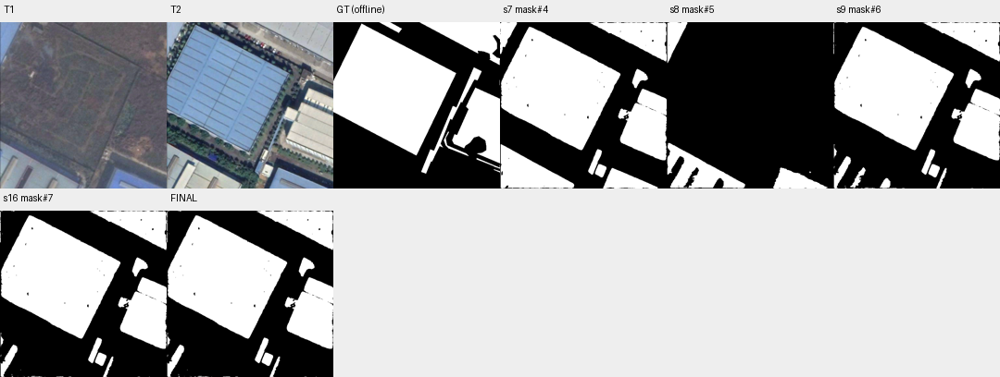

# case_20 完整轨迹

[交互回放](case_20.html#review) · [审查总表](20_case_review.md)



显式submit成功建立current，标签不是终止异常

完整0–17步：13步ask无current失败，14步to_mask(mask)类型错误；15步显式提交mask#6被正常接受并建立current，返回固定核验报告，16步移除FP后17步正常提交F1=90.65。submit_without_current只是调用前状态，不代表未提交。T3实例以文字分割替代示例匹配的问题另列且本轮不改。

修正统计解释，保留显式submit合法行为；研究更直接的答案切换以免借submit设状态，不改T3工具。

## 第 0 步

当前答案：None；离线评价：None


## 第 1 步

当前答案：None；离线评价：None

I need to analyze the example region (mask#0) to understand what type of land-cover change it represents, then find all similar changes in the image.

Let me first view the example region to understand the transition:


<details><summary>view · 完整参数和返回</summary>


```json

{
  "tool": "view",
  "args": {
    "region": [
      450,
      150,
      512,
      250
    ],
    "overlay": "mask#0"
  },
  "ok": true,
  "error_code": null,
  "result_text": "{\"ok\":true,\"view_id\":\"view#1\",\"region\":[448,150,512,250],\"overlay\":\"mask#0\",\"display_size\":[492,768],\"image_size\":[520,796],\"scale\":7.68,\"padding\":[28,28],\"labelled_ids\":[],\"unlabelled_count\":0}",
  "current_before": null,
  "current_after": null,
  "input_handles": [
    "mask#0"
  ],
  "output_handles": [],
  "eval": null,
  "candidate_eval": [],
  "set_current": null
}

```


</details>

## 第 2 步

当前答案：None；离线评价：None

The example region shows a transition from natural/vegetated land (T1) to what appears to be a building or paved surface (T2). Looking at the full images, I can see that in T1 there's mostly bare ground/vegetation, while in T2 there's a large blue-roofed building constructed. The example seems to show construction/building development on previously undeveloped land.

Let me look at the full images more carefully to understand the overall change pattern:


<details><summary>view · 完整参数和返回</summary>


```json

{
  "tool": "view",
  "args": {
    "region": [
      0,
      0,
      520,
      796
    ]
  },
  "ok": false,
  "error_code": "bad_args",
  "result_text": "{\"ok\":false,\"error_code\":\"bad_args\",\"message\":\"region must be an ordered box inside the full image.\"}",
  "current_before": null,
  "current_after": null,
  "input_handles": [],
  "output_handles": [],
  "eval": null,
  "candidate_eval": [],
  "set_current": null
}

```


</details>

## 第 3 步

当前答案：None；离线评价：None

The region must be within the image dimensions. Let me check the actual image size and view the full images properly:


<details><summary>view · 完整参数和返回</summary>


```json

{
  "tool": "view",
  "args": {},
  "ok": true,
  "error_code": null,
  "result_text": "{\"ok\":true,\"view_id\":\"view#2\",\"region\":[0,0,512,512],\"overlay\":null,\"display_size\":[768,768],\"image_size\":[796,796],\"scale\":1.5,\"padding\":[28,28],\"labelled_ids\":[],\"unlabelled_count\":0}",
  "current_before": null,
  "current_after": null,
  "input_handles": [],
  "output_handles": [],
  "eval": null,
  "candidate_eval": [],
  "set_current": null
}

```


</details>

## 第 4 步

当前答案：None；离线评价：None

I can see the full images now. The key change is:
- T1: Mostly bare ground/vegetation with some small structures
- T2: A large blue-roofed building has been constructed in the center-left area, plus additional buildings on the right

The example (mask#0) appears to be a small region showing construction/building development. I need to find all areas where land was converted from natural/bare to built-up (buildings).

Let me segment the building/impervious surfaces at T2 to identify all new construction areas, then compare with T1 to find changes:


<details><summary>segment_text · 完整参数和返回</summary>


```json

{
  "tool": "segment_text",
  "args": {
    "time": "t2",
    "text": "building",
    "score_thr": 0.3
  },
  "ok": true,
  "error_code": null,
  "result_text": "{\"ok\":true,\"inst\":\"inst#1\",\"n\":14,\"area\":148252,\"score\":{\"min\":0.3203125,\"median\":0.548828125,\"max\":0.93359375}}",
  "current_before": null,
  "current_after": null,
  "input_handles": [],
  "output_handles": [
    "inst#1"
  ],
  "eval": null,
  "candidate_eval": [],
  "set_current": null
}

```


</details>

## 第 5 步

当前答案：None；离线评价：None

I have an instance set of buildings at T2. Now I need to understand what the example transition is. Let me look at the example region more carefully - it seems to be a small area where construction occurred. The key is to find areas that changed from non-building (natural/bare) to building between T1 and T2.

Let me first segment buildings at T1 to see what existed before:


<details><summary>segment_text · 完整参数和返回</summary>


```json

{
  "tool": "segment_text",
  "args": {
    "time": "t1",
    "text": "building",
    "score_thr": 0.3
  },
  "ok": true,
  "error_code": null,
  "result_text": "{\"ok\":true,\"inst\":\"inst#2\",\"n\":4,\"area\":24497,\"score\":{\"min\":0.494140625,\"median\":0.546875,\"max\":0.70703125}}",
  "current_before": null,
  "current_after": null,
  "input_handles": [],
  "output_handles": [
    "inst#2"
  ],
  "eval": null,
  "candidate_eval": [],
  "set_current": null
}

```


</details>

## 第 6 步

当前答案：None；离线评价：None

I have buildings at both T1 and T2. The change I'm looking for is areas that became buildings (or impervious surfaces) between T1 and T2. Let me look at the example region more carefully to understand the exact transition type.

Looking at the full images:
- T1 shows mostly bare/vegetated land with some small structures in corners
- T2 shows a large new building complex in the center-left area, plus additional buildings on the right side

The example (mask#0) appears to be a small vertical strip on the right edge showing construction. This seems to be part of the larger development pattern - conversion from natural/bare ground to built-up area.

Let me segment "impervious" or "paved" surfaces at T2 to capture all new construction, then compare with T1:


<details><summary>segment_text · 完整参数和返回</summary>


```json

{
  "tool": "segment_text",
  "args": {
    "time": "t2",
    "text": "impervious",
    "score_thr": 0.3
  },
  "ok": true,
  "error_code": null,
  "result_text": "{\"ok\":true,\"inst\":\"inst#3\",\"n\":0,\"area\":0,\"score\":null}",
  "current_before": null,
  "current_after": null,
  "input_handles": [],
  "output_handles": [
    "inst#3"
  ],
  "eval": null,
  "candidate_eval": [],
  "set_current": null
}

```


</details>

## 第 7 步

当前答案：None；离线评价：None

Let me try a different approach. I'll segment "pavement" or look at what changed by comparing the building instances between T1 and T2. First, let me understand the example better by looking at its location and what it represents.

The example mask#0 is a small region on the right edge (around x=500-512, y=175-200). Looking at T2, this area shows what appears to be part of a building or paved surface that wasn't there in T1.

Let me create a mask of all new construction by taking buildings at T2 and subtracting buildings that existed at T1:


<details><summary>to_mask · 完整参数和返回</summary>


```json

{
  "tool": "to_mask",
  "args": {
    "sets": [
      "inst#1"
    ],
    "set_current": false
  },
  "ok": true,
  "error_code": null,
  "result_text": "{\"ok\":true,\"mask\":\"mask#4\",\"area\":148252,\"component_count\":10}",
  "current_before": null,
  "current_after": null,
  "input_handles": [
    "inst#1"
  ],
  "output_handles": [
    "mask#4"
  ],
  "eval": null,
  "candidate_eval": [
    {
      "handle": "mask#4",
      "parent": null,
      "tp": 117414,
      "fp": 30838,
      "fn": 15199,
      "f1": 0.8360885122745804,
      "iou": 0.7183437238071348
    }
  ],
  "set_current": false
}

```


</details>

## 第 8 步

当前答案：None；离线评价：None

I have mask#4 as the union of all buildings at T2. Now I need to subtract buildings that existed at T1 to find new construction. Let me first get the mask of T1 buildings:


<details><summary>to_mask · 完整参数和返回</summary>


```json

{
  "tool": "to_mask",
  "args": {
    "sets": [
      "inst#2"
    ],
    "set_current": false
  },
  "ok": true,
  "error_code": null,
  "result_text": "{\"ok\":true,\"mask\":\"mask#5\",\"area\":24497,\"component_count\":6}",
  "current_before": null,
  "current_after": null,
  "input_handles": [
    "inst#2"
  ],
  "output_handles": [
    "mask#5"
  ],
  "eval": null,
  "candidate_eval": [
    {
      "handle": "mask#5",
      "parent": null,
      "tp": 0,
      "fp": 24497,
      "fn": 132613,
      "f1": 0.0,
      "iou": 0.0
    }
  ],
  "set_current": false
}

```


</details>

## 第 9 步

当前答案：None；离线评价：None

Now I have mask#4 (all T2 buildings) and mask#5 (all T1 buildings). The new construction would be mask#4 minus mask#5. But wait - the task says to find changes of the "same transition as the example". The example appears to be a small area where construction occurred. Let me think about this more carefully.

Actually, looking at the images again:
- T1 has mostly bare/vegetated land in the center
- T2 has a large blue building complex constructed there

The example region (mask#0) is on the right edge showing what looks like part of a building or paved area that appeared. This seems to be part of the overall development pattern.

Let me compute the difference between T2 buildings and T1 buildings to find new construction areas:


<details><summary>combine · 完整参数和返回</summary>


```json

{
  "tool": "combine",
  "args": {
    "op": "subtract",
    "a": "mask#4",
    "b": "mask#5",
    "set_current": false
  },
  "ok": true,
  "error_code": null,
  "result_text": "{\"ok\":true,\"mask\":\"mask#6\",\"area\":128044,\"component_count\":33,\"added_px\":0,\"removed_px\":20208}",
  "current_before": null,
  "current_after": null,
  "input_handles": [
    "mask#4",
    "mask#5"
  ],
  "output_handles": [
    "mask#6"
  ],
  "eval": null,
  "candidate_eval": [
    {
      "handle": "mask#6",
      "parent": "mask#4",
      "tp": 117414,
      "fp": 10630,
      "fn": 15199,
      "f1": 0.9009080899419544,
      "iou": 0.8196840334257172,
      "delta_f1_from_parent": 0.064819577667374
    }
  ],
  "set_current": false
}

```


</details>

## 第 10 步

当前答案：None；离线评价：None

I have mask#6 which represents new construction (T2 buildings minus T1 buildings). This has 33 components. However, I need to verify that these are indeed the same type of change as the example - conversion from natural/bare land to built-up area.

Let me view this mask to see what it looks like and check if it matches the example transition:


<details><summary>view · 完整参数和返回</summary>


```json

{
  "tool": "view",
  "args": {
    "overlay": "mask#6"
  },
  "ok": true,
  "error_code": null,
  "result_text": "{\"ok\":true,\"view_id\":\"view#3\",\"region\":[0,0,512,512],\"overlay\":\"mask#6\",\"display_size\":[768,768],\"image_size\":[796,796],\"scale\":1.5,\"padding\":[28,28],\"labelled_ids\":[],\"unlabelled_count\":0}",
  "current_before": null,
  "current_after": null,
  "input_handles": [
    "mask#6"
  ],
  "output_handles": [],
  "eval": null,
  "candidate_eval": [],
  "set_current": null
}

```


</details>

## 第 11 步

当前答案：None；离线评价：None

I can see mask#6 shows the new construction areas - the large blue building in the center-left, plus additional buildings on the right and bottom. This appears to be the "any change" result showing all areas where land was converted from natural/bare to built-up.

However, I need to verify this matches the example transition. The example (mask#0) is a small region on the right edge. Let me check if that area is included in mask#6:


<details><summary>inspect · 完整参数和返回</summary>


```json

{
  "tool": "inspect",
  "args": {
    "mask": "mask#6",
    "limit": 10
  },
  "ok": true,
  "error_code": null,
  "result_text": "{\"ok\":true,\"mask\":\"mask#6\",\"total_components\":33,\"returned\":10,\"has_more\":true,\"components\":[{\"id\":5,\"area\":83096,\"bbox\":[3,14,370,394]},{\"id\":9,\"area\":22295,\"bbox\":[363,205,512,426]},{\"id\":3,\"area\":14116,\"bbox\":[275,0,512,122]},{\"id\":13,\"area\":2016,\"bbox\":[2,412,54,512]},{\"id\":8,\"area\":1504,\"bbox\":[406,144,454,203]},{\"id\":12,\"area\":1352,\"bbox\":[271,391,313,470]},{\"id\":15,\"area\":969,\"bbox\":[292,437,327,478]},{\"id\":17,\"area\":944,\"bbox\":[52,447,99,511]},{\"id\":19,\"area\":676,\"bbox\":[143,480,175,511]},{\"id\":18,\"area\":583,\"bbox\":[317,449,348,512]}]}",
  "current_before": null,
  "current_after": null,
  "input_handles": [
    "mask#6"
  ],
  "output_handles": [],
  "eval": null,
  "candidate_eval": [],
  "set_current": null
}

```


</details>

## 第 12 步

当前答案：None；离线评价：None

I see mask#6 has 33 components. The largest component (id=5) is the big blue building area (bbox [3,14,370,394]). Component id=9 (bbox [363,205,512,426]) appears to be on the right side which might include the example region.

Let me check if the example region (around x=500-512, y=175-200) is covered by any of these components. Looking at the bboxes:
- id=9: bbox [363,205,512,426] - this covers x from 363 to 512, y from 205 to 426. The example is around y=175-200, so it might not be fully covered.

Wait, I need to reconsider. The example mask#0 is a small vertical strip. Let me look at what the example actually shows more carefully. The example seems to be showing a specific type of change - perhaps just the edge of construction or a specific transition pattern.

Actually, re-reading the task: "Find all land-cover changes with the same transition as the marked example." The example is mask#0 which marks a specific region. I need to understand what transition that region represents and find all similar transitions.

Looking at the full images again:
- T1: Mostly bare/vegetated land
- T2: Large new building complex constructed

The example region on the right edge (mask#0) appears to show where construction started or an edge of the new development. This could be representing "construction/building development" as the change type.

My current mask#6 (new construction = T2 buildings - T1 buildings) should capture all areas where buildings were newly constructed, which matches the example transition of "natural/bare land → building".

However, I should verify this is correct by checking if the example region is included in mask#6. Let me view the example region overlaid on mask#6:


<details><summary>view · 完整参数和返回</summary>


```json

{
  "tool": "view",
  "args": {
    "region": [
      480,
      150,
      512,
      250
    ],
    "overlay": "mask#6"
  },
  "ok": true,
  "error_code": null,
  "result_text": "{\"ok\":true,\"view_id\":\"view#4\",\"region\":[448,150,512,250],\"overlay\":\"mask#6\",\"display_size\":[492,768],\"image_size\":[520,796],\"scale\":7.68,\"padding\":[28,28],\"labelled_ids\":[],\"unlabelled_count\":0}",
  "current_before": null,
  "current_after": null,
  "input_handles": [
    "mask#6"
  ],
  "output_handles": [],
  "eval": null,
  "candidate_eval": [],
  "set_current": null
}

```


</details>

## 第 13 步

当前答案：None；离线评价：None

I can see that mask#6 does cover the example region (the red contour shows the boundary of a component in mask#6 that includes the example area). The T2 image shows this area has a building/impervious surface, while T1 shows it was natural/bare land.

This confirms that mask#6 represents the "any change" type - conversion from natural/bare land to built-up area, which matches the example transition.

However, I need to be careful. The task says "Find all land-cover changes with the same transition as the marked example." The example might be showing a specific sub-type of change. Let me look more carefully at what the example region specifically shows.

Looking at view#4, the example region (around x=500-512, y=175-200) in T1 appears to be bare/vegetated land, and in T2 it shows what looks like part of a building or paved surface. This is consistent with the overall pattern of construction.

My current approach of using T2 buildings minus T1 buildings should capture all new construction areas. But I should verify that mask#6 doesn't include false positives (like areas that were already buildings in T1 but got modified).

Let me check if there are any components in mask#6 that might not represent true "new construction" vs "existing building expansion". Actually, since I subtracted T1 buildings from T2 buildings, mask#6 should only contain areas that are buildings in T2 but weren't buildings in T1 - which is exactly what we want.

But wait - I need to make sure the segmentation is accurate. Let me also consider if there might be other types of changes that match the example. Looking at the images:
- The main change is clearly the large blue building complex
- There are also some smaller buildings added on the right and bottom

Mask#6 should capture all of these. Let me now set this as the current answer and submit:

Actually, before submitting, let me verify by asking the verifier about some components to ensure they represent valid changes:


<details><summary>ask · 完整参数和返回</summary>


```json

{
  "tool": "ask",
  "args": {},
  "ok": false,
  "error_code": "bad_args",
  "result_text": "{\"ok\":false,\"error_code\":\"bad_args\",\"message\":\"There is no current answer; pass regions with a mask handle.\"}",
  "current_before": null,
  "current_after": null,
  "input_handles": [],
  "output_handles": [],
  "eval": null,
  "candidate_eval": [],
  "set_current": null
}

```


</details>

## 第 14 步

当前答案：None；离线评价：None

I need to set mask#6 as the current answer first, then ask the verifier. Let me do that:


<details><summary>to_mask · 完整参数和返回</summary>


```json

{
  "tool": "to_mask",
  "args": {
    "sets": [
      "mask#6"
    ],
    "set_current": true
  },
  "ok": false,
  "error_code": "bad_handle",
  "result_text": "{\"ok\":false,\"error_code\":\"bad_handle\",\"message\":\"Expected a inst handle.\"}",
  "current_before": null,
  "current_after": null,
  "input_handles": [
    "mask#6"
  ],
  "output_handles": [],
  "eval": null,
  "candidate_eval": [],
  "set_current": true
}

```


</details>

## 第 15 步

当前答案：mask#6；离线评价：{'tp': 117414, 'fp': 10630, 'fn': 15199, 'f1': 0.9009080899419544, 'iou': 0.8196840334257172, 'delta_f1': None}

I see - to_mask expects inst handles, not mask handles. Let me use a different approach. I can just submit with mask#6 directly since it's already a mask handle:


<details><summary>submit · 完整参数和返回</summary>


```json

{
  "tool": "submit",
  "args": {
    "mask": "mask#6",
    "summary": "Found all areas where land was converted from natural/bare ground to built-up (buildings) between T1 and T2. This matches the example transition of construction development. The mask contains 33 components representing new building construction, including the large blue-roofed building complex in the center-left and additional structures on the right and bottom edges."
  },
  "ok": true,
  "error_code": null,
  "result_text": "{\"ok\":true,\"submitted\":false,\"report\":\"Report before submission. Every run gets this report as the first response to submit; it does not judge the mask, and nothing has to change. mask#6 is now your current answer: 128044 pixels in 33 components.\\nThe verifier has just checked the 33 components that had no answer.\\nVerifier answers on mask#6: 31 yes, 2 no, 0 unparsed, 0 with no answer. An answer applies only to the exact outline it was about; a view is not an answer.\\n  IDs answered yes: [5, 9, 3, 13, 8, 12, 15, 18, 11, 4, 6, 25, 30, 2, 10, 16, 22, 31, 1, 32, 27, 21, 7, 20, 26, 33, 14, 23, 24, 28, 29]\\n  IDs answered no: [17, 19]\\n  answered no: id=17 area=944 bbox=[52, 447, 99, 511] type=same_category_replacement p_yes=0.18 reason=The red contour marks a feature on the building roof in both images that appears to be a skylight or similar structure, \\n  answered no: id=19 area=676 bbox=[143, 480, 175, 511] type=same_category_replacement p_yes=0.1 reason=The red contour marks a feature on a building roof in both images that appears to be the same structural element (e.g., \\nA verifier answer is evidence, not an order, and it can be wrong in both directions. No answer is not an error. To finish with this mask, call submit with mask#6 again. To change it, edit and submit the new handle; components the verifier has not seen will be reported again. In the summary, say what you changed, and why you went against any verifier answer. You have 15 replies left.\"}",
  "current_before": null,
  "current_after": "mask#6",
  "input_handles": [
    "mask#6"
  ],
  "output_handles": [],
  "eval": {
    "tp": 117414,
    "fp": 10630,
    "fn": 15199,
    "f1": 0.9009080899419544,
    "iou": 0.8196840334257172,
    "delta_f1": null
  },
  "candidate_eval": [],
  "set_current": null
}

```


</details>

## 第 16 步

当前答案：mask#7；离线评价：{'tp': 117414, 'fp': 9010, 'fn': 15199, 'f1': 0.906542308627725, 'iou': 0.8290602515128193, 'delta_f1': 0.005634218685770631}

The verifier found 2 components (id=17 and id=19) that answered "no" - they are classified as "same_category_replacement" meaning the land-cover category didn't actually change, just features on existing building roofs. I need to remove these false positives from my mask.

Let me remove these two components:


<details><summary>remove_region · 完整参数和返回</summary>


```json

{
  "tool": "remove_region",
  "args": {
    "mask": "mask#6",
    "ids": [
      17,
      19
    ],
    "set_current": true
  },
  "ok": true,
  "error_code": null,
  "result_text": "{\"ok\":true,\"mask\":\"mask#7\",\"area\":126424,\"component_count\":31,\"added_px\":0,\"removed_px\":1620,\"current_mask\":{\"before\":\"mask#6\",\"after\":\"mask#7\"}}",
  "current_before": "mask#6",
  "current_after": "mask#7",
  "input_handles": [
    "mask#6"
  ],
  "output_handles": [
    "mask#7"
  ],
  "eval": {
    "tp": 117414,
    "fp": 9010,
    "fn": 15199,
    "f1": 0.906542308627725,
    "iou": 0.8290602515128193,
    "delta_f1": 0.005634218685770631
  },
  "candidate_eval": [
    {
      "handle": "mask#7",
      "parent": "mask#6",
      "tp": 117414,
      "fp": 9010,
      "fn": 15199,
      "f1": 0.906542308627725,
      "iou": 0.8290602515128193,
      "delta_f1_from_parent": 0.005634218685770631
    }
  ],
  "set_current": true
}

```


</details>

## 第 17 步

当前答案：mask#7；离线评价：{'tp': 117414, 'fp': 9010, 'fn': 15199, 'f1': 0.906542308627725, 'iou': 0.8290602515128193, 'delta_f1': 0.0}

I've removed the 2 false positive components (id=17 and id=19) that were classified as "same_category_replacement" - they were features on existing building roofs, not actual land-cover changes. The remaining 31 components all answered "yes" to containing a valid change.

Now let me submit the final mask:


<details><summary>submit · 完整参数和返回</summary>


```json

{
  "tool": "submit",
  "args": {
    "mask": "mask#7",
    "summary": "Final mask showing all land-cover changes from natural/bare ground to built-up (buildings) between T1 and T2, matching the example transition. Removed 2 false positives (ids 17, 19) that were same-category roof features, not actual land-cover changes. Remaining 31 components all verified as valid changes by the verifier. Total area: 126424 pixels."
  },
  "ok": true,
  "error_code": null,
  "result_text": "{\"ok\":true,\"mask\":\"mask#7\",\"area\":126424,\"component_count\":31,\"current_mask\":{\"before\":\"mask#7\",\"after\":\"mask#7\"},\"submitted\":true}",
  "current_before": "mask#7",
  "current_after": "mask#7",
  "input_handles": [
    "mask#7"
  ],
  "output_handles": [],
  "eval": {
    "tp": 117414,
    "fp": 9010,
    "fn": 15199,
    "f1": 0.906542308627725,
    "iou": 0.8290602515128193,
    "delta_f1": 0.0
  },
  "candidate_eval": [],
  "set_current": null
}

```


</details>
