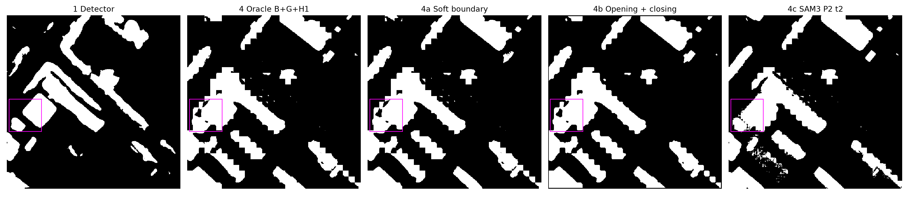
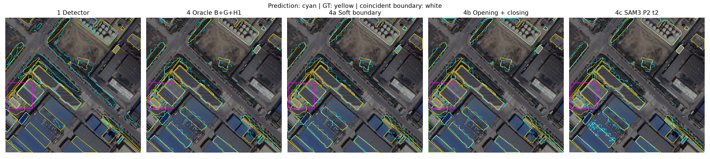
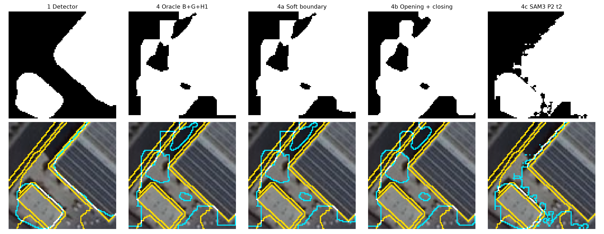

# 统一评价指标：SECOND test 全表（eval_metrics 第二版）

任务：`doc/eval_metrics.md`。只做评估，不训练模型。
代码：`code/probe/metrics_cd.py`、`eval_metrics_run.py`、`eval_metrics_report.py`（第二版，来自 batch16）。
完整输出在服务器 `Chang-Agent/outputs/CD_1016_probe/eval_metrics_v2/`，含逐图 `per_image.jsonl`。2026-10-21 运行。

## 结论

**复算核对**：第 1、2、3、4、5、6 行与历史结果的 TP/FP/FN 完全一致。2a/2b/2c 和 4a/4b/4c 是本文档新定义的变体，没有历史值可核对，两次逐图计算的计数一致。

**六个数：**

| 行 | 像素 F1 | BF(d=2) | 目标 F1 | 新增误检目标/图 | 逐图下降 % |
|---|---:|---:|---:|---:|---:|
| 1 检测器 | 74.17 | 34.83 | 50.97 | – | – |
| 2 补漏 oracle（BGH1） | 82.67 | 45.81 | 61.46 | 0.74 | 2.1 |
| 3 去误检 oracle | 79.91 | 40.10 | 49.32 | 0.25 | 0.06 |
| 4 两路 oracle（BGH1） | 88.37 | 51.40 | 62.13 | 0.49 | 0.18 |
| 5 V1（6b 主结果） | 72.85 | 32.24 | 51.55 | 0.71 | **62.8** |
| 6 A2 DINOv3（6f） | 74.16 | 34.78 | 50.81 | 0.22 | 58.2 |

各行的 IoU 见下面的全表。

**每组指标一句话：**
- **A 像素级**：两路 oracle 把像素 F1 从 74.17 提到 88.37，IoU 从 58.9 提到 79.2；V1 是全表唯一低于检测器的行（−1.31）。
- **B 边界级**：oracle 的像素 F1 涨了 14 个点，BF2 只涨 16.6 个点（34.8 → 51.4），而且绝对值仍然只有 51%。SLIC 整块并入后的边界依然很粗。三种只改边缘的变体，在补漏一侧都没有提高 BF2：
  - 2_BGH1 45.81，2a 43.78，2b 45.23，2c 43.74。
  - 2b（形态学）和 2c（SAM）的 BF1 甚至更低。
- **C 目标级**：形态学平滑（2b/4b）把目标 F1 从 61.5 提到 66.1，两路时从 62.1 提到 69.0；新增误检目标从 0.74 降到 0.03 个/图。原因是开运算去掉了小碎片，而不是边界变好了。SAM 精修（2c）新增误检目标 4.4 个/图，碎片明显变多。
- **D 形状质量**：检测器的粗糙度是 2.14，比真值（2.88）还“光滑”。oracle 并入后升到 2.39–2.69，向真值靠近。在 SECOND 上，粗糙度高不等于更差，所以这个指标不宜单独作为“锯齿”的判据。这与 7b 中各单元粗糙度都在 2.95 左右的观察一致。
- **E 逐图变化**：
  - 两路 oracle 在 99.8% 的图上提升。
  - V1 有 62.8% 的图下降；有实际编辑的图中，55% 的 ΔF1 < −0.5 个百分点。
  - 2b 形态学在 11.9%（BG）和 5.5%（BGH1）的图上下降。在有编辑的图中，Boundary IoU（d=3）下降的比例为 31–37%，说明平滑会损伤细边界。

**对后续的含义：**
1. 简单的后处理，包括软边界、开闭运算、单个 SAM 小框，都没有在保住像素 F1 的同时改善边界。边界问题交给 exp7 的提示精修。
2. 汇报时不能只看像素 F1。以 test_987 为例：4c 的像素 F1 从 85.9 降到 81.1，BF2 却从 48.1 升到 50.1，同时新增误检目标 37 个。几个指标的方向不一致。

2c/4c 按文档固定为 SAM3、P2、t2 视图，再与外扩 5 像素的范围取交，选 t2 是保守做法。exp7 在验证集上选出的方案是 best 视图 + clip3，结果另见 `exp7_prompt_refinement.md`。

---

共 1694 张图；比例显示为百分数，ΔF1 显示为百分点。A–C 按像素、边界计数或目标数汇总；D 的总体粗糙度为周长和与凸包周长和之比；分布表按图等权。所有变化均相对第 1 行。

## 六个数

| 行 | 像素 F1 % | IoU % | BF(d=2) % | 目标 F1 % | 新增误检目标/图 | 下降图 % |
| --- | --- | --- | --- | --- | --- | --- |
| 1 | 74.1652 | 58.9386 | 34.8309 | 50.9693 | 0.0000 | 0.0000 |
| 2_BG | 81.1263 | 68.2458 | 43.9364 | 60.1536 | 0.7745 | 2.4793 |
| 2_BGH1 | 82.6651 | 70.4523 | 45.8127 | 61.4624 | 0.7403 | 2.1251 |
| 2a_BG | 80.2388 | 66.9989 | 42.4803 | 58.8255 | 0.8105 | 2.7155 |
| 2a_BGH1 | 81.1916 | 68.3383 | 43.7786 | 59.4281 | 0.8996 | 2.1842 |
| 2b_BG | 80.7304 | 67.6873 | 43.2139 | 64.3563 | 0.0396 | 11.8654 |
| 2b_BGH1 | 82.3007 | 69.9245 | 45.2283 | 66.1248 | 0.0336 | 5.5490 |
| 3 | 79.9063 | 66.5366 | 40.0991 | 49.3157 | 0.2479 | 0.0590 |
| 2c_BG | 80.0309 | 66.7096 | 42.4362 | 58.8216 | 3.7515 | 2.4793 |
| 2c_BGH1 | 81.2658 | 68.4435 | 43.7444 | 59.9941 | 4.3961 | 1.5939 |
| 4_BG | 86.8427 | 76.7451 | 49.4360 | 60.1119 | 0.5041 | 0.1771 |
| 4_BGH1 | 88.3670 | 79.1586 | 51.4015 | 62.1282 | 0.4864 | 0.1771 |
| 4a_BG | 85.9644 | 75.3838 | 47.9901 | 58.4562 | 0.5525 | 0.0590 |
| 4a_BGH1 | 86.9110 | 76.8519 | 49.3473 | 59.4149 | 0.5962 | 0.0590 |
| 4b_BG | 86.3487 | 75.9769 | 48.5320 | 66.2196 | 0.0089 | 1.5348 |
| 4b_BGH1 | 87.9082 | 78.4252 | 50.6688 | 68.9912 | 0.0077 | 0.9445 |
| 4c_BG | 85.7468 | 75.0497 | 47.7955 | 56.7502 | 2.6765 | 0.2361 |
| 4c_BGH1 | 86.9695 | 76.9435 | 49.1212 | 58.2034 | 3.1759 | 0.2361 |
| 5 | 72.8525 | 57.2976 | 32.2362 | 51.5494 | 0.7060 | 62.7509 |
| 6 | 74.1557 | 58.9265 | 34.7779 | 50.8108 | 0.2249 | 58.2054 |

## 行定义与复算核对

| 行 | 设定 | 历史参考核对 |
| --- | --- | --- |
| 1 | 检测器保存的 0.5 预测 | TP/FP/FN 一致，F1 通过 |
| 2_BG | oracle 补漏，B+G0.05 | TP/FP/FN 一致，F1 通过 |
| 2_BGH1 | oracle 补漏，B+G0.05+H1 | TP/FP/FN 一致，F1 通过 |
| 2a_BG | oracle 补漏，软边界，B+G0.05 | 新边缘变体；无历史值；两次逐图计数一致 |
| 2a_BGH1 | oracle 补漏，软边界，B+G0.05+H1 | 新边缘变体；无历史值；两次逐图计数一致 |
| 2b_BG | oracle 补漏，开闭运算，B+G0.05 | 新边缘变体；无历史值；两次逐图计数一致 |
| 2b_BGH1 | oracle 补漏，开闭运算，B+G0.05+H1 | 新边缘变体；无历史值；两次逐图计数一致 |
| 3 | oracle 切块去误检 | TP/FP/FN 一致，F1 通过 |
| 2c_BG | oracle 补漏，SAM3 P2 t2 clip5，B+G0.05 | 新边缘变体；无历史值；两次逐图计数一致 |
| 2c_BGH1 | oracle 补漏，SAM3 P2 t2 clip5，B+G0.05+H1 | 新边缘变体；无历史值；两次逐图计数一致 |
| 4_BG | oracle 两路，B+G0.05 | TP/FP/FN 一致，F1 通过 |
| 4_BGH1 | oracle 两路，B+G0.05+H1 | TP/FP/FN 一致，F1 通过 |
| 4a_BG | oracle 两路，软边界，B+G0.05 | 新边缘变体；无历史值；两次逐图计数一致 |
| 4a_BGH1 | oracle 两路，软边界，B+G0.05+H1 | 新边缘变体；无历史值；两次逐图计数一致 |
| 4b_BG | oracle 两路，开闭运算，B+G0.05 | 新边缘变体；无历史值；两次逐图计数一致 |
| 4b_BGH1 | oracle 两路，开闭运算，B+G0.05+H1 | 新边缘变体；无历史值；两次逐图计数一致 |
| 4c_BG | oracle 两路，SAM3 P2 t2 clip5，B+G0.05 | 新边缘变体；无历史值；两次逐图计数一致 |
| 4c_BGH1 | oracle 两路，SAM3 P2 t2 clip5，B+G0.05+H1 | 新边缘变体；无历史值；两次逐图计数一致 |
| 5 | V1 none，B+G0.05+H1 | TP/FP/FN 一致，F1 通过 |
| 6 | A2 DINOv3，B+G0.05，k=0.002 | TP/FP/FN 一致，F1 通过 |

V1 阈值为 0.819681704044342；A2 预算 k=0.002，空预测图的预算基数为测试集平均预测面积 48189.71546635183。
精确 JSON 的 F1 容差为 1e-10（0–1），整数计数要求完全一致；既有报告两位小数的容差为 0.0051 个百分点。
第 4 行参考由已核对的补漏、去误检、原始计数推导，合并为 cleaned ∪ (accepted ∖ original)，不恢复删除的原预测像素。
保存掩码与重新读取概率 >0.5 相差 17534 像素；本表沿用历史 6a/6b/6e 的保存掩码。

## A 像素级

同一micro汇总下 F1=2×IoU/(1+IoU)，两者单调等价，IoU不提供新增形状约束。

| 行 | TP | FP | FN | 精度 % | 召回 % | F1 % | IoU % |
| --- | --- | --- | --- | --- | --- | --- | --- |
| 1 | 63317347 | 18316031 | 25796045 | 77.5631 | 71.0526 | 74.1652 | 58.9386 |
| 2_BG | 75669715 | 21764858 | 13443677 | 77.6621 | 84.9140 | 81.1263 | 68.2458 |
| 2_BGH1 | 78672244 | 22554026 | 10441148 | 77.7192 | 88.2833 | 82.6651 | 70.4523 |
| 2a_BG | 73957629 | 21272871 | 15155763 | 77.6617 | 82.9927 | 80.2388 | 66.9989 |
| 2a_BGH1 | 75751045 | 21733765 | 13362347 | 77.7055 | 85.0052 | 81.1916 | 68.3383 |
| 2b_BG | 74596259 | 21093796 | 14517133 | 77.9561 | 83.7094 | 80.7304 | 67.6873 |
| 2b_BGH1 | 77611640 | 21880124 | 11501752 | 78.0081 | 87.0931 | 82.3007 | 69.9245 |
| 3 | 63259058 | 5960614 | 25854334 | 91.3888 | 70.9872 | 79.9063 | 66.5366 |
| 2c_BG | 73702261 | 21368898 | 15411131 | 77.5233 | 82.7062 | 80.0309 | 66.7096 |
| 2c_BGH1 | 76080459 | 22044678 | 13032933 | 77.5341 | 85.3749 | 81.2658 | 68.4435 |
| 4_BG | 75611426 | 9409441 | 13501966 | 88.9328 | 84.8486 | 86.8427 | 76.7451 |
| 4_BGH1 | 78613955 | 10198609 | 10499437 | 88.5167 | 88.2179 | 88.3670 | 79.1586 |
| 4a_BG | 73899340 | 8917454 | 15214052 | 89.2323 | 82.9273 | 85.9644 | 75.3838 |
| 4a_BGH1 | 75692756 | 9378348 | 13420636 | 88.9759 | 84.9398 | 86.9110 | 76.8519 |
| 4b_BG | 74536204 | 8990429 | 14577188 | 89.2365 | 83.6420 | 86.3487 | 75.9769 |
| 4b_BGH1 | 77551381 | 9772463 | 11562011 | 88.8089 | 87.0255 | 87.9082 | 78.4252 |
| 4c_BG | 73643972 | 9013481 | 15469420 | 89.0954 | 82.6407 | 85.7468 | 75.0497 |
| 4c_BGH1 | 76022170 | 9689261 | 13091222 | 88.6955 | 85.3095 | 86.9695 | 76.9435 |
| 5 | 68922136 | 31174567 | 20191256 | 68.8556 | 77.3421 | 72.8525 | 57.2976 |
| 6 | 63426857 | 18523839 | 25686535 | 77.3964 | 71.1754 | 74.1557 | 58.9265 |

第 1 / 4_BGH1 行的像素 F1 为 74.1652 / 88.3670%，IoU 为 58.9386 / 79.1586%。

## B 边界级

| 行 | BF1 P % | BF1 R % | BF1 F1 % | BF2 P % | BF2 R % | BF2 F1 % | BF4 P % | BF4 R % | BF4 F1 % | BF5 P % | BF5 R % | BF5 F1 % | BIoU 2%对角线 % | BIoU d=3 % |
| --- | --- | --- | --- | --- | --- | --- | --- | --- | --- | --- | --- | --- | --- | --- |
| 1 | 29.3479 | 22.5457 | 25.5010 | 39.7180 | 31.0147 | 34.8309 | 53.6325 | 43.5628 | 48.0760 | 58.4378 | 48.4571 | 52.9815 | 40.4590 | 16.0258 |
| 2_BG | 32.0887 | 31.8880 | 31.9880 | 43.9191 | 43.9537 | 43.9364 | 59.9440 | 60.7648 | 60.3516 | 65.4957 | 66.7171 | 66.1007 | 49.8302 | 20.5567 |
| 2_BGH1 | 33.1077 | 33.9984 | 33.5471 | 45.0640 | 46.5867 | 45.8127 | 61.0159 | 63.6835 | 62.3212 | 66.5206 | 69.5954 | 68.0233 | 51.8362 | 21.6666 |
| 2a_BG | 31.5884 | 30.1749 | 30.8655 | 43.2388 | 41.7479 | 42.4803 | 59.1194 | 58.1783 | 58.6451 | 64.5962 | 64.0906 | 64.3424 | 48.6102 | 19.8110 |
| 2a_BGH1 | 32.2524 | 31.5994 | 31.9225 | 44.0265 | 43.5335 | 43.7786 | 59.9167 | 60.1638 | 60.0400 | 65.3579 | 66.0259 | 65.6902 | 49.8832 | 20.5655 |
| 2b_BG | 26.7136 | 24.1358 | 25.3593 | 44.9813 | 41.5802 | 43.2139 | 61.1013 | 58.4096 | 59.7251 | 66.5871 | 64.4439 | 65.4979 | 48.6531 | 17.5877 |
| 2b_BGH1 | 27.7673 | 25.8275 | 26.7623 | 46.3845 | 44.1283 | 45.2283 | 62.4780 | 61.3131 | 61.8901 | 67.9124 | 67.3374 | 67.6237 | 50.6670 | 18.5877 |
| 3 | 38.6354 | 23.7208 | 29.3944 | 52.1186 | 32.5845 | 40.0991 | 69.8231 | 45.4034 | 55.0257 | 75.8097 | 50.2725 | 60.4549 | 47.3155 | 18.7901 |
| 2c_BG | 31.9008 | 30.6221 | 31.2484 | 43.1997 | 41.6993 | 42.4362 | 58.2798 | 57.3709 | 57.8218 | 63.6928 | 63.3695 | 63.5307 | 47.9953 | 19.9807 |
| 2c_BGH1 | 32.3831 | 32.2260 | 32.3044 | 43.7718 | 43.7170 | 43.7444 | 58.8617 | 59.6969 | 59.2763 | 64.3232 | 65.7356 | 65.0218 | 49.4390 | 20.7184 |
| 4_BG | 39.4476 | 33.1518 | 36.0267 | 53.8647 | 45.6802 | 49.4360 | 73.1162 | 62.9093 | 67.6298 | 79.6923 | 68.9160 | 73.9134 | 57.7022 | 23.6367 |
| 4_BGH1 | 40.3668 | 35.2981 | 37.6627 | 54.8356 | 48.3721 | 51.4015 | 73.8810 | 65.9247 | 69.6765 | 80.3639 | 71.9045 | 75.8992 | 59.9140 | 24.8405 |
| 4a_BG | 39.2211 | 31.4386 | 34.9013 | 53.5538 | 43.4737 | 47.9901 | 72.7959 | 60.3185 | 65.9724 | 79.3341 | 66.2825 | 72.2234 | 56.3627 | 22.8451 |
| 4a_BGH1 | 39.7674 | 32.8988 | 36.0085 | 54.1643 | 45.3172 | 49.3473 | 73.3148 | 62.3980 | 67.4173 | 79.7784 | 68.3256 | 73.6092 | 57.7746 | 23.6657 |
| 4b_BG | 33.1922 | 25.3426 | 28.7411 | 55.3118 | 43.2327 | 48.5320 | 74.7353 | 60.5402 | 66.8930 | 81.2637 | 66.6622 | 73.2423 | 56.2900 | 20.2329 |
| 4b_BGH1 | 34.2088 | 27.0943 | 30.2387 | 56.5901 | 45.8693 | 50.6688 | 75.8694 | 63.5762 | 69.1809 | 82.3035 | 69.7053 | 75.4823 | 58.5461 | 21.3291 |
| 4c_BG | 39.3254 | 31.8794 | 35.2131 | 53.1568 | 43.4165 | 47.7955 | 71.3757 | 59.5019 | 64.9002 | 77.8291 | 65.5447 | 71.1606 | 55.6731 | 23.0197 |
| 4c_BGH1 | 39.5632 | 33.5104 | 36.2861 | 53.3934 | 45.4820 | 49.1212 | 71.4986 | 61.9133 | 66.3616 | 77.9674 | 68.0111 | 72.6497 | 57.2544 | 23.8038 |
| 5 | 24.7002 | 22.7727 | 23.6974 | 33.3555 | 31.1895 | 32.2362 | 45.9381 | 43.9947 | 44.9454 | 50.8276 | 49.1343 | 49.9666 | 37.7594 | 14.3732 |
| 6 | 29.1354 | 22.6022 | 25.4563 | 39.4461 | 31.0976 | 34.7779 | 53.3478 | 43.7011 | 48.0450 | 58.1649 | 48.6133 | 52.9619 | 40.4481 | 15.9897 |

第 1 / 4_BGH1 行的 BF2 为 34.8309 / 51.4015%，BF5 为 52.9815 / 75.8992%。

## C 目标级

预测与真值均使用二值图 8 连通域，不按语义转移拆分；覆盖/重叠至少 50% 即命中，两侧分别计数，不要求一一匹配。面积桶端点为 <100、[100,1000]、(1000,5000]、>5000。

| 行 | 预测目标 | 正确预测目标 | 真值目标 | 命中真值目标 | 精度 % | 召回 % | F1 % | <100 R % | 100–1000 R % | 1000–5000 R % | >5000 R % |
| --- | --- | --- | --- | --- | --- | --- | --- | --- | --- | --- | --- |
| 1 | 26317 | 13925 | 48432 | 23811 | 52.9126 | 49.1638 | 50.9693 | 48.8360 | 32.0714 | 57.6463 | 79.1914 |
| 2_BG | 31411 | 18034 | 48432 | 30594 | 57.4130 | 63.1690 | 60.1536 | 51.7148 | 68.2964 | 88.3225 | 94.6900 |
| 2_BGH1 | 31002 | 17749 | 48432 | 32131 | 57.2511 | 66.3425 | 61.4624 | 52.8615 | 78.1071 | 92.2100 | 95.8221 |
| 2a_BG | 31333 | 17787 | 48432 | 29562 | 56.7676 | 61.0382 | 58.8255 | 51.3095 | 61.9903 | 84.2384 | 93.0189 |
| 2a_BGH1 | 31520 | 17790 | 48432 | 30391 | 56.4404 | 62.7498 | 59.4281 | 52.0786 | 67.0308 | 86.0535 | 93.5849 |
| 2b_BG | 24149 | 16171 | 48432 | 30001 | 66.9634 | 61.9446 | 64.3563 | 50.5335 | 66.2196 | 87.5813 | 94.3935 |
| 2b_BGH1 | 23814 | 15964 | 48432 | 31596 | 67.0362 | 65.2379 | 66.1248 | 51.6836 | 76.4521 | 91.6503 | 95.6873 |
| 3 | 21598 | 14779 | 48432 | 18670 | 68.4276 | 38.5489 | 49.3157 | 31.0469 | 32.0281 | 57.6161 | 79.1914 |
| 2c_BG | 44645 | 25297 | 48432 | 29617 | 56.6626 | 61.1517 | 58.8216 | 51.2090 | 62.2607 | 84.9191 | 93.3962 |
| 2c_BGH1 | 47130 | 26648 | 48432 | 30946 | 56.5415 | 63.8958 | 59.9941 | 52.0162 | 71.2493 | 88.3376 | 94.4474 |
| 4_BG | 26981 | 18941 | 48432 | 25455 | 70.2013 | 52.5582 | 60.1119 | 33.9257 | 68.2747 | 88.3074 | 94.6631 |
| 4_BGH1 | 26616 | 18680 | 48432 | 26992 | 70.1833 | 55.7317 | 62.1282 | 35.0724 | 78.0746 | 92.1948 | 95.8221 |
| 4a_BG | 26908 | 18708 | 48432 | 24423 | 69.5258 | 50.4274 | 58.4562 | 33.5204 | 61.9686 | 84.2233 | 92.9919 |
| 4a_BGH1 | 27141 | 18742 | 48432 | 25251 | 69.0542 | 52.1370 | 59.4149 | 34.2895 | 66.9984 | 86.0233 | 93.5849 |
| 4b_BG | 18498 | 17290 | 48432 | 24832 | 93.4696 | 51.2719 | 66.2196 | 32.6509 | 66.1655 | 87.5813 | 94.3396 |
| 4b_BGH1 | 18248 | 17122 | 48432 | 26420 | 93.8295 | 54.5507 | 68.9912 | 33.7837 | 76.3656 | 91.6352 | 95.6873 |
| 4c_BG | 40490 | 26202 | 48432 | 24474 | 64.7123 | 50.5327 | 56.7502 | 33.4199 | 62.1958 | 84.8888 | 93.3962 |
| 4c_BGH1 | 43013 | 27586 | 48432 | 25803 | 64.1341 | 53.2768 | 58.2034 | 34.2271 | 71.1952 | 88.3225 | 94.3935 |
| 5 | 22476 | 10176 | 48432 | 28983 | 45.2750 | 59.8427 | 51.5494 | 59.3882 | 43.9697 | 69.4146 | 85.8760 |
| 6 | 26823 | 14020 | 48432 | 23941 | 52.2686 | 49.4322 | 50.8108 | 49.0993 | 32.4500 | 57.9186 | 79.2183 |

| 行 | 校正前纯误检目标总数 | 校正后纯误检目标总数 | 新增误检/图均值 | 新增误检/图 P90 |
| --- | --- | --- | --- | --- |
| 1 | 10963 | 10963 | 0.0000 | 0.0000 |
| 2_BG | 10963 | 12139 | 0.7745 | 3.0000 |
| 2_BGH1 | 10963 | 12051 | 0.7403 | 2.0000 |
| 2a_BG | 10963 | 12204 | 0.8105 | 3.0000 |
| 2a_BGH1 | 10963 | 12337 | 0.8996 | 3.0000 |
| 2b_BG | 10963 | 6745 | 0.0396 | 0.0000 |
| 2b_BGH1 | 10963 | 6659 | 0.0336 | 0.0000 |
| 3 | 10963 | 5834 | 0.2479 | 0.0000 |
| 2c_BG | 10963 | 17301 | 3.7515 | 10.0000 |
| 2c_BGH1 | 10963 | 18384 | 4.3961 | 11.0000 |
| 4_BG | 10963 | 7199 | 0.5041 | 2.0000 |
| 4_BGH1 | 10963 | 7130 | 0.4864 | 2.0000 |
| 4a_BG | 10963 | 7265 | 0.5525 | 2.0000 |
| 4a_BGH1 | 10963 | 7417 | 0.5962 | 2.0000 |
| 4b_BG | 10963 | 353 | 0.0089 | 0.0000 |
| 4b_BGH1 | 10963 | 329 | 0.0077 | 0.0000 |
| 4c_BG | 10963 | 12649 | 2.6765 | 8.0000 |
| 4c_BGH1 | 10963 | 13749 | 3.1759 | 10.0000 |
| 5 | 10963 | 9856 | 0.7060 | 2.0000 |
| 6 | 10963 | 11311 | 0.2249 | 1.0000 |

| 行 | 拆分率 % | 粘连率(≥1像素) % | 粘连率(每个真值覆盖≥50%) % |
| --- | --- | --- | --- |
| 1 | 5.2940 | 7.7288 | 5.5515 |
| 2_BG | 5.8370 | 9.9710 | 7.8508 |
| 2_BGH1 | 5.2981 | 10.6316 | 8.7640 |
| 2a_BG | 5.9836 | 9.4820 | 7.3469 |
| 2a_BGH1 | 5.9176 | 9.8096 | 7.7697 |
| 2b_BG | 4.9513 | 12.4436 | 9.8720 |
| 2b_BGH1 | 4.3091 | 13.4837 | 11.2497 |
| 3 | 5.3085 | 8.9406 | 6.4728 |
| 2c_BG | 8.8247 | 6.4733 | 4.7508 |
| 2c_BGH1 | 8.8413 | 6.4757 | 4.8377 |
| 4_BG | 5.8660 | 11.3636 | 8.9063 |
| 4_BGH1 | 5.3353 | 12.1806 | 9.9940 |
| 4a_BG | 6.0126 | 10.7849 | 8.3358 |
| 4a_BGH1 | 5.9568 | 11.1823 | 8.8243 |
| 4b_BG | 5.0937 | 15.8558 | 12.4122 |
| 4b_BGH1 | 4.4413 | 17.3005 | 14.2427 |
| 4c_BG | 8.8330 | 6.9449 | 5.0605 |
| 4c_BGH1 | 8.8557 | 6.9281 | 5.1357 |
| 5 | 4.0345 | 12.4399 | 9.4901 |
| 6 | 5.4014 | 7.6874 | 5.4841 |

拆分分母为全部真值目标；与其有≥1像素重叠的预测连通域至少2个即计入。粘连分母为全部预测目标；与至少2个真值目标各重叠≥1像素即计入；另报逐个真值覆盖≥50%的版本。

新增误检数取每图 max(0, 校正后零真值重叠连通域数 − 校正前同类连通域数)，再求均值和 P90；此值是数量净增加，删除造成的碎裂也可能计入。
第 1 / 4_BGH1 行的目标 F1 为 50.9693 / 62.1282%。

## D 形状质量

| 行 | 预测周长和 | 预测凸包周长和 | 预测粗糙度 | 真值周长和 | 真值凸包周长和 | 真值粗糙度 | 预测连通域/图均值 | 预测连通域/图 P90 | <20碎片/图均值 | <20碎片/图 P90 |
| --- | --- | --- | --- | --- | --- | --- | --- | --- | --- | --- |
| 1 | 5898130 | 2755487.7813 | 2.1405 | 7829026 | 2719243.9805 | 2.8791 | 15.5354 | 26.0000 | 3.3412 | 7.0000 |
| 2_BG | 7590222 | 2898396.0907 | 2.6188 | 7829026 | 2719243.9805 | 2.8791 | 18.5425 | 30.0000 | 3.7261 | 8.0000 |
| 2_BGH1 | 7824014 | 2909351.5352 | 2.6893 | 7829026 | 2719243.9805 | 2.8791 | 18.3011 | 30.0000 | 3.4445 | 7.0000 |
| 2a_BG | 7273962 | 2884179.5624 | 2.5220 | 7829026 | 2719243.9805 | 2.8791 | 18.4965 | 30.0000 | 4.1305 | 8.0000 |
| 2a_BGH1 | 7464768 | 2890036.0750 | 2.5829 | 7829026 | 2719243.9805 | 2.8791 | 18.6068 | 30.7000 | 4.1635 | 8.0000 |
| 2b_BG | 6926766 | 2852497.1850 | 2.4283 | 7829026 | 2719243.9805 | 2.8791 | 14.2556 | 23.0000 | 0.6399 | 2.0000 |
| 2b_BGH1 | 7136322 | 2865634.2718 | 2.4903 | 7829026 | 2719243.9805 | 2.8791 | 14.0579 | 23.0000 | 0.5584 | 2.0000 |
| 3 | 4688876 | 2565455.9071 | 1.8277 | 7829026 | 2719243.9805 | 2.8791 | 12.7497 | 22.0000 | 4.6228 | 10.0000 |
| 2c_BG | 7541134 | 2892942.4267 | 2.6067 | 7829026 | 2719243.9805 | 2.8791 | 26.3548 | 48.0000 | 10.7102 | 24.7000 |
| 2c_BGH1 | 7837630 | 2902907.1779 | 2.6999 | 7829026 | 2719243.9805 | 2.8791 | 27.8217 | 51.0000 | 11.9581 | 27.0000 |
| 4_BG | 6401664 | 2762031.7787 | 2.3177 | 7829026 | 2719243.9805 | 2.8791 | 15.9274 | 27.0000 | 4.9906 | 11.0000 |
| 4_BGH1 | 6642914 | 2775863.2070 | 2.3931 | 7829026 | 2719243.9805 | 2.8791 | 15.7119 | 26.0000 | 4.6972 | 10.0000 |
| 4a_BG | 6085404 | 2744745.8879 | 2.2171 | 7829026 | 2719243.9805 | 2.8791 | 15.8843 | 27.0000 | 5.3949 | 12.0000 |
| 4a_BGH1 | 6283668 | 2752561.5550 | 2.2828 | 7829026 | 2719243.9805 | 2.8791 | 16.0218 | 27.0000 | 5.4162 | 12.0000 |
| 4b_BG | 5820456 | 2644038.6700 | 2.2014 | 7829026 | 2719243.9805 | 2.8791 | 10.9197 | 19.0000 | 0.3920 | 1.0000 |
| 4b_BGH1 | 6042546 | 2662551.0314 | 2.2695 | 7829026 | 2719243.9805 | 2.8791 | 10.7721 | 19.0000 | 0.3123 | 1.0000 |
| 4c_BG | 6366386 | 2754340.3008 | 2.3114 | 7829026 | 2719243.9805 | 2.8791 | 23.9020 | 44.0000 | 12.1854 | 26.0000 |
| 4c_BGH1 | 6670128 | 2767154.4948 | 2.4105 | 7829026 | 2719243.9805 | 2.8791 | 25.3914 | 48.0000 | 13.4333 | 29.7000 |
| 5 | 6936434 | 2863668.9203 | 2.4222 | 7829026 | 2719243.9805 | 2.8791 | 13.2680 | 21.0000 | 2.0443 | 5.0000 |
| 6 | 5955402 | 2771006.8252 | 2.1492 | 7829026 | 2719243.9805 | 2.8791 | 15.8341 | 27.0000 | 3.3713 | 7.0000 |

第 1 / 4_BGH1 行的预测总体粗糙度为 2.1405 / 2.3931，真值为 2.8791。

## E 逐图变化

| 行 | 提升图 % | 下降图 % | 不变图 % | ΔF1 P10 | ΔF1 P50 | ΔF1 P90 | 最差五图（百分点） |
| --- | --- | --- | --- | --- | --- | --- | --- |
| 1 | 0.0000 | 0.0000 | 100.0000 | 0.0000 | 0.0000 | 0.0000 | test_0.png: 0.0000; test_1.png: 0.0000; test_10.png: 0.0000; test_100.png: 0.0000; test_1000.png: 0.0000 |
| 2_BG | 94.6871 | 2.4793 | 2.8335 | 0.2000 | 5.4214 | 24.9285 | test_733.png: -3.9386; test_831.png: -3.4577; test_443.png: -2.1278; test_1015.png: -1.4733; test_374.png: -1.1387 |
| 2_BGH1 | 96.6942 | 2.1251 | 1.1806 | 0.8147 | 6.8971 | 27.4052 | test_733.png: -3.9386; test_831.png: -3.7992; test_443.png: -2.3824; test_307.png: -1.5266; test_1015.png: -1.4493 |
| 2a_BG | 94.3329 | 2.7155 | 2.9516 | 0.1691 | 4.7705 | 22.2985 | test_831.png: -3.3816; test_443.png: -2.1278; test_1015.png: -1.4733; test_1239.png: -0.9989; test_1033.png: -0.9435 |
| 2a_BGH1 | 96.5762 | 2.1842 | 1.2397 | 0.6663 | 5.6745 | 23.0315 | test_831.png: -3.2655; test_443.png: -2.3765; test_1015.png: -1.4643; test_374.png: -0.9304; test_1033.png: -0.8418 |
| 2b_BG | 88.1346 | 11.8654 | 0.0000 | -0.1022 | 5.0320 | 24.4132 | test_733.png: -5.2905; test_590.png: -2.9527; test_831.png: -2.7284; test_1015.png: -2.5159; test_1295.png: -2.3942 |
| 2b_BGH1 | 94.4510 | 5.5490 | 0.0000 | 0.4000 | 6.6042 | 26.8519 | test_733.png: -5.2905; test_831.png: -3.0372; test_590.png: -2.9527; test_1015.png: -2.5080; test_1418.png: -1.7564 |
| 3 | 98.1700 | 0.0590 | 1.7710 | 0.3494 | 3.5666 | 16.6727 | test_1406.png: -0.8711; test_1002.png: 0.0000; test_1005.png: 0.0000; test_1041.png: 0.0000; test_1063.png: 0.0000 |
| 2c_BG | 94.6281 | 2.4793 | 2.8926 | 0.1648 | 4.4229 | 22.0898 | test_1015.png: -4.1016; test_831.png: -3.4459; test_950.png: -3.1103; test_307.png: -3.0884; test_949.png: -2.1560 |
| 2c_BGH1 | 97.2255 | 1.5939 | 1.1806 | 0.5960 | 5.6090 | 23.6423 | test_1015.png: -4.0692; test_307.png: -3.4797; test_831.png: -3.3020; test_950.png: -3.1103; test_949.png: -2.1587 |
| 4_BG | 99.7639 | 0.1771 | 0.0590 | 2.7689 | 12.8855 | 35.7393 | test_1406.png: -0.8711; test_733.png: -0.4953; test_1239.png: -0.1175; test_656.png: 0.0000; test_1027.png: 0.0152 |
| 4_BGH1 | 99.8229 | 0.1771 | 0.0000 | 3.7393 | 13.9360 | 37.3595 | test_1406.png: -0.8711; test_733.png: -0.4953; test_307.png: -0.2646; test_1191.png: 0.0117; test_1239.png: 0.0538 |
| 4a_BG | 99.8819 | 0.0590 | 0.0590 | 2.5698 | 11.8963 | 33.3915 | test_1406.png: -0.8711; test_656.png: 0.0000; test_1027.png: 0.0152; test_1239.png: 0.0242; test_390.png: 0.0717 |
| 4a_BGH1 | 99.9410 | 0.0590 | 0.0000 | 3.3208 | 12.7289 | 33.8520 | test_1406.png: -0.8711; test_390.png: 0.0717; test_1191.png: 0.0968; test_953.png: 0.1435; test_576.png: 0.1655 |
| 4b_BG | 98.4652 | 1.5348 | 0.0000 | 2.1996 | 12.3403 | 35.2679 | test_733.png: -2.3252; test_1295.png: -1.2870; test_953.png: -0.9423; test_1406.png: -0.8711; test_1584.png: -0.7602 |
| 4b_BGH1 | 99.0555 | 0.9445 | 0.0000 | 3.1675 | 13.5861 | 36.8454 | test_733.png: -2.3252; test_953.png: -0.9423; test_1406.png: -0.8711; test_270.png: -0.8062; test_1015.png: -0.7419 |
| 4c_BG | 99.7048 | 0.2361 | 0.0590 | 2.5600 | 11.4137 | 33.0459 | test_1015.png: -2.4010; test_307.png: -1.8729; test_1406.png: -0.8711; test_1002.png: -0.0110; test_656.png: 0.0000 |
| 4c_BGH1 | 99.7639 | 0.2361 | 0.0000 | 3.3682 | 12.4337 | 34.5612 | test_1015.png: -2.3695; test_307.png: -2.2771; test_1406.png: -0.8711; test_1002.png: -0.0110; test_390.png: 0.0698 |
| 5 | 36.7769 | 62.7509 | 0.4723 | -7.6294 | -0.9082 | 5.8077 | test_365.png: -29.1367; test_986.png: -26.0892; test_1412.png: -24.7292; test_1466.png: -24.6730; test_1023.png: -24.5173 |
| 6 | 41.6765 | 58.2054 | 0.1181 | -0.2167 | -0.0325 | 0.2134 | test_298.png: -4.0226; test_1443.png: -2.7332; test_590.png: -2.2377; test_1023.png: -2.1335; test_507.png: -2.0348 |

4_BGH1 的提升 / 下降 / 不变图占比为 99.8229 / 0.1771 / 0.0000%。

## test_987

第 4、4a、4b、4c 行均展示 B+G0.05+H1。品红框为放大区域。

边界配色：预测青色、真值黄色、重合白色。在 4_BGH1 边界上，取距 4 与 4b 掩码差异不超过半径 2 圆盘、且不在原检测器边界半径 2 圆盘内的像素作为台阶代理；逐像素枚举完整 96×96 窗口，选代理像素最多的窗口。并列按上到下、左到右取首个；所有窗口为零时也按此规则取首个，并报告零分。五行使用同一窗口，以最近邻放大，不使用真值选窗。
窗口 [x0,y0,x1,y1)=[6, 247, 102, 343]，代理像素数 180。

| 示例行 | 像素 F1 % | IoU % | BF2 % | 目标 F1 % | 新增误检目标数 | 全测试集下降图 % |
| --- | --- | --- | --- | --- | --- | --- |
| 1 | 58.5056 | 41.3484 | 30.4276 | 52.7197 | 0 | 0.0000 |
| 4_BGH1 | 85.9181 | 75.3126 | 48.0899 | 65.5172 | 8 | 0.1771 |
| 4a_BGH1 | 85.5339 | 74.7242 | 46.3015 | 61.2565 | 9 | 0.0590 |
| 4b_BGH1 | 85.4474 | 74.5923 | 48.1507 | 90.1186 | 0 | 0.9445 |
| 4c_BGH1 | 81.1348 | 68.2578 | 50.0994 | 64.8534 | 37 | 0.2361 |

## 实现口径

边界为掩码减 3×3 腐蚀，图外按背景；BF 用欧氏距离 ≤1/2/4/5 像素的双向独立匹配。Boundary IoU 用掩码内部带：减去 d 次 3×3 腐蚀，d=max(1,round(对角线×2%))，另报 d=3；512² 时 d=14。
周长计像素方格外露的单位边（包含孔洞与图框），凸包取整张预测所有前景像素方格的几何凸包。因此粗糙度同时受碎片影响。空图周长均为 0、粗糙度缺省；单像素周长 4、凸包周长 4、粗糙度 1。精度/召回/F1/IoU 分母为零时取 0；空面积桶召回缺省；均值和分位数排除缺省值并列出有效图数。
2a/4a 按字面取 (切块内 ∩ 概率>0.05) ∩ 切块外扩2像素；切块已经包含在外扩区，故外扩不会加入切块外像素。2b/4b 对最终整图作半径2圆盘开运算再闭运算，图外按背景。
six_numbers(pred, gt, before) 返回单图前五个数，第六个值在未提供全测试集统计时为 None；流程页需传入 dataset_decline_fraction=summary['rows'][行]['delta_f1']['decline_fraction']。

## 逐图分布补充

以下直接使用 0–1 比例尺度；目标/碎片为个数、粗糙度为比值。逐图原始计数及 ΔF1 在 per_image.jsonl。

### 1 检测器保存的 0.5 预测

| 指标 | 有效图数 | 均值 | P10 | P50 | P90 | 最小 | 最大 |
| --- | --- | --- | --- | --- | --- | --- | --- |
| pixel_precision | 1694 | 0.7505 | 0.4731 | 0.8038 | 0.9480 | 0.0000 | 0.9977 |
| pixel_recall | 1694 | 0.6766 | 0.3791 | 0.7108 | 0.9081 | 0.0000 | 0.9927 |
| pixel_f1 | 1694 | 0.6855 | 0.4343 | 0.7215 | 0.8818 | 0.0000 | 0.9886 |
| pixel_iou | 1694 | 0.5481 | 0.2774 | 0.5643 | 0.7885 | 0.0000 | 0.9775 |
| bf1_precision | 1694 | 0.2982 | 0.1452 | 0.2942 | 0.4511 | 0.0000 | 0.7672 |
| bf1_recall | 1694 | 0.2403 | 0.1124 | 0.2254 | 0.3806 | 0.0000 | 0.7779 |
| bf1_f1 | 1694 | 0.2541 | 0.1337 | 0.2467 | 0.3803 | 0.0000 | 0.7229 |
| bf2_precision | 1694 | 0.4042 | 0.2113 | 0.4038 | 0.5910 | 0.0000 | 0.9580 |
| bf2_recall | 1694 | 0.3290 | 0.1650 | 0.3161 | 0.5125 | 0.0000 | 0.9491 |
| bf2_f1 | 1694 | 0.3471 | 0.1927 | 0.3453 | 0.5056 | 0.0000 | 0.9190 |
| bf4_precision | 1694 | 0.5451 | 0.3123 | 0.5556 | 0.7663 | 0.0000 | 1.0000 |
| bf4_recall | 1694 | 0.4579 | 0.2468 | 0.4493 | 0.6691 | 0.0000 | 1.0000 |
| bf4_f1 | 1694 | 0.4776 | 0.2911 | 0.4836 | 0.6581 | 0.0000 | 0.9773 |
| bf5_precision | 1694 | 0.5927 | 0.3537 | 0.6103 | 0.8122 | 0.0000 | 1.0000 |
| bf5_recall | 1694 | 0.5069 | 0.2815 | 0.5053 | 0.7270 | 0.0000 | 1.0000 |
| bf5_f1 | 1694 | 0.5251 | 0.3301 | 0.5346 | 0.7054 | 0.0000 | 0.9803 |
| biou_diag | 1694 | 0.4067 | 0.2261 | 0.4080 | 0.5859 | 0.0000 | 0.8899 |
| biou_3 | 1694 | 0.1625 | 0.0813 | 0.1564 | 0.2514 | 0.0000 | 0.5657 |
| object_precision | 1694 | 0.5528 | 0.2308 | 0.5556 | 0.8750 | 0.0000 | 1.0000 |
| object_recall | 1694 | 0.5008 | 0.1677 | 0.5000 | 0.8333 | 0.0000 | 1.0000 |
| object_f1 | 1694 | 0.4566 | 0.2145 | 0.4629 | 0.6897 | 0.0000 | 1.0000 |
| split_rate | 1694 | 0.1386 | 0.0000 | 0.1111 | 0.3333 | 0.0000 | 1.0000 |
| merge_rate | 1694 | 0.0814 | 0.0000 | 0.0556 | 0.2000 | 0.0000 | 0.8000 |
| merge_rate_50 | 1694 | 0.0604 | 0.0000 | 0.0000 | 0.1667 | 0.0000 | 0.8000 |
| object_recall_lt100 | 797 | 0.1960 | 0.0000 | 0.0000 | 0.8022 | 0.0000 | 1.0000 |
| object_recall_100_to_1000 | 1495 | 0.3402 | 0.0000 | 0.2727 | 0.8527 | 0.0000 | 1.0000 |
| object_recall_1000_to_5000 | 1540 | 0.5642 | 0.0000 | 0.5917 | 1.0000 | 0.0000 | 1.0000 |
| object_recall_gt5000 | 1517 | 0.8142 | 0.4267 | 1.0000 | 1.0000 | 0.0000 | 1.0000 |
| pred_roughness | 1694 | 2.0590 | 0.9748 | 1.9574 | 3.3616 | 0.3142 | 5.7734 |
| gt_roughness | 1694 | 2.7539 | 1.2138 | 2.4407 | 4.6223 | 0.2209 | 14.9616 |
| pred_fragments | 1694 | 15.5354 | 6.0000 | 14.0000 | 26.0000 | 1.0000 | 59.0000 |
| pred_fragments_lt20 | 1694 | 3.3412 | 0.0000 | 3.0000 | 7.0000 | 0.0000 | 25.0000 |
| gt_fragments | 1694 | 28.5903 | 4.0000 | 12.0000 | 28.0000 | 1.0000 | 2213.0000 |
| gt_fragments_lt20 | 1694 | 15.9793 | 0.0000 | 0.0000 | 4.0000 | 0.0000 | 2190.0000 |
| new_false_objects | 1694 | 0.0000 | 0.0000 | 0.0000 | 0.0000 | 0.0000 | 0.0000 |
| added_pixels | 1694 | 0.0000 | 0.0000 | 0.0000 | 0.0000 | 0.0000 | 0.0000 |
| deleted_pixels | 1694 | 0.0000 | 0.0000 | 0.0000 | 0.0000 | 0.0000 | 0.0000 |

### 2_BG oracle 补漏，B+G0.05

| 指标 | 有效图数 | 均值 | P10 | P50 | P90 | 最小 | 最大 |
| --- | --- | --- | --- | --- | --- | --- | --- |
| pixel_precision | 1694 | 0.7522 | 0.5234 | 0.7927 | 0.9263 | 0.0023 | 0.9974 |
| pixel_recall | 1694 | 0.8479 | 0.7073 | 0.8737 | 0.9563 | 0.1279 | 0.9984 |
| pixel_f1 | 1694 | 0.7817 | 0.6242 | 0.8139 | 0.9041 | 0.0045 | 0.9886 |
| pixel_iou | 1694 | 0.6590 | 0.4537 | 0.6862 | 0.8251 | 0.0023 | 0.9775 |
| bf1_precision | 1694 | 0.3219 | 0.1879 | 0.3220 | 0.4414 | 0.0033 | 0.7128 |
| bf1_recall | 1694 | 0.3372 | 0.2144 | 0.3343 | 0.4579 | 0.0271 | 0.7779 |
| bf1_f1 | 1694 | 0.3214 | 0.2060 | 0.3215 | 0.4303 | 0.0062 | 0.7229 |
| bf2_precision | 1694 | 0.4411 | 0.2712 | 0.4486 | 0.5904 | 0.0108 | 0.9100 |
| bf2_recall | 1694 | 0.4642 | 0.3075 | 0.4657 | 0.6125 | 0.0393 | 0.9491 |
| bf2_f1 | 1694 | 0.4419 | 0.2984 | 0.4469 | 0.5814 | 0.0204 | 0.9190 |
| bf4_precision | 1694 | 0.6021 | 0.3982 | 0.6207 | 0.7783 | 0.0145 | 0.9707 |
| bf4_recall | 1694 | 0.6393 | 0.4548 | 0.6522 | 0.8091 | 0.0649 | 1.0000 |
| bf4_f1 | 1694 | 0.6070 | 0.4348 | 0.6201 | 0.7563 | 0.0279 | 0.9773 |
| bf5_precision | 1694 | 0.6569 | 0.4433 | 0.6784 | 0.8361 | 0.0145 | 0.9852 |
| bf5_recall | 1694 | 0.6996 | 0.5151 | 0.7173 | 0.8645 | 0.0799 | 1.0000 |
| bf5_f1 | 1694 | 0.6640 | 0.4898 | 0.6836 | 0.8130 | 0.0281 | 0.9803 |
| biou_diag | 1694 | 0.5108 | 0.3446 | 0.5271 | 0.6631 | 0.0029 | 0.8899 |
| biou_3 | 1694 | 0.2098 | 0.1259 | 0.2090 | 0.2932 | 0.0037 | 0.5657 |
| object_precision | 1694 | 0.5806 | 0.2653 | 0.6000 | 0.8667 | 0.0000 | 1.0000 |
| object_recall | 1694 | 0.7662 | 0.4810 | 0.8000 | 1.0000 | 0.0000 | 1.0000 |
| object_f1 | 1694 | 0.6122 | 0.3793 | 0.6354 | 0.8184 | 0.0000 | 1.0000 |
| split_rate | 1694 | 0.1440 | 0.0000 | 0.1111 | 0.3333 | 0.0000 | 1.0000 |
| merge_rate | 1694 | 0.1018 | 0.0000 | 0.0833 | 0.2174 | 0.0000 | 0.7059 |
| merge_rate_50 | 1694 | 0.0826 | 0.0000 | 0.0667 | 0.1868 | 0.0000 | 0.6667 |
| object_recall_lt100 | 797 | 0.2907 | 0.0000 | 0.0517 | 1.0000 | 0.0000 | 1.0000 |
| object_recall_100_to_1000 | 1495 | 0.7024 | 0.3333 | 0.7500 | 1.0000 | 0.0000 | 1.0000 |
| object_recall_1000_to_5000 | 1540 | 0.8798 | 0.5000 | 1.0000 | 1.0000 | 0.0000 | 1.0000 |
| object_recall_gt5000 | 1517 | 0.9561 | 0.8333 | 1.0000 | 1.0000 | 0.0000 | 1.0000 |
| pred_roughness | 1694 | 2.5458 | 1.2776 | 2.4276 | 3.9729 | 0.3948 | 6.7689 |
| gt_roughness | 1694 | 2.7539 | 1.2138 | 2.4407 | 4.6223 | 0.2209 | 14.9616 |
| pred_fragments | 1694 | 18.5425 | 8.0000 | 17.0000 | 30.0000 | 2.0000 | 61.0000 |
| pred_fragments_lt20 | 1694 | 3.7261 | 0.0000 | 3.0000 | 8.0000 | 0.0000 | 22.0000 |
| gt_fragments | 1694 | 28.5903 | 4.0000 | 12.0000 | 28.0000 | 1.0000 | 2213.0000 |
| gt_fragments_lt20 | 1694 | 15.9793 | 0.0000 | 0.0000 | 4.0000 | 0.0000 | 2190.0000 |
| new_false_objects | 1694 | 0.7745 | 0.0000 | 0.0000 | 3.0000 | 0.0000 | 10.0000 |
| added_pixels | 1694 | 9327.7420 | 751.0000 | 5906.5000 | 21416.5000 | 0.0000 | 102657.0000 |
| deleted_pixels | 1694 | 0.0000 | 0.0000 | 0.0000 | 0.0000 | 0.0000 | 0.0000 |

### 2_BGH1 oracle 补漏，B+G0.05+H1

| 指标 | 有效图数 | 均值 | P10 | P50 | P90 | 最小 | 最大 |
| --- | --- | --- | --- | --- | --- | --- | --- |
| pixel_precision | 1694 | 0.7513 | 0.5291 | 0.7907 | 0.9212 | 0.0044 | 0.9961 |
| pixel_recall | 1694 | 0.8794 | 0.7647 | 0.9039 | 0.9666 | 0.1406 | 0.9993 |
| pixel_f1 | 1694 | 0.7962 | 0.6441 | 0.8282 | 0.9166 | 0.0087 | 0.9886 |
| pixel_iou | 1694 | 0.6785 | 0.4750 | 0.7067 | 0.8460 | 0.0044 | 0.9775 |
| bf1_precision | 1694 | 0.3316 | 0.1964 | 0.3349 | 0.4537 | 0.0171 | 0.7128 |
| bf1_recall | 1694 | 0.3582 | 0.2355 | 0.3570 | 0.4780 | 0.0271 | 0.7779 |
| bf1_f1 | 1694 | 0.3365 | 0.2213 | 0.3352 | 0.4447 | 0.0291 | 0.7229 |
| bf2_precision | 1694 | 0.4520 | 0.2819 | 0.4620 | 0.6068 | 0.0263 | 0.9100 |
| bf2_recall | 1694 | 0.4904 | 0.3352 | 0.4948 | 0.6353 | 0.0393 | 0.9491 |
| bf2_f1 | 1694 | 0.4602 | 0.3134 | 0.4661 | 0.5961 | 0.0364 | 0.9190 |
| bf4_precision | 1694 | 0.6122 | 0.4067 | 0.6308 | 0.7876 | 0.0273 | 0.9707 |
| bf4_recall | 1694 | 0.6680 | 0.4887 | 0.6822 | 0.8280 | 0.0649 | 1.0000 |
| bf4_f1 | 1694 | 0.6262 | 0.4556 | 0.6402 | 0.7742 | 0.0521 | 0.9773 |
| bf5_precision | 1694 | 0.6665 | 0.4542 | 0.6891 | 0.8430 | 0.0273 | 0.9851 |
| bf5_recall | 1694 | 0.7277 | 0.5520 | 0.7457 | 0.8817 | 0.0799 | 1.0000 |
| bf5_f1 | 1694 | 0.6826 | 0.5093 | 0.7011 | 0.8298 | 0.0522 | 0.9803 |
| biou_diag | 1694 | 0.5293 | 0.3627 | 0.5482 | 0.6784 | 0.0047 | 0.8899 |
| biou_3 | 1694 | 0.2206 | 0.1355 | 0.2190 | 0.3043 | 0.0037 | 0.5657 |
| object_precision | 1694 | 0.5789 | 0.2609 | 0.6000 | 0.8750 | 0.0000 | 1.0000 |
| object_recall | 1694 | 0.8197 | 0.5455 | 0.8571 | 1.0000 | 0.0824 | 1.0000 |
| object_f1 | 1694 | 0.6353 | 0.3846 | 0.6667 | 0.8443 | 0.0000 | 1.0000 |
| split_rate | 1694 | 0.1309 | 0.0000 | 0.0962 | 0.3077 | 0.0000 | 1.0000 |
| merge_rate | 1694 | 0.1093 | 0.0000 | 0.0909 | 0.2308 | 0.0000 | 1.0000 |
| merge_rate_50 | 1694 | 0.0924 | 0.0000 | 0.0769 | 0.2000 | 0.0000 | 1.0000 |
| object_recall_lt100 | 797 | 0.3565 | 0.0000 | 0.2245 | 1.0000 | 0.0000 | 1.0000 |
| object_recall_100_to_1000 | 1495 | 0.8016 | 0.5000 | 0.8696 | 1.0000 | 0.0000 | 1.0000 |
| object_recall_1000_to_5000 | 1540 | 0.9193 | 0.6667 | 1.0000 | 1.0000 | 0.0000 | 1.0000 |
| object_recall_gt5000 | 1517 | 0.9653 | 1.0000 | 1.0000 | 1.0000 | 0.0000 | 1.0000 |
| pred_roughness | 1694 | 2.6143 | 1.3123 | 2.4838 | 4.0977 | 0.3948 | 6.8375 |
| gt_roughness | 1694 | 2.7539 | 1.2138 | 2.4407 | 4.6223 | 0.2209 | 14.9616 |
| pred_fragments | 1694 | 18.3011 | 8.0000 | 17.0000 | 30.0000 | 2.0000 | 62.0000 |
| pred_fragments_lt20 | 1694 | 3.4445 | 0.0000 | 3.0000 | 7.0000 | 0.0000 | 21.0000 |
| gt_fragments | 1694 | 28.5903 | 4.0000 | 12.0000 | 28.0000 | 1.0000 | 2213.0000 |
| gt_fragments_lt20 | 1694 | 15.9793 | 0.0000 | 0.0000 | 4.0000 | 0.0000 | 2190.0000 |
| new_false_objects | 1694 | 0.7403 | 0.0000 | 0.0000 | 2.0000 | 0.0000 | 10.0000 |
| added_pixels | 1694 | 11566.0519 | 1632.1000 | 8139.5000 | 25761.9000 | 0.0000 | 103161.0000 |
| deleted_pixels | 1694 | 0.0000 | 0.0000 | 0.0000 | 0.0000 | 0.0000 | 0.0000 |

### 2a_BG oracle 补漏，软边界，B+G0.05

| 指标 | 有效图数 | 均值 | P10 | P50 | P90 | 最小 | 最大 |
| --- | --- | --- | --- | --- | --- | --- | --- |
| pixel_precision | 1694 | 0.7531 | 0.5171 | 0.7934 | 0.9287 | 0.0023 | 0.9974 |
| pixel_recall | 1694 | 0.8256 | 0.6595 | 0.8572 | 0.9520 | 0.1279 | 0.9984 |
| pixel_f1 | 1694 | 0.7709 | 0.6043 | 0.8041 | 0.9008 | 0.0045 | 0.9886 |
| pixel_iou | 1694 | 0.6454 | 0.4330 | 0.6724 | 0.8195 | 0.0023 | 0.9775 |
| bf1_precision | 1694 | 0.3183 | 0.1853 | 0.3187 | 0.4412 | 0.0033 | 0.7128 |
| bf1_recall | 1694 | 0.3197 | 0.1988 | 0.3156 | 0.4413 | 0.0271 | 0.7779 |
| bf1_f1 | 1694 | 0.3104 | 0.1979 | 0.3098 | 0.4182 | 0.0062 | 0.7229 |
| bf2_precision | 1694 | 0.4364 | 0.2639 | 0.4400 | 0.5897 | 0.0108 | 0.9100 |
| bf2_recall | 1694 | 0.4417 | 0.2833 | 0.4399 | 0.5939 | 0.0393 | 0.9491 |
| bf2_f1 | 1694 | 0.4277 | 0.2844 | 0.4312 | 0.5623 | 0.0204 | 0.9190 |
| bf4_precision | 1694 | 0.5965 | 0.3866 | 0.6113 | 0.7769 | 0.0145 | 0.9793 |
| bf4_recall | 1694 | 0.6125 | 0.4259 | 0.6203 | 0.7889 | 0.0649 | 1.0000 |
| bf4_f1 | 1694 | 0.5900 | 0.4196 | 0.6045 | 0.7451 | 0.0279 | 0.9773 |
| bf5_precision | 1694 | 0.6506 | 0.4332 | 0.6695 | 0.8340 | 0.0145 | 0.9882 |
| bf5_recall | 1694 | 0.6722 | 0.4786 | 0.6842 | 0.8455 | 0.0799 | 1.0000 |
| bf5_f1 | 1694 | 0.6463 | 0.4711 | 0.6664 | 0.7998 | 0.0281 | 0.9803 |
| biou_diag | 1694 | 0.4978 | 0.3242 | 0.5138 | 0.6515 | 0.0029 | 0.8899 |
| biou_3 | 1694 | 0.2022 | 0.1210 | 0.2001 | 0.2843 | 0.0037 | 0.5657 |
| object_precision | 1694 | 0.5768 | 0.2692 | 0.5909 | 0.8636 | 0.0000 | 1.0000 |
| object_recall | 1694 | 0.7290 | 0.4014 | 0.7500 | 1.0000 | 0.0000 | 1.0000 |
| object_f1 | 1694 | 0.5918 | 0.3636 | 0.6087 | 0.8000 | 0.0000 | 1.0000 |
| split_rate | 1694 | 0.1496 | 0.0000 | 0.1124 | 0.3333 | 0.0000 | 1.0000 |
| merge_rate | 1694 | 0.0978 | 0.0000 | 0.0800 | 0.2116 | 0.0000 | 0.8000 |
| merge_rate_50 | 1694 | 0.0781 | 0.0000 | 0.0588 | 0.1765 | 0.0000 | 0.8000 |
| object_recall_lt100 | 797 | 0.2786 | 0.0000 | 0.0000 | 1.0000 | 0.0000 | 1.0000 |
| object_recall_100_to_1000 | 1495 | 0.6503 | 0.2429 | 0.6667 | 1.0000 | 0.0000 | 1.0000 |
| object_recall_1000_to_5000 | 1540 | 0.8368 | 0.5000 | 1.0000 | 1.0000 | 0.0000 | 1.0000 |
| object_recall_gt5000 | 1517 | 0.9407 | 0.7500 | 1.0000 | 1.0000 | 0.0000 | 1.0000 |
| pred_roughness | 1694 | 2.4481 | 1.2060 | 2.3489 | 3.8521 | 0.3948 | 6.5450 |
| gt_roughness | 1694 | 2.7539 | 1.2138 | 2.4407 | 4.6223 | 0.2209 | 14.9616 |
| pred_fragments | 1694 | 18.4965 | 8.0000 | 17.0000 | 30.0000 | 2.0000 | 61.0000 |
| pred_fragments_lt20 | 1694 | 4.1305 | 1.0000 | 4.0000 | 8.0000 | 0.0000 | 26.0000 |
| gt_fragments | 1694 | 28.5903 | 4.0000 | 12.0000 | 28.0000 | 1.0000 | 2213.0000 |
| gt_fragments_lt20 | 1694 | 15.9793 | 0.0000 | 0.0000 | 4.0000 | 0.0000 | 2190.0000 |
| new_false_objects | 1694 | 0.8105 | 0.0000 | 0.0000 | 3.0000 | 0.0000 | 12.0000 |
| added_pixels | 1694 | 8026.6364 | 573.6000 | 5219.5000 | 18856.0000 | 0.0000 | 102645.0000 |
| deleted_pixels | 1694 | 0.0000 | 0.0000 | 0.0000 | 0.0000 | 0.0000 | 0.0000 |

### 2a_BGH1 oracle 补漏，软边界，B+G0.05+H1

| 指标 | 有效图数 | 均值 | P10 | P50 | P90 | 最小 | 最大 |
| --- | --- | --- | --- | --- | --- | --- | --- |
| pixel_precision | 1694 | 0.7523 | 0.5223 | 0.7930 | 0.9269 | 0.0023 | 0.9961 |
| pixel_recall | 1694 | 0.8421 | 0.6893 | 0.8745 | 0.9582 | 0.1354 | 0.9993 |
| pixel_f1 | 1694 | 0.7785 | 0.6090 | 0.8124 | 0.9072 | 0.0045 | 0.9886 |
| pixel_iou | 1694 | 0.6558 | 0.4378 | 0.6841 | 0.8302 | 0.0023 | 0.9775 |
| bf1_precision | 1694 | 0.3244 | 0.1895 | 0.3255 | 0.4493 | 0.0033 | 0.7128 |
| bf1_recall | 1694 | 0.3328 | 0.2091 | 0.3284 | 0.4556 | 0.0271 | 0.7779 |
| bf1_f1 | 1694 | 0.3199 | 0.2059 | 0.3193 | 0.4269 | 0.0062 | 0.7229 |
| bf2_precision | 1694 | 0.4437 | 0.2690 | 0.4505 | 0.5995 | 0.0108 | 0.9100 |
| bf2_recall | 1694 | 0.4581 | 0.2992 | 0.4572 | 0.6080 | 0.0393 | 0.9491 |
| bf2_f1 | 1694 | 0.4396 | 0.2939 | 0.4416 | 0.5739 | 0.0204 | 0.9190 |
| bf4_precision | 1694 | 0.6039 | 0.3897 | 0.6181 | 0.7804 | 0.0145 | 0.9793 |
| bf4_recall | 1694 | 0.6305 | 0.4471 | 0.6405 | 0.8008 | 0.0649 | 1.0000 |
| bf4_f1 | 1694 | 0.6028 | 0.4333 | 0.6158 | 0.7519 | 0.0279 | 0.9773 |
| bf5_precision | 1694 | 0.6576 | 0.4387 | 0.6772 | 0.8393 | 0.0145 | 0.9882 |
| bf5_recall | 1694 | 0.6897 | 0.5016 | 0.7056 | 0.8580 | 0.0799 | 1.0000 |
| bf5_f1 | 1694 | 0.6586 | 0.4865 | 0.6779 | 0.8079 | 0.0281 | 0.9803 |
| biou_diag | 1694 | 0.5083 | 0.3343 | 0.5242 | 0.6612 | 0.0029 | 0.8899 |
| biou_3 | 1694 | 0.2090 | 0.1263 | 0.2079 | 0.2898 | 0.0037 | 0.5657 |
| object_precision | 1694 | 0.5725 | 0.2692 | 0.5903 | 0.8571 | 0.0000 | 1.0000 |
| object_recall | 1694 | 0.7559 | 0.4426 | 0.7917 | 1.0000 | 0.0000 | 1.0000 |
| object_f1 | 1694 | 0.6027 | 0.3641 | 0.6203 | 0.8065 | 0.0000 | 1.0000 |
| split_rate | 1694 | 0.1471 | 0.0000 | 0.1111 | 0.3333 | 0.0000 | 1.0000 |
| merge_rate | 1694 | 0.1015 | 0.0000 | 0.0833 | 0.2143 | 0.0000 | 1.0000 |
| merge_rate_50 | 1694 | 0.0827 | 0.0000 | 0.0667 | 0.1818 | 0.0000 | 1.0000 |
| object_recall_lt100 | 797 | 0.3176 | 0.0000 | 0.1136 | 1.0000 | 0.0000 | 1.0000 |
| object_recall_100_to_1000 | 1495 | 0.7028 | 0.3333 | 0.7500 | 1.0000 | 0.0000 | 1.0000 |
| object_recall_1000_to_5000 | 1540 | 0.8556 | 0.5000 | 1.0000 | 1.0000 | 0.0000 | 1.0000 |
| object_recall_gt5000 | 1517 | 0.9446 | 0.7500 | 1.0000 | 1.0000 | 0.0000 | 1.0000 |
| pred_roughness | 1694 | 2.5060 | 1.2280 | 2.3856 | 3.9497 | 0.3948 | 6.7221 |
| gt_roughness | 1694 | 2.7539 | 1.2138 | 2.4407 | 4.6223 | 0.2209 | 14.9616 |
| pred_fragments | 1694 | 18.6068 | 8.0000 | 17.0000 | 30.7000 | 2.0000 | 59.0000 |
| pred_fragments_lt20 | 1694 | 4.1635 | 1.0000 | 4.0000 | 8.0000 | 0.0000 | 23.0000 |
| gt_fragments | 1694 | 28.5903 | 4.0000 | 12.0000 | 28.0000 | 1.0000 | 2213.0000 |
| gt_fragments_lt20 | 1694 | 15.9793 | 0.0000 | 0.0000 | 4.0000 | 0.0000 | 2190.0000 |
| new_false_objects | 1694 | 0.8996 | 0.0000 | 0.0000 | 3.0000 | 0.0000 | 16.0000 |
| added_pixels | 1694 | 9357.3979 | 1266.6000 | 6705.5000 | 20705.1000 | 0.0000 | 102840.0000 |
| deleted_pixels | 1694 | 0.0000 | 0.0000 | 0.0000 | 0.0000 | 0.0000 | 0.0000 |

### 2b_BG oracle 补漏，开闭运算，B+G0.05

| 指标 | 有效图数 | 均值 | P10 | P50 | P90 | 最小 | 最大 |
| --- | --- | --- | --- | --- | --- | --- | --- |
| pixel_precision | 1694 | 0.7558 | 0.5269 | 0.7969 | 0.9284 | 0.0013 | 0.9974 |
| pixel_recall | 1694 | 0.8344 | 0.6893 | 0.8605 | 0.9453 | 0.0839 | 0.9956 |
| pixel_f1 | 1694 | 0.7777 | 0.6192 | 0.8102 | 0.8995 | 0.0027 | 0.9829 |
| pixel_iou | 1694 | 0.6534 | 0.4484 | 0.6809 | 0.8173 | 0.0013 | 0.9663 |
| bf1_precision | 1694 | 0.2684 | 0.1497 | 0.2684 | 0.3860 | 0.0025 | 0.6917 |
| bf1_recall | 1694 | 0.2554 | 0.1495 | 0.2515 | 0.3626 | 0.0106 | 0.7575 |
| bf1_f1 | 1694 | 0.2556 | 0.1507 | 0.2561 | 0.3597 | 0.0041 | 0.6608 |
| bf2_precision | 1694 | 0.4526 | 0.2743 | 0.4596 | 0.6084 | 0.0073 | 0.9209 |
| bf2_recall | 1694 | 0.4407 | 0.2886 | 0.4390 | 0.5924 | 0.0404 | 0.9461 |
| bf2_f1 | 1694 | 0.4362 | 0.2913 | 0.4382 | 0.5761 | 0.0135 | 0.9172 |
| bf4_precision | 1694 | 0.6149 | 0.4036 | 0.6323 | 0.7954 | 0.0094 | 1.0000 |
| bf4_recall | 1694 | 0.6166 | 0.4327 | 0.6248 | 0.7940 | 0.0648 | 1.0000 |
| bf4_f1 | 1694 | 0.6026 | 0.4297 | 0.6143 | 0.7559 | 0.0179 | 0.9769 |
| bf5_precision | 1694 | 0.6693 | 0.4490 | 0.6910 | 0.8525 | 0.0094 | 1.0000 |
| bf5_recall | 1694 | 0.6778 | 0.4892 | 0.6918 | 0.8529 | 0.0812 | 1.0000 |
| bf5_f1 | 1694 | 0.6598 | 0.4816 | 0.6773 | 0.8125 | 0.0181 | 0.9808 |
| biou_diag | 1694 | 0.4997 | 0.3376 | 0.5166 | 0.6492 | 0.0017 | 0.8441 |
| biou_3 | 1694 | 0.1796 | 0.1067 | 0.1799 | 0.2503 | 0.0032 | 0.4926 |
| object_precision | 1694 | 0.6691 | 0.3529 | 0.7019 | 0.9412 | 0.0000 | 1.0000 |
| object_recall | 1694 | 0.7544 | 0.4444 | 0.7868 | 1.0000 | 0.0000 | 1.0000 |
| object_f1 | 1694 | 0.6638 | 0.4290 | 0.6897 | 0.8617 | 0.0000 | 1.0000 |
| split_rate | 1694 | 0.1203 | 0.0000 | 0.0909 | 0.2857 | 0.0000 | 1.0000 |
| merge_rate | 1694 | 0.1279 | 0.0000 | 0.1053 | 0.2727 | 0.0000 | 1.0000 |
| merge_rate_50 | 1694 | 0.1049 | 0.0000 | 0.0785 | 0.2500 | 0.0000 | 1.0000 |
| object_recall_lt100 | 797 | 0.2710 | 0.0000 | 0.0000 | 1.0000 | 0.0000 | 1.0000 |
| object_recall_100_to_1000 | 1495 | 0.6819 | 0.2500 | 0.7273 | 1.0000 | 0.0000 | 1.0000 |
| object_recall_1000_to_5000 | 1540 | 0.8718 | 0.5000 | 1.0000 | 1.0000 | 0.0000 | 1.0000 |
| object_recall_gt5000 | 1517 | 0.9537 | 0.8000 | 1.0000 | 1.0000 | 0.0000 | 1.0000 |
| pred_roughness | 1694 | 2.3574 | 1.2129 | 2.2542 | 3.6662 | 0.4758 | 5.6109 |
| gt_roughness | 1694 | 2.7539 | 1.2138 | 2.4407 | 4.6223 | 0.2209 | 14.9616 |
| pred_fragments | 1694 | 14.2556 | 6.0000 | 13.0000 | 23.0000 | 1.0000 | 48.0000 |
| pred_fragments_lt20 | 1694 | 0.6399 | 0.0000 | 0.0000 | 2.0000 | 0.0000 | 7.0000 |
| gt_fragments | 1694 | 28.5903 | 4.0000 | 12.0000 | 28.0000 | 1.0000 | 2213.0000 |
| gt_fragments_lt20 | 1694 | 15.9793 | 0.0000 | 0.0000 | 4.0000 | 0.0000 | 2190.0000 |
| new_false_objects | 1694 | 0.0396 | 0.0000 | 0.0000 | 0.0000 | 0.0000 | 3.0000 |
| added_pixels | 1694 | 9082.5762 | 770.0000 | 5804.5000 | 21012.8000 | 0.0000 | 101797.0000 |
| deleted_pixels | 1694 | 784.6558 | 155.0000 | 645.0000 | 1568.1000 | 5.0000 | 3622.0000 |

### 2b_BGH1 oracle 补漏，开闭运算，B+G0.05+H1

| 指标 | 有效图数 | 均值 | P10 | P50 | P90 | 最小 | 最大 |
| --- | --- | --- | --- | --- | --- | --- | --- |
| pixel_precision | 1694 | 0.7548 | 0.5309 | 0.7948 | 0.9246 | 0.0043 | 0.9960 |
| pixel_recall | 1694 | 0.8660 | 0.7512 | 0.8910 | 0.9553 | 0.1375 | 0.9956 |
| pixel_f1 | 1694 | 0.7926 | 0.6417 | 0.8251 | 0.9123 | 0.0085 | 0.9829 |
| pixel_iou | 1694 | 0.6732 | 0.4725 | 0.7023 | 0.8387 | 0.0043 | 0.9663 |
| bf1_precision | 1694 | 0.2785 | 0.1588 | 0.2789 | 0.3948 | 0.0097 | 0.6917 |
| bf1_recall | 1694 | 0.2729 | 0.1633 | 0.2696 | 0.3798 | 0.0163 | 0.7575 |
| bf1_f1 | 1694 | 0.2695 | 0.1632 | 0.2683 | 0.3746 | 0.0160 | 0.6608 |
| bf2_precision | 1694 | 0.4658 | 0.2873 | 0.4761 | 0.6240 | 0.0267 | 0.9209 |
| bf2_recall | 1694 | 0.4667 | 0.3112 | 0.4676 | 0.6148 | 0.0404 | 0.9461 |
| bf2_f1 | 1694 | 0.4561 | 0.3101 | 0.4620 | 0.5924 | 0.0392 | 0.9172 |
| bf4_precision | 1694 | 0.6276 | 0.4189 | 0.6469 | 0.8079 | 0.0291 | 1.0000 |
| bf4_recall | 1694 | 0.6458 | 0.4652 | 0.6567 | 0.8099 | 0.0648 | 1.0000 |
| bf4_f1 | 1694 | 0.6238 | 0.4515 | 0.6363 | 0.7751 | 0.0551 | 0.9769 |
| bf5_precision | 1694 | 0.6814 | 0.4624 | 0.7065 | 0.8596 | 0.0291 | 1.0000 |
| bf5_recall | 1694 | 0.7068 | 0.5277 | 0.7192 | 0.8700 | 0.0812 | 1.0000 |
| bf5_f1 | 1694 | 0.6806 | 0.5072 | 0.6983 | 0.8300 | 0.0552 | 0.9808 |
| biou_diag | 1694 | 0.5184 | 0.3566 | 0.5361 | 0.6662 | 0.0046 | 0.8441 |
| biou_3 | 1694 | 0.1895 | 0.1132 | 0.1909 | 0.2644 | 0.0036 | 0.4926 |
| object_precision | 1694 | 0.6690 | 0.3333 | 0.7083 | 0.9455 | 0.0000 | 1.0000 |
| object_recall | 1694 | 0.8101 | 0.5329 | 0.8500 | 1.0000 | 0.0765 | 1.0000 |
| object_f1 | 1694 | 0.6924 | 0.4454 | 0.7258 | 0.8889 | 0.0000 | 1.0000 |
| split_rate | 1694 | 0.1045 | 0.0000 | 0.0714 | 0.2500 | 0.0000 | 1.0000 |
| merge_rate | 1694 | 0.1384 | 0.0000 | 0.1176 | 0.2857 | 0.0000 | 1.0000 |
| merge_rate_50 | 1694 | 0.1190 | 0.0000 | 0.0984 | 0.2500 | 0.0000 | 1.0000 |
| object_recall_lt100 | 797 | 0.3360 | 0.0000 | 0.1667 | 1.0000 | 0.0000 | 1.0000 |
| object_recall_100_to_1000 | 1495 | 0.7829 | 0.4545 | 0.8571 | 1.0000 | 0.0000 | 1.0000 |
| object_recall_1000_to_5000 | 1540 | 0.9134 | 0.6667 | 1.0000 | 1.0000 | 0.0000 | 1.0000 |
| object_recall_gt5000 | 1517 | 0.9642 | 1.0000 | 1.0000 | 1.0000 | 0.0000 | 1.0000 |
| pred_roughness | 1694 | 2.4182 | 1.2470 | 2.3044 | 3.7367 | 0.4758 | 5.8022 |
| gt_roughness | 1694 | 2.7539 | 1.2138 | 2.4407 | 4.6223 | 0.2209 | 14.9616 |
| pred_fragments | 1694 | 14.0579 | 6.0000 | 13.0000 | 23.0000 | 1.0000 | 47.0000 |
| pred_fragments_lt20 | 1694 | 0.5584 | 0.0000 | 0.0000 | 2.0000 | 0.0000 | 6.0000 |
| gt_fragments | 1694 | 28.5903 | 4.0000 | 12.0000 | 28.0000 | 1.0000 | 2213.0000 |
| gt_fragments_lt20 | 1694 | 15.9793 | 0.0000 | 0.0000 | 4.0000 | 0.0000 | 2190.0000 |
| new_false_objects | 1694 | 0.0336 | 0.0000 | 0.0000 | 0.0000 | 0.0000 | 3.0000 |
| added_pixels | 1694 | 11318.4858 | 1557.4000 | 7957.0000 | 25356.4000 | 0.0000 | 102246.0000 |
| deleted_pixels | 1694 | 776.3453 | 152.3000 | 640.0000 | 1546.1000 | 3.0000 | 3526.0000 |

### 3 oracle 切块去误检

| 指标 | 有效图数 | 均值 | P10 | P50 | P90 | 最小 | 最大 |
| --- | --- | --- | --- | --- | --- | --- | --- |
| pixel_precision | 1694 | 0.8954 | 0.7951 | 0.9175 | 0.9767 | 0.0000 | 1.0000 |
| pixel_recall | 1694 | 0.6752 | 0.3769 | 0.7100 | 0.9067 | 0.0000 | 0.9915 |
| pixel_f1 | 1694 | 0.7503 | 0.5250 | 0.7869 | 0.9122 | 0.0000 | 0.9911 |
| pixel_iou | 1694 | 0.6244 | 0.3560 | 0.6486 | 0.8385 | 0.0000 | 0.9824 |
| bf1_precision | 1694 | 0.3906 | 0.2499 | 0.3860 | 0.5335 | 0.0000 | 0.8033 |
| bf1_recall | 1694 | 0.2525 | 0.1223 | 0.2389 | 0.3936 | 0.0000 | 0.7814 |
| bf1_f1 | 1694 | 0.2977 | 0.1687 | 0.2923 | 0.4299 | 0.0000 | 0.7790 |
| bf2_precision | 1694 | 0.5284 | 0.3579 | 0.5282 | 0.6964 | 0.0000 | 0.9789 |
| bf2_recall | 1694 | 0.3451 | 0.1809 | 0.3345 | 0.5299 | 0.0000 | 0.9491 |
| bf2_f1 | 1694 | 0.4057 | 0.2461 | 0.4036 | 0.5697 | 0.0000 | 0.9638 |
| bf4_precision | 1694 | 0.7082 | 0.5302 | 0.7198 | 0.8739 | 0.0000 | 1.0000 |
| bf4_recall | 1694 | 0.4765 | 0.2648 | 0.4720 | 0.6986 | 0.0000 | 1.0000 |
| bf4_f1 | 1694 | 0.5547 | 0.3617 | 0.5605 | 0.7425 | 0.0000 | 1.0000 |
| bf5_precision | 1694 | 0.7678 | 0.5951 | 0.7848 | 0.9192 | 0.0000 | 1.0000 |
| bf5_recall | 1694 | 0.5251 | 0.2981 | 0.5236 | 0.7508 | 0.0000 | 1.0000 |
| bf5_f1 | 1694 | 0.6079 | 0.4163 | 0.6176 | 0.7891 | 0.0000 | 1.0000 |
| biou_diag | 1694 | 0.4800 | 0.2921 | 0.4891 | 0.6564 | 0.0000 | 0.9002 |
| biou_3 | 1694 | 0.1941 | 0.1058 | 0.1857 | 0.2916 | 0.0000 | 0.5943 |
| object_precision | 1694 | 0.7096 | 0.4000 | 0.7500 | 1.0000 | 0.0000 | 1.0000 |
| object_recall | 1694 | 0.4940 | 0.1667 | 0.5000 | 0.8333 | 0.0000 | 1.0000 |
| object_f1 | 1694 | 0.5237 | 0.2474 | 0.5357 | 0.7700 | 0.0000 | 1.0000 |
| split_rate | 1694 | 0.1387 | 0.0000 | 0.1111 | 0.3333 | 0.0000 | 1.0000 |
| merge_rate | 1694 | 0.0910 | 0.0000 | 0.0588 | 0.2500 | 0.0000 | 1.0000 |
| merge_rate_50 | 1694 | 0.0682 | 0.0000 | 0.0000 | 0.2000 | 0.0000 | 1.0000 |
| object_recall_lt100 | 797 | 0.1693 | 0.0000 | 0.0000 | 0.6667 | 0.0000 | 1.0000 |
| object_recall_100_to_1000 | 1495 | 0.3393 | 0.0000 | 0.2667 | 0.8333 | 0.0000 | 1.0000 |
| object_recall_1000_to_5000 | 1540 | 0.5639 | 0.0000 | 0.5833 | 1.0000 | 0.0000 | 1.0000 |
| object_recall_gt5000 | 1517 | 0.8142 | 0.4267 | 1.0000 | 1.0000 | 0.0000 | 1.0000 |
| pred_roughness | 1694 | 1.7407 | 0.7367 | 1.6367 | 2.9174 | 0.0594 | 5.2659 |
| gt_roughness | 1694 | 2.7539 | 1.2138 | 2.4407 | 4.6223 | 0.2209 | 14.9616 |
| pred_fragments | 1694 | 12.7497 | 5.0000 | 11.0000 | 22.0000 | 1.0000 | 54.0000 |
| pred_fragments_lt20 | 1694 | 4.6228 | 0.0000 | 4.0000 | 10.0000 | 0.0000 | 35.0000 |
| gt_fragments | 1694 | 28.5903 | 4.0000 | 12.0000 | 28.0000 | 1.0000 | 2213.0000 |
| gt_fragments_lt20 | 1694 | 15.9793 | 0.0000 | 0.0000 | 4.0000 | 0.0000 | 2190.0000 |
| new_false_objects | 1694 | 0.2479 | 0.0000 | 0.0000 | 0.0000 | 0.0000 | 11.0000 |
| added_pixels | 1694 | 0.0000 | 0.0000 | 0.0000 | 0.0000 | 0.0000 | 0.0000 |
| deleted_pixels | 1694 | 7328.0437 | 379.2000 | 3900.5000 | 17619.3000 | 0.0000 | 123933.0000 |

### 2c_BG oracle 补漏，SAM3 P2 t2 clip5，B+G0.05

| 指标 | 有效图数 | 均值 | P10 | P50 | P90 | 最小 | 最大 |
| --- | --- | --- | --- | --- | --- | --- | --- |
| pixel_precision | 1694 | 0.7513 | 0.5168 | 0.7927 | 0.9271 | 0.0032 | 0.9974 |
| pixel_recall | 1694 | 0.8213 | 0.6740 | 0.8463 | 0.9429 | 0.1277 | 0.9971 |
| pixel_f1 | 1694 | 0.7691 | 0.6158 | 0.7989 | 0.9009 | 0.0063 | 0.9886 |
| pixel_iou | 1694 | 0.6424 | 0.4448 | 0.6652 | 0.8197 | 0.0032 | 0.9775 |
| bf1_precision | 1694 | 0.3239 | 0.1899 | 0.3239 | 0.4573 | 0.0080 | 0.7453 |
| bf1_recall | 1694 | 0.3282 | 0.2031 | 0.3196 | 0.4625 | 0.0271 | 0.8194 |
| bf1_f1 | 1694 | 0.3178 | 0.2010 | 0.3146 | 0.4344 | 0.0152 | 0.7229 |
| bf2_precision | 1694 | 0.4386 | 0.2704 | 0.4422 | 0.5953 | 0.0127 | 0.9100 |
| bf2_recall | 1694 | 0.4451 | 0.2884 | 0.4391 | 0.6052 | 0.0393 | 0.9491 |
| bf2_f1 | 1694 | 0.4313 | 0.2846 | 0.4329 | 0.5783 | 0.0240 | 0.9190 |
| bf4_precision | 1694 | 0.5891 | 0.3875 | 0.6037 | 0.7665 | 0.0150 | 0.9746 |
| bf4_recall | 1694 | 0.6066 | 0.4299 | 0.6066 | 0.7827 | 0.0649 | 1.0000 |
| bf4_f1 | 1694 | 0.5848 | 0.4191 | 0.5949 | 0.7392 | 0.0287 | 0.9773 |
| bf5_precision | 1694 | 0.6421 | 0.4285 | 0.6602 | 0.8224 | 0.0150 | 0.9839 |
| bf5_recall | 1694 | 0.6667 | 0.4920 | 0.6733 | 0.8372 | 0.0799 | 1.0000 |
| bf5_f1 | 1694 | 0.6407 | 0.4763 | 0.6549 | 0.7916 | 0.0289 | 0.9803 |
| biou_diag | 1694 | 0.4933 | 0.3327 | 0.5031 | 0.6478 | 0.0040 | 0.8899 |
| biou_3 | 1694 | 0.2066 | 0.1230 | 0.2049 | 0.2912 | 0.0037 | 0.5657 |
| object_precision | 1694 | 0.5603 | 0.2817 | 0.5756 | 0.8125 | 0.0000 | 1.0000 |
| object_recall | 1694 | 0.7346 | 0.4444 | 0.7500 | 1.0000 | 0.0000 | 1.0000 |
| object_f1 | 1694 | 0.5937 | 0.3810 | 0.6122 | 0.7861 | 0.0000 | 1.0000 |
| split_rate | 1694 | 0.2164 | 0.0000 | 0.1818 | 0.4545 | 0.0000 | 1.0000 |
| merge_rate | 1694 | 0.0738 | 0.0000 | 0.0556 | 0.1667 | 0.0000 | 0.8333 |
| merge_rate_50 | 1694 | 0.0577 | 0.0000 | 0.0385 | 0.1364 | 0.0000 | 0.8333 |
| object_recall_lt100 | 797 | 0.2874 | 0.0000 | 0.0000 | 1.0000 | 0.0000 | 1.0000 |
| object_recall_100_to_1000 | 1495 | 0.6482 | 0.2500 | 0.6667 | 1.0000 | 0.0000 | 1.0000 |
| object_recall_1000_to_5000 | 1540 | 0.8472 | 0.5000 | 1.0000 | 1.0000 | 0.0000 | 1.0000 |
| object_recall_gt5000 | 1517 | 0.9449 | 0.7500 | 1.0000 | 1.0000 | 0.0000 | 1.0000 |
| pred_roughness | 1694 | 2.5337 | 1.2582 | 2.4228 | 3.9866 | 0.3948 | 6.6235 |
| gt_roughness | 1694 | 2.7539 | 1.2138 | 2.4407 | 4.6223 | 0.2209 | 14.9616 |
| pred_fragments | 1694 | 26.3548 | 9.0000 | 23.0000 | 48.0000 | 2.0000 | 127.0000 |
| pred_fragments_lt20 | 1694 | 10.7102 | 1.0000 | 7.0000 | 24.7000 | 0.0000 | 97.0000 |
| gt_fragments | 1694 | 28.5903 | 4.0000 | 12.0000 | 28.0000 | 1.0000 | 2213.0000 |
| gt_fragments_lt20 | 1694 | 15.9793 | 0.0000 | 0.0000 | 4.0000 | 0.0000 | 2190.0000 |
| new_false_objects | 1694 | 3.7515 | 0.0000 | 2.0000 | 10.0000 | 0.0000 | 46.0000 |
| added_pixels | 1694 | 7932.5744 | 548.3000 | 4942.0000 | 18269.1000 | 0.0000 | 94934.0000 |
| deleted_pixels | 1694 | 0.0000 | 0.0000 | 0.0000 | 0.0000 | 0.0000 | 0.0000 |

### 2c_BGH1 oracle 补漏，SAM3 P2 t2 clip5，B+G0.05+H1

| 指标 | 有效图数 | 均值 | P10 | P50 | P90 | 最小 | 最大 |
| --- | --- | --- | --- | --- | --- | --- | --- |
| pixel_precision | 1694 | 0.7500 | 0.5225 | 0.7903 | 0.9240 | 0.0044 | 0.9961 |
| pixel_recall | 1694 | 0.8459 | 0.7152 | 0.8687 | 0.9524 | 0.1424 | 0.9983 |
| pixel_f1 | 1694 | 0.7807 | 0.6274 | 0.8097 | 0.9105 | 0.0087 | 0.9886 |
| pixel_iou | 1694 | 0.6576 | 0.4571 | 0.6802 | 0.8358 | 0.0044 | 0.9775 |
| bf1_precision | 1694 | 0.3283 | 0.1929 | 0.3286 | 0.4615 | 0.0119 | 0.7459 |
| bf1_recall | 1694 | 0.3440 | 0.2179 | 0.3347 | 0.4788 | 0.0261 | 0.8194 |
| bf1_f1 | 1694 | 0.3280 | 0.2102 | 0.3228 | 0.4496 | 0.0164 | 0.7266 |
| bf2_precision | 1694 | 0.4439 | 0.2754 | 0.4470 | 0.6024 | 0.0218 | 0.9100 |
| bf2_recall | 1694 | 0.4652 | 0.3072 | 0.4581 | 0.6238 | 0.0393 | 0.9491 |
| bf2_f1 | 1694 | 0.4441 | 0.2958 | 0.4455 | 0.5895 | 0.0290 | 0.9190 |
| bf4_precision | 1694 | 0.5945 | 0.3892 | 0.6072 | 0.7734 | 0.0260 | 0.9668 |
| bf4_recall | 1694 | 0.6296 | 0.4558 | 0.6347 | 0.7982 | 0.0649 | 1.0000 |
| bf4_f1 | 1694 | 0.5990 | 0.4349 | 0.6085 | 0.7486 | 0.0495 | 0.9773 |
| bf5_precision | 1694 | 0.6478 | 0.4342 | 0.6660 | 0.8277 | 0.0260 | 0.9799 |
| bf5_recall | 1694 | 0.6900 | 0.5224 | 0.6986 | 0.8531 | 0.0799 | 1.0000 |
| bf5_f1 | 1694 | 0.6552 | 0.4866 | 0.6719 | 0.8068 | 0.0496 | 0.9803 |
| biou_diag | 1694 | 0.5066 | 0.3452 | 0.5165 | 0.6603 | 0.0047 | 0.8899 |
| biou_3 | 1694 | 0.2138 | 0.1285 | 0.2106 | 0.3013 | 0.0037 | 0.5657 |
| object_precision | 1694 | 0.5551 | 0.2804 | 0.5714 | 0.8000 | 0.0000 | 1.0000 |
| object_recall | 1694 | 0.7828 | 0.5000 | 0.8000 | 1.0000 | 0.0706 | 1.0000 |
| object_f1 | 1694 | 0.6128 | 0.4037 | 0.6316 | 0.8000 | 0.0000 | 1.0000 |
| split_rate | 1694 | 0.2162 | 0.0000 | 0.1818 | 0.4912 | 0.0000 | 1.0000 |
| merge_rate | 1694 | 0.0741 | 0.0000 | 0.0571 | 0.1609 | 0.0000 | 1.0000 |
| merge_rate_50 | 1694 | 0.0587 | 0.0000 | 0.0400 | 0.1364 | 0.0000 | 1.0000 |
| object_recall_lt100 | 797 | 0.3345 | 0.0000 | 0.1667 | 1.0000 | 0.0000 | 1.0000 |
| object_recall_100_to_1000 | 1495 | 0.7379 | 0.3846 | 0.7778 | 1.0000 | 0.0000 | 1.0000 |
| object_recall_1000_to_5000 | 1540 | 0.8836 | 0.6000 | 1.0000 | 1.0000 | 0.0000 | 1.0000 |
| object_recall_gt5000 | 1517 | 0.9540 | 0.8000 | 1.0000 | 1.0000 | 0.0000 | 1.0000 |
| pred_roughness | 1694 | 2.6240 | 1.3068 | 2.5058 | 4.1252 | 0.3948 | 7.0204 |
| gt_roughness | 1694 | 2.7539 | 1.2138 | 2.4407 | 4.6223 | 0.2209 | 14.9616 |
| pred_fragments | 1694 | 27.8217 | 10.0000 | 24.0000 | 51.0000 | 2.0000 | 152.0000 |
| pred_fragments_lt20 | 1694 | 11.9581 | 1.0000 | 8.0000 | 27.0000 | 0.0000 | 111.0000 |
| gt_fragments | 1694 | 28.5903 | 4.0000 | 12.0000 | 28.0000 | 1.0000 | 2213.0000 |
| gt_fragments_lt20 | 1694 | 15.9793 | 0.0000 | 0.0000 | 4.0000 | 0.0000 | 2190.0000 |
| new_false_objects | 1694 | 4.3961 | 0.0000 | 2.0000 | 11.0000 | 0.0000 | 80.0000 |
| added_pixels | 1694 | 9735.3949 | 1197.0000 | 6785.0000 | 21864.2000 | 0.0000 | 95379.0000 |
| deleted_pixels | 1694 | 0.0000 | 0.0000 | 0.0000 | 0.0000 | 0.0000 | 0.0000 |

### 4_BG oracle 两路，B+G0.05

| 指标 | 有效图数 | 均值 | P10 | P50 | P90 | 最小 | 最大 |
| --- | --- | --- | --- | --- | --- | --- | --- |
| pixel_precision | 1694 | 0.8653 | 0.7663 | 0.8779 | 0.9542 | 0.0000 | 0.9995 |
| pixel_recall | 1694 | 0.8464 | 0.7070 | 0.8731 | 0.9546 | 0.0000 | 0.9979 |
| pixel_f1 | 1694 | 0.8499 | 0.7594 | 0.8644 | 0.9305 | 0.0000 | 0.9911 |
| pixel_iou | 1694 | 0.7474 | 0.6121 | 0.7612 | 0.8700 | 0.0000 | 0.9824 |
| bf1_precision | 1694 | 0.3971 | 0.2960 | 0.3963 | 0.5034 | 0.0000 | 0.7952 |
| bf1_recall | 1694 | 0.3504 | 0.2309 | 0.3470 | 0.4674 | 0.0000 | 0.7814 |
| bf1_f1 | 1694 | 0.3676 | 0.2627 | 0.3651 | 0.4693 | 0.0000 | 0.7790 |
| bf2_precision | 1694 | 0.5432 | 0.4181 | 0.5453 | 0.6594 | 0.0000 | 0.9789 |
| bf2_recall | 1694 | 0.4820 | 0.3332 | 0.4844 | 0.6245 | 0.0000 | 0.9491 |
| bf2_f1 | 1694 | 0.5049 | 0.3767 | 0.5066 | 0.6259 | 0.0000 | 0.9638 |
| bf4_precision | 1694 | 0.7384 | 0.6104 | 0.7466 | 0.8516 | 0.0000 | 1.0000 |
| bf4_recall | 1694 | 0.6611 | 0.4843 | 0.6754 | 0.8237 | 0.0000 | 1.0000 |
| bf4_f1 | 1694 | 0.6910 | 0.5536 | 0.7007 | 0.8170 | 0.0000 | 1.0000 |
| bf5_precision | 1694 | 0.8043 | 0.6860 | 0.8179 | 0.9087 | 0.0000 | 1.0000 |
| bf5_recall | 1694 | 0.7218 | 0.5454 | 0.7406 | 0.8800 | 0.0000 | 1.0000 |
| bf5_f1 | 1694 | 0.7544 | 0.6179 | 0.7675 | 0.8707 | 0.0000 | 1.0000 |
| biou_diag | 1694 | 0.5963 | 0.4556 | 0.6108 | 0.7184 | 0.0000 | 0.9002 |
| biou_3 | 1694 | 0.2448 | 0.1674 | 0.2413 | 0.3227 | 0.0000 | 0.5943 |
| object_precision | 1694 | 0.7071 | 0.4000 | 0.7500 | 1.0000 | 0.0000 | 1.0000 |
| object_recall | 1694 | 0.7597 | 0.4546 | 0.8000 | 1.0000 | 0.0000 | 1.0000 |
| object_f1 | 1694 | 0.6950 | 0.4706 | 0.7200 | 0.8889 | 0.0000 | 1.0000 |
| split_rate | 1694 | 0.1448 | 0.0000 | 0.1111 | 0.3333 | 0.0000 | 1.0000 |
| merge_rate | 1694 | 0.1134 | 0.0000 | 0.0952 | 0.2381 | 0.0000 | 0.9091 |
| merge_rate_50 | 1694 | 0.0925 | 0.0000 | 0.0714 | 0.2000 | 0.0000 | 0.8182 |
| object_recall_lt100 | 797 | 0.2640 | 0.0000 | 0.0000 | 1.0000 | 0.0000 | 1.0000 |
| object_recall_100_to_1000 | 1495 | 0.7023 | 0.3333 | 0.7500 | 1.0000 | 0.0000 | 1.0000 |
| object_recall_1000_to_5000 | 1540 | 0.8796 | 0.5000 | 1.0000 | 1.0000 | 0.0000 | 1.0000 |
| object_recall_gt5000 | 1517 | 0.9560 | 0.8333 | 1.0000 | 1.0000 | 0.0000 | 1.0000 |
| pred_roughness | 1694 | 2.2318 | 1.0142 | 2.1021 | 3.6175 | 0.1039 | 6.6611 |
| gt_roughness | 1694 | 2.7539 | 1.2138 | 2.4407 | 4.6223 | 0.2209 | 14.9616 |
| pred_fragments | 1694 | 15.9274 | 6.0000 | 15.0000 | 27.0000 | 1.0000 | 58.0000 |
| pred_fragments_lt20 | 1694 | 4.9906 | 1.0000 | 4.0000 | 11.0000 | 0.0000 | 36.0000 |
| gt_fragments | 1694 | 28.5903 | 4.0000 | 12.0000 | 28.0000 | 1.0000 | 2213.0000 |
| gt_fragments_lt20 | 1694 | 15.9793 | 0.0000 | 0.0000 | 4.0000 | 0.0000 | 2190.0000 |
| new_false_objects | 1694 | 0.5041 | 0.0000 | 0.0000 | 2.0000 | 0.0000 | 12.0000 |
| added_pixels | 1694 | 9327.7420 | 751.0000 | 5906.5000 | 21416.5000 | 0.0000 | 102657.0000 |
| deleted_pixels | 1694 | 7328.0437 | 379.2000 | 3900.5000 | 17619.3000 | 0.0000 | 123933.0000 |

### 4_BGH1 oracle 两路，B+G0.05+H1

| 指标 | 有效图数 | 均值 | P10 | P50 | P90 | 最小 | 最大 |
| --- | --- | --- | --- | --- | --- | --- | --- |
| pixel_precision | 1694 | 0.8606 | 0.7635 | 0.8736 | 0.9502 | 0.0000 | 0.9983 |
| pixel_recall | 1694 | 0.8779 | 0.7644 | 0.9029 | 0.9654 | 0.0000 | 0.9988 |
| pixel_f1 | 1694 | 0.8649 | 0.7870 | 0.8760 | 0.9372 | 0.0000 | 0.9911 |
| pixel_iou | 1694 | 0.7689 | 0.6488 | 0.7794 | 0.8818 | 0.0000 | 0.9824 |
| bf1_precision | 1694 | 0.4067 | 0.3067 | 0.4052 | 0.5091 | 0.0000 | 0.7952 |
| bf1_recall | 1694 | 0.3717 | 0.2510 | 0.3711 | 0.4897 | 0.0000 | 0.7814 |
| bf1_f1 | 1694 | 0.3839 | 0.2826 | 0.3823 | 0.4838 | 0.0000 | 0.7790 |
| bf2_precision | 1694 | 0.5535 | 0.4312 | 0.5561 | 0.6672 | 0.0000 | 0.9789 |
| bf2_recall | 1694 | 0.5087 | 0.3618 | 0.5140 | 0.6498 | 0.0000 | 0.9491 |
| bf2_f1 | 1694 | 0.5245 | 0.3988 | 0.5262 | 0.6426 | 0.0000 | 0.9638 |
| bf4_precision | 1694 | 0.7467 | 0.6245 | 0.7567 | 0.8544 | 0.0000 | 1.0000 |
| bf4_recall | 1694 | 0.6906 | 0.5244 | 0.7051 | 0.8393 | 0.0000 | 1.0000 |
| bf4_f1 | 1694 | 0.7112 | 0.5788 | 0.7224 | 0.8306 | 0.0000 | 1.0000 |
| bf5_precision | 1694 | 0.8116 | 0.6996 | 0.8268 | 0.9088 | 0.0000 | 1.0000 |
| bf5_recall | 1694 | 0.7508 | 0.5858 | 0.7689 | 0.8946 | 0.0000 | 1.0000 |
| bf5_f1 | 1694 | 0.7739 | 0.6474 | 0.7884 | 0.8827 | 0.0000 | 1.0000 |
| biou_diag | 1694 | 0.6169 | 0.4860 | 0.6304 | 0.7273 | 0.0000 | 0.9002 |
| biou_3 | 1694 | 0.2568 | 0.1793 | 0.2535 | 0.3356 | 0.0000 | 0.5943 |
| object_precision | 1694 | 0.7062 | 0.4000 | 0.7391 | 1.0000 | 0.0000 | 1.0000 |
| object_recall | 1694 | 0.8132 | 0.5340 | 0.8571 | 1.0000 | 0.0000 | 1.0000 |
| object_f1 | 1694 | 0.7228 | 0.5000 | 0.7500 | 0.9091 | 0.0000 | 1.0000 |
| split_rate | 1694 | 0.1317 | 0.0000 | 0.0952 | 0.3333 | 0.0000 | 1.0000 |
| merge_rate | 1694 | 0.1223 | 0.0000 | 0.1000 | 0.2500 | 0.0000 | 0.9091 |
| merge_rate_50 | 1694 | 0.1036 | 0.0000 | 0.0833 | 0.2258 | 0.0000 | 0.8571 |
| object_recall_lt100 | 797 | 0.3298 | 0.0000 | 0.1667 | 1.0000 | 0.0000 | 1.0000 |
| object_recall_100_to_1000 | 1495 | 0.8014 | 0.5000 | 0.8696 | 1.0000 | 0.0000 | 1.0000 |
| object_recall_1000_to_5000 | 1540 | 0.9192 | 0.6667 | 1.0000 | 1.0000 | 0.0000 | 1.0000 |
| object_recall_gt5000 | 1517 | 0.9653 | 1.0000 | 1.0000 | 1.0000 | 0.0000 | 1.0000 |
| pred_roughness | 1694 | 2.3035 | 1.0413 | 2.1712 | 3.7417 | 0.1331 | 6.9874 |
| gt_roughness | 1694 | 2.7539 | 1.2138 | 2.4407 | 4.6223 | 0.2209 | 14.9616 |
| pred_fragments | 1694 | 15.7119 | 6.0000 | 14.0000 | 26.0000 | 1.0000 | 60.0000 |
| pred_fragments_lt20 | 1694 | 4.6972 | 1.0000 | 4.0000 | 10.0000 | 0.0000 | 35.0000 |
| gt_fragments | 1694 | 28.5903 | 4.0000 | 12.0000 | 28.0000 | 1.0000 | 2213.0000 |
| gt_fragments_lt20 | 1694 | 15.9793 | 0.0000 | 0.0000 | 4.0000 | 0.0000 | 2190.0000 |
| new_false_objects | 1694 | 0.4864 | 0.0000 | 0.0000 | 2.0000 | 0.0000 | 11.0000 |
| added_pixels | 1694 | 11566.0519 | 1632.1000 | 8139.5000 | 25761.9000 | 0.0000 | 103161.0000 |
| deleted_pixels | 1694 | 7328.0437 | 379.2000 | 3900.5000 | 17619.3000 | 0.0000 | 123933.0000 |

### 4a_BG oracle 两路，软边界，B+G0.05

| 指标 | 有效图数 | 均值 | P10 | P50 | P90 | 最小 | 最大 |
| --- | --- | --- | --- | --- | --- | --- | --- |
| pixel_precision | 1694 | 0.8691 | 0.7717 | 0.8828 | 0.9574 | 0.0000 | 0.9995 |
| pixel_recall | 1694 | 0.8241 | 0.6584 | 0.8566 | 0.9500 | 0.0000 | 0.9979 |
| pixel_f1 | 1694 | 0.8388 | 0.7365 | 0.8559 | 0.9283 | 0.0000 | 0.9911 |
| pixel_iou | 1694 | 0.7325 | 0.5830 | 0.7482 | 0.8662 | 0.0000 | 0.9824 |
| bf1_precision | 1694 | 0.3959 | 0.2913 | 0.3942 | 0.5032 | 0.0000 | 0.7952 |
| bf1_recall | 1694 | 0.3330 | 0.2130 | 0.3290 | 0.4535 | 0.0000 | 0.7814 |
| bf1_f1 | 1694 | 0.3566 | 0.2499 | 0.3546 | 0.4577 | 0.0000 | 0.7790 |
| bf2_precision | 1694 | 0.5419 | 0.4163 | 0.5426 | 0.6630 | 0.0000 | 0.9789 |
| bf2_recall | 1694 | 0.4596 | 0.3052 | 0.4581 | 0.6093 | 0.0000 | 0.9491 |
| bf2_f1 | 1694 | 0.4908 | 0.3580 | 0.4914 | 0.6131 | 0.0000 | 0.9638 |
| bf4_precision | 1694 | 0.7372 | 0.6042 | 0.7457 | 0.8584 | 0.0000 | 1.0000 |
| bf4_recall | 1694 | 0.6342 | 0.4487 | 0.6450 | 0.8066 | 0.0000 | 1.0000 |
| bf4_f1 | 1694 | 0.6742 | 0.5254 | 0.6828 | 0.8047 | 0.0000 | 1.0000 |
| bf5_precision | 1694 | 0.8026 | 0.6815 | 0.8159 | 0.9118 | 0.0000 | 1.0000 |
| bf5_recall | 1694 | 0.6943 | 0.5038 | 0.7107 | 0.8623 | 0.0000 | 1.0000 |
| bf5_f1 | 1694 | 0.7371 | 0.5925 | 0.7493 | 0.8636 | 0.0000 | 1.0000 |
| biou_diag | 1694 | 0.5821 | 0.4347 | 0.5974 | 0.7102 | 0.0000 | 0.9002 |
| biou_3 | 1694 | 0.2369 | 0.1588 | 0.2336 | 0.3174 | 0.0000 | 0.5943 |
| object_precision | 1694 | 0.7050 | 0.4000 | 0.7399 | 1.0000 | 0.0000 | 1.0000 |
| object_recall | 1694 | 0.7226 | 0.4000 | 0.7500 | 1.0000 | 0.0000 | 1.0000 |
| object_f1 | 1694 | 0.6726 | 0.4364 | 0.6923 | 0.8727 | 0.0000 | 1.0000 |
| split_rate | 1694 | 0.1504 | 0.0000 | 0.1111 | 0.3333 | 0.0000 | 1.0000 |
| merge_rate | 1694 | 0.1092 | 0.0000 | 0.0909 | 0.2308 | 0.0000 | 0.8462 |
| merge_rate_50 | 1694 | 0.0881 | 0.0000 | 0.0667 | 0.2000 | 0.0000 | 0.8000 |
| object_recall_lt100 | 797 | 0.2520 | 0.0000 | 0.0000 | 1.0000 | 0.0000 | 1.0000 |
| object_recall_100_to_1000 | 1495 | 0.6502 | 0.2429 | 0.6667 | 1.0000 | 0.0000 | 1.0000 |
| object_recall_1000_to_5000 | 1540 | 0.8366 | 0.5000 | 1.0000 | 1.0000 | 0.0000 | 1.0000 |
| object_recall_gt5000 | 1517 | 0.9407 | 0.7500 | 1.0000 | 1.0000 | 0.0000 | 1.0000 |
| pred_roughness | 1694 | 2.1322 | 0.9511 | 2.0168 | 3.4459 | 0.1039 | 6.4329 |
| gt_roughness | 1694 | 2.7539 | 1.2138 | 2.4407 | 4.6223 | 0.2209 | 14.9616 |
| pred_fragments | 1694 | 15.8843 | 6.0000 | 14.0000 | 27.0000 | 1.0000 | 65.0000 |
| pred_fragments_lt20 | 1694 | 5.3949 | 1.0000 | 4.0000 | 12.0000 | 0.0000 | 36.0000 |
| gt_fragments | 1694 | 28.5903 | 4.0000 | 12.0000 | 28.0000 | 1.0000 | 2213.0000 |
| gt_fragments_lt20 | 1694 | 15.9793 | 0.0000 | 0.0000 | 4.0000 | 0.0000 | 2190.0000 |
| new_false_objects | 1694 | 0.5525 | 0.0000 | 0.0000 | 2.0000 | 0.0000 | 12.0000 |
| added_pixels | 1694 | 8026.6364 | 573.6000 | 5219.5000 | 18856.0000 | 0.0000 | 102645.0000 |
| deleted_pixels | 1694 | 7328.0437 | 379.2000 | 3900.5000 | 17619.3000 | 0.0000 | 123933.0000 |

### 4a_BGH1 oracle 两路，软边界，B+G0.05+H1

| 指标 | 有效图数 | 均值 | P10 | P50 | P90 | 最小 | 最大 |
| --- | --- | --- | --- | --- | --- | --- | --- |
| pixel_precision | 1694 | 0.8662 | 0.7685 | 0.8791 | 0.9548 | 0.0000 | 0.9983 |
| pixel_recall | 1694 | 0.8407 | 0.6877 | 0.8737 | 0.9570 | 0.0000 | 0.9988 |
| pixel_f1 | 1694 | 0.8465 | 0.7479 | 0.8627 | 0.9336 | 0.0000 | 0.9911 |
| pixel_iou | 1694 | 0.7439 | 0.5973 | 0.7586 | 0.8754 | 0.0000 | 0.9824 |
| bf1_precision | 1694 | 0.4015 | 0.2951 | 0.4002 | 0.5089 | 0.0000 | 0.7952 |
| bf1_recall | 1694 | 0.3463 | 0.2214 | 0.3410 | 0.4662 | 0.0000 | 0.7814 |
| bf1_f1 | 1694 | 0.3667 | 0.2634 | 0.3641 | 0.4711 | 0.0000 | 0.7790 |
| bf2_precision | 1694 | 0.5484 | 0.4231 | 0.5496 | 0.6689 | 0.0000 | 0.9789 |
| bf2_recall | 1694 | 0.4764 | 0.3233 | 0.4773 | 0.6251 | 0.0000 | 0.9491 |
| bf2_f1 | 1694 | 0.5033 | 0.3741 | 0.5038 | 0.6254 | 0.0000 | 0.9638 |
| bf4_precision | 1694 | 0.7430 | 0.6137 | 0.7507 | 0.8603 | 0.0000 | 1.0000 |
| bf4_recall | 1694 | 0.6531 | 0.4723 | 0.6660 | 0.8198 | 0.0000 | 1.0000 |
| bf4_f1 | 1694 | 0.6875 | 0.5474 | 0.6958 | 0.8141 | 0.0000 | 1.0000 |
| bf5_precision | 1694 | 0.8077 | 0.6896 | 0.8212 | 0.9134 | 0.0000 | 1.0000 |
| bf5_recall | 1694 | 0.7127 | 0.5242 | 0.7303 | 0.8736 | 0.0000 | 1.0000 |
| bf5_f1 | 1694 | 0.7498 | 0.6122 | 0.7617 | 0.8702 | 0.0000 | 1.0000 |
| biou_diag | 1694 | 0.5937 | 0.4553 | 0.6069 | 0.7171 | 0.0000 | 0.9002 |
| biou_3 | 1694 | 0.2443 | 0.1670 | 0.2417 | 0.3259 | 0.0000 | 0.5943 |
| object_precision | 1694 | 0.7000 | 0.4000 | 0.7273 | 0.9687 | 0.0000 | 1.0000 |
| object_recall | 1694 | 0.7494 | 0.4211 | 0.7857 | 1.0000 | 0.0000 | 1.0000 |
| object_f1 | 1694 | 0.6856 | 0.4569 | 0.7099 | 0.8839 | 0.0000 | 1.0000 |
| split_rate | 1694 | 0.1481 | 0.0000 | 0.1111 | 0.3333 | 0.0000 | 1.0000 |
| merge_rate | 1694 | 0.1138 | 0.0000 | 0.1000 | 0.2394 | 0.0000 | 0.9091 |
| merge_rate_50 | 1694 | 0.0932 | 0.0000 | 0.0714 | 0.2000 | 0.0000 | 0.8571 |
| object_recall_lt100 | 797 | 0.2909 | 0.0000 | 0.0500 | 1.0000 | 0.0000 | 1.0000 |
| object_recall_100_to_1000 | 1495 | 0.7026 | 0.3333 | 0.7500 | 1.0000 | 0.0000 | 1.0000 |
| object_recall_1000_to_5000 | 1540 | 0.8554 | 0.5000 | 1.0000 | 1.0000 | 0.0000 | 1.0000 |
| object_recall_gt5000 | 1517 | 0.9446 | 0.7500 | 1.0000 | 1.0000 | 0.0000 | 1.0000 |
| pred_roughness | 1694 | 2.1934 | 0.9628 | 2.0545 | 3.5811 | 0.1039 | 6.8473 |
| gt_roughness | 1694 | 2.7539 | 1.2138 | 2.4407 | 4.6223 | 0.2209 | 14.9616 |
| pred_fragments | 1694 | 16.0218 | 6.0000 | 15.0000 | 27.0000 | 1.0000 | 64.0000 |
| pred_fragments_lt20 | 1694 | 5.4162 | 1.0000 | 4.0000 | 12.0000 | 0.0000 | 35.0000 |
| gt_fragments | 1694 | 28.5903 | 4.0000 | 12.0000 | 28.0000 | 1.0000 | 2213.0000 |
| gt_fragments_lt20 | 1694 | 15.9793 | 0.0000 | 0.0000 | 4.0000 | 0.0000 | 2190.0000 |
| new_false_objects | 1694 | 0.5962 | 0.0000 | 0.0000 | 2.0000 | 0.0000 | 13.0000 |
| added_pixels | 1694 | 9357.3979 | 1266.6000 | 6705.5000 | 20705.1000 | 0.0000 | 102840.0000 |
| deleted_pixels | 1694 | 7328.0437 | 379.2000 | 3900.5000 | 17619.3000 | 0.0000 | 123933.0000 |

### 4b_BG oracle 两路，开闭运算，B+G0.05

| 指标 | 有效图数 | 均值 | P10 | P50 | P90 | 最小 | 最大 |
| --- | --- | --- | --- | --- | --- | --- | --- |
| pixel_precision | 1694 | 0.8694 | 0.7718 | 0.8815 | 0.9562 | 0.0000 | 1.0000 |
| pixel_recall | 1694 | 0.8329 | 0.6889 | 0.8596 | 0.9428 | 0.0000 | 0.9956 |
| pixel_f1 | 1694 | 0.8447 | 0.7534 | 0.8593 | 0.9253 | 0.0000 | 0.9834 |
| pixel_iou | 1694 | 0.7396 | 0.6043 | 0.7532 | 0.8610 | 0.0000 | 0.9673 |
| bf1_precision | 1694 | 0.3344 | 0.2307 | 0.3307 | 0.4370 | 0.0000 | 0.7922 |
| bf1_recall | 1694 | 0.2682 | 0.1662 | 0.2645 | 0.3756 | 0.0000 | 0.7575 |
| bf1_f1 | 1694 | 0.2939 | 0.1966 | 0.2910 | 0.3940 | 0.0000 | 0.7744 |
| bf2_precision | 1694 | 0.5583 | 0.4350 | 0.5590 | 0.6771 | 0.0000 | 0.9789 |
| bf2_recall | 1694 | 0.4579 | 0.3087 | 0.4581 | 0.6025 | 0.0000 | 0.9461 |
| bf2_f1 | 1694 | 0.4972 | 0.3676 | 0.4983 | 0.6222 | 0.0000 | 0.9622 |
| bf4_precision | 1694 | 0.7554 | 0.6282 | 0.7645 | 0.8714 | 0.0000 | 1.0000 |
| bf4_recall | 1694 | 0.6384 | 0.4581 | 0.6473 | 0.8086 | 0.0000 | 1.0000 |
| bf4_f1 | 1694 | 0.6852 | 0.5444 | 0.6942 | 0.8187 | 0.0000 | 1.0000 |
| bf5_precision | 1694 | 0.8209 | 0.7049 | 0.8366 | 0.9253 | 0.0000 | 1.0000 |
| bf5_recall | 1694 | 0.7003 | 0.5144 | 0.7152 | 0.8665 | 0.0000 | 1.0000 |
| bf5_f1 | 1694 | 0.7492 | 0.6065 | 0.7623 | 0.8733 | 0.0000 | 1.0000 |
| biou_diag | 1694 | 0.5827 | 0.4442 | 0.5968 | 0.7020 | 0.0000 | 0.8999 |
| biou_3 | 1694 | 0.2095 | 0.1410 | 0.2077 | 0.2798 | 0.0000 | 0.5835 |
| object_precision | 1694 | 0.9390 | 0.8182 | 1.0000 | 1.0000 | 0.0000 | 1.0000 |
| object_recall | 1694 | 0.7478 | 0.4286 | 0.7857 | 1.0000 | 0.0000 | 1.0000 |
| object_f1 | 1694 | 0.8131 | 0.5833 | 0.8521 | 1.0000 | 0.0000 | 1.0000 |
| split_rate | 1694 | 0.1232 | 0.0000 | 0.0909 | 0.2857 | 0.0000 | 1.0000 |
| merge_rate | 1694 | 0.1650 | 0.0000 | 0.1250 | 0.3333 | 0.0000 | 1.0000 |
| merge_rate_50 | 1694 | 0.1369 | 0.0000 | 0.1000 | 0.3333 | 0.0000 | 1.0000 |
| object_recall_lt100 | 797 | 0.2432 | 0.0000 | 0.0000 | 1.0000 | 0.0000 | 1.0000 |
| object_recall_100_to_1000 | 1495 | 0.6813 | 0.2500 | 0.7273 | 1.0000 | 0.0000 | 1.0000 |
| object_recall_1000_to_5000 | 1540 | 0.8718 | 0.5000 | 1.0000 | 1.0000 | 0.0000 | 1.0000 |
| object_recall_gt5000 | 1517 | 0.9535 | 0.8000 | 1.0000 | 1.0000 | 0.0000 | 1.0000 |
| pred_roughness | 1693 | 2.1091 | 1.0920 | 1.9873 | 3.3224 | 0.2805 | 5.6298 |
| gt_roughness | 1694 | 2.7539 | 1.2138 | 2.4407 | 4.6223 | 0.2209 | 14.9616 |
| pred_fragments | 1694 | 10.9197 | 4.0000 | 10.0000 | 19.0000 | 0.0000 | 47.0000 |
| pred_fragments_lt20 | 1694 | 0.3920 | 0.0000 | 0.0000 | 1.0000 | 0.0000 | 8.0000 |
| gt_fragments | 1694 | 28.5903 | 4.0000 | 12.0000 | 28.0000 | 1.0000 | 2213.0000 |
| gt_fragments_lt20 | 1694 | 15.9793 | 0.0000 | 0.0000 | 4.0000 | 0.0000 | 2190.0000 |
| new_false_objects | 1694 | 0.0089 | 0.0000 | 0.0000 | 0.0000 | 0.0000 | 2.0000 |
| added_pixels | 1694 | 9043.3383 | 739.3000 | 5730.0000 | 20974.2000 | 0.0000 | 101785.0000 |
| deleted_pixels | 1694 | 7925.7143 | 788.1000 | 4550.5000 | 18405.9000 | 5.0000 | 124853.0000 |

### 4b_BGH1 oracle 两路，开闭运算，B+G0.05+H1

| 指标 | 有效图数 | 均值 | P10 | P50 | P90 | 最小 | 最大 |
| --- | --- | --- | --- | --- | --- | --- | --- |
| pixel_precision | 1694 | 0.8644 | 0.7692 | 0.8772 | 0.9523 | 0.0000 | 0.9991 |
| pixel_recall | 1694 | 0.8646 | 0.7505 | 0.8900 | 0.9539 | 0.0000 | 0.9956 |
| pixel_f1 | 1694 | 0.8601 | 0.7823 | 0.8712 | 0.9328 | 0.0000 | 0.9834 |
| pixel_iou | 1694 | 0.7615 | 0.6424 | 0.7718 | 0.8741 | 0.0000 | 0.9673 |
| bf1_precision | 1694 | 0.3448 | 0.2414 | 0.3425 | 0.4481 | 0.0000 | 0.7922 |
| bf1_recall | 1694 | 0.2861 | 0.1807 | 0.2829 | 0.3932 | 0.0000 | 0.7575 |
| bf1_f1 | 1694 | 0.3092 | 0.2116 | 0.3080 | 0.4090 | 0.0000 | 0.7744 |
| bf2_precision | 1694 | 0.5711 | 0.4499 | 0.5720 | 0.6893 | 0.0000 | 0.9825 |
| bf2_recall | 1694 | 0.4846 | 0.3392 | 0.4868 | 0.6277 | 0.0000 | 0.9461 |
| bf2_f1 | 1694 | 0.5187 | 0.3867 | 0.5195 | 0.6420 | 0.0000 | 0.9622 |
| bf4_precision | 1694 | 0.7665 | 0.6460 | 0.7758 | 0.8775 | 0.0000 | 1.0000 |
| bf4_recall | 1694 | 0.6687 | 0.4999 | 0.6805 | 0.8260 | 0.0000 | 1.0000 |
| bf4_f1 | 1694 | 0.7079 | 0.5672 | 0.7188 | 0.8351 | 0.0000 | 1.0000 |
| bf5_precision | 1694 | 0.8310 | 0.7164 | 0.8457 | 0.9288 | 0.0000 | 1.0000 |
| bf5_recall | 1694 | 0.7305 | 0.5560 | 0.7463 | 0.8824 | 0.0000 | 1.0000 |
| bf5_f1 | 1694 | 0.7713 | 0.6370 | 0.7855 | 0.8883 | 0.0000 | 1.0000 |
| biou_diag | 1694 | 0.6039 | 0.4754 | 0.6180 | 0.7133 | 0.0000 | 0.8999 |
| biou_3 | 1694 | 0.2207 | 0.1495 | 0.2194 | 0.2901 | 0.0000 | 0.5835 |
| object_precision | 1694 | 0.9416 | 0.8333 | 1.0000 | 1.0000 | 0.0000 | 1.0000 |
| object_recall | 1694 | 0.8034 | 0.5000 | 0.8462 | 1.0000 | 0.0000 | 1.0000 |
| object_f1 | 1694 | 0.8519 | 0.6667 | 0.8889 | 1.0000 | 0.0000 | 1.0000 |
| split_rate | 1694 | 0.1071 | 0.0000 | 0.0769 | 0.2500 | 0.0000 | 1.0000 |
| merge_rate | 1694 | 0.1810 | 0.0000 | 0.1429 | 0.3750 | 0.0000 | 1.0000 |
| merge_rate_50 | 1694 | 0.1566 | 0.0000 | 0.1111 | 0.3333 | 0.0000 | 1.0000 |
| object_recall_lt100 | 797 | 0.3080 | 0.0000 | 0.1250 | 1.0000 | 0.0000 | 1.0000 |
| object_recall_100_to_1000 | 1495 | 0.7819 | 0.4545 | 0.8462 | 1.0000 | 0.0000 | 1.0000 |
| object_recall_1000_to_5000 | 1540 | 0.9133 | 0.6667 | 1.0000 | 1.0000 | 0.0000 | 1.0000 |
| object_recall_gt5000 | 1517 | 0.9642 | 1.0000 | 1.0000 | 1.0000 | 0.0000 | 1.0000 |
| pred_roughness | 1693 | 2.1742 | 1.1218 | 2.0415 | 3.4277 | 0.2824 | 5.9431 |
| gt_roughness | 1694 | 2.7539 | 1.2138 | 2.4407 | 4.6223 | 0.2209 | 14.9616 |
| pred_fragments | 1694 | 10.7721 | 4.0000 | 10.0000 | 19.0000 | 0.0000 | 46.0000 |
| pred_fragments_lt20 | 1694 | 0.3123 | 0.0000 | 0.0000 | 1.0000 | 0.0000 | 7.0000 |
| gt_fragments | 1694 | 28.5903 | 4.0000 | 12.0000 | 28.0000 | 1.0000 | 2213.0000 |
| gt_fragments_lt20 | 1694 | 15.9793 | 0.0000 | 0.0000 | 4.0000 | 0.0000 | 2190.0000 |
| new_false_objects | 1694 | 0.0077 | 0.0000 | 0.0000 | 0.0000 | 0.0000 | 1.0000 |
| added_pixels | 1694 | 11275.3512 | 1528.0000 | 7923.0000 | 25278.5000 | 0.0000 | 102234.0000 |
| deleted_pixels | 1694 | 7916.1623 | 783.0000 | 4538.5000 | 18393.2000 | 3.0000 | 124847.0000 |

### 4c_BG oracle 两路，SAM3 P2 t2 clip5，B+G0.05

| 指标 | 有效图数 | 均值 | P10 | P50 | P90 | 最小 | 最大 |
| --- | --- | --- | --- | --- | --- | --- | --- |
| pixel_precision | 1694 | 0.8683 | 0.7650 | 0.8829 | 0.9582 | 0.0000 | 0.9995 |
| pixel_recall | 1694 | 0.8199 | 0.6719 | 0.8451 | 0.9416 | 0.0000 | 0.9965 |
| pixel_f1 | 1694 | 0.8375 | 0.7398 | 0.8510 | 0.9275 | 0.0000 | 0.9911 |
| pixel_iou | 1694 | 0.7296 | 0.5871 | 0.7406 | 0.8649 | 0.0000 | 0.9824 |
| bf1_precision | 1694 | 0.4016 | 0.2835 | 0.3985 | 0.5239 | 0.0000 | 0.7952 |
| bf1_recall | 1694 | 0.3413 | 0.2170 | 0.3328 | 0.4717 | 0.0000 | 0.7814 |
| bf1_f1 | 1694 | 0.3644 | 0.2470 | 0.3571 | 0.4858 | 0.0000 | 0.7790 |
| bf2_precision | 1694 | 0.5428 | 0.3999 | 0.5434 | 0.6832 | 0.0000 | 0.9789 |
| bf2_recall | 1694 | 0.4628 | 0.3106 | 0.4569 | 0.6209 | 0.0000 | 0.9491 |
| bf2_f1 | 1694 | 0.4939 | 0.3557 | 0.4913 | 0.6359 | 0.0000 | 0.9638 |
| bf4_precision | 1694 | 0.7257 | 0.5818 | 0.7353 | 0.8585 | 0.0000 | 1.0000 |
| bf4_recall | 1694 | 0.6282 | 0.4584 | 0.6308 | 0.7969 | 0.0000 | 1.0000 |
| bf4_f1 | 1694 | 0.6669 | 0.5140 | 0.6718 | 0.8099 | 0.0000 | 1.0000 |
| bf5_precision | 1694 | 0.7891 | 0.6539 | 0.8034 | 0.9074 | 0.0000 | 1.0000 |
| bf5_recall | 1694 | 0.6885 | 0.5192 | 0.6967 | 0.8495 | 0.0000 | 1.0000 |
| bf5_f1 | 1694 | 0.7290 | 0.5851 | 0.7390 | 0.8627 | 0.0000 | 1.0000 |
| biou_diag | 1694 | 0.5778 | 0.4365 | 0.5845 | 0.7143 | 0.0000 | 0.9002 |
| biou_3 | 1694 | 0.2425 | 0.1583 | 0.2362 | 0.3351 | 0.0000 | 0.5943 |
| object_precision | 1694 | 0.6542 | 0.3896 | 0.6667 | 0.8942 | 0.0000 | 1.0000 |
| object_recall | 1694 | 0.7280 | 0.4264 | 0.7500 | 1.0000 | 0.0000 | 1.0000 |
| object_f1 | 1694 | 0.6548 | 0.4444 | 0.6702 | 0.8439 | 0.0000 | 1.0000 |
| split_rate | 1694 | 0.2165 | 0.0000 | 0.1818 | 0.4594 | 0.0000 | 1.0000 |
| merge_rate | 1694 | 0.0787 | 0.0000 | 0.0556 | 0.1802 | 0.0000 | 0.8000 |
| merge_rate_50 | 1694 | 0.0616 | 0.0000 | 0.0385 | 0.1429 | 0.0000 | 0.8000 |
| object_recall_lt100 | 797 | 0.2607 | 0.0000 | 0.0000 | 1.0000 | 0.0000 | 1.0000 |
| object_recall_100_to_1000 | 1495 | 0.6476 | 0.2500 | 0.6667 | 1.0000 | 0.0000 | 1.0000 |
| object_recall_1000_to_5000 | 1540 | 0.8468 | 0.5000 | 1.0000 | 1.0000 | 0.0000 | 1.0000 |
| object_recall_gt5000 | 1517 | 0.9449 | 0.7500 | 1.0000 | 1.0000 | 0.0000 | 1.0000 |
| pred_roughness | 1694 | 2.2263 | 1.0087 | 2.1078 | 3.6509 | 0.0994 | 6.2910 |
| gt_roughness | 1694 | 2.7539 | 1.2138 | 2.4407 | 4.6223 | 0.2209 | 14.9616 |
| pred_fragments | 1694 | 23.9020 | 8.0000 | 20.0000 | 44.0000 | 1.0000 | 120.0000 |
| pred_fragments_lt20 | 1694 | 12.1854 | 2.0000 | 8.0000 | 26.0000 | 0.0000 | 96.0000 |
| gt_fragments | 1694 | 28.5903 | 4.0000 | 12.0000 | 28.0000 | 1.0000 | 2213.0000 |
| gt_fragments_lt20 | 1694 | 15.9793 | 0.0000 | 0.0000 | 4.0000 | 0.0000 | 2190.0000 |
| new_false_objects | 1694 | 2.6765 | 0.0000 | 0.0000 | 8.0000 | 0.0000 | 42.0000 |
| added_pixels | 1694 | 7932.5744 | 548.3000 | 4942.0000 | 18269.1000 | 0.0000 | 94934.0000 |
| deleted_pixels | 1694 | 7328.0437 | 379.2000 | 3900.5000 | 17619.3000 | 0.0000 | 123933.0000 |

### 4c_BGH1 oracle 两路，SAM3 P2 t2 clip5，B+G0.05+H1

| 指标 | 有效图数 | 均值 | P10 | P50 | P90 | 最小 | 最大 |
| --- | --- | --- | --- | --- | --- | --- | --- |
| pixel_precision | 1694 | 0.8637 | 0.7599 | 0.8779 | 0.9544 | 0.0000 | 0.9989 |
| pixel_recall | 1694 | 0.8444 | 0.7141 | 0.8671 | 0.9514 | 0.0000 | 0.9978 |
| pixel_f1 | 1694 | 0.8494 | 0.7556 | 0.8622 | 0.9337 | 0.0000 | 0.9911 |
| pixel_iou | 1694 | 0.7464 | 0.6072 | 0.7577 | 0.8757 | 0.0000 | 0.9824 |
| bf1_precision | 1694 | 0.4045 | 0.2832 | 0.4017 | 0.5282 | 0.0000 | 0.7952 |
| bf1_recall | 1694 | 0.3574 | 0.2339 | 0.3493 | 0.4900 | 0.0000 | 0.7814 |
| bf1_f1 | 1694 | 0.3750 | 0.2583 | 0.3685 | 0.4963 | 0.0000 | 0.7790 |
| bf2_precision | 1694 | 0.5460 | 0.3959 | 0.5474 | 0.6883 | 0.0000 | 0.9789 |
| bf2_recall | 1694 | 0.4833 | 0.3295 | 0.4788 | 0.6377 | 0.0000 | 0.9491 |
| bf2_f1 | 1694 | 0.5072 | 0.3662 | 0.5025 | 0.6473 | 0.0000 | 0.9638 |
| bf4_precision | 1694 | 0.7278 | 0.5859 | 0.7389 | 0.8583 | 0.0000 | 1.0000 |
| bf4_recall | 1694 | 0.6518 | 0.4849 | 0.6574 | 0.8168 | 0.0000 | 1.0000 |
| bf4_f1 | 1694 | 0.6816 | 0.5330 | 0.6864 | 0.8188 | 0.0000 | 1.0000 |
| bf5_precision | 1694 | 0.7914 | 0.6611 | 0.8049 | 0.9059 | 0.0000 | 1.0000 |
| bf5_recall | 1694 | 0.7126 | 0.5504 | 0.7249 | 0.8672 | 0.0000 | 1.0000 |
| bf5_f1 | 1694 | 0.7439 | 0.6040 | 0.7528 | 0.8702 | 0.0000 | 1.0000 |
| biou_diag | 1694 | 0.5926 | 0.4559 | 0.5963 | 0.7197 | 0.0000 | 0.9002 |
| biou_3 | 1694 | 0.2504 | 0.1640 | 0.2433 | 0.3457 | 0.0000 | 0.5943 |
| object_precision | 1694 | 0.6450 | 0.3892 | 0.6640 | 0.8839 | 0.0000 | 1.0000 |
| object_recall | 1694 | 0.7762 | 0.5000 | 0.8000 | 1.0000 | 0.0000 | 1.0000 |
| object_f1 | 1694 | 0.6748 | 0.4749 | 0.6923 | 0.8571 | 0.0000 | 1.0000 |
| split_rate | 1694 | 0.2163 | 0.0000 | 0.1818 | 0.4694 | 0.0000 | 1.0000 |
| merge_rate | 1694 | 0.0791 | 0.0000 | 0.0588 | 0.1667 | 0.0000 | 0.8571 |
| merge_rate_50 | 1694 | 0.0627 | 0.0000 | 0.0400 | 0.1429 | 0.0000 | 0.8571 |
| object_recall_lt100 | 797 | 0.3078 | 0.0000 | 0.1250 | 1.0000 | 0.0000 | 1.0000 |
| object_recall_100_to_1000 | 1495 | 0.7373 | 0.3846 | 0.7692 | 1.0000 | 0.0000 | 1.0000 |
| object_recall_1000_to_5000 | 1540 | 0.8835 | 0.6000 | 1.0000 | 1.0000 | 0.0000 | 1.0000 |
| object_recall_gt5000 | 1517 | 0.9538 | 0.8000 | 1.0000 | 1.0000 | 0.0000 | 1.0000 |
| pred_roughness | 1694 | 2.3202 | 1.0317 | 2.1923 | 3.8089 | 0.1285 | 6.9941 |
| gt_roughness | 1694 | 2.7539 | 1.2138 | 2.4407 | 4.6223 | 0.2209 | 14.9616 |
| pred_fragments | 1694 | 25.3914 | 8.0000 | 21.0000 | 48.0000 | 1.0000 | 146.0000 |
| pred_fragments_lt20 | 1694 | 13.4333 | 2.0000 | 9.0000 | 29.7000 | 0.0000 | 112.0000 |
| gt_fragments | 1694 | 28.5903 | 4.0000 | 12.0000 | 28.0000 | 1.0000 | 2213.0000 |
| gt_fragments_lt20 | 1694 | 15.9793 | 0.0000 | 0.0000 | 4.0000 | 0.0000 | 2190.0000 |
| new_false_objects | 1694 | 3.1759 | 0.0000 | 1.0000 | 10.0000 | 0.0000 | 78.0000 |
| added_pixels | 1694 | 9735.3949 | 1197.0000 | 6785.0000 | 21864.2000 | 0.0000 | 95379.0000 |
| deleted_pixels | 1694 | 7328.0437 | 379.2000 | 3900.5000 | 17619.3000 | 0.0000 | 123933.0000 |

### 5 V1 none，B+G0.05+H1

| 指标 | 有效图数 | 均值 | P10 | P50 | P90 | 最小 | 最大 |
| --- | --- | --- | --- | --- | --- | --- | --- |
| pixel_precision | 1694 | 0.6568 | 0.3716 | 0.6917 | 0.8905 | 0.0000 | 0.9942 |
| pixel_recall | 1694 | 0.7490 | 0.5018 | 0.7885 | 0.9348 | 0.0000 | 0.9957 |
| pixel_f1 | 1694 | 0.6759 | 0.4309 | 0.7115 | 0.8657 | 0.0000 | 0.9886 |
| pixel_iou | 1694 | 0.5344 | 0.2746 | 0.5522 | 0.7632 | 0.0000 | 0.9775 |
| bf1_precision | 1694 | 0.2481 | 0.1109 | 0.2440 | 0.3874 | 0.0000 | 0.7672 |
| bf1_recall | 1694 | 0.2389 | 0.1186 | 0.2256 | 0.3739 | 0.0000 | 0.7683 |
| bf1_f1 | 1694 | 0.2329 | 0.1203 | 0.2283 | 0.3470 | 0.0000 | 0.7181 |
| bf2_precision | 1694 | 0.3356 | 0.1624 | 0.3331 | 0.5051 | 0.0000 | 0.9580 |
| bf2_recall | 1694 | 0.3264 | 0.1748 | 0.3123 | 0.4918 | 0.0000 | 0.9282 |
| bf2_f1 | 1694 | 0.3173 | 0.1712 | 0.3146 | 0.4603 | 0.0000 | 0.9130 |
| bf4_precision | 1694 | 0.4621 | 0.2465 | 0.4699 | 0.6714 | 0.0000 | 1.0000 |
| bf4_recall | 1694 | 0.4583 | 0.2685 | 0.4500 | 0.6575 | 0.0000 | 0.9940 |
| bf4_f1 | 1694 | 0.4423 | 0.2612 | 0.4436 | 0.6145 | 0.0000 | 0.9708 |
| bf5_precision | 1694 | 0.5106 | 0.2800 | 0.5231 | 0.7250 | 0.0000 | 1.0000 |
| bf5_recall | 1694 | 0.5100 | 0.3131 | 0.5059 | 0.7204 | 0.0000 | 1.0000 |
| bf5_f1 | 1694 | 0.4910 | 0.3007 | 0.4966 | 0.6661 | 0.0000 | 0.9738 |
| biou_diag | 1694 | 0.3775 | 0.2045 | 0.3793 | 0.5416 | 0.0000 | 0.8807 |
| biou_3 | 1694 | 0.1436 | 0.0687 | 0.1381 | 0.2234 | 0.0000 | 0.5588 |
| object_precision | 1694 | 0.4727 | 0.1667 | 0.4667 | 0.7833 | 0.0000 | 1.0000 |
| object_recall | 1694 | 0.6088 | 0.2727 | 0.6250 | 1.0000 | 0.0000 | 1.0000 |
| object_f1 | 1694 | 0.4664 | 0.2222 | 0.4706 | 0.7059 | 0.0000 | 1.0000 |
| split_rate | 1694 | 0.1069 | 0.0000 | 0.0714 | 0.2857 | 0.0000 | 1.0000 |
| merge_rate | 1694 | 0.1298 | 0.0000 | 0.1111 | 0.2857 | 0.0000 | 1.0000 |
| merge_rate_50 | 1694 | 0.1013 | 0.0000 | 0.0769 | 0.2500 | 0.0000 | 1.0000 |
| object_recall_lt100 | 797 | 0.3173 | 0.0000 | 0.0244 | 1.0000 | 0.0000 | 1.0000 |
| object_recall_100_to_1000 | 1495 | 0.4749 | 0.0000 | 0.5000 | 1.0000 | 0.0000 | 1.0000 |
| object_recall_1000_to_5000 | 1540 | 0.6831 | 0.2000 | 0.7500 | 1.0000 | 0.0000 | 1.0000 |
| object_recall_gt5000 | 1517 | 0.8772 | 0.5000 | 1.0000 | 1.0000 | 0.0000 | 1.0000 |
| pred_roughness | 1694 | 2.3454 | 1.1863 | 2.2407 | 3.6767 | 0.4426 | 6.3571 |
| gt_roughness | 1694 | 2.7539 | 1.2138 | 2.4407 | 4.6223 | 0.2209 | 14.9616 |
| pred_fragments | 1694 | 13.2680 | 6.0000 | 13.0000 | 21.0000 | 1.0000 | 43.0000 |
| pred_fragments_lt20 | 1694 | 2.0443 | 0.0000 | 2.0000 | 5.0000 | 0.0000 | 14.0000 |
| gt_fragments | 1694 | 28.5903 | 4.0000 | 12.0000 | 28.0000 | 1.0000 | 2213.0000 |
| gt_fragments_lt20 | 1694 | 15.9793 | 0.0000 | 0.0000 | 4.0000 | 0.0000 | 2190.0000 |
| new_false_objects | 1694 | 0.7060 | 0.0000 | 0.0000 | 2.0000 | 0.0000 | 11.0000 |
| added_pixels | 1694 | 10899.2473 | 2491.9000 | 8679.0000 | 21685.4000 | 0.0000 | 54339.0000 |
| deleted_pixels | 1694 | 0.0000 | 0.0000 | 0.0000 | 0.0000 | 0.0000 | 0.0000 |

### 6 A2 DINOv3，B+G0.05，k=0.002

| 指标 | 有效图数 | 均值 | P10 | P50 | P90 | 最小 | 最大 |
| --- | --- | --- | --- | --- | --- | --- | --- |
| pixel_precision | 1694 | 0.7482 | 0.4726 | 0.8010 | 0.9439 | 0.0000 | 0.9977 |
| pixel_recall | 1694 | 0.6782 | 0.3809 | 0.7122 | 0.9086 | 0.0000 | 0.9927 |
| pixel_f1 | 1694 | 0.6854 | 0.4343 | 0.7206 | 0.8809 | 0.0000 | 0.9881 |
| pixel_iou | 1694 | 0.5478 | 0.2774 | 0.5633 | 0.7872 | 0.0000 | 0.9766 |
| bf1_precision | 1694 | 0.2951 | 0.1456 | 0.2933 | 0.4474 | 0.0000 | 0.7128 |
| bf1_recall | 1694 | 0.2408 | 0.1141 | 0.2265 | 0.3808 | 0.0000 | 0.7779 |
| bf1_f1 | 1694 | 0.2533 | 0.1339 | 0.2458 | 0.3782 | 0.0000 | 0.7050 |
| bf2_precision | 1694 | 0.4002 | 0.2113 | 0.4007 | 0.5848 | 0.0000 | 0.8901 |
| bf2_recall | 1694 | 0.3299 | 0.1676 | 0.3166 | 0.5101 | 0.0000 | 0.9491 |
| bf2_f1 | 1694 | 0.3462 | 0.1956 | 0.3438 | 0.5038 | 0.0000 | 0.8973 |
| bf4_precision | 1694 | 0.5409 | 0.3116 | 0.5523 | 0.7597 | 0.0000 | 0.9918 |
| bf4_recall | 1694 | 0.4595 | 0.2487 | 0.4507 | 0.6713 | 0.0000 | 1.0000 |
| bf4_f1 | 1694 | 0.4769 | 0.2905 | 0.4840 | 0.6565 | 0.0000 | 0.9585 |
| bf5_precision | 1694 | 0.5887 | 0.3521 | 0.6069 | 0.8058 | 0.0000 | 0.9982 |
| bf5_recall | 1694 | 0.5087 | 0.2859 | 0.5067 | 0.7280 | 0.0000 | 1.0000 |
| bf5_f1 | 1694 | 0.5246 | 0.3307 | 0.5331 | 0.7064 | 0.0000 | 0.9620 |
| biou_diag | 1694 | 0.4064 | 0.2271 | 0.4091 | 0.5835 | 0.0000 | 0.8832 |
| biou_3 | 1694 | 0.1619 | 0.0819 | 0.1563 | 0.2498 | 0.0000 | 0.5519 |
| object_precision | 1694 | 0.5415 | 0.2308 | 0.5455 | 0.8519 | 0.0000 | 1.0000 |
| object_recall | 1694 | 0.5041 | 0.1802 | 0.5000 | 0.8451 | 0.0000 | 1.0000 |
| object_f1 | 1694 | 0.4535 | 0.2154 | 0.4613 | 0.6834 | 0.0000 | 1.0000 |
| split_rate | 1694 | 0.1419 | 0.0000 | 0.1111 | 0.3333 | 0.0000 | 1.0000 |
| merge_rate | 1694 | 0.0800 | 0.0000 | 0.0556 | 0.2000 | 0.0000 | 0.8000 |
| merge_rate_50 | 1694 | 0.0588 | 0.0000 | 0.0000 | 0.1667 | 0.0000 | 0.8000 |
| object_recall_lt100 | 797 | 0.1985 | 0.0000 | 0.0000 | 0.8355 | 0.0000 | 1.0000 |
| object_recall_100_to_1000 | 1495 | 0.3462 | 0.0000 | 0.2857 | 0.8679 | 0.0000 | 1.0000 |
| object_recall_1000_to_5000 | 1540 | 0.5677 | 0.0000 | 0.6000 | 1.0000 | 0.0000 | 1.0000 |
| object_recall_gt5000 | 1517 | 0.8145 | 0.4267 | 1.0000 | 1.0000 | 0.0000 | 1.0000 |
| pred_roughness | 1694 | 2.0701 | 0.9739 | 1.9594 | 3.3899 | 0.3174 | 5.8441 |
| gt_roughness | 1694 | 2.7539 | 1.2138 | 2.4407 | 4.6223 | 0.2209 | 14.9616 |
| pred_fragments | 1694 | 15.8341 | 6.0000 | 15.0000 | 27.0000 | 2.0000 | 59.0000 |
| pred_fragments_lt20 | 1694 | 3.3713 | 0.0000 | 3.0000 | 7.0000 | 0.0000 | 25.0000 |
| gt_fragments | 1694 | 28.5903 | 4.0000 | 12.0000 | 28.0000 | 1.0000 | 2213.0000 |
| gt_fragments_lt20 | 1694 | 15.9793 | 0.0000 | 0.0000 | 4.0000 | 0.0000 | 2190.0000 |
| new_false_objects | 1694 | 0.2249 | 0.0000 | 0.0000 | 1.0000 | 0.0000 | 6.0000 |
| added_pixels | 1694 | 187.3188 | 58.0000 | 153.0000 | 326.0000 | 7.0000 | 1183.0000 |
| deleted_pixels | 1694 | 0.0000 | 0.0000 | 0.0000 | 0.0000 | 0.0000 | 0.0000 |

## E 补充与 SAM 小框精修

有害编辑率：有实际增删像素的图中，ΔF1 < −0.5个百分点的比例；无编辑图时缺省。ΔBoundary IoU亦报告同一阈值的下降率，分母同为实际编辑图。

| 行 | 实际编辑图 | 有害编辑图 | 有害编辑率 % | 新增像素均值/P10/P50/P90 | 删除像素均值/P10/P50/P90 |
| --- | --- | --- | --- | --- | --- |
| 1 | 0 | 0 | — | 0.0000 / 0.0000 / 0.0000 / 0.0000 | 0.0000 / 0.0000 / 0.0000 / 0.0000 |
| 2_BG | 1646 | 17 | 1.0328 | 9327.7420 / 751.0000 / 5906.5000 / 21416.5000 | 0.0000 / 0.0000 / 0.0000 / 0.0000 |
| 2_BGH1 | 1674 | 15 | 0.8961 | 11566.0519 / 1632.1000 / 8139.5000 / 25761.9000 | 0.0000 / 0.0000 / 0.0000 / 0.0000 |
| 2a_BG | 1644 | 12 | 0.7299 | 8026.6364 / 573.6000 / 5219.5000 / 18856.0000 | 0.0000 / 0.0000 / 0.0000 / 0.0000 |
| 2a_BGH1 | 1673 | 10 | 0.5977 | 9357.3979 / 1266.6000 / 6705.5000 / 20705.1000 | 0.0000 / 0.0000 / 0.0000 / 0.0000 |
| 2b_BG | 1694 | 67 | 3.9551 | 9082.5762 / 770.0000 / 5804.5000 / 21012.8000 | 784.6558 / 155.0000 / 645.0000 / 1568.1000 |
| 2b_BGH1 | 1694 | 37 | 2.1842 | 11318.4858 / 1557.4000 / 7957.0000 / 25356.4000 | 776.3453 / 152.3000 / 640.0000 / 1546.1000 |
| 3 | 1666 | 1 | 0.0600 | 0.0000 / 0.0000 / 0.0000 / 0.0000 | 7328.0437 / 379.2000 / 3900.5000 / 17619.3000 |
| 2c_BG | 1645 | 16 | 0.9726 | 7932.5744 / 548.3000 / 4942.0000 / 18269.1000 | 0.0000 / 0.0000 / 0.0000 / 0.0000 |
| 2c_BGH1 | 1674 | 13 | 0.7766 | 9735.3949 / 1197.0000 / 6785.0000 / 21864.2000 | 0.0000 / 0.0000 / 0.0000 / 0.0000 |
| 4_BG | 1693 | 1 | 0.0591 | 9327.7420 / 751.0000 / 5906.5000 / 21416.5000 | 7328.0437 / 379.2000 / 3900.5000 / 17619.3000 |
| 4_BGH1 | 1694 | 1 | 0.0590 | 11566.0519 / 1632.1000 / 8139.5000 / 25761.9000 | 7328.0437 / 379.2000 / 3900.5000 / 17619.3000 |
| 4a_BG | 1693 | 1 | 0.0591 | 8026.6364 / 573.6000 / 5219.5000 / 18856.0000 | 7328.0437 / 379.2000 / 3900.5000 / 17619.3000 |
| 4a_BGH1 | 1694 | 1 | 0.0590 | 9357.3979 / 1266.6000 / 6705.5000 / 20705.1000 | 7328.0437 / 379.2000 / 3900.5000 / 17619.3000 |
| 4b_BG | 1694 | 9 | 0.5313 | 9043.3383 / 739.3000 / 5730.0000 / 20974.2000 | 7925.7143 / 788.1000 / 4550.5000 / 18405.9000 |
| 4b_BGH1 | 1694 | 7 | 0.4132 | 11275.3512 / 1528.0000 / 7923.0000 / 25278.5000 | 7916.1623 / 783.0000 / 4538.5000 / 18393.2000 |
| 4c_BG | 1693 | 3 | 0.1772 | 7932.5744 / 548.3000 / 4942.0000 / 18269.1000 | 7328.0437 / 379.2000 / 3900.5000 / 17619.3000 |
| 4c_BGH1 | 1694 | 3 | 0.1771 | 9735.3949 / 1197.0000 / 6785.0000 / 21864.2000 | 7328.0437 / 379.2000 / 3900.5000 / 17619.3000 |
| 5 | 1688 | 931 | 55.1540 | 10899.2473 / 2491.9000 / 8679.0000 / 21685.4000 | 0.0000 / 0.0000 / 0.0000 / 0.0000 |
| 6 | 1694 | 45 | 2.6564 | 187.3188 / 58.0000 / 153.0000 / 326.0000 | 0.0000 / 0.0000 / 0.0000 / 0.0000 |

| 行 | delta_biou_diag | 提升 % | 下降 % | 不变 % | P10 | P50 | P90 | 编辑图中下降>0.5pp % | 最差五图 |
| --- | --- | --- | --- | --- | --- | --- | --- | --- | --- |
| 1 |  | 0.0000 | 0.0000 | 100.0000 | 0.0000 | 0.0000 | 0.0000 | — | test_0.png: 0.0000; test_1.png: 0.0000; test_10.png: 0.0000; test_100.png: 0.0000; test_1000.png: 0.0000 |
| 2_BG |  | 93.2113 | 3.9551 | 2.8335 | 0.2642 | 7.6290 | 25.3851 | 2.3086 | test_443.png: -7.4532; test_949.png: -7.0295; test_733.png: -5.7541; test_1460.png: -5.6959; test_831.png: -4.8281 |
| 2_BGH1 |  | 95.5726 | 3.2468 | 1.1806 | 1.2591 | 9.6494 | 27.7670 | 1.9116 | test_443.png: -7.8067; test_949.png: -7.0954; test_733.png: -5.7541; test_1460.png: -5.6959; test_831.png: -5.2165 |
| 2a_BG |  | 93.4475 | 3.6009 | 2.9516 | 0.1926 | 6.5493 | 22.0168 | 2.0073 | test_443.png: -7.4532; test_949.png: -7.0295; test_1460.png: -5.3355; test_896.png: -4.7571; test_831.png: -4.7401 |
| 2a_BGH1 |  | 95.3955 | 3.3648 | 1.2397 | 0.9252 | 8.1495 | 22.8368 | 1.6736 | test_443.png: -7.7986; test_949.png: -7.0002; test_1460.png: -5.3355; test_896.png: -4.7683; test_831.png: -4.6005 |
| 2b_BG |  | 84.3566 | 15.6434 | 0.0000 | -0.6771 | 6.5385 | 24.4063 | 11.7473 | test_953.png: -9.8167; test_733.png: -7.6551; test_949.png: -7.0509; test_1015.png: -6.8169; test_390.png: -6.2988 |
| 2b_BGH1 |  | 91.2043 | 8.7957 | 0.0000 | 0.1587 | 8.5029 | 26.6799 | 6.7887 | test_953.png: -9.8167; test_733.png: -7.6551; test_949.png: -7.1050; test_1015.png: -6.7695; test_443.png: -6.5759 |
| 3 |  | 98.1700 | 0.0590 | 1.7710 | 0.5989 | 5.0652 | 17.5201 | 0.0000 | test_1406.png: -0.4692; test_1002.png: 0.0000; test_1005.png: 0.0000; test_1041.png: 0.0000; test_1063.png: 0.0000 |
| 2c_BG |  | 93.4475 | 3.6600 | 2.8926 | 0.2375 | 6.1332 | 21.2317 | 2.4316 | test_972.png: -12.2893; test_949.png: -9.5521; test_950.png: -8.7546; test_1015.png: -8.6221; test_1028.png: -6.5522 |
| 2c_BGH1 |  | 95.4545 | 3.3648 | 1.1806 | 0.8597 | 7.8004 | 22.9199 | 2.2700 | test_972.png: -12.4694; test_949.png: -9.5582; test_950.png: -8.7546; test_1015.png: -8.5816; test_1028.png: -6.5522 |
| 4_BG |  | 99.7048 | 0.2361 | 0.0590 | 5.5954 | 17.0607 | 34.8990 | 0.1772 | test_1239.png: -1.5691; test_733.png: -0.7993; test_1487.png: -0.7747; test_1406.png: -0.4692; test_656.png: 0.0000 |
| 4_BGH1 |  | 99.8229 | 0.1771 | 0.0000 | 7.2750 | 19.0156 | 37.2838 | 0.1181 | test_1239.png: -1.0951; test_733.png: -0.7993; test_1406.png: -0.4692; test_1002.png: 0.0844; test_307.png: 0.1867 |
| 4a_BG |  | 99.7639 | 0.1771 | 0.0590 | 5.0404 | 15.6300 | 32.8112 | 0.0591 | test_1239.png: -1.1606; test_1406.png: -0.4692; test_79.png: -0.2545; test_656.png: 0.0000; test_1027.png: 0.0541 |
| 4a_BGH1 |  | 99.8819 | 0.1181 | 0.0000 | 6.3551 | 16.7300 | 33.3770 | 0.0590 | test_1239.png: -0.6511; test_1406.png: -0.4692; test_576.png: 0.2503; test_390.png: 0.4149; test_1191.png: 0.5794 |
| 4b_BG |  | 97.8749 | 2.1251 | 0.0000 | 3.8013 | 15.9103 | 33.8809 | 1.7119 | test_953.png: -9.2372; test_390.png: -6.0489; test_656.png: -5.7512; test_1186.png: -3.7812; test_1584.png: -3.5888 |
| 4b_BGH1 |  | 98.8784 | 1.1216 | 0.0000 | 5.5788 | 17.8801 | 36.1085 | 0.9445 | test_953.png: -9.2372; test_390.png: -6.0489; test_733.png: -3.5049; test_1138.png: -3.0564; test_270.png: -2.5519 |
| 4c_BG |  | 99.4687 | 0.4723 | 0.0590 | 4.9901 | 15.1700 | 31.8164 | 0.2953 | test_972.png: -7.0367; test_1015.png: -3.2357; test_949.png: -2.1313; test_307.png: -2.1044; test_52.png: -0.7031 |
| 4c_BGH1 |  | 99.3506 | 0.6494 | 0.0000 | 6.3442 | 16.6063 | 33.2239 | 0.4723 | test_972.png: -7.2433; test_1015.png: -3.1696; test_1328.png: -2.8075; test_307.png: -2.6467; test_949.png: -2.1384 |
| 5 |  | 31.5821 | 67.9457 | 0.4723 | -10.9973 | -1.9353 | 3.6516 | 63.6848 | test_365.png: -37.7320; test_1466.png: -35.7759; test_986.png: -32.2934; test_420.png: -31.1528; test_831.png: -30.1426 |
| 6 |  | 39.1381 | 60.3896 | 0.4723 | -0.3477 | -0.0541 | 0.3178 | 5.2538 | test_298.png: -9.0676; test_365.png: -3.6168; test_1443.png: -2.4785; test_507.png: -2.1999; test_1531.png: -2.0045 |

| 行 | delta_biou_3 | 提升 % | 下降 % | 不变 % | P10 | P50 | P90 | 编辑图中下降>0.5pp % | 最差五图 |
| --- | --- | --- | --- | --- | --- | --- | --- | --- | --- |
| 1 |  | 0.0000 | 0.0000 | 100.0000 | 0.0000 | 0.0000 | 0.0000 | — | test_0.png: 0.0000; test_1.png: 0.0000; test_10.png: 0.0000; test_100.png: 0.0000; test_1000.png: 0.0000 |
| 2_BG |  | 87.7804 | 9.3861 | 2.8335 | 0.0000 | 3.5257 | 11.9642 | 7.6549 | test_949.png: -13.2803; test_443.png: -11.8762; test_1015.png: -11.4591; test_831.png: -11.2657; test_374.png: -8.0891 |
| 2_BGH1 |  | 90.4368 | 8.3825 | 1.1806 | 0.0759 | 4.5765 | 13.2972 | 6.6906 | test_949.png: -13.2264; test_443.png: -12.8491; test_831.png: -12.0980; test_1015.png: -11.3855; test_827.png: -7.5945 |
| 2a_BG |  | 86.3046 | 10.7438 | 2.9516 | -0.0421 | 2.9014 | 10.1084 | 8.6983 | test_949.png: -13.2803; test_443.png: -11.8762; test_1015.png: -11.4591; test_831.png: -11.2241; test_374.png: -7.4487 |
| 2a_BGH1 |  | 88.6659 | 10.0945 | 1.2397 | -0.0168 | 3.8320 | 11.0587 | 7.8302 | test_949.png: -13.2199; test_443.png: -12.8148; test_1015.png: -11.4591; test_831.png: -11.3969; test_374.png: -7.5886 |
| 2b_BG |  | 59.2090 | 40.7910 | 0.0000 | -4.5040 | 1.0549 | 9.3430 | 36.8359 | test_953.png: -26.6311; test_390.png: -22.3957; test_1015.png: -16.4286; test_1208.png: -15.2264; test_949.png: -14.7260 |
| 2b_BGH1 |  | 66.1747 | 33.8253 | 0.0000 | -4.0807 | 2.0081 | 10.6531 | 30.8146 | test_953.png: -26.6311; test_390.png: -22.3957; test_1015.png: -16.4245; test_1208.png: -15.2264; test_949.png: -14.6544 |
| 3 |  | 98.1110 | 0.1181 | 1.7710 | 0.4658 | 2.2863 | 6.5916 | 0.0000 | test_1406.png: -0.3744; test_356.png: -0.0620; test_1002.png: 0.0000; test_1005.png: 0.0000; test_1041.png: 0.0000 |
| 2c_BG |  | 89.4923 | 7.6151 | 2.8926 | 0.0000 | 3.3020 | 10.7043 | 4.8024 | test_1015.png: -12.6918; test_967.png: -10.3390; test_950.png: -7.8687; test_1123.png: -7.7289; test_1125.png: -7.3254 |
| 2c_BGH1 |  | 92.0897 | 6.7296 | 1.1806 | 0.2423 | 4.1254 | 11.5139 | 4.5998 | test_1015.png: -12.5476; test_967.png: -10.3345; test_950.png: -7.8687; test_1125.png: -7.3254; test_972.png: -5.9097 |
| 4_BG |  | 97.7568 | 2.1842 | 0.0590 | 2.3948 | 7.2819 | 15.8114 | 1.7129 | test_949.png: -10.2604; test_1015.png: -9.4128; test_831.png: -7.0160; test_443.png: -5.4320; test_1094.png: -4.9954 |
| 4_BGH1 |  | 97.8158 | 2.1842 | 0.0000 | 3.0164 | 8.5755 | 17.3774 | 1.5939 | test_949.png: -10.2002; test_1015.png: -9.3408; test_831.png: -8.0469; test_443.png: -6.8605; test_882.png: -4.3730 |
| 4a_BG |  | 97.5797 | 2.3613 | 0.0590 | 2.0661 | 6.4827 | 14.2915 | 1.7720 | test_949.png: -10.2604; test_1015.png: -9.4128; test_831.png: -6.9545; test_443.png: -5.4320; test_1002.png: -4.6382 |
| 4a_BGH1 |  | 97.8158 | 2.1842 | 0.0000 | 2.6336 | 7.4409 | 15.0012 | 1.6529 | test_949.png: -10.1929; test_1015.png: -9.4128; test_831.png: -7.1879; test_443.png: -6.8115; test_1002.png: -4.6116 |
| 4b_BG |  | 79.6340 | 20.3660 | 0.0000 | -2.4626 | 4.2303 | 12.9174 | 17.7686 | test_953.png: -26.0127; test_390.png: -21.9759; test_1015.png: -14.4964; test_656.png: -14.3389; test_1267.png: -13.3689 |
| 4b_BGH1 |  | 83.1759 | 16.8241 | 0.0000 | -1.7152 | 5.2667 | 14.2972 | 15.1122 | test_953.png: -26.0127; test_390.png: -21.9759; test_1015.png: -14.4959; test_1295.png: -13.4270; test_1584.png: -12.3845 |
| 4c_BG |  | 98.0519 | 1.8890 | 0.0590 | 2.4218 | 6.8771 | 15.0071 | 1.2404 | test_1015.png: -10.7247; test_967.png: -9.5895; test_1123.png: -7.5868; test_988.png: -5.6303; test_1125.png: -4.9134 |
| 4c_BGH1 |  | 98.2881 | 1.7119 | 0.0000 | 2.8545 | 7.8525 | 15.8737 | 1.4168 | test_1015.png: -10.5724; test_967.png: -9.5850; test_988.png: -5.6305; test_1125.png: -4.9134; test_1123.png: -4.0037 |
| 5 |  | 29.9292 | 69.5986 | 0.4723 | -6.6780 | -1.2121 | 1.8756 | 61.1967 | test_949.png: -21.8783; test_831.png: -21.2190; test_443.png: -20.4959; test_1466.png: -17.9355; test_1015.png: -17.7339 |
| 6 |  | 33.0579 | 65.2302 | 1.7119 | -0.3739 | -0.0530 | 0.2515 | 5.7851 | test_298.png: -7.3822; test_1584.png: -2.1429; test_1026.png: -1.7166; test_1123.png: -1.6607; test_1267.png: -1.5755 |

2c/4c按组合先合并相邻确认切块，使用SAM3/P2/t2，保守固定第二期；与确认区域欧氏外扩5像素取交。4c不恢复原去误检删除的像素。SAM IoU以与确认区域重叠的完整二值真值目标并集为参照；面积桶按该真值并集面积，无匹配另列；此值与真值紧框实验2的逐目标IoU口径不同。

| 2c_BG / 4c同组 | 区域数 | 平均SAM IoU % |
| --- | --- | --- |
| lt100 | 143 | 43.3127 |
| 100_to_1000 | 4912 | 44.7822 |
| gt1000 | 10173 | 31.3054 |
| no_match | 1616 | 0.0000 |

| 2c_BGH1 / 4c同组 | 区域数 | 平均SAM IoU % |
| --- | --- | --- |
| lt100 | 217 | 49.9815 |
| 100_to_1000 | 5430 | 48.6197 |
| gt1000 | 12755 | 27.4050 |
| no_match | 1574 | 0.0000 |

评估用时 2628.4 秒，工作进程 4。
