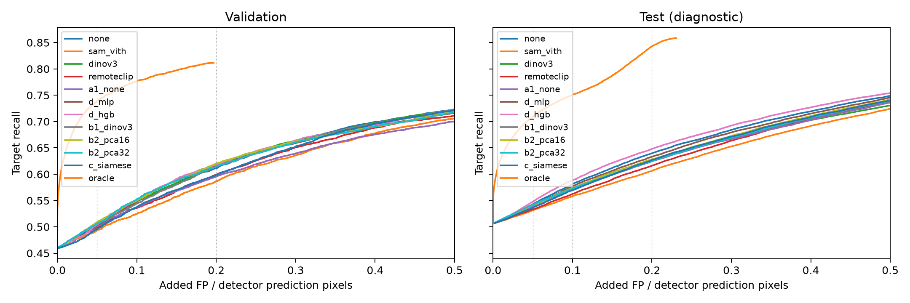
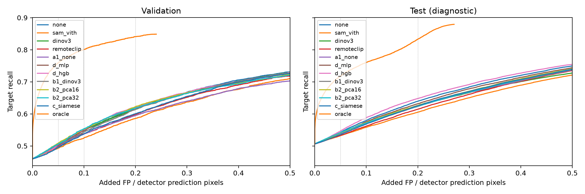
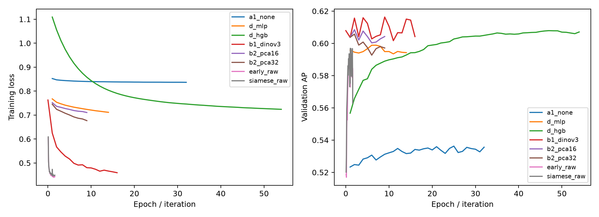
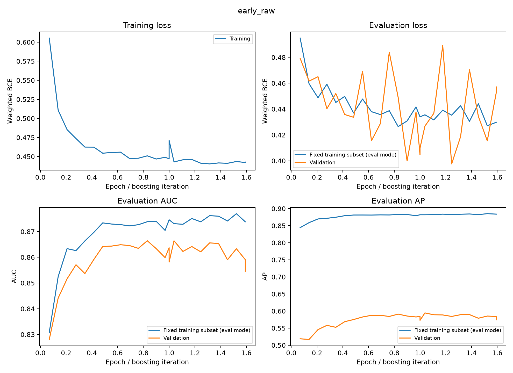
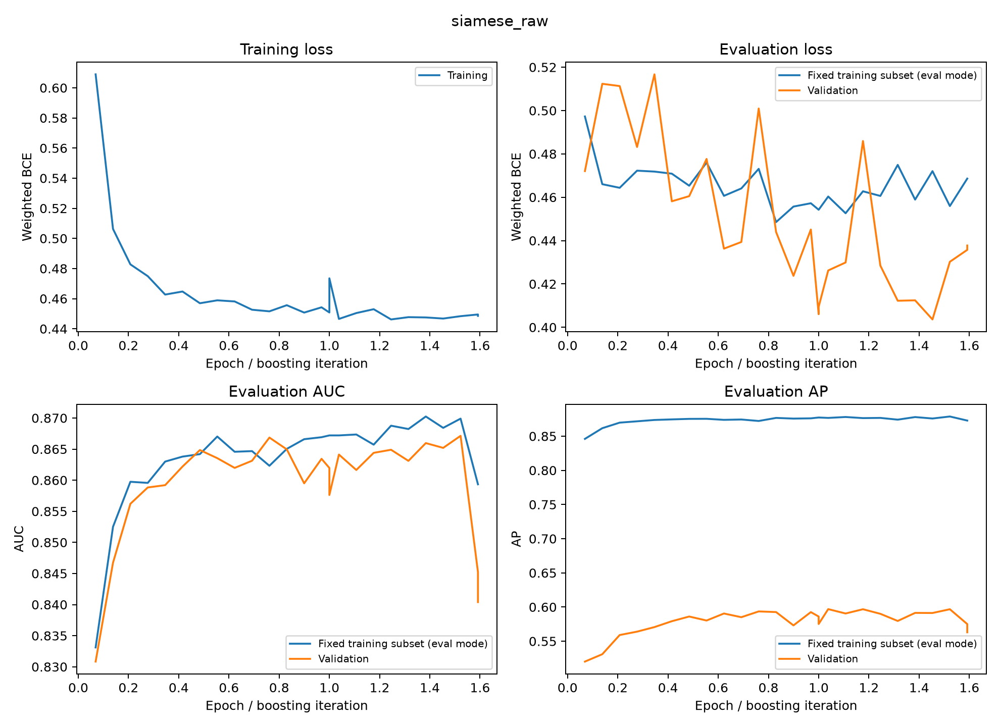
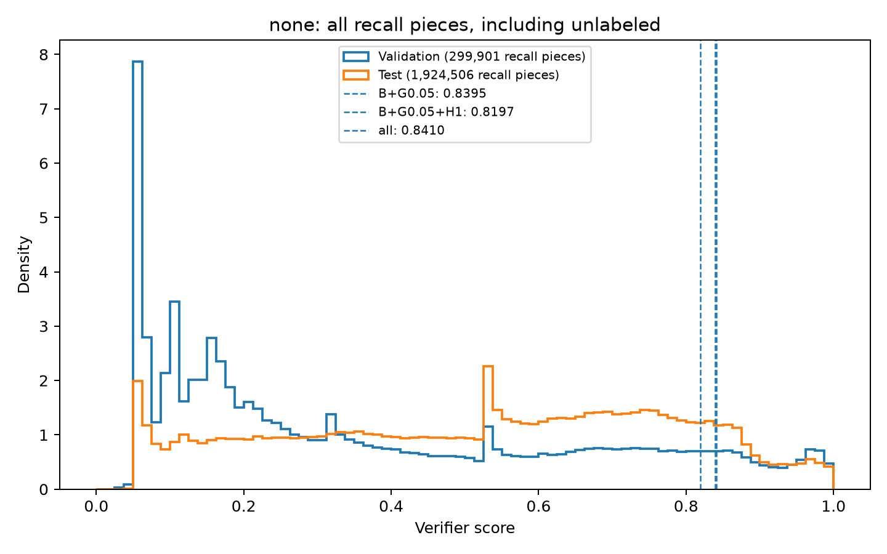

# 实验 6f：V1 验证器的诊断与变体

任务：`doc/exp6f_v1_variants.md`。本轮检查概率刻度、上下文特征、图像特征用法和原分辨率小网络能否改善 6b 的补漏结果。

**结果**：已评估变体的测试补漏 ΔF1 最高为 0.00 个百分点，对应不并入任何切块。D-HGB 在固定新增 FP 预算下的目标召回优于 none，但验证集选定的补漏阈值仍未带来测试 F1 正增益。结论限于这些 V1 变体。

## 做了什么

沿用 6b 的 SECOND 候选池与按图划分：2,671 张训练、297 张验证；常规表格模型使用 2,555,543 个有标签训练切块，验证分类使用 286,287 块。特征、超参数、早停、阈值或预算 k 的选择只看验证集；测试集用于冻结版本的最终评估。检测器不重训，候选和特征不使用真值语义图；A3 未执行。数据规模来源：`variants/a1_none/val_metrics.json`。

- **A1 none**：把四个检测器概率统计量换成切块在本图补漏候选中的百分位排名，重训元数据 MLP。
- **A2 none / DINOv3**：复用 6b 分数，按图从高到低并入完整切块，新增并集像素达到检测器预测像素数乘 k 后停止，k 由验证集选择。
- **D-MLP / D-HGB**：保留原始概率，加入多来源覆盖、与预测区域的距离、原候选、邻接及图像级特征，共 21 维，分别训练 MLP 和 `HistGradientBoostingClassifier`。
- **B1 DINOv3**：冻结 D-HGB 基线，在其 logit 上加 DINOv3 小 MLP 残差；残差输出层从零开始，采用 dropout 0.5 和权重衰减 0.01。
- **B2 PCA16 / PCA32**：将图像特征限制为两期差异与余弦相似度，PCA 只在训练集拟合，分别保留 16 / 32 维，再拼接元数据训练 MLP。
- **C 早融合 / 孪生**：从切块附近裁取 64×64 两期 RGB、掩码与原始检测器概率，共 8 通道，训练小 CNN；按全验证集 AP 选择孪生版本进入测试。

A2 的 k 是比例：如 0.001 表示 0.1%。最后一个完整切块可能超出预算；检测器预测为空的图使用当前完整数据集的平均预测面积作基数（second_cv 44,784.34、second 48,189.72 像素，均包含空预测图且不读取真值）。这是新增总像素预算，与后文的新增 FP 预算不同。来源：`variants/a2_{none,dinov3}/thresholds_second_cv.json`、`variants/exp6f_report.md`。

**C 的训练与选择范围**：训练使用 739,826 块（390,338 正块、349,488 负块）；fit 缓存共 1,107,826 块，约 34 GiB，包含验证打分行。每 200 步在固定的 16,384 块验证监测集上按 AP 选检查点，两个模型的最佳步均为 3,000（约第 1.038 轮），4,600 步时在第 2 轮触发耐心早停。最终比较全验证集 AP：早融合 0.5825、孪生 0.5850，选择孪生。second_cv 只打分 297 张验证图的 368,000 行，其余行留为 NaN；有标签分类子集为 286,287 块。测试 all 缓存约 71 GiB。来源：`variants/c/{early_raw,siamese_raw}/{config.json,val_metrics.json,scores_second_cv.json}`、`variants/c/selection.json`；缓存规模见 `variants/c/cache_*/shard_*/manifest.json`。

## 结果

### 1. 切块分类与召回 80% 时的新增像素精度

AUC / AP 范围为 0–1；其余列为百分数。FPR@80/90 是在当前数据集达到有标签正块召回 80% / 90% 时的负块误检率。新增像素精度统计对应分数阈值下并入的像素，属于诊断口径；测试集诊断阈值不用于端到端选阈值。新增像素精度超过原检测器 F1/2，纯补漏才会提高 F1。

**验证集**

| 版本 | AUC | AP | FPR@80% | FPR@90% | 新增像素精度% | F1/2% |
| --- | --- | --- | --- | --- | --- | --- |
| none | 0.8674 | 0.5945 | 22.68 | 36.29 | 25.79 | 35.70 |
| SAM ViT-H | 0.8125 | 0.5047 | 33.62 | 56.51 | 18.22 | 35.70 |
| DINOv3 | 0.8450 | 0.5776 | 26.99 | 46.53 | 22.58 | 35.70 |
| RemoteCLIP | 0.8252 | 0.5210 | 30.44 | 52.67 | 20.04 | 35.70 |
| A1 none | 0.8400 | 0.5363 | 28.75 | 45.31 | 21.06 | 35.70 |
| A2 none | 0.8674 | 0.5945 | 22.68 | 36.29 | 25.79 | 35.70 |
| A2 DINOv3 | 0.8450 | 0.5776 | 26.99 | 46.53 | 22.58 | 35.70 |
| D-MLP | 0.8682 | 0.5988 | 22.89 | 37.61 | 24.41 | 35.70 |
| D-HGB | 0.8762 | 0.6079 | 20.82 | 34.74 | 26.94 | 35.70 |
| B1 DINOv3 | 0.8794 | 0.6163 | 20.51 | 33.46 | 27.89 | 35.70 |
| B2 PCA16 | 0.8729 | 0.6085 | 21.59 | 36.14 | 26.47 | 35.70 |
| B2 PCA32 | 0.8727 | 0.6057 | 21.71 | 35.95 | 26.28 | 35.70 |
| C 早融合 | 0.8608 | 0.5825 | 23.33 | 39.14 | 25.27 | 35.70 |
| C 孪生 | 0.8596 | 0.5850 | 23.17 | 38.61 | 25.42 | 35.70 |

来源：下方目录索引中各版本的 `eval_second_cv.json`，字段 `recall.overall` 与 `pixels.pixel_precision_at_recall_80`；对照汇总 `variants/exp6f_report.md`。

**测试集**

| 版本 | AUC | AP | FPR@80% | FPR@90% | 新增像素精度% | F1/2% |
| --- | --- | --- | --- | --- | --- | --- |
| none | 0.8745 | 0.6248 | 22.48 | 36.66 | 21.25 | 37.08 |
| SAM ViT-H | 0.8161 | 0.5008 | 32.72 | 52.85 | 16.54 | 37.08 |
| DINOv3 | 0.8325 | 0.5574 | 30.42 | 49.62 | 17.92 | 37.08 |
| RemoteCLIP | 0.8357 | 0.5266 | 28.42 | 45.60 | 18.46 | 37.08 |
| A1 none | 0.8484 | 0.5558 | 27.89 | 42.10 | 18.80 | 37.08 |
| A2 none | 0.8745 | 0.6248 | 22.48 | 36.66 | 21.25 | 37.08 |
| A2 DINOv3 | 0.8325 | 0.5574 | 30.42 | 49.62 | 17.92 | 37.08 |
| D-MLP | 0.8673 | 0.6098 | 23.72 | 38.00 | 20.71 | 37.08 |
| D-HGB | 0.8744 | 0.6260 | 22.87 | 36.46 | 21.28 | 37.08 |
| B1 DINOv3 | 0.8612 | 0.5854 | 24.59 | 39.23 | 21.00 | 37.08 |
| B2 PCA16 | 0.8751 | 0.6132 | 22.28 | 35.04 | 22.07 | 37.08 |
| B2 PCA32 | 0.8743 | 0.6115 | 22.56 | 35.20 | 21.90 | 37.08 |
| C 早融合 | 未评估 | 未评估 | 未评估 | 未评估 | 未评估 | 未评估 |
| C 孪生 | 0.8690 | 0.6100 | 24.17 | 37.51 | 21.51 | 37.08 |

来源：下方目录索引中各版本的 `eval_second.json`，字段 `recall.overall` 与 `pixels.pixel_precision_at_recall_80`；对照汇总 `variants/exp6f_report.md`。

D-HGB 验证 AUC 0.8762 超过 0.874，测试 AUC 0.8744 与 none 的 0.8745 几乎相同；测试新增像素精度仅从 21.25% 到 21.28%，距 37.08% 门槛仍差 15.80 个百分点。B2 PCA16 的测试精度最高，为 22.07%，仍差 15.01 个百分点。C 孪生测试 AUC / AP 为 0.8690 / 0.6100，低于 none 的 0.8745 / 0.6248。

### 2. 端到端补漏：验证阈值迁移后仍未转正

以下均为纯补漏 `pixels.recall/*`，ΔF1 单位为百分点；斜线依次表示验证 / 测试，TP / FP 是新增像素数。各来源组合分别在验证集选阈值或 k。检测器原始 F1 为 71.41% / 74.17%，P 为 77.92% / 77.56%，R 为 65.90% / 71.05%。来源：`verifier/none/eval_{second_cv,second}.json` 的 `pixels.baseline`。

**B+G0.05**

| 版本 | 验证阈值或 k | F1% 验证/测试 | P% 验证/测试 | R% 验证/测试 | ΔF1 验证/测试 | 新增 TP 验证/测试 | 新增 FP 验证/测试 |
| --- | --- | --- | --- | --- | --- | --- | --- |
| none | 0.839513 | 71.52 / 73.51 | 75.05 / 72.74 | 68.31 / 74.30 | +0.12 / -0.66 | 398,531 / 2,891,402 | 666,690 / 6,499,983 |
| SAM ViT-H | 0.981715 | 71.59 / 73.96 | 77.21 / 76.05 | 66.74 / 71.98 | +0.18 / -0.20 | 138,224 / 826,819 | 169,472 / 1,879,232 |
| DINOv3 | 0.907933 | 71.95 / 73.39 | 75.00 / 72.16 | 69.14 / 74.65 | +0.54 / -0.78 | 535,091 / 3,206,983 | 722,993 / 7,346,877 |
| RemoteCLIP | 0.959487 | 71.56 / 73.89 | 76.79 / 75.52 | 67.01 / 72.34 | +0.15 / -0.27 | 182,551 / 1,148,029 | 261,924 / 2,584,128 |
| A1 none | 0.929928 | 71.44 / 73.98 | 77.27 / 76.53 | 66.43 / 71.60 | +0.03 / -0.18 | 87,171 / 491,506 | 143,936 / 1,256,403 |
| A2 none | k=0.0 | 71.41 / 74.17 | 77.92 / 77.56 | 65.90 / 71.05 | +0.00 / +0.00 | 0 / 0 | 0 / 0 |
| A2 DINOv3 | k=0.002 | 71.42 / 74.16 | 77.77 / 77.40 | 66.03 / 71.18 | +0.01 / -0.01 | 21,487 / 109,510 | 33,695 / 207,808 |
| D-MLP | 0.806860 | 71.48 / 71.86 | 73.15 / 67.15 | 69.88 / 77.27 | +0.07 / -2.31 | 656,531 / 5,541,311 | 1,151,921 / 15,368,587 |
| D-HGB | 不并入 | 71.41 / 74.17 | 77.92 / 77.56 | 65.90 / 71.05 | +0.00 / +0.00 | 0 / 0 | 0 / 0 |
| B1 DINOv3 | 0.852767 | 72.31 / 73.42 | 74.47 / 71.26 | 70.27 / 75.72 | +0.90 / -0.74 | 721,327 / 4,159,389 | 893,595 / 8,897,301 |
| B2 PCA16 | 0.846888 | 71.75 / 73.61 | 74.95 / 72.54 | 68.82 / 74.71 | +0.34 / -0.56 | 481,829 / 3,261,682 | 714,785 / 6,893,183 |
| B2 PCA32 | 0.814881 | 71.76 / 72.88 | 73.50 / 69.55 | 70.11 / 76.54 | +0.36 / -1.29 | 694,789 / 4,891,491 | 1,090,313 / 11,543,264 |
| C 早融合 | 0.860134 | 71.42 / 未评估 | 77.79 / 未评估 | 66.01 / 未评估 | +0.01 / 未评估 | 17,661 / 未评估 | 28,282 / 未评估 |
| C 孪生 | 不并入 | 71.41 / 74.17 | 77.92 / 77.56 | 65.90 / 71.05 | +0.00 / +0.00 | 0 / 0 | 0 / 0 |

来源：目录索引中各版本的 `thresholds_second_cv.json`、`eval_{second_cv,second}.json`；只取 `pixels.recall/B+G0.05`。

**B+G0.05+H1**

| 版本 | 验证阈值或 k | F1% 验证/测试 | P% 验证/测试 | R% 验证/测试 | ΔF1 验证/测试 | 新增 TP 验证/测试 | 新增 FP 验证/测试 |
| --- | --- | --- | --- | --- | --- | --- | --- |
| none | 0.819682 | 71.54 / 72.85 | 72.80 / 68.86 | 70.33 / 77.34 | +0.14 / -1.31 | 731,832 / 5,604,789 | 1,256,092 / 12,858,536 |
| SAM ViT-H | 0.982461 | 71.61 / 73.90 | 76.78 / 75.56 | 67.09 / 72.32 | +0.20 / -0.27 | 196,636 / 1,125,515 | 266,643 / 2,533,091 |
| DINOv3 | 0.907963 | 72.03 / 73.29 | 73.87 / 71.09 | 70.28 / 75.63 | +0.62 / -0.87 | 723,121 / 4,083,521 | 1,020,902 / 9,096,784 |
| RemoteCLIP | 0.947347 | 71.61 / 73.67 | 75.91 / 74.16 | 67.78 / 73.18 | +0.20 / -0.49 | 309,682 / 1,899,007 | 469,272 / 4,401,887 |
| A1 none | 0.930055 | 71.44 / 73.98 | 76.99 / 76.34 | 66.64 / 71.76 | +0.03 / -0.18 | 122,480 / 629,925 | 205,970 / 1,498,382 |
| A2 none | k=0.001 | 71.41 / 74.15 | 77.83 / 77.46 | 65.97 / 71.11 | +0.00 / -0.01 | 11,227 / 54,384 | 19,462 / 124,681 |
| A2 DINOv3 | k=0.05 | 71.53 / 73.98 | 75.95 / 75.36 | 67.60 / 72.64 | +0.12 / -0.19 | 280,497 / 1,417,962 | 451,862 / 2,847,049 |
| D-MLP | 0.815079 | 71.53 / 71.75 | 71.91 / 65.94 | 71.16 / 78.69 | +0.12 / -2.41 | 867,691 / 6,803,453 | 1,507,062 / 17,899,482 |
| D-HGB | 0.849315 | 71.44 / 73.75 | 75.09 / 73.92 | 68.12 / 73.58 | +0.03 / -0.41 | 366,917 / 2,252,131 | 648,930 / 4,814,176 |
| B1 DINOv3 | 0.892824 | 72.38 / 73.77 | 74.54 / 72.21 | 70.34 / 75.39 | +0.97 / -0.40 | 733,570 / 3,863,310 | 884,419 / 7,536,013 |
| B2 PCA16 | 0.863117 | 71.87 / 73.66 | 74.50 / 72.19 | 69.41 / 75.19 | +0.46 / -0.50 | 579,636 / 3,690,302 | 838,722 / 7,493,470 |
| B2 PCA32 | 0.854978 | 71.84 / 73.39 | 73.67 / 70.82 | 70.10 / 76.16 | +0.43 / -0.77 | 693,109 / 4,549,381 | 1,052,640 / 9,649,092 |
| C 早融合 | 0.913368 | 71.41 / 未评估 | 77.92 / 未评估 | 65.90 / 未评估 | +0.00 / 未评估 | 4 / 未评估 | 6 / 未评估 |
| C 孪生 | 不并入 | 71.41 / 74.17 | 77.92 / 77.56 | 65.90 / 71.05 | +0.00 / +0.00 | 0 / 0 | 0 / 0 |

来源：目录索引中各版本的 `thresholds_second_cv.json`、`eval_{second_cv,second}.json`；只取 `pixels.recall/B+G0.05+H1`。

**all**

| 版本 | 验证阈值或 k | F1% 验证/测试 | P% 验证/测试 | R% 验证/测试 | ΔF1 验证/测试 | 新增 TP 验证/测试 | 新增 FP 验证/测试 |
| --- | --- | --- | --- | --- | --- | --- | --- |
| none | 0.840986 | 71.52 / 73.38 | 73.77 / 71.03 | 69.40 / 75.88 | +0.11 / -0.79 | 577,050 / 4,304,261 | 990,505 / 9,260,050 |
| SAM ViT-H | 0.982236 | 71.58 / 73.87 | 76.66 / 75.41 | 67.14 / 72.40 | +0.17 / -0.29 | 204,374 / 1,197,381 | 292,563 / 2,715,894 |
| DINOv3 | 0.940500 | 72.04 / 73.58 | 74.54 / 72.08 | 69.71 / 75.13 | +0.63 / -0.59 | 629,360 / 3,637,250 | 849,367 / 7,618,926 |
| RemoteCLIP | 0.947347 | 71.60 / 73.64 | 75.82 / 74.02 | 67.83 / 73.27 | +0.19 / -0.52 | 319,043 / 1,978,550 | 489,371 / 4,602,544 |
| A1 none | 0.930055 | 71.44 / 73.97 | 76.96 / 76.31 | 66.66 / 71.77 | +0.03 / -0.19 | 124,949 / 643,524 | 211,929 / 1,536,771 |
| A2 none | k=0.002 | 71.41 / 74.14 | 77.79 / 77.41 | 66.00 / 71.14 | +0.00 / -0.02 | 15,836 / 77,532 | 27,960 / 180,725 |
| A2 DINOv3 | k=0.05 | 71.54 / 73.99 | 75.95 / 75.38 | 67.61 / 72.66 | +0.13 / -0.17 | 282,792 / 1,428,228 | 451,157 / 2,834,753 |
| D-MLP | 0.879986 | 71.47 / 73.37 | 74.59 / 72.11 | 68.60 / 74.66 | +0.07 / -0.80 | 446,368 / 3,216,212 | 774,778 / 7,413,712 |
| D-HGB | 不并入 | 71.41 / 74.17 | 77.92 / 77.56 | 65.90 / 71.05 | +0.00 / +0.00 | 0 / 0 | 0 / 0 |
| B1 DINOv3 | 0.892824 | 72.38 / 73.72 | 74.33 / 71.98 | 70.53 / 75.55 | +0.97 / -0.44 | 764,499 / 4,007,813 | 937,658 / 7,893,771 |
| B2 PCA16 | 0.863117 | 71.92 / 73.57 | 74.30 / 71.81 | 69.68 / 75.43 | +0.51 / -0.59 | 624,224 / 3,899,399 | 895,780 / 8,076,776 |
| B2 PCA32 | 0.847914 | 71.85 / 73.17 | 73.08 / 69.83 | 70.66 / 76.83 | +0.44 / -1.00 | 785,429 / 5,148,453 | 1,214,064 / 11,258,096 |
| C 早融合 | 0.913368 | 71.41 / 未评估 | 77.92 / 未评估 | 65.90 / 未评估 | +0.00 / 未评估 | 4 / 未评估 | 6 / 未评估 |
| C 孪生 | 不并入 | 71.41 / 74.17 | 77.92 / 77.56 | 65.90 / 71.05 | +0.00 / +0.00 | 0 / 0 | 0 / 0 |

来源：目录索引中各版本的 `thresholds_second_cv.json`、`eval_{second_cv,second}.json`；只取 `pixels.recall/all`。

A1 的 B+G0.05+H1 为验证 +0.03383、测试 −0.18430；A2 none 为验证 +0.00177、测试 −0.01406 个百分点（验证值在表中显示为 +0.00，实际略正）。A2 DINOv3 为 +0.12 / −0.19。它们缩小降幅，但没有使实际补漏在验证和测试上都获得正增益。A2 none 在 B+G0.05 选 k=0；D-HGB 在 B+G0.05 与 all、C 孪生在全部组合选不并入，0.00 来自原预测保持不变。

**C 早融合记录差异**：两个 C 版本在验证端到端两位小数下均为 +0.00；早融合 `eval_second_cv.json` 与 `thresholds_second_cv.json` 实际一致记录：B+G0.05 新增 TP / FP 为 17,661 / 28,282，ΔF1 +0.008242；B+G0.05+H1 与 all 为 4 / 6，ΔF1 +0.00000282。上表按原始 JSON 列数。孪生的验证和测试均确实不并入；早融合未做测试，选择仍按全验证 AP。

**目标级召回（B+G0.05+H1）**：以全部真值目标为分母，预测覆盖目标至少 50% 像素即命中；有语义转移信息时按转移定义目标。面积单位为像素，中间桶包含 100 与 1,000。斜线依次为验证 / 测试，单位 %。

| 版本 | 全部 | <100 | 100–1,000 | >1,000 |
| --- | --- | --- | --- | --- |
| 原检测器 | 45.95 / 50.62 | 34.18 / 47.20 | 41.76 / 44.10 | 65.40 / 68.67 |
| none | 53.98 / 61.59 | 42.90 / 58.42 | 50.46 / 56.17 | 71.72 / 77.51 |
| SAM ViT-H | 47.39 / 52.13 | 35.90 / 48.59 | 43.07 / 45.81 | 66.69 / 70.23 |
| DINOv3 | 52.85 / 57.75 | 41.14 / 54.41 | 49.43 / 52.00 | 71.21 / 74.53 |
| RemoteCLIP | 48.62 / 53.49 | 37.35 / 50.13 | 44.55 / 47.19 | 67.32 / 71.08 |
| A1 none | 47.21 / 51.84 | 35.81 / 48.54 | 43.04 / 45.18 | 66.21 / 69.73 |
| A2 none | 46.08 / 50.78 | 34.31 / 47.39 | 41.87 / 44.22 | 65.54 / 68.76 |
| A2 DINOv3 | 48.89 / 53.30 | 37.60 / 50.07 | 45.00 / 46.93 | 67.39 / 70.62 |
| D-MLP | 55.61 / 64.26 | 45.31 / 61.64 | 52.30 / 58.87 | 72.17 / 78.61 |
| D-HGB | 50.08 / 55.65 | 39.01 / 52.69 | 46.25 / 49.25 | 68.25 / 72.23 |
| B1 DINOv3 | 51.45 / 56.61 | 39.82 / 53.34 | 47.25 / 50.35 | 70.73 / 73.89 |
| B2 PCA16 | 51.73 / 56.90 | 39.70 / 53.26 | 48.56 / 51.52 | 70.13 / 74.02 |
| B2 PCA32 | 53.14 / 58.29 | 41.49 / 54.52 | 50.04 / 53.35 | 71.02 / 75.25 |
| C 早融合 | 45.95 / 未评估 | 34.18 / 未评估 | 41.76 / 未评估 | 65.40 / 未评估 |
| C 孪生 | 45.95 / 50.62 | 34.18 / 47.20 | 41.76 / 44.10 | 65.40 / 68.67 |

来源：各版本 `eval_{second_cv,second}.json` 的 `pixels.baseline.target_recall` 与 `pixels.recall/B+G0.05+H1.target_recall`；定义见 `variants/recall_priority/*_second.json` 的 `target_rule`。

### 3. 召回优先：固定新增 FP 预算

横轴为新增 FP 像素 / 原检测器预测变化像素，纵轴为全部目标召回。预算点取实际 FP 不超过 5% / 10% / 20% 的完整曲线点中最高召回，不插值。测试曲线使用测试真值计数，属于事后诊断，不能当作验证集选好阈值后保证达到的测试收益。oracle 按切块真值占比排序，提供候选切块可达到的对照；它不参与模型选择。

下表每格依次为 **5% / 10% / 20%** FP 预算下的目标召回（%）。原检测器行是零新增 FP 的参考，三个值相同。A2 不改变原模型打分且没有独立 FP 预算曲线，因此对应的分数排序诊断沿用 none / DINOv3；这不等同于 A2 每图预算策略的曲线。

**验证集**

| 版本 | B+G0.05 | B+G0.05+H1 | all |
| --- | --- | --- | --- |
| 原检测器 | 45.95 / 45.95 / 45.95 | 45.95 / 45.95 / 45.95 | 45.95 / 45.95 / 45.95 |
| none | 49.75 / 53.46 / 59.18 | 50.23 / 54.72 / 61.15 | 50.25 / 54.86 / 61.38 |
| SAM ViT-H | 48.98 / 51.95 / 57.62 | 49.38 / 52.48 / 58.67 | 49.31 / 52.47 / 58.61 |
| DINOv3 | 50.34 / 53.98 / 59.85 | 50.63 / 55.03 / 61.58 | 50.68 / 55.00 / 61.43 |
| RemoteCLIP | 49.80 / 53.07 / 58.68 | 49.86 / 53.61 / 59.92 | 49.87 / 53.80 / 59.85 |
| A1 none | 49.51 / 52.72 / 57.72 | 50.12 / 53.73 / 59.57 | 50.05 / 53.68 / 59.47 |
| D-MLP | 49.95 / 53.99 / 59.39 | 50.24 / 54.80 / 61.66 | 50.11 / 54.80 / 61.85 |
| D-HGB | 50.05 / 54.13 / 59.81 | 50.43 / 55.11 / 61.80 | 50.44 / 55.13 / 62.07 |
| B1 DINOv3 | 50.01 / 53.82 / 59.65 | 50.63 / 54.41 / 61.49 | 50.49 / 54.36 / 61.37 |
| B2 PCA16 | 50.20 / 53.87 / 59.03 | 50.93 / 54.95 / 62.03 | 50.85 / 55.21 / 62.18 |
| B2 PCA32 | 50.26 / 53.92 / 59.20 | 50.56 / 55.19 / 61.44 | 50.56 / 55.34 / 61.85 |
| C 孪生 | 49.39 / 52.67 / 58.29 | 49.57 / 53.73 / 59.86 | 49.49 / 53.87 / 60.05 |
| oracle | 67.03 / 70.25 / 71.46 | 73.86 / 77.67 / 81.14 | 75.88 / 80.08 / 84.09 |

来源：`variants/recall_priority/{none,sam_vith,dinov3,remoteclip,a1_none,d_mlp,d_hgb,b1_dinov3,b2_pca16,b2_pca32,c_siamese,oracle}_second_cv.json` 的 `combinations.*.budgets`；检测器行取 `baseline_hits / totals`，与端到端基线一致。

**测试集**

| 版本 | B+G0.05 | B+G0.05+H1 | all |
| --- | --- | --- | --- |
| 原检测器 | 50.62 / 50.62 / 50.62 | 50.62 / 50.62 / 50.62 | 50.62 / 50.62 / 50.62 |
| none | 54.04 / 57.37 / 62.69 | 54.29 / 58.13 / 63.97 | 54.20 / 57.94 / 63.93 |
| SAM ViT-H | 53.17 / 55.57 / 60.39 | 53.15 / 55.80 / 60.61 | 53.19 / 55.81 / 60.53 |
| DINOv3 | 53.96 / 56.75 / 61.94 | 54.02 / 57.23 / 62.59 | 53.96 / 57.12 / 62.38 |
| RemoteCLIP | 53.38 / 56.15 / 61.20 | 53.29 / 56.24 / 61.62 | 53.29 / 56.16 / 61.44 |
| A1 none | 53.79 / 56.68 / 61.58 | 53.89 / 57.10 / 62.44 | 53.88 / 57.02 / 62.32 |
| D-MLP | 54.10 / 57.36 / 62.46 | 54.25 / 57.72 / 63.32 | 54.13 / 57.50 / 63.15 |
| D-HGB | 54.70 / 58.22 / 63.64 | 54.73 / 58.85 / 64.80 | 54.65 / 58.79 / 64.79 |
| B1 DINOv3 | 54.11 / 56.95 / 62.07 | 54.12 / 57.03 / 62.49 | 54.06 / 56.91 / 62.34 |
| B2 PCA16 | 53.96 / 57.00 / 61.91 | 54.10 / 57.40 / 62.85 | 54.06 / 57.28 / 62.64 |
| B2 PCA32 | 53.96 / 56.80 / 61.80 | 54.19 / 57.26 / 62.50 | 54.17 / 57.13 / 62.41 |
| C 孪生 | 53.70 / 56.85 / 61.96 | 53.60 / 56.94 / 62.68 | 53.54 / 56.80 / 62.51 |
| oracle | 67.81 / 71.79 / 79.67 | 70.89 / 75.09 / 84.29 | 71.78 / 76.03 / 83.30 |

来源：`variants/recall_priority/{none,sam_vith,dinov3,remoteclip,a1_none,d_mlp,d_hgb,b1_dinov3,b2_pca16,b2_pca32,c_siamese,oracle}_second.json` 的 `combinations.*.budgets`；检测器行取 `baseline_hits / totals`，与端到端基线一致。

测试 B+G0.05+H1 下，D-HGB 在 5% / 10% / 20% 预算达到 54.73% / 58.85% / 64.80%，比原检测器 50.62% 提高 4.11 / 8.23 / 14.18 个百分点，比 none 提高 0.44 / 0.73 / 0.83 个百分点；oracle 为 70.89% / 75.09% / 84.29%。D-HGB 在所列三个来源组合和三个测试预算点均为已评估学习模型中最高，但这一比较仅描述测试结果。

[B+G0.05 曲线](../figures/exp6f/recall_B+G0.05.png)。图中颜色循环使用：最高的橙色曲线是 oracle，与 sam_vith 同色；c_siamese 与 none 同色，读数以表格为准。来源为 `variants/recall_priority/` 下同名 PNG，预算数值以 JSON 为准。

### 4. D 的特征组消融与重要性

消融均重新训练 D-HGB，按验证 AP 早停；ΔAUC / ΔAP 为删除该组后减完整模型，使用 0–1 原始尺度。

| 删除组 | 验证 AUC | 验证 AP | ΔAUC | ΔAP |
| --- | --- | --- | --- | --- |
| 完整模型 | 0.8762 | 0.6079 | — | — |
| 检测器概率（probability） | 0.8681 | 0.5765 | -0.0081 | -0.0314 |
| 面积与切细（geometry） | 0.8727 | 0.6061 | -0.0036 | -0.0017 |
| 来源覆盖（sources） | 0.8706 | 0.5996 | -0.0057 | -0.0082 |
| 预测距离与相邻（distance） | 0.8756 | 0.6091 | -0.0006 | +0.0012 |
| 原候选上下文（candidate） | 0.8728 | 0.6048 | -0.0035 | -0.0031 |
| 邻接切块（adjacency） | 0.8763 | 0.6095 | +0.0001 | +0.0016 |
| 图像级统计（image） | 0.8750 | 0.6045 | -0.0012 | -0.0034 |

来源：`variants/d_hgb/val_metrics.json`、`variants/d_hgb/ablations/*/val_metrics.json` 的 `recall.overall`。

验证集随机置换重要性：固定 30,000 个样本，重复 3 次；数值为置换该列后指标的下降量。

| 特征 | AUC 下降均值 | AUC 下降标准差 | AP 下降均值 |
| --- | --- | --- | --- |
| prob_mean | 0.1219 | 0.0010 | 0.2660 |
| prob_max | 0.0001 | 0.0001 | 0.0047 |
| prob_min | 0.0056 | 0.0004 | 0.0078 |
| prob_p90 | 0.0012 | 0.0002 | 0.0142 |
| log_area | 0.0037 | 0.0003 | 0.0044 |
| split | 0.0000 | 0.0000 | 0.0001 |
| source_count | 0.0001 | 0.0000 | -0.0000 |
| covers_B | 0.0033 | 0.0001 | 0.0032 |
| covers_G0.05 | 0.0005 | 0.0000 | 0.0026 |
| covers_C1 | 0.0012 | 0.0001 | 0.0022 |
| covers_C2 | 0.0074 | 0.0003 | 0.0076 |
| covers_H1 | 0.0055 | 0.0003 | 0.0057 |
| prediction_distance | 0.0002 | 0.0002 | -0.0003 |
| prediction_adjacent | 0.0000 | 0.0000 | 0.0000 |
| candidate_log_area | 0.0017 | 0.0001 | 0.0025 |
| candidate_piece_count | 0.0004 | 0.0001 | 0.0004 |
| other_piece_probability | 0.0147 | 0.0009 | 0.0142 |
| neighbor_candidate_fraction | 0.0000 | 0.0000 | 0.0000 |
| neighbor_probability | 0.0001 | 0.0000 | 0.0001 |
| image_prediction_fraction | 0.0002 | 0.0002 | -0.0001 |
| image_recall_piece_count | 0.0038 | 0.0004 | 0.0100 |

来源：`variants/d_hgb/importance.json` 的 `features`、`metrics`。

检测器概率仍提供最多信息：删除概率组令验证 AUC 下降 0.0081；单列置换 `prob_mean` 令 AUC 下降 0.1219。新增特征中，同一候选其他切块的概率均值下降 0.0147，图像候选块数下降 0.0038；距离与邻接项贡献很小。整组删除后重训与固定模型单列置换测量的对象不同，下降量不能直接相加，也不能据此单独归因树模型和上下文各自带来多少收益。

### 5. 训练曲线与分数分布

6b 的 30 轮诊断重跑中，三个骨干版本在第 1 轮就出现训练 / 验证 AUC 差距：SAM 0.886 / 0.809、DINOv3 0.928 / 0.857、RemoteCLIP 0.909 / 0.825。到第 30 轮，训练 AUC 达到 0.987–0.999，验证 AUC 为 0.799–0.836，验证 loss 同时上升，支持“背训练图”的判断。none 的第 1 / 30 轮训练 AUC 为 0.861 / 0.864、验证为 0.862 / 0.867，未见同类过拟合。来源：`results/exp6b_verifier.md` 的学习曲线节；该图来自仓库现有 `figures/exp6f/v1_curves.png`，与原早停训练日志区分。

B1 仍有过拟合：第 16 轮训练子集 AUC 0.9605、验证 0.8755；B2 PCA16 / PCA32 第 9 轮分别为 0.8848 / 0.8714、0.8950 / 0.8685，差距较小但没有消失。D-HGB 最佳为第 47 次迭代，验证 AP 0.6079；A1 最佳为第 25 轮，AP 0.5363。来源：对应 `train_log.jsonl` 与 `val_metrics.json`。单版本图见 [A1](../figures/exp6f/a1_none_curves.png)、[D-MLP](../figures/exp6f/d_mlp_curves.png)、[D-HGB](../figures/exp6f/d_hgb_curves.png)、[B1](../figures/exp6f/b1_dinov3_curves.png)、[B2 PCA16](../figures/exp6f/b2_pca16_curves.png)、[B2 PCA32](../figures/exp6f/b2_pca32_curves.png)。

C 在本次短训练中没有骨干版本那种明显背图现象：最佳步的孪生训练 / 验证监测 AUC 为 0.8672 / 0.8641，loss 未持续分离。它很早进入平台期并在第 2 轮停止，不能据此断言延长训练也不会过拟合。训练监测集正例率较高，AP 与验证 AP 的绝对差距不能直接解读为背图；曲线还混有固定验证监测集和轮末全验证点，需按日志的 `val_scope` 区分。来源：`variants/c/{early_raw,siamese_raw}/train_log.jsonl`。

分布图包含无标签补漏切块。测试分数在中高分区的密度较高，说明同一阈值对应的候选分布发生变化；该图及 A1/A2 只能支持存在分布差异，不能单独证明检测器概率刻度就是端到端失效的原因。来源：`variants/figures/diagnostics/none_score_distribution.png`。

### 6. 中位面积尺度审查（review6 P1，方案 A）

用训练集漏检目标重新统计尺度，测试统计仅用于核对已冻结值。对象按语义转移的 8 连通区域定义，面积至少 20 像素，检测器覆盖率小于 0.1；检测器预测统一使用保存概率 >0.5。

| 范围 | 图数 | 符合条件的漏检目标数 | 中位面积（像素） |
| --- | --- | --- | --- |
| 训练全集 | 2968 | 31269 | 299 |
| 验证器训练子集 | 2671 | 28328 | 302 |
| 验证子集 | 297 | 2941 | 272 |
| 测试复算 | 1694 | 14885 | 298 |

来源：`geometry/second_cv_train.json` 与 `geometry/second_check_frozen.json` 的 `subsets`。

训练全集 / 验证器训练子集为 299 / 302 像素，接近冻结尺度 298；测试复算仍为 298，验证子集为 272。本次按方案 A 保留已有候选池，判断尺度依赖对本轮结论可忽略，未重建池。该审查提供尺度接近的证据，没有直接测量重新建池后的指标变化。保存二值掩码与概率 >0.5 有少量差异，统计采用后者，避免混用口径。

### 7. 耗时与结果目录

训练耗时取 `val_metrics.json.seconds`，为训练程序记录的经过时间，不能当作独占 GPU 时间或 CPU 核时。A2 复用已有模型，训练耗时不重复计入；特征提取、候选池构建与端到端评估缺少本次所读文件中的独立完整计时，标为“未记录”。

| 版本 | 最佳轮次/迭代 | 训练秒 | 验证/测试打分秒 | 端到端评估秒 | 目录（相对 O） |
| --- | --- | --- | --- | --- | --- |
| none | 25 | 314.4 | 未记录 / 未记录 | 未记录 | `verifier/none/` |
| SAM ViT-H | 5 | 714.2 | 未记录 / 未记录 | 未记录 | `verifier/sam_vith/` |
| DINOv3 | 7 | 788.9 | 未记录 / 未记录 | 未记录 | `verifier/dinov3/` |
| RemoteCLIP | 1 | 439.4 | 未记录 / 未记录 | 未记录 | `verifier/remoteclip/` |
| A1 none | 25 | 277.1 | 未记录 / 未记录 | 未记录 | `variants/a1_none/` |
| A2 none | 复用 6b | 不新增训练 | 未记录 | 未记录 | `variants/a2_none/` |
| A2 DINOv3 | 复用 6b | 不新增训练 | 未记录 | 未记录 | `variants/a2_dinov3/` |
| D-MLP | 7 | 81.3 | 未记录 / 未记录 | 未记录 | `variants/d_mlp/` |
| D-HGB | 47 | 132.7 | 未记录 / 未记录 | 未记录 | `variants/d_hgb/` |
| B1 DINOv3 | 9 | 1669.8 | 未记录 / 未记录 | 未记录 | `variants/b1_dinov3/` |
| B2 PCA16 | 2 | 628.9 | 未记录 / 未记录 | 未记录 | `variants/b2_pca16/` |
| B2 PCA32 | 2 | 632.9 | 未记录 / 未记录 | 未记录 | `variants/b2_pca32/` |
| C 早融合 | 1.038 | 324.7 | 91.8 / 未评估 | 未记录 | `variants/c/early_raw/` |
| C 孪生 | 1.038 | 824.7 | 92.3 / 156.5 | 未记录 | `variants/c/siamese_raw/` |

来源：目录索引所列路径的 `val_metrics.json`、`train_log.jsonl`；C 打分取 `scores_second_cv.json` 与 `scores_second.json`。C 的 1.038 是分数轮次，停止发生在第 2 轮。

候选池构建耗时：未记录；6b 骨干特征提取耗时：未记录；B1 前置交叉拟合基线的完整成本：未记录。各主模型训练耗时不包含这些前置成本，记录字段中的前置计时为 0 不解释为实际成本为零。D 消融耗时如下；这些独立重训未计入 D-HGB 主模型一行。

| 消融删除组 | 训练秒 |
| --- | --- |
| adjacency | 147.4 |
| candidate | 224.3 |
| distance | 257.8 |
| geometry | 157.3 |
| image | 128.0 |
| probability | 180.6 |
| sources | 148.3 |

来源：`variants/d_hgb/ablations/*/val_metrics.json` 的 `seconds`。

**目录索引与复核范围**：上表 O 为 `/guisongxia01/pangchao/wangyihan/Chang-Agent/outputs/CD_1016_probe/exp6`。常规模型训练日志为目录内 `train_log.jsonl`，模型选择记录为 `val_metrics.json`，阈值为 `thresholds_second_cv.json`，验证 / 测试评估为 `eval_second_cv.json` / `eval_second.json`；A2 的训练日志分别复用 `verifier/none/` 和 `verifier/dinov3/`。汇总表为 `variants/exp6f_report.md`。汇总表尾部“C 不在本批”已落后于现有 C JSON，本稿包含已完成的 C 孪生测试。

DINOv3 为卫星版 ViT-L/16（SAT-493M）权重，见 `results/env.md` 的更正记录。

## 对四个判断问题的回答

1. **验证集为正、测试集为负，是否由检测器概率刻度不同造成？A1/A2 能否让两者符号一致？**

   现有证据不能确认因果。B+G0.05+H1 下，none 为 +0.14 / −1.31；A1 为 +0.03383 / −0.18430；A2 none 为 +0.00177 / −0.01406；A2 DINOv3 为 +0.12 / −0.19，实际补漏仍然验证正、测试负。A2 none 的 B+G0.05 两边均为零来自 k=0。分数分布变化与刻度偏移假说相容，但 A1 同时损失分类能力（测试 AUC 0.8745 → 0.8484），A2 同时压缩并入量，A3 未做，无法据此确定原因或排除其他分布差异。

2. **上下文特征或树模型能否把 AUC 提到 0.874 以上，并让召回 80% 时的像素精度明显接近 37%？**

   D-HGB 验证 / 测试 AUC 为 0.8762 / 0.8744，数值上超过 0.874，但测试与 none 的 0.8745 相当；D-MLP 测试仅 0.8673。D-HGB 测试召回 80% 像素精度为 21.28%，较 none 的 21.25% 只高 0.03 个百分点，距 37.08% 仍差 15.80 个百分点，未明显接近门槛。

3. **图像特征在受限（B）或原分辨率（C）条件下，能否在表格基线上带来增益？**

   B1 相对直接基线 D-HGB 的验证 AP 从 0.6079 到 0.6163，但测试从 0.6260 降到 0.5854；B+G0.05+H1 测试 ΔF1 为 −0.40，D-HGB 为 −0.41，all 下 B1 为 −0.44、D-HGB 为 0.00，不能认定获得稳定收益。B2 PCA16 / PCA32 测试 AUC 为 0.8751 / 0.8743、AP 为 0.6132 / 0.6115，召回 80% 像素精度为 22.07% / 21.90%，有局部指标改善但 F1 仍为负。C 孪生测试 AUC / AP 为 0.8690 / 0.6100，低于 none；ΔF1 0.00 来自不并入。B/C 在所列测试 FP 预算点的目标召回均低于 D-HGB。当前未显示稳定、可迁移的图像特征收益；小差异未做重复种子或显著性检验。

4. **所有变体中测试集 ΔF1 最好是多少？在召回优先口径下，固定 FP 预算时目标级召回能提高多少？**

   纯补漏测试 ΔF1 最高 0.00：C 孪生全部组合、A2 none 的 B+G0.05、D-HGB 的 B+G0.05 与 all 均未并入；没有正增益。实际并入的配置中 A2 DINOv3 的 B+G0.05 最接近零，为 −0.00954 个百分点；若固定 B+G0.05+H1，则 A2 none 最接近零，为 −0.01406。固定 FP 预算诊断中，D-HGB 的 B+G0.05+H1 在 5% / 10% / 20% 达到 54.73% / 58.85% / 64.80%，比原检测器提高 4.11 / 8.23 / 14.18 个百分点；同预算 oracle 为 70.89% / 75.09% / 84.29%。这些测试预算收益是事后诊断，尚未通过验证集选预算工作点再迁移到测试来验证。
