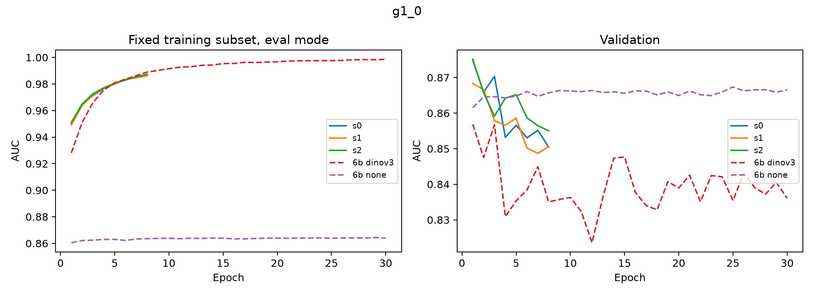
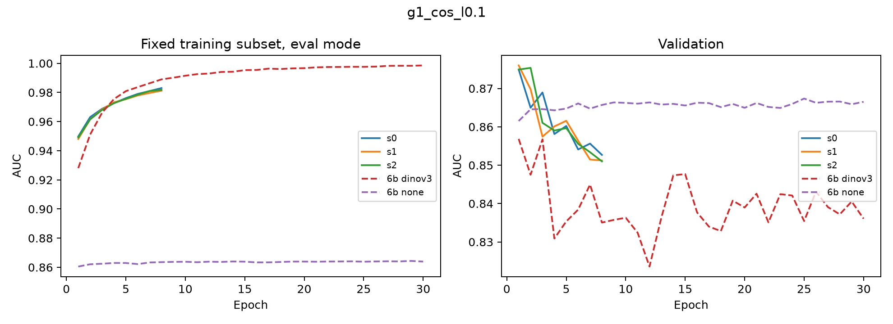
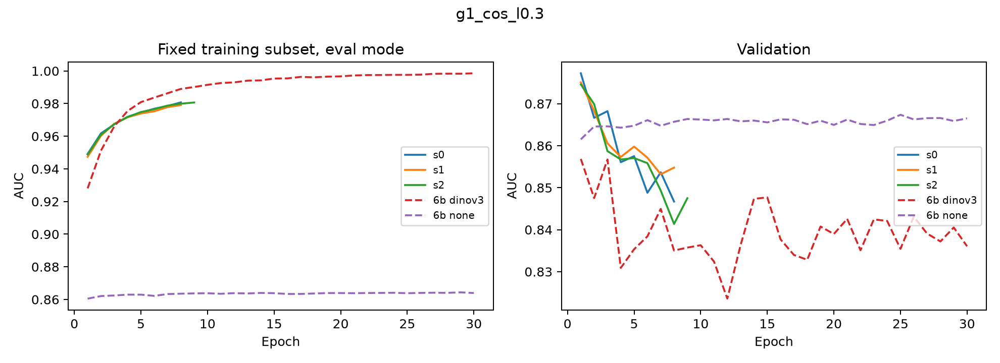
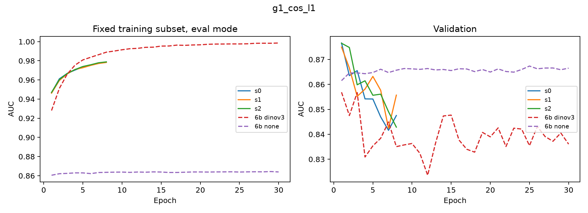
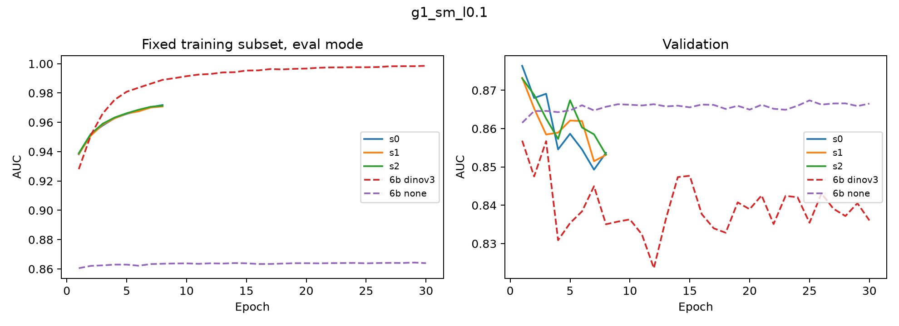
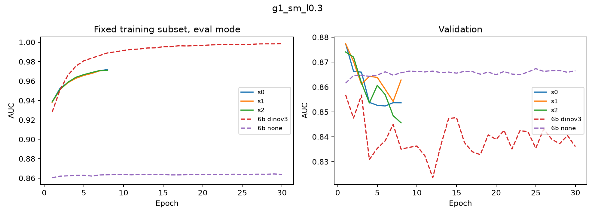
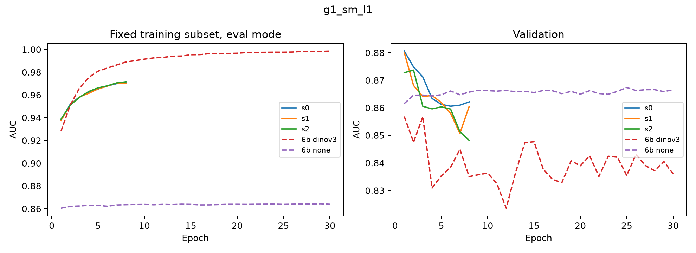

# 实验 6h：时相约束辅助损失

任务见 `doc/exp6h_temporal_consistency.md`。本页目前只有 6h-1（256 维 DINOv3 切块特征 + 投影头），6h-2（6f-C 原分辨率孪生网络）在做，完成后补在后面。

## 结论（6h-1，2026-10-21）

| 设置 | 验证 AUC | 测试 AUC | 测试 AP | 验证 ΔF1 | 测试 ΔF1 | 召回 80% 时补入像素精度（测试） |
|---|---:|---:|---:|---:|---:|---:|
| G1-0（λ=0，对照） | 0.873 ± 0.004 | 0.866 ± 0.003 | 0.595 ± 0.007 | +1.05 ± 0.09 | −0.29 ± 0.05 | 21.8% |
| G1-cos（λ=1） | 0.876 ± 0.001 | 0.869 ± 0.003 | 0.597 ± 0.013 | +1.04 ± 0.06 | −0.17 ± 0.15 | 22.3% |
| G1-sm（λ=1） | 0.878 ± 0.004 | 0.873 ± 0.003 | 0.606 ± 0.008 | +1.05 ± 0.17 | −0.35 ± 0.14 | 22.4% |
| 6b 无骨干（参照） | 0.867 | 0.875 | 0.625 | +0.11 | −0.79 | 21.2% |

三种子均值 ± 标准差；ΔF1 为全部来源、验证集选阈值、百分点。

1. **加 L_t 是否稳定提高验证 AUC/AP？** 幅度很小。G1-cos 相对 G1-0 验证 AUC +0.003（3/3 种子为正），AP +0.005（2/3）；G1-sm +0.005 / +0.011（2/3），均在种子波动量级。按验证 AP 选 λ=1（两种形式都是）。
2. **cos(z1, z2) 单独当分数能到多少？** 1−cos 的验证 AUC：原始 256 维特征 0.785，G1-0 0.811–0.818，G1-cos λ=1 0.818，G1-sm 0.798。投影头训练本身就把它提高约 0.03，L_t 再加不到 0.01。高于 exp5 RemoteCLIP（0.60–0.67，样本群体不同，仅作参照）。
3. **测试 ΔF1 和召回优先是否改善？是否超过无骨干基线？** 没有。三组测试 AUC 0.866–0.873，均未超过无骨干 0.875；测试 ΔF1 −0.17 至 −0.35，补入误检像素约是正确像素的 1.9 倍。召回优先口径下相对 G1-0 的差在 ±0.35 个百分点以内。
4. **L_t 是否缓解过拟合？** 没有。所有设置仍在第 1 轮达到最佳验证 AUC，之后训练子集 AUC 上升、验证下降（下图），与 6b DINOv3 相同；投影头 + 早停本身让验证 AUC 从 6b DINOv3 的 0.836 提到 0.873，这部分收益与 L_t 无关。

**判断**：在切块池化特征上，L_t 不能让验证器在测试集转正，也没超过无骨干基线。

以下为脚本生成的完整结果。

## 6h-1 详细结果

三种子为 0、1、2；表内标准差为样本标准差（ddof=1）。缺失值标为待完成，不用较少种子代替三种子结论。λ 按三种子验证 AP 均值选择，种子各自按验证 AP 早停。全部来源、阈值补漏；仅使用缓存的 256 维 f1/f2 和 6b none 的 11 维元数据。

## 分类

| 设置 | 数据集 | AUC | AP | FPR@80% | FPR@90% | 补入像素精度@80% | F1/2% |
|---|---|---|---|---|---|---|---|
| g1_0 | second_cv | 0.8728 ± 0.0039 | 0.6057 ± 0.0084 | 21.12 ± 0.74 | 35.98 ± 1.60 | 27.03 ± 0.59 | 35.70 ± 0.00 |
| g1_0 | second | 0.8660 ± 0.0025 | 0.5950 ± 0.0072 | 23.49 ± 0.54 | 38.19 ± 0.93 | 21.84 ± 0.25 | 37.08 ± 0.00 |
| g1_cos_l0.1 | second_cv | 0.8753 ± 0.0006 | 0.6091 ± 0.0043 | 20.54 ± 0.19 | 34.79 ± 0.21 | 27.61 ± 0.19 | 35.70 ± 0.00 |
| g1_cos_l0.3 | second_cv | 0.8741 ± 0.0038 | 0.6057 ± 0.0072 | 20.75 ± 0.79 | 35.31 ± 1.17 | 27.42 ± 0.68 | 35.70 ± 0.00 |
| g1_cos_l1 | second_cv | 0.8760 ± 0.0009 | 0.6103 ± 0.0052 | 20.43 ± 0.11 | 34.87 ± 0.75 | 27.68 ± 0.11 | 35.70 ± 0.00 |
| g1_cos_l1 | second | 0.8694 ± 0.0028 | 0.5968 ± 0.0131 | 22.93 ± 0.63 | 36.71 ± 0.32 | 22.27 ± 0.43 | 37.08 ± 0.00 |
| g1_sm_l0.1 | second_cv | 0.8743 ± 0.0018 | 0.6094 ± 0.0043 | 20.68 ± 0.12 | 35.25 ± 0.96 | 27.24 ± 0.05 | 35.70 ± 0.00 |
| g1_sm_l0.3 | second_cv | 0.8763 ± 0.0019 | 0.6160 ± 0.0054 | 20.25 ± 0.16 | 34.73 ± 0.50 | 27.66 ± 0.12 | 35.70 ± 0.00 |
| g1_sm_l1 | second_cv | 0.8778 ± 0.0044 | 0.6166 ± 0.0118 | 20.01 ± 0.72 | 34.02 ± 1.05 | 27.80 ± 0.71 | 35.70 ± 0.00 |
| g1_sm_l1 | second | 0.8728 ± 0.0031 | 0.6059 ± 0.0084 | 22.29 ± 0.53 | 36.18 ± 0.67 | 22.36 ± 0.33 | 37.08 ± 0.00 |

## 端到端补漏：全部来源

| 设置 | 数据集 | F1% | P% | R% | ΔF1百分点 | 新增TP | 新增FP |
|---|---|---|---|---|---|---|---|
| g1_0 | second_cv | 72.46 ± 0.09 | 74.17 ± 0.31 | 70.83 ± 0.35 | 1.05 ± 0.09 | 813979.0000 ± 57221.1500 | 990251.0000 ± 83939.7078 |
| g1_0 | second | 73.88 ± 0.05 | 72.36 ± 0.27 | 75.46 ± 0.19 | -0.29 ± 0.05 | 3925111.0000 ± 169943.0897 | 7371485.6667 ± 407809.6426 |
| g1_cos_l0.1 | second_cv | 72.43 ± 0.17 | 74.19 ± 0.26 | 70.75 ± 0.11 | 1.02 ± 0.17 | 800357.3333 ± 17600.9350 | 979983.0000 ± 52090.1436 |
| g1_cos_l0.3 | second_cv | 72.44 ± 0.06 | 74.90 ± 0.35 | 70.14 ± 0.26 | 1.04 ± 0.06 | 700052.6667 ± 43222.8526 | 797282.3333 ± 84872.6975 |
| g1_cos_l1 | second_cv | 72.45 ± 0.06 | 74.68 ± 0.52 | 70.36 ± 0.53 | 1.04 ± 0.06 | 735813.0000 ± 86733.4159 | 856726.0000 ± 136401.9889 |
| g1_cos_l1 | second | 73.99 ± 0.15 | 73.04 ± 0.80 | 74.98 ± 0.56 | -0.17 ± 0.15 | 3497828.6667 ± 501987.3154 | 6352744.0000 ± 1174843.1264 |
| g1_sm_l0.1 | second_cv | 72.41 ± 0.22 | 74.03 ± 0.35 | 70.86 ± 0.70 | 1.00 ± 0.22 | 818635.6667 ± 114993.4248 | 1021632.6667 ± 113759.7736 |
| g1_sm_l0.3 | second_cv | 72.46 ± 0.09 | 73.72 ± 0.13 | 71.24 ± 0.29 | 1.05 ± 0.09 | 881220.6667 ± 48506.4956 | 1109601.0000 ± 45038.7815 |
| g1_sm_l1 | second_cv | 72.46 ± 0.17 | 73.79 ± 0.31 | 71.19 ± 0.60 | 1.05 ± 0.17 | 872384.3333 ± 98400.5077 | 1092073.0000 ± 101312.2166 |
| g1_sm_l1 | second | 73.81 ± 0.14 | 71.95 ± 0.87 | 75.78 ± 0.67 | -0.35 ± 0.14 | 4214575.3333 ± 599221.3557 | 8022310.6667 ± 1378169.5982 |

## 端到端目标召回

| 设置 | 数据集 | 全部% | <100% | 100–999% | ≥1000% |
|---|---|---|---|---|---|
| g1_0 | second_cv | 52.28 ± 0.48 | 40.97 ± 0.84 | 48.08 ± 0.33 | 71.19 ± 0.47 |
| g1_0 | second | 56.75 ± 0.50 | 53.44 ± 0.58 | 50.59 ± 0.53 | 74.00 ± 0.34 |
| g1_cos_l0.1 | second_cv | 52.00 ± 0.65 | 40.23 ± 0.82 | 48.05 ± 0.96 | 71.14 ± 0.26 |
| g1_cos_l0.3 | second_cv | 51.36 ± 0.62 | 40.19 ± 0.77 | 47.08 ± 0.67 | 70.24 ± 0.45 |
| g1_cos_l1 | second_cv | 51.29 ± 0.77 | 39.85 ± 0.81 | 46.98 ± 0.85 | 70.54 ± 0.81 |
| g1_cos_l1 | second | 55.79 ± 1.08 | 52.40 ± 1.12 | 49.53 ± 1.13 | 73.40 ± 0.89 |
| g1_sm_l0.1 | second_cv | 52.31 ± 0.61 | 40.88 ± 0.97 | 48.13 ± 0.46 | 71.37 ± 0.54 |
| g1_sm_l0.3 | second_cv | 53.27 ± 0.31 | 42.29 ± 0.36 | 49.11 ± 0.21 | 71.76 ± 0.69 |
| g1_sm_l1 | second_cv | 53.03 ± 0.91 | 41.82 ± 0.56 | 48.91 ± 1.42 | 71.74 ± 0.69 |
| g1_sm_l1 | second | 57.20 ± 1.47 | 53.82 ± 1.50 | 51.17 ± 1.79 | 74.46 ± 1.00 |

## 召回优先诊断

| 设置 | 数据集 | FP预算% | 实际FP% | 全部% | <100% | 100–999% | ≥1000% |
|---|---|---|---|---|---|---|---|
| g1_0 | second_cv | 5 | 4.99 ± 0.00 | 50.39 ± 0.43 | 39.05 ± 0.55 | 45.90 ± 0.62 | 69.75 ± 0.27 |
| g1_0 | second_cv | 10 | 9.99 ± 0.01 | 54.47 ± 0.49 | 43.26 ± 0.87 | 50.53 ± 0.87 | 72.92 ± 0.26 |
| g1_0 | second_cv | 20 | 19.99 ± 0.01 | 61.03 ± 0.14 | 50.12 ± 0.55 | 58.15 ± 0.42 | 77.73 ± 0.74 |
| g1_0 | second | 5 | 5.00 ± 0.00 | 54.08 ± 0.19 | 50.75 ± 0.26 | 47.54 ± 0.24 | 71.91 ± 0.04 |
| g1_0 | second | 10 | 10.00 ± 0.00 | 57.37 ± 0.13 | 54.02 ± 0.23 | 51.39 ± 0.11 | 74.50 ± 0.08 |
| g1_0 | second | 20 | 19.99 ± 0.00 | 63.16 ± 0.17 | 59.62 ± 0.22 | 58.72 ± 0.22 | 78.81 ± 0.11 |
| g1_cos_l0.1 | second_cv | 5 | 4.99 ± 0.01 | 50.20 ± 0.41 | 38.62 ± 0.82 | 45.93 ± 0.24 | 69.54 ± 0.23 |
| g1_cos_l0.1 | second_cv | 10 | 9.99 ± 0.01 | 54.15 ± 0.49 | 42.27 ± 0.79 | 50.63 ± 0.57 | 72.83 ± 0.17 |
| g1_cos_l0.1 | second_cv | 20 | 19.99 ± 0.00 | 60.94 ± 0.49 | 49.71 ± 0.80 | 58.47 ± 0.45 | 77.47 ± 0.34 |
| g1_cos_l0.3 | second_cv | 5 | 5.00 ± 0.00 | 50.56 ± 0.33 | 39.41 ± 0.18 | 46.19 ± 0.35 | 69.53 ± 0.59 |
| g1_cos_l0.3 | second_cv | 10 | 9.99 ± 0.01 | 54.65 ± 0.51 | 43.65 ± 0.34 | 50.81 ± 0.72 | 72.71 ± 0.50 |
| g1_cos_l0.3 | second_cv | 20 | 20.00 ± 0.00 | 61.47 ± 0.55 | 50.55 ± 0.25 | 58.90 ± 0.73 | 77.77 ± 0.69 |
| g1_cos_l1 | second_cv | 5 | 5.00 ± 0.00 | 50.22 ± 0.23 | 38.70 ± 0.60 | 45.85 ± 0.16 | 69.62 ± 0.13 |
| g1_cos_l1 | second_cv | 10 | 9.99 ± 0.00 | 54.42 ± 0.42 | 43.13 ± 0.94 | 50.54 ± 0.14 | 72.91 ± 0.29 |
| g1_cos_l1 | second_cv | 20 | 19.99 ± 0.00 | 61.22 ± 0.71 | 49.93 ± 1.00 | 58.64 ± 0.69 | 77.95 ± 0.54 |
| g1_cos_l1 | second | 5 | 4.99 ± 0.00 | 54.03 ± 0.24 | 50.68 ± 0.27 | 47.45 ± 0.26 | 71.94 ± 0.23 |
| g1_cos_l1 | second | 10 | 10.00 ± 0.00 | 57.25 ± 0.40 | 53.83 ± 0.48 | 51.29 ± 0.39 | 74.56 ± 0.27 |
| g1_cos_l1 | second | 20 | 19.99 ± 0.01 | 62.81 ± 0.80 | 59.18 ± 0.89 | 58.40 ± 0.78 | 78.69 ± 0.66 |
| g1_sm_l0.1 | second_cv | 5 | 4.99 ± 0.01 | 50.26 ± 0.34 | 38.61 ± 0.61 | 46.01 ± 0.29 | 69.64 ± 0.15 |
| g1_sm_l0.1 | second_cv | 10 | 9.99 ± 0.00 | 54.45 ± 0.45 | 43.08 ± 0.76 | 50.56 ± 0.39 | 73.03 ± 0.33 |
| g1_sm_l0.1 | second_cv | 20 | 19.99 ± 0.00 | 61.34 ± 0.42 | 50.38 ± 0.98 | 58.37 ± 0.23 | 78.21 ± 0.22 |
| g1_sm_l0.3 | second_cv | 5 | 4.99 ± 0.00 | 50.71 ± 0.26 | 39.66 ± 0.74 | 46.20 ± 0.23 | 69.75 ± 0.30 |
| g1_sm_l0.3 | second_cv | 10 | 9.99 ± 0.01 | 54.84 ± 0.15 | 43.92 ± 0.18 | 50.83 ± 0.21 | 73.03 ± 0.37 |
| g1_sm_l0.3 | second_cv | 20 | 19.99 ± 0.01 | 61.33 ± 0.12 | 50.36 ± 0.33 | 58.28 ± 0.17 | 78.34 ± 0.37 |
| g1_sm_l1 | second_cv | 5 | 5.00 ± 0.00 | 50.44 ± 0.32 | 39.11 ± 0.44 | 46.19 ± 0.44 | 69.43 ± 0.16 |
| g1_sm_l1 | second_cv | 10 | 9.98 ± 0.00 | 54.81 ± 0.27 | 43.62 ± 0.25 | 50.92 ± 0.56 | 73.17 ± 0.10 |
| g1_sm_l1 | second_cv | 20 | 20.00 ± 0.00 | 61.62 ± 0.69 | 50.82 ± 1.18 | 58.52 ± 0.68 | 78.49 ± 0.42 |
| g1_sm_l1 | second | 5 | 4.99 ± 0.00 | 54.02 ± 0.36 | 50.63 ± 0.43 | 47.54 ± 0.45 | 71.90 ± 0.08 |
| g1_sm_l1 | second | 10 | 9.98 ± 0.01 | 57.38 ± 0.37 | 54.06 ± 0.43 | 51.30 ± 0.45 | 74.57 ± 0.18 |
| g1_sm_l1 | second | 20 | 19.99 ± 0.00 | 62.90 ± 0.41 | 59.27 ± 0.53 | 58.37 ± 0.30 | 78.92 ± 0.19 |

## 验证集冻结阈值

| 设置 | 种子 | 应用数据集 | 阈值 |
|---|---|---|---|
| g1_0 | 0 | second_cv | 0.93709582 |
| g1_0 | 1 | second_cv | 0.90312344 |
| g1_0 | 2 | second_cv | 0.9308365 |
| g1_0 | 0 | second | 0.93709582 |
| g1_0 | 1 | second | 0.90312344 |
| g1_0 | 2 | second | 0.9308365 |
| g1_cos_l0.1 | 0 | second_cv | 0.91964257 |
| g1_cos_l0.1 | 1 | second_cv | 0.92549968 |
| g1_cos_l0.1 | 2 | second_cv | 0.92509472 |
| g1_cos_l0.3 | 0 | second_cv | 0.9403531 |
| g1_cos_l0.3 | 1 | second_cv | 0.9234544 |
| g1_cos_l0.3 | 2 | second_cv | 0.91505283 |
| g1_cos_l1 | 0 | second_cv | 0.91978675 |
| g1_cos_l1 | 1 | second_cv | 0.90990698 |
| g1_cos_l1 | 2 | second_cv | 0.94068086 |
| g1_cos_l1 | 0 | second | 0.91978675 |
| g1_cos_l1 | 1 | second | 0.90990698 |
| g1_cos_l1 | 2 | second | 0.94068086 |
| g1_sm_l0.1 | 0 | second_cv | 0.92590266 |
| g1_sm_l0.1 | 1 | second_cv | 0.89552265 |
| g1_sm_l0.1 | 2 | second_cv | 0.89858866 |
| g1_sm_l0.3 | 0 | second_cv | 0.91212356 |
| g1_sm_l0.3 | 1 | second_cv | 0.88161486 |
| g1_sm_l0.3 | 2 | second_cv | 0.90796721 |
| g1_sm_l1 | 0 | second_cv | 0.89460546 |
| g1_sm_l1 | 1 | second_cv | 0.90845561 |
| g1_sm_l1 | 2 | second_cv | 0.91336799 |
| g1_sm_l1 | 0 | second | 0.89460546 |
| g1_sm_l1 | 1 | second | 0.90845561 |
| g1_sm_l1 | 2 | second | 0.91336799 |

## 训练记录

| 设置 | 种子 | 最佳轮次 | 共享作业墙钟分钟 | 共享峰值显存GiB | 日志 |
|---|---|---|---|---|---|
| g1_0 | 0 | 1 | 8.66 | 4.06 | outputs/CD_1016_probe/exp6/variants/h1_g1_0_s0/train_log.jsonl |
| g1_0 | 1 | 1 | 8.67 | 4.06 | outputs/CD_1016_probe/exp6/variants/h1_g1_0_s1/train_log.jsonl |
| g1_0 | 2 | 1 | 8.67 | 4.06 | outputs/CD_1016_probe/exp6/variants/h1_g1_0_s2/train_log.jsonl |
| g1_cos_l0.1 | 0 | 1 | 6.47 | 4.25 | outputs/CD_1016_probe/exp6/variants/h1_g1_cos_l0.1_s0/train_log.jsonl |
| g1_cos_l0.1 | 1 | 1 | 6.47 | 4.25 | outputs/CD_1016_probe/exp6/variants/h1_g1_cos_l0.1_s1/train_log.jsonl |
| g1_cos_l0.1 | 2 | 1 | 6.48 | 4.25 | outputs/CD_1016_probe/exp6/variants/h1_g1_cos_l0.1_s2/train_log.jsonl |
| g1_cos_l0.3 | 0 | 1 | 8.18 | 4.44 | outputs/CD_1016_probe/exp6/variants/h1_g1_cos_l0.3_s0/train_log.jsonl |
| g1_cos_l0.3 | 1 | 1 | 8.18 | 4.44 | outputs/CD_1016_probe/exp6/variants/h1_g1_cos_l0.3_s1/train_log.jsonl |
| g1_cos_l0.3 | 2 | 2 | 8.41 | 4.44 | outputs/CD_1016_probe/exp6/variants/h1_g1_cos_l0.3_s2/train_log.jsonl |
| g1_cos_l1 | 0 | 1 | 8.62 | 4.63 | outputs/CD_1016_probe/exp6/variants/h1_g1_cos_l1_s0/train_log.jsonl |
| g1_cos_l1 | 1 | 1 | 8.62 | 4.63 | outputs/CD_1016_probe/exp6/variants/h1_g1_cos_l1_s1/train_log.jsonl |
| g1_cos_l1 | 2 | 1 | 8.62 | 4.63 | outputs/CD_1016_probe/exp6/variants/h1_g1_cos_l1_s2/train_log.jsonl |
| g1_sm_l0.1 | 0 | 1 | 8.86 | 4.06 | outputs/CD_1016_probe/exp6/variants/h1_g1_sm_l0.1_s0/train_log.jsonl |
| g1_sm_l0.1 | 1 | 1 | 8.86 | 4.06 | outputs/CD_1016_probe/exp6/variants/h1_g1_sm_l0.1_s1/train_log.jsonl |
| g1_sm_l0.1 | 2 | 1 | 8.87 | 4.06 | outputs/CD_1016_probe/exp6/variants/h1_g1_sm_l0.1_s2/train_log.jsonl |
| g1_sm_l0.3 | 0 | 1 | 9.03 | 4.25 | outputs/CD_1016_probe/exp6/variants/h1_g1_sm_l0.3_s0/train_log.jsonl |
| g1_sm_l0.3 | 1 | 1 | 9.04 | 4.25 | outputs/CD_1016_probe/exp6/variants/h1_g1_sm_l0.3_s1/train_log.jsonl |
| g1_sm_l0.3 | 2 | 1 | 9.04 | 4.25 | outputs/CD_1016_probe/exp6/variants/h1_g1_sm_l0.3_s2/train_log.jsonl |
| g1_sm_l1 | 0 | 1 | 8.95 | 4.44 | outputs/CD_1016_probe/exp6/variants/h1_g1_sm_l1_s0/train_log.jsonl |
| g1_sm_l1 | 1 | 1 | 8.95 | 4.44 | outputs/CD_1016_probe/exp6/variants/h1_g1_sm_l1_s1/train_log.jsonl |
| g1_sm_l1 | 2 | 1 | 8.95 | 4.44 | outputs/CD_1016_probe/exp6/variants/h1_g1_sm_l1_s2/train_log.jsonl |

召回 80%/90% 与 FP 预算点是当前数据集上的诊断点；端到端使用验证集固定阈值。F1/2 文档参考为验证 35.7%、测试 37.08%，表中还保留实际检测器结果对应的门槛。训练种子共享作业时间和显存；不能将种子耗时相加为 GPU 总耗时。

累计单 GPU 作业墙钟：1.047 小时（包含特征读取、训练、打分；CPU 评估另计）。

## 两期相似度

| 设置/种子 | 数据集 | AUC(cos) | AUC(1−cos) | 群体 |
|---|---|---|---|---|
| raw_dinov3_256 | second_cv | 0.2154 | 0.7846 | labeled_recall_pieces |
| h1_g1_0_s0 | second_cv | 0.1860 | 0.8140 | labeled_recall_pieces |
| h1_g1_0_s1 | second_cv | 0.1817 | 0.8183 | labeled_recall_pieces |
| h1_g1_0_s2 | second_cv | 0.1889 | 0.8111 | labeled_recall_pieces |
| h1_g1_cos_l0.1_s0 | second_cv | 0.1856 | 0.8144 | labeled_recall_pieces |
| h1_g1_cos_l0.1_s1 | second_cv | 0.1768 | 0.8232 | labeled_recall_pieces |
| h1_g1_cos_l0.1_s2 | second_cv | 0.1781 | 0.8219 | labeled_recall_pieces |
| h1_g1_cos_l0.3_s0 | second_cv | 0.1807 | 0.8193 | labeled_recall_pieces |
| h1_g1_cos_l0.3_s1 | second_cv | 0.1782 | 0.8218 | labeled_recall_pieces |
| h1_g1_cos_l0.3_s2 | second_cv | 0.1846 | 0.8154 | labeled_recall_pieces |
| h1_g1_cos_l1_s0 | second_cv | 0.1835 | 0.8165 | labeled_recall_pieces |
| h1_g1_cos_l1_s1 | second_cv | 0.1822 | 0.8178 | labeled_recall_pieces |
| h1_g1_cos_l1_s2 | second_cv | 0.1803 | 0.8197 | labeled_recall_pieces |
| h1_g1_sm_l0.1_s0 | second_cv | 0.2191 | 0.7809 | labeled_recall_pieces |
| h1_g1_sm_l0.1_s1 | second_cv | 0.2093 | 0.7907 | labeled_recall_pieces |
| h1_g1_sm_l0.1_s2 | second_cv | 0.1951 | 0.8049 | labeled_recall_pieces |
| h1_g1_sm_l0.3_s0 | second_cv | 0.2094 | 0.7906 | labeled_recall_pieces |
| h1_g1_sm_l0.3_s1 | second_cv | 0.2046 | 0.7954 | labeled_recall_pieces |
| h1_g1_sm_l0.3_s2 | second_cv | 0.2059 | 0.7941 | labeled_recall_pieces |
| h1_g1_sm_l1_s0 | second_cv | 0.1888 | 0.8112 | labeled_recall_pieces |
| h1_g1_sm_l1_s1 | second_cv | 0.2048 | 0.7952 | labeled_recall_pieces |
| h1_g1_sm_l1_s2 | second_cv | 0.2126 | 0.7874 | labeled_recall_pieces |
| raw_dinov3_256 | second | 0.2207 | 0.7793 | labeled_recall_pieces |
| h1_g1_0_s0 | second | 0.1854 | 0.8146 | labeled_recall_pieces |
| h1_g1_0_s1 | second | 0.1828 | 0.8172 | labeled_recall_pieces |
| h1_g1_0_s2 | second | 0.1856 | 0.8144 | labeled_recall_pieces |
| h1_g1_cos_l0.1_s0 | second | 0.1855 | 0.8145 | labeled_recall_pieces |
| h1_g1_cos_l0.1_s1 | second | 0.1792 | 0.8208 | labeled_recall_pieces |
| h1_g1_cos_l0.1_s2 | second | 0.1825 | 0.8175 | labeled_recall_pieces |
| h1_g1_cos_l0.3_s0 | second | 0.1830 | 0.8170 | labeled_recall_pieces |
| h1_g1_cos_l0.3_s1 | second | 0.1818 | 0.8182 | labeled_recall_pieces |
| h1_g1_cos_l0.3_s2 | second | 0.1887 | 0.8113 | labeled_recall_pieces |
| h1_g1_cos_l1_s0 | second | 0.1830 | 0.8170 | labeled_recall_pieces |
| h1_g1_cos_l1_s1 | second | 0.1851 | 0.8149 | labeled_recall_pieces |
| h1_g1_cos_l1_s2 | second | 0.1865 | 0.8135 | labeled_recall_pieces |
| h1_g1_sm_l0.1_s0 | second | 0.2179 | 0.7821 | labeled_recall_pieces |
| h1_g1_sm_l0.1_s1 | second | 0.2062 | 0.7938 | labeled_recall_pieces |
| h1_g1_sm_l0.1_s2 | second | 0.2028 | 0.7972 | labeled_recall_pieces |
| h1_g1_sm_l0.3_s0 | second | 0.2111 | 0.7889 | labeled_recall_pieces |
| h1_g1_sm_l0.3_s1 | second | 0.2101 | 0.7899 | labeled_recall_pieces |
| h1_g1_sm_l0.3_s2 | second | 0.2128 | 0.7872 | labeled_recall_pieces |
| h1_g1_sm_l1_s0 | second | 0.1992 | 0.8008 | labeled_recall_pieces |
| h1_g1_sm_l1_s1 | second | 0.2124 | 0.7876 | labeled_recall_pieces |
| h1_g1_sm_l1_s2 | second | 0.2119 | 0.7881 | labeled_recall_pieces |
| exp5 RemoteCLIP exp4b/clip_dissim_ctx | second | 0.3846 | 0.6154 | exp5 sampled candidates, not the exp6 pool; historical reference only |
| exp5 RemoteCLIP exp4b/clip_dissim_tight | second | 0.3648 | 0.6352 | exp5 sampled candidates, not the exp6 pool; historical reference only |
| exp5 RemoteCLIP exp5b/clip_dissim_ctx | second | 0.3273 | 0.6727 | exp5 sampled candidates, not the exp6 pool; historical reference only |
| exp5 RemoteCLIP exp5b/clip_dissim_tight | second | 0.4022 | 0.5978 | exp5 sampled candidates, not the exp6 pool; historical reference only |

RemoteCLIP 只有 exp5 测试抽样上的结果，没有同一 297 张验证图上的值，因此表中不列验证值。

## 判断问题

验证 AP 选择 `g1_cos_l1`；λ=1。
相对 G1-0，验证 AUC 配对差为 +0.0032 ± 0.0029；正增益种子 3/3，均值超过配对差标准差。
相对 G1-0，验证 AP 配对差为 +0.0047 ± 0.0065；正增益种子 2/3，均值未超过配对差标准差。
冻结版本测试 AUC 均值 0.8694，未超过文档 none 基线 0.874；测试 ΔF1 均值 -0.171 个百分点。
相对 G1-0 的测试 ΔF1 差为 +0.119 个百分点；召回优先三个预算及面积桶结果见表。
测试 FP 预算 5% 时，目标召回相对 G1-0 -0.055 个百分点。
测试 FP 预算 10% 时，目标召回相对 G1-0 -0.118 个百分点。
测试 FP 预算 20% 时，目标召回相对 G1-0 -0.347 个百分点。
验证 AP 选择 `g1_sm_l1`；λ=1。
相对 G1-0，验证 AUC 配对差为 +0.0050 ± 0.0071；正增益种子 2/3，均值未超过配对差标准差。
相对 G1-0，验证 AP 配对差为 +0.0110 ± 0.0140；正增益种子 2/3，均值未超过配对差标准差。
冻结版本测试 AUC 均值 0.8728，未超过文档 none 基线 0.874；测试 ΔF1 均值 -0.352 个百分点。
相对 G1-0 的测试 ΔF1 差为 -0.062 个百分点；召回优先三个预算及面积桶结果见表。
测试 FP 预算 5% 时，目标召回相对 G1-0 -0.069 个百分点。
测试 FP 预算 10% 时，目标召回相对 G1-0 +0.018 个百分点。
测试 FP 预算 20% 时，目标召回相对 G1-0 -0.263 个百分点。
配对差标准差用于描述种子波动，不构成显著性检验；G1-sm 同时改变投影维度和余弦输入，与 G1-0 的差值不能单独归因于 L_t。

`g1_cos_l1` / second_cv：cos AUC 0.1820 ± 0.0016，固定 1−cos AUC 0.8180 ± 0.0016；相对原始 256 维特征的 1−cos AUC 差 +0.0334。
`g1_sm_l1` / second_cv：cos AUC 0.2021 ± 0.0121，固定 1−cos AUC 0.7979 ± 0.0121；相对原始 256 维特征的 1−cos AUC 差 +0.0133。
`g1_cos_l1` / second：cos AUC 0.1849 ± 0.0018，固定 1−cos AUC 0.8151 ± 0.0018；相对原始 256 维特征的 1−cos AUC 差 +0.0358。
`g1_sm_l1` / second：cos AUC 0.2079 ± 0.0075，固定 1−cos AUC 0.7921 ± 0.0075；相对原始 256 维特征的 1−cos AUC 差 +0.0128。
RemoteCLIP 的样本群体与 6h 不同，历史值仅供参照；不能据此声称同群体提升。

现有 6b none 测试 AUC=0.8745，全部来源 ΔF1=-0.788 个百分点。
6h-2 进行中（6f-C 已选定孪生版本）。
