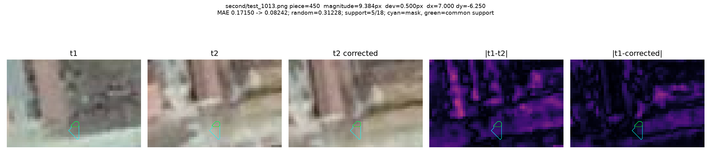
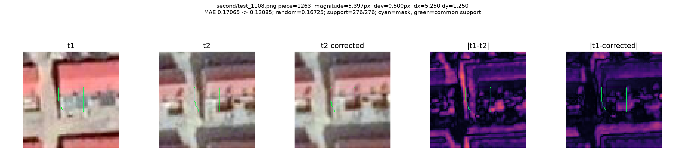
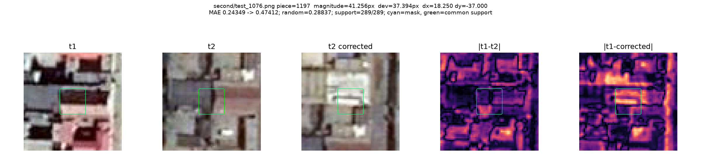
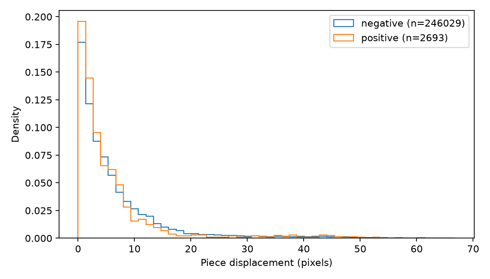
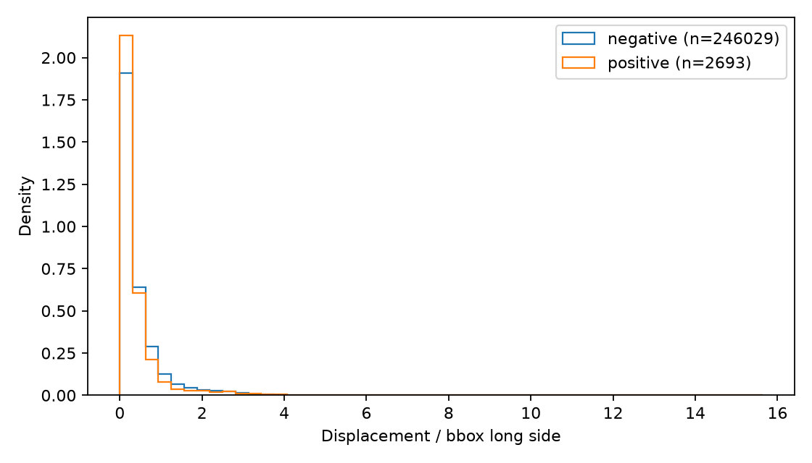
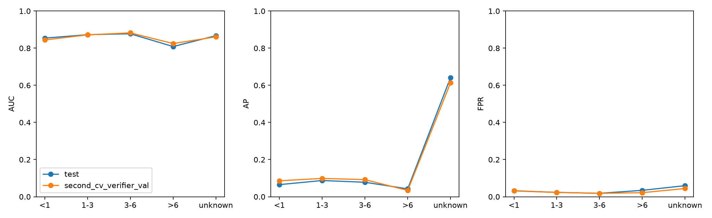
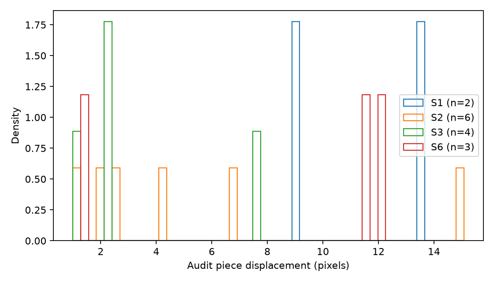

# 实验 6i：SECOND 两期配准偏移

任务：`doc/exp6i_misregistration.md`。代码：`code/probe/exp6i_{common,synth,offsets,pieces,stats}.py`（估计与统计），`exp6i_verify.py`（补偿核验）。中间数据：`interim/exp6/exp6i/`（`r2_stats.json` 完整分桶统计，`r3_verify.json` 补偿核验，`*_image_medians.json` 逐图偏移中位数）；逐块偏移数组较大（约 770 MB），留在服务器 `outputs/CD_1016_probe/exp6/misregistration/`。审核样本偏移：`audit/samples_offset.json`。

## 结论（2026-10-21）

1. **偏移有多大？** 能估计的影像里，整图偏移中位数约 3.3 像素（test 3.43，second_cv 3.26），66% 的影像整图偏移超过 2 像素。扣除整图偏移后，残余的平方位移只下降约 32%，**以局部偏移为主**。test 与 second_cv 很接近（整图中位数差 0.17 像素）。
2. **多少负例切块受影响？** 在能估计的负例切块中，偏移 > 3 像素的占 57%（test）/ 61%（验证），> 5 像素的约 41%。补偿核验确认 3–15 像素这一段多数是真实偏移（见下）。来源上 C1、H1 偏高（约 64%，B 为 52%）；小切块并不更多；高分负例与全体负例比例相当，没有集中。
3. **V1 在大偏移切块上是否更差？** 略差，但幅度小：大偏移（> 3 像素）组减小偏移组的 AUC，test −0.029，验证 −0.008；只用补偿检验通过的切块，为 −0.032 / −0.004。AP 差（−0.02 至 −0.04）主要来自两组正例比例不同，不宜直接比较。
4. **建议**：暂不改流水线（方案 a），在报告中记录这一限制。理由：偏移普遍存在，但高分负例并不富集大偏移，V1 的 AUC 差只有 0.01–0.03，解释不了 V1 测试集转负的问题；整图配准（b）只能消掉约三分之一的位移。若以后要做，优先试 (c) 的邻域匹配池化，且只在验证集上判断。

**最大的局限是覆盖率。** 能可靠估计偏移的切块只占 11–12%（test 257,576 / 2,317,570），test 负例中 84% 无法估计；可估计的切块偏向纹理丰富、真值变化少的区域，正例很少（test 约 1,400 个）。上述比例只代表这部分切块。6g 的 320 个审核样本里只有 15 个能估计，不足以分析审核与偏移的关系；人工答案也尚未返回。

## 方法

- **两种估计**：
  - 网格估计：每对影像转灰度后，在 96×96 窗口、步长 48 的网格上做相位相关，`upsample_factor=4`。
  - 中心直接估计（主口径）：以切块为中心开一个完整窗口直接估计。网格估计作为敏感性对照，两者都有效时向量差中位数 0.45 像素。
- **为什么不用文档中的 64 窗口**：校准时 96 窗口更稳；校准方法见下一条。
- **校准**：在 50 张真实影像对上，对 t2 人为再平移 0–10 像素，看估计值的变化是否等于人为平移。留出集上 93.7% 的误差在 1 像素内，保留率约 30%。这一步只说明方法能追踪相对平移，不能证明绝对偏移正确。
- **有效块条件**：真值变化占比 < 10%，纹理强度高于参考 20 分位，峰值比高于校准阈值。
- **参考样本未完全通过**：`test_857.png` 切块 18 估计为 13.5 像素（dx +12，dy +6.25），网格估计相同。方向与 6g 目测一致，但超出文档"8–12 像素"的判据。经记录的人工放行后继续，参数未改。
- **最大偏移的检查图**：5 个网格（`figures/exp6i/check/`）和 r2 列出的 10 个最大偏移负例，目视都是误匹配（真实建筑变化、模糊或外观变化），不是真错位。

## 补偿核验（r3）

由于峰值比几乎不能筛掉误匹配（q10–q90 只有 1.04–1.10），另做了一个不依赖人工的核验。对每个可估计切块，在掩膜内比较三种两期 RGB 平均绝对差：
- 原始；
- 把 t2 按估计偏移平移回去之后；
- 按同样幅度、随机方向平移之后。

**判断依据**：如果偏移是真的，补偿后差异应该下降，并且优于随机方向；纯噪声时"优于随机"的比例应在 50% 左右。

test 负例，按偏移幅度分桶：

| 偏移幅度 | 切块数 | 补偿后差异下降 | 相对下降中位数 | 优于随机方向 | 与图内中位偏移的偏差（中位数） |
|---|---:|---:|---:|---:|---:|
| 0–1 像素 | 47,097 | 61.7% | 0.9% | 50.0% | 0.5 |
| 1–3 | 61,263 | 69.7% | 5.5% | 64.0% | 0.8 |
| 3–8 | 78,034 | 72.9% | 13.5% | 68.6% | 1.1 |
| 8–15 | 40,060 | 70.5% | 18.0% | 67.8% | 1.5 |
| 15–30 | 16,083 | 65.8% | 15.5% | 64.7% | 11.4 |
| > 30 | 9,121 | 55.2% | 4.9% | 54.0% | 38.8 |

second_cv 的数字几乎相同（3–8 像素：73.7% / 14.7% / 69.3%）。

- **0–1 像素一组**：优于随机方向的比例正好约 50%，与纯噪声的预期一致。
- **3–15 像素**：68–70% 的切块优于随机方向，补偿后差异中位下降 13–18%；而且这些切块的偏移与同图中位偏移只差 1–1.5 像素，说明同一张图内的估计彼此一致。**这一段的偏移多数是真实的。**
- **超过 30 像素**：接近噪声水平，并且与同图其他切块相差约 39 像素，基本是误匹配。这部分约占可估计切块的 3.5%。
- **15–30 像素**：真偏移和误匹配混在一起。

"可信块"（补偿后差异下降且优于随机方向）占可估计负例的 53–55%。用可信块重算，主要比例变化不大：
- test 负例 > 3 像素：57.0% → 59.8%；
- 验证负例 > 3 像素：60.6% → 64.0%。

这个规则在纯噪声下也有约 50% 的通过率，只能作为辅助对照，不能当作配准精度。

## 详细数字

| 数据集 | 影像 / 无法估计 | 整图中位偏移 | 整图 > 2 像素的影像 | 残余局部中位偏移 | 残余 > 3 像素的有效块 |
|---|---|---:|---:|---:|---:|
| test | 1,694 / 473 | 3.43 | 66.7% | 0.80 | 18.7% |
| second_cv | 2,968 / 833 | 3.26 | 66.0% | 0.79 | 16.2% |

负例按来源、面积，统计偏移 > 3 像素的比例（test，可估计切块）：

| 分组 | 可估计 | 全部可估计 | 只看可信块 |
|---|---:|---:|---:|
| B | 74,787 | 51.9% | 55.2% |
| G0.05 | 32,040 | 57.0% | 60.8% |
| C1 | 44,328 | 63.8% | 66.0% |
| C2 | 67,993 | 55.6% | 57.7% |
| H1 | 26,881 | 63.8% | 66.8% |
| 面积 < 50 | 47,135 | 52.9% | 55.0% |
| 50–300 | 179,135 | 58.1% | 60.9% |
| 300–1000 | 18,403 | 57.2% | 59.3% |
| > 1000 | 1,356 | 57.2% | 62.0% |

pred 切块不在估计范围内（全部无法估计）。

V1（6b 无骨干）按偏移分组：

| 数据集 | 口径 | 小偏移（≤ 3）切块数 / 正例 / AUC | 大偏移（> 3）切块数 / 正例 / AUC | AUC 差 |
|---|---|---|---|---:|
| test | 全部可估计 | 107,077 / 1,307 / 0.865 | 141,645 / 1,386 / 0.836 | −0.029 |
| test | 可信块 | 52,813 / 539 / 0.880 | 78,404 / 658 / 0.847 | −0.032 |
| 验证 | 全部可估计 | 15,142 / 294 / 0.862 | 23,063 / 218 / 0.854 | −0.008 |
| 验证 | 可信块 | 7,580 / 131 / 0.874 | 13,331 / 119 / 0.871 | −0.004 |

高分负例（V1 分数 ≥ 0.820）中偏移 > 3 像素的比例：test 58.0%（全体负例 57.0%），验证 54.7%（全体 60.6%）。

r2 列出的 10 个最大偏移负例（约 66 像素）按补偿面板重画，在 `figures/exp6i/verify/top_*.png`；它们都是误匹配。各幅度桶的随机负例在 `figures/exp6i/verify/random_*.png`。

## 后续方案与工作量（人工估计）

| 方案 | 判断 | 工作量 |
|---|---|---|
| (a) 不处理，记录限制 | **建议**。偏移普遍，但与 V1 的失败关系弱 | 已完成 |
| (b) 整图配准 | 只能消掉约 1/3 的平方位移；可作为廉价对照 | 1–2 天，计算另计 |
| (c) V1/V2 容忍局部偏移（邻域匹配池化、放大近景框） | 若以后再做图像特征版本，可以先试 | 2–4 天，训练另计 |
| (d) 排除小切块 + 大相对偏移 | 小切块并不偏多，收益不明；改变评估范围需要单独论证 | 半天到 1 天 |
