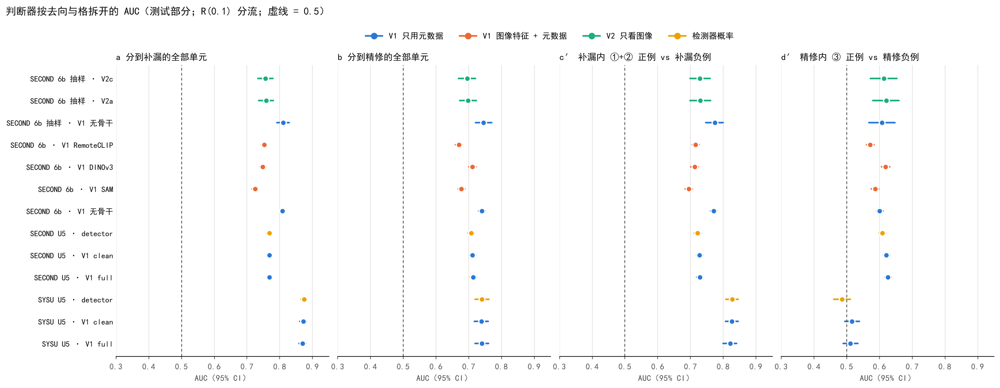
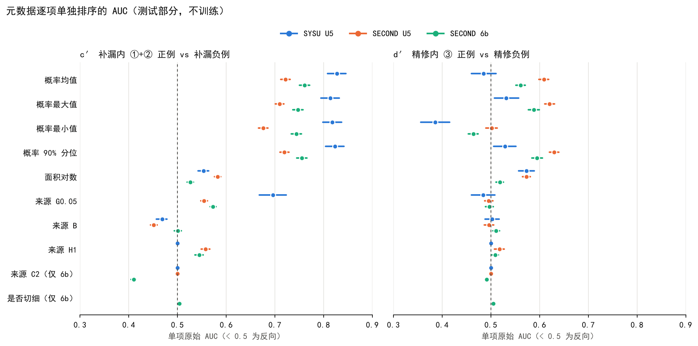

# 实验 8 补充 2：按漏检格拆开看判断器，并检验分流规则

任务：`doc/exp8s2_judge_by_cell.md`。不训练，不跑任何模型（检测器、SAM3、AnyChange、MLLM、V1/V2 都不跑），只在已有缓存和已保存的分数上统计。全部为 CPU 作业。
代码：`code/probe/exp8s2_route.py`（第 1 步）、`code/probe/exp8s2_judge.py`（第 2 步）、`code/probe/exp8s2_split.py` 与 `exp8s2_step1c.py`（第 1b、1c 步）、`code/probe/exp8s2_judge_split.py`（按修正分流补报第 2 步）、`code/probe/exp8s2_route1d.py`（第 1d 步）。服务器上的完整输出：`Chang-Agent/outputs/CD_1016_probe/exp8s2_batch39/`（第 1 步）、`wyh/exp6_staging/batch40/run/`（第 2 步）、`wyh/exp6_staging/batch41/{route_run,run}/`（第 1b、1c 步与补报）、`wyh/exp6_staging/batch42/run/`（第 1d 步）。
复用：四格标签取 exp8s batch34 的逐像素格标签；候选完整掩码按 exp8s 第 6 步（batch37）的方式重建，并逐个核对“完整掩码去掉检测器掩码”等于缓存候选。

进度：第 1、1b、1c、1d、2 步完成（2026-10-24），第 2 步另按第 1b 步修正后的分流补报一次。**最终分流规则（第 1d 步冻结）：按成员分流，R(0.1)，不加预过滤**，完整参数见 `exp8s2_frozen_rule.json`。

## 第 1 步：分流规则（只用推理时可见的信息）

**定义**
- 候选 c 取完整掩码（成员原始掩码之并）；D 为检测器 0.5 掩码。
- 候选覆盖率 r = |D ∩ c| / |c|；碎片数 k = D ∩ c 中 ≥ 5 像素的 8 连通域个数。
- R(τ)：r < τ 去补漏，否则去精修。R(τ, k₀)：r < τ 但 k ≥ k₀ 的也去精修。τ ∈ {0.05, 0.1, 0.2, 0.3, 0.5}，k₀ ∈ {3, 5}。
- 用 |D ∩ c| 而不是“候选碰到的整块检测器掩码”，是为了避免旁边一栋已检出的大建筑把候选误判为“在已检区域上往外扩”。完全不碰 D 的候选 r = 0，必然去补漏。
- 漏检连通域与格同 batch34（含 ⑤ 残余）；③ 按检测器对目标的覆盖率再分 10–30% 与 ≥ 30%。每个漏检连通域由覆盖其像素最多的候选决定去向（并列取候选序号小者）；没有候选覆盖的记为未覆盖。
- 候选集：默认四源 D1 全部候选（d1all）；SECOND、SYSU 另报第 5 步冻结的每图 8、20 工作点（wp8、wp20）。LEVIR、WHU 测试只作描述。
- 核对：各格连通域总数与 batch34 完全一致（例如 SECOND 测试 ① 3,284、② 11,675；SYSU 测试 ① 154、② 909）。LEVIR / WHU 的 B 来源按 batch30 的建筑类变化口径重建。

**表 1a：默认四源 D1 全部候选，R(τ)**（各格去补漏的比例，连通域 % / 漏检像素 %；最后两列为每图候选数）

| 划分 | 候选集 | 规则 | ① | ② | ③ 10–30% | ③ ≥30% | ⑤ | 每图补漏 | 每图精修 |
|---|---|---|---:|---:|---:|---:|---:|---:|---:|
| SECOND 验证 | d1all | R(0.05) | 23.9 / 41.8 | 63.4 / 76.3 | 5.6 / 6.2 | 1.0 / 2.3 | 3.6 / 3.9 | 120.1 | 25.7 |
| SECOND 验证 | d1all | R(0.1) | 31.3 / 51.3 | 66.7 / 78.8 | 12.8 / 10.3 | 2.1 / 3.5 | 4.8 / 5.2 | 122.1 | 23.8 |
| SECOND 验证 | d1all | R(0.2) | 35.7 / 55.8 | 69.9 / 82.8 | 26.7 / 32.6 | 4.8 / 5.9 | 7.9 / 8.3 | 125.1 | 20.8 |
| SECOND 验证 | d1all | R(0.3) | 41.9 / 60.4 | 73.4 / 84.7 | 36.7 / 40.3 | 9.5 / 10.5 | 12.4 / 12.6 | 127.5 | 18.4 |
| SECOND 验证 | d1all | R(0.5) | 59.0 / 83.1 | 82.0 / 90.9 | 55.9 / 71.5 | 26.5 / 33.0 | 30.0 / 29.7 | 132.1 | 13.8 |
| SECOND 测试 | d1all | R(0.05) | 16.9 / 22.8 | 54.9 / 66.6 | 5.6 / 5.2 | 0.7 / 0.9 | 5.2 / 3.9 | 118.8 | 26.7 |
| SECOND 测试 | d1all | R(0.1) | 21.8 / 29.4 | 58.8 / 70.1 | 12.0 / 11.9 | 1.9 / 2.1 | 7.0 / 5.5 | 121.0 | 24.5 |
| SECOND 测试 | d1all | R(0.2) | 31.2 / 42.7 | 65.1 / 76.0 | 25.3 / 30.3 | 5.8 / 6.1 | 11.6 / 9.9 | 124.2 | 21.3 |
| SECOND 测试 | d1all | R(0.3) | 40.3 / 53.3 | 70.5 / 80.4 | 37.1 / 45.9 | 12.8 / 13.6 | 17.8 / 16.1 | 126.8 | 18.7 |
| SECOND 测试 | d1all | R(0.5) | 66.2 / 77.8 | 82.9 / 89.9 | 64.4 / 72.0 | 41.5 / 44.8 | 41.4 / 40.8 | 131.4 | 14.1 |
| SYSU 验证 | d1all | R(0.05) | 37.9 / 36.7 | 86.9 / 91.6 | 5.4 / 20.7 | 0.5 / 1.1 | 2.1 / 2.6 | 63.7 | 5.9 |
| SYSU 验证 | d1all | R(0.1) | 55.2 / 49.3 | 89.2 / 96.4 | 14.3 / 24.5 | 1.4 / 2.3 | 3.2 / 4.3 | 64.1 | 5.4 |
| SYSU 验证 | d1all | R(0.2) | 75.9 / 84.4 | 90.3 / 96.6 | 33.9 / 38.8 | 2.0 / 3.2 | 5.7 / 6.9 | 64.7 | 4.8 |
| SYSU 验证 | d1all | R(0.3) | 75.9 / 84.4 | 90.3 / 96.6 | 62.5 / 78.8 | 3.5 / 4.7 | 7.3 / 8.4 | 65.2 | 4.3 |
| SYSU 验证 | d1all | R(0.5) | 86.2 / 97.0 | 94.3 / 98.6 | 80.4 / 87.9 | 14.5 / 29.0 | 16.0 / 18.7 | 66.3 | 3.3 |
| SYSU 测试 | d1all | R(0.05) | 47.4 / 37.0 | 88.3 / 94.4 | 10.3 / 10.7 | 1.1 / 4.1 | 1.2 / 1.5 | 56.7 | 5.4 |
| SYSU 测试 | d1all | R(0.1) | 64.9 / 72.4 | 88.9 / 94.6 | 18.3 / 15.8 | 1.5 / 5.0 | 2.4 / 2.5 | 57.1 | 5.0 |
| SYSU 测试 | d1all | R(0.2) | 81.2 / 88.9 | 89.8 / 95.5 | 44.8 / 39.5 | 3.1 / 7.3 | 4.7 / 4.7 | 57.6 | 4.4 |
| SYSU 测试 | d1all | R(0.3) | 86.4 / 92.2 | 91.1 / 96.3 | 69.8 / 77.9 | 5.3 / 10.0 | 7.3 / 7.3 | 58.1 | 3.9 |
| SYSU 测试 | d1all | R(0.5) | 95.5 / 99.4 | 94.3 / 97.9 | 87.7 / 96.6 | 16.1 / 27.1 | 18.2 / 18.9 | 59.0 | 3.0 |

**表 1b：加碎片条件 k₀ 的对照**（各格去补漏的比例，连通域 % / 漏检像素 %；最后两列为每图候选数）

| 划分 | 候选集 | 规则 | ① | ② | ③ 10–30% | ③ ≥30% | ⑤ | 每图补漏 | 每图精修 |
|---|---|---|---:|---:|---:|---:|---:|---:|---:|
| SECOND 验证 | d1all | R(0.1) | 31.3 / 51.3 | 66.7 / 78.8 | 12.8 / 10.3 | 2.1 / 3.5 | 4.8 / 5.2 | 122.1 | 23.8 |
| SECOND 验证 | d1all | R(0.1,3) | 25.4 / 41.2 | 64.6 / 75.2 | 8.8 / 5.5 | 1.4 / 2.3 | 3.8 / 4.3 | 121.6 | 24.3 |
| SECOND 验证 | d1all | R(0.1,5) | 29.2 / 47.4 | 66.1 / 77.6 | 11.4 / 7.7 | 1.8 / 3.3 | 4.3 / 4.8 | 122.0 | 23.9 |
| SECOND 验证 | d1all | R(0.2,3) | 28.1 / 44.9 | 66.6 / 76.9 | 17.6 / 9.7 | 3.0 / 3.6 | 5.3 / 6.0 | 124.1 | 21.8 |
| SECOND 验证 | d1all | R(0.2,5) | 32.9 / 51.5 | 68.6 / 80.0 | 23.2 / 15.7 | 3.9 / 5.1 | 6.2 / 7.1 | 124.8 | 21.1 |
| SECOND 验证 | d1all | R(0.3,3) | 30.3 / 45.7 | 68.6 / 78.1 | 21.8 / 11.8 | 5.5 / 6.3 | 7.2 / 8.0 | 126.2 | 19.7 |
| SECOND 验证 | d1all | R(0.3,5) | 36.7 / 55.0 | 71.4 / 81.7 | 31.3 / 20.4 | 7.2 / 8.6 | 9.0 / 9.9 | 127.1 | 18.8 |
| SECOND 测试 | d1all | R(0.1) | 21.8 / 29.4 | 58.8 / 70.1 | 12.0 / 11.9 | 1.9 / 2.1 | 7.0 / 5.5 | 121.0 | 24.5 |
| SECOND 测试 | d1all | R(0.1,3) | 17.3 / 20.6 | 55.3 / 65.4 | 8.8 / 7.0 | 1.2 / 1.2 | 5.6 / 4.3 | 120.4 | 25.1 |
| SECOND 测试 | d1all | R(0.1,5) | 20.5 / 25.4 | 57.4 / 67.7 | 11.2 / 10.0 | 1.6 / 1.6 | 6.1 / 4.8 | 120.9 | 24.6 |
| SECOND 测试 | d1all | R(0.2,3) | 21.1 / 24.7 | 58.0 / 67.7 | 15.9 / 14.4 | 2.9 / 2.7 | 7.6 / 6.1 | 123.1 | 22.4 |
| SECOND 测试 | d1all | R(0.2,5) | 26.6 / 32.6 | 61.5 / 71.1 | 20.9 / 23.0 | 4.1 / 3.9 | 8.8 / 7.3 | 123.9 | 21.6 |
| SECOND 测试 | d1all | R(0.3,3) | 23.6 / 26.8 | 59.8 / 69.5 | 19.4 / 17.8 | 5.5 / 5.1 | 9.9 / 8.1 | 125.3 | 20.2 |
| SECOND 测试 | d1all | R(0.3,5) | 31.1 / 37.0 | 64.3 / 73.5 | 26.8 / 29.3 | 8.0 / 7.5 | 12.4 / 10.7 | 126.3 | 19.2 |
| SYSU 验证 | d1all | R(0.1) | 55.2 / 49.3 | 89.2 / 96.4 | 14.3 / 24.5 | 1.4 / 2.3 | 3.2 / 4.3 | 64.1 | 5.4 |
| SYSU 验证 | d1all | R(0.1,3) | 51.7 / 47.0 | 89.2 / 96.4 | 8.9 / 20.9 | 0.8 / 1.7 | 2.7 / 3.7 | 64.1 | 5.5 |
| SYSU 验证 | d1all | R(0.1,5) | 55.2 / 49.3 | 89.2 / 96.4 | 10.7 / 21.2 | 1.1 / 2.0 | 2.9 / 4.0 | 64.1 | 5.5 |
| SYSU 验证 | d1all | R(0.2,3) | 72.4 / 82.1 | 90.3 / 96.6 | 25.0 / 24.4 | 1.3 / 2.7 | 4.5 / 5.4 | 64.7 | 4.9 |
| SYSU 验证 | d1all | R(0.2,5) | 75.9 / 84.4 | 90.3 / 96.6 | 28.6 / 31.3 | 1.8 / 2.9 | 5.2 / 6.3 | 64.7 | 4.8 |
| SYSU 验证 | d1all | R(0.3,3) | 72.4 / 82.1 | 90.3 / 96.6 | 39.3 / 36.9 | 2.6 / 4.0 | 5.9 / 6.8 | 65.1 | 4.4 |
| SYSU 验证 | d1all | R(0.3,5) | 75.9 / 84.4 | 90.3 / 96.6 | 50.0 / 49.9 | 3.2 / 4.3 | 6.7 / 7.7 | 65.2 | 4.3 |
| SYSU 测试 | d1all | R(0.1) | 64.9 / 72.4 | 88.9 / 94.6 | 18.3 / 15.8 | 1.5 / 5.0 | 2.4 / 2.5 | 57.1 | 5.0 |
| SYSU 测试 | d1all | R(0.1,3) | 53.2 / 34.4 | 88.4 / 94.2 | 16.7 / 14.3 | 1.4 / 4.4 | 1.8 / 2.0 | 57.0 | 5.0 |
| SYSU 测试 | d1all | R(0.1,5) | 59.1 / 49.3 | 88.7 / 94.4 | 17.1 / 15.2 | 1.5 / 5.0 | 2.2 / 2.2 | 57.0 | 5.0 |
| SYSU 测试 | d1all | R(0.2,3) | 64.9 / 46.8 | 89.3 / 95.0 | 38.5 / 28.2 | 2.6 / 6.2 | 3.7 / 3.8 | 57.6 | 4.5 |
| SYSU 测试 | d1all | R(0.2,5) | 74.0 / 63.3 | 89.5 / 95.2 | 43.3 / 34.4 | 2.9 / 7.0 | 4.4 / 4.4 | 57.6 | 4.4 |
| SYSU 测试 | d1all | R(0.3,3) | 68.2 / 48.6 | 89.9 / 95.4 | 59.5 / 56.3 | 4.4 / 8.1 | 5.3 / 5.4 | 58.0 | 4.0 |
| SYSU 测试 | d1all | R(0.3,5) | 77.9 / 65.4 | 90.8 / 96.0 | 67.9 / 69.4 | 5.0 / 9.4 | 6.6 / 6.4 | 58.1 | 4.0 |

**表 1c：LEVIR / WHU 测试（只作描述）**（各格去补漏的比例，连通域 % / 漏检像素 %；最后两列为每图候选数）

| 划分 | 候选集 | 规则 | ① | ② | ③ 10–30% | ③ ≥30% | ⑤ | 每图补漏 | 每图精修 |
|---|---|---|---:|---:|---:|---:|---:|---:|---:|
| LEVIR 测试 | d1all | R(0.05) | 52.9 / 39.1 | 71.4 / 58.5 | 22.6 / 22.6 | 1.5 / 1.1 | 0.4 / 0.8 | 182.0 | 108.9 |
| LEVIR 测试 | d1all | R(0.1) | 82.4 / 85.9 | 73.5 / 60.5 | 41.9 / 46.5 | 2.2 / 1.5 | 0.6 / 1.0 | 184.7 | 106.2 |
| LEVIR 测试 | d1all | R(0.2) | 88.2 / 95.1 | 81.0 / 65.8 | 54.8 / 50.9 | 7.0 / 7.3 | 4.1 / 4.6 | 187.7 | 103.2 |
| LEVIR 测试 | d1all | R(0.3) | 94.1 / 99.2 | 84.4 / 72.2 | 71.0 / 71.8 | 19.3 / 21.0 | 14.8 / 14.7 | 190.2 | 100.7 |
| LEVIR 测试 | d1all | R(0.5) | 94.1 / 99.2 | 92.5 / 97.1 | 100.0 / 100.0 | 41.6 / 46.2 | 30.4 / 32.4 | 197.9 | 93.0 |
| WHU 测试 | d1all | R(0.05) | 77.8 / 87.4 | 92.2 / 98.8 | 0.0 / 0.0 | 3.3 / 1.3 | 0.6 / 1.2 | 127.4 | 5.8 |
| WHU 测试 | d1all | R(0.1) | 94.4 / 99.8 | 92.2 / 98.8 | 15.4 / 4.0 | 5.5 / 3.2 | 1.9 / 2.3 | 127.8 | 5.5 |
| WHU 测试 | d1all | R(0.2) | 94.4 / 99.8 | 94.2 / 99.3 | 53.8 / 51.7 | 12.2 / 6.5 | 5.6 / 6.4 | 128.2 | 5.0 |
| WHU 测试 | d1all | R(0.3) | 94.4 / 99.8 | 96.1 / 99.7 | 100.0 / 100.0 | 18.8 / 8.7 | 8.5 / 10.1 | 128.5 | 4.7 |
| WHU 测试 | d1all | R(0.5) | 100.0 / 100.0 | 97.1 / 99.7 | 100.0 / 100.0 | 34.3 / 40.0 | 16.1 / 20.4 | 129.2 | 4.1 |

**表 1d：第 5 步冻结工作点（每图 8、20 个候选）**（各格去补漏的比例，连通域 % / 漏检像素 %；最后两列为每图候选数）

| 划分 | 候选集 | 规则 | ① | ② | ③ 10–30% | ③ ≥30% | ⑤ | 每图补漏 | 每图精修 |
|---|---|---|---:|---:|---:|---:|---:|---:|---:|
| SECOND 验证 | wp8 | R(0.1) | 12.4 / 27.9 | 15.0 / 27.9 | 7.8 / 10.8 | 2.0 / 4.3 | 1.2 / 1.4 | 4.2 | 3.7 |
| SECOND 验证 | wp8 | R(0.2) | 14.5 / 28.7 | 16.2 / 29.5 | 13.4 / 19.3 | 3.9 / 6.0 | 2.7 / 2.8 | 4.5 | 3.4 |
| SECOND 验证 | wp20 | R(0.1) | 21.5 / 44.1 | 33.9 / 53.1 | 11.2 / 9.0 | 2.1 / 3.2 | 2.7 / 3.2 | 12.1 | 7.4 |
| SECOND 验证 | wp20 | R(0.2) | 25.2 / 47.1 | 37.5 / 58.8 | 21.0 / 29.7 | 4.4 / 5.1 | 4.9 / 5.2 | 12.9 | 6.6 |
| SECOND 测试 | wp8 | R(0.1) | 9.6 / 18.5 | 16.5 / 26.9 | 6.1 / 10.2 | 1.7 / 2.4 | 2.5 / 2.1 | 4.2 | 3.8 |
| SECOND 测试 | wp8 | R(0.2) | 13.9 / 25.1 | 19.9 / 31.7 | 10.3 / 18.1 | 4.0 / 5.1 | 5.1 / 4.5 | 4.5 | 3.5 |
| SECOND 测试 | wp20 | R(0.1) | 15.7 / 22.4 | 35.2 / 49.7 | 9.4 / 8.6 | 1.9 / 2.2 | 4.4 / 3.5 | 12.7 | 7.0 |
| SECOND 测试 | wp20 | R(0.2) | 23.4 / 35.1 | 41.0 / 55.7 | 20.2 / 24.5 | 5.5 / 5.7 | 8.5 / 7.3 | 13.5 | 6.1 |
| SYSU 验证 | wp8 | R(0.1) | 55.2 / 49.3 | 59.1 / 79.3 | 12.5 / 24.3 | 0.6 / 1.2 | 0.7 / 1.2 | 5.6 | 2.1 |
| SYSU 验证 | wp8 | R(0.2) | 75.9 / 84.4 | 59.7 / 82.9 | 33.9 / 38.7 | 0.8 / 2.0 | 1.5 / 2.1 | 5.8 | 2.0 |
| SYSU 验证 | wp20 | R(0.1) | 55.2 / 49.3 | 78.4 / 92.7 | 14.3 / 24.4 | 0.9 / 2.2 | 0.9 / 1.8 | 15.7 | 3.2 |
| SYSU 验证 | wp20 | R(0.2) | 75.9 / 84.4 | 79.5 / 92.9 | 35.7 / 38.8 | 1.2 / 2.9 | 1.7 / 2.7 | 16.0 | 2.8 |
| SYSU 测试 | wp8 | R(0.1) | 60.4 / 67.5 | 66.3 / 84.2 | 13.9 / 13.0 | 0.7 / 3.0 | 0.5 / 0.8 | 5.3 | 2.1 |
| SYSU 测试 | wp8 | R(0.2) | 78.6 / 86.3 | 67.5 / 84.9 | 37.3 / 34.6 | 1.7 / 4.7 | 1.4 / 1.8 | 5.4 | 2.0 |
| SYSU 测试 | wp20 | R(0.1) | 64.3 / 72.4 | 80.3 / 92.2 | 17.9 / 16.1 | 1.2 / 4.6 | 0.6 / 1.0 | 14.5 | 3.0 |
| SYSU 测试 | wp20 | R(0.2) | 80.5 / 88.8 | 81.6 / 93.5 | 43.3 / 38.8 | 2.4 / 6.7 | 1.5 / 2.0 | 14.7 | 2.8 |

**表 2：R(0.1)、默认四源 D1 全部候选下的“格 × 去向”交叉表**（连通域数 / 漏检像素）

SECOND 验证（297 张图，每图候选 145.9 个，其中 r = 0 占 78.9%）

| 格 | 补漏 | 精修 | 未覆盖 |
|---|---:|---:|---:|
| ① | 196 / 679,363 | 431 / 643,990 | 0 / 0 |
| ② | 1,548 / 1,110,726 | 661 / 269,292 | 113 / 30,108 |
| ③ 10–30% | 64 / 103,546 | 435 / 902,946 | 0 / 0 |
| ③ ≥30% | 96 / 64,022 | 4,550 / 1,784,634 | 0 / 0 |
| ⑤ | 456 / 2,107 | 8,943 / 38,143 | 175 / 490 |

SECOND 测试（1694 张图，每图候选 145.5 个，其中 r = 0 占 78.2%）

| 格 | 补漏 | 精修 | 未覆盖 |
|---|---:|---:|---:|
| ① | 716 / 1,645,138 | 2,568 / 3,941,103 | 0 / 0 |
| ② | 6,867 / 5,224,417 | 4,404 / 2,119,806 | 404 / 112,726 |
| ③ 10–30% | 326 / 408,265 | 2,387 / 3,027,818 | 0 / 0 |
| ③ ≥30% | 493 / 188,140 | 25,606 / 8,888,834 | 0 / 0 |
| ⑤ | 4,502 / 13,555 | 57,670 / 229,584 | 2,028 / 4,367 |

SYSU 验证（800 张图，每图候选 69.5 个，其中 r = 0 占 90.4%）

| 格 | 补漏 | 精修 | 未覆盖 |
|---|---:|---:|---:|
| ① | 16 / 78,369 | 13 / 80,710 | 0 / 0 |
| ② | 157 / 307,182 | 17 / 11,265 | 2 / 87 |
| ③ 10–30% | 8 / 77,523 | 48 / 239,444 | 0 / 0 |
| ③ ≥30% | 20 / 23,995 | 1,403 / 1,038,098 | 0 / 0 |
| ⑤ | 59 / 281 | 1,780 / 6,228 | 3 / 44 |

SYSU 测试（4000 张图，每图候选 62.1 个，其中 r = 0 占 90.2%）

| 格 | 补漏 | 精修 | 未覆盖 |
|---|---:|---:|---:|
| ① | 100 / 645,731 | 54 / 245,582 | 0 / 0 |
| ② | 808 / 1,643,995 | 78 / 90,188 | 23 / 2,748 |
| ③ 10–30% | 46 / 189,204 | 206 / 1,006,657 | 0 / 0 |
| ③ ≥30% | 112 / 299,020 | 7,215 / 5,668,243 | 0 / 0 |
| ⑤ | 204 / 837 | 8,361 / 32,360 | 28 / 187 |

LEVIR 测试（128 张图，每图候选 290.9 个，其中 r = 0 占 59.5%）

| 格 | 补漏 | 精修 | 未覆盖 |
|---|---:|---:|---:|
| ① | 14 / 13,965 | 3 / 2,294 | 0 / 0 |
| ② | 108 / 39,100 | 31 / 24,626 | 8 / 942 |
| ③ 10–30% | 13 / 6,333 | 18 / 7,279 | 0 / 0 |
| ③ ≥30% | 93 / 4,341 | 4,212 / 282,093 | 3 / 69 |
| ⑤ | 253 / 1,311 | 41,278 / 125,428 | 222 / 447 |

WHU 测试（690 张图，每图候选 133.2 个，其中 r = 0 占 94.5%）

| 格 | 补漏 | 精修 | 未覆盖 |
|---|---:|---:|---:|
| ① | 17 / 26,676 | 1 / 41 | 0 / 0 |
| ② | 95 / 132,661 | 6 / 1,529 | 2 / 112 |
| ③ 10–30% | 2 / 1,758 | 11 / 42,035 | 0 / 0 |
| ③ ≥30% | 45 / 9,327 | 771 / 286,489 | 1 / 29 |
| ⑤ | 164 / 581 | 8,496 / 24,210 | 16 / 37 |

**读数**
- **③ 覆盖率 ≥ 30% 几乎全部去精修。** R(0.1) 下误分到补漏的只有 SECOND 1.9–2.1%、SYSU 1.4–1.5%（按连通域；按像素 2–5%）。τ 升到 0.2 时为 2–6%，0.5 时升到 15–42%。
- **② 去补漏的比例在两个数据集上差别很大。**
  - SYSU：R(0.1) 下 89% 的连通域、95–96% 的像素去补漏，未覆盖约 1–3%。
  - SECOND：R(0.1) 下只有 59–67% 的连通域、70–79% 的像素去补漏；约 38%（测试 4,404 个）去了精修。
  - 原因（见审查页 “② → 精修” 的例子）：覆盖这些 ② 最多的候选是一大片区域（低阈值概率块或 SAM 大区域），同时盖住了旁边已检出的部分，r ≥ 0.1。规则按候选整体判断，候选太大时就会把孤立的漏检带去精修。
  - 提高 τ 帮助有限：SECOND 测试 R(0.3) 下 ② 去补漏升到 70.5%，但 ③ 10–30% 去补漏升到 37%，③ ≥ 30% 升到 12.8%。
- **① 的去向因数据集而异。** SYSU 测试 R(0.1) 下 64.9% 的连通域（72.4% 像素）去补漏；SECOND 测试只有 21.8%（29.4%）。SECOND 验证 31.3%，SYSU 验证 55.2%（只有 29 个连通域）。
- **加碎片条件 k₀ 没有好处。** k₀ 把一部分候选从补漏改到精修：③ ≥ 30% 的误分只从 1.9% 降到 1.2%（SECOND 测试），但 ①、② 去补漏的比例同时下降（SYSU 测试 ① 从 64.9% 降到 53.2%，SECOND 测试 ② 从 58.8% 降到 55.3%）。
- **工作点（wp8、wp20）上 ② 去补漏的比例更低。** 每图只留 8 或 20 个候选，被选中的多是与检测器掩码重叠的大候选。
  - SECOND 测试 ②：wp8 去补漏 1,922、去精修 3,380、未覆盖 6,373；wp20 分别为 4,114、4,845、2,716。去精修的比去补漏的还多。
  - SYSU 测试 ②：wp8 去补漏 603、去精修 93、未覆盖 213；wp20 分别为 730、98、81。
  - SECOND 测试 ①：wp20 去补漏 516、去精修 2,585、未覆盖 183。
- **LEVIR、WHU 与 SYSU 相似**：R(0.1) 下 ② 去补漏 73–92%，③ ≥ 30% 误分 2–6%。
- 每图候选数：d1all 下 SECOND 约 121 个去补漏、24 个去精修；SYSU 约 57 / 5；78–90% 的候选 r = 0。

**例图审查页**：`results/exp8s2_route_examples/index.html`（可离线打开）。SECOND 测试、SYSU 测试，规则 R(0.1)、候选集 d1all，在“格（①、②、③ 10–30%、③ ≥ 30%、⑤）× 去向（补漏、精修、未覆盖）”的每格随机抽 4 例；种子 20261024（SECOND）/ 20261025（SYSU）。每例并排 T1、T2、真值、检测器预测、叠加图（红色为漏检连通域，蓝色为 D，绿色为决定去向的候选完整掩码轮廓）和整图小图，标注 r、k、去向和覆盖率。

### 判断问题 1、2 的回答

**1. R(τ) 能否把 ② 几乎全部送到补漏、把覆盖率 ≥ 30% 的 ③ 几乎全部送到精修？哪个 τ 最合适？k₀ 有没有区别？**
- ③ ≥ 30% 能做到：R(0.1) 下 98% 以上去精修。
- ② 只在 SYSU（以及 LEVIR、WHU）上能做到（89–92%）；在 SECOND 上只有约 60%，因为大候选同时盖住已检区域。这不是 τ 能解决的：τ 从 0.1 升到 0.3，② 只多 12 个百分点，③ 的误分却多 10 个百分点以上。
- τ = 0.1 最合适；0.2 也可接受（③ ≥ 30% 误分 2–6%，SYSU ① 去补漏从 65% 升到 81%）。
- 加 k₀ 没有好处：③ 误分只少不到 1 个百分点，①、② 去补漏的比例同时下降。
- 要改善 SECOND 的 ②，方向是改候选而不是改阈值：例如按连通域或在 D 外裁开大候选，再算 r。

**2. SYSU 的 ① 和 SECOND 的 ① 在规则下去向是否不同？与审查时的观察是否一致？**
- 不同。R(0.1) 下 SYSU 测试 ① 有 65% 去补漏（像素 72%），与 ② 接近；SECOND 测试只有 22%（像素 29%），大多去精修。
- 与“SYSU 的 ① 接近 ②、SECOND 的 ① 很碎”的观察一致：SECOND 的 ① 多贴在已检出区域旁边，覆盖它们的候选多数同时含有较多 D 像素。

## 第 2 步：按格拆开的判断器 AUC（按第 1 步的 R(0.1) 分流）

**范围与口径**
- 不重新推理，只读已保存的逐单元分数。三个总体：
  - **U5**：exp8 第 3 步 U5_x4 单元。判断器为 V1 full、V1 clean、detector（检测器概率在单元内的均值，与元数据“概率均值”逐元素相同）。SECOND 验证 297 图 / 测试 1,694 图，SYSU 验证 800 图 / 测试 4,000 图。
  - **6b**：exp6b 的 recall 切块（只用有 0/1 标签的）。判断器为 V1 无骨干、V1 SAM ViT-H、V1 DINOv3、V1 RemoteCLIP。只有 SECOND（验证 297 图 / 测试 1,694 图）。
  - **6b 抽样**：exp6b 的 SECOND 测试 6,000 个分层抽样切块，按 6b 的总体权重加权。判断器为 V1 无骨干（同上分数）、V2a、V2c。
- **判断器的输入要分开读**：V1 无骨干、V1 full / clean 只用 12 维元数据；V1 骨干版本用“图像特征 + 元数据”；V2a、V2c 只看图像；detector 只是一个元数据项。
- **未保存、已跳过**：
  - V2a、V2c 在验证抽样上只有汇总指标，没有逐切块分数。V2 只报测试，第 4 项不做 V2。
  - exp8s 第 6 步在工作点（wp8、wp20）候选上的分数没有按候选保存，跳过。
- 去向：每个单元用自身掩码算 r，R(0.1)。正例按其新增真值像素多数所在的格归入 ①、②、③。正负例沿用原实验（U5：新增像素真值占比 ≥ 50% / < 10%，中间不计）。
- 分组：
  - a = 分到补漏的全部单元；b = 分到精修的全部单元；e = 全体。
  - c′ = 分到补漏的 ①+② 正例 vs 补漏负例；d′ = 分到精修的 ③ 正例 vs 精修负例。这两组是文档第 2 项的“同去向”比较。
  - 另报 c、d：正例按格取、不限去向，负例仍分别取补漏 / 精修。
- 95% CI 为 2000 次自助法，按图整群重抽（6b 抽样按权重抽切块），种子 20261024。所有组的正例都 ≥ 30（最少的是 6b 抽样 d′，655 个正例、175 个负例）。
- **核对**：全体 AUC / AP 与原实验保存的数字逐个相同。例如 6b 测试 V1 无骨干 0.874，6b 抽样 V1 无骨干 / V2a / V2c 为 0.873 / 0.814 / 0.811；U5 SECOND 测试 full 0.841，SYSU 测试 0.910。U5 验证部分重算的元数据与保存的特征逐元素一致（SECOND 899,868 个、SYSU 470,496 个元素）。
- 6b 的历史检测器掩码与 exp8s batch30 有少量不同（测试 1,659 图共 17,534 像素），统计统一用 batch30 的掩码。

**表 3：按去向和格拆开的 AUC（测试部分）**

| 总体 · 判断器 | 输入 | e 全体 | a 补漏 | b 精修 | c′ 补漏内 ①+② | d′ 精修内 ③ |
|---|---|---:|---:|---:|---:|---:|
| SECOND U5 · V1 full | 元数据 | 0.841 | 0.768 | 0.714 | 0.728 [0.719, 0.737] | 0.626 [0.617, 0.635] |
| SECOND U5 · V1 clean | 元数据 | 0.841 | 0.768 | 0.711 | 0.728 | 0.621 |
| SECOND U5 · detector | 概率均值 | 0.842 | 0.768 | 0.707 | 0.721 | 0.609 |
| SYSU U5 · V1 full | 元数据 | 0.910 | 0.869 | 0.740 | 0.821 [0.800, 0.841] | 0.512 [0.489, 0.534] |
| SYSU U5 · V1 clean | 元数据 | 0.911 | 0.871 | 0.739 | 0.827 | 0.516 |
| SYSU U5 · detector | 概率均值 | 0.913 | 0.874 | 0.740 | 0.827 | 0.485 |
| SECOND 6b · V1 无骨干 | 元数据 | 0.874 | 0.808 | 0.740 | 0.770 [0.761, 0.780] | 0.601 [0.591, 0.611] |
| SECOND 6b · V1 SAM ViT-H | 图像特征 + 元数据 | 0.816 | 0.724 | 0.678 | 0.695 | 0.587 |
| SECOND 6b · V1 DINOv3 | 图像特征 + 元数据 | 0.833 | 0.748 | 0.711 | 0.712 [0.701, 0.724] | 0.619 [0.606, 0.631] |
| SECOND 6b · V1 RemoteCLIP | 图像特征 + 元数据 | 0.836 | 0.753 | 0.669 | 0.716 | 0.571 |
| SECOND 6b 抽样 · V1 无骨干 | 元数据 | 0.873 | 0.810 | 0.745 | 0.774 [0.747, 0.800] | 0.607 [0.567, 0.647] |
| SECOND 6b 抽样 · V2a | 图像 | 0.814 | 0.758 | 0.698 | 0.730 [0.699, 0.761] | 0.620 [0.580, 0.659] |
| SECOND 6b 抽样 · V2c | 图像 | 0.811 | 0.756 | 0.695 | 0.728 [0.698, 0.760] | 0.614 [0.573, 0.653] |

各组规模（测试）：SECOND U5 c′ 23,891 正 / 369,732 负，d′ 18,339 / 22,809；SYSU U5 c′ 4,571 / 132,675，d′ 4,189 / 4,882；SECOND 6b c′ 88,172 / 1,461,422，d′ 66,952 / 88,120；6b 抽样 c′ 1,123 / 2,825，d′ 655 / 175。补漏总体里正例只占约 8–9%（测试），所以 AP 很低：a 组 0.20–0.34，c′ 组 0.11–0.16。精修总体（b 组）的 AP 在 0.75–0.87。

验证部分的读数与测试一致：
- SECOND U5 full：a 0.767、b 0.684、c′ 0.719、d′ 0.607。
- SYSU U5 full：a 0.884、b 0.700、c′ 0.820、d′ 0.475。
- SECOND 6b：
  - V1 无骨干 c′ 0.774、d′ 0.586。
  - DINOv3 c′ 0.758、d′ 0.668。
  - RemoteCLIP c′ 0.702、d′ 0.558；SAM c′ 0.701、d′ 0.568。

不限去向的 c、d 组：c 比 c′ 高 0.01–0.02；d 组的 V1 与 detector 全部低于 0.5（测试 0.19–0.47），V2a / V2c 为 0.56。原因是 d 的正例里有分到补漏的 ③，这些单元与 D 重叠少、概率低，而精修负例与 D 重叠多、概率高。部署时 ③ 正例只会在自己的去向里被比较，所以读 d′。

**表 4：第 4 项，补漏总体里验证选阈值、测试评一次**（ΔF1 ≥ −0.3 个百分点下取像素召回最高的阈值；只接收分到补漏的单元，重叠像素取最大分数。漏检率变化以全部真值像素为分母，单位为百分点，负值表示漏检减少）

| 总体 | 判断器 | 验证 ΔF1 | 验证 Δ漏检 | 测试 ΔF1 | 测试 Δ漏检 | 测试 Δ①+② 漏检 | 测试 Δ③ 漏检 |
|---|---|---:|---:|---:|---:|---:|---:|
| SECOND U5 | V1 full | −0.3 | −4.7 | **−5.5** | −6.9 | −4.5 | −2.4 |
| SECOND U5 | V1 clean | −0.3 | −4.6 | **−5.2** | −6.7 | −4.3 | −2.4 |
| SECOND U5 | detector | −0.3 | −1.2 | **−1.5** | −3.3 | −1.9 | −1.4 |
| SECOND 6b | V1 无骨干 | −0.3 | −5.0 | **−5.2** | −8.5 | −4.5 | −3.9 |
| SECOND 6b | V1 DINOv3 | −0.3 | −5.5 | **−2.9** | −5.3 | −2.9 | −2.4 |
| SECOND 6b | V1 RemoteCLIP | −0.3 | −3.1 | **−2.3** | −3.7 | −1.9 | −1.8 |
| SECOND 6b | V1 SAM ViT-H | −0.3 | −2.1 | **−1.7** | −2.5 | −1.3 | −1.2 |
| SYSU U5 | V1 full | −0.3 | −1.8 | −0.1 | −1.3 | −0.7 | −0.6 |
| SYSU U5 | V1 clean | −0.3 | −2.0 | −0.1 | −1.4 | −0.7 | −0.7 |
| SYSU U5 | detector | −0.3 | −1.8 | −0.1 | −1.3 | −0.7 | −0.6 |

- SYSU：冻结阈值在测试上守住了 ΔF1 约束，但漏检只少 1.3–1.4 个点，其中 ①+② 只占 0.7 个点。
- SECOND：所有判断器在测试上都守不住，ΔF1 为 −1.5 到 −5.5。这与 exp8s 第 6 步的结论相同（那里为 −2.2 到 −4.2）：用 297 张验证图选的阈值迁移不到 SECOND 测试。
- 阈值与漏检变化见 `batch40/run/summary_{u5,p6b}.json` 的 thresholds 一项。

**表 5：第 5 项，元数据逐项单独排序的 AUC（测试部分，不训练；< 0.5 表示该项越小越像正例）**

| 元数据项 | c′ SECOND U5 | c′ SYSU U5 | c′ SECOND 6b | d′ SECOND U5 | d′ SYSU U5 | d′ SECOND 6b |
|---|---:|---:|---:|---:|---:|---:|
| 概率均值 | 0.721 | 0.827 | 0.760 | 0.609 | 0.485 | 0.561 |
| 概率最大值 | 0.710 | 0.813 | 0.747 | 0.620 | 0.532 | 0.588 |
| 概率最小值 | 0.676 | 0.818 | 0.744 | 0.502 | **0.386** | 0.464 |
| 概率 90% 分位 | 0.719 | 0.823 | 0.755 | **0.629** | 0.529 | **0.595** |
| 面积对数 | 0.582 | 0.553 | 0.526 | 0.573 | **0.573** | 0.518 |
| 来源 G0.05 | 0.554 | 0.696 | 0.573 | 0.495 | 0.484 | 0.497 |
| 来源 B | 0.451 | 0.468 | 0.501 | 0.496 | 0.502 | 0.511 |
| 来源 H1 | 0.557 | 常数 | 0.544 | 0.518 | 常数 | 0.509 |
| 来源 C1 / C2 | 常数 | 常数 | 0.472 / 0.410 | 常数 | 常数 | 0.493 / 0.491 |
| 来源数（U5）/ 是否切细（6b） | 0.563 | 0.664 | 0.504 | 0.509 | 0.486 | 0.505 |
| 对照：完整 V1（full / 无骨干） | 0.728 | 0.821 | 0.770 | 0.626 | 0.512 | 0.601 |

- “常数”表示该来源在这个总体里全为 0 或全为 1，AUC 恒为 0.5。来源 pred 在所有总体里都是常数。
- 95% CI 宽度：U5 SECOND 与 6b 约 ±0.01；SYSU c′ 约 ±0.02，d′ 约 ±0.025。

### 判断问题 3、3b、4、5 的回答（按第 1 步的分流）

**3. V1 在“分到补漏”总体上的 AUC 是多少？比“分到精修”低多少？是否接近 0.5？**
- 不接近 0.5，而且比精修总体**高**，不是低。
  - 补漏 / 精修（测试）：SECOND U5 V1 full 为 0.768 / 0.714，SECOND 6b V1 无骨干 0.808 / 0.740，SYSU U5 0.869 / 0.740。
  - 只看补漏内的 ①+② 正例（c′）：SECOND 0.73–0.77，SYSU 0.82。
- 补漏总体的问题在**正例太稀**（约 8–9%），不在排序。AP 只有 0.20–0.34（只看 ①+② 正例时 0.11–0.16）。第 4 项里要守住 F1 只能接收很少的单元，SYSU 测试漏检只少 1.3 个点。
- 真正接近 0.5 的是**精修总体里的 ③**（d′）：SYSU 0.49–0.52，SECOND 0.57–0.63。

**3b. 元数据中哪一项在 ③ 上起作用？在 ①+② 上，检测器概率各项是否接近 0.5，面积或来源是否仍有区分力？**
- **①+②：检测器概率各项都不接近 0.5，而且是主要信号。**
  - 概率均值单独排序：SECOND U5 0.721、SYSU 0.827、SECOND 6b 0.760。完整 V1 是 0.728 / 0.821 / 0.770，与单项相差不超过 0.01。
  - 也就是说，在补漏总体里 V1 基本等于“检测器概率均值”。
  - “无信号”指检测器 0.5 掩码覆盖目标不到 10%。但低于 0.5 的概率仍然能把真漏检排在负例前面。
- **①+② 上面积和来源只有弱区分力。**
  - 面积对数 0.53–0.58。
  - 来源 G0.05 在 SYSU 上 0.70（SECOND 0.55–0.57），其余来源 0.41–0.56。
  - 来源 C2（6b）0.41、来源 B（U5）0.45–0.47 是反向的：这两个来源的候选更可能是负例。
- **③ 上起作用的是概率的高端和面积，且只在 SECOND 上有用。**
  - SECOND：90% 分位 0.629 / 0.595（U5 / 6b）、最大值 0.620 / 0.588，最高；均值 0.609 / 0.561。最小值约 0.5 或反向。面积 0.573（U5）。
  - SYSU：没有一项正向超过 0.58。面积 0.573；最小值反向 0.386，即最小概率越低越像正例（翻转后 0.61）；均值 0.485。
  - 完整 V1 在 ③ 上（SECOND 0.626、SYSU 0.512）没有超过最好的单项。

**4. 用了图像的判断器在“分到补漏”总体上是否比 V1 元数据版本好？**
- 不好，反而差。
  - c′（补漏内 ①+②）测试：V1 无骨干 0.770，三个 V1 骨干版本 0.695–0.716。同一抽样上 V1 无骨干 0.774，V2a / V2c 只有 0.730 / 0.728。抽样只有 1,123 个正例，CI 部分重叠（0.747–0.800 对 0.698–0.761）；但在 6b 全量上，骨干版本落后 0.05–0.08，远大于 CI 宽度（约 ±0.01）。
  - a（补漏全部）同样：0.808 / 0.810 对 0.724–0.758。
- 第 4 项里骨干版本在 SECOND 测试上 ΔF1 掉得少（−1.7 到 −2.9，V1 无骨干 −5.2），但漏检也少降（−2.5 到 −5.3，V1 无骨干 −8.5）。这是验证阈值迁移程度不同造成的，两侧都没守住约束，不能说明骨干版本更好。
- 在精修总体的 ③ 上（d′），DINOv3 和 V2 略好或持平，CI 部分重叠；SAM、RemoteCLIP 更差（0.587、0.571）：
  - 测试：DINOv3 0.619 对 V1 无骨干 0.601；V2a 0.620 对 0.607。
  - 只有 DINOv3 在验证上明显更好（0.668 对 0.586）。

**5. 结论是否支持“补漏阶段的判断器需要换成看图像的方法”？**
- **不支持。** 在分到补漏的总体里，看图像的判断器（V1 骨干版本、V2a、V2c）都不如只用元数据的 V1，差 0.04–0.08 AUC。V1 在这里的作用几乎全部来自检测器的低于阈值的概率。
- 补漏阶段的瓶颈是正例占比低：补漏全部单元上 AUC 0.72–0.87，AP 只有 0.20–0.34；补漏内 ①+② 的 AP 只有 0.11–0.16。冻结阈值在 SECOND 上迁移不到测试，在 SYSU 上只能补回约 1 个点的漏检。要改善，需要比现有判断器精度高得多的判断，而不是换成现有的看图判断器。
- 更接近 0.5 的是**精修阶段的 ③**（SYSU 0.49–0.52）。如果要给某一阶段换成看图像的方法，证据更支持精修阶段，但现有看图判断器在这里也只到 0.62。
- 限定条件：
  - V2 只有 SECOND 测试的抽样，没有 SYSU，也没有验证分数。
  - 这些 V1 / V2 判断器都是在全体候选上训练的，不是专门为补漏总体训练的。
  - 以上按第 1 步的分流。第 1b 步（在 D 处裁开大候选）会把 SECOND 的一部分 ② 改为补漏，按修正分流补报的结果见后续更新。

## 第 1b 步：在检测器掩码处裁开候选

**做法**（文档第 1b 步，Ethan 已同意）：
- 对每个候选 c 取新增部分 N = c \ D 的 8 连通域。D⁺ 为 D 在整图上外扩 1 像素。
- 不碰 D⁺ 的连通域：≥ 20 像素的拆成独立候选（r = 0，去补漏），< 20 像素的丢弃。
- 剩下的 c′ 按 R(τ) 重新分流。拆出的块不再去重。
- 六个数据集都做，规则 R(0.1) 与 R(0.2)，候选集 d1all。
- 核对：漏检连通域总数和各格的连通域数、像素数与第 1 步完全一致（例如 SECOND 测试共 107,971 个漏检连通域）。

**结果：几乎没有变化。** 所有数据集、两条规则下，没有一格的去补漏比例变化超过 2 个百分点。

| 数据集 | ② 去补漏（连通域 %）第 1 步 → 裁开后 | ② 去补漏（像素 %） | 每图候选数变化（补漏 / 精修） |
|---|---|---|---|
| SECOND 验证 | 66.7 → 66.7 | 78.8 → 78.8 | +0.79 / +0.06 |
| SECOND 测试 | 58.8 → 58.8 | 70.1 → 70.1 | +1.06 / +0.08 |
| SYSU 验证 | 89.2 → 89.2 | 96.4 → 96.4 | +0.24 / +0.02 |
| SYSU 测试 | 88.9 → 89.1 | 94.6 → 94.7 | +0.21 / +0.01 |
| LEVIR 测试 | 73.5 → 73.5 | 60.5 → 60.5 | +1.37 / +0.09 |
| WHU 测试 | 92.2 → 92.2 | 98.8 → 98.8 | +1.83 / +0.03 |

- **SECOND 测试只有 3 个 ② 从精修改为补漏**；精修中的 ② 从 4,404 个降到 4,402 个。另有 3 个 ② 因小块被丢弃，从补漏变为未覆盖。
- **③ ≥ 30% 误分到补漏的比例与第 1 步相同**。R(0.1) 下按连通域：SECOND 1.9–2.1%，SYSU 1.4–1.5%，LEVIR 2.2%，WHU 5.5%。按像素为 1.5–5.1%。WHU 按连通域、SECOND 验证 / SYSU 测试 / WHU 按像素超过 3%，这几项在第 1 步就已超过。
- **“被拆”的候选很多，但几乎都是本来就不碰 D 的候选**：
  - 被拆比例为 58–93%（SECOND 测试 189,133 / 246,476）。其中 c′ 为空的有 189,008 个，即整个候选都不碰 D⁺，原本 r 就是 0、去补漏。
  - 这类候选拆成几块后去向不变，只是每图多出 0.2–1.8 个补漏候选。
  - 既碰 D⁺ 又拆出独立块的候选极少。
- **原因**（见审查页补充页 `exp8s2_route_examples/split/index.html` 中“裁开后仍去精修”的 8 例）：
  - 把 SECOND 的 ② 带去精修的候选，大多是横跨大半张图的低阈值概率块或 SAM 大区域。
  - 它们的新增部分本身就连成一片，包着这个 ②，同时在别处贴着 D。所以按“与 D 的连通性”拆不开。
  - 改为补漏的 3 例才符合文档设想的情形：候选圈住的是一栋孤立的漏检建筑，只是另一块碰到了 D。
- **判断**：要把这些 ② 送去补漏，需要按候选自身把大片切小，而不是按与 D 的连通性切。可以考虑两种做法，都只用推理时可见的信息：
  - 按成员原始掩码分别算 r，不用并集；
  - 限制候选面积。

## 第 1c 步：两组候选的构成（第 1b 步修正后的分流）

**口径**
- 规则 R(0.1)（另有 R(0.2)，结论相同，见 `batch41/route_run/<数据集>/tables.md`），候选集 d1all。
- 每个候选：新增像素 N = 候选 \ D，p = |N ∩ 真值| / |N|。
- F 为检测器在该数据集上的像素 F1（全数据集微平均，与 batch30 一致）。加入一块精度为 p 的像素会提高 F1 的条件是 p > F/2。
- 分档按升序：0、(0, 10%)、[10%, F/2)、[F/2, 50%)、≥ 50%。没有一个补漏候选的新增像素为 0。
- 来源按“含该来源”多标签计数：B、G（G0.05）、H1、C（C1 / C2）。
- 预过滤“B 原区域 < 500”只作用于仅含 B 的候选，B 原区域取 B 成员完整掩码面积的最大值。
- 预过滤“H1 每图前 10”只作用于仅含 H1 的候选：按裁开前的原候选排序，取缓存中 H1 分数的最大值，降序；拆出块随原候选去留。
- 预过滤的损失 = 过滤前后补漏组候选并集覆盖的 ①+② 漏检像素之差 ÷ 全部 ①+② 漏检像素。

**表 6：补漏组候选按新增像素精度分档（R(0.1)，占补漏候选的 %）**

| 数据集 | F / 2 | 补漏候选 / 图 | 0 | (0, 10%) | [10%, F/2) | [F/2, 50%) | ≥ 50% | 值得并入（≥ F/2）/ 图 |
|---|---:|---:|---:|---:|---:|---:|---:|---:|
| SECOND 验证 | 0.357 | 122.9 | 83.5 | 4.5 | 3.2 | 1.1 | 7.6 | 10.8 |
| SECOND 测试 | 0.371 | 122.0 | 85.1 | 4.5 | 3.1 | 1.0 | 6.2 | 8.9 |
| SYSU 验证 | 0.404 | 64.3 | 92.0 | 1.3 | 1.2 | 0.2 | 5.3 | 3.5 |
| SYSU 测试 | 0.423 | 57.3 | 90.8 | 1.5 | 1.3 | 0.2 | 6.2 | 3.7 |
| LEVIR 测试 | 0.464 | 186.1 | 94.1 | 4.8 | 0.6 | 0.02 | 0.6 | 1.1 |
| WHU 测试 | 0.466 | 129.6 | 98.2 | 1.2 | 0.2 | 0.01 | 0.5 | 0.6 |

- 补漏组里 84–98% 的候选**完全不含真值**；值得并入（p ≥ F/2）的只有 SECOND 的 7–9%、SYSU 的 5–6%，LEVIR、WHU 的 0.5–0.6%。
- [F/2, 50%) 这一档很薄（≤ 1.1%），所以“≥ 50%”与“≥ F/2”几乎是同一批候选。

**按来源**（SECOND 测试，每图候选数，多标签）：

| 档 | B | G | H1 | C |
|---|---:|---:|---:|---:|
| 0 | 45.6 | 16.3 | 46.4 | 11.6 |
| ≥ 50% | 2.6 | 1.5 | 4.5 | 0.6 |

- 各来源的 ≥ 50% 候选与 0 档候选之比：SECOND 测试 G 9.4%、H1 9.7%、B 5.7%、C 5.0%。SYSU 测试 G 25.8%、H1 7.8%、B 4.4%、C 7.4%（G 每图只有 0.7 个候选）。
- 正例数量上 H1 最多。单位候选的正例率：SECOND 上 G 与 H1 相近（9–10%），SYSU 上 G 最高。

**正例（p ≥ 50%）按新增真值的多数格**（R(0.1)，候选数）：

| 数据集 | ① | ② | ③ | ⑤ |
|---|---:|---:|---:|---:|
| SECOND 验证 | 600 | 1,365 | 813 | 2 |
| SECOND 测试 | 2,719 | 6,795 | 3,346 | 2 |
| SYSU 验证 | 254 | 794 | 1,659 | 0 |
| SYSU 测试 | 1,717 | 4,132 | 8,356 | 2 |
| LEVIR 测试 | 24 | 85 | 27 | 0 |
| WHU 测试 | 58 | 197 | 173 | 0 |

- 补漏组的正例中，以 ③ 为主的占 SECOND 26–29%、SYSU 59–61%。
- 这些候选多是贴着 ③ 漏检的小块，r < 0.1。按连通域定去向时，③ 本身由覆盖它最多的大候选带去精修，但同一个 ③ 的边角也可能被补漏组的小候选盖到。补漏阶段的判断器因此也会遇到 ③ 正例。

**表 7：补漏组的便宜预过滤**（R(0.1)；每格为“丢掉候选 / 图，丢掉的 ①+② 漏检像素占全部 ①+② 的 %”）

| 数据集 | 过滤前覆盖 ①+② | 新增 < 50 | 新增 < 100 | 新增 < 200 | 仅 B 且原区域 < 500 | 仅 H1 只留前 10 |
|---|---:|---|---|---|---|---|
| SECOND 验证 | 53.8% | 21.8，0.18 | 40.9，0.57 | 62.0，1.60 | 39.0，1.46 | 36.0，5.19 |
| SECOND 测试 | 52.7% | 20.9，0.16 | 39.2，0.49 | 60.2，1.52 | 35.0，0.98 | 35.2，5.66 |
| SYSU 验证 | 61.4% | 20.0，0.90 | 35.9，2.55 | 47.7，4.85 | 13.5，2.02 | 29.9，5.55 |
| SYSU 测试 | 73.8% | 17.5，0.65 | 31.6，1.88 | 42.3，4.18 | 10.7，1.21 | 27.2，6.08 |
| LEVIR 测试 | 70.4% | 20.1，0.11 | 44.9，0.31 | 79.2，1.07 | 52.3，2.59 | 98.8，4.99 |
| WHU 测试 | 95.0% | 18.1，0.08 | 39.6，0.16 | 67.5，0.41 | 16.5，0.34 | 91.2，2.13 |

- **“新增 < 100”性价比最好**：每图去掉 32–45 个候选（补漏组的 24–56%），①+② 只损失 0.2–0.6%（SYSU 1.9–2.6%）。
- “新增 < 50”更保守：去掉 17–22 个，损失 ≤ 0.9%。
- “B 原区域 < 500”去掉 11–52 个，损失 0.3–2.6%。
- “H1 只留前 10”损失最大（2–6%）。H1 的排序选不出好候选，与 exp8s 第 3、4 步的结论一致。

**精修组（供 exp9 讨论）**

**表 8：精修组候选与其覆盖的漏检**（R(0.1)。M = 与候选新增部分相交的漏检连通域之并；面积比 = |N| / |N ∩ M|）

| 数据集 | 精修候选 / 图 | 不碰任何漏检的比例 | 面积比 中位数 / P75 / P90 | IoU 中位数 / P75 / P90 |
|---|---:|---:|---|---|
| SECOND 验证 | 23.8 | 24% | 2.3 / 6.8 / 25.0 | 0.08 / 0.28 / 0.52 |
| SECOND 测试 | 24.6 | 27% | 2.7 / 8.4 / 31.4 | 0.07 / 0.25 / 0.49 |
| SYSU 验证 | 5.5 | 37% | 1.8 / 6.6 / 27.4 | 0.02 / 0.16 / 0.40 |
| SYSU 测试 | 5.0 | 32% | 1.9 / 6.4 / 27.1 | 0.03 / 0.18 / 0.42 |
| LEVIR 测试 | 106.3 | 6% | 6.5 / 17.7 / 45.8 | 0.12 / 0.24 / 0.34 |
| WHU 测试 | 5.5 | 22% | 7.1 / 21.4 / 74.8 | 0.06 / 0.19 / 0.39 |

- 面积比的分位数只算与漏检有交集的候选；IoU 包括不碰漏检的候选（记 0）。
- 精修候选的新增部分一般比它补上的漏检大得多：中位数 2–7 倍，P90 25–75 倍。IoU 中位数只有 0.02–0.12。

**表 9：精修起点对比**（R(0.1)，像素微平均；A = D，B = D ∪ 全部精修组候选，B′ = D ∪ 精修组中 p ≥ 50% 的候选，即全部挑对时的上限）

| 数据集 | F1 A / B / B′ | IoU A / B / B′ | 每图 FP 像素 A / B / B′ | 每图 FN 像素 A / B / B′ |
|---|---|---|---|---|
| SECOND 验证 | 0.714 / 0.658 / 0.780 | 0.555 / 0.491 / 0.639 | 10,373 / 41,549 / 13,618 | 18,954 / 7,928 / 11,366 |
| SECOND 测试 | 0.742 / 0.622 / 0.784 | 0.589 / 0.451 / 0.645 | 10,806 / 53,324 / 12,980 | 15,232 / 4,812 / 10,331 |
| SYSU 验证 | 0.807 / 0.735 / 0.843 | 0.677 / 0.581 / 0.728 | 2,305 / 7,095 / 2,585 | 2,329 / 913 / 1,386 |
| SYSU 测试 | 0.846 / 0.790 / 0.874 | 0.733 / 0.654 / 0.777 | 2,285 / 6,663 / 2,645 | 2,456 / 1,001 / 1,394 |
| LEVIR 测试 | 0.929 / 0.563 / 0.934 | 0.867 / 0.391 / 0.876 | 3,607 / 81,150 / 4,157 | 3,971 / 760 / 2,975 |
| WHU 测试 | 0.932 / 0.684 / 0.951 | 0.873 / 0.520 / 0.906 | 486 / 8,113 / 584 | 762 / 251 / 347 |

从 B 删到没有误检需要删除的量（每图）：

| 数据集 | B 的全部误检：像素 / 8 连通域 | 其中候选新增的误检：像素 / 8 连通域 |
|---|---|---|
| SECOND 验证 | 41,549 / 34.2 | 31,176 / 32.1 |
| SECOND 测试 | 53,324 / 23.9 | 42,518 / 23.2 |
| SYSU 验证 | 7,095 / 3.4 | 4,790 / 3.5 |
| SYSU 测试 | 6,663 / 3.3 | 4,377 / 3.4 |
| LEVIR 测试 | 81,150 / 111.5 | 77,543 / 193.5 |
| WHU 测试 | 8,113 / 6.8 | 7,626 / 10.5 |

（单独看“候选新增的误检”时，原来与 D 的误检连成一片的部分会断开成多块，所以它的连通域数可以比全部误检还多。）

- **起点 B（全部精修候选并入）的 F1 都低于 A**：SECOND −5.6（验证）/ −12.0（测试）个点，SYSU −7.2 / −5.5，LEVIR −36.6，WHU −24.8。
- 起点 B 的漏检降到 A 的 32–42%（LEVIR、WHU 降到 19–33%），但误检是 A 的 3–5 倍（LEVIR 22 倍、WHU 17 倍）。
- **起点 B′（全部挑对）的上限**：比 A 高 SECOND +4.2 / +6.6、SYSU +2.8 / +3.6、LEVIR +0.5、WHU +1.9 个点（测试 / 验证）。
- **“用候选替代后删”的代价**：
  - 从 B 出发，SECOND 每图要删 4–5 万误检像素、24–34 个误检连通域，误检像素是 A 的 4–5 倍。
  - SYSU 每图要删约 7 千误检像素（其中候选新增的约 4–5 千）、3–4 个连通域。
  - 相比之下，“从 D 出发加”在 B′ 的上限下每图只需挑出几个候选：SECOND 精修组每图 25 个候选，SYSU 每图 5 个。
- **对 exp9 的含义**：
  - SYSU 的精修组每图只有约 5 个候选。“先并入再删”每图只删 3–4 块，两种做法都可行。
  - SECOND 和 LEVIR 的精修候选又大又多，新增部分中位数是所补漏检的 2–7 倍，“先并入再删”的删除量太大。更适合“从 D 出发、逐个决定加不加”，或者先把候选裁到漏检附近再并入。

## 第 2 步补报：按第 1b 步修正后的分流

- **做法**：单元掩码的新增像素中，不贴 D⁺ 且 ≥ 20 像素的块合计占一半以上时，单元去补漏。否则去掉这些块，在剩余掩码上重算 r 分流。单元仍只有一个分数，标签、格、分数都不变。
- **去向改变的单元很少**：
  - SECOND 测试 U5 共 48.4 万个单元，精修→补漏 589 个、补漏→精修 751 个。
  - 6b 切块 182 万个，精修→补漏 969 个、补漏→精修 140 个。
  - SYSU 测试 U5 16.5 万个，两个方向合计 324 个。
- **结果与原第 2 步几乎相同**：
  - 所有判断器、所有分组的 AUC 变化最大 0.010，出现在 6b 抽样的精修组。其余组的变化都在 0.005 以内。
  - 第 4 项的冻结阈值和测试结果相同或只差 0.1–0.8 个百分点。例如 SECOND U5 V1 full 测试 ΔF1 从 −5.5 变为 −4.7，6b V1 无骨干仍为 −5.2；SYSU 测试仍为 −0.1。
  - 判断问题 3–5 的结论不变。
- 完整表格：`wyh/exp6_staging/batch41/run/tables_split_all.md`。

## 第 1d 步：修正 SECOND 的 ② 分错，冻结最终分流规则

**做法**（文档第 1d 步，Ethan 已同意）：
- **base**：第 1b 步的规则，作对照。
- **(a) 按成员**：候选的每个成员（各来源去重前的原始掩码）分别算 r = |D ∩ m| / |m|，按 R(τ) 分流。分到同一组的成员在组内重做 D1 去重。
- **(b) 限制面积**：完整掩码面积 > A_max 的候选先按成员拆开；单个成员仍 > A_max 的，与该图 U5 所用的 SAM 自动分割区域求交，拆成块（< 20 像素丢弃）。每块算 r。A_max ∈ {5,000, 20,000, 50,000}。
- **(a)+(b)**：先按成员分流，成员 > A_max 的再按 SAM 拆块；组内 D1 去重。
- 每种做法 × τ ∈ {0.1, 0.2} × {不过滤, 补漏组“新增像素 < 100”丢弃}，共 32 种组合。六个数据集都做。
- 选择规则（文档原文，只用验证部分）：在 SECOND 验证“③ ≥ 30% 误分（按像素）≤ 5%”的组合中，取 SECOND 验证 ①+② 覆盖最高者；差距 < 0.1 个百分点时取每图补漏候选更少者。
- 覆盖 = 补漏组候选并集覆盖的漏检像素占比（与第 1c 步表 7 的“过滤前覆盖”同口径）。

**表 10：主要组合（τ = 0.1、不过滤；按成员另列加预过滤的一行）**

| 组合 | SECOND 验证 ①+② / ② 覆盖 | ③ ≥ 30% 误分（像素） | 补漏 / 精修候选每图 | SECOND 测试 ①+② / ② 覆盖 | 测试 ③ ≥ 30% 误分（像素） |
|---|---|---:|---|---|---:|
| base（第 1b 步） | 53.8 / 61.3 | 3.7% | 123 / 24 | 52.7 / 61.9 | 2.1% |
| **(a) 按成员（选中）** | **58.2 / 63.1** | **4.0%** | **125 / 23** | **57.7 / 65.1** | **2.9%** |
| (a) + 新增 < 100 丢弃 | 57.7 / 62.4 | 3.9% | 85 / 23 | 57.2 / 64.6 | 2.9% |
| (b) A_max 50,000 | 59.0 / 62.7 | 9.2% | 139 / 49 | 59.7 / 65.6 | 10.2% |
| (b) A_max 5,000 | 60.6 / 65.0 | 19.7% | 206 / 97 | 65.5 / 69.3 | 21.1% |
| (a)+(b) A_max 50,000 | 61.4 / 64.1 | 9.7% | 135 / 42 | 62.8 / 67.8 | 11.4% |
| (a)+(b) A_max 5,000 | 61.1 / 65.3 | 20.1% | 176 / 74 | 66.0 / 69.6 | 22.1% |

- 32 种组合中只有 4 种满足约束：base 与 (a)，τ = 0.1，过滤与否。τ = 0.2 和所有 (b)、(a)+(b) 组合的 ③ 误分都超过 5%（SECOND 验证 6–20%）。
- **冻结规则：(a) 按成员分流，τ = 0.1，不加预过滤。** SECOND 验证 ①+② 覆盖 58.24%；加预过滤的同一做法为 57.68%，差 0.56 个百分点，超出平局范围，所以没有选中。

**冻结规则在测试部分（评一次）**

| 数据集 | ①+② 覆盖 | ② 覆盖 | ③ ≥ 30% 误分（连通域 / 像素） | 补漏 / 精修候选每图 | 补漏组完全不含真值 |
|---|---:|---:|---|---|---:|
| SECOND 测试 | 57.7% | 65.1% | 3.2% / 2.9% | 124 / 23 | 84.0% |
| SYSU 测试 | 75.4% | 74.1% | 2.2% / 5.4% | 58 / 4.6 | 90.2% |
| LEVIR 测试 | 74.6% | 71.5% | 3.4% / 2.5% | 189 / 105 | 92.9% |
| WHU 测试 | 95.6% | 95.6% | 8.7% / 5.9% | 128 / 5.2 | 98.0% |

按连通域定去向（表 1a 口径），SECOND 测试的 ② 去补漏从第 1b 步的 58.8%（像素 70.1%）升到 63.3%（72.3%），① 从 21.8% 升到 26.2%。SECOND 验证的 ② 从 66.7% 升到 68.8%（像素 78.8% → 80.0%）。各数据集的完整表 1a、表 2 见 `wyh/exp6_staging/batch42/run/tables.md`。

**读数**
- **目标“SECOND ①+② 覆盖升到 70% 以上”没有达到。** 按成员只从 53% 升到 58%。限制面积能升到 60–66%，但 ③ ≥ 30% 的误分随之升到 9–22%，违反约束。
- 原因：把大区域拆小以后，贴着已检物体的那些小块中，有不少 r < 0.1，会把 ③ 一起带去补漏。“面积小”和“与 D 重叠少”都不能可靠区分 ② 与 ③。
- 测试上冻结规则守住了约束：SECOND 2.9%、LEVIR 2.5%。SYSU 测试按像素为 5.4%（第 1b 步已是 5.1%），WHU 按连通域 8.7%（第 1b 步 5.5%），这两项略超，只作描述。
- “新增 < 100 丢弃”的代价很小：SECOND 覆盖少约 0.5 个百分点，SYSU 少约 2 个百分点。收益是补漏候选从每图 125 个减到 85 个（SECOND），SYSU 从 65 个减到 29 个。按文档的选择规则它没被选上；exp8s3 按冻结规则不用它。
- 例图：`exp8s2_route_examples/rule1d/index.html`。SECOND 测试中由精修改为补漏的 ②（池中 532 例，抽 8 例），以及改后仍去精修的 ②（3,870 例，抽 8 例）。
