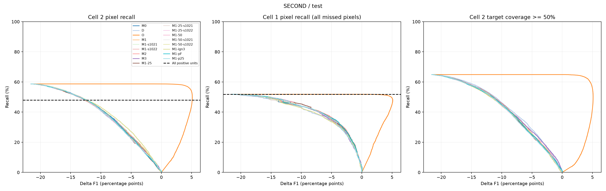
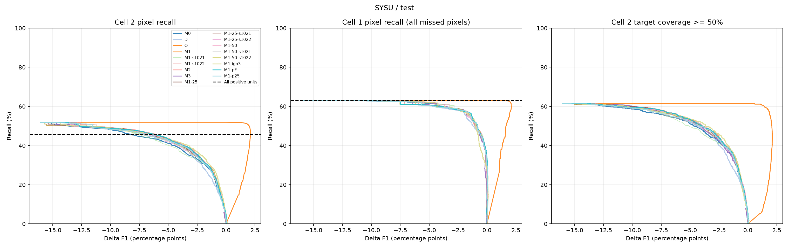

# 实验 8 补充 3：只用补漏组训练补漏判断器

任务：`doc/exp8s3_stage1_judge.md`。只训练小模型（MLP、梯度提升树），全部在 CPU 上，合计约 7.5 CPU 小时，不用 GPU。不跑检测器、SAM3、AnyChange、MLLM。阈值和早停只用验证部分选，测试部分每个冻结点只评一次。
代码：`code/probe/exp8s3_*.py`（units → train → rank → curves → merge → points → report；提交链见 `exp8s3_run_all.sh`）。服务器上的完整输出：`wyh/exp6_staging/batch43/run/{second,sysu}/`（表格 `tables.md`、逐 epoch 训练日志 `models/<方法>/train_log.jsonl`）。图：`figures/exp8s3/`。

进度：全部完成（2026-10-24）。

**结论**：只用补漏组训练没有带来改进。M1、M2、M3、正例数量和门槛的各变体，都和“单元内检测器平均概率”（D）排得一样好，曲线几乎重合。唯一有差别的是忽略 ③ 为主的正例（M1-ign3）：在 ΔF1 −1 到 −2 区间，② 召回高约 1–3 个点，新增误检块更少。SECOND 上验证选的阈值迁移不到测试，测试 F1 代价是目标的约 5–20 倍；SYSU 守得住，但 ΔF1 −1 时 ② 只补回约 14%。瓶颈不在模型容量和正例数量，而在两处：现有特征分不开 ② 正例与负例（② 正例对补漏负例 AUC 只有 0.68–0.78、AP 0.05–0.08）；U5 单元对 ② 的覆盖上限只有 52–59%。

## 数据与分流

- **分流规则**：exp8s2 第 1d 步冻结的规则（按成员分流，R(0.1)，不加预过滤）。它在 U5 单元上的对应做法（我定的）：U5 单元本身就是 SAM 自动分割出的对象，只有一个特征向量，不再拆分，所以“按成员”就是按单元自身掩码算 r = |D ∩ m| / |m|，r < 0.1 的单元进补漏组。冻结规则不含预过滤，所以不丢弃小单元。
- 训练 / 验证 / 测试的划分、交叉拟合检测器、特征（SECOND 19 维、SYSU 15 维）与 exp8 第 3 步 V1 相同。
- **标签按新增像素重算**：新增像素（单元 \ D）中真值占比 ≥ 50% 为正、< 10% 为负，其余不参与训练。exp8 原标签按整个单元算；补漏组里两者不同的单元很少（SECOND 测试 553 个、SYSU 测试 81 个）。
- 训练划分的格标签按 batch34 的定义，用缓存的真值和检测器预测重建；验证 / 测试直接用 batch34 的格标签，并逐图核对 batch30 基线（完全一致）。
- 核对时发现：exp8 单元池缓存的“新增像素数”与本次用 D 重算的结果，有少数单元差 1–3 个像素（检测器掩码在 0.5 附近的个别像素不同）。我按“每单元差 ≤ max(5 像素, 新增面积 1%)”放行，并记录不一致的单元数。这对标签和格没有实际影响。

**表 1：补漏组的规模与正例构成**

| 数据集 / 划分 | 图数 | 补漏单元 | 正例 | 正例率 | 正例中 ① / ② / ③ |
|---|---:|---:|---:|---:|---|
| SECOND 训练 | 2,671 | 631,399 | 62,889 | 10.0% | 22.7 / 45.0 / 32.3% |
| SECOND 验证 | 297 | 66,568 | 6,419 | 9.6% | 23.8 / 41.2 / 34.9% |
| SECOND 测试 | 1,694 | 423,542 | 35,676 | 8.4% | 22.1 / 44.8 / 33.0% |
| SYSU 训练 | 3,200 | 115,411 | 7,888 | 6.8% | 11.4 / 23.8 / 64.7% |
| SYSU 验证 | 800 | 35,194 | 2,665 | 7.6% | 10.2 / 22.7 / 67.1% |
| SYSU 测试 | 4,000 | 147,769 | 12,233 | 8.3% | 14.7 / 22.7 / 62.6% |

（⑤ 为主的正例 < 0.2%。）

**覆盖上限**（② 像素召回，分母为全部 ② 漏检像素）：

| 数据集 / 划分 | 补漏组全部单元并入 | 只并入正例单元 | ① 可达上限 |
|---|---:|---:|---:|
| SECOND 验证 / 测试 | 56.5% / 58.7% | 48.3% / 48.0% | 51.0% / 51.8% |
| SYSU 验证 / 测试 | 50.7% / 51.9% | 43.0% / 45.6% | 40.1% / 63.1% |

U5 单元只盖得到约一半的 ② 漏检。exp8s2 第 1d 步的候选池对 ② 的覆盖是 63–74%，U5 少了 10–20 个点。

## 判断器

| 记号 | 说明 |
|---|---|
| M0 | exp8 第 3 步冻结的 V1 full（全部候选上训练），不重训，只在补漏组上评估 |
| D | 单元内检测器平均概率，不训练 |
| O | oracle：按单元新增像素的真实精度排序 |
| M1 | 两层 MLP，结构与超参数同 V1（AdamW，学习率 1e-3，权重衰减 1e-4，Dropout 0.15，批量 2048，最多 50 epoch，按验证 AP 早停，耐心 7），只用补漏组训练；3 个种子 |
| M2 | 四层 MLP（512 → 256 → 128 → 64），其余同 M1 |
| M3 | HistGradientBoostingClassifier，31 叶，学习率 0.1，按外部验证 AP 早停（最多 300 次，耐心 20） |
| M1-25 / M1-50 | 正例随机只留 25% / 50%（25% 是 50% 的子集），负例全留，正例权重按留下的数目重算；各 3 个种子 |
| M1-ign3 | 训练时忽略“新增真值多数在 ③”的正例 |
| M1-pF / M1-p25 | 正例门槛放宽到 ≥ F/2（F = 训练划分上检测器的像素 F1：SECOND 0.710，SYSU 0.842）/ ≥ 25% |

- 变体只改训练标签。早停和排序评估一律用原标签（≥ 50% / < 10%）。
- 所有 MLP 的每个 epoch 都记录了训练 / 验证损失和验证 AUC / AP。

## 排序指标（测试部分，补漏组）

**表 2：AUC / AP**（95% CI 为 2000 次按图整群自助法；SECOND 补漏全部的 AUC CI 约 ±0.008、② 子集约 ±0.01；SYSU 分别约 ±0.01 和 ±0.02）

| 判断器 | SECOND 补漏全部 AUC / AP | SECOND ② 正例 vs 补漏负例 AUC / AP | SYSU 补漏全部 AUC / AP | SYSU ② 正例 vs 补漏负例 AUC / AP |
|---|---|---|---|---|
| D | 0.767 / 0.235 | 0.681 / 0.067 | 0.874 / 0.341 | 0.781 / 0.048 |
| M0 | 0.767 / 0.232 | 0.688 / 0.072 | 0.869 / 0.338 | 0.769 / 0.049 |
| M1 | 0.766 / 0.233 | 0.687 / 0.072 | 0.873 / 0.342 | 0.782 / 0.051 |
| M2 | 0.769 / 0.239 | 0.687 / 0.070 | 0.874 / 0.342 | 0.781 / 0.050 |
| M3 | 0.768 / 0.237 | 0.689 / 0.072 | 0.873 / 0.339 | 0.782 / 0.050 |
| M1-ign3 | 0.736 / 0.204 | **0.703 / 0.084** | 0.850 / 0.288 | **0.799 / 0.078** |
| M1-pF | 0.768 / 0.238 | 0.687 / 0.070 | 0.873 / 0.339 | 0.783 / 0.051 |
| M1-p25 | 0.766 / 0.232 | 0.685 / 0.070 | 0.872 / 0.338 | 0.776 / 0.049 |

- 除 M1-ign3 外，所有判断器之间的差别都在 0.008 以内，CI 重叠，而且都和不训练的 D 一样。
- M1-ign3 在“补漏全部”上更差（因为它不再把 ③ 为主的正例排前），在 ② 子集上更好：AP 从 0.07 升到 0.08（SECOND）、从 0.05 升到 0.08（SYSU）。SECOND 的 ② AUC 0.703（CI 0.694–0.712），M1 为 0.687（0.677–0.697），CI 只略有重叠。

## 主曲线：② 像素召回 vs ΔF1

扫阈值，按分数从高到低把补漏单元并入 D，重叠像素取最大分数。每条曲线横轴是 ΔF1（百分点，相对检测器本身），纵轴是 ② 漏检像素召回。

验证的图：`figures/exp8s3/{second,sysu}_main_val.png`。每张图另有 ① 像素召回和 ② 对象召回（目标被覆盖 ≥ 50%）两个面板。

**表 3：曲线上同等 F1 代价下的 ② 像素召回**（每条曲线上 ΔF1 ≥ 给定值时能达到的最高 ② 召回，单位 %。这是描述性读数，测试曲线不用于选择）

| 判断器 | SECOND 验证 −0.5 / −1 / −2 | SECOND 测试 −0.5 / −1 / −2 | SYSU 验证 −0.5 / −1 / −2 | SYSU 测试 −0.5 / −1 / −2 |
|---|---|---|---|---|
| D | 3.5 / 11.1 / 15.4 | 2.9 / 5.2 / 10.2 | 10.7 / 14.0 / 23.2 | 14.0 / 20.2 / 28.8 |
| M0 | 11.4 / 14.3 / 20.2 | 2.7 / 5.6 / 11.2 | 11.2 / 14.7 / 24.7 | 15.4 / 23.8 / 30.8 |
| M1（3 种子均值） | 10.1 / 13.9 / 19.3 | 2.8 / 6.0 / 10.6 | 11.4 / 15.6 / 25.0 | 16.0 / 24.9 / 31.9 |
| M2 | 9.5 / 12.9 / 19.6 | 2.5 / 6.0 / 10.3 | 11.0 / 15.4 / 24.9 | 15.5 / 24.7 / 32.5 |
| M3 | 6.5 / 9.8 / 18.8 | 4.0 / 6.5 / 10.5 | 12.2 / 14.9 / 25.0 | 15.6 / 23.9 / 32.3 |
| **M1-ign3** | **14.5 / 16.8 / 21.3** | 3.0 / **6.8 / 12.4** | 10.6 / **17.5 / 25.7** | **18.2 / 27.8 / 34.4** |
| M1-pF | 8.8 / 11.0 / 19.5 | 2.8 / 5.5 / 10.0 | 11.5 / 16.5 / 23.0 | 15.8 / 24.0 / 32.1 |
| M1-p25 | 10.1 / 12.2 / 21.3 | 3.1 / 6.0 / 10.8 | 10.5 / 15.8 / 23.0 | 13.6 / 23.4 / 31.6 |
| O（上限） | 56.5（ΔF1 > 0） | 58.7（ΔF1 > 0） | 50.7（ΔF1 > 0） | 51.9（ΔF1 > 0） |

- SECOND 测试的曲线比验证低得多：ΔF1 −1 时验证能补回 10–17%，测试只有 5–7%。SECOND 验证和测试用的不是同一个检测器（验证用交叉拟合的检测器，F1 0.714；测试用官方权重，F1 0.742）。测试的基线更强，并入一块像素要提高 F1 需要的精度（F/2）也更高。
- SYSU 测试的曲线比验证略好。

## 冻结点：验证选阈值，测试评一次

在验证曲线上，取 ΔF1 ≥ −0.3 / −0.5 / −1 / −2 中 ② 像素召回最高的阈值，冻结后在测试上评一次。完整表（含 ΔIoU、① 召回、整体漏检率变化、新增误检像素与连通域 / 图、换算代价）见 `batch43/run/<数据集>/tables.md`。

**表 4：冻结点的测试结果**（ΔF1 与召回为百分点 / %；“代价”= −ΔF1 ÷ ② 像素召回百分点，即每补回 1 个百分点 ② 漏检像素，F1 下降多少）

| 判断器 | 验证目标 | SECOND 测试 ΔF1 | SECOND ② 像素 / 对象召回 | SECOND 代价 | SYSU 测试 ΔF1 | SYSU ② 像素 / 对象召回 | SYSU 新增误检块 / 图 | SYSU 代价 |
|---|---:|---:|---|---:|---:|---|---:|---:|
| D | −0.5 | −2.33 | 11.8 / 15.5 | 0.20 | −0.23 | 9.6 / 13.0 | 2.1 | 0.024 |
| D | −2 | −9.19 | 37.8 / 43.5 | 0.24 | −1.19 | 22.8 / 27.4 | 3.6 | 0.052 |
| M0 | −0.5 | −6.19 | 29.1 / 29.9 | 0.21 | −0.22 | 10.4 / 14.0 | 1.7 | 0.021 |
| M0 | −2 | −10.22 | 42.5 / 45.5 | 0.24 | −1.09 | 25.3 / 31.7 | 3.7 | 0.043 |
| M1 | −0.3 | −6.05 | 28.7 / 29.8 | 0.21 | −0.11 | 6.5 / 9.1 | 1.5 | 0.017 |
| M1 | −0.5 | −6.60 | 30.5 / 32.0 | 0.22 | −0.22 | 10.3 / 13.6 | 1.8 | 0.021 |
| M1 | −1 | −8.19 | 36.1 / 38.2 | 0.23 | −0.43 | 14.1 / 18.7 | 2.2 | 0.030 |
| M1 | −2 | −10.47 | 42.5 / 45.8 | 0.25 | −1.08 | 25.5 / 32.0 | 3.2 | 0.042 |
| M2 | −0.5 | −5.99 | 27.4 / 29.8 | 0.22 | −0.20 | 9.9 / 13.3 | 1.8 | 0.020 |
| M3 | −0.5 | −4.07 | 20.3 / 23.9 | 0.20 | −0.26 | 9.7 / 13.5 | 1.9 | 0.027 |
| M1-ign3 | −0.5 | −7.28 | 35.0 / 35.1 | 0.21 | −0.15 | 10.3 / 9.2 | 0.4 | 0.014 |
| M1-ign3 | −1 | −8.43 | 38.6 / 39.5 | 0.22 | −0.42 | 16.8 / 16.3 | 0.7 | 0.025 |
| M1-ign3 | −2 | −11.02 | 45.6 / 47.9 | 0.24 | −1.06 | 28.1 / 33.9 | 2.1 | 0.038 |
| M1-pF | −0.5 | −5.56 | 25.0 / 26.8 | 0.22 | −0.20 | 8.8 / 12.3 | 1.5 | 0.022 |
| M1-p25 | −0.5 | −5.99 | 26.2 / 28.1 | 0.23 | −0.22 | 8.4 / 11.9 | 1.7 | 0.026 |

- **SYSU 守得住**：所有判断器在测试上的 ΔF1 都不超过验证目标（−0.5 目标下 −0.15 到 −0.26，−2 目标下 −1.06 到 −1.19）。
- **SECOND 完全守不住**：−0.5 目标下测试 ΔF1 为 −2.3 到 −7.3，−2 目标下为 −9 到 −11。代价稳定在每个百分点 ② 约 0.2–0.25 个 F1 点，所以测试点只是沿着更差的测试曲线滑到了更远的位置。

### 额外尝试：按接收比例冻结（单独一节，不训练）

为检验 SECOND 守不住是不是因为两个检测器的分数整体偏移，我把冻结对象从“分数阈值”换成“接收的补漏单元比例”。在验证上照原规则选好阈值，记下它接收的单元比例 q；测试上接收分数最高的 q 比例单元，评一次。只读已保存的分数和曲线（`code/probe/exp8s3_quantile.py`，结果 `batch43/run/quantile_frozen.{json,md}`）。

| 判断器 | 验证目标 | 接收比例 | SECOND 测试 ΔF1（分数冻结 → 比例冻结） | SECOND ② 召回（分数 → 比例） |
|---|---:|---:|---|---|
| D | −0.5 | 5.9% | −2.33 → −0.61 | 11.8 → 3.4 |
| M1 | −0.5 | 9.1% | −6.60 → −3.20 | 30.5 → 17.0 |
| M1 | −2 | 16.7% | −10.47 → −5.89 | 42.5 → 27.8 |
| M3 | −0.5 | 7.1% | −4.07 → −1.58 | 20.3 → 9.1 |
| M1-ign3 | −0.5 | 5.9% | −7.28 → −3.58 | 35.0 → 20.5 |

- F1 代价约减半，但仍远超目标（M1 −0.5 目标下 −3.2）。只有 D 接近守住（−0.61）。
- SYSU 上两种冻结的结果几乎相同（例如 M1 −2 目标：−1.08 / −1.00）。
- 读数：SECOND 测试的问题不只是分数偏移。在同样的接收比例下，测试上补漏单元的精度本身就更低。所以在 SECOND 上，按验证选阈值的判断器没法直接部署；需要用与测试同一个检测器得到的验证数据来校准，或者把冻结点定在比目标保守得多的位置。

## 判断问题

**1. 只用补漏组训练（M1）比 M0 好多少？**
- 几乎没有差别。
  - 补漏组 AUC：SECOND 0.766 对 0.767，SYSU 0.873 对 0.869。
  - 曲线上 ΔF1 = −0.5 时 ② 召回：SECOND 验证 10.1% 对 11.4%、测试 2.8% 对 2.7%；SYSU 验证 11.4% 对 11.2%、测试 16.0% 对 15.4%。
  - 冻结点（−0.5 目标）测试 ② 召回：SECOND 30.5% 对 29.1%（两者 ΔF1 都在 −6 以上），SYSU 10.3% 对 10.4%。
- 原因：在补漏组里，V1 的排序本来就几乎等于检测器平均概率（exp8s2 第 2 步）。只用补漏组重训不会给特征带来新信息。

**2. ΔF1 = −0.3 / −0.5 / −1 / −2 时，测试部分 ② 能补回多少？验证到测试守得住吗？**
- **SYSU（守得住）**：M1 的测试 ΔF1 为 −0.11 / −0.22 / −0.43 / −1.08，② 像素召回 6.5 / 10.3 / 14.1 / 25.5%，② 对象召回 9.1 / 13.6 / 18.7 / 32.0%。M1-ign3 在 −1 / −2 两档补回 16.8 / 28.1%，新增误检块每图 0.7 / 2.1 个（M1 为 2.2 / 3.2 个）。
- **SECOND（守不住）**：M1 的测试 ΔF1 为 −6.1 / −6.6 / −8.2 / −10.5，② 补回 29 / 31 / 36 / 43%。按测试曲线描述，真正只付 −0.5 / −1 / −2 的 F1 时，② 只能补回约 3 / 6 / 11%。

**3. 正例从 25% → 50% → 100%，曲线是否还在明显变好？人造正例是否值得做？**
- 没有。三个种子均值（ΔF1 −0.5 / −1 / −2 时的 ② 召回）：
  - SECOND 测试：25% 2.7 / 5.5 / 10.2，50% 2.9 / 5.7 / 10.8，100% 2.8 / 6.0 / 10.6。
  - SYSU 测试：25% 16.5 / 24.1 / 32.2，50% 16.1 / 24.7 / 32.0，100% 16.0 / 24.9 / 31.9。
- 差别都在种子间的波动范围内，验证 AUC 也相同（三个种子均值：SECOND 0.763 / 0.765 / 0.765，SYSU 0.889 / 0.890 / 0.889）。正例数量不是瓶颈，**不建议做人造正例**。

**4. M2、M3 是否比 M1 好？模型容量是不是瓶颈？**
- 不是。M2、M3 的 AUC / AP 与 M1 差 ≤ 0.006。曲线上各有高低，没有一致的提升（例如 SYSU 测试 ΔF1 −2 时 M1 31.9%、M2 32.5%、M3 32.3%；SECOND 测试 10.6 / 10.3 / 10.5%）。
- M3 在 SECOND 验证上低预算处反而更差（−0.5 时 6.5% 对 10.1%）。

**5a. 忽略 ③ 为主的正例、放宽正例门槛，对曲线有什么影响？**
- **忽略 ③（M1-ign3）是唯一有用的改动**，变好的主要是 ΔF1 −1 到 −2 这一段：
  - ② 召回在 SECOND 测试 −1 / −2 时 6.8 / 12.4%（M1 为 6.0 / 10.6）；SYSU 测试 27.8 / 34.4%（M1 为 24.9 / 31.9）。
  - 新增误检的连通域明显更少：SYSU −1 冻结点每图 0.7 块，M1 为 2.2 块。
  - 代价：① 召回在低预算处下降（SYSU −0.3 冻结点 26.9% 对 36.4%）；在“补漏全部”的 AUC 上更差，因为它不再把 ③ 为主的正例排前。
  - 符合 exp8s3 的目标：补漏阶段只负责 ②，③ 留给精修。
- **放宽门槛（M1-pF、M1-p25）没有让曲线右移**，与 M1 重合或略差（SECOND 测试 −2 时 10.0 / 10.8% 对 10.6%）。门槛附近（25–50%）的单元很少（SECOND 训练只多出 7,506 / 13,874 个正例），而且它们本身就是低精度单元，加进来不改变排序。

**5. 与 oracle 的差距有多大？要达到 ② 召回 50% 需要多高的判断精度？**
- 差距很大。oracle 在 F1 上升的同时就能达到 ② 召回 56–59%（SECOND）、51–52%（SYSU）。最好的判断器在 ΔF1 −2 时只有 11–12%（SECOND 测试）、34%（SYSU 测试）。
- 按 oracle 的排序，要补回 50% 的 ② 漏检，需要接收新增像素精度 ≥ 0.44（SECOND 测试）/ ≥ 0.22（SYSU 测试）的全部单元，而且不接收更差的单元；此时并入像素的累计精度约 80%（SECOND 80.2%、SYSU 79.8%），ΔF1 为 +5.1 / +2.0。
- 现有判断器在 ② 子集上的 AP 只有 0.07–0.08，距离这个精度差一个数量级。
- SYSU 测试只并入正例单元，② 召回最多 45.6%；要到 50%，还得并入一部分中间单元（全部单元上限 51.9%）。

## 下一步的方向（判断）

- **判断器这一侧**：现有元数据特征下，换模型、换容量、加正例都没用。要提高 ② 召回，需要新的信息来源，例如由 MLLM 或专门的变化验证模型看图，判断“这里是不是一个检测器漏掉的新建筑”。exp8s2 第 2 步已经显示，现有看图的判断器（V1 骨干版本、V2）在补漏组上也不比元数据好，所以需要新的看图方法，而不是现有的。
- **训练目标**：保留“忽略 ③ 为主的正例”。补漏判断器只学 ②（和 ①），把 ③ 交给精修阶段。
- **候选这一侧**：U5 单元对 ② 的覆盖上限只有 52–59%，第 1d 步的候选池能到 63–74%。如果要继续提高上限，补漏阶段应改用覆盖更高的候选单元。
- **部署上**：SECOND 上验证选的阈值不能直接用于测试。要么验证数据用与测试相同的检测器，要么把冻结点定得保守得多。
