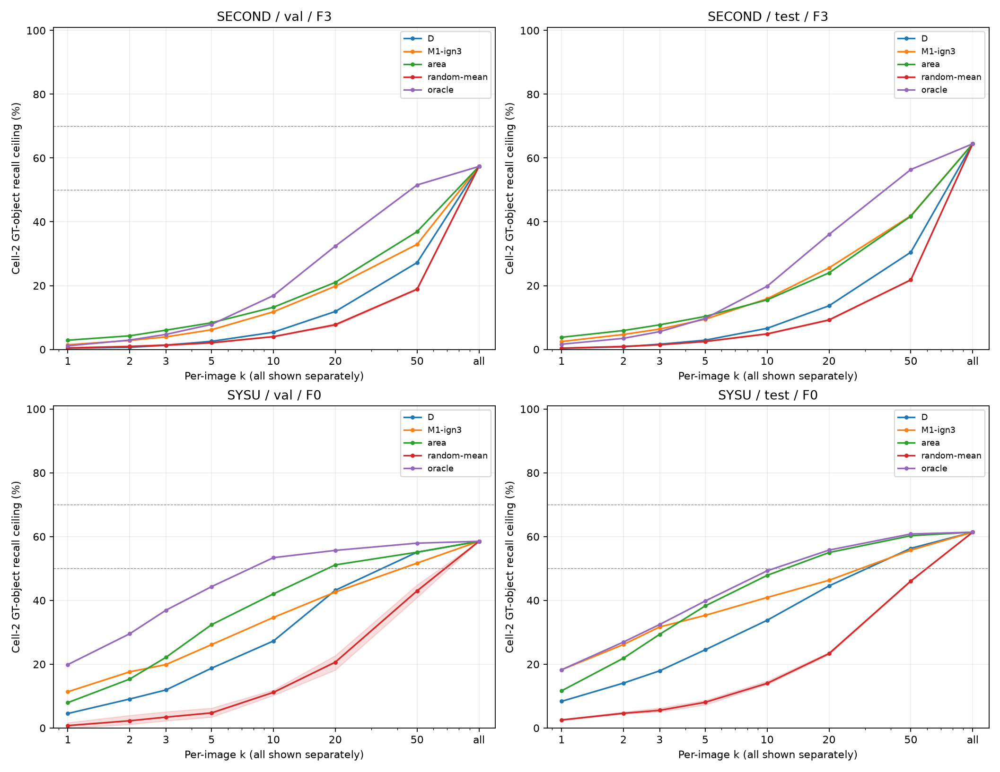
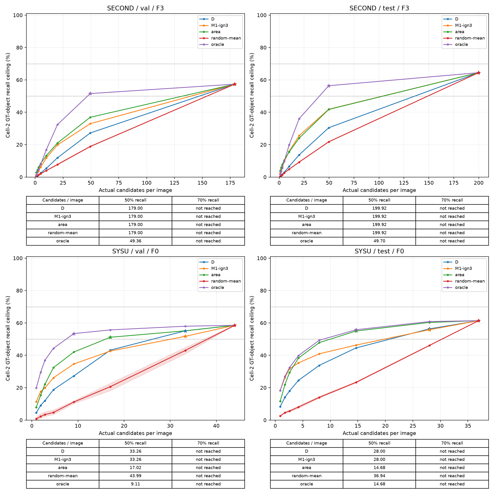

# 实验 8 补充 5：② 判定检查、碎片过滤与候选预算

任务：`doc/exp8s5_checks_budget.md`。代码：`code/probe/exp8s5_*.py`。服务器输出：`wyh/exp6_staging/batch46/run/`。审核页的第 3、5 步对比图已生成（`batch46/page/`），按 Ethan 的意思暂不重新发布。

完整缓存统计。参数只在验证部分选择，测试部分按冻结方案描述。

候选负责列出有预算的待查清单；补漏、去误检与掩码精修交给后续MLLM。此实验没有执行任何模型。调用耗时以0.44秒/候选估算，不包含调度、输入输出等额外耗时。

对象口径：按GT目标去重，D与候选新增真值并集覆盖GT目标至少50%算命中；SECOND按语义转移分目标。像素口径：候选新增掩码并集覆盖该格全部漏检像素的比例。附加漏检连通域指标保存在JSON。分母为零时显示“—”。

## 1. train_2697 与全量自检

本图格标签与冻结定义一致。右上角GT目标6共1396像素，D覆盖0.00%，棋盘距离4、欧氏距离5.0像素。

| GT目标/漏检域 | 目标/漏检域像素 | D覆盖率 | 棋盘距离 | 欧氏距离 | (t1,t2) | 结论 |
|---|---|---|---|---|---|---|
| 6/12 | 1396/1396 | 0.00% | 4 | 5.00 | [2, 1] | 漏检域与D的棋盘距离为4，一像素膨胀不相接 |

语义类别编号见 [详查JSON](exp8s5_inspection/train_2697.json)。[原分辨率叠加图](exp8s5_inspection/train_2697-native.png)；[右上角逐像素4倍放大图](exp8s5_inspection/train_2697-upper-right-4x.png)。棋盘距离d表示最近像素中心相隔d步；中间空格层数为d−1。

| 数据集 | 划分 | 图数 | ②GT对象 | ②漏检域 | 原②所属GT与D重叠数 | 原②像素与D重叠 | 修正后重叠对象 | 变化标签像素 |
|---|---|---|---|---|---|---|---|---|
| second | train | 2671 | 22365 | 22365 | 0 | 0 | 0 | 0 |
| second | test | 1694 | 11675 | 11675 | 0 | 0 | 0 | 0 |
| sysu | train | 3200 | 764 | 764 | 0 | 0 | 0 | 0 |
| sysu | test | 4000 | 909 | 909 | 0 | 0 | 0 | 0 |

原标签与冻结定义不一致时，按语义GT对象、目标检测覆盖率、漏检连通域大小及到D的距离重建；逐图JSON保留旧格分布与修正格，原缓存不改。重叠检查同时检查②像素和其所属完整GT目标，避免只检查GT减D产生的必然零值。

| 数据集 | 划分 | 棋盘距离 | GT对象数 | 漏检域数 | 像素数 | 占②像素 |
|---|---|---|---|---|---|---|
| second | train | 2 | 1199 | 1199 | 773117 | 5.51% |
| second | train | 3 | 995 | 995 | 611381 | 4.36% |
| second | train | 4–5 | 1509 | 1509 | 1047658 | 7.47% |
| second | train | >5 | 18636 | 18636 | 11566521 | 82.50% |
| second | train | 图内无D | 26 | 26 | 20668 | 0.15% |
| second | test | 2 | 606 | 606 | 448851 | 6.02% |
| second | test | 3 | 517 | 517 | 410797 | 5.51% |
| second | test | 4–5 | 807 | 807 | 562602 | 7.54% |
| second | test | >5 | 9745 | 9745 | 6034699 | 80.93% |
| second | test | 图内无D | 0 | 0 | 0 | 0.00% |
| sysu | train | 2 | 3 | 3 | 18611 | 1.50% |
| sysu | train | 3 | 3 | 3 | 62271 | 5.02% |
| sysu | train | 4–5 | 4 | 4 | 7732 | 0.62% |
| sysu | train | >5 | 665 | 665 | 940396 | 75.75% |
| sysu | train | 图内无D | 89 | 89 | 212435 | 17.11% |
| sysu | test | 2 | 4 | 4 | 1540 | 0.09% |
| sysu | test | 3 | 2 | 2 | 9147 | 0.53% |
| sysu | test | 4–5 | 6 | 6 | 25335 | 1.46% |
| sysu | test | >5 | 790 | 790 | 1218989 | 70.18% |
| sysu | test | 图内无D | 107 | 107 | 481920 | 27.75% |

距离分布按漏检域归档，GT目标在每个距离档内去重；同一目标若含多个距离档的漏检域，跨档不可相加。

| 数据集 | 划分 | 修正前/后 | 格 | 像素数 | 占FN | 占全部GT |
|---|---|---|---|---|---|---|
| second | train | 修正前 | 1 | 10537861 | 22.33% | 7.60% |
| second | train | 修正前 | 2 | 14019345 | 29.70% | 10.11% |
| second | train | 修正前 | 3 | 22269401 | 47.19% | 16.06% |
| second | train | 修正前 | 5 | 369137 | 0.78% | 0.27% |
| second | train | 修正后 | 1 | 10537861 | 22.33% | 7.60% |
| second | train | 修正后 | 2 | 14019345 | 29.70% | 10.11% |
| second | train | 修正后 | 3 | 22269401 | 47.19% | 16.06% |
| second | train | 修正后 | 5 | 369137 | 0.78% | 0.27% |
| second | test | 修正前 | 1 | 5586241 | 21.65% | 6.27% |
| second | test | 修正前 | 2 | 7456949 | 28.90% | 8.37% |
| second | test | 修正前 | 3 | 12513057 | 48.49% | 14.04% |
| second | test | 修正前 | 5 | 247506 | 0.96% | 0.28% |
| second | test | 修正后 | 1 | 5586241 | 21.65% | 6.27% |
| second | test | 修正后 | 2 | 7456949 | 28.90% | 8.37% |
| second | test | 修正后 | 3 | 12513057 | 48.49% | 14.04% |
| second | test | 修正后 | 5 | 247506 | 0.96% | 0.28% |
| sysu | train | 修正前 | 1 | 645213 | 8.86% | 1.38% |
| sysu | train | 修正前 | 2 | 1241445 | 17.05% | 2.65% |
| sysu | train | 修正前 | 3 | 5365069 | 73.68% | 11.46% |
| sysu | train | 修正前 | 5 | 30340 | 0.42% | 0.06% |
| sysu | train | 修正后 | 1 | 645213 | 8.86% | 1.38% |
| sysu | train | 修正后 | 2 | 1241445 | 17.05% | 2.65% |
| sysu | train | 修正后 | 3 | 5365069 | 73.68% | 11.46% |
| sysu | train | 修正后 | 5 | 30340 | 0.42% | 0.06% |
| sysu | test | 修正前 | 1 | 891313 | 9.07% | 1.44% |
| sysu | test | 修正前 | 2 | 1736931 | 17.68% | 2.81% |
| sysu | test | 修正前 | 3 | 7163124 | 72.91% | 11.59% |
| sysu | test | 修正前 | 5 | 33384 | 0.34% | 0.05% |
| sysu | test | 修正后 | 1 | 891313 | 9.07% | 1.44% |
| sysu | test | 修正后 | 2 | 1736931 | 17.68% | 2.81% |
| sysu | test | 修正后 | 3 | 7163124 | 72.91% | 11.59% |
| sysu | test | 修正后 | 5 | 33384 | 0.34% | 0.05% |

### 邻接从1像素放宽到3像素（仅对照，不改定义）

| 数据集 | 划分 | 膨胀半径 | 格 | GT对象数 | 漏检域数 | 像素数 | 占FN | 占全部GT |
|---|---|---|---|---|---|---|---|---|
| second | train | 1 | 1 | 5960 | 6068 | 10537861 | 22.33% | 7.60% |
| second | train | 1 | 2 | 22365 | 22365 | 14019345 | 29.70% | 10.11% |
| second | train | 3 | 1 | 8154 | 8262 | 11922359 | 25.26% | 8.60% |
| second | train | 3 | 2 | 20171 | 20171 | 12634847 | 26.77% | 9.11% |
| second | test | 1 | 1 | 3207 | 3284 | 5586241 | 21.65% | 6.27% |
| second | test | 1 | 2 | 11675 | 11675 | 7456949 | 28.90% | 8.37% |
| second | test | 3 | 1 | 4330 | 4407 | 6445889 | 24.98% | 7.23% |
| second | test | 3 | 2 | 10552 | 10552 | 6597301 | 25.57% | 7.40% |
| sysu | train | 1 | 1 | 107 | 113 | 645213 | 8.86% | 1.38% |
| sysu | train | 1 | 2 | 764 | 764 | 1241445 | 17.05% | 2.65% |
| sysu | train | 3 | 1 | 113 | 119 | 726095 | 9.97% | 1.55% |
| sysu | train | 3 | 2 | 758 | 758 | 1160563 | 15.94% | 2.48% |
| sysu | test | 1 | 1 | 150 | 154 | 891313 | 9.07% | 1.44% |
| sysu | test | 1 | 2 | 909 | 909 | 1736931 | 17.68% | 2.81% |
| sysu | test | 3 | 1 | 156 | 160 | 902000 | 9.18% | 1.46% |
| sysu | test | 3 | 2 | 903 | 903 | 1726244 | 17.57% | 2.79% |

## 2. 碎片过滤与验证冻结

F0原样；F1新增面积≥100；F2先3×3开运算再要求新增面积≥100；F3新增掩码最大内切圆半径≥2像素。F3旨在去除细线、保留紧凑小区域，不额外裁剪掩码。每个数据集独立选择：②像素和对象覆盖相对F0均损失≤1个百分点，候选数最少；同分按F0/F1/F2/F3顺序。

| 数据集 | 划分 | 方案 | 单元/图 | ①像素覆盖 | ②像素覆盖 | ②对象覆盖 | 丢弃数 | 丢弃中正例比例 | 丢弃中含任意GT比例 |
|---|---|---|---|---|---|---|---|---|---|
| second | val | F0 | 224.13 | 50.98% | 56.54% | 57.71% | 0 | — | — |
| second | val | F1 | 122.05 | 50.18% | 54.95% | 54.26% | 30319 | 8.48% | 13.46% |
| second | val | F2 | 114.00 | 49.12% | 53.67% | 52.84% | 32710 | 8.45% | 13.82% |
| second | val | F3（选中） | 179.00 | 50.67% | 56.09% | 57.36% | 13404 | 8.45% | 13.70% |
| second | test | F0 | 250.02 | 51.80% | 58.69% | 64.89% | 0 | — | — |
| second | test | F1 | 136.81 | 50.85% | 57.24% | 62.15% | 191789 | 7.17% | 12.10% |
| second | test | F2 | 127.45 | 49.68% | 55.96% | 60.81% | 207640 | 7.16% | 12.54% |
| second | test | F3（选中） | 199.92 | 51.45% | 58.23% | 64.45% | 84876 | 7.44% | 12.80% |
| sysu | val | F0（选中） | 43.99 | 40.07% | 50.68% | 58.52% | 0 | — | — |
| sysu | val | F1 | 16.01 | 36.60% | 47.12% | 50.00% | 22383 | 7.17% | 9.16% |
| sysu | val | F2 | 14.33 | 34.86% | 45.52% | 48.86% | 23731 | 7.10% | 9.16% |
| sysu | val | F3 | 32.16 | 39.51% | 50.18% | 57.39% | 9469 | 6.04% | 7.99% |
| sysu | test | F0（选中） | 36.94 | 63.10% | 51.91% | 61.39% | 0 | — | — |
| sysu | test | F1 | 13.19 | 59.20% | 49.06% | 57.21% | 94990 | 8.35% | 10.45% |
| sysu | test | F2 | 11.83 | 57.34% | 47.14% | 55.23% | 100436 | 8.26% | 10.51% |
| sysu | test | F3 | 27.14 | 62.41% | 51.35% | 60.62% | 39214 | 7.18% | 9.03% |

| 数据集 | 划分 | 冻结方案 | 每图减少单元 | ②像素损失/百分点 | ②对象损失/百分点 |
|---|---|---|---|---|---|
| second | val | F3 | 45.13 | 0.45 | 0.34 |
| second | test | F3 | 50.10 | 0.47 | 0.44 |
| sysu | val | F0 | 0.00 | 0.00 | 0.00 |
| sysu | test | F0 | 0.00 | 0.00 | 0.00 |

正例按处理后的新增真值精度≥50%定义，含③为主的正例；丢弃比例使用处理前标签。测试的F0–F3全表仅作描述，未重选。审核页沿用原图并在每个数据集的6张固定流程图后追加第3、5步并排对比；冒烟只显示限量图。

## 3. 候选预算曲线

D、M1-ign3使用原单元缓存分数降序；面积按处理后完整面积降序；oracle按处理后新增真值精度降序。随机使用1020/1021/1022三个种子，均值曲线附最小/最大范围。oracle是给定精度排序的参照，并非集合覆盖最优解。所有候选都允许后续MLLM正确精修，所以召回上限按候选覆盖真值并集计算，不只接受预先标为正例的候选。

### SECOND / val

| 排序 | k | ②像素召回 | ②对象召回 | ①像素召回 | ①对象召回 | 正例总数 | 正例比例 | 正例/图 | 候选/图 | MLLM调用数 | 估算GPU小时 |
|---|---|---|---|---|---|---|---|---|---|---|---|
| D | 1 | 0.14% | 0.39% | 1.16% | 3.55% | 112.0 | 37.71% | 0.38 | 1.00 | 297.0 | 0.0363 |
| D | 2 | 0.40% | 0.65% | 2.48% | 6.46% | 208.0 | 35.02% | 0.70 | 2.00 | 594.0 | 0.0726 |
| D | 3 | 0.78% | 1.34% | 5.95% | 8.72% | 295.0 | 33.11% | 0.99 | 3.00 | 891.0 | 0.1089 |
| D | 5 | 2.09% | 2.54% | 11.06% | 12.92% | 483.0 | 32.53% | 1.63 | 5.00 | 1485.0 | 0.1815 |
| D | 10 | 4.11% | 5.38% | 18.46% | 20.68% | 875.0 | 29.46% | 2.95 | 10.00 | 2970.0 | 0.3630 |
| D | 20 | 13.22% | 11.89% | 25.24% | 30.21% | 1587.0 | 26.73% | 5.34 | 19.99 | 5938.0 | 0.7258 |
| D | 50 | 26.57% | 27.22% | 35.26% | 41.20% | 3037.0 | 20.71% | 10.23 | 49.36 | 14661.0 | 1.7919 |
| D | all | 56.09% | 57.36% | 50.67% | 49.76% | 5287.0 | 9.94% | 17.80 | 179.00 | 53164.0 | 6.4978 |
| M1-ign3 | 1 | 1.92% | 1.46% | 7.56% | 7.11% | 108.0 | 36.36% | 0.36 | 1.00 | 297.0 | 0.0363 |
| M1-ign3 | 2 | 3.84% | 2.80% | 8.87% | 9.05% | 217.0 | 36.53% | 0.73 | 2.00 | 594.0 | 0.0726 |
| M1-ign3 | 3 | 4.68% | 3.92% | 10.75% | 12.28% | 313.0 | 35.13% | 1.05 | 3.00 | 891.0 | 0.1089 |
| M1-ign3 | 5 | 7.19% | 6.16% | 14.69% | 15.83% | 480.0 | 32.32% | 1.62 | 5.00 | 1485.0 | 0.1815 |
| M1-ign3 | 10 | 13.78% | 11.80% | 25.52% | 23.75% | 878.0 | 29.56% | 2.96 | 10.00 | 2970.0 | 0.3630 |
| M1-ign3 | 20 | 22.17% | 19.81% | 31.26% | 31.99% | 1567.0 | 26.39% | 5.28 | 19.99 | 5938.0 | 0.7258 |
| M1-ign3 | 50 | 34.35% | 32.95% | 40.46% | 41.03% | 2974.0 | 20.29% | 10.01 | 49.36 | 14661.0 | 1.7919 |
| M1-ign3 | all | 56.09% | 57.36% | 50.67% | 49.76% | 5287.0 | 9.94% | 17.80 | 179.00 | 53164.0 | 6.4978 |
| area | 1 | 7.14% | 2.89% | 15.89% | 3.88% | 37.0 | 12.46% | 0.12 | 1.00 | 297.0 | 0.0363 |
| area | 2 | 10.57% | 4.26% | 22.21% | 6.30% | 75.0 | 12.63% | 0.25 | 2.00 | 594.0 | 0.0726 |
| area | 3 | 14.59% | 6.03% | 26.44% | 9.85% | 110.0 | 12.35% | 0.37 | 3.00 | 891.0 | 0.1089 |
| area | 5 | 19.39% | 8.35% | 30.29% | 12.92% | 187.0 | 12.59% | 0.63 | 5.00 | 1485.0 | 0.1815 |
| area | 10 | 26.83% | 13.22% | 35.49% | 18.58% | 386.0 | 13.00% | 1.30 | 10.00 | 2970.0 | 0.3630 |
| area | 20 | 34.33% | 21.02% | 39.92% | 27.46% | 738.0 | 12.43% | 2.48 | 19.99 | 5938.0 | 0.7258 |
| area | 50 | 46.09% | 36.91% | 45.47% | 40.23% | 1778.0 | 12.13% | 5.99 | 49.36 | 14661.0 | 1.7919 |
| area | all | 56.09% | 57.36% | 50.67% | 49.76% | 5287.0 | 9.94% | 17.80 | 179.00 | 53164.0 | 6.4978 |
| random-1020 | 1 | 0.42% | 0.43% | 0.41% | 0.65% | 37.0 | 12.46% | 0.12 | 1.00 | 297.0 | 0.0363 |
| random-1020 | 2 | 1.08% | 0.90% | 0.51% | 0.65% | 71.0 | 11.95% | 0.24 | 2.00 | 594.0 | 0.0726 |
| random-1020 | 3 | 1.43% | 1.21% | 0.84% | 0.81% | 102.0 | 11.45% | 0.34 | 3.00 | 891.0 | 0.1089 |
| random-1020 | 5 | 2.95% | 1.85% | 1.40% | 1.78% | 168.0 | 11.31% | 0.57 | 5.00 | 1485.0 | 0.1815 |
| random-1020 | 10 | 4.99% | 4.01% | 6.45% | 3.72% | 341.0 | 11.48% | 1.15 | 10.00 | 2970.0 | 0.3630 |
| random-1020 | 20 | 10.67% | 7.67% | 13.46% | 7.75% | 669.0 | 11.27% | 2.25 | 19.99 | 5938.0 | 0.7258 |
| random-1020 | 50 | 20.47% | 18.65% | 25.58% | 19.06% | 1609.0 | 10.97% | 5.42 | 49.36 | 14661.0 | 1.7919 |
| random-1020 | all | 56.09% | 57.36% | 50.67% | 49.76% | 5287.0 | 9.94% | 17.80 | 179.00 | 53164.0 | 6.4978 |
| random-1021 | 1 | 0.48% | 0.73% | 1.27% | 0.65% | 39.0 | 13.13% | 0.13 | 1.00 | 297.0 | 0.0363 |
| random-1021 | 2 | 1.07% | 1.21% | 3.69% | 0.81% | 71.0 | 11.95% | 0.24 | 2.00 | 594.0 | 0.0726 |
| random-1021 | 3 | 1.41% | 1.72% | 4.03% | 0.97% | 97.0 | 10.89% | 0.33 | 3.00 | 891.0 | 0.1089 |
| random-1021 | 5 | 2.08% | 2.37% | 7.83% | 2.10% | 159.0 | 10.71% | 0.54 | 5.00 | 1485.0 | 0.1815 |
| random-1021 | 10 | 4.78% | 4.09% | 9.16% | 3.55% | 350.0 | 11.78% | 1.18 | 10.00 | 2970.0 | 0.3630 |
| random-1021 | 20 | 9.75% | 8.14% | 14.70% | 7.75% | 687.0 | 11.57% | 2.31 | 19.99 | 5938.0 | 0.7258 |
| random-1021 | 50 | 21.07% | 19.21% | 23.28% | 20.36% | 1652.0 | 11.27% | 5.56 | 49.36 | 14661.0 | 1.7919 |
| random-1021 | all | 56.09% | 57.36% | 50.67% | 49.76% | 5287.0 | 9.94% | 17.80 | 179.00 | 53164.0 | 6.4978 |
| random-1022 | 1 | 0.22% | 0.17% | 0.25% | 0.32% | 31.0 | 10.44% | 0.10 | 1.00 | 297.0 | 0.0363 |
| random-1022 | 2 | 0.80% | 0.69% | 0.74% | 0.65% | 69.0 | 11.62% | 0.23 | 2.00 | 594.0 | 0.0726 |
| random-1022 | 3 | 1.89% | 1.08% | 1.13% | 0.97% | 98.0 | 11.00% | 0.33 | 3.00 | 891.0 | 0.1089 |
| random-1022 | 5 | 3.16% | 2.07% | 1.44% | 0.97% | 158.0 | 10.64% | 0.53 | 5.00 | 1485.0 | 0.1815 |
| random-1022 | 10 | 5.13% | 3.92% | 3.85% | 3.23% | 315.0 | 10.61% | 1.06 | 10.00 | 2970.0 | 0.3630 |
| random-1022 | 20 | 10.61% | 7.41% | 9.73% | 7.11% | 642.0 | 10.81% | 2.16 | 19.99 | 5938.0 | 0.7258 |
| random-1022 | 50 | 23.11% | 18.78% | 20.38% | 16.32% | 1585.0 | 10.81% | 5.34 | 49.36 | 14661.0 | 1.7919 |
| random-1022 | all | 56.09% | 57.36% | 50.67% | 49.76% | 5287.0 | 9.94% | 17.80 | 179.00 | 53164.0 | 6.4978 |
| oracle | 1 | 2.27% | 1.12% | 1.54% | 2.10% | 289.0 | 97.31% | 0.97 | 1.00 | 297.0 | 0.0363 |
| oracle | 2 | 4.62% | 2.93% | 3.09% | 5.01% | 567.0 | 95.45% | 1.91 | 2.00 | 594.0 | 0.0726 |
| oracle | 3 | 7.10% | 4.69% | 4.51% | 8.08% | 833.0 | 93.49% | 2.80 | 3.00 | 891.0 | 0.1089 |
| oracle | 5 | 11.50% | 7.84% | 10.86% | 12.92% | 1327.0 | 89.36% | 4.47 | 5.00 | 1485.0 | 0.1815 |
| oracle | 10 | 23.90% | 16.88% | 21.66% | 22.94% | 2328.0 | 78.38% | 7.84 | 10.00 | 2970.0 | 0.3630 |
| oracle | 20 | 39.26% | 32.39% | 37.69% | 34.73% | 3639.0 | 61.28% | 12.25 | 19.99 | 5938.0 | 0.7258 |
| oracle | 50 | 52.14% | 51.55% | 47.48% | 46.53% | 4876.0 | 33.26% | 16.42 | 49.36 | 14661.0 | 1.7919 |
| oracle | all | 56.09% | 57.36% | 50.67% | 49.76% | 5287.0 | 9.94% | 17.80 | 179.00 | 53164.0 | 6.4978 |
| random-mean | 1 | 0.37% | 0.45% | 0.64% | 0.54% | 35.7 | 12.01% | 0.12 | 1.00 | 297.0 | 0.0363 |
| random-mean | 2 | 0.98% | 0.93% | 1.65% | 0.70% | 70.3 | 11.84% | 0.24 | 2.00 | 594.0 | 0.0726 |
| random-mean | 3 | 1.58% | 1.34% | 2.00% | 0.92% | 99.0 | 11.11% | 0.33 | 3.00 | 891.0 | 0.1089 |
| random-mean | 5 | 2.73% | 2.10% | 3.56% | 1.62% | 161.7 | 10.89% | 0.54 | 5.00 | 1485.0 | 0.1815 |
| random-mean | 10 | 4.97% | 4.01% | 6.49% | 3.50% | 335.3 | 11.29% | 1.13 | 10.00 | 2970.0 | 0.3630 |
| random-mean | 20 | 10.34% | 7.74% | 12.63% | 7.54% | 666.0 | 11.22% | 2.24 | 19.99 | 5938.0 | 0.7258 |
| random-mean | 50 | 21.55% | 18.88% | 23.08% | 18.58% | 1615.3 | 11.02% | 5.44 | 49.36 | 14661.0 | 1.7919 |
| random-mean | all | 56.09% | 57.36% | 50.67% | 49.76% | 5287.0 | 9.94% | 17.80 | 179.00 | 53164.0 | 6.4978 |

### SECOND / test

| 排序 | k | ②像素召回 | ②对象召回 | ①像素召回 | ①对象召回 | 正例总数 | 正例比例 | 正例/图 | 候选/图 | MLLM调用数 | 估算GPU小时 |
|---|---|---|---|---|---|---|---|---|---|---|---|
| D | 1 | 0.22% | 0.35% | 1.01% | 2.12% | 565.0 | 33.35% | 0.33 | 1.00 | 1694.0 | 0.2070 |
| D | 2 | 0.48% | 0.81% | 2.01% | 4.12% | 1076.0 | 31.76% | 0.64 | 2.00 | 3388.0 | 0.4141 |
| D | 3 | 1.04% | 1.64% | 3.03% | 6.17% | 1587.0 | 31.23% | 0.94 | 3.00 | 5082.0 | 0.6211 |
| D | 5 | 2.03% | 2.90% | 5.40% | 9.26% | 2531.0 | 29.88% | 1.49 | 5.00 | 8470.0 | 1.0352 |
| D | 10 | 5.13% | 6.61% | 10.81% | 17.03% | 4720.0 | 27.86% | 2.79 | 10.00 | 16940.0 | 2.0704 |
| D | 20 | 11.11% | 13.68% | 18.63% | 26.19% | 8267.0 | 24.41% | 4.88 | 19.99 | 33863.0 | 4.1388 |
| D | 50 | 26.52% | 30.47% | 32.61% | 39.94% | 15619.0 | 18.55% | 9.22 | 49.70 | 84189.0 | 10.2898 |
| D | all | 58.23% | 64.45% | 51.45% | 52.45% | 29358.0 | 8.67% | 17.33 | 199.92 | 338666.0 | 41.3925 |
| M1-ign3 | 1 | 3.26% | 2.48% | 7.25% | 5.05% | 484.0 | 28.57% | 0.29 | 1.00 | 1694.0 | 0.2070 |
| M1-ign3 | 2 | 5.29% | 4.68% | 10.99% | 8.42% | 954.0 | 28.16% | 0.56 | 2.00 | 3388.0 | 0.4141 |
| M1-ign3 | 3 | 7.02% | 6.38% | 13.08% | 10.54% | 1403.0 | 27.61% | 0.83 | 3.00 | 5082.0 | 0.6211 |
| M1-ign3 | 5 | 10.37% | 9.46% | 17.60% | 14.90% | 2281.0 | 26.93% | 1.35 | 5.00 | 8470.0 | 1.0352 |
| M1-ign3 | 10 | 17.65% | 15.87% | 23.98% | 22.89% | 4298.0 | 25.37% | 2.54 | 10.00 | 16940.0 | 2.0704 |
| M1-ign3 | 20 | 26.72% | 25.57% | 30.83% | 30.59% | 7545.0 | 22.28% | 4.45 | 19.99 | 33863.0 | 4.1388 |
| M1-ign3 | 50 | 39.99% | 41.88% | 39.59% | 41.69% | 14482.0 | 17.20% | 8.55 | 49.70 | 84189.0 | 10.2898 |
| M1-ign3 | all | 58.23% | 64.45% | 51.45% | 52.45% | 29358.0 | 8.67% | 17.33 | 199.92 | 338666.0 | 41.3925 |
| area | 1 | 7.39% | 3.80% | 12.28% | 4.24% | 165.0 | 9.74% | 0.10 | 1.00 | 1694.0 | 0.2070 |
| area | 2 | 11.27% | 5.92% | 16.96% | 6.83% | 339.0 | 10.01% | 0.20 | 2.00 | 3388.0 | 0.4141 |
| area | 3 | 14.07% | 7.71% | 20.82% | 9.23% | 528.0 | 10.39% | 0.31 | 3.00 | 5082.0 | 0.6211 |
| area | 5 | 18.09% | 10.34% | 25.00% | 12.07% | 893.0 | 10.54% | 0.53 | 5.00 | 8470.0 | 1.0352 |
| area | 10 | 24.75% | 15.54% | 30.33% | 17.62% | 1818.0 | 10.73% | 1.07 | 10.00 | 16940.0 | 2.0704 |
| area | 20 | 33.53% | 24.00% | 36.40% | 25.35% | 3586.0 | 10.59% | 2.12 | 19.99 | 33863.0 | 4.1388 |
| area | 50 | 46.49% | 41.76% | 44.39% | 37.92% | 8710.0 | 10.35% | 5.14 | 49.70 | 84189.0 | 10.2898 |
| area | all | 58.23% | 64.45% | 51.45% | 52.45% | 29358.0 | 8.67% | 17.33 | 199.92 | 338666.0 | 41.3925 |
| random-1020 | 1 | 0.47% | 0.43% | 0.37% | 0.44% | 159.0 | 9.39% | 0.09 | 1.00 | 1694.0 | 0.2070 |
| random-1020 | 2 | 0.92% | 0.98% | 0.82% | 0.75% | 330.0 | 9.74% | 0.19 | 2.00 | 3388.0 | 0.4141 |
| random-1020 | 3 | 1.31% | 1.38% | 1.32% | 1.09% | 476.0 | 9.37% | 0.28 | 3.00 | 5082.0 | 0.6211 |
| random-1020 | 5 | 2.13% | 2.33% | 1.81% | 1.84% | 799.0 | 9.43% | 0.47 | 5.00 | 8470.0 | 1.0352 |
| random-1020 | 10 | 5.01% | 4.74% | 3.84% | 3.93% | 1618.0 | 9.55% | 0.96 | 10.00 | 16940.0 | 2.0704 |
| random-1020 | 20 | 8.91% | 9.04% | 8.97% | 7.61% | 3209.0 | 9.48% | 1.89 | 19.99 | 33863.0 | 4.1388 |
| random-1020 | 50 | 20.67% | 21.59% | 20.45% | 17.90% | 7843.0 | 9.32% | 4.63 | 49.70 | 84189.0 | 10.2898 |
| random-1020 | all | 58.23% | 64.45% | 51.45% | 52.45% | 29358.0 | 8.67% | 17.33 | 199.92 | 338666.0 | 41.3925 |
| random-1021 | 1 | 0.36% | 0.33% | 0.45% | 0.28% | 148.0 | 8.74% | 0.09 | 1.00 | 1694.0 | 0.2070 |
| random-1021 | 2 | 0.79% | 0.75% | 0.95% | 0.69% | 316.0 | 9.33% | 0.19 | 2.00 | 3388.0 | 0.4141 |
| random-1021 | 3 | 1.39% | 1.28% | 1.28% | 1.22% | 495.0 | 9.74% | 0.29 | 3.00 | 5082.0 | 0.6211 |
| random-1021 | 5 | 2.42% | 2.42% | 2.30% | 2.09% | 807.0 | 9.53% | 0.48 | 5.00 | 8470.0 | 1.0352 |
| random-1021 | 10 | 4.66% | 5.13% | 4.37% | 3.77% | 1598.0 | 9.43% | 0.94 | 10.00 | 16940.0 | 2.0704 |
| random-1021 | 20 | 9.46% | 9.53% | 8.60% | 7.30% | 3181.0 | 9.39% | 1.88 | 19.99 | 33863.0 | 4.1388 |
| random-1021 | 50 | 21.29% | 21.84% | 21.21% | 17.46% | 7826.0 | 9.30% | 4.62 | 49.70 | 84189.0 | 10.2898 |
| random-1021 | all | 58.23% | 64.45% | 51.45% | 52.45% | 29358.0 | 8.67% | 17.33 | 199.92 | 338666.0 | 41.3925 |
| random-1022 | 1 | 0.52% | 0.43% | 0.31% | 0.22% | 140.0 | 8.26% | 0.08 | 1.00 | 1694.0 | 0.2070 |
| random-1022 | 2 | 1.03% | 1.09% | 1.28% | 0.72% | 318.0 | 9.39% | 0.19 | 2.00 | 3388.0 | 0.4141 |
| random-1022 | 3 | 1.63% | 1.71% | 1.60% | 1.06% | 477.0 | 9.39% | 0.28 | 3.00 | 5082.0 | 0.6211 |
| random-1022 | 5 | 2.58% | 2.68% | 2.30% | 1.96% | 815.0 | 9.62% | 0.48 | 5.00 | 8470.0 | 1.0352 |
| random-1022 | 10 | 4.95% | 4.72% | 4.60% | 3.62% | 1590.0 | 9.39% | 0.94 | 10.00 | 16940.0 | 2.0704 |
| random-1022 | 20 | 9.08% | 9.14% | 8.12% | 7.30% | 3153.0 | 9.31% | 1.86 | 19.99 | 33863.0 | 4.1388 |
| random-1022 | 50 | 21.12% | 21.99% | 18.76% | 17.46% | 7875.0 | 9.35% | 4.65 | 49.70 | 84189.0 | 10.2898 |
| random-1022 | all | 58.23% | 64.45% | 51.45% | 52.45% | 29358.0 | 8.67% | 17.33 | 199.92 | 338666.0 | 41.3925 |
| oracle | 1 | 2.50% | 1.63% | 2.51% | 2.06% | 1596.0 | 94.21% | 0.94 | 1.00 | 1694.0 | 0.2070 |
| oracle | 2 | 5.06% | 3.47% | 5.08% | 4.05% | 3116.0 | 91.97% | 1.84 | 2.00 | 3388.0 | 0.4141 |
| oracle | 3 | 7.66% | 5.58% | 7.83% | 6.17% | 4554.0 | 89.61% | 2.69 | 3.00 | 5082.0 | 0.6211 |
| oracle | 5 | 12.17% | 9.71% | 11.85% | 10.41% | 7215.0 | 85.18% | 4.26 | 5.00 | 8470.0 | 1.0352 |
| oracle | 10 | 22.50% | 19.80% | 21.29% | 19.52% | 12637.0 | 74.60% | 7.46 | 10.00 | 16940.0 | 2.0704 |
| oracle | 20 | 36.72% | 36.04% | 33.48% | 33.18% | 19804.0 | 58.48% | 11.69 | 19.99 | 33863.0 | 4.1388 |
| oracle | 50 | 52.64% | 56.39% | 46.98% | 47.58% | 27061.0 | 32.14% | 15.97 | 49.70 | 84189.0 | 10.2898 |
| oracle | all | 58.23% | 64.45% | 51.45% | 52.45% | 29358.0 | 8.67% | 17.33 | 199.92 | 338666.0 | 41.3925 |
| random-mean | 1 | 0.45% | 0.39% | 0.37% | 0.31% | 149.0 | 8.80% | 0.09 | 1.00 | 1694.0 | 0.2070 |
| random-mean | 2 | 0.91% | 0.94% | 1.02% | 0.72% | 321.3 | 9.48% | 0.19 | 2.00 | 3388.0 | 0.4141 |
| random-mean | 3 | 1.44% | 1.46% | 1.40% | 1.12% | 482.7 | 9.50% | 0.28 | 3.00 | 5082.0 | 0.6211 |
| random-mean | 5 | 2.38% | 2.48% | 2.14% | 1.96% | 807.0 | 9.53% | 0.48 | 5.00 | 8470.0 | 1.0352 |
| random-mean | 10 | 4.87% | 4.86% | 4.27% | 3.77% | 1602.0 | 9.46% | 0.95 | 10.00 | 16940.0 | 2.0704 |
| random-mean | 20 | 9.15% | 9.24% | 8.56% | 7.40% | 3181.0 | 9.39% | 1.88 | 19.99 | 33863.0 | 4.1388 |
| random-mean | 50 | 21.02% | 21.81% | 20.14% | 17.61% | 7848.0 | 9.32% | 4.63 | 49.70 | 84189.0 | 10.2898 |
| random-mean | all | 58.23% | 64.45% | 51.45% | 52.45% | 29358.0 | 8.67% | 17.33 | 199.92 | 338666.0 | 41.3925 |

### SYSU / val

| 排序 | k | ②像素召回 | ②对象召回 | ①像素召回 | ①对象召回 | 正例总数 | 正例比例 | 正例/图 | 候选/图 | MLLM调用数 | 估算GPU小时 |
|---|---|---|---|---|---|---|---|---|---|---|---|
| D | 1 | 4.26% | 4.55% | 2.37% | 11.11% | 186.0 | 24.28% | 0.23 | 0.96 | 766.0 | 0.0936 |
| D | 2 | 8.48% | 9.09% | 6.81% | 18.52% | 338.0 | 22.19% | 0.42 | 1.90 | 1523.0 | 0.1861 |
| D | 3 | 10.03% | 11.93% | 8.48% | 25.93% | 457.0 | 20.15% | 0.57 | 2.83 | 2268.0 | 0.2772 |
| D | 5 | 14.89% | 18.75% | 11.65% | 25.93% | 665.0 | 17.77% | 0.83 | 4.68 | 3743.0 | 0.4575 |
| D | 10 | 24.28% | 27.27% | 17.50% | 33.33% | 1072.0 | 14.71% | 1.34 | 9.11 | 7290.0 | 0.8910 |
| D | 20 | 36.59% | 43.18% | 30.36% | 44.44% | 1565.0 | 11.49% | 1.96 | 17.02 | 13616.0 | 1.6642 |
| D | 50 | 48.55% | 55.11% | 39.23% | 55.56% | 2301.0 | 8.65% | 2.88 | 33.26 | 26608.0 | 3.2521 |
| D | all | 50.68% | 58.52% | 40.07% | 55.56% | 2665.0 | 7.57% | 3.33 | 43.99 | 35194.0 | 4.3015 |
| M1-ign3 | 1 | 13.82% | 11.36% | 14.17% | 29.63% | 148.0 | 19.32% | 0.18 | 0.96 | 766.0 | 0.0936 |
| M1-ign3 | 2 | 19.82% | 17.61% | 18.05% | 29.63% | 270.0 | 17.73% | 0.34 | 1.90 | 1523.0 | 0.1861 |
| M1-ign3 | 3 | 21.55% | 19.89% | 20.80% | 33.33% | 381.0 | 16.80% | 0.48 | 2.83 | 2268.0 | 0.2772 |
| M1-ign3 | 5 | 25.11% | 26.14% | 24.81% | 37.04% | 568.0 | 15.17% | 0.71 | 4.68 | 3743.0 | 0.4575 |
| M1-ign3 | 10 | 30.14% | 34.66% | 28.43% | 40.74% | 970.0 | 13.31% | 1.21 | 9.11 | 7290.0 | 0.8910 |
| M1-ign3 | 20 | 36.26% | 42.61% | 33.51% | 48.15% | 1492.0 | 10.96% | 1.86 | 17.02 | 13616.0 | 1.6642 |
| M1-ign3 | 50 | 46.54% | 51.70% | 38.76% | 51.85% | 2274.0 | 8.55% | 2.84 | 33.26 | 26608.0 | 3.2521 |
| M1-ign3 | all | 50.68% | 58.52% | 40.07% | 55.56% | 2665.0 | 7.57% | 3.33 | 43.99 | 35194.0 | 4.3015 |
| area | 1 | 11.98% | 7.95% | 11.23% | 14.81% | 40.0 | 5.22% | 0.05 | 0.96 | 766.0 | 0.0936 |
| area | 2 | 20.60% | 15.34% | 14.66% | 18.52% | 87.0 | 5.71% | 0.11 | 1.90 | 1523.0 | 0.1861 |
| area | 3 | 25.29% | 22.16% | 18.66% | 25.93% | 131.0 | 5.78% | 0.16 | 2.83 | 2268.0 | 0.2772 |
| area | 5 | 31.22% | 32.39% | 23.64% | 33.33% | 220.0 | 5.88% | 0.28 | 4.68 | 3743.0 | 0.4575 |
| area | 10 | 39.57% | 42.05% | 27.33% | 40.74% | 461.0 | 6.32% | 0.58 | 9.11 | 7290.0 | 0.8910 |
| area | 20 | 45.59% | 51.14% | 32.51% | 44.44% | 914.0 | 6.71% | 1.14 | 17.02 | 13616.0 | 1.6642 |
| area | 50 | 49.50% | 55.11% | 38.66% | 51.85% | 1827.0 | 6.87% | 2.28 | 33.26 | 26608.0 | 3.2521 |
| area | all | 50.68% | 58.52% | 40.07% | 55.56% | 2665.0 | 7.57% | 3.33 | 43.99 | 35194.0 | 4.3015 |
| random-1020 | 1 | 1.43% | 0.57% | 0.43% | 0.00% | 53.0 | 6.92% | 0.07 | 0.96 | 766.0 | 0.0936 |
| random-1020 | 2 | 2.64% | 1.14% | 1.61% | 3.70% | 103.0 | 6.76% | 0.13 | 1.90 | 1523.0 | 0.1861 |
| random-1020 | 3 | 3.27% | 2.27% | 1.74% | 3.70% | 155.0 | 6.83% | 0.19 | 2.83 | 2268.0 | 0.2772 |
| random-1020 | 5 | 4.25% | 3.41% | 2.07% | 3.70% | 245.0 | 6.55% | 0.31 | 4.68 | 3743.0 | 0.4575 |
| random-1020 | 10 | 11.07% | 11.36% | 4.10% | 11.11% | 483.0 | 6.63% | 0.60 | 9.11 | 7290.0 | 0.8910 |
| random-1020 | 20 | 20.05% | 21.02% | 12.73% | 25.93% | 909.0 | 6.68% | 1.14 | 17.02 | 13616.0 | 1.6642 |
| random-1020 | 50 | 39.76% | 40.91% | 25.26% | 40.74% | 1788.0 | 6.72% | 2.23 | 33.26 | 26608.0 | 3.2521 |
| random-1020 | all | 50.68% | 58.52% | 40.07% | 55.56% | 2665.0 | 7.57% | 3.33 | 43.99 | 35194.0 | 4.3015 |
| random-1021 | 1 | 1.10% | 1.70% | 1.29% | 0.00% | 48.0 | 6.27% | 0.06 | 0.96 | 766.0 | 0.0936 |
| random-1021 | 2 | 2.07% | 3.98% | 1.75% | 0.00% | 104.0 | 6.83% | 0.13 | 1.90 | 1523.0 | 0.1861 |
| random-1021 | 3 | 3.73% | 5.11% | 1.86% | 0.00% | 151.0 | 6.66% | 0.19 | 2.83 | 2268.0 | 0.2772 |
| random-1021 | 5 | 4.46% | 6.25% | 2.48% | 0.00% | 259.0 | 6.92% | 0.32 | 4.68 | 3743.0 | 0.4575 |
| random-1021 | 10 | 8.62% | 10.23% | 4.26% | 3.70% | 477.0 | 6.54% | 0.60 | 9.11 | 7290.0 | 0.8910 |
| random-1021 | 20 | 17.35% | 18.18% | 7.42% | 7.41% | 897.0 | 6.59% | 1.12 | 17.02 | 13616.0 | 1.6642 |
| random-1021 | 50 | 39.47% | 44.89% | 26.17% | 40.74% | 1776.0 | 6.67% | 2.22 | 33.26 | 26608.0 | 3.2521 |
| random-1021 | all | 50.68% | 58.52% | 40.07% | 55.56% | 2665.0 | 7.57% | 3.33 | 43.99 | 35194.0 | 4.3015 |
| random-1022 | 1 | 0.22% | 0.00% | 0.20% | 0.00% | 54.0 | 7.05% | 0.07 | 0.96 | 766.0 | 0.0936 |
| random-1022 | 2 | 0.72% | 1.70% | 0.42% | 0.00% | 103.0 | 6.76% | 0.13 | 1.90 | 1523.0 | 0.1861 |
| random-1022 | 3 | 2.35% | 2.84% | 1.44% | 0.00% | 150.0 | 6.61% | 0.19 | 2.83 | 2268.0 | 0.2772 |
| random-1022 | 5 | 5.69% | 4.55% | 8.17% | 3.70% | 254.0 | 6.79% | 0.32 | 4.68 | 3743.0 | 0.4575 |
| random-1022 | 10 | 10.97% | 11.93% | 10.16% | 11.11% | 482.0 | 6.61% | 0.60 | 9.11 | 7290.0 | 0.8910 |
| random-1022 | 20 | 19.69% | 22.73% | 17.36% | 18.52% | 894.0 | 6.57% | 1.12 | 17.02 | 13616.0 | 1.6642 |
| random-1022 | 50 | 38.29% | 43.18% | 27.78% | 29.63% | 1785.0 | 6.71% | 2.23 | 33.26 | 26608.0 | 3.2521 |
| random-1022 | all | 50.68% | 58.52% | 40.07% | 55.56% | 2665.0 | 7.57% | 3.33 | 43.99 | 35194.0 | 4.3015 |
| oracle | 1 | 9.22% | 19.89% | 6.01% | 18.52% | 380.0 | 49.61% | 0.47 | 0.96 | 766.0 | 0.0936 |
| oracle | 2 | 16.37% | 29.55% | 10.95% | 33.33% | 627.0 | 41.17% | 0.78 | 1.90 | 1523.0 | 0.1861 |
| oracle | 3 | 20.72% | 36.93% | 12.12% | 33.33% | 811.0 | 35.76% | 1.01 | 2.83 | 2268.0 | 0.2772 |
| oracle | 5 | 28.45% | 44.32% | 15.32% | 37.04% | 1088.0 | 29.07% | 1.36 | 4.68 | 3743.0 | 0.4575 |
| oracle | 10 | 40.22% | 53.41% | 19.94% | 40.74% | 1536.0 | 21.07% | 1.92 | 9.11 | 7290.0 | 0.8910 |
| oracle | 20 | 46.23% | 55.68% | 28.63% | 44.44% | 2016.0 | 14.81% | 2.52 | 17.02 | 13616.0 | 1.6642 |
| oracle | 50 | 50.64% | 57.95% | 40.07% | 55.56% | 2471.0 | 9.29% | 3.09 | 33.26 | 26608.0 | 3.2521 |
| oracle | all | 50.68% | 58.52% | 40.07% | 55.56% | 2665.0 | 7.57% | 3.33 | 43.99 | 35194.0 | 4.3015 |
| random-mean | 1 | 0.92% | 0.76% | 0.64% | 0.00% | 51.7 | 6.74% | 0.06 | 0.96 | 766.0 | 0.0936 |
| random-mean | 2 | 1.81% | 2.27% | 1.26% | 1.23% | 103.3 | 6.78% | 0.13 | 1.90 | 1523.0 | 0.1861 |
| random-mean | 3 | 3.11% | 3.41% | 1.68% | 1.23% | 152.0 | 6.70% | 0.19 | 2.83 | 2268.0 | 0.2772 |
| random-mean | 5 | 4.80% | 4.73% | 4.24% | 2.47% | 252.7 | 6.75% | 0.32 | 4.68 | 3743.0 | 0.4575 |
| random-mean | 10 | 10.22% | 11.17% | 6.17% | 8.64% | 480.7 | 6.59% | 0.60 | 9.11 | 7290.0 | 0.8910 |
| random-mean | 20 | 19.03% | 20.64% | 12.50% | 17.28% | 900.0 | 6.61% | 1.12 | 17.02 | 13616.0 | 1.6642 |
| random-mean | 50 | 39.17% | 42.99% | 26.40% | 37.04% | 1783.0 | 6.70% | 2.23 | 33.26 | 26608.0 | 3.2521 |
| random-mean | all | 50.68% | 58.52% | 40.07% | 55.56% | 2665.0 | 7.57% | 3.33 | 43.99 | 35194.0 | 4.3015 |

### SYSU / test

| 排序 | k | ②像素召回 | ②对象召回 | ①像素召回 | ①对象召回 | 正例总数 | 正例比例 | 正例/图 | 候选/图 | MLLM调用数 | 估算GPU小时 |
|---|---|---|---|---|---|---|---|---|---|---|---|
| D | 1 | 5.42% | 8.36% | 5.47% | 19.33% | 988.0 | 27.79% | 0.25 | 0.89 | 3555.0 | 0.4345 |
| D | 2 | 9.43% | 14.08% | 8.57% | 26.67% | 1732.0 | 24.76% | 0.43 | 1.75 | 6996.0 | 0.8551 |
| D | 3 | 12.90% | 17.93% | 14.17% | 30.67% | 2354.0 | 22.75% | 0.59 | 2.59 | 10345.0 | 1.2644 |
| D | 5 | 18.71% | 24.53% | 24.76% | 38.67% | 3400.0 | 20.19% | 0.85 | 4.21 | 16838.0 | 2.0580 |
| D | 10 | 25.95% | 33.77% | 32.83% | 44.67% | 5213.0 | 16.31% | 1.30 | 7.99 | 31969.0 | 3.9073 |
| D | 20 | 35.86% | 44.55% | 45.34% | 52.00% | 7528.0 | 12.82% | 1.88 | 14.68 | 58730.0 | 7.1781 |
| D | 50 | 47.90% | 56.33% | 54.36% | 60.67% | 10470.0 | 9.35% | 2.62 | 28.00 | 111998.0 | 13.6886 |
| D | all | 51.91% | 61.39% | 63.10% | 66.67% | 12233.0 | 8.28% | 3.06 | 36.94 | 147769.0 | 18.0607 |
| M1-ign3 | 1 | 15.18% | 18.26% | 26.01% | 31.33% | 795.0 | 22.36% | 0.20 | 0.89 | 3555.0 | 0.4345 |
| M1-ign3 | 2 | 20.83% | 26.18% | 33.81% | 40.00% | 1423.0 | 20.34% | 0.36 | 1.75 | 6996.0 | 0.8551 |
| M1-ign3 | 3 | 24.19% | 31.68% | 37.70% | 44.67% | 1987.0 | 19.21% | 0.50 | 2.59 | 10345.0 | 1.2644 |
| M1-ign3 | 5 | 27.78% | 35.31% | 41.90% | 48.67% | 2945.0 | 17.49% | 0.74 | 4.21 | 16838.0 | 2.0580 |
| M1-ign3 | 10 | 32.11% | 40.92% | 47.10% | 53.33% | 4778.0 | 14.95% | 1.19 | 7.99 | 31969.0 | 3.9073 |
| M1-ign3 | 20 | 37.19% | 46.31% | 52.05% | 58.00% | 7094.0 | 12.08% | 1.77 | 14.68 | 58730.0 | 7.1781 |
| M1-ign3 | 50 | 47.18% | 55.78% | 57.27% | 63.33% | 10266.0 | 9.17% | 2.57 | 28.00 | 111998.0 | 13.6886 |
| M1-ign3 | all | 51.91% | 61.39% | 63.10% | 66.67% | 12233.0 | 8.28% | 3.06 | 36.94 | 147769.0 | 18.0607 |
| area | 1 | 14.38% | 11.66% | 29.33% | 23.33% | 298.0 | 8.38% | 0.07 | 0.89 | 3555.0 | 0.4345 |
| area | 2 | 24.10% | 21.89% | 36.03% | 32.67% | 591.0 | 8.45% | 0.15 | 1.75 | 6996.0 | 0.8551 |
| area | 3 | 30.57% | 29.37% | 41.29% | 38.00% | 846.0 | 8.18% | 0.21 | 2.59 | 10345.0 | 1.2644 |
| area | 5 | 36.89% | 38.28% | 45.74% | 44.67% | 1317.0 | 7.82% | 0.33 | 4.21 | 16838.0 | 2.0580 |
| area | 10 | 43.46% | 47.85% | 51.54% | 52.67% | 2397.0 | 7.50% | 0.60 | 7.99 | 31969.0 | 3.9073 |
| area | 20 | 47.45% | 55.01% | 56.17% | 58.67% | 4321.0 | 7.36% | 1.08 | 14.68 | 58730.0 | 7.1781 |
| area | 50 | 50.92% | 60.29% | 60.62% | 66.67% | 8291.0 | 7.40% | 2.07 | 28.00 | 111998.0 | 13.6886 |
| area | all | 51.91% | 61.39% | 63.10% | 66.67% | 12233.0 | 8.28% | 3.06 | 36.94 | 147769.0 | 18.0607 |
| random-1020 | 1 | 2.09% | 2.75% | 0.38% | 1.33% | 292.0 | 8.21% | 0.07 | 0.89 | 3555.0 | 0.4345 |
| random-1020 | 2 | 3.26% | 4.40% | 1.83% | 3.33% | 572.0 | 8.18% | 0.14 | 1.75 | 6996.0 | 0.8551 |
| random-1020 | 3 | 4.10% | 5.28% | 2.75% | 5.33% | 826.0 | 7.98% | 0.21 | 2.59 | 10345.0 | 1.2644 |
| random-1020 | 5 | 6.50% | 8.69% | 4.61% | 9.33% | 1318.0 | 7.83% | 0.33 | 4.21 | 16838.0 | 2.0580 |
| random-1020 | 10 | 10.89% | 13.64% | 22.78% | 17.33% | 2417.0 | 7.56% | 0.60 | 7.99 | 31969.0 | 3.9073 |
| random-1020 | 20 | 20.28% | 23.21% | 31.40% | 30.67% | 4268.0 | 7.27% | 1.07 | 14.68 | 58730.0 | 7.1781 |
| random-1020 | 50 | 38.77% | 46.09% | 48.52% | 48.67% | 8216.0 | 7.34% | 2.05 | 28.00 | 111998.0 | 13.6886 |
| random-1020 | all | 51.91% | 61.39% | 63.10% | 66.67% | 12233.0 | 8.28% | 3.06 | 36.94 | 147769.0 | 18.0607 |
| random-1021 | 1 | 1.49% | 2.53% | 7.94% | 3.33% | 279.0 | 7.85% | 0.07 | 0.89 | 3555.0 | 0.4345 |
| random-1021 | 2 | 2.79% | 4.40% | 10.65% | 4.00% | 534.0 | 7.63% | 0.13 | 1.75 | 6996.0 | 0.8551 |
| random-1021 | 3 | 3.78% | 5.06% | 11.15% | 5.33% | 786.0 | 7.60% | 0.20 | 2.59 | 10345.0 | 1.2644 |
| random-1021 | 5 | 6.30% | 7.26% | 16.56% | 8.00% | 1310.0 | 7.78% | 0.33 | 4.21 | 16838.0 | 2.0580 |
| random-1021 | 10 | 11.94% | 13.64% | 21.32% | 13.33% | 2400.0 | 7.51% | 0.60 | 7.99 | 31969.0 | 3.9073 |
| random-1021 | 20 | 20.39% | 23.76% | 32.39% | 26.00% | 4255.0 | 7.25% | 1.06 | 14.68 | 58730.0 | 7.1781 |
| random-1021 | 50 | 39.88% | 45.87% | 47.75% | 48.00% | 8163.0 | 7.29% | 2.04 | 28.00 | 111998.0 | 13.6886 |
| random-1021 | all | 51.91% | 61.39% | 63.10% | 66.67% | 12233.0 | 8.28% | 3.06 | 36.94 | 147769.0 | 18.0607 |
| random-1022 | 1 | 2.02% | 2.31% | 7.19% | 2.00% | 297.0 | 8.35% | 0.07 | 0.89 | 3555.0 | 0.4345 |
| random-1022 | 2 | 3.27% | 5.06% | 7.73% | 3.33% | 578.0 | 8.26% | 0.14 | 1.75 | 6996.0 | 0.8551 |
| random-1022 | 3 | 4.55% | 6.27% | 8.48% | 5.33% | 849.0 | 8.21% | 0.21 | 2.59 | 10345.0 | 1.2644 |
| random-1022 | 5 | 6.68% | 8.25% | 10.52% | 8.00% | 1320.0 | 7.84% | 0.33 | 4.21 | 16838.0 | 2.0580 |
| random-1022 | 10 | 12.62% | 14.74% | 19.63% | 16.67% | 2418.0 | 7.56% | 0.60 | 7.99 | 31969.0 | 3.9073 |
| random-1022 | 20 | 21.10% | 22.99% | 33.98% | 30.67% | 4265.0 | 7.26% | 1.07 | 14.68 | 58730.0 | 7.1781 |
| random-1022 | 50 | 40.21% | 46.31% | 49.27% | 48.67% | 8181.0 | 7.30% | 2.05 | 28.00 | 111998.0 | 13.6886 |
| random-1022 | all | 51.91% | 61.39% | 63.10% | 66.67% | 12233.0 | 8.28% | 3.06 | 36.94 | 147769.0 | 18.0607 |
| oracle | 1 | 9.18% | 18.26% | 4.85% | 16.00% | 1738.0 | 48.89% | 0.43 | 0.89 | 3555.0 | 0.4345 |
| oracle | 2 | 16.05% | 26.95% | 8.29% | 24.67% | 2929.0 | 41.87% | 0.73 | 1.75 | 6996.0 | 0.8551 |
| oracle | 3 | 20.97% | 32.45% | 12.48% | 29.33% | 3813.0 | 36.86% | 0.95 | 2.59 | 10345.0 | 1.2644 |
| oracle | 5 | 28.11% | 39.82% | 23.13% | 36.67% | 5116.0 | 30.38% | 1.28 | 4.21 | 16838.0 | 2.0580 |
| oracle | 10 | 38.27% | 49.28% | 30.80% | 42.67% | 7077.0 | 22.14% | 1.77 | 7.99 | 31969.0 | 3.9073 |
| oracle | 20 | 45.65% | 55.78% | 43.73% | 52.00% | 9193.0 | 15.65% | 2.30 | 14.68 | 58730.0 | 7.1781 |
| oracle | 50 | 51.19% | 60.84% | 57.46% | 62.00% | 11343.0 | 10.13% | 2.84 | 28.00 | 111998.0 | 13.6886 |
| oracle | all | 51.91% | 61.39% | 63.10% | 66.67% | 12233.0 | 8.28% | 3.06 | 36.94 | 147769.0 | 18.0607 |
| random-mean | 1 | 1.87% | 2.53% | 5.17% | 2.22% | 289.3 | 8.14% | 0.07 | 0.89 | 3555.0 | 0.4345 |
| random-mean | 2 | 3.11% | 4.62% | 6.73% | 3.56% | 561.3 | 8.02% | 0.14 | 1.75 | 6996.0 | 0.8551 |
| random-mean | 3 | 4.14% | 5.54% | 7.46% | 5.33% | 820.3 | 7.93% | 0.21 | 2.59 | 10345.0 | 1.2644 |
| random-mean | 5 | 6.49% | 8.07% | 10.56% | 8.44% | 1316.0 | 7.82% | 0.33 | 4.21 | 16838.0 | 2.0580 |
| random-mean | 10 | 11.82% | 14.01% | 21.24% | 15.78% | 2411.7 | 7.54% | 0.60 | 7.99 | 31969.0 | 3.9073 |
| random-mean | 20 | 20.59% | 23.32% | 32.59% | 29.11% | 4262.7 | 7.26% | 1.07 | 14.68 | 58730.0 | 7.1781 |
| random-mean | 50 | 39.62% | 46.09% | 48.51% | 48.44% | 8186.7 | 7.31% | 2.05 | 28.00 | 111998.0 | 13.6886 |
| random-mean | all | 51.91% | 61.39% | 63.10% | 66.67% | 12233.0 | 8.28% | 3.06 | 36.94 | 147769.0 | 18.0607 |

### 50% / 70%对象覆盖所需预算

取预设k网格中首次达到的点，不在点间插值。测试点属于描述性曲线。未达到时显示全部候选的覆盖上限，GPU小时不虚构。

| 数据集 | 划分 | 排序 | 覆盖目标 | 所需k | 候选/图 | 实际覆盖/全部上限 | GPU小时 |
|---|---|---|---|---|---|---|---|
| second | val | D | 50.00% | all | 179.00 | 57.36% | 6.4978 |
| second | val | D | 70.00% | 未达到 | — | 57.36% | — |
| second | val | M1-ign3 | 50.00% | all | 179.00 | 57.36% | 6.4978 |
| second | val | M1-ign3 | 70.00% | 未达到 | — | 57.36% | — |
| second | val | area | 50.00% | all | 179.00 | 57.36% | 6.4978 |
| second | val | area | 70.00% | 未达到 | — | 57.36% | — |
| second | val | oracle | 50.00% | 50 | 49.36 | 51.55% | 1.7919 |
| second | val | oracle | 70.00% | 未达到 | — | 57.36% | — |
| second | val | random-mean | 50.00% | all | 179.00 | 57.36% | 6.4978 |
| second | val | random-mean | 70.00% | 未达到 | — | 57.36% | — |
| second | test | D | 50.00% | all | 199.92 | 64.45% | 41.3925 |
| second | test | D | 70.00% | 未达到 | — | 64.45% | — |
| second | test | M1-ign3 | 50.00% | all | 199.92 | 64.45% | 41.3925 |
| second | test | M1-ign3 | 70.00% | 未达到 | — | 64.45% | — |
| second | test | area | 50.00% | all | 199.92 | 64.45% | 41.3925 |
| second | test | area | 70.00% | 未达到 | — | 64.45% | — |
| second | test | oracle | 50.00% | 50 | 49.70 | 56.39% | 10.2898 |
| second | test | oracle | 70.00% | 未达到 | — | 64.45% | — |
| second | test | random-mean | 50.00% | all | 199.92 | 64.45% | 41.3925 |
| second | test | random-mean | 70.00% | 未达到 | — | 64.45% | — |
| sysu | val | D | 50.00% | 50 | 33.26 | 55.11% | 3.2521 |
| sysu | val | D | 70.00% | 未达到 | — | 58.52% | — |
| sysu | val | M1-ign3 | 50.00% | 50 | 33.26 | 51.70% | 3.2521 |
| sysu | val | M1-ign3 | 70.00% | 未达到 | — | 58.52% | — |
| sysu | val | area | 50.00% | 20 | 17.02 | 51.14% | 1.6642 |
| sysu | val | area | 70.00% | 未达到 | — | 58.52% | — |
| sysu | val | oracle | 50.00% | 10 | 9.11 | 53.41% | 0.8910 |
| sysu | val | oracle | 70.00% | 未达到 | — | 58.52% | — |
| sysu | val | random-mean | 50.00% | all | 43.99 | 58.52% | 4.3015 |
| sysu | val | random-mean | 70.00% | 未达到 | — | 58.52% | — |
| sysu | test | D | 50.00% | 50 | 28.00 | 56.33% | 13.6886 |
| sysu | test | D | 70.00% | 未达到 | — | 61.39% | — |
| sysu | test | M1-ign3 | 50.00% | 50 | 28.00 | 55.78% | 13.6886 |
| sysu | test | M1-ign3 | 70.00% | 未达到 | — | 61.39% | — |
| sysu | test | area | 50.00% | 20 | 14.68 | 55.01% | 7.1781 |
| sysu | test | area | 70.00% | 未达到 | — | 61.39% | — |
| sysu | test | oracle | 50.00% | 20 | 14.68 | 55.78% | 7.1781 |
| sysu | test | oracle | 70.00% | 未达到 | — | 61.39% | — |
| sysu | test | random-mean | 50.00% | all | 36.94 | 61.39% | 18.0607 |
| sysu | test | random-mean | 70.00% | 未达到 | — | 61.39% | — |

| 数据集 | 划分 | 排序 | 覆盖目标 | 相对随机多用候选/图 | 相对面积多用候选/图 | 相对oracle多用候选/图 |
|---|---|---|---|---|---|---|
| second | val | D | 50.00% | 0.00 | 0.00 | 129.64 |
| second | val | D | 70.00% | 不可比较 | 不可比较 | 不可比较 |
| second | val | M1-ign3 | 50.00% | 0.00 | 0.00 | 129.64 |
| second | val | M1-ign3 | 70.00% | 不可比较 | 不可比较 | 不可比较 |
| second | test | D | 50.00% | 0.00 | 0.00 | 150.22 |
| second | test | D | 70.00% | 不可比较 | 不可比较 | 不可比较 |
| second | test | M1-ign3 | 50.00% | 0.00 | 0.00 | 150.22 |
| second | test | M1-ign3 | 70.00% | 不可比较 | 不可比较 | 不可比较 |
| sysu | val | D | 50.00% | -10.73 | 16.24 | 24.15 |
| sysu | val | D | 70.00% | 不可比较 | 不可比较 | 不可比较 |
| sysu | val | M1-ign3 | 50.00% | -10.73 | 16.24 | 24.15 |
| sysu | val | M1-ign3 | 70.00% | 不可比较 | 不可比较 | 不可比较 |
| sysu | test | D | 50.00% | -8.94 | 13.32 | 13.32 |
| sysu | test | D | 70.00% | 不可比较 | 不可比较 | 不可比较 |
| sysu | test | M1-ign3 | 50.00% | -8.94 | 13.32 | 13.32 |
| sysu | test | M1-ign3 | 70.00% | 不可比较 | 不可比较 | 不可比较 |

### 验证预算直接应用于测试

| 数据集 | 排序 | 验证覆盖目标 | 验证选定k | 测试实际覆盖 | 测试候选/图 | 测试GPU小时 |
|---|---|---|---|---|---|---|
| second | D | 50.00% | all | 64.45% | 199.92 | 41.3925 |
| second | D | 70.00% | 验证未达到 | — | — | — |
| second | M1-ign3 | 50.00% | all | 64.45% | 199.92 | 41.3925 |
| second | M1-ign3 | 70.00% | 验证未达到 | — | — | — |
| second | area | 50.00% | all | 64.45% | 199.92 | 41.3925 |
| second | area | 70.00% | 验证未达到 | — | — | — |
| second | random-mean | 50.00% | all | 64.45% | 199.92 | 41.3925 |
| second | random-mean | 70.00% | 验证未达到 | — | — | — |
| second | oracle | 50.00% | 50 | 56.39% | 49.70 | 10.2898 |
| second | oracle | 70.00% | 验证未达到 | — | — | — |
| sysu | D | 50.00% | 50 | 56.33% | 28.00 | 13.6886 |
| sysu | D | 70.00% | 验证未达到 | — | — | — |
| sysu | M1-ign3 | 50.00% | 50 | 55.78% | 28.00 | 13.6886 |
| sysu | M1-ign3 | 70.00% | 验证未达到 | — | — | — |
| sysu | area | 50.00% | 20 | 55.01% | 14.68 | 7.1781 |
| sysu | area | 70.00% | 验证未达到 | — | — | — |
| sysu | random-mean | 50.00% | all | 61.39% | 36.94 | 18.0607 |
| sysu | random-mean | 70.00% | 验证未达到 | — | — | — |
| sysu | oracle | 50.00% | 10 | 49.28% | 7.99 | 3.9073 |
| sysu | oracle | 70.00% | 验证未达到 | — | — | — |

## 验证与限制

合并检查完整图清单与冒烟范围；预算召回随k单调；全部候选在所有排序下的计数一致，且与独立过滤统计相同；分片随机顺序由图编号确定；页面构建检查所有本地链接。每阶段记录耗时及torch导入检查。正式全量由Slurm运行后才可回答全量统计，冒烟结果不得替代。页面发布由Claude完成；本目录只生成可发布文件。

## 判断问题（Claude）

**1. train_2697 那个 ② 是缝还是程序错误？全量里有多少类似情况？**
- 是缝，程序没有错。这个目标是贴着道路的一条细带（变化类别 2→1），1,396 像素，检测结果完全没盖到它，棋盘距离 4、欧氏距离 5 像素。
- 检测结果盖住的是紧挨着的另一条带子，那是另一个真值目标。审核页把 512 像素的图缩到 240 像素，4 像素的缝只剩约 2 像素，看上去像重叠。逐像素放大图见 `exp8s5_inspection/train_2697-upper-right-4x.png`。
- 全量自检：SECOND、SYSU 的训练与测试中，② 与检测结果重叠的目标都是 0，不需要修正。
- 离检测结果只隔 2–5 像素的 ② 在 SECOND 上不少：训练 17.3%、测试 19.1% 的 ② 像素。SYSU 只有 2–7%。
- 若把 ① 的邻接判定放宽到 3 像素，SECOND 测试的 ② 像素占比从 28.9% 降到 25.6%，① 从 21.7% 升到 25.0%。SYSU 几乎不变。只作对照，冻结定义不改。

**2. 选中的碎片过滤方案每图能去掉多少单元，② 损失多少？**
- SECOND 选中 F3（新增像素的最大内切圆半径 ≥ 2 像素，即去掉细条）。测试每图去掉 50 个单元（200 → 150 个中的约四分之一），② 像素覆盖损失 0.47、对象覆盖损失 0.44 个百分点。
- F1（新增 < 100 丢弃）能去掉更多（每图约 113 个），但 SECOND 验证上 ② 对象覆盖损失 3.5 个百分点，超过 1 个百分点的约束。
- SYSU 上 F1–F3 的 ② 对象覆盖损失都超过 1 个百分点（F3 为 1.1），按规则保持 F0（不过滤）。SYSU 每图只有约 37–44 个补漏单元，碎片问题本来就小。

**3. 每图给 MLLM 看多少个候选能覆盖 50% / 70% 的 ②（对象计）？比随机、面积好多少？离 oracle 多远？**
- **70% 在两个数据集上都达不到**：全部补漏单元的上限只有 SECOND 测试 64%、SYSU 测试 61%。
- **SECOND 测试，50%**：
  - 用 D、M1-ign3、面积或随机排序，每图 50 个都不够（M1-ign3 42%、面积 37%、D 30%、随机 19%），要看全部候选（每图约 200 个）。
  - oracle 每图 50 个就到 56%。
  - 预设网格之外，按曲线看，M1-ign3 大约要 80–100 个。这是描述性读数，不在网格点上。
- **SYSU 测试，50%**：
  - 面积排序每图 20 个（实际约 15 个）就到 55%，D 和 M1-ign3 要 50 个（实际约 28 个，因为每图候选不多）。
  - 随机要看全部（约 37 个）。oracle 每图 20 个。
  - 在 SYSU 上面积比 D、M1-ign3 更省：大地块更可能是 ②。
- **小预算时 M1-ign3 明显比 D 好**（SECOND 测试，k = 20：② 对象召回 25.6% 对 13.7%；k = 50：41.9% 对 30.5%）。D 把概率高、贴着检测结果的单元排在前面，这些多是 ① 和 ③，不是 ②。
- 离 oracle 很远：SECOND 测试 k = 20 时，oracle 32%（验证）/ 37%（测试），M1-ign3 只有 20% / 26%。

**4. 按 0.44 秒 / 候选，覆盖 50% 的 ② 在测试集各需要多少 GPU 小时？**
- SECOND 测试：现有排序都要看全部候选，约 34 万次调用，**约 41 GPU 小时**。oracle 排序只要约 10 GPU 小时。
- SYSU 测试：面积排序约 **7.2 GPU 小时**，D / M1-ign3 约 13.7 GPU 小时。
- 0.44 秒 / 候选是文档给的估计，6j 测出实际耗时后替换。

**读数**：
- 候选池对 ② 的覆盖上限只有 61–64%，这是这条路线的天花板。
- 在 SECOND 上，现有便宜排序要覆盖一半的 ②，几乎得把全部候选都交给 MLLM。
- 要降低 MLLM 预算，需要比 M1-ign3 好得多的初筛，或者先提高候选池本身的覆盖。
