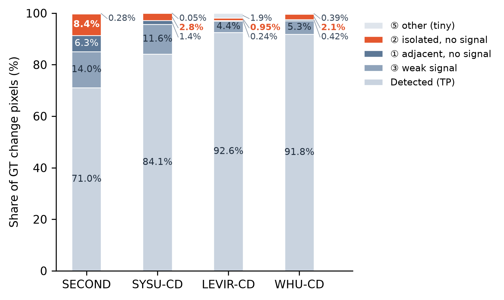
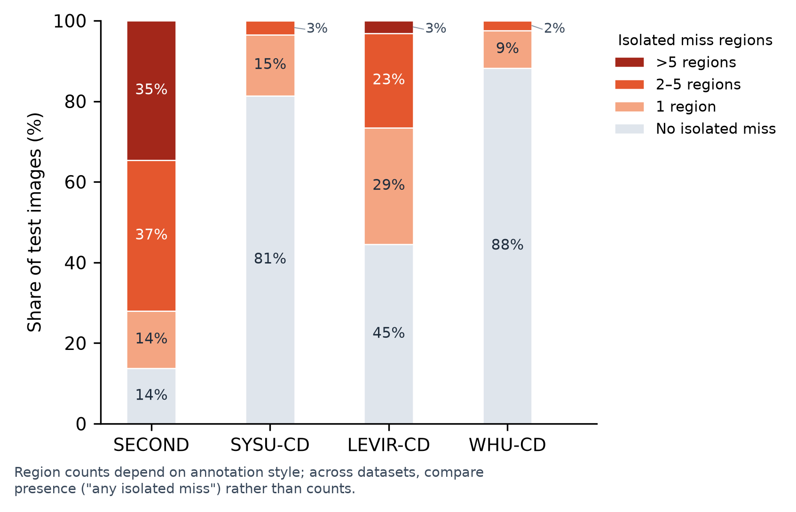

# 完全孤立的漏检（②）在四个数据集里的占比（2026-10-28）

口径：四个数据集的测试集，检测器与测试池一致（官方权重，概率 > 0.5）。漏检像素按 exp8s5 修正后的格定义分为 ①（无信号、贴着检测结果，1 像素邻接）、②（无信号、孤立）、③（有信号：该 GT 目标被检测器覆盖 ≥ 10%）、⑤（其他：目标或漏检块 < 20 像素）。LEVIR、WHU 用 exp8s8 的同一套读取（结果与 exp8s8 表一致：② 占漏检像素 12.7%、25.6%）。SECOND、SYSU 的 ② 占全部 GT 像素与 exp8s5 一致（8.37%、2.81%）。

代码 `code/probe/miss_share.py`；图 `figures/miss_share/`（PNG、PDF）。只用 CPU。

## 图 1：全部 GT 变化像素的构成

| 数据集 | 测试图数 | GT 像素 | 已检出（TP） | ③ | ① | **②** | ⑤ | ② 占漏检像素 |
|---|---:|---:|---:|---:|---:|---:|---:|---:|
| SECOND | 1694 | 89,113,392 | 71.04% | 14.04% | 6.27% | **8.37%** | 0.28% | 28.9% |
| SYSU-CD | 4000 | 61,820,917 | 84.11% | 11.59% | 1.44% | **2.81%** | 0.05% | 17.7% |
| LEVIR-CD | 128 | 6,837,404 | 92.57% | 4.39% | 0.24% | **0.95%** | 1.86% | 12.7% |
| WHU-CD | 690 | 6,428,314 | 91.83% | 5.28% | 0.42% | **2.09%** | 0.39% | 25.6% |

## 图 2：含孤立漏检区域的图像比例

“孤立漏检区域”指 ② 漏检像素的 8 连通域。区域个数取决于标注风格（例如 SECOND 一块地常被标成多个目标、多处），跨数据集只看“有没有”更可靠。

| 数据集 | 不含 ② | 含 1 处 | 含 2–5 处 | 含 5 处以上 | **含任意 ②** | ② 区域总数 |
|---|---:|---:|---:|---:|---:|---:|
| SECOND | 13.8% | 14.2% | 37.4% | 34.7% | **86.2%**（1461 张） | 9264 |
| SYSU-CD | 81.4% | 15.1% | 3.5% | 0.0% | **18.6%**（744 张） | 909 |
| LEVIR-CD | 44.5% | 28.9% | 23.4% | 3.1% | **55.5%**（71 张） | 147 |
| WHU-CD | 88.3% | 9.3% | 2.5% | 0.0% | **11.7%**（81 张） | 103 |

## 读法

- **像素占比**：② 占全部 GT 像素 SECOND 8.4%，其余三个数据集 1–3%（SYSU 2.8%、WHU 2.1%、LEVIR 0.95%）。但在漏检像素里 ② 的份额并不小：SECOND 28.9%、WHU 25.6%、SYSU 17.7%、LEVIR 12.7%。
- **图像比例**：SECOND 86% 的测试图至少有一处孤立漏检；LEVIR 56%；SYSU 19%；WHU 12%。
- 补漏的潜在收益在 SECOND 最大；在 LEVIR、WHU 上 ② 像素很少，补漏对总体 F1 的上限有限。
