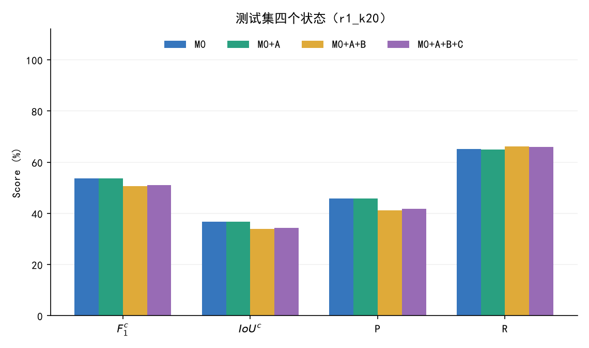

# OVCD-v0：首次跑通整个系统的 baseline（结果）

任务文档：`doc/ovcd_v0_baseline.md`。审核页：`results/ovcd_v0_review.html`（轮次下拉菜单）。代码：`code/ovcd_v0/`。图：`figures/ovcd_v0/round_<n>/`。

通用约定（所有轮次）：
- 数据 LEVIR-CD 1024²，类别 building。验证 64 对用于所有选择；测试 128 对每轮只评一次。
- 指标：F1^c、IoU^c、P、R 在整个划分上累计 TP/FP/FN（与 DynamicEarth `eval/evaluate.py` 相同，已逐像素核对）；整目标漏检率 = 真值连通域与预测的 IoU < 0.1 的比例，整目标误检率反之（IoU 按与之接触的对方连通域并集计算）；逐图平均 F1（空真值且空预测记 1）。
- Agent 是程序编排的 v0 循环：A（去误检）→ B（补漏）→ C（修边界）。MLLM 的回答对每个待查项只算一次并缓存（16 条一批，批量与逐条的 P(yes) 最大差 0.02、回答 16/16 一致），循环在 CPU 上按预算 k 消费这些回答，每用一次 T3 或 T5 记 1 次调用；所以 k=10/20/50 与阈值网格不必重复调用模型。轨迹（每图每步）在 `ovcd_v0_run/agent/<配置>/<划分>/traj/`，仓库内有压缩副本 `results/ovcd_v0/round_<n>/`。

---

## 第 1 轮（2026-10-29）

### 配置

| 项 | 选择 |
|---|---|
| 初始化 M0 | DynamicEarth M-C-I（SAM ViT-H + DINOv2 + SegEarth-OV），官方代码与参数，逐图种子 |
| MLLM | Qwen3.5-4B 本地，bf16，不思考；T3 读 yes/no 首词元概率并生成类型与理由 |
| 口径卡 | v0 固定：算新建、拆除、拆除后重建；不算阴影、季节色调、配准错位边缘、车辆和临时堆放、非建筑地物变化 |
| 近景 T2 | 外接框最长边的 4 倍、至少 64 px 的正方形，缩放到 384²，红色轮廓（沿用 exp6j/exp6k） |
| 阶段 A | M0 的 8 连通域，按面积从大到小核实（M1 理想曲线最好），P(yes) < τ_A 删除 |
| 阶段 B | T7 来源 = M-C-I 未进 M0 的近阈值 SAM 提议（软接受分 = sigmoid((s−s0)/0.05)·p_own·(1−p_other)，掩码 NMS，面积 50–20000 px，被 M0 覆盖 ≤ 50%），每图前 20 个；P(yes) ≥ τ_B 时 T5：Qwen 在近景画框 → SAM 框提示 T1、T2 取并集 |
| 阶段 C | 每个连通域用外接框提示 SAM（T1、T2 各一次，取与原域 IoU 高者），IoU(新,旧) ≥ 门限才替换；与访问顺序无关 |
| 预算 | a_share = 0.75（M1 中误检像素占全部错误的 75%）；k = 10、20、50 |
| 选择 | 验证集上逐阶段：先选 τ_A，固定后选 τ_B，再选 C 的门限 |

**GPU 小时（实际）**：M-C-I 192 图 0.38 h；SAM 嵌入 0.08 h；Qwen 调用 0.9 h（验证 3,532 项 + 测试 7,601 项，批量 16）；冒烟、基准与作废的逐条版本约 0.3 h。合计约 1.7 GPU 小时，未超 8 小时，没有做减法。开跑前按逐条调用估的是约 7 GPU 小时，改为批量后降到上面的数字。

**没做的**：I-M-C（APE-DINO）对比行。权重（APE 6.0 GB、EVA-CLIP 10.1 GB）已下载，环境在编译 detectron2/detrex，第 1 轮结束时尚未跑通；表中先列原文数字，跑通后补入（见“I-M-C 进度”）。

### M0：初始化与复现

- **做了什么**：官方 M-C-I 脚本逻辑不改任何决策，另外导出全部 SAM 提议（每图约 600 个）的 DINOv2 变化分数、两期 building 概率、是否进 M0。3 张验证图上官方流程与导出流程逐像素一致。每图约 7.2 秒。
- **结果**：测试集 F1^c **53.76**、IoU^c **36.76**、P 45.75、R 65.16；原文 53.6 / 36.6，差 0.16，复现成功。验证集 F1^c 57.82。
- **关键问题**：官方 SegEarth-OV 的上采样器保留 Dropout（未设 eval），M-C-I 输出带随机性；我们按图固定种子，换种子可能有小幅差异。CLIP ViT-B/16 权重用的是 timm 发布的同一份 OpenAI 权重（已核对：卷积、线性、注意力层 fp16 无损，LayerNorm 与嵌入本来就是 fp32）。
- **下一步**：用这份 M0 和逐提议分数做 M1。

### M1：初始化输出的错误分析

| | 验证 | 测试 |
|---|---:|---:|
| 整目标漏检率 | 43.1% | 50.5% |
| 整目标误检率 | 38.2% | 39.3% |
| 误检像素占全部错误 | 74.9% | 68.9% |
| 误检像素中“整块误检” / “命中目标外多出的像素” | 31% / 69% | 28% / 72% |
| 漏检像素中 ② 孤立无信号 / ① 贴边 / ③ 有信号 / ⑤ 极小 | 69.3 / 17.4 / 10.5 / 2.7% | 67.2 / 18.1 / 12.8 / 1.9% |
| 理想 A（删除最优的连通域集合）F1^c | 65.43（+7.6） | 60.28（+6.5） |
| 理想 B（补回全部整目标漏检）F1^c | 69.85（+12.0） | 69.86（+16.1） |

- **排序（验证集，理想核实）**：每图只查 n 个连通域时，按面积从大到小最好（n=15：62.97；按变化分数升序 61.20；按面积从小到大 60.13）。小连通域更常是误检（误检 AUC 0.88），但删掉它们挽回的像素少。
- **T7 覆盖（验证集）**：前 20 个候选只碰到 21% 的整目标漏检，理想补入上限 61.6；前 50 个为 34%、63.3。
- **关键问题**：误检里大部分是“命中目标外多出的像素”，这是边界问题，A 删整块只能处理三成；漏检主要是 M-C-I 完全没出提议的孤立目标，T7 的近阈值提议只覆盖五分之一。
- **下一步**：A 用面积降序、预算的 75% 给 A。

### M2：阶段 A，去误检

- **MLLM 判别力（验证集，不涉及阈值）**：P(yes) 区分“该删/该留”的 AUC 0.85，按面积加权只有 0.69。该删的 887 个连通域里，418 个被 Qwen 答成 `new_building`。
- **阈值曲线**：τ_A 从 0 到 0.7，验证集 F1 都在 57.6–58.0 之间，几乎平坦；τ_A ≥ 0.8 明显变差。选中 τ_A = 0.2 / 0.1 / 0.5（k=10/20/50）。
- **结果**：验证集 A 相对 M0 +0.10 / +0.10 / +0.21；测试集 +0.02 / 0.00 / **−0.19**。逐图平均 F1 在测试集上 +1.8 / +1.6 / +1.9（主要来自空真值图上的误检被删光，单图 F1 从 0 跳到 1；Codex 核算 k=50 时两张这样的图贡献了 1.56 个点）。
- **关键问题**：按面积降序先核实的是大块、精度中等的连通域，Qwen 看到里面有建筑就答“是”，判别力恰好在像素权重大的地方最弱。k=50 测试集上删了 647 个连通域，被删像素的真阳性比例 29.7%，高于 F1/2 ≈ 26.9%，所以累计 F1 下降（例 `test_27` uid 19：精度 58%，被判 `no_change` 删除）。
- **下一步**：Codex 用缓存精确核算了其他排序：按 M-C-I 变化分数升序（`score_asc`）并重选 τ_A，验证集 A 可到 58.88（k=20），比现在高约 1 个点。列为第 3 轮的改动。

### M3：阶段 B，补漏

- **MLLM 判别力（验证集）**：候选里 20% 是真漏检；P(yes) 区分真漏检的 AUC **0.94**，真漏检 93% 答“是”，非漏检 23% 答“是”。
- **T5 画框**：3,839 次画框全部能解析（失败率 0%），但质量差。对真漏检候选，“框 + SAM 两期并集”与真值的 IoU 平均 0.13，低于候选掩码本身的 0.22，只有 28% 的情况框更好。
- **阈值曲线**：τ_B < 0.8 时补入都让验证集 F1 下降；选中 τ_B = 0.95（三档）。
- **结果**：验证集 B 相对 A +0.26 / +0.23 / +0.01；测试集 +0.07 / **−3.03** / **−3.15**。
- **反常排查（与 Codex 一起）**：测试集的骤降主要来自一次调用。`test_96` 的候选 uid 100182 外接框 180×286，近景按 4 倍放大后就是整图；Qwen 回答 `[0,0,1000,1000]`，SAM 用整图框分出 972,791 个新增像素，其中 972,774 个是误检，占 B 新增误检的 81%。只撤销这一步，k=20 的 B 在测试集上是 53.66，仍比 A 低 0.10：其余补入像素的精度只有 24%，低于 F1/2。验证集里也有 4 次整框输出，但都在边长 88–676 的小近景上，没有造成大面积误检。
- **关键问题**：B 的“判断”强（AUC 0.94），“生成掩码”弱：画框能解析不等于定位成功，T5 把好的判断变成了差的掩码。
- **下一步**：第 2 轮去掉 T5，核实通过后直接加入候选掩码（理由见“第 2 轮改什么”）。

### M4：阶段 C，修边界

- **结果（验证集）**：每个连通域都换成 SAM 输出（门限 0）会掉 0.5；门限 0.7–0.8 时 +0.2。选中门限 0.8 / 0.8 / 0.7。测试集 C 相对 B +0.17 / +0.41 / +0.49。
- **代价**：C 在 CPU 上逐连通域调用 SAM 解码器，每图约 11 秒。
- **关键问题**：新旧 IoU 门限只限制形状变化，不判断对错。`test_96` 上 C 接受了与那块错误大区域 IoU 0.89 的替换；测试集 C 让像素指标上升，整目标误检率却从 40.0% 升到 41.8%（连通域被拆分或合并）。
- **下一步**：第 1 轮不改 C；之后考虑只对 A 核实为“是”的连通域修边界。

### 汇总（测试集，每轮只评这一次）

| k | 状态 | F1^c | IoU^c | P | R | 整目标漏检率 | 整目标误检率 | 逐图平均 F1 | 平均调用 | MLLM 秒/图 | CPU 秒/图 |
|---|---|---:|---:|---:|---:|---:|---:|---:|---:|---:|---:|
| 10 | M0 | 53.76 | 36.76 | 45.75 | 65.16 | 50.5 | 39.3 | 46.23 | 0.0 | 0.00 | 0.00 |
| 10 | M0+A | 53.78 | 36.78 | 45.92 | 64.88 | 50.8 | 38.3 | 48.04 | 6.9 | 1.31 | 0.01 |
| 10 | M0+A+B | 53.84 | 36.84 | 45.78 | 65.36 | 50.5 | 38.7 | 46.98 | 10.0 | 1.94 | 0.10 |
| 10 | M0+A+B+C | **54.01** | 36.99 | 46.05 | 65.28 | 51.0 | 40.0 | 47.08 | 10.0 | 1.94 | 11.88 |
| 20 | M0+A | 53.76 | 36.76 | 45.83 | 65.01 | 50.6 | 38.4 | 47.87 | 11.9 | 2.25 | 0.02 |
| 20 | M0+A+B | 50.73 | 33.98 | 41.17 | 66.07 | 50.2 | 40.0 | 46.90 | 20.0 | 4.02 | 0.27 |
| 20 | M0+A+B+C | **51.14** | 34.36 | 41.76 | 65.97 | 50.7 | 41.8 | 47.02 | 20.0 | 4.02 | 11.19 |
| 50 | M0+A | 53.57 | 36.58 | 46.73 | 62.75 | 52.6 | 32.8 | 48.18 | 23.2 | 4.34 | 0.04 |
| 50 | M0+A+B | 50.42 | 33.71 | 41.05 | 65.34 | 51.1 | 36.9 | 47.17 | 40.7 | 8.15 | 0.62 |
| 50 | M0+A+B+C | **50.91** | 34.15 | 41.82 | 65.05 | 52.1 | 41.4 | 47.40 | 40.7 | 8.15 | 10.67 |

MLLM 秒/图是批量缓存时间按批大小分摊后的数；不含 M-C-I 初始化（约 7.2 GPU 秒/图）。验证集同表见 `ovcd_v0_run/eval/r1_k*_val.json`（k=20：M0 57.82 → A 57.92 → B 58.16 → C 58.37）。

对比行（测试集 F1^c / IoU^c）：

| 方法 | 原文 | 本次复现 |
|---|---|---|
| DynamicEarth M-C-I（SAM-DINOv2-SegEarth-OV） | 53.6 / 36.6 | 53.76 / 36.76 |
| DynamicEarth I-M-C（APE-DINO） | 69.7 / 53.5 | 69.67 / 53.46（第 2 轮补跑） |
| 第 1 轮 Agent，k=10 / 20 / 50 | — | 54.01 / 51.14 / 50.91 |

### 第 1 轮结论

1. 整个流水线跑通：口径卡 → M0 → 状态（连通域清单与两个队列）→ A/B/C → 输出与逐步轨迹 → 四状态评测，k=10/20/50 都有结果。
2. 收益：测试集只有 k=10 微升（+0.25）；k=20、50 因 B 的整框事故下降约 2.6–2.9 个点。验证集三档都是 +0.4–0.6。
3. 三个关键问题：B 的判断好、生成掩码差（T5）；A 的排序与 MLLM 判别力错配（大块上判别弱）；C 只约束形状、不判断对错，对象指标与像素指标会背离。

### 与 Codex 的讨论，以及第 2 轮改什么

- **Codex 的独立核实**（batch59）：确认 `test_96` 的定位，并修正数字口径（见 M3）；指出 k=50 的 A 在测试集变差是真实误删，不是统计假象；逐图平均与累计 F1 方向相反是空真值图 0↔1 跳变造成的。
- **第 2 轮只改一项：去掉 T5，阶段 B 核实通过后直接加入候选掩码。** 双方意见一致。依据全部来自验证集：
  - 画框后的掩码弱于候选掩码（IoU 0.13 vs 0.22）；
  - 完整验证集网格中，无 T5 的最终 F1：k=10 58.54（+0.14）、k=20 59.09（+0.72）、k=50 60.23（+1.97）；固定原来的 τ_B 也有提升，收益不只来自重选阈值。
  - 测试集的整框事故没有参与这个决定；它只是同一问题在测试集上的极端表现。
- **后续候选**（按 Codex 的排序，我同意）：第 3 轮 A 改为 `score_asc` 排序；第 4 轮 B 队列从 20 扩到 50（需补调用）。暂不改口径卡：Codex 指出“轮廓内有没有建筑变化”和“整块是否值得保留”是两个不同问题，改提示要先能区分这两者。

### I-M-C 进度

APE 环境第一次构建失败在 detrex 固定 `omegaconf==2.1.0`（与 hydra-core 1.3.2 冲突），改为 `--no-deps` 安装 detrex 并补齐它的依赖（wandb、submitit、pybind11）后重建中。跑通后在 2048 个 256² 块上推理，拼回 1024² 评测，补入对比行。

### 执行过程中改过的地方（如实记录）

- Qwen 调用从逐条改为 16 条一批（7 倍提速），逐条版本跑出的部分缓存已删掉重跑，所有读数来自同一代码路径。
- Codex 代码审查（batch58）在看测试集之前发现并修复：阶段 C 逐个替换会擦掉此前已接受的像素（改为一次性合并，与顺序无关）；缺少缓存的待查项被静默跳过（改为报错，B 队列上限 `b_max=20` 写入配置）；理想上限 A 只删一轮（改为最优前缀）；画框解析不严格（改为 JSON 解析，对现有 3,839 个框结果无变化）；B 诊断的漏检定义与其他地方不一致；补充了各状态的耗时。修复前跑出的测试集掩码在评测前作废重跑，测试集仍只评了一次。
- 第 1 轮的近景保存为 q90 JPEG 显示副本，实际送入模型的是内存中的无损图像（可由 `render.render_pair` 按轨迹里的外接框确定性重建）；之后各轮存无损 PNG。

---

## 第 2 轮（2026-10-29）：去掉 T5，阶段 B 直接加入候选掩码

### 配置与改动

- **只改了一项**：`use_t5 = False`。阶段 B 的候选核实通过（P(yes) ≥ τ_B）后，直接把候选掩码（M-C-I 的 SAM 提议）加入当前掩码，不再让 Qwen 画框、不再用框提示 SAM。
- **为什么**：第 1 轮验证集诊断——真漏检候选上，框 + SAM 并集与真值的 IoU 0.13，低于候选掩码本身的 0.22，只有 28% 的情况框更好；B 的核实判别力强（AUC 0.94）。Codex 同意（batch59）。
- 其余与第 1 轮相同：M0、口径卡、近景、阶段 A（面积降序、a_share 0.75）、T7 来源与前 20 个、阶段 C 算法、k=10/20/50、逐阶段验证集选参。
- **GPU**：0。M0、Qwen 调用缓存和 SAM 嵌入全部复用（T5 的缓存不再被消费）。

### M0、M1

与第 1 轮相同（同一份 M0；测试集 53.76 / 36.76）。本轮补上了 I-M-C（APE-DINO）复现：测试集 **69.67 / 53.46**（原文 69.7 / 53.5），2048 个 256² 块的累计结果与拼回 1024² 后完全一致。

### M2：阶段 A

配置与选出的 τ_A 与第 1 轮相同（0.2 / 0.1 / 0.5），A 状态的数字不变。

### M3：阶段 B（本轮改动）

- **验证集**：τ_B 曲线不再整体为负；τ_B = 0.9–0.95 时最好，选中 0.95 / 0.9 / 0.9。B 相对 A：+0.39 / +0.95 / +1.94（k=10/20/50）。
- **被接受候选的新增像素精度**：验证 68% / 58% / 51%，测试 50% / 44% / 42%。
- **测试集**：B 相对 A **+0.29 / +0.73 / +1.53**，三档都是正的；整目标漏检率下降 0.6–4.1 个点。
- **关键问题（Codex batch60 的验证集分析）**：k=50 时被接受的 213 个候选里，40 个与真值完全不相交，贡献了 B 新增误检的一半；其中 39 个被 Qwen 答成 `new_building`，P(yes) 中位数 0.95。高分也会错，但把 τ_B 提到 0.95 在验证集上反而略差。近景边长 ≥512 的 5 个接受候选新增像素精度只有 5%。
- **例子**：`test_96` 仍然变差（0.88 → 0.07），但原因变了：不再有整图框，而是 4 个并非建筑变化的候选被以 0.95–0.99 接受。

### M4：阶段 C

验证集仍是门限 0.7–0.8 最好，选中 0.8 / 0.8 / 0.7；测试集 C 相对 B +0.15 / +0.18 / +0.17。

### 汇总（测试集，本轮只评这一次）

| k | M0 | +A | +A+B | +A+B+C | 整目标漏检率（C） | 整目标误检率（C） | 逐图平均 F1（C） | 平均调用 |
|---|---:|---:|---:|---:|---:|---:|---:|---:|
| 10 | 53.76 | 53.78 | 54.07 | **54.22** | 50.7 | 39.4 | 47.8 | 10.0 |
| 20 | 53.76 | 53.76 | 54.49 | **54.67** | 49.3 | 38.9 | 48.5 | 20.0 |
| 50 | 53.76 | 53.57 | 55.10 | **55.27** | 49.5 | 35.0 | 50.1 | 40.0 |

相对第 1 轮：+0.21 / +3.53 / +4.36。预算曲线第一次随 k 单调上升。验证集：58.54 / 59.09 / 60.23。

### 与 Codex 的讨论，以及第 3 轮改什么

- **第 3 轮只改阶段 A 的排序为按 M-C-I 变化分数升序（`score_asc`）**，双方一致。依据：Codex 在 batch59 用缓存精确核算，batch60 又在第 2 轮流程（无 T5）下复核了 A 的变化对 B 覆盖判断的影响（选中配置下 B 访问与接受的候选集合不变）；第 3 轮完整验证集网格的最终 F1 59.47 / 60.04 / 60.88，比第 2 轮高 0.93 / 0.94 / 0.66。
- Codex 对后续的建议：第 4 轮拒绝近景边长 ≥512 的 B 候选（验证集 B +0 / +0.07 / +0.25，样本只有 3 张图 5 个候选）；B 队列 20→50 的预算内机会比全局覆盖小（k=50 时只有 24 个新增可覆盖目标落在还有余额的图上）；换初始化范围最大，排在最后。我的看法见第 3 轮一节。
