# 补漏与去误检：方法流程

输入两期遥感影像，检测器给出初始变化图；候选工具寻找遗漏区域，验证器逐块打分，最后按阈值补漏或去误检。本页展示真实 V1/V2a 输出，同时保留 oracle 理想上界。

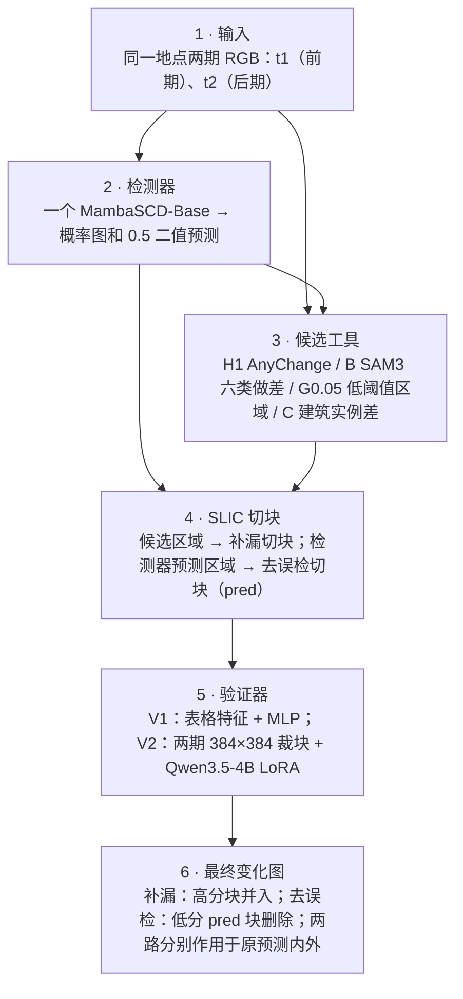

总览中检测器预测同时送到切块步骤，t1/t2 同时供候选工具使用。本页 V2a 只展示补漏；去误检展示检测器平均概率与 V1。

## 先看懂几个词

| 词 | 意思 |
| --- | --- |
| 双时相影像 t1 / t2 | 同一地点前后两期 RGB 影像，SECOND 为 512×512。 |
| 检测器 | MambaSCD-Base 输出变化概率和 0.5 二值图；下游校正使用已保存的二值 PNG。 |
| 真值（GT） | 人工变化标注；SECOND 的两期语义标签记录变化前后的六类地物。只用于训练标签和评估。 |
| 漏检 / 误检 | 蓝色为漏检 FN，红色为误检 FP，绿色为正确预测 TP。 |
| 无信号漏检 | 预测覆盖不足 10%、面积至少 20 像素的真值目标。历史统计按语义转移拆目标。 |
| 候选（来源） | 候选工具提出可能变化的区域：H1、B、G0.05、C1/C2。 |
| 覆盖率 | 候选覆盖目标至少 50%，且候选面积不超过目标外框的 4 倍时算找到；统计无信号漏检目标。 |
| 纯度 | 区域内真变化像素比例；来源面积合计按候选重复计数，全部来源并集另行去重。 |
| 切细 / 切块 | SLIC 根据两期颜色与位置划分超像素，大候选与超像素相交后形成切块。 |
| 验证器 | 逐块判断变化的模型；补漏用高分块，去误检删低分块。 |
| 验证器 V1 / V2 | V1 为特征加 MLP，本页用 none 表格基线；V2 为 Qwen3.5-4B LoRA，直接看两期裁块。 |
| 补漏切块 / 去误检切块 | 前者来自候选工具，后者来自检测器自身预测区域（pred）；V1 主模型仅用补漏切块训练。 |
| oracle | 直接按真值挑块的理想上界。页面将其与真实验证器结果分别标注。 |
| F1 / ΔF1 | F1 为精度与召回的调和平均；ΔF1 为校正后减校正前。页面 F1 用百分数，ΔF1 用百分点。 |
| F1/2 门槛 | 并入像素的真变化比例超过当前 F1 的一半时，像素 F1 才会上升；SECOND 约 37.08%。 |
| AUC / 召回 80% 时误检率 | AUC 衡量排序；误检率为放过真变化的同时放过多少负例。验证阈值与测试 ROC 诊断分别标注。 |
| 交叉拟合（K 折） | 训练集分三折，用其余两折训练的检测器预测留出折，为训练验证器产生真实漏检。 |
| SeK | SECOND 语义变化指标，用于选择交叉拟合检测器检查点。 |

## 示例选择

保留 test_987；其余图要求真值变化像素 ≥ 1000。E1 取行 5 的正 ΔF1 最大图，E2 取负 ΔF1 最小图；同分按文件名升序。测试结果仅用于挑选展示图，不参与模型、来源组合或阈值选择。

统一指标 per_image.jsonl 行5：V1 none，B+G0.05+H1，精确阈值 0.819681704044342。示例的极端提升或下降不能代表全测试集平均收益。

| 用途 | 图名 | 真值变化像素 | 原 F1 | V1 后 F1 | ΔF1 点 |
| --- | --- | --- | --- | --- | --- |
| 固定示例 | test_987.png | 61533 | 58.51% | 64.39% | +5.8875 |
| E1 | test_1669.png | 32821 | 16.63% | 48.96% | +32.3296 |
| E2 | test_365.png | 7218 | 92.70% | 63.56% | -29.1367 |

来源：[选图清单与完整规则](pipeline_figs/selection.json)。

## 固定示例 · test_987.png · V1 ΔF1 +5.8875 点

来源：[本图数字与规则](pipeline_figs/test_987/example.json)；[全部切块分数](pipeline_figs/test_987/pieces.json)。

| t1 | t2 | gt | prob | base_mask |
| --- | --- | --- | --- | --- |
| 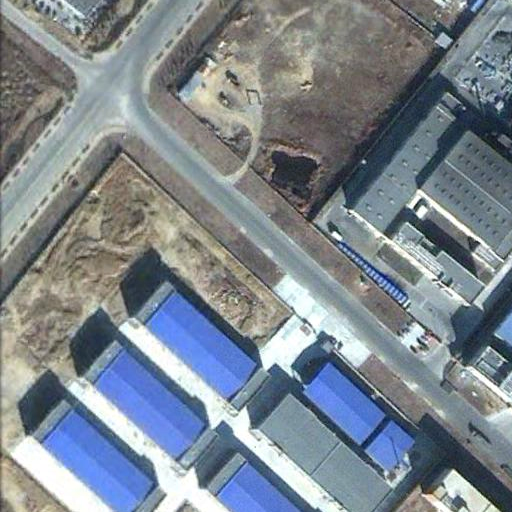 | 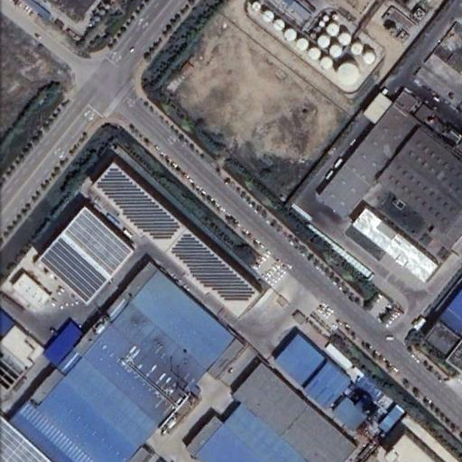 | 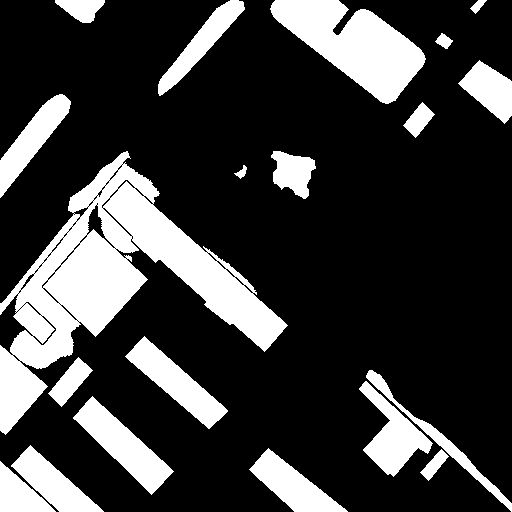 | 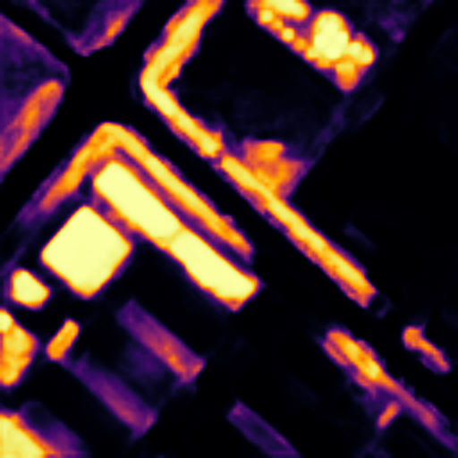 | 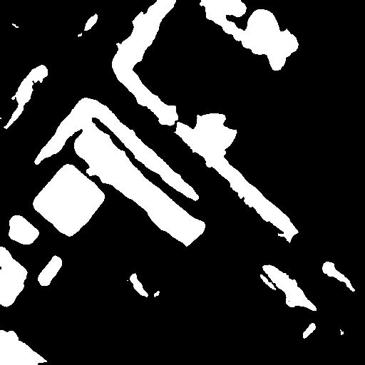 |

原预测使用保存 PNG；它与保存概率再取 >0.5 相差 25 像素。候选筛选仍沿用建池时的 prob>0.5，最终结果与统一指标均沿用保存 PNG。

HTML 版提供同一组相对路径 PNG 的图层开关；下列静态图展示相同数据。

### 1. 各来源候选

H1 用 AnyChange（SAM ViT-H）比较两期特征；B 用 SAM3 六类语义做差；G0.05 从 prob>0.05 的连通域提出候选，筛掉被 prob>0.5 覆盖超过一半的区域；C1 找未匹配建筑实例，C2 找已匹配实例的外观差异。C2 沿用池中的原始集合。来源颜色：H1 橙、B 紫、G0.05 青、C 粉；黄线是真值。

| H1 | B | G0.05 | C |
| --- | --- | --- | --- |
| 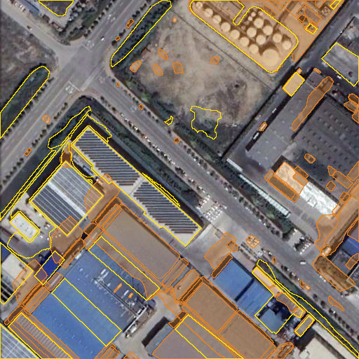 | 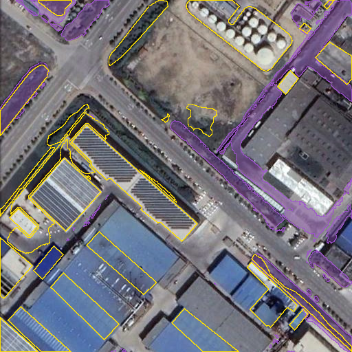 | 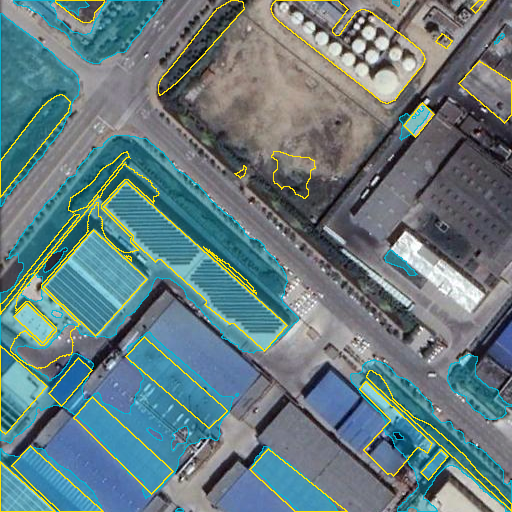 | 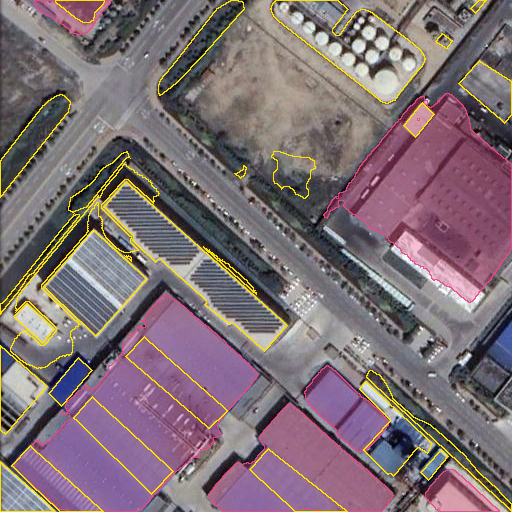 |

| 来源 | 候选数 | 面积合计 px（含重叠） | 面积加权纯度 | 并集面积 px | 并集纯度 |
| --- | --- | --- | --- | --- | --- |
| H1 | 99 | 100821 | 33.12% | 65839 | 29.76% |
| B | 28 | 29505 | 17.00% | 29505 | 17.00% |
| G0.05 | 13 | 87338 | 49.95% | 87338 | 49.95% |
| C | 6 | 69034 | 18.73% | 69034 | 18.73% |

### 2. 全部候选

| 全部来源及各来源轮廓 |
| --- |
| 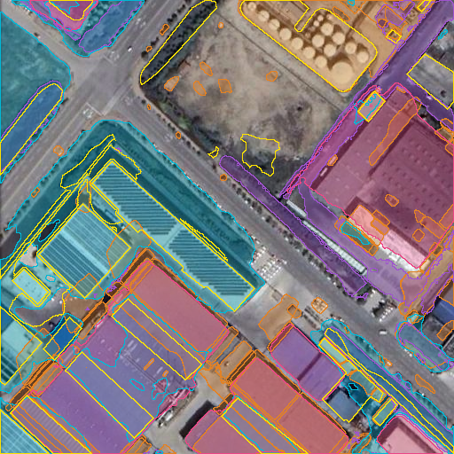 |

候选共 146 个；去重并集 179463 像素，占全图 68.46%；并集里真变化占 29.80%。重叠区域可在图层开关中逐个查看来源。

### 3. 全部补漏切块

| 绿正、红负、灰无标签，白线切块边界 |
| --- |
| 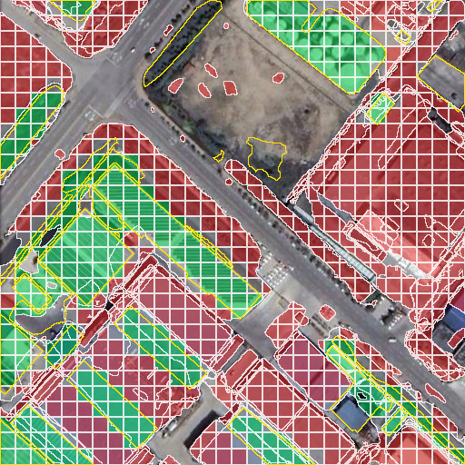 |

共 1407 块：正 421、负 827、无标签 159。有标签正例率 33.73%；正块占全部切块 29.92%。≥50% 真值为正、<10% 为负，中间部分不用于监督训练，但继续参加推理。全来源均展示，重叠块保留各自 ID；标签色重叠时按 piece_id 后绘制者覆盖，边界取全部块轮廓。

### 4. V1 打分热图

| V1 全部补漏切块；重叠像素显示最高分 | V1 分数色条与精确阈值 |
| --- | --- |
| 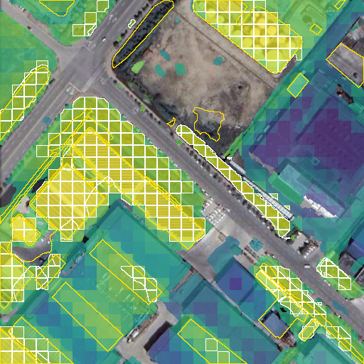 |  |

V1 none 阈值 0.819681704044342，来自 exp6/verifier/none/thresholds_second_cv.json 的 recall.B+G0.05+H1；白线只标出该组合中 score≥阈值的块。分数来自 none/second/scores.npz。C1/C2 分数也显示，结果比较固定使用 B+G0.05+H1。

### 5. V2a 打分热图

| V2a 同一批全部补漏切块 | sigmoid(logit 差) 色条 |
| --- | --- |
| 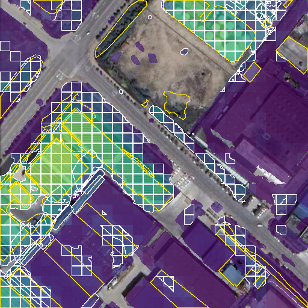 |  |

复用 V2 384×384 红色轮廓裁块；不筛除无标签块。验证 recall-80 logit 差阈值为 -1.875，色条对应概率 0.132964240。接受规则直接比较 logit 差，白线同样只标 B+G0.05+H1；阈值出处为 exp6/v2/a/eval/sample/validation_thresholds.json。

### 6. 补漏结果对比

| 检测器原预测：F1 58.51%；ΔF1 +0.0000 点 | V1 none 补漏：F1 64.39%；ΔF1 +5.8875 点 | V2a 补漏（仅三图）：F1 60.70%；ΔF1 +2.1954 点 | oracle 补漏：F1 77.43%；ΔF1 +18.9222 点 |
| --- | --- | --- | --- |
|  | 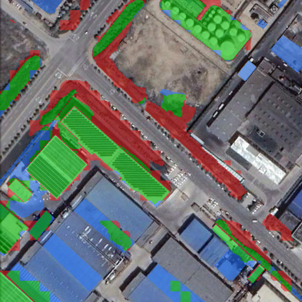 | 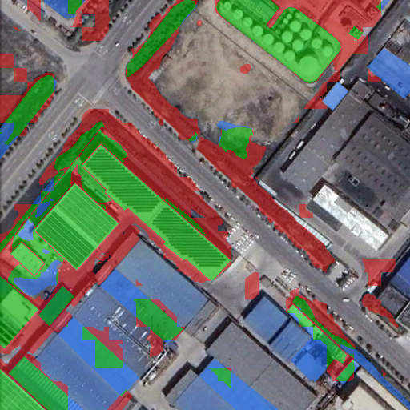 | 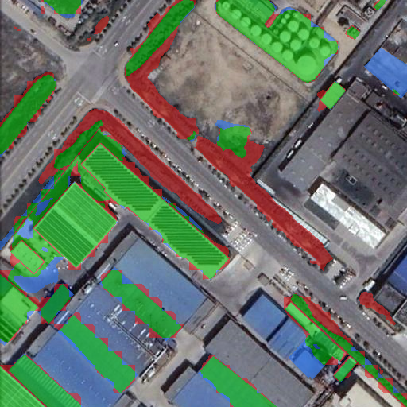 |

绿 TP、红 FP、蓝 FN。三种补漏均使用 B+G0.05+H1；oracle 使用真值挑块。V1 与 V2a 各自沿用验证集已冻结的阈值，两者阈值选择目标不同。

### 7. 边缘质量

| 青框为放大窗口 |
| --- |
|  |

放大框 xyxy=[0, 384, 128, 512]。128 像素窗口、步长 16，最大化 4_BGH1 与 4b_BGH1 边界异或像素数；同分先上后左。这是突出边缘变化的可复现展示规则，不宣称找到了人工感知上最锯齿的区域。红线为预测边界，黄线为真值；局部图下的 F1 是整图指标。

| 检测器原预测：F1 58.51%；ΔF1 +0.0000 点 | oracle 两路：F1 85.92%；ΔF1 +27.4124 点 | oracle 两路：软边界：F1 85.53%；ΔF1 +27.0283 点 | oracle 两路：开闭运算：F1 85.45%；ΔF1 +26.9418 点 |
| --- | --- | --- | --- |
| 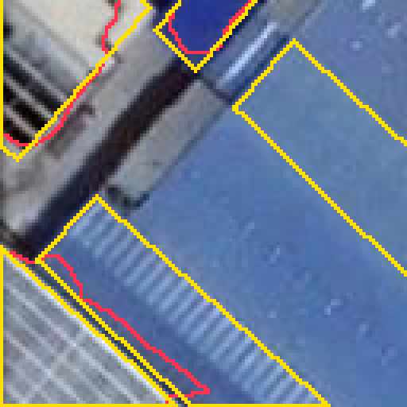 |  |  | 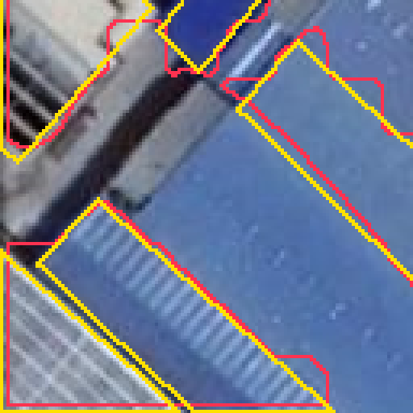 |

| oracle 补漏：F1 77.43%；ΔF1 +18.9222 点 | oracle 补漏：软边界：F1 77.02%；ΔF1 +18.5116 点 | oracle 补漏：开闭运算：F1 76.91%；ΔF1 +18.4045 点 |
| --- | --- | --- |
| 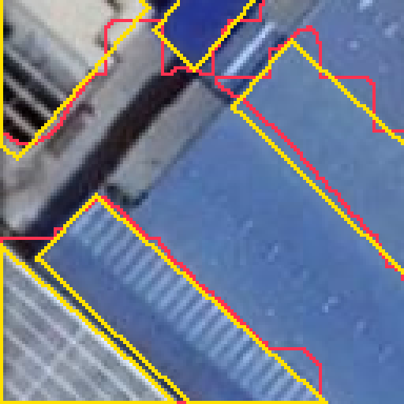 | 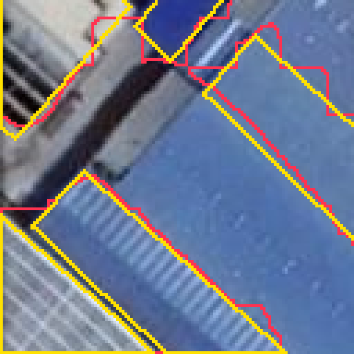 |  |

直接调用 batch14 的 eval_metrics_run.reconstruct。2a/4a：已接受切块内保留 prob>0.05，再与该块外扩 2 像素相交；按此先后顺序，相交不会增加切块外像素。2b/4b：对最终整图做半径 2 欧氏圆盘开运算再闭运算，图外为背景。两路合并为 cleaned ∪ (accepted ∖ original)。

### 8. 去误检分支

| 检测器均值；白线为删除块 | 检测器均值阈值 | V1 分数；白线为删除块 | V1 删除阈值 |
| --- | --- | --- | --- |
| 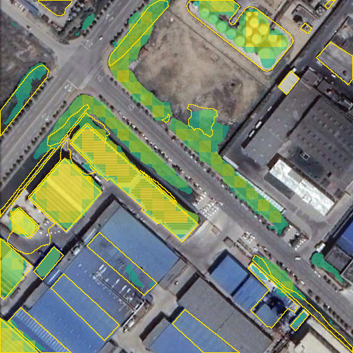 |  | 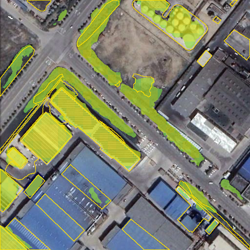 | 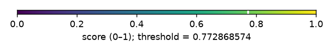 |

| 方式 | pred 块数 | 删除阈值（严格小于） | 删除块数 | 删除像素 | 阈值出处 |
| --- | --- | --- | --- | --- | --- |
| detector_mean | 316 | 0.501367211341858 | 0 | 0 | exp6/verifier/none/thresholds_second_cv.json: remove.detector_mean |
| verifier | 316 | 0.772868573665619 | 2 | 45 | exp6/verifier/none/thresholds_second_cv.json: remove.verifier |

pred 掩码与分数均按 6b 池的 image、piece_id 对应，使用 V1 none 的同一 scores.npz。6e 的独立 pieces.jsonl 编号不用于关联这些分数。两个删除阈值均由 297 张验证图的 micro F1 选定。V1 none 尚未用 pred 切块训练。

| 检测器原预测：F1 58.51%；ΔF1 +0.0000 点 | 检测器平均概率去误检：F1 58.51%；ΔF1 +0.0000 点 | V1 去误检：F1 58.53%；ΔF1 +0.0233 点 | oracle 去误检：F1 66.63%；ΔF1 +8.1287 点 |
| --- | --- | --- | --- |
|  | 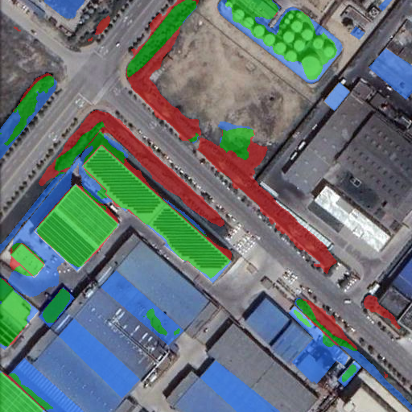 |  | 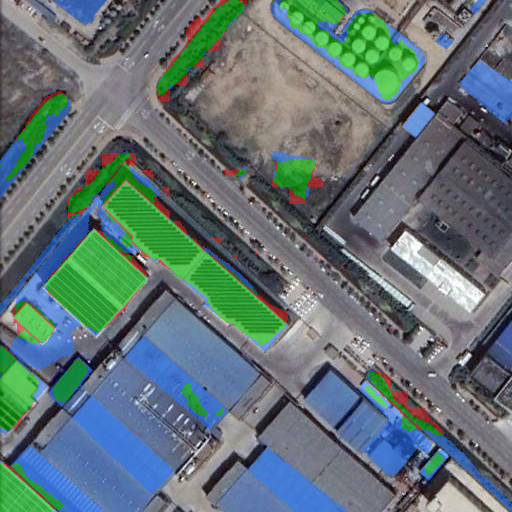 |

### 本图六个数

前五项由 six_numbers 计算本图；最后一项为全测试集下降占比。V2a 只有三图推理，最后一项未评估。实际去误检两行另遍历完整测试集计算下降占比，并核对 6b 保存的 TP/FP/FN。

| 结果 | 像素 F1 | IoU | BF2 | 目标 F1 | 新增误检目标 | 全测试集下降占比 | ΔF1 点 |
| --- | --- | --- | --- | --- | --- | --- | --- |
| 检测器原预测 | 58.51% | 41.35% | 30.43% | 52.72% | 0 | 0.00% | +0.0000 |
| V1 none 补漏 | 64.39% | 47.49% | 28.28% | 50.72% | 2 | 62.75% | +5.8875 |
| V2a 补漏（仅三图） | 60.70% | 43.58% | 19.86% | 40.68% | 8 | 未评估 | +2.1954 |
| oracle 补漏 | 77.43% | 63.17% | 40.82% | 73.55% | 1 | 2.13% | +18.9222 |
| oracle 去误检 | 66.63% | 49.96% | 37.36% | 49.43% | 8 | 0.06% | +8.1287 |
| oracle 两路 | 85.92% | 75.31% | 48.09% | 65.52% | 8 | 0.18% | +27.4124 |
| oracle 补漏：软边界 | 77.02% | 62.62% | 39.19% | 68.28% | 2 | 2.18% | +18.5116 |
| oracle 补漏：开闭运算 | 76.91% | 62.48% | 40.72% | 84.56% | 0 | 5.55% | +18.4045 |
| oracle 两路：软边界 | 85.53% | 74.72% | 46.30% | 61.26% | 9 | 0.06% | +27.0283 |
| oracle 两路：开闭运算 | 85.45% | 74.59% | 48.15% | 90.12% | 0 | 0.94% | +26.9418 |
| 检测器平均概率去误检 | 58.51% | 41.35% | 30.43% | 52.72% | 0 | 10.68% | +0.0000 |
| V1 去误检 | 58.53% | 41.37% | 30.49% | 54.78% | 0 | 19.89% | +0.0233 |

来源：[本图六数与各行下降占比出处](pipeline_figs/test_987/example.json)；[统一指标全测试集汇总副本](pipeline_figs/eval_metrics_summary.json)；[实际去误检全测试集汇总](pipeline_figs/removal_summary.json)。

## E1 · test_1669.png · V1 ΔF1 +32.3296 点

来源：[本图数字与规则](pipeline_figs/test_1669/example.json)；[全部切块分数](pipeline_figs/test_1669/pieces.json)。

| t1 | t2 | gt | prob | base_mask |
| --- | --- | --- | --- | --- |
| 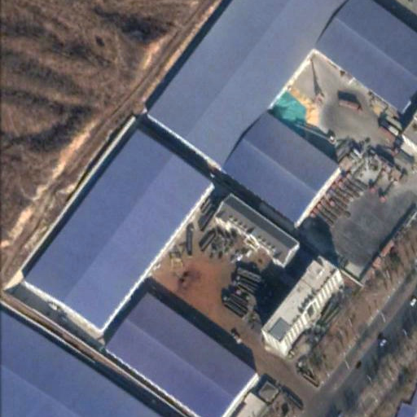 | 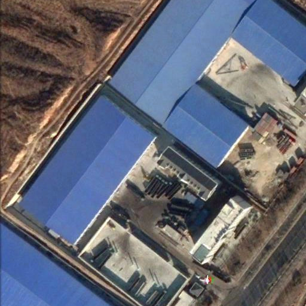 | 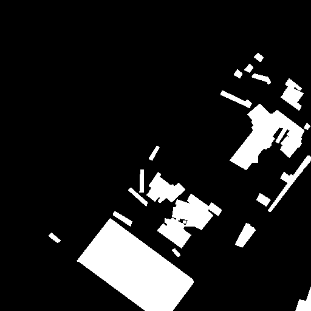 | 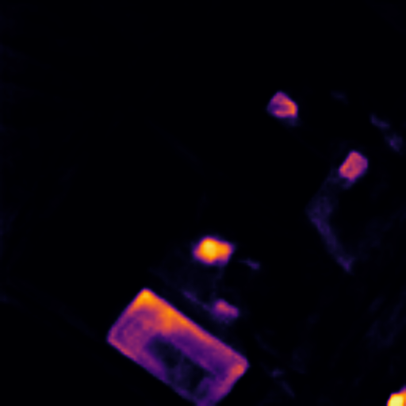 | 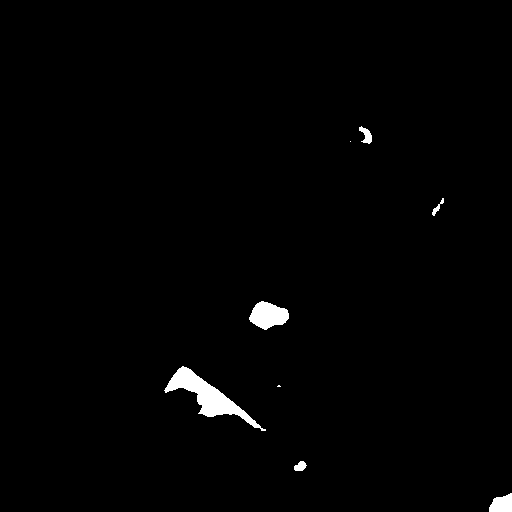 |

原预测使用保存 PNG；它与保存概率再取 >0.5 相差 5 像素。候选筛选仍沿用建池时的 prob>0.5，最终结果与统一指标均沿用保存 PNG。

HTML 版提供同一组相对路径 PNG 的图层开关；下列静态图展示相同数据。

### 1. 各来源候选

H1 用 AnyChange（SAM ViT-H）比较两期特征；B 用 SAM3 六类语义做差；G0.05 从 prob>0.05 的连通域提出候选，筛掉被 prob>0.5 覆盖超过一半的区域；C1 找未匹配建筑实例，C2 找已匹配实例的外观差异。C2 沿用池中的原始集合。来源颜色：H1 橙、B 紫、G0.05 青、C 粉；黄线是真值。

| H1 | B | G0.05 | C |
| --- | --- | --- | --- |
| 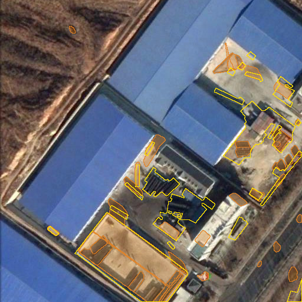 | 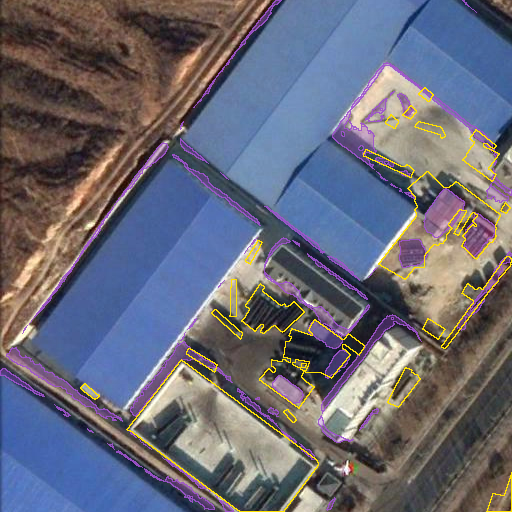 | 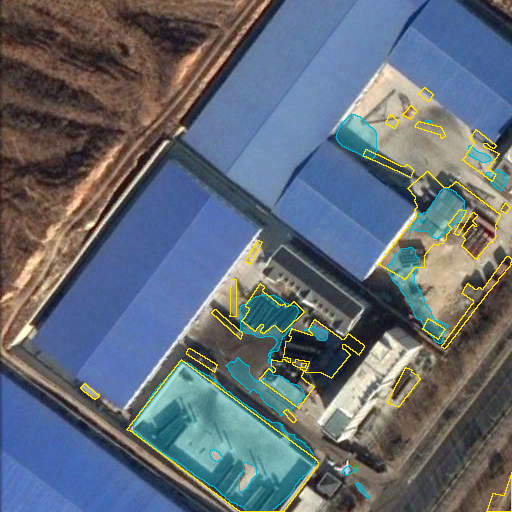 | 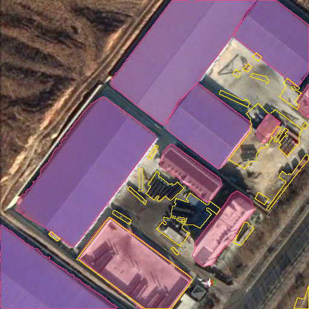 |

| 来源 | 候选数 | 面积合计 px（含重叠） | 面积加权纯度 | 并集面积 px | 并集纯度 |
| --- | --- | --- | --- | --- | --- |
| H1 | 40 | 43073 | 83.18% | 24746 | 74.93% |
| B | 57 | 17118 | 31.87% | 17118 | 31.87% |
| G0.05 | 12 | 24381 | 78.72% | 24381 | 78.72% |
| C | 10 | 118461 | 13.72% | 118415 | 13.73% |

### 2. 全部候选

| 全部来源及各来源轮廓 |
| --- |
| 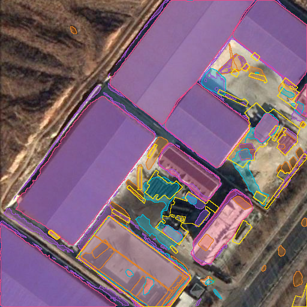 |

候选共 119 个；去重并集 143448 像素，占全图 54.72%；并集里真变化占 17.31%。重叠区域可在图层开关中逐个查看来源。

### 3. 全部补漏切块

| 绿正、红负、灰无标签，白线切块边界 |
| --- |
| 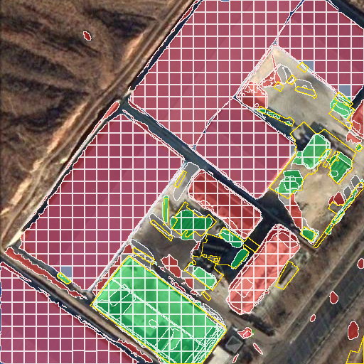 |

共 935 块：正 348、负 548、无标签 39。有标签正例率 38.84%；正块占全部切块 37.22%。≥50% 真值为正、<10% 为负，中间部分不用于监督训练，但继续参加推理。全来源均展示，重叠块保留各自 ID；标签色重叠时按 piece_id 后绘制者覆盖，边界取全部块轮廓。

### 4. V1 打分热图

| V1 全部补漏切块；重叠像素显示最高分 | V1 分数色条与精确阈值 |
| --- | --- |
| 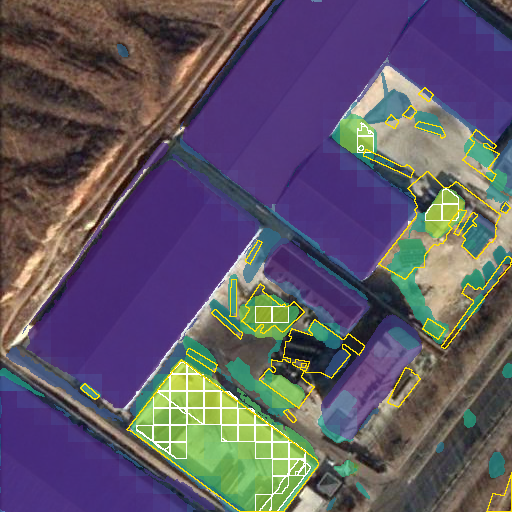 | 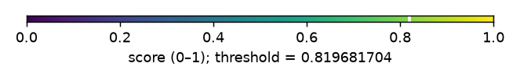 |

V1 none 阈值 0.819681704044342，来自 exp6/verifier/none/thresholds_second_cv.json 的 recall.B+G0.05+H1；白线只标出该组合中 score≥阈值的块。分数来自 none/second/scores.npz。C1/C2 分数也显示，结果比较固定使用 B+G0.05+H1。

### 5. V2a 打分热图

| V2a 同一批全部补漏切块 | sigmoid(logit 差) 色条 |
| --- | --- |
| 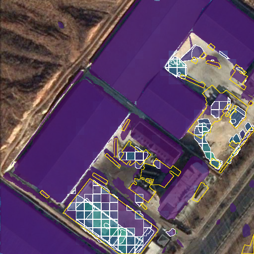 | 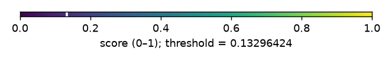 |

复用 V2 384×384 红色轮廓裁块；不筛除无标签块。验证 recall-80 logit 差阈值为 -1.875，色条对应概率 0.132964240。接受规则直接比较 logit 差，白线同样只标 B+G0.05+H1；阈值出处为 exp6/v2/a/eval/sample/validation_thresholds.json。

### 6. 补漏结果对比

| 检测器原预测：F1 16.63%；ΔF1 +0.0000 点 | V1 none 补漏：F1 48.96%；ΔF1 +32.3296 点 | V2a 补漏（仅三图）：F1 62.65%；ΔF1 +46.0231 点 | oracle 补漏：F1 80.33%；ΔF1 +63.6991 点 |
| --- | --- | --- | --- |
| 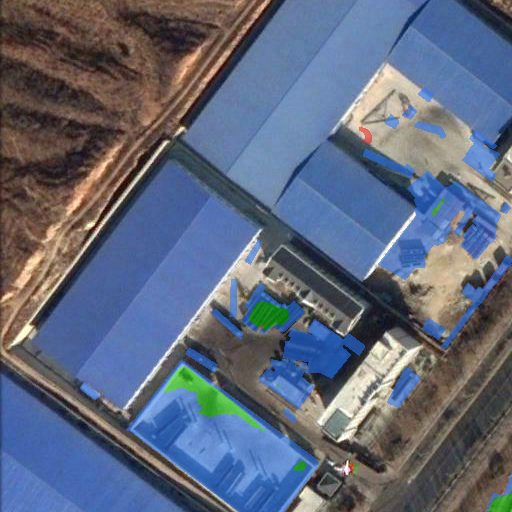 | 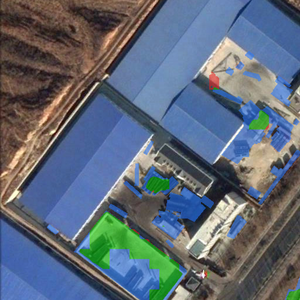 | 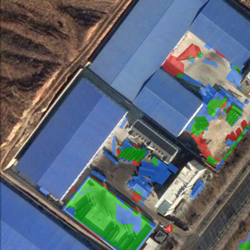 | 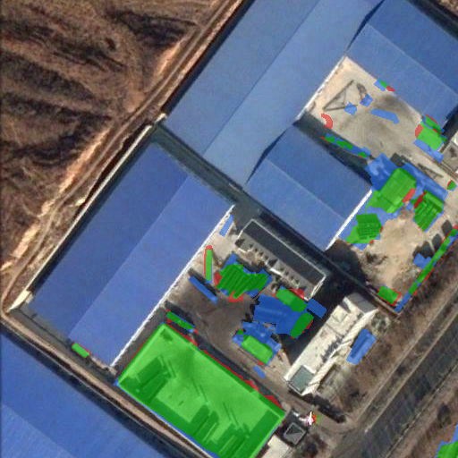 |

绿 TP、红 FP、蓝 FN。三种补漏均使用 B+G0.05+H1；oracle 使用真值挑块。V1 与 V2a 各自沿用验证集已冻结的阈值，两者阈值选择目标不同。

### 7. 边缘质量

| 青框为放大窗口 |
| --- |
| 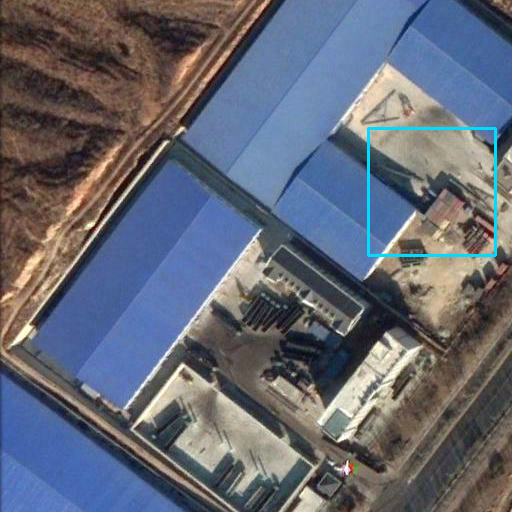 |

放大框 xyxy=[368, 128, 496, 256]。128 像素窗口、步长 16，最大化 4_BGH1 与 4b_BGH1 边界异或像素数；同分先上后左。这是突出边缘变化的可复现展示规则，不宣称找到了人工感知上最锯齿的区域。红线为预测边界，黄线为真值；局部图下的 F1 是整图指标。

| 检测器原预测：F1 16.63%；ΔF1 +0.0000 点 | oracle 两路：F1 80.51%；ΔF1 +63.8753 点 | oracle 两路：软边界：F1 71.91%；ΔF1 +55.2840 点 | oracle 两路：开闭运算：F1 80.16%；ΔF1 +63.5268 点 |
| --- | --- | --- | --- |
| 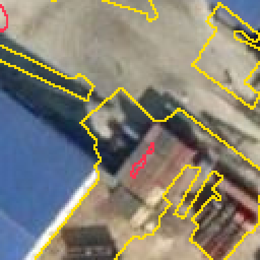 |  | 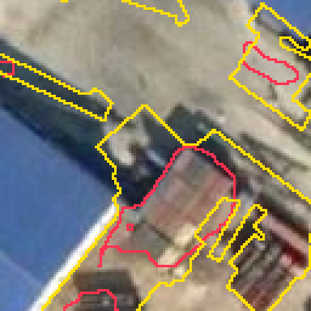 |  |

| oracle 补漏：F1 80.33%；ΔF1 +63.6991 点 | oracle 补漏：软边界：F1 71.74%；ΔF1 +55.1114 点 | oracle 补漏：开闭运算：F1 79.99%；ΔF1 +63.3572 点 |
| --- | --- | --- |
|  |  |  |

直接调用 batch14 的 eval_metrics_run.reconstruct。2a/4a：已接受切块内保留 prob>0.05，再与该块外扩 2 像素相交；按此先后顺序，相交不会增加切块外像素。2b/4b：对最终整图做半径 2 欧氏圆盘开运算再闭运算，图外为背景。两路合并为 cleaned ∪ (accepted ∖ original)。

### 8. 去误检分支

| 检测器均值；白线为删除块 | 检测器均值阈值 | V1 分数；白线为删除块 | V1 删除阈值 |
| --- | --- | --- | --- |
| 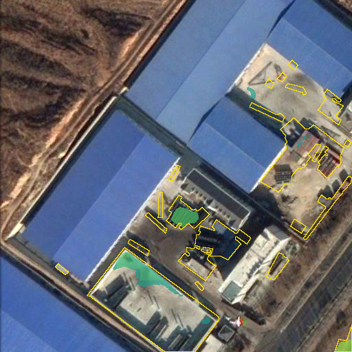 |  | 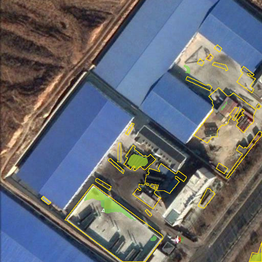 |  |

| 方式 | pred 块数 | 删除阈值（严格小于） | 删除块数 | 删除像素 | 阈值出处 |
| --- | --- | --- | --- | --- | --- |
| detector_mean | 25 | 0.501367211341858 | 0 | 0 | exp6/verifier/none/thresholds_second_cv.json: remove.detector_mean |
| verifier | 25 | 0.772868573665619 | 1 | 26 | exp6/verifier/none/thresholds_second_cv.json: remove.verifier |

pred 掩码与分数均按 6b 池的 image、piece_id 对应，使用 V1 none 的同一 scores.npz。6e 的独立 pieces.jsonl 编号不用于关联这些分数。两个删除阈值均由 297 张验证图的 micro F1 选定。V1 none 尚未用 pred 切块训练。

| 检测器原预测：F1 16.63%；ΔF1 +0.0000 点 | 检测器平均概率去误检：F1 16.63%；ΔF1 +0.0000 点 | V1 去误检：F1 16.50%；ΔF1 -0.1327 点 | oracle 去误检：F1 16.69%；ΔF1 +0.0590 点 |
| --- | --- | --- | --- |
|  |  |  |  |

### 本图六个数

前五项由 six_numbers 计算本图；最后一项为全测试集下降占比。V2a 只有三图推理，最后一项未评估。实际去误检两行另遍历完整测试集计算下降占比，并核对 6b 保存的 TP/FP/FN。

| 结果 | 像素 F1 | IoU | BF2 | 目标 F1 | 新增误检目标 | 全测试集下降占比 | ΔF1 点 |
| --- | --- | --- | --- | --- | --- | --- | --- |
| 检测器原预测 | 16.63% | 9.07% | 3.71% | 8.96% | 0 | 0.00% | +0.0000 |
| V1 none 补漏 | 48.96% | 32.42% | 16.30% | 16.81% | 0 | 62.75% | +32.3296 |
| V2a 补漏（仅三图） | 62.65% | 45.62% | 29.91% | 37.04% | 3 | 未评估 | +46.0231 |
| oracle 补漏 | 80.33% | 67.13% | 50.11% | 66.47% | 0 | 2.13% | +63.6991 |
| oracle 去误检 | 16.69% | 9.10% | 3.76% | 9.02% | 0 | 0.06% | +0.0590 |
| oracle 两路 | 80.51% | 67.37% | 50.55% | 67.59% | 0 | 0.18% | +63.8753 |
| oracle 补漏：软边界 | 71.74% | 55.94% | 26.76% | 31.01% | 0 | 2.18% | +55.1114 |
| oracle 补漏：开闭运算 | 79.99% | 66.65% | 47.55% | 58.96% | 0 | 5.55% | +63.3572 |
| oracle 两路：软边界 | 71.91% | 56.15% | 27.05% | 31.50% | 0 | 0.06% | +55.2840 |
| oracle 两路：开闭运算 | 80.16% | 66.89% | 47.96% | 60.00% | 0 | 0.94% | +63.5268 |
| 检测器平均概率去误检 | 16.63% | 9.07% | 3.71% | 8.96% | 0 | 10.68% | +0.0000 |
| V1 去误检 | 16.50% | 8.99% | 3.71% | 8.96% | 0 | 19.89% | -0.1327 |

来源：[本图六数与各行下降占比出处](pipeline_figs/test_1669/example.json)；[统一指标全测试集汇总副本](pipeline_figs/eval_metrics_summary.json)；[实际去误检全测试集汇总](pipeline_figs/removal_summary.json)。

## E2 · test_365.png · V1 ΔF1 -29.1367 点

来源：[本图数字与规则](pipeline_figs/test_365/example.json)；[全部切块分数](pipeline_figs/test_365/pieces.json)。

| t1 | t2 | gt | prob | base_mask |
| --- | --- | --- | --- | --- |
|  |  |  |  |  |

原预测使用保存 PNG；它与保存概率再取 >0.5 相差 0 像素。候选筛选仍沿用建池时的 prob>0.5，最终结果与统一指标均沿用保存 PNG。

HTML 版提供同一组相对路径 PNG 的图层开关；下列静态图展示相同数据。

### 1. 各来源候选

H1 用 AnyChange（SAM ViT-H）比较两期特征；B 用 SAM3 六类语义做差；G0.05 从 prob>0.05 的连通域提出候选，筛掉被 prob>0.5 覆盖超过一半的区域；C1 找未匹配建筑实例，C2 找已匹配实例的外观差异。C2 沿用池中的原始集合。来源颜色：H1 橙、B 紫、G0.05 青、C 粉；黄线是真值。

| H1 | B | G0.05 | C |
| --- | --- | --- | --- |
|  |  |  |  |

| 来源 | 候选数 | 面积合计 px（含重叠） | 面积加权纯度 | 并集面积 px | 并集纯度 |
| --- | --- | --- | --- | --- | --- |
| H1 | 129 | 55176 | 0.00% | 44352 | 0.00% |
| B | 162 | 70210 | 0.00% | 70210 | 0.00% |
| G0.05 | 47 | 23587 | 0.00% | 23587 | 0.00% |
| C | 75 | 163341 | 0.12% | 147441 | 0.13% |

### 2. 全部候选

| 全部来源及各来源轮廓 |
| --- |
|  |

候选共 413 个；去重并集 203077 像素，占全图 77.47%；并集里真变化占 0.10%。重叠区域可在图层开关中逐个查看来源。

### 3. 全部补漏切块

| 绿正、红负、灰无标签，白线切块边界 |
| --- |
|  |

共 1760 块：正 2、负 1755、无标签 3。有标签正例率 0.11%；正块占全部切块 0.11%。≥50% 真值为正、<10% 为负，中间部分不用于监督训练，但继续参加推理。全来源均展示，重叠块保留各自 ID；标签色重叠时按 piece_id 后绘制者覆盖，边界取全部块轮廓。

### 4. V1 打分热图

| V1 全部补漏切块；重叠像素显示最高分 | V1 分数色条与精确阈值 |
| --- | --- |
|  |  |

V1 none 阈值 0.819681704044342，来自 exp6/verifier/none/thresholds_second_cv.json 的 recall.B+G0.05+H1；白线只标出该组合中 score≥阈值的块。分数来自 none/second/scores.npz。C1/C2 分数也显示，结果比较固定使用 B+G0.05+H1。

### 5. V2a 打分热图

| V2a 同一批全部补漏切块 | sigmoid(logit 差) 色条 |
| --- | --- |
|  |  |

复用 V2 384×384 红色轮廓裁块；不筛除无标签块。验证 recall-80 logit 差阈值为 -1.875，色条对应概率 0.132964240。接受规则直接比较 logit 差，白线同样只标 B+G0.05+H1；阈值出处为 exp6/v2/a/eval/sample/validation_thresholds.json。

### 6. 补漏结果对比

| 检测器原预测：F1 92.70%；ΔF1 +0.0000 点 | V1 none 补漏：F1 63.56%；ΔF1 -29.1367 点 | V2a 补漏（仅三图）：F1 20.08%；ΔF1 -72.6155 点 | oracle 补漏：F1 92.70%；ΔF1 +0.0000 点 |
| --- | --- | --- | --- |
|  |  |  |  |

绿 TP、红 FP、蓝 FN。三种补漏均使用 B+G0.05+H1；oracle 使用真值挑块。V1 与 V2a 各自沿用验证集已冻结的阈值，两者阈值选择目标不同。

### 7. 边缘质量

| 青框为放大窗口 |
| --- |
|  |

放大框 xyxy=[176, 208, 304, 336]。128 像素窗口、步长 16，最大化 4_BGH1 与 4b_BGH1 边界异或像素数；同分先上后左。这是突出边缘变化的可复现展示规则，不宣称找到了人工感知上最锯齿的区域。红线为预测边界，黄线为真值；局部图下的 F1 是整图指标。

| 检测器原预测：F1 92.70%；ΔF1 +0.0000 点 | oracle 两路：F1 93.46%；ΔF1 +0.7576 点 | oracle 两路：软边界：F1 93.46%；ΔF1 +0.7576 点 | oracle 两路：开闭运算：F1 93.56%；ΔF1 +0.8668 点 |
| --- | --- | --- | --- |
|  |  |  |  |

| oracle 补漏：F1 92.70%；ΔF1 +0.0000 点 | oracle 补漏：软边界：F1 92.70%；ΔF1 +0.0000 点 | oracle 补漏：开闭运算：F1 93.08%；ΔF1 +0.3827 点 |
| --- | --- | --- |
|  |  |  |

直接调用 batch14 的 eval_metrics_run.reconstruct。2a/4a：已接受切块内保留 prob>0.05，再与该块外扩 2 像素相交；按此先后顺序，相交不会增加切块外像素。2b/4b：对最终整图做半径 2 欧氏圆盘开运算再闭运算，图外为背景。两路合并为 cleaned ∪ (accepted ∖ original)。

### 8. 去误检分支

| 检测器均值；白线为删除块 | 检测器均值阈值 | V1 分数；白线为删除块 | V1 删除阈值 |
| --- | --- | --- | --- |
|  |  |  |  |

| 方式 | pred 块数 | 删除阈值（严格小于） | 删除块数 | 删除像素 | 阈值出处 |
| --- | --- | --- | --- | --- | --- |
| detector_mean | 39 | 0.501367211341858 | 0 | 0 | exp6/verifier/none/thresholds_second_cv.json: remove.detector_mean |
| verifier | 39 | 0.772868573665619 | 0 | 0 | exp6/verifier/none/thresholds_second_cv.json: remove.verifier |

pred 掩码与分数均按 6b 池的 image、piece_id 对应，使用 V1 none 的同一 scores.npz。6e 的独立 pieces.jsonl 编号不用于关联这些分数。两个删除阈值均由 297 张验证图的 micro F1 选定。V1 none 尚未用 pred 切块训练。

| 检测器原预测：F1 92.70%；ΔF1 +0.0000 点 | 检测器平均概率去误检：F1 92.70%；ΔF1 +0.0000 点 | V1 去误检：F1 92.70%；ΔF1 +0.0000 点 | oracle 去误检：F1 93.46%；ΔF1 +0.7576 点 |
| --- | --- | --- | --- |
|  |  |  |  |

### 本图六个数

前五项由 six_numbers 计算本图；最后一项为全测试集下降占比。V2a 只有三图推理，最后一项未评估。实际去误检两行另遍历完整测试集计算下降占比，并核对 6b 保存的 TP/FP/FN。

| 结果 | 像素 F1 | IoU | BF2 | 目标 F1 | 新增误检目标 | 全测试集下降占比 | ΔF1 点 |
| --- | --- | --- | --- | --- | --- | --- | --- |
| 检测器原预测 | 92.70% | 86.39% | 42.46% | 25.00% | 0 | 0.00% | +0.0000 |
| V1 none 补漏 | 63.56% | 46.59% | 20.82% | 22.22% | 1 | 62.75% | -29.1367 |
| V2a 补漏（仅三图） | 20.08% | 11.16% | 3.11% | 1.89% | 98 | 未评估 | -72.6155 |
| oracle 补漏 | 92.70% | 86.39% | 42.46% | 25.00% | 0 | 2.13% | +0.0000 |
| oracle 去误检 | 93.46% | 87.71% | 48.88% | 40.00% | 0 | 0.06% | +0.7576 |
| oracle 两路 | 93.46% | 87.71% | 48.88% | 40.00% | 0 | 0.18% | +0.7576 |
| oracle 补漏：软边界 | 92.70% | 86.39% | 42.46% | 25.00% | 0 | 2.18% | +0.0000 |
| oracle 补漏：开闭运算 | 93.08% | 87.06% | 45.28% | 100.00% | 0 | 5.55% | +0.3827 |
| oracle 两路：软边界 | 93.46% | 87.71% | 48.88% | 40.00% | 0 | 0.06% | +0.7576 |
| oracle 两路：开闭运算 | 93.56% | 87.91% | 49.26% | 100.00% | 0 | 0.94% | +0.8668 |
| 检测器平均概率去误检 | 92.70% | 86.39% | 42.46% | 25.00% | 0 | 10.68% | +0.0000 |
| V1 去误检 | 92.70% | 86.39% | 42.46% | 25.00% | 0 | 19.89% | +0.0000 |

来源：[本图六数与各行下降占比出处](pipeline_figs/test_365/example.json)；[统一指标全测试集汇总副本](pipeline_figs/eval_metrics_summary.json)；[实际去误检全测试集汇总](pipeline_figs/removal_summary.json)。

## MLLM 验证器：真实输入、生成回答与分数

在三图全部有标签补漏切块中，优先选 V2a 验证 recall-80 阈值下的正例答对、负例答错；再尝试正例答错、负例答对；否则各取一正一负。各桶取离阈值最远者，同分按图名、piece_id 升序。此处答对指阈值分类，生成答案另行报告；仅作展示。

V2a 只答是/否，本身没有理由；V2b 先写理由后答；V2c 先答后写理由。下文原文来自 model.generate，不用标签模板冒充回答。打分单独复用 score_one：a/c 在答案前缀后比较首词元，b 先生成至“答案：”再比较；b 的打分理由也保留。完整生成与打分是两次调用，表中同时报告自然生成答案和验证阈值判断。

### test_987.png / 切块 344 / 正例

来源 G0.05，面积 289，真值占比 100.00%，crop=[76, 229, 144, 297]。

| 实际 t1 输入，384×384 | 实际 t2 输入，384×384 |
| --- | --- |
|  |  |

| 版本 | logit 差 | sigmoid 分数 | 验证阈值 | 阈值判断 / 对错 | 生成答案 / 对错 | 达到长度上限 |
| --- | --- | --- | --- | --- | --- | --- |
| V2a | 1.75 | 0.851952802 | -1.875 | 1 / True | 1 / True | False |
| V2b | 17.75 | 0.99999998 | -20.0 | 1 / True | 1 / True | False |
| V2c | 1.5 | 0.817574476 | -1.875 | 1 / True | 1 / True | False |

判断 1=是、0=否；None 表示未解析到合法答案，不计为答对。达到长度上限表示回答可能截断，原文完整保留。

#### V2a 完整提示词

输入顺序：Image 1 (T1, earlier): → t1；Image 2 (T2, later): → t2；以下正文。assistant 预填前缀：答案：；enable_thinking=False。

```text
Image 1 and Image 2 are co-registered remote-sensing images of the same area: Image 1 is the earlier date (T1) and Image 2 the later date (T2). The red contour marks the same location in both.
Question: inside the red contour, is there a real land-cover change between T1 and T2, for example a building constructed or demolished, a road or other hard surface built, vegetation cleared or planted, water area changed, or bare land converted? Ignore differences caused only by illumination, seasonal colour of the same vegetation, shadows, vehicles, or slight misregistration.

只判断红色轮廓内的地物变化。最后一行只写“答案：是”或“答案：否”。
```

#### V2a 原始生成文本（不含预填前缀）

```text
是

```

来源：[原始回答文件](pipeline_figs/mllm/test_987_344/a_raw.txt)；[序列化完整模型输入](pipeline_figs/mllm/test_987_344/a_model_input.txt)；[提示词文件](pipeline_figs/mllm/test_987_344/a_prompt.txt)；[逐项记录](pipeline_figs/mllm/test_987_344/a.json)。

#### V2b 完整提示词

输入顺序：Image 1 (T1, earlier): → t1；Image 2 (T2, later): → t2；以下正文。assistant 预填前缀：无；enable_thinking=False。

```text
Image 1 and Image 2 are co-registered remote-sensing images of the same area: Image 1 is the earlier date (T1) and Image 2 the later date (T2). The red contour marks the same location in both.
Question: inside the red contour, is there a real land-cover change between T1 and T2, for example a building constructed or demolished, a road or other hard surface built, vegetation cleared or planted, water area changed, or bare land converted? Ignore differences caused only by illumination, seasonal colour of the same vegetation, shadows, vehicles, or slight misregistration.

只判断红色轮廓内的地物变化。先用一句中文说明两期地物及变化类型；无变化时说明仅色调或成像差异。最后另起一行写“答案：是”或“答案：否”。
```

#### V2b 原始生成文本（不含预填前缀）

```text
t1 为非植被地表，t2 为建筑，地物类别改变，是真实变化（新建建筑）。
答案：是

```

用于 logit 打分的原始理由生成；状态：generated_marker

```text
t1 为非植被地表，t2 为建筑，地物类别改变，是真实变化（新建建筑）。
答案：
```

来源：[原始回答文件](pipeline_figs/mllm/test_987_344/b_raw.txt)；[序列化完整模型输入](pipeline_figs/mllm/test_987_344/b_model_input.txt)；[提示词文件](pipeline_figs/mllm/test_987_344/b_prompt.txt)；[逐项记录](pipeline_figs/mllm/test_987_344/b.json)。

#### V2c 完整提示词

输入顺序：Image 1 (T1, earlier): → t1；Image 2 (T2, later): → t2；以下正文。assistant 预填前缀：答案：；enable_thinking=False。

```text
Image 1 and Image 2 are co-registered remote-sensing images of the same area: Image 1 is the earlier date (T1) and Image 2 the later date (T2). The red contour marks the same location in both.
Question: inside the red contour, is there a real land-cover change between T1 and T2, for example a building constructed or demolished, a road or other hard surface built, vegetation cleared or planted, water area changed, or bare land converted? Ignore differences caused only by illumination, seasonal colour of the same vegetation, shadows, vehicles, or slight misregistration.

只判断红色轮廓内的地物变化。先写“答案：是”或“答案：否”，再另起一行用一句中文说明两期地物及变化类型；无变化时说明仅色调或成像差异。
```

#### V2c 原始生成文本（不含预填前缀）

```text
是
t1 为非植被地表，t2 为建筑，地物类别改变，是真实变化（新建建筑）。

```

来源：[原始回答文件](pipeline_figs/mllm/test_987_344/c_raw.txt)；[序列化完整模型输入](pipeline_figs/mllm/test_987_344/c_model_input.txt)；[提示词文件](pipeline_figs/mllm/test_987_344/c_prompt.txt)；[逐项记录](pipeline_figs/mllm/test_987_344/c.json)。

### test_365.png / 切块 562 / 负例

来源 G0.05，面积 285，真值占比 0.00%，crop=[433, 382, 501, 450]。

| 实际 t1 输入，384×384 | 实际 t2 输入，384×384 |
| --- | --- |
|  |  |

| 版本 | logit 差 | sigmoid 分数 | 验证阈值 | 阈值判断 / 对错 | 生成答案 / 对错 | 达到长度上限 |
| --- | --- | --- | --- | --- | --- | --- |
| V2a | 1.125 | 0.754914987 | -1.875 | 1 / False | 1 / False | False |
| V2b | 15.625 | 0.999999836 | -20.0 | 1 / False | 1 / False | False |
| V2c | 0.75 | 0.679178699 | -1.875 | 1 / False | 1 / False | False |

判断 1=是、0=否；None 表示未解析到合法答案，不计为答对。达到长度上限表示回答可能截断，原文完整保留。

#### V2a 完整提示词

输入顺序：Image 1 (T1, earlier): → t1；Image 2 (T2, later): → t2；以下正文。assistant 预填前缀：答案：；enable_thinking=False。

```text
Image 1 and Image 2 are co-registered remote-sensing images of the same area: Image 1 is the earlier date (T1) and Image 2 the later date (T2). The red contour marks the same location in both.
Question: inside the red contour, is there a real land-cover change between T1 and T2, for example a building constructed or demolished, a road or other hard surface built, vegetation cleared or planted, water area changed, or bare land converted? Ignore differences caused only by illumination, seasonal colour of the same vegetation, shadows, vehicles, or slight misregistration.

只判断红色轮廓内的地物变化。最后一行只写“答案：是”或“答案：否”。
```

#### V2a 原始生成文本（不含预填前缀）

```text
是

```

来源：[原始回答文件](pipeline_figs/mllm/test_365_562/a_raw.txt)；[序列化完整模型输入](pipeline_figs/mllm/test_365_562/a_model_input.txt)；[提示词文件](pipeline_figs/mllm/test_365_562/a_prompt.txt)；[逐项记录](pipeline_figs/mllm/test_365_562/a.json)。

#### V2b 完整提示词

输入顺序：Image 1 (T1, earlier): → t1；Image 2 (T2, later): → t2；以下正文。assistant 预填前缀：无；enable_thinking=False。

```text
Image 1 and Image 2 are co-registered remote-sensing images of the same area: Image 1 is the earlier date (T1) and Image 2 the later date (T2). The red contour marks the same location in both.
Question: inside the red contour, is there a real land-cover change between T1 and T2, for example a building constructed or demolished, a road or other hard surface built, vegetation cleared or planted, water area changed, or bare land converted? Ignore differences caused only by illumination, seasonal colour of the same vegetation, shadows, vehicles, or slight misregistration.

只判断红色轮廓内的地物变化。先用一句中文说明两期地物及变化类型；无变化时说明仅色调或成像差异。最后另起一行写“答案：是”或“答案：否”。
```

#### V2b 原始生成文本（不含预填前缀）

```text
t1 为低矮植被，t2 为非植被地表，地物类别改变，是真实变化（地表与植被互变）。
答案：是

```

用于 logit 打分的原始理由生成；状态：generated_marker

```text
t1 为低矮植被，t2 为非植被地表，地物类别改变，是真实变化（地表与植被互变）。
答案：
```

来源：[原始回答文件](pipeline_figs/mllm/test_365_562/b_raw.txt)；[序列化完整模型输入](pipeline_figs/mllm/test_365_562/b_model_input.txt)；[提示词文件](pipeline_figs/mllm/test_365_562/b_prompt.txt)；[逐项记录](pipeline_figs/mllm/test_365_562/b.json)。

#### V2c 完整提示词

输入顺序：Image 1 (T1, earlier): → t1；Image 2 (T2, later): → t2；以下正文。assistant 预填前缀：答案：；enable_thinking=False。

```text
Image 1 and Image 2 are co-registered remote-sensing images of the same area: Image 1 is the earlier date (T1) and Image 2 the later date (T2). The red contour marks the same location in both.
Question: inside the red contour, is there a real land-cover change between T1 and T2, for example a building constructed or demolished, a road or other hard surface built, vegetation cleared or planted, water area changed, or bare land converted? Ignore differences caused only by illumination, seasonal colour of the same vegetation, shadows, vehicles, or slight misregistration.

只判断红色轮廓内的地物变化。先写“答案：是”或“答案：否”，再另起一行用一句中文说明两期地物及变化类型；无变化时说明仅色调或成像差异。
```

#### V2c 原始生成文本（不含预填前缀）

```text
是
t1 为低矮植被，t2 为非植被地表，地物类别改变，是真实变化（地表与植被互变）。

```

来源：[原始回答文件](pipeline_figs/mllm/test_365_562/c_raw.txt)；[序列化完整模型输入](pipeline_figs/mllm/test_365_562/c_model_input.txt)；[提示词文件](pipeline_figs/mllm/test_365_562/c_prompt.txt)；[逐项记录](pipeline_figs/mllm/test_365_562/c.json)。

本次 V2a 对三图共 4102 个补漏切块打分，其中无标签 201 个；本次作业记录耗时 10.8 分钟（含加载模型、打分和六次完整生成）。

## 训练流程与当前证据


图中的 V1 和 V2 是同一候选池上的两种训练分支；V2 不接收 V1 的输出。交叉拟合只用于准备验证器训练数据，测试仍用官方检测器。SLIC 中位面积沿用实验 5c 冻结值 298，面积 >1192 才切细；补漏小于 10 像素的块不保留，pred 小块保留。

V1 none 实际取 Pool.meta[:, :11]，包含六个来源指示（含 pred），不含是否切细。带骨干的 V1 还取两期切块/外接框池化特征、绝对差、余弦相似度和完整 12 维元数据。V1 为 512→256 隐层 MLP，dropout 0.15，按验证 AP 早停。V2 从验证器训练图中均匀无放回抽样，不做类别平衡；视觉编码器和原语言参数冻结，仅语言部分线性层 LoRA 可训练。正例理由由训练语义标签生成，负例用通用未变化理由；真值不进入推理输入。

来源：[交叉拟合与候选池](exp6a_pool.md)；[V1 / V2 结果](exp6b_verifier.md)。

训练规模与参数出处：exp6/v2/data/data_report.json、exp6/v2/{a,b,c}/best.json；冻结范围与输入实现：code/probe/exp6v2_common.py 的 load_model/input_batch、code/probe/exp6b_common.py 的 Features.batches。训练图交叉拟合 F1 71.04，测试 74.17；候选检测器概率中位数 0.0041 / 0.0371，提示概率刻度不同，但尚不能据此确认失败原因。

| 模型 | 验证 AUC | 测试抽样 AUC | 验证 recall-80 阈值的测试 FPR | 实际测试召回 | 秒/块 | 验证+测试全池 GPU 小时估计 |
| --- | --- | --- | --- | --- | --- | --- |
| V2a | 0.8423 | 0.8139 | 30.91% | 78.35% | 0.44 | 328.6 |
| V2b | 0.7987 | 0.7789 | 44.52% | 81.94% | 2.00 | 1495.0 |
| V2c | 0.8387 | 0.8114 | 30.19% | 77.01% | 0.49 | 365.6 |

V2 全池预计约 330–1,500 GPU 小时，包含 pred 和无标签块；因此已有评估只做抽样。V1 同一测试抽样 AUC 约 0.873，高于 V2。测试抽样按来源和标签分层，用总体权重统计；抽样分类结果不能代替全测试集端到端像素指标。本页额外仅跑三图全部补漏块。上表直接读取 exp6/v2/{a,b,c}/eval/sample/sample_report.json。

## 全测试集统一指标

| 行 | 设定 | 像素 F1 | IoU | BF2 | 目标 F1 | 每图新增误检目标均值 | 下降图占比 |
| --- | --- | --- | --- | --- | --- | --- | --- |
| 1 | 检测器保存的 0.5 预测 | 74.17% | 58.94% | 34.83% | 50.97% | 0.000 | 0.00% |
| 2_BG | oracle 补漏，B+G0.05 | 81.13% | 68.25% | 43.94% | 60.15% | 0.774 | 2.48% |
| 2_BGH1 | oracle 补漏，B+G0.05+H1 | 82.67% | 70.45% | 45.81% | 61.46% | 0.740 | 2.13% |
| 2a_BG | oracle 补漏，软边界，B+G0.05 | 80.24% | 67.00% | 42.48% | 58.83% | 0.811 | 2.72% |
| 2a_BGH1 | oracle 补漏，软边界，B+G0.05+H1 | 81.19% | 68.34% | 43.78% | 59.43% | 0.900 | 2.18% |
| 2b_BG | oracle 补漏，开闭运算，B+G0.05 | 80.73% | 67.69% | 43.21% | 64.36% | 0.040 | 11.87% |
| 2b_BGH1 | oracle 补漏，开闭运算，B+G0.05+H1 | 82.30% | 69.92% | 45.23% | 66.12% | 0.034 | 5.55% |
| 3 | oracle 切块去误检 | 79.91% | 66.54% | 40.10% | 49.32% | 0.248 | 0.06% |
| 4_BG | oracle 两路，B+G0.05 | 86.84% | 76.75% | 49.44% | 60.11% | 0.504 | 0.18% |
| 4_BGH1 | oracle 两路，B+G0.05+H1 | 88.37% | 79.16% | 51.40% | 62.13% | 0.486 | 0.18% |
| 4a_BG | oracle 两路，软边界，B+G0.05 | 85.96% | 75.38% | 47.99% | 58.46% | 0.553 | 0.06% |
| 4a_BGH1 | oracle 两路，软边界，B+G0.05+H1 | 86.91% | 76.85% | 49.35% | 59.41% | 0.596 | 0.06% |
| 4b_BG | oracle 两路，开闭运算，B+G0.05 | 86.35% | 75.98% | 48.53% | 66.22% | 0.009 | 1.53% |
| 4b_BGH1 | oracle 两路，开闭运算，B+G0.05+H1 | 87.91% | 78.43% | 50.67% | 68.99% | 0.008 | 0.94% |
| 5 | V1 none，B+G0.05+H1 | 72.85% | 57.30% | 32.24% | 51.55% | 0.706 | 62.75% |
| 6 | A2 DINOv3，B+G0.05，k=0.002 | 74.16% | 58.93% | 34.78% | 50.81% | 0.225 | 58.21% |

来源：[实际读入的全测试集汇总](pipeline_figs/eval_metrics_summary.json)。

BF2 使用掩码减 3×3 腐蚀提取边界，距离容差 2 像素；目标按二值 8 连通域，分别以覆盖/重叠 ≥50% 算召回/精度。新增误检目标按零真值重叠连通域数的正向净增量。全测试集像素、边界、目标指标均先累加计数再算 micro；下降占比按逐图 ΔF1<0。历史按语义转移拆分的目标召回，与此二值目标 F1 口径不同。

## 当前进度（2026-10-21）

| 部分 | 最新记录与结论 | 来源文件 |
| --- | --- | --- |
| 检测器与候选 | SECOND 检测器 F1 74.17；无信号漏检占真值像素 14.9%；四来源覆盖率 52.2%。 | summary.md；exp5a_anychange.md |
| 6a | 交叉拟合、候选池和自动标签均完成；训练池 298 万补漏块，有标签正例率 15.27%。 | exp6a_pool.md |
| 6b V1 | none 测试 AUC 0.8745；B+G0.05+H1 测试 ΔF1 −1.3127 点；骨干版本出现过拟合。 | exp6b_verifier.md；exp6/verifier/none/eval_second.json |
| 6b V2 | a/b/c 训练和抽样评估完成，均低于同样本 V1；全测试集端到端 ⏳ 未做。 | exp6b_verifier.md 第4节；exp6/v2/*/eval/sample/sample_report.json |
| 6e | oracle 去误检 SECOND +5.74、SYSU +4.07 点；SECOND 概率基线与 V1 实际去误检已完成，ΔF1 约0；pred 重训与 LEVIR/WHU ⏳。 | exp6e_fp_removal.md（oracle）；exp6b_verifier.md 第3节（较新实际结果） |
| 6f | A1/A2、D、B1/B2、C 已完成；A3 ⏳。实际并入最接近零是 A2 DINOv3 B+G0.05，−0.00954 点；不并入的0不算收益。 | exp6f_v1_variants.md；exp6/variants/a2_dinov3/eval_second.json |
| 6g | 320 个样本盲审页面已就绪；人工答案 ⏳ 未返回，干净子集统计 ⏳。 | ../audit/label_audit.html；../audit/samples.json |
| 6h | 6h-1、6h-2 均完成：6h-1 G1-0/cos/sm 测试 ΔF1 −0.29/−0.17/−0.35 点；6h-2 原分辨率孪生网络各 λ 验证 AP 0.589–0.590，测试 AUC 0.867–0.869，ΔF1 约 0；L_t 无稳定收益。 | exp6h_temporal_consistency.md |
| 6i | 配准诊断完成；可估计负例约57%偏移>3px，V1 AUC差约−0.029；可估计范围仅约11–12%，暂不处理。 | exp6i_misregistration.md |
| 6c / 6d / V3 | 泛化数据与预测已准备，验证器泛化评估 ⏳；RingMo-SAM ⏳，Zero-OVCD 停止；V3 待定。 | summary.md；exp6d_backlog.md |

进度与历史数字依据 2026-10-21 的结果文档。统一指标（eval_metrics）与实验 7 正在进行，本页“六个数”取自统一指标第一版（含 A–E 五组，BF d=1/4、拆分/粘连与 SAM 精修行待第二版）；实验 7 结果出来后补“掩码精修”一节。6e 旧页标题仍写只完成上界，本页同时采用更新的 6b 实际去误检记录。6g 没有人工答案，不能给出审核后的准确率或标签噪声结论。

来源：[summary.md](summary.md)；[exp6a_pool.md](exp6a_pool.md)；[exp6b_verifier.md](exp6b_verifier.md)；[exp6e_fp_removal.md](exp6e_fp_removal.md)；[exp6f_v1_variants.md](exp6f_v1_variants.md)；[exp6h_temporal_consistency.md](exp6h_temporal_consistency.md)；[exp6i_misregistration.md](exp6i_misregistration.md)；[6g 审核页](../audit/label_audit.html)。
